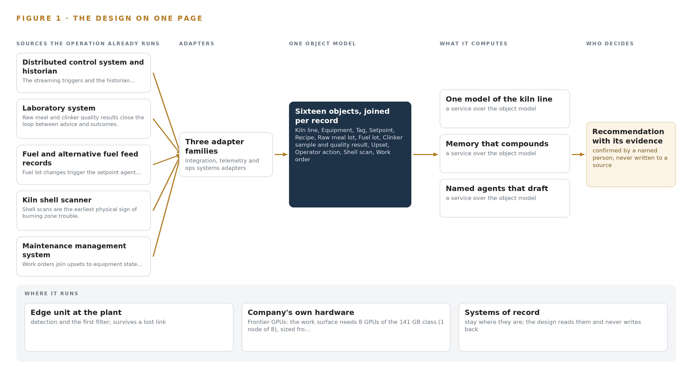
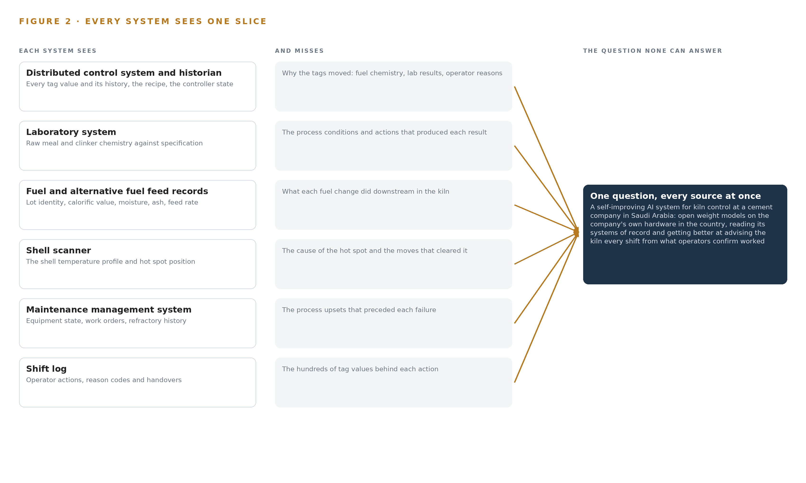
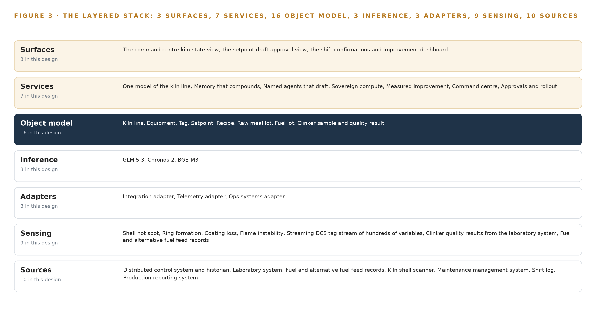
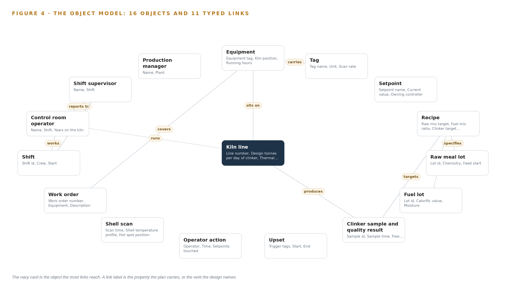
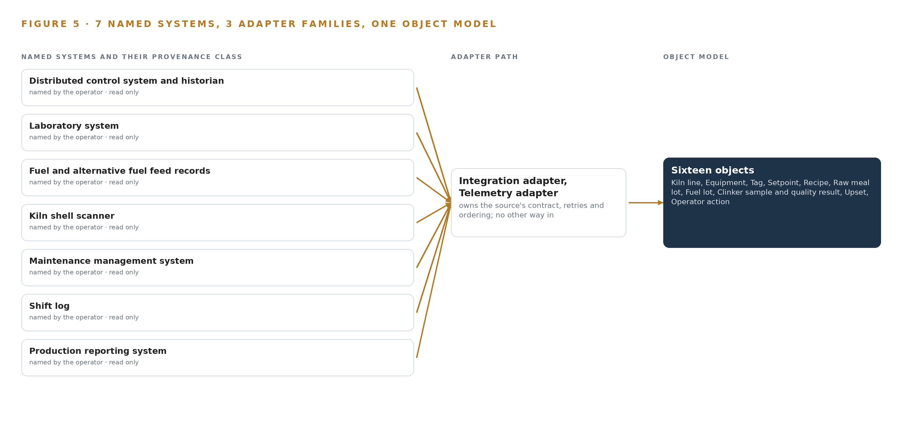
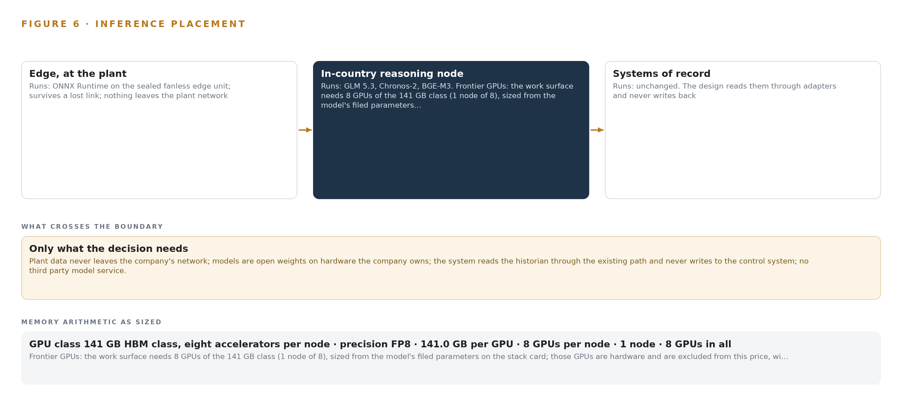
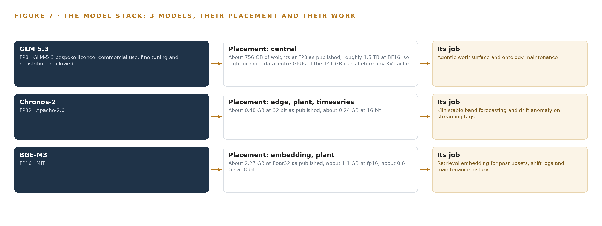
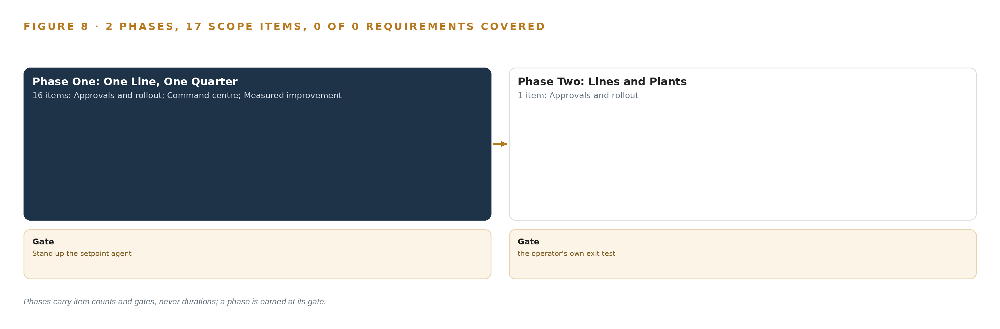
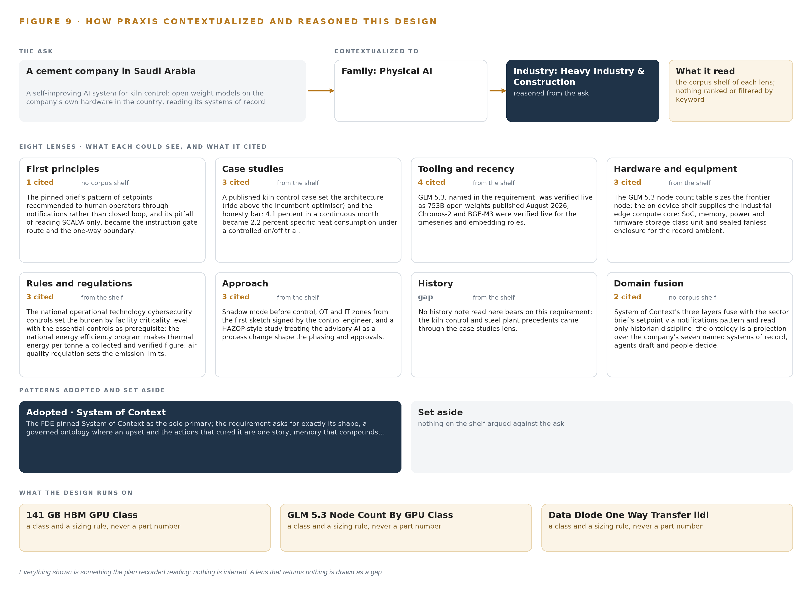

# A Self-Improving AI System for Cement Kiln Control in Saudi Arabia

Canonical: https://codeatoms.ai/cement-kiln-control-saudi-arabia/
PDF: https://codeatoms.ai/cement-kiln-control-saudi-arabia/paper/cement-kiln-control-saudi-arabia.pdf
License: CC BY 4.0
Publisher: CodeNinja Atoms (https://codeatoms.ai), a fully owned subsidiary of CodeNinja

VERTICAL-DRIVEN ARCHITECTURES · HEAVY INDUSTRY & CONSTRUCTION · DESIGNED WITH PRAXIS · NOVEMBER 2026

# A Self-Improving AI System for Cement Kiln Control in Saudi Arabia

Heavy Industry & Construction Watch: One Living Picture of the Operation

Muhammad Umar, Cofounder, CodeNinja

For the leaders accountable for heavy industry & construction operations, their supervisors, and the data and platform engineers who would build and run it.

---

Vertical-Driven Architectures is a CodeNinja series of system designs. Every design in the series is driven by a real-world problem and scenario in a single industry, and every one is designed on Praxis, CodeNinja's platform for designing physical AI systems. Operations are described by class, never by name.

At a glance

## A Self-Improving AI System for Cement Kiln Control in Saudi Arabia

**What this is.** An open reference architecture for system design in physical AI, built for a cement company in Saudi Arabia that runs several integrated plants, each with a preheater and precalciner kiln line of several thousand tonnes of clinker a day, where owning the inference node that runs it costs about 570,000 US dollars over three years. When a new alternative fuel lot drifts the burning zone over a shift, the design joins the streaming tags, the fuel lot, the raw meal, the laboratory results, the shell scan and the shift log into one argument, so the control room operator sees the likely cause, the recovery moves that worked in matching past upsets and the setpoint adjustments with their expected effect on thermal energy per tonne, and every confirmed outcome is kept as the memory the next shift reads. The models run entirely on the company's own hardware in the country under the national energy efficiency program's reporting, the environmental permit's emission limits, the national operational technology cybersecurity controls and the company's own management of change procedure. It is written for the leaders accountable for heavy industry and construction operations, their supervisors, and the data and platform engineers who would build and run it. The operator is described by class, never by name.

**The answer in numbers.**

| Part | The design |
| --- | --- |
| Sources | Seven read only systems of record, entering through three adapter families (integration, telemetry and ops systems) behind a one-way boundary that stamps every record with its provenance and receipt time: the distributed control system and its historian, the laboratory system, the fuel and alternative fuel feed records, the kiln shell scanner, the maintenance management system, the shift log and the production reporting system; the platform never writes to the control system |
| Object model | 16 typed objects, from the kiln line, equipment, tag and setpoint through the recipe, raw meal lot, fuel lot and clinker sample to the upset, operator action, shell scan, work order and shift, with the control room operator, shift supervisor and production manager, held as a projection over the systems of record and published as JSON for reuse |
| Models | GLM 5.3 (GLM-5.3 bespoke licence, 753B at FP8) for cause drafting, handover drafting, ontology maintenance and the command centre's cited answers; Chronos-2 (Apache-2.0) forecasting the stable band on the streaming tags to raise the drift trigger; BGE-M3 (MIT) embedding past upsets, shift logs and maintenance history in Arabic and English; no third party model service, nothing trained into weights |
| Compute | One node of eight 141 GB HBM accelerators (1,128 GB) in the company's own data centre in Saudi Arabia, holding 753 GB of FP8 weights with a 1.2 planning factor, 904 GB; a plant GPU server of one or two PCIe cards for the forecast and embedding models; a sealed fanless industrial edge unit at the plant. The node is a 4A090 class item for a D:3 and D:4 destination, so an export licence determination comes before the order, with two 80 GB class nodes as the fallback shape |
| Rollout | Two phases carrying 17 scope items (16 and 1) against 18 requirements, each closed by a gate, never a date: one kiln line at one plant for one quarter, whose gate stands the setpoint agent up with drafts flowing to a named approver and a controlled on and off comparison of thermal energy per tonne of clinker; then extension to further lines and plants on that evidence; the sector precedent that read 4.1 percent in a continuous month and 2.2 percent under a controlled comparison sets the honesty bar |
| Three-year cost | About 570,000 US dollars to own the frontier node for three years (a range of 542,000 to 594,000: server, support and power at the national commercial electricity tariff), against about 751,000 to rent the same eight cards on the deepest three year commitment in AWS Middle East (UAE), so ownership costs about three quarters of it, and about 2.00 million on demand, against which ownership costs a little over a quarter. Renting is a price reference only, because AWS lists no Saudi region on the day read and every rented option would carry plant data across the border (Appendix A) |
| Human control | Agents draft and people decide, by name: the control room operator confirms the upset agent's cause and recovery draft, the shift supervisor approves the setpoint agent's draft, and the production manager confirms the shift agent's handover and its energy and quality comparison; drafts run in shadow before anyone approves them, and every confirmation or rejection is kept as the memory the next shift reads |

**Reuse it.** The object model, the model register and the figures are free to reuse under CC BY 4.0. Cite as <https://codeatoms.ai/cement-kiln-control-saudi-arabia/.>

**Made with.** Reasoned on [CodeNinja Praxis](<https://codeatoms.ai/praxis/>), the CodeNinja Atoms platform for designing physical AI systems. The object model imports into [Hyper Ontology](<https://codeatoms.ai/hyper-ontology/>), which turns it into a living system. Load it with the [hyper-ontology loader](../hyper-ontology-py/): `hyper-ontology show cement-kiln-control-saudi-arabia`. Both are in beta; access by request.

ABSTRACT

## The Answer Already Exists in the Systems the Operation Runs

A self-improving AI system for kiln control at a cement company in Saudi Arabia: open weight models on the company's own hardware in the country, reading its systems of record and getting better at advising the kiln every shift from what operators confirm worked, on one governed ontology of the kiln line, its equipment, tags, setpoints, recipes, raw meal lots, fuel lots, clinker samples, upsets, operator actions, shell scans, work orders and shifts, each fact tied to its source system.

The design reads 10 source systems through 3 adapter families into one object model of 16 objects, runs 7 services over it and opens 3 surfaces to the people who decide, with 3 models placed where the data is. A sovereign, read-only advisory system for one kiln line: a governed ontology over the plant's seven systems of record, three named agents that draft causes, setpoints and handovers for people to confirm, and memory that compounds confirmed outcomes without ever changing weights. Phase one runs one line for one quarter against a measured baseline, gated on an on/off comparison in the units the national energy efficiency program itself collects.

The paper covers the operation and the problem its systems cannot answer, the constraints, the stack, the object model, ingestion, inference placement, the models and their licenses, the rollout and its proof, ownership, and finally how Praxis contextualized and reasoned the design.

---



Figure 1. Heavy Industry & Construction Watch on one page: the sources the operation already runs, one object model, what it computes, and the person who decides.

## Contents

Each chapter is tagged for the reader it serves most directly: Executive, Team Lead, FDE, Reference.

|  |  |  |
| --- | --- | --- |
|  | Abstract · The Answer Already Exists in the Systems the Operation Runs | Executive |
| PART I · THE PROBLEM | | |
| 1 | [A Daily Question Goes Unanswered in the Systems That Hold the Data](#ch1) | Executive |
| 2 | [Every System Sees One Slice of the Operation](#ch2) | ExecutiveTeam Lead |
| PART II · THE DESIGN | | |
| 3 | [Four Constraints Shape Everything Downstream](#ch3) | Team Lead |
| 4 | [One Stack Runs From the Systems of Record to the Surfaces](#ch4) | Team LeadFDE |
| 5 | [Sixteen Objects Turn Operational Data Into One Argument](#ch5) | FDE |
| 6 | [Every Source Enters Through an Adapter, Never Directly](#ch6) | FDE |
| 7 | [Inference Belongs Where the Data Is](#ch7) | FDE |
| 8 | [The License Decides What the Operator Can Own](#ch8) | FDEExecutive |
| PART III · THE ROLLOUT | | |
| 9 | [Shadow Mode Comes Before Any Flag Is Trusted](#ch9) | Team LeadExecutive |
| 10 | [The Intelligence Should Stay with the Operation That Produced It](#ch10) | Executive |
| PART IV · HOW IT WAS DESIGNED | | |
|  | Conclusion · The Pattern Repeats Wherever Systems of Record Do Not Meet | Executive |
| 11 | [How Praxis Contextualized and Reasoned This Design](#ch11) | Team LeadFDE |
|  | [Sources](#sources) | Reference |

PART I · CHAPTER 1

## A Daily Question Goes Unanswered in the Systems That Hold the Data

The operation holds every fact the question needs and no system answers it.

The abstract promised a self-improving AI system for kiln lines, sketched in one paragraph: a sovereign, read-only advisory system for one line, agents that draft for people to confirm, and memory that compounds without touching weights. A self-improving AI system earns its keep only if the question it serves is stated exactly and the ground it stands on is real, and that is this chapter's work.

### 1.1  The Question and the Regimes It Must Satisfy

The operation needs one question answered every shift: given the fuel lot now burning, the raw meal now feeding and the hundreds of variables now streaming from the line, which setpoint moves hold thermal energy per tonne of clinker low while clinker chemistry stays in specification, and when the line upsets, which moves bring it back soonest. The question carries a second half that matters as much, the why, with evidence a named person can check before acting. Answering it requires all seven systems of record at once: streaming tag values and historian context from the distributed control system, raw meal and clinker quality from the laboratory, calorific value and feed rate from the fuel records, shell temperature profiles from the scanner, equipment state from maintenance, actions and handovers from the shift log, and tonnes and energy from production reporting. Three regimes frame the answer. The national energy efficiency program collects and verifies thermal energy per tonne, so the figure the system is judged on is already measured by a third party. Operational technology cybersecurity controls set the control burden by facility criticality level, which fixes how anything may connect to the control network. Air quality regulation sets stationary source emission limits, so emission lineage must be traceable even though the permit reporting duty stays with the plant.

### 1.2  What Unrecorded Practice Costs

Heavy industry and construction pays for unrecorded practice in two currencies. The first is human: more than 1,000 construction workers have died on the job annually since 2016 (CPWR n.d.), a toll that disciplines every change made near operating equipment and every claim of automation. The second is energy and clinker. Fuel is the main cost at a plant of this class, thermal energy per tonne is the figure the company is measured on, and every shift runs the kiln differently: one operator holds the burning zone hot and burns fuel, another runs it cool and makes poor clinker, and when a quality excursion or a shell hot spot is found, the cause is rebuilt by hand across the historian, the lab and the fuel log. Regulators have begun to expect a change of this kind to be treated as a process change, with revised guidelines relating AI reliability assessment in plant safety to traditional methods such as HAZOP and FMEA (GO n.d.), and this design adopts that standard for its approvals path. The ask for a self-improving system is timely rather than fashionable, since recursive self-improvement has moved from frontier laboratories into the broader corporate ecosystem (Stanford 2026), and the design must deliver it in a form a plant can audit.

### 1.3  The Operation as a Scenario

The operator is a cement company in Saudi Arabia running several integrated plants. Each plant runs a preheater, a kiln line of several thousand tonnes of clinker a day and a cooler, watched from a control room where an operator tracks hundreds of variables shift by shift; a model predictive controller runs on some lines, and operators switch it off when a ring forms or the fuel changes. Three roles sit in the loop by name: the control room operator who moves setpoints, the shift supervisor who confirms drafts, and the production manager who owns the line's energy and quality figures. The plant's most experienced operator retires this year, and the knowledge of how he brought the kiln back from an upset is in nobody's notes. The physical environment is desert heat, with a record ambient of 52 C and dust that argues for sealed, fanless compute. The regulatory ground is the energy efficiency program's collected figure, the operational technology controls by facility criticality level, and the air quality limits with the industry's annex override. The counts behind the scenario: seven named systems of record, three named roles, several plants, and one line in phase one.

PART I · CHAPTER 2

## Every System Sees One Slice of the Operation

Each system of record sees its own part of the answer and none sees the whole.

Chapter 1 stated the question and the scenario that holds it. This chapter shows why no existing system can answer that question: each system of record sees one slice of the kiln, and the slices never meet in one place.

### 2.1  One Slice at a Time

The distributed control system and its historian see every tag value, the recipe and the controller state, but not why the tags moved, because fuel chemistry, laboratory findings and operator reasons live elsewhere. The laboratory system sees raw meal and clinker chemistry against specification, but not the process conditions that produced each result. The fuel and alternative fuel feed records see lot identity, calorific value, moisture, ash and feed rate, but not what each fuel change did downstream in the kiln. The shell scanner sees the shell temperature profile and the position of a hot spot, the earliest physical sign of burning zone trouble, but not the cause or the moves that cleared it. The maintenance management system sees equipment state, work orders and refractory history, but not the process upsets that preceded each failure. The shift log sees operator actions, reason codes and handovers, the human half of every upset story, but not the hundreds of tag values behind each action. The production reporting system sees clinker tonnes and energy against plan, but not the decisions and conditions behind each figure. Figure 2 sets these seven slices side by side, and the pattern is the same in each row: the slice is faithful, complete in its own terms, and silent about everything the question joins it to.



Figure 2. Seven systems, each seeing one part of the answer. The question needs all of them in one place at once.

### 2.2  What No System Sees Together

What none of them see together is an upset and its cure as one story: the trigger tags, the fuel lot burning at the time, the raw meal feeding, the operator's moves in order, the lab findings that followed, the shell scan that confirmed recovery, and the time and fuel it cost. That join failure is paid every time a quality excursion or hot spot is found and the cause is rebuilt by hand across three systems, and it is paid once more when the retiring operator leaves, because the recovery moves that worked live in his judgment and in no record any successor can read. The model predictive controller compounds the loss rather than repairing it, since operators switch it off precisely when the kiln misbehaves, so the hardest episodes, the ones worth learning from, are the ones no system captures. The data for the daily question is all present; the argument that joins it is not.

PART II · CHAPTER 3

## Four Constraints Shape Everything Downstream

The goals, the scoping decisions and the exclusions were fixed before any component was chosen.

Chapter 2 showed that the failure is a join failure, not a data failure, so the fix is an argument built across systems rather than another copy of them. Before any component was chosen, four goals were fixed, and every choice downstream had to satisfy all four at once; this chapter states them and the scoping they forced.

### 3.1  Sovereignty Is a Sizing Problem

The first goal is ownership: open weight models on the company's own hardware, in the country, with nothing about the plants leaving it. In this industry that is hard because the frontier model in the design needs a node of eight accelerators of the 141 GB class, and the export license position for that class into the country is not yet confirmed, with two nodes of the 80 GB class as the fallback shape. Sovereignty also collides with the operational technology controls, which set the connection burden by facility criticality level, so the boundary design has to be settled with the security function before design freeze rather than after.

### 3.2  The Human Loop Is the Control Design

The second goal is that people decide: the system reads the systems of record and never writes to the control system, and operators and supervisors make every setpoint change. This is hard because the plant's own history shows what happens to advisory layers operators do not trust, as the model predictive controller is switched off whenever the kiln misbehaves. The design answers with draft quality gates, explicit operator authority recorded against each draft, and a one-way boundary between the analytics zone and the control network. Guidance on safety management for autonomous equipment on industrial sites points the same way (ISSA 2026), and the approvals path treats the advisory system as a process change under hazard-study methods (GO n.d.).

### 3.3  Improvement Without Touching the Weights

The third goal is a [self-improving AI system](https://codeatoms.ai/self-improving-ai-system/) in a form a plant can audit. Frontier laboratories delegate a growing share of AI development to AI systems themselves (Anthropic n.d.), but a kiln cannot risk weights that drift shift by shift, and the requirement forbids training on the fly. The design therefore improves through memory alone: every confirmed outcome, the upset, the moves and the measured recovery, is kept and read before the next draft, while the model weights never change. What compounds is the record, not the parameters.

### 3.4  Proof Before Trust

The fourth goal is measured improvement, gated. The precedent that sets the honesty bar is the kiln control build whose continuous-month saving of 4.1 percent became 2.2 percent under a controlled on/off comparison, so phase one runs one line for one quarter against a measured baseline and gates on the on/off comparison alone, in the units the national energy efficiency program itself collects.

### 3.5  Scoping Decisions

Three scoping decisions follow from the four goals, and Table 1 records what each buys and what it costs.

Table 1 · Scoping Decisions

| Decision | What it buys | What it costs |
| --- | --- | --- |
| Run one kiln line for one quarter first | A clean baseline and an honest on/off gate in collected units | Findings from one line reach the other plants slowly |
| Bind the seven systems read-only | Safety sign-off and no risk to the control path | No closed-loop savings; every benefit must pass through a person |
| Improve through confirmed memory, not weights | An auditable record of what worked and who confirmed it | Improvement is bounded by what operators actually confirm |

### 3.6  What the Design Chose Against

Table 2 records the alternatives the design rejected and why, and it closes with the scope boundary. The ontology decision deserves a word, because the projection discipline is what separates this design from the document stores that pass for industrial ontology examples in most plants: the ontology is a governed projection over the seven systems of record, never a shadow copy, so a query can walk from an upset to the fuel lot, the operator actions and the lab findings without any of them being duplicated.

Table 2 · What the Design Chose Against

| Where | What was picked | Instead of, and why |
| --- | --- | --- |
| Control architecture | Advisory agents riding above the incumbent model predictive controller | Replacing or re-tuning it; the precedent rode above the incumbent optimizer so one control path survived and operators kept authority |
| Data foundation | A governed ontology projected over the seven systems of record | A shadow data lake; copies drift, and no document store joins an upset to the moves that cured it |
| Improvement mechanism | Memory of confirmed outcomes, read before each draft | Fine tuning on the fly; the requirement forbids it and a plant cannot audit drifting weights |
| Compute | One node of eight 141 GB class accelerators on the company's own hardware | A third party model service; nothing about the plants may leave the country |
| Scope boundary | Closed-loop writes excluded | Autonomy inside the control system; operators and supervisors make every change, and the permit reporting duty stays with the plant |

PART II · CHAPTER 4

## One Stack Runs From the Systems of Record to the Surfaces

Systems of record below, one object model in the middle, services and surfaces above.

A self-improving AI system for kiln lines usually fails at the join between the control system and everything else the plant knows, not at the model, and Chapter 3 fixed the four constraints any answer must survive: read-only systems of record, weights that never change, named people who decide, and nothing leaving the country. This chapter lays out the stack that satisfies all four at once, running from the sources to the surfaces the control room actually sees.

### 4.1  The Pattern and Why It Fits

The architecture is three layers in a fixed order: the systems of record below, never replaced, never modified, never bulk loaded; one object model in the middle, owned by the company and held as a projection over those systems rather than a copy of them; and the applications and agents above, which draft causes, setpoints and handovers for people to confirm. The order matters because the distributed control system stays authoritative for control and its historian stays authoritative for history, so the object model only has to join what each already holds, and every capability traces to a clause the company asked for. Because the advisory layer changes how the control room works, the stack is treated as a process change and assessed with the plant's own hazard-study methods, the way revised plant-safety guidance expects AI reliability to be weighed against methods such as HAZOP (GO n.d.). Figure 3 shows the layers with their counts: seven systems of record feeding three adapter families, one object model of sixteen objects, seven services and three surfaces, with three models doing the inference.



Figure 3. The layered stack: 10 sources, 3 adapter families, 16 objects, 7 services and 3 surfaces.

### 4.2  The Stack Stage by Stage

Table 3 walks the stack from the sources to the surfaces, naming the component responsible at each stage and what it does with the data.

Table 3 · The Stack, Stage by Stage

| Stage | What it is responsible for | How |
| --- | --- | --- |
| Sources | Hold the plant's truth: the distributed control system and historian, the laboratory system, the fuel and alternative fuel feed records, the shell scanner, the maintenance management system, the shift log, the production reporting system | Read only; nothing is replaced, modified or bulk loaded |
| Sensing | The streams the design reads: hundreds of DCS variables, clinker quality values, fuel feed records, shell temperature profiles, shift log entries, production figures | Existing instrumentation only; no new field devices are supplied |
| Adapters | Three families: the integration adapter, the telemetry adapter, the ops systems adapter | Each owns one source contract: validate, time-stamp, buffer, stamp provenance |
| Object model | Hyper Ontology v0.9 over TimescaleDB | Sixteen objects with typed links; a projection over the sources, not a copy of them |
| Inference | GLM 5.3 at FP8 on one node of eight 141 GB accelerators; Chronos-2 and BGE-M3 on the plant GPU server under ONNX Runtime and vLLM | 753 GB of weights, 904 GB with the 1.2 planning factor, against 1,128 GB of memory; weights never change |
| Services | Seven: one model of the kiln line, memory that compounds, named agents that draft, sovereign compute, measured improvement, command center, approvals and rollout | Each reads the object model and the decision record, and drafts for a named person |
| Surfaces | Three: the command center kiln state view, the setpoint draft approval view, the shift confirmations and improvement dashboard | Every screen names the person who confirms |

### 4.3  A Reusable Pattern

A team carrying a similar brief can reuse the whole shape: read-only adapters over the systems of record, one governed object model that joins them, agents that draft and never write, and memory that compounds confirmations without touching a single weight. They would swap the objects and the sources for their own, the way this design anchors the kiln line in the historian and equipment in the maintenance system, and keep three things unchanged: the one-way boundary into the control network, the named person confirmation as the single write path, and an on/off comparison as the first gate. The self-improvement here is deliberately narrow, memory of what operators confirmed rather than the recursive self-improvement frontier labs now run as an active priority (Anthropic n.d.; Stanford 2026), because a kiln cannot afford a model that changes its own behavior between shifts.

Table 7 · Architecture, Layer by Layer

| Layer | Component | Choice | Why |
| --- | --- | --- | --- |
| Event streaming and messaging | by class, no product named | Product | Apache Kafka 4.3 (KRaft) |
| The ontology or graph store | by class, no product named | Product | Hyper Ontology v0.9 (Semantics plus Kinetics) |
| Time series and telemetry storage | by class, no product named | Product | TimescaleDB |
| Video ingest, recording and management | by class, no product named | Not needed | No IP video is installed; the shell scanner's thermal line scans and any burning zone camera arrive as existing plant records through the historian path. |
| Edge model serving | by class, no product named | Product | ONNX Runtime |
| On site language model serving | by class, no product named | Product | VLLM |
| Object tracking and trajectory forecasting | by class, no product named | Not needed | No camera tracking exists; burning zone drift forecasting is the timeseries register role. |
| Edge orchestration of containers | by class, no product named | Product | K3s |
| An air gapped artifact and model registry | by class, no product named | Product | Harbor (offline registry) |
| Labelling and retraining | by class, no product named | Not needed | Weights never change: improvement comes from the memory of confirmed outcomes, per the requirement and the intake answer. |
| Time synchronisation across sensors and systems | by class, no product named | Product | Chrony |
| Observability of the running system | by class, no product named | Product | Prometheus 3.13 LTS with Grafana and Loki |

PART II · CHAPTER 5

## Sixteen Objects Turn Operational Data Into One Argument

The object model is the join the systems never made.

Chapter 4 placed the object model at the center of the stack and made it the one thing the services read; this chapter opens that model up and shows the join it makes. The plant has never had this join: the historian, the laboratory system and the fuel records each hold a slice of every upset, and reconstructing one story from them is hand work.

### 5.1  Sixteen Objects and the Links Between Them

The model holds sixteen objects: kiln line, equipment, tag, setpoint, recipe, raw meal lot, fuel lot, clinker sample and quality result, upset, operator action, shell scan, work order, shift, control room operator, shift supervisor and production manager. What makes them an argument rather than a list is the typed links: a fuel lot links to the recipe that blends it and to every upset that began during its feed, an operator action links to the setpoints it touched and to the draft it answered, and a work order links to the equipment it covers and the upsets it was raised from. Figure 4 shows all sixteen objects and their links, with the upset in navy as the focal object. A query can now walk a path no single system holds: ask for every upset that began during a fuel lot change and was followed by a clinker sample back in specification, and the model traverses upset to fuel lot to operator action to sample in one step, where a document store would need the question known in advance and the join written by hand. In published industrial ontology examples this crossing of mappings is the hard part, and it is the product here; Table 8, printed by the platform, lists every object with the system of record it is anchored in and its typed links.



Figure 4. The sixteen objects of the model and the typed links that let a query reach across them.

Table 8 · The Object Model

| Object | Anchored in | Typed links |
| --- | --- | --- |
| Kiln line | The distributed control system and its historian | produces: Clinker sample and quality result |
| Equipment | The maintenance management system | carries: Tag; sits on: Kiln line |
| Tag | The distributed control system and its historian | no typed link recorded |
| Setpoint | The distributed control system and its historian | no typed link recorded |
| Recipe | The distributed control system and its historian | specifies: Raw meal lot; blends: Fuel lot; targets: Clinker sample and quality result |
| Raw meal lot | The laboratory system for raw meal and clinker quality | no typed link recorded |
| Fuel lot | The fuel and alternative fuel feed records | no typed link recorded |
| Clinker sample and quality result | The laboratory system for raw meal and clinker quality | no typed link recorded |
| Upset | The object model itself | no typed link recorded |
| Operator action | The shift log | no typed link recorded |
| Shell scan | The kiln shell scanner | no typed link recorded |
| Work order | The maintenance management system | covers: Equipment |

### 5.2  The Human Loop and the Hosting Posture

The human loop lives in the status vocabularies. Every object that carries a decision carries a vocabulary a person moves: an upset walks from open through cause drafted and cause confirmed to recovered and closed, a setpoint records who approved it, and an operator action records the draft it was for or against. Twelve of the sixteen objects are anchored in a named system of record; the upset and the three people are anchored in the model itself, because no system of record holds an upset whole or holds a person at all. The hosting posture closes the rest: everything runs in the country on the company's own hardware, identity is Keycloak, there are no external links, the one crossing toward the control network is the Lidi with Eurydice one-way transfer, and the single write path into the object model is a named person confirming, rejecting or annotating a draft.

### 5.3  One Object in Its Recorded Form

The kiln line record below shows the identifier and label, the kind, the properties, the status vocabulary and the typed links the platform prints for every object; the upset, the object the whole argument turns on, is recorded the same way, with its trigger tags and times, the confirmed cause and recovery moves, and the status vocabulary a person walks it through.

```
{ "id": "kiln-line", "label": "Kiln line", "kind": "site", "anchored_in": "The distributed control system and its historian", "properties": [ "Line number", "Design tonnes per day of clinker", "Thermal energy per tonne", "Stable band definition" ], "status_vocabulary": [], "links": [ { "to": "clinker-sample", "label": "produces" } ] }
```

PART II · CHAPTER 6

## Every Source Enters Through an Adapter, Never Directly

Nothing reaches the object model except through an adapter that owns its contract.

Chapter 5 showed what the object model holds once data is inside it; this chapter shows how data gets there, and why nothing can arrive by any route the design does not own. The rule is absolute: every source enters through an adapter, never directly, because an unowned path into the model is a path nobody can validate, time-stamp or replay.

### 6.1  Every Named Source and Its Provenance

Seven named systems feed the model, all of one provenance class: systems the company already owns and runs, read in one direction only. The distributed control system and historian supply the streaming triggers and the historian context; the laboratory system closes the loop between advice and clinker quality; the fuel and alternative fuel feed records carry the calorific value behind every drift and trigger the setpoint agent when a lot changes; the shell scanner gives the earliest physical sign of burning zone trouble; the maintenance management system joins upsets to equipment state and refractory history; the shift log holds the operator actions and handovers that are the human half of every upset story; and the production reporting system holds the clinker tonnes and energy figures that form both the baseline and the gate. Figure 5 maps each source to its adapter path and its provenance class.



Figure 5. The 10 named systems, the adapter path each one takes, and the object model they all map into.

### 6.2  What the Adapter Tier Guarantees

Three adapter families cover the seven sources: the integration adapter for the operational systems, the telemetry adapter for the streaming tag flow, and the ops systems adapter for logs, work orders and reports. The tier guarantees five things. Each adapter owns its source contract, so a schema change at the source surfaces as a contract failure rather than silent corruption; each validates every record against that contract before it passes; each stamps provenance and receipt time and aligns both to the plant time source through Chrony, because a join between the historian and the laboratory system is only as good as their shared clock; each buffers when a source is slow or briefly absent and backfills on return; and every adapter is read only, with no path existing from the tier back into any source.

### 6.3  The Event Backbone

The backbone is Apache Kafka 4.3 with KRaft, the Raft-based controller that removes the older coordination service. Ordering holds per key: tag streams are partitioned by tag name, so the sequence of any one variable is never reordered even when the whole plant is flowing through at once. Delivery is at least once, made effectively once by idempotent writes keyed on each source's sequence numbers, so a replay after a fault cannot double-apply an operator action or a lab value. Buffering sits at two levels: the adapter buffers against a slow source, and the plant side of the boundary buffers when the link into the analytics zone fails, with the backbone resynchronizing on restore. Replication runs inside the plant cluster, so the loss of a broker does not lose a shift. The one crossing of the control boundary is the Lidi with Eurydice one-way transfer, which fails closed: when the link, the power or the update path fails, the diode stops, the adapters buffer, the agents pause their drafts, and the kiln's control path is untouched.

PART II · CHAPTER 7

## Inference Belongs Where the Data Is

Each tier runs what its data and its link can carry.

Chapter 6 described how the plant's systems of record enter through three adapter families, never directly, and how the event backbone orders and buffers what they emit. This chapter fixes where each model runs, what each tier can carry, and what happens when the connections between those places break.

### 7.1  Three Tiers Hold Three Different Jobs

The frontier tier runs GLM 5.3 on one node of eight accelerators of the 141 GB class, and the memory arithmetic is the whole argument for that shape. The model has 753 billion parameters filed, and at FP8 precision, one byte per parameter, its weights occupy 753 GB. Multiplying by the 1.2 planning factor, which reserves room for the KV cache and activations, gives 904 GB the GPUs must hold. One node of eight 141 GB accelerators offers 1,128 GB of usable memory, which leaves 375 GB beside the weights, more than twice the 151 GB the planning factor reserves, so the KV cache ceiling clears with margin and the work surface never needs a second node. This tier carries the reasoning work: drafting causes from an upset's assembled story, drafting shift handovers, maintaining the ontology, and answering the control room's questions with citations.

The plant tier runs on the plant GPU server, on one or two PCIe cards and no high bandwidth memory node. Chronos-2, about 0.24 GB at 16-bit precision, forecasts the stable band on the streaming tags and its residuals are thresholded to raise the drift trigger. BGE-M3, about 1.1 GB at FP16, embeds past upsets, shift logs and maintenance history so the reasoning tier can retrieve them. Both models fit on a single card with room to spare, which is why the design buys no additional frontier hardware for them. This tier is where the stream meets a model: the telemetry adapter feeds the tag stream of hundreds of variables into the event backbone, and the timeseries model watches it continuously.

The edge tier is the industrial octa-core SoC edge unit with a 6 TOPS NPU in a sealed fanless enclosure, served by ONNX Runtime. It holds roughly 33 degrees C of margin at the 52 C record ambient before solar gain, and it sits closest to the data. Figure 6 sets the three tiers side by side, with what runs on each and what crosses between them.



Figure 6. Where each tier runs, what runs there, and the narrow set of outputs that cross the boundary.

### 7.2  The Latency Budget Follows the Physics

Each agent's deadline is set by the cadence of the physical process it serves, not by a service level anyone chose. The drift anomaly must land inside the scan rate of the tag stream it watches, because a warning that arrives after the next scan is a history entry rather than advice. The setpoint agent's drafts after a fuel lot change must arrive while that lot is still feeding the burner, or they describe a lot that has already been burned through. The handover draft has the end of the shift as its deadline, and the improvement figures behind it close when the laboratory data lands.

Cause drafting is the one job with no tight deadline, because an upset's story is assembled across hours of historian, laboratory and fuel data, and depth of reasoning matters more than speed there. That is frontier tier work by choice rather than necessity. The design's rule is simple: anything with a physical deadline runs on the plant tier beside the stream, and only drafts, citations and questions travel to the frontier node.

### 7.3  The Boundary and What Fails Through It

Reads flow one way from the systems of record into the analytic zone, and the control network boundary is enforced by the Lidi with Eurydice one-way transfer stack, a data diode that carries plant data out for analysis and makes a return path physically absent rather than merely blocked. No model output crosses into the control system in any direction, because the single write path in the whole design is a human confirming a draft, and nothing about the plants leaves the country: every weight runs on the company's own hardware inside it.

When the link between tiers fails, the event backbone buffers and the historian backfills on reconnect, while the surfaces mark every standing draft as stale with the time it was computed at, so a control room operator never mistakes a prediction frozen mid-shift for a live one. When power fails, the sealed edge unit restarts, resynchronizes against the plant's time sources under Chrony with the offsets recorded, and reconstructs the stream from the historian rather than from its own memory. When the update path fails, the Harbor offline registry keeps the running versions in place: containers and models are staged, signed and verified on site, and if a staged update cannot be verified, the previous version keeps serving while the mismatch is surfaced to the platform engineers rather than left to diverge silently.

PART II · CHAPTER 8

## The License Decides What the Operator Can Own

Every model was chosen against its license before its accuracy.

Chapter 7 placed each tier and showed the memory arithmetic that sizes it. This chapter turns to the models themselves and to the legal instrument that decides more than any benchmark: the license under which each weight runs.



Figure 7. The three models, their placement, and the work each one does.

### 8.1  Each Model Was Chosen Against Its License

Figure 7 shows the model stack as three cards: GLM 5.3 at the frontier tier, Chronos-2 and BGE-M3 at the plant tier, with the equipment classes beneath them. GLM 5.3, named in the company's own requirement, is a mixture of experts language model with 753 billion parameters filed and published as open weights. At FP8 its weights occupy about 756 GB, roughly 1.5 TB at BF16, which is why it needs eight accelerators of the 141 GB class before any KV cache is counted. It runs on the frontier node in the country and carries two jobs: the agentic work surface, where the control room's people build and run their agents against the ontology, and ontology maintenance, where the governed model of the kiln line stays aligned with the systems of record beneath it.

Its license is the GLM-5.3 bespoke license, whose terms allow commercial use, fine tuning and redistribution. Two consequences follow. The company can hold the weights on its own hardware without a service relationship it cannot exit, and the license's model as a service trigger stays inapplicable because every inference is internal advisory use inside the company's boundary. Recursive self-improvement is an active priority at frontier AI companies and is beginning to diffuse into the broader corporate ecosystem (Stanford 2026); this design declines that road in the one place its license would permit it. The weights never change, and improvement compounds in the memory of confirmed outcomes, which is retrieval rather than training.

Chronos-2 is the timeseries model, about 0.48 GB at 32-bit precision and about 0.24 GB at 16-bit, small enough to sit beside the embedding model on a single PCIe card in the plant GPU server. It performs zero-shot multivariate forecasting with covariates: it forecasts the stable band on the streaming tags, and its residuals are thresholded to raise the drift trigger. Its Apache-2.0 terms impose nothing on the company beyond attribution, and with no fine tuning in the plan the model can be held, moved and rerun inside the plant for as long as the plant wants it.

BGE-M3 is the retrieval embedding model, about 2.27 GB at float32, about 1.1 GB at FP16 and about 0.6 GB at 8-bit; the design serves it at FP16. It performs multilingual dense, sparse and multi-vector retrieval in one pass, which is what keeps Arabic and English shift logs and part numbers from the maintenance system retrievable in the same query. Its MIT license sits at the permissive end of the register, so the company holds it outright.

### 8.2  The Register Behind the Choices

Table 4 gathers what each choice rests on: the three models, the hardware classes and sizing rules that place them, the sensing they consume, the pattern the design stands on, and the ground everything runs on. Read down the third column and the argument of the whole paper appears, because every row answers to a constraint the company set before any model was named: weights held, decisions human, nothing crossing the country's boundary.

Table 4 · Model and Equipment Register

| The choice | What was picked | Why here |
| --- | --- | --- |
| Frontier model | GLM 5.3, 753 billion parameters filed, FP8 | Named in the requirement; the license allows commercial use, fine tuning and redistribution, so the company holds the weights |
| Timeseries model | Chronos-2, about 0.24 GB at 16-bit | Zero-shot multivariate forecasting with covariates on the streaming tags; Apache-2.0 with no fine tuning in the plan |
| Embedding model | BGE-M3, about 1.1 GB at FP16 | One pass retrieves dense, sparse and multi-vector across Arabic and English logs; MIT license |
| Frontier hardware class | 141 GB HBM GPU class, eight accelerators per node | 753 GB of weights at FP8 plus the 1.2 planning factor fits one node of 1,128 GB |
| Sizing rule | GLM 5.3 node count by GPU class | Sizes the frontier node from the filed parameter count before any hardware order |
| Boundary equipment | Lidi with Eurydice one-way transfer stack | Reads leave the control zone for analysis; no return path exists to block |
| Edge compute class | Industrial octa-core SoC edge unit, 6 TOPS NPU, sealed fanless enclosure | Holds roughly 33 C of margin at the 52 C record ambient before solar gain |
| Sensing | Streaming DCS tag stream of hundreds of variables, clinker quality data, fuel and alternative fuel feed records, the shell scan profile, shift log and production figures | The physical AI register the tiers consume, read as it exists |
| Pattern | System of context, primary | Systems of record below, the ontology as a projection over them, agents that draft and people who decide |
| Ground | The company's own hardware, in the country | Nothing about the plants leaves the country and no third party model service is used |

PART III · CHAPTER 9

## Shadow Mode Comes Before Any Flag Is Trusted

The rollout earns each phase at a gate the company can read.

Chapter 8 settled which weights the company may hold and on what terms, from the work-surface model down to the embedding model. This chapter sets out how the system earns its way onto one kiln line and then across the estate, and how anyone evaluating a self-improving AI system for kiln lines can check the claim in units the national energy efficiency program already collects.

### 9.1  Phases, Item Counts and Gates

The rollout has two phases and eighteen requirements, and every phase carries its item count, its workstreams and a gate the company can read before committing the next tranche of work. Phase One runs on one kiln line and carries sixteen items across six workstreams: One model of the kiln line, Named agents that draft, Memory that compounds, Command center, Measured improvement, and Approvals and rollout. Its opening items build the governed kiln line ontology, bind the seven systems of record read-only, and enforce the one-way control boundary; its gate stands the setpoint agent up, with drafts flowing to a named approver and an on/off comparison read in the units the national energy efficiency program itself collects. Phase Two carries a single item under the Approvals and rollout workstream, extending the system to further kiln lines and plants, and it is entered only on the phase-one evidence, with its gate set with the production manager before a second line is touched. Figure 8 sets the phases, their item counts, their gates and the requirement coverage side by side. The approvals workstream treats the advisory system as a process change and studies it the way plant risk practice studies any other change, following plant safety guidance that now extends the reliability assessment of AI to established methods such as HAZOP and FMEA (GO n.d.). Each of the eighteen requirements traces to a workstream item, so coverage is read item by item at each gate rather than asserted at the end.



Figure 8. The two phases and their gates, and coverage of the 18 requirements across them.

### 9.2  What the Rollout Measures

One number carries the gate: thermal energy per tonne of clinker, drawn from the production reporting system, compared between periods with the drafts on and periods with the drafts off, on the same line. The honesty bar comes from the sector's own precedent, in which a continuous month that read 4.1 percent fell to 2.2 percent specific heat consumption once the same line ran a controlled on/off comparison, so the headline month is never the gate. Around that number the rollout measures acceptance from the first weeks: how many drafts each control room operator confirms, edits or rejects; how many upsets move from open to cause confirmed; time to recover, set against comparable upsets already held in memory; and free lime held inside its specification band while the energy number moves. Together these show whether the memory is compounding or merely recording, and they are the figures the improvement surface puts in front of the shift supervisor.

### 9.3  Failure Modes

Table 5 states what the design expects to fail and what it does about each failure.

Table 5 · Failure Modes

| What fails | What the design does |
| --- | --- |
| Operators switch the advisory off as they switch the model predictive controller off today | Draft quality gate before anything reaches the control room, explicit operator authority over every setpoint, and acceptance measured from the first weeks |
| The retiring operator's recovery knowledge leaves before it is captured | Elicitation sessions scheduled in the opening weeks of Phase One, ahead of the retirement date, feeding the upset and recovery record |
| Headline savings flatter the model | The gate reads the controlled on/off comparison only, never a continuous run |
| The facility criticality level under the national OT cybersecurity control is unknown | The level is confirmed with the OT security function before design freeze, so the control burden is set early |
| The export license position for the 141 GB class node is unconfirmed | License determination before order, with two 80 GB class nodes as the fallback shape |
| The DCS tag namespace and the maintenance equipment hierarchy disagree | One master asset register is picked early and the other mapped to it |

### 9.4  Lessons

**Shadow the drafts before anyone approves them.** The incumbent controller lost the control room because it argued from a model the operators could not question, and both crews switched it off when the kiln misbehaved. The advisory route inverts that: drafts run first in shadow, every draft names its cause and its expected effect, and the operator's confirmation or rejection is itself the recorded outcome the memory compounds on. Trust is measured, not assumed.

**Gate on the on/off comparison, not the headline month.** The sector precedent is the instruction: a continuous month read 4.1 percent where the controlled comparison on the same line read 2.2. Any figure quoted without the on/off discipline is a forecast wearing the clothes of a measurement, and the phase-one gate refuses to read it.

**Capture the retiring operator before the retirement date.** The knowledge of how the most experienced operator brought the kiln back from an upset lives in nobody's notes, and it leaves with him. Elicitation sessions sit in the opening weeks of Phase One, and the elicited recoveries seed the upset objects the agents retrieve against.

### 9.5  What Is Still Open

Three questions settle before design freeze, and each one moves the design. The export license position for the 141 GB class node: settling it either confirms one node of eight accelerators or reshapes the footprint onto two 80 GB class nodes, changing the memory arithmetic with it. The facility criticality level under the national OT cybersecurity control: settling it sets the control burden and the boundary engineering, and it is the OT security function's call, not the design's. The master asset register: settling whether the DCS tag namespace or the maintenance equipment hierarchy is master decides how the ontology joins tags to equipment, which is the join the whole argument rests on. A fourth question is the phase-two gate itself: settling what evidence extends the system to further lines and plants decides how the single-line proof is read.

PART III · CHAPTER 10

## The Intelligence Should Stay with the Operation That Produced It

What the design builds belongs to the company.

Chapter 9 ended on the questions the gate leaves open. This chapter states who owns what the gate protects, which is the question the requirement asked first.

### 10.1  What the Operator Owns

The object model is a projection over the company's seven systems of record, never a shadow copy of them: every object, property and typed link describes this company's lines, equipment, fuel lots and people, and the governed model stays inside the company. It is not one of the industrial ontology examples a vendor ships ready made; it is built from the company's own records and changes only through the governed path. The weights are held under licenses that permit the company to keep them: the work-surface model runs under a license allowing commercial use, fine tuning and redistribution, and because the design never fine tunes, the weights the company holds are the weights it audited, while the forecasting and embedding models run under Apache-2.0 and MIT. The decision record, every draft, confirmation, rejection and operator action with the person who decided, belongs to the company, and so does the memory that compounds from it. Public discussion of self-improvement centers on AI development delegated to AI systems (Anthropic n.d.) and on that practice diffusing into the wider corporate ecosystem (Stanford 2026); this design compounds instead through a kept record the company can read, audit and export. The boundary is the company's control as well: the one-way transfer, the in-country hosting on the company's own hardware, and the OT policy decision retained by the company's security function.

### 10.2  The Offer Behind the Design

CodeNinja designed this system on Praxis, its platform for designing physical AI systems, and each element of the design maps to a named part of its offer. The sensing, detection and forecasting of physical behavior, from the shell hot spot and ring formation detections to the drift forecasting on the streaming tag register, is Adaptive Operations. The governed object model over the seven systems of record is Hyper Ontology. The command center, where the company's people build their own agents on models they can change without losing what was built, is Hyper Pragma. The kept record of decisions and outcomes that the next decision reads, which never updates model weights, is Hyper Engram. The own hardware, the open-weight licenses and the in-country operation are Sovereign Infrastructure.

PART IV · CONCLUSION

## The Pattern Repeats Wherever Systems of Record Do Not Meet

Seen whole, the design is one object model over the systems a cement company in Saudi Arabia already runs, with inference placed where the data is and every decision left to a named person.

Running the same shape elsewhere takes the same four things: the named systems, an object model anchored in them, a first gate that can stop the work cheaply, and the license posture that lets the company own what it learns.

PART IV · CHAPTER 11

## How Praxis Contextualized and Reasoned This Design

Every choice above traces back to something Praxis recorded reading.

Chapter 10 closed the ownership argument: the object model, the weights, the decision record and the boundary all stay with the company. This chapter opens the design record itself, so the reader can audit how each choice was made. Every design in this series is produced on Praxis, and this chapter lets a reader trace any choice above back to the recorded reading that justified it. Figure 9 shows that path end to end: the ask, the family and industry assigned, what it read, the eight lenses, the patterns adopted, and the equipment classes the reasoning landed on.

### 11.1  Contextualizing the Ask

The ask arrived as a requirement written in the company's voice: a self-improving AI system for cement kiln control, owned by the company, open weight models on its own hardware in the country, reading its systems of record, improving every shift from what operators confirm, without training a model on the fly and with nothing about the plants leaving the country. Praxis assigned the family Physical AI and the industry Heavy Industry and Construction; the family was selected by the FDE on the project as a pin rather than a reasoned match, and the brief was still read as reasoning input. Praxis read the case study, tooling, hardware, regulation, approach and history shelves the lenses drew on.



Figure 9. From the ask to the design: the family and industry Praxis assigned, the eight lenses and what each cited, the patterns adopted and set aside, and the equipment the design lands on.

### 11.2  The Lenses

Table 6 states what each lens could see, how many records it cited, and what it contributed to the design.

Table 6 · The Lenses and What They Contributed

| Lens | Could see | Cited | What it contributed |
| --- | --- | --- | --- |
| First principles | no corpus shelf | 1 | The pinned brief's pattern of setpoints recommended to human operators through notifications rather than closed loop, and its pitfall of reading SCADA only, became the instruction gate route and the one-way boundary. |
| Case studies | the case study shelf | 3 | A published kiln control case set the architecture (ride above the incumbent optimiser) and the honesty bar: 4.1 percent in a continuous month became 2.2 percent specific heat consumption under a controlled on/off trial. |
| Tooling and recency | the tooling and recency shelf | 4 | GLM 5.3, named in the requirement, was verified live as 753B open weights published August 2026; Chronos-2 and BGE-M3 were verified live for the timeseries and embedding roles. |
| Hardware and equipment | the hardware and equipment shelf | 3 | The GLM 5.3 node count table sizes the frontier node; the on device shelf supplies the industrial edge compute core: SoC, memory, power and firmware storage class unit and sealed fanless enclosure for the record ambient. |
| Rules and regulations | the rules and regulations shelf | 3 | The national operational technology cybersecurity controls set the burden by facility criticality level, with the essential controls as prerequisite; the national energy efficiency program makes thermal energy per tonne a collected and verified figure; air quality regulation sets the stationary source emission limits. |
| Approach | the approach shelf | 3 | Shadow mode before control, OT and IT zones from the first sketch signed by the control engineer, and a HAZOP style study treating the advisory AI as a process change shape the phasing and approvals. |
| History | the history shelf | 0 | No history note read here bears on this requirement; the kiln control and steel plant precedents came through the case studies lens. |
| Domain fusion | no corpus shelf | 2 | System of context's three layers fuse with the sector brief's setpoint via notifications pattern and read only historian discipline: the ontology is a projection over the company's seven named systems of record, agents draft and people decide. |

### 11.3  Patterns Adopted and Set Aside

One pattern was adopted as primary: the system of context pattern, pinned by the FDE as the sole primary because the requirement asks for exactly its shape, a governed ontology where an upset and the actions that cured it form one story, memory that compounds without training, and a command center that answers with citations. Its rules held throughout: systems of record below, never replaced, never modified, never loaded; the ontology as a projection with crossing mappings rather than a shadow copy; one small grammar in which nouns become objects, facts become properties and relationships become typed links; and the kinetic loop closing on the model so the line it describes stays living. Nothing was set aside, and the record shows why: no competing pattern answered the requirement's combination of read-only sources, human confirmation and compounding memory without training.

### 11.4  Where the Reasoning Lands

The reasoning lands on three equipment classes: the 141 GB HBM GPU class that holds the work-surface model's weights with room beside them for KV cache and activations; the node-count rule by GPU class that sizes the frontier node from the model's filed parameters; and the one-way data transfer class that enforces the boundary. Everything above those classes, the phases, the gate, the failure modes and the open questions, traces to recorded reading through the lenses of Table 6. Everything shown in this chapter was recorded reading, and nothing is inferred.

Appendix A

## What the Company's Own Inference Node Costs Over Three Years

The paper is written for a cement company in Saudi Arabia, with every model running on the company's own hardware in the country (chapter 1, section 1.3; chapter 3, section 3.1; Table 4, "Ground"). This appendix therefore prices for Saudi Arabia, with the national commercial electricity tariff for power and the AWS Middle East (UAE) region, me-central-1, as the rental reference. The design's frontier tier is "GLM 5.3 on one node of eight accelerators of the 141 GB class" at FP8 on vLLM (chapter 7, section 7.1; Table 4, "Frontier hardware class"; Table 7, "On site language model serving"). The two smaller models need no further hardware line here: Chronos-2 and BGE-M3 run "on the plant GPU server, on one or two PCIe cards and no high bandwidth memory node", and "both models fit on a single card with room to spare, which is why the design buys no additional frontier hardware for them" (chapter 7, section 7.1); the paper does not size that server, nor the "industrial octa-core SoC edge unit" (Table 4, "Edge compute class"), so nothing is added for either rather than a server guessed. The node is priced two ways: owned, from a reseller's published configured price with support and power added, and rented, from the AWS price files for the nearest region that offers the same card, on demand and on the two three year all upfront plans. Every input is dated and cited, and the arithmetic is shown. The node is the same class, in the same country and the same reference region, as the grid control room appendix of 2 November 2026, so the sourced prices of that day are reused and cited with that date, as the brief for this paper permits.

### A.1 The Answer

Owning the node for three years costs **about 570,000 US dollars**, inside a range of 542,000 to 594,000. Renting the same eight H200 cards around the clock costs **about 751,000 dollars** on the deepest three year commitment (an AWS EC2 Instance Savings Plan, all upfront, for p5en.48xlarge in Middle East (UAE)), **about 1.33 million dollars** on the three year Compute Savings Plan, all upfront, and **about 2.00 million dollars** on demand. Against the deepest commitment, ownership costs **about three quarters** (569,988 / 750,535 = 0.76, and 0.72 to 0.79 across the range); against on demand, a little over a quarter (569,988 / 1,996,103 = 0.29). No rented option can sit inside the country today: AWS's Saudi region is scheduled to open by December 2026 (W.Media 2026) and its price files list no Saudi region on the day read (AWS 2026a), and every rented option would carry the tag stream, the laboratory results, the fuel records and the decision record across the border, which the design's own rule that "nothing about the plants leaves the country" rules out (chapter 3, section 3.1; chapter 7, section 7.3). Renting is therefore a price reference only. GLM 5.3 carries the GLM-5.3 bespoke licence, "whose terms allow commercial use, fine tuning and redistribution", with a model as a service trigger that "stays inapplicable because every inference is internal advisory use" (chapter 8, section 8.1); no price is asserted for it here. Chronos-2 (Apache-2.0) and BGE-M3 (MIT) carry no licence line (chapter 8, section 8.1).

### A.2 What the Hardware Would Cost

| Option | Basis | Three year cost (USD) |
| --- | --- | --- |
| Owned, in the company's own data centre | One 8x H200 node with support and power, broken out below | 542,000 to 594,000, typical 570,000 |
| AWS, Middle East (UAE), on demand | p5en.48xlarge, eight H200 cards, 1,128 GB of HBM3e (AWS 2026c), at 75.9552 dollars an hour (AWS 2026b), 26,280 hours; outside the country | 1,996,103 |
| AWS, Middle East (UAE), three year Compute Savings Plan, all upfront | p5en.48xlarge at 50.66046 dollars an hour (AWS 2026a), 26,280 hours; outside the country | 1,331,357 |
| AWS, Middle East (UAE), three year EC2 Instance Savings Plan, all upfront | p5en.48xlarge at 28.55916 dollars an hour, the deepest three year plan for this instance in the region (AWS 2026a), 26,280 hours; outside the country | 750,535 |

The purchase option priced as the rental reference is the three year EC2 Instance Savings Plan, all upfront, the lowest three year rate the me-central-1 file lists for p5en.48xlarge (the partial upfront and no upfront three year Instance plans list 30.38208 and 32.81265 dollars an hour). Egress, storage of the mirrored record and the network link to the region are excluded, and the all upfront plans are paid in full on day one, so every rented figure is a floor.

The owned line, item by item:

| Line | Basis | Three year cost (USD) |
| --- | --- | --- |
| Node | Thinkmate GPX GXS5-2508-8HGX-H2, 5U, NVIDIA HGX H200 with eight H200 SXM5 cards (1.1 TB of HBM3), two Intel Xeon Platinum 8558 processors of 48 cores and 330 W each, 32 x 32 GB of DDR5 memory, 3000 W 4+2 redundant power and a three year depot warranty, the configurator's default build: barebone 309,855, processors 2 x 5,584, memory 32 x 2,688, assembly and testing 330, warranty 45, a configured price of 407,660 dollars (Thinkmate 2026) | 407,660 |
| Support | 8 to 12 percent of hardware value a year (Introl 2026), 10 percent typical, over three years | 97,838 to 146,758, typical 122,298 |
| Power | The paper states no power figure for the node, so this line takes the 10.2 kW maximum NVIDIA gives for its own eight H200 system (NVIDIA 2026b): 10.2 kW x 26,280 hours = 268,056 kWh, times a power usage effectiveness of 1.6 (above the 1.54 industry average, Uptime Institute 2025) = 428,890 kWh, about 11,914 kWh a month, which sits in the commercial tier above 6,000 kWh a month: 32 halalas per kWh today and 35 halalas from 1 January 2027, both excluding VAT (Tariff 2026a; Tariff 2026b), at 3.75 riyals to the dollar (SAMA 2026) | 36,599 to 40,030, typical 40,030 |
| **Total** | Low: 8 percent support, today's tariff. High: 12 percent, the 2027 tariff. Typical: 10 percent, the 2027 tariff, because the node is ordered only after the export licence determination (Table 5; chapter 9, section 9.5) and its three years run under the 2027 schedule | **542,097 to 594,447, typical 569,988** |

The power line is a ceiling: it takes the system maximum around the clock, against an H200 card's "up to 700W" (NVIDIA 2026a), and a kiln advisory work surface whose tight deadlines run on the plant tier (chapter 7, section 7.2) will rarely hold eight cards at full draw. It also prices every kilowatt hour at the upper commercial tier, which is right if the node shares a meter with other loads; a dedicated meter would bill the first 6,000 kWh a month at 22 halalas today and 25 from 2027, and would add the 2027 fixed charge of 350 to 900 riyals a month by breaker size, at most 8,640 dollars over three years (Tariff 2026b). A cement plant buys power on an industrial contract whose rate this appendix does not know, so the commercial tariff is the published reference, not the company's bill. The reseller price is a United States dollar price from a United States reseller, before Saudi customs duty and 15 percent VAT, and a written quote delivered to the country will differ.

Why this hardware: the paper's sizing line is explicit, "Multiplying by the 1.2 planning factor, which reserves room for the KV cache and activations, gives 904 GB the GPUs must hold. One node of eight 141 GB accelerators offers 1,128 GB of usable memory, which leaves 375 GB beside the weights" (chapter 7, section 7.1), and Table 4 fixes the class as "141 GB HBM GPU class, eight accelerators per node". Eight H200 cards at 141 GB are 1,128 GB, and that is the node priced, as Thinkmate's HGX H200 configuration and as p5en.48xlarge, whose eight H200 cards carry the same 1,128 GB (AWS 2026c; NVIDIA 2026b). The paper's fallback shape, "two nodes of the 80 GB class" if the export licence position demands it (chapter 3, section 3.1; chapter 9, section 9.5), is not priced here because the paper does not choose it.

One inconsistency in the paper's own numbers, which does not change the node count or the price: the weights are 753 GB in Table 3, chapter 7 and Table 4, but "about 756 GB of weights at FP8" in chapter 8, section 8.1, and Figure 7; this appendix uses chapter 7 and Table 4, and 756 GB times 1.2 is 907 GB, which the same 1,128 GB node holds.

### A.3 What the Price Does Not Include

- **An export licence determination, which is a checkpoint, not a price.** The paper places "License determination before order" (Table 5) and lists the licence position as the first open question to settle before design freeze (chapter 9, section 9.5). Saudi Arabia sits in Country Groups D:3 and D:4 (eCFR 2026a), and 15 CFR 742.6(a)(6)(iii), as it reads on the day, carries a worldwide licence requirement for 4A090.a items (eCFR 2026b). The order date for the node is therefore set by that determination. The paper claims no exemption.
- **Everything the paper's scope boundary keeps out**: closed loop writes into the control system, model training and replacement of any system of record (Table 2, "Scope boundary"). The distributed control system, the historian, the laboratory, fuel, maintenance, shift log and production reporting systems are the company's own and carry no line here.
- **The servers for the rest of the stack**: the plant GPU server for Chronos-2 and BGE-M3, the edge unit, the ontology store on TimescaleDB, the Kafka backbone, the K3s cluster, the observability stack and the air gapped Harbor registry are chosen by class and not sized in the paper (Table 3; Table 7; chapter 7, section 7.1).
- **The one-way boundary hardware**: the Lidi with Eurydice one-way transfer stack (Table 4, "Boundary equipment") is named by class and the paper gives no part or size.
- **Facilities work** for the node's load and cooling in the company's data centre, which the paper does not discuss.
- **People**: the engineers who build and run the platform, the elicitation sessions with the retiring operator (Table 5), and the operators and supervisors who confirm every draft, whom every option carries.
- **Customs duty, 15 percent VAT, freight and installation** on the hardware, which a written quote delivered to the country settles, and residual value at the end of three years.
- **Double counted cover.** The configured price already carries a three year depot warranty, so the support line may count some cover twice.
- **A closed model token comparison**, which is not printed because the paper states no token volume for the work surface.

### A.4 Sources for This Appendix

- AWS. 2026a. EC2 Instance and Compute Savings Plans price files, region index and me-central-1, version 20261029175641, as read 2 November 2026 for the grid control room appendix and reused here. <https://pricing.us-east-1.amazonaws.com/savingsPlan/v1.0/aws/AWSComputeSavingsPlan/current/region_index.json> and <https://pricing.us-east-1.amazonaws.com/savingsPlan/v1.0/aws/AWSComputeSavingsPlan/20261029175641/me-central-1/index.json>
- AWS. 2026b. EC2 on demand price data for the AWS pricing page, Linux, shared tenancy, Middle East (UAE), published 29 October 2026, as read 2 November 2026. <https://b0.p.awsstatic.com/pricing/2.0/meteredUnitMaps/ec2/USD/current/ec2-ondemand-without-sec-sel/Middle%20East%20(UAE>)/Linux/index.json
- AWS. 2026c. Amazon EC2 P5 instances, p5en.48xlarge, eight NVIDIA H200 GPUs, 1,128 GB HBM3e, as read 27 October 2026 for the ep28 appendix and not re-read. <https://aws.amazon.com/ec2/instance-types/p5/>
- eCFR. 2026a. 15 CFR Part 740, Supplement No. 1, Country Groups, Saudi Arabia in D:3 and D:4, version of 29 October 2026, as read 2 November 2026. <https://www.ecfr.gov/current/title-15/part-740/appendix-Supplement%20No.%201%20to%20Part%20740> (read through <https://www.ecfr.gov/api/versioner/v1/full/2026-10-29/title-15.xml?part=740>)
- eCFR. 2026b. 15 CFR 742.6(a)(6)(iii)(A), worldwide license requirement for 3A090.a and 4A090.a items, version of 29 October 2026, as read 2 November 2026. <https://www.ecfr.gov/current/title-15/section-742.6> (read through <https://www.ecfr.gov/api/versioner/v1/full/2026-10-29/title-15.xml?part=742&section=742.6>)
- Introl. 2026. GPU infrastructure TCO model, "Vendor support agreements typically cost 8-12% of hardware value annually", as read 2 November 2026. <https://introl.com/blog/gpu-infrastructure-tco-model-5-year-enterprise-ai-deployment>
- NVIDIA. 2026a. H200 specifications, H200 SXM, up to 700W (configurable), 141GB, as read 2 November 2026. <https://www.nvidia.com/en-us/data-center/h200/>
- NVIDIA. 2026b. DGX H100/H200 User Guide, Introduction, Table 3 Power Specifications, "10.2 kW max", and 8 x H200 GPUs with 1,128 GB total GPU memory, as read 2 November 2026. <https://docs.nvidia.com/dgx/dgxh100-user-guide/introduction-to-dgxh100.html>
- SAMA. 2026. Saudi Central Bank affirms its commitment to the riyal's peg to the US dollar at the official rate of 3.75, listed in search on 2 November 2026; the page did not load for direct reading that day. <https://sama.gov.sa/en-US/MediaCenter/News/Pages/news-557.aspx>
- Tariff. 2026a. National electricity consumption tariffs, published by the Kingdom's electricity service provider, commercial 22 halalas per kWh for 1 to 6,000 kWh a month and 32 above, as read 2 November 2026. <https://www.se.com.sa/en/Ourservices/ColumnC/Bills-and-Consumption/ConsumptionTariffs/CT1/>
- Tariff. 2026b. National electricity consumption tariffs after amendment, published by the same provider, applied from 1 January 2027, commercial 25 halalas per kWh for 1 to 6,000 kWh a month and 35 above, fixed charge 350 to 900 riyals a month by breaker capacity, excluding VAT, as read 2 November 2026. <https://www.se.com.sa/ar-SA/ourservices/columnc/bills-and-consumption/consumptiontariffs/ct2/ct2>
- Thinkmate. 2026. GPX GXS5-2508-8HGX-H2 5U H200 Xeon server, online configurator, default configuration as stated, configured price 407,660 dollars (sum of the page's default selections), as read 2 November 2026. <https://www.thinkmate.com/system/gpx-gxs5-2508-8hgx-h2>
- Uptime Institute. 2025. Global Data Center Survey 2025, average annual PUE of 1.54, as read 2 November 2026 through <https://mgrid.org/2025/10/01/uptime-institute-data-center-pue-stagnation-2025-liquid-cooling/> (survey page <https://intelligence.uptimeinstitute.com/resource/uptime-institute-global-data-center-survey-2025>)
- W.Media. 2026. AWS Saudi Arabia cloud region set for December 2026 launch, 1 September 2026, as read 2 November 2026. <https://w.media/aws-saudi-arabia-cloud-region-set-for-december-2026-launch/>

SOURCES

## Source Register

CPWR. n.d.. Construction Fatality Map. <https://www.cpwr.com/research/data-center/the-construction-chart-book/interactive-7th/injuries-illnesses-health/fatality-map/>

GO. n.d.. Revision of Guidelines on Assessment of AI Reliability in the Field of Plant Safety. <https://www.fdma.go.jp/relocation/neuter/topics/fieldList4_16/pdf/r03/jisyuhoan_shiryo_03_08.pdf>

ISSA. 2026. Global HeatSafe Construction , Best Practice. <https://www.issa.int/sites/default/files/documents/2026-08/Best%20Practice%20-%20Safety%20Management%20for%20Autonomous%20Construction%20Equipment.pdf>

Anthropic. n.d.. When AI builds itself. <https://www.anthropic.com/institute/recursive-self-improvement>

Stanford. 2026. The Ungovernable Machine , CodeX , Stanford Law School. <https://law.stanford.edu/2026/03/17/the-ungovernable-machine/>

---

### About CodeNinja

CodeNinja is a Middle Eastern American artificial intelligence lab and system of context company. It builds sovereign self-improving systems that organizations own, run inside their own boundary and improve with every decision they make.

[codeatoms.ai](https://codeatoms.ai)
