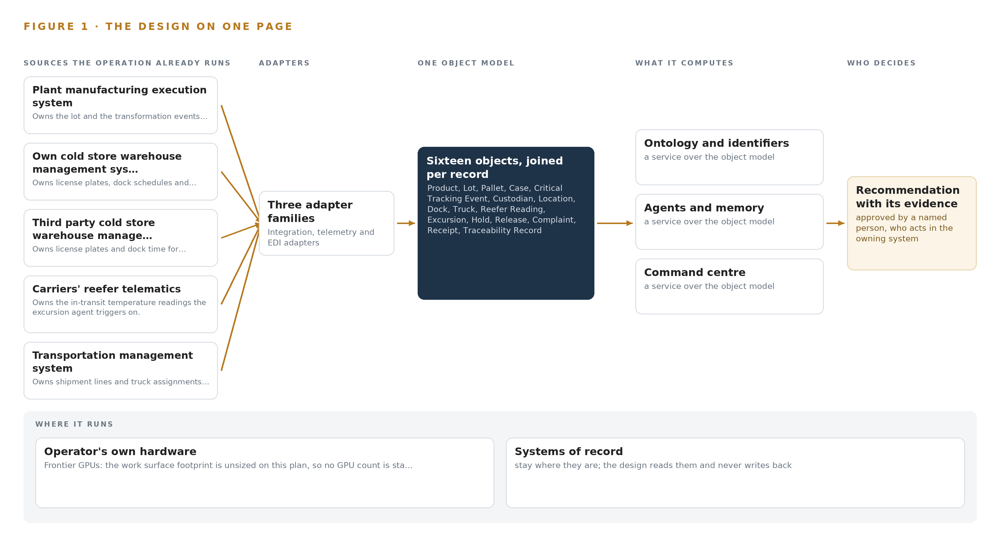
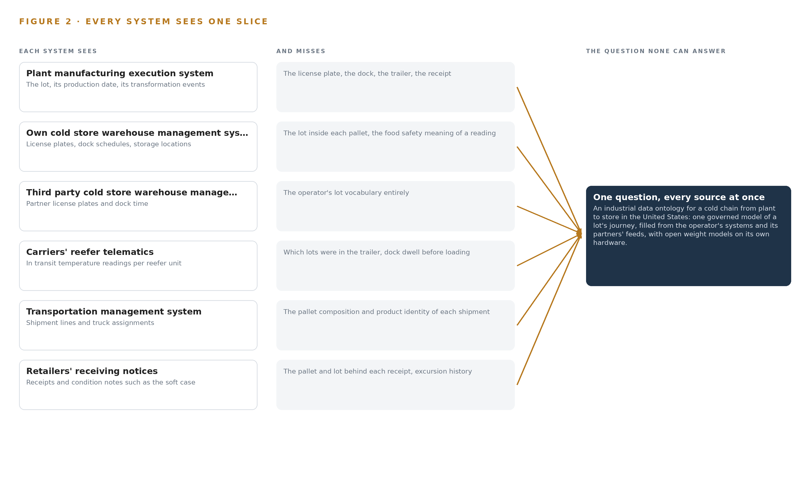
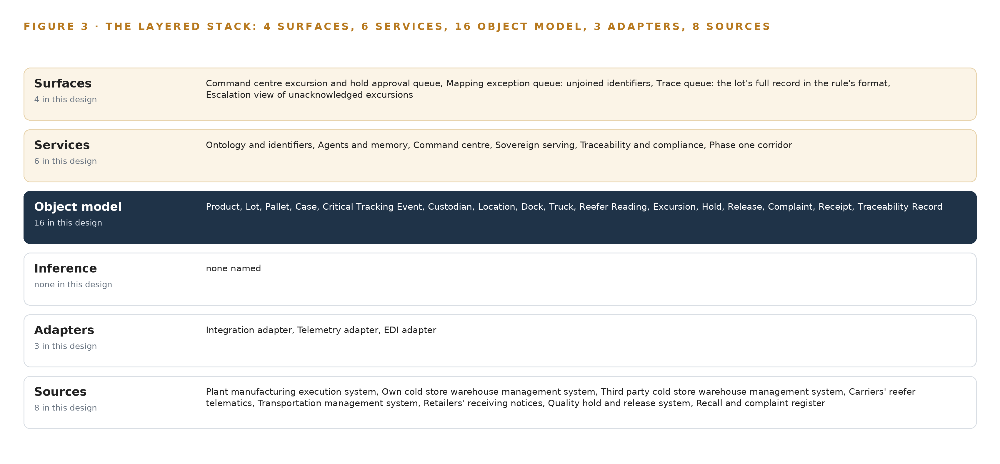
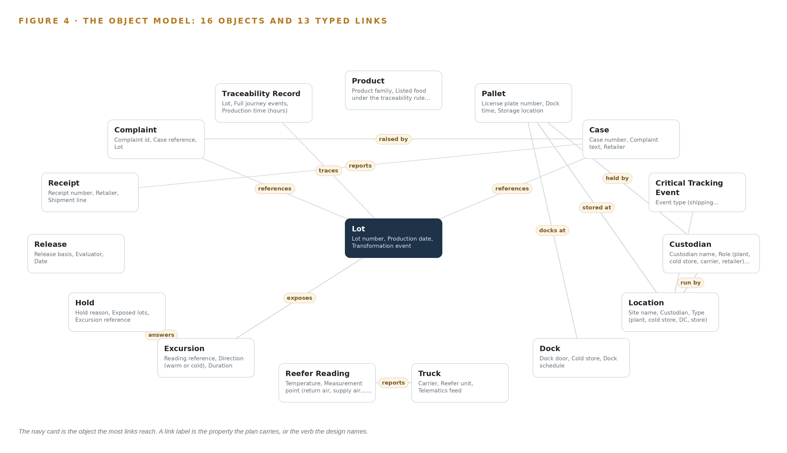
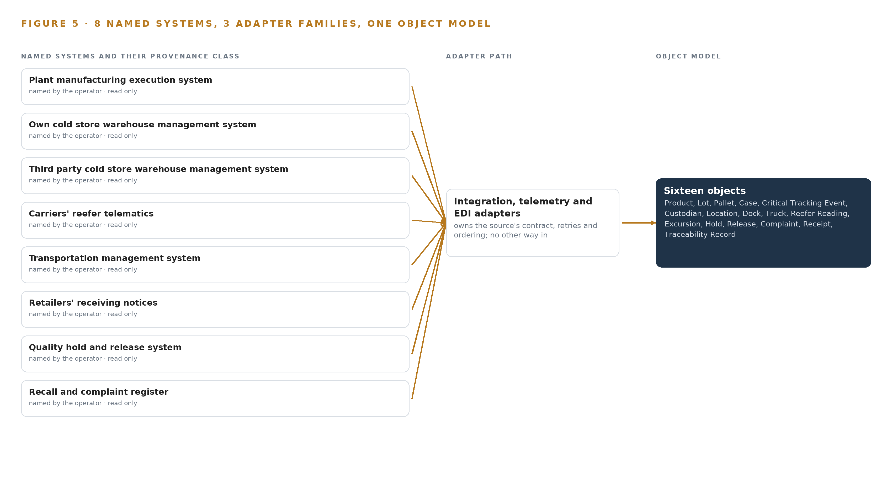
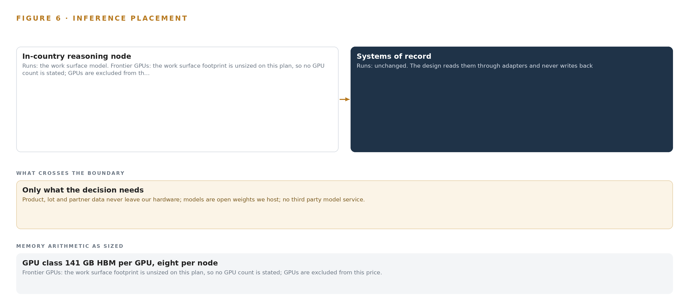
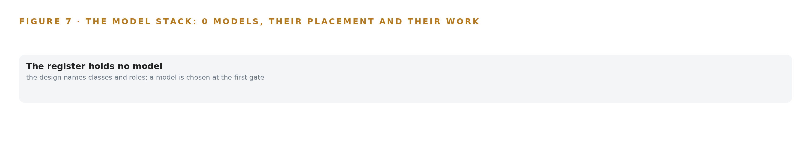
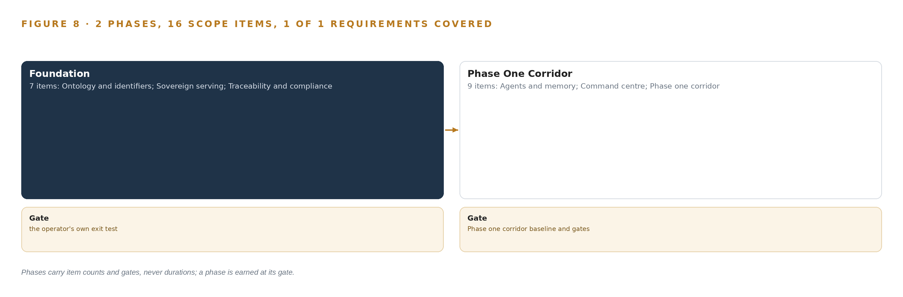
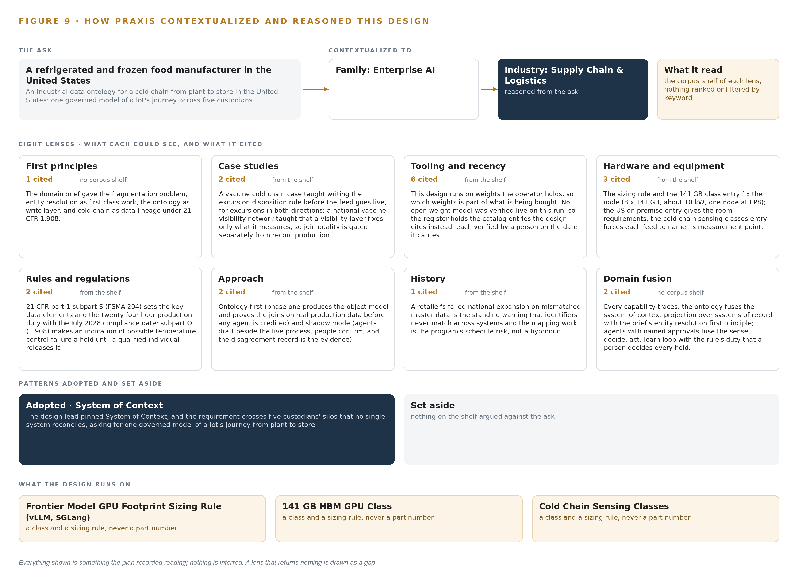

# Industrial Data Ontology for a Cold Chain From Plant to Store in the United States

Canonical: https://codeatoms.ai/cold-chain-ontology-us/
PDF: https://codeatoms.ai/cold-chain-ontology-us/paper/cold-chain-ontology-us.pdf
License: CC BY 4.0
Publisher: CodeNinja Atoms (https://codeatoms.ai), a fully owned subsidiary of CodeNinja

VERTICAL-DRIVEN ARCHITECTURES · SUPPLY CHAIN & LOGISTICS · DESIGNED WITH PRAXIS · NOVEMBER 2026

# Industrial Data Ontology for a Cold Chain From Plant to Store in the United States

Lot Thread: Industrial AI for Cold Chain Traceability From Plant to Store

Muhammad Umar, Cofounder, CodeNinja

For the quality and regulatory lead accountable for traceability, cold chain and logistics managers, and the data, integration and platform engineers who would build and run it.

---

Vertical-Driven Architectures is a CodeNinja series of system designs. Every design in the series is driven by a real-world problem and scenario in a single industry, and every one is designed on Praxis, CodeNinja's platform for designing physical AI systems. Operations are described by class, never by name.

At a glance

## Industrial Data Ontology for a Cold Chain From Plant to Store in the United States

**What this is.** An open reference architecture for system design in physical AI, built as an industrial data ontology for a refrigerated and frozen food manufacturer in the United States that ships from its plants through its own and third party cold storage to retail distribution centers and stores, where owning the reasoning node that runs it costs about 591,000 US dollars over three years. When a retailer reports a soft case, or a regulator names a lot under the federal food traceability rule, the design joins the plant's lot, the warehouse's license plate, the carrier's reefer readings, the transport shipment line and the retailer's receipt into one journey, so the quality team can say within the hour which pallets shared a dock and a truck and produce the lot's whole record in hours instead of a week and three phone calls. The model runs entirely on the operator's own hardware inside the United States, with no third party model service. It is written for the quality and regulatory lead accountable for traceability, the cold chain and logistics managers, and the data, integration and platform engineers who would build and run it. The operator is described by class, never by name.

**The answer in numbers.**

| Part | The design |
| --- | --- |
| Sources | Eight read only systems of record across five custodians, entering through three adapter families (an integration adapter on change data capture, a telemetry adapter for reefer and dock readings, an EDI adapter for retailer notices and partner files) that stamp every fact with its source system and its source key: the plant manufacturing execution system, the operator's own and third party cold store warehouse management systems, the carriers' reefer telematics, the transportation management system, the retailers' receiving notices, the quality hold and release system and the recall and complaint register; each partner feed is gated on written data terms, and no adapter exposes a write path |
| Object model | 16 typed objects with 13 typed links, from the product, lot, pallet and case through the critical tracking event, custodian, location, dock, truck and reefer reading to the excursion, hold, release, complaint, receipt and traceability record, held as a projection over the systems of record rather than a copy of them and published as JSON for reuse; the pallet is the hinge where the five vocabularies meet |
| Models | GLM 5.3, named by the operator, as the frontier class open weight work surface for the mapping, excursion and trace agents and the cited conversational interface, under a license whose attribution notice and managed service trigger counsel reviews before hosting; document reading and embedding entries by class on an air cooled PCIe server; no entry survived live verification on this run, so the register holds catalog entries and the commitment waits on a verified row; nothing is trained or fine tuned, improvement runs through the memory of confirmed joins |
| Compute | One central tier in the operator's existing server room in the United States: one node of eight 141 GB HBM cards (1,128 GB) drawing about 10 kW, holding 756 GB of FP8 weights with about 280 GB of KV cache headroom; no compute in freezers, on docks or in trucks, because readings arrive as partner data; inbound feeds only, no egress path, updates through the Harbor registry |
| Rollout | Two phases carrying 16 scope items (7 and 9), each closed by a gate, never a date: a Foundation phase that builds the ontology, the explicit identifier mapping and the ingest normalisation, then a Phase One Corridor running one product family through one plant, one cold store and one retailer for one quarter; the exit gate is a lot's full record in hours instead of a week (nominal 4.0 hours), lots joined end to end, excursions joined to exposed lots within the hour, and a rehearsed dock door event in which the retailer is told before the truck arrives; the mapping agent runs in shadow mode with a measured acceptance rate before any credit is taken |
| Three-year cost | About 591,000 US dollars to own the node for three years (a range of 546,000 to 615,000: node, support and power at the national average commercial or industrial price), against about 625,000 to rent the same eight cards on the deepest three year commitment in AWS US East (N. Virginia), so ownership costs about nine tenths of it, and about 1.66 million on demand, against which ownership costs about a third. Renting is a price reference only, because every rented option would carry product, lot and partner data out of the operator's hardware (Appendix A) |
| Human control | Agents draft and people decide, by name: the traceability analyst confirms every identifier join the mapping agent drafts, the quality manager approves every hold the excursion agent recommends and acts in the quality hold and release system, the regulatory affairs lead sends every trace record the trace agent drafts; no agent places or lifts a hold or sends a record to a regulator, an escalation view surfaces unacknowledged excursions, and every confirmed join is kept as memory the next join reads |

**Reuse it.** The object model, the model register and the figures are free to reuse under CC BY 4.0. Cite as <https://codeatoms.ai/cold-chain-ontology-us/.>

**Made with.** Reasoned on [CodeNinja Praxis](<https://codeatoms.ai/praxis/>), the CodeNinja Atoms platform for designing physical AI systems. The object model imports into [Hyper Ontology](<https://codeatoms.ai/hyper-ontology/>), which turns it into a living system. Load it with the [hyper-ontology loader](../hyper-ontology-py/): `hyper-ontology show cold-chain-ontology-us`. Both are in beta; access by request.

ABSTRACT

## A Lot's Journey Should Take Hours, Not a Week and Three Phone Calls

An industrial data ontology for a cold chain from plant to store in the United States has to answer one question: when a retailer reports a soft case, which pallets shared its dock time and its truck, and when the federal food traceability rule asks, can the lot's whole journey be produced within twenty four hours. Today the operator cannot answer either within a day, because its chain has five custodians and five vocabularies: a pallet is a lot in the plant, a license plate in the warehouse, a shipment line in transport, a receipt in the retailer's notice and a case in a complaint. A temperature excursion on a dock is logged by the warehouse while the truck's telematics logs a different one an hour later, and neither is joined to the lot that sat on the dock. The quality managers hold the mapping between the vocabularies in their heads, which is why producing a record takes a week and three phone calls and why the rule's compliance date of July 2028 finds the operation unprepared.

The design reads eight named systems of record, from the plant manufacturing execution system to the recall and complaint register, through three adapter families: an integration adapter for change data capture, a telemetry adapter for reefer and dock readings, and an EDI adapter for retailer notices and file routes. Everything lands in one governed object model of sixteen objects with typed links, from Lot and Pallet through Dock, Truck, Excursion and Hold to the trace record the rule asks for, held as a projection over the systems of record rather than a copy of them. Six services, from ontology and identifiers through the command center to the phase one corridor, expose four surfaces: an excursion and hold approval queue, a mapping exception queue, a trace queue and an escalation view. The model register is deliberately empty, because no open weight model survived live verification on this run; the work surface commits frontier class open weights self hosted for sovereignty, to be sized when a verified entry stands in the register. All of it runs on the operator's own hardware in the United States, and no product, lot or partner data leaves that boundary.

The paper covers, in order: the industry problem and the regulatory regimes behind it; the join failure across the five vocabularies; the constraints and scoping decisions; the stack from systems of record to surfaces; the object model of sixteen objects and their typed links; ingestion through adapters; where serving sits and why no edge inference exists; the empty model register and what it will take to fill it; the two phase rollout with its gates, measurements, failure modes and open questions; who owns what the design builds; and finally the chapter on how Praxis contextualized and reasoned the design, so any choice can be traced to the recorded reading behind it.

---



Figure 1. The design on one page: the sources the operation already runs, one object model, what it computes, and the person who decides.

## Contents

Each chapter is tagged for the reader it serves most directly: Executive, Team Lead, FDE, Reference.

|  |  |  |
| --- | --- | --- |
|  | Abstract · A Lot's Journey Should Take Hours, Not a Week and Three Phone Calls | Executive |
| PART I · THE PROBLEM | | |
| 1 | [An Industrial Data Ontology for the Cold Chain Starts at the Dock Door](#ch1) | Executive |
| 2 | [Five Custodians Keep Five Vocabularies for One Pallet](#ch2) | ExecutiveTeam Lead |
| PART II · THE DESIGN | | |
| 3 | [Sovereignty and the Twenty Four Hour Rule Shape Everything](#ch3) | Team Lead |
| 4 | [One Stack Runs From Systems of Record to Surfaces](#ch4) | Team LeadFDE |
| 5 | [Sixteen Objects Turn Cold Chain Data Into One Journey](#ch5) | FDE |
| 6 | [Every Source Enters Through an Adapter, Never Directly](#ch6) | FDE |
| 7 | [All Serving Sits on the Operator's Own Metal](#ch7) | FDE |
| 8 | [An Empty Register Keeps the Weights Honest](#ch8) | FDEExecutive |
| PART III · THE ROLLOUT | | |
| 9 | [Shadow Mode Comes Before Any Join Is Trusted](#ch9) | Team LeadExecutive |
| 10 | [The Mapping Knowledge Should Stay with the Operator](#ch10) | Executive |
| PART IV · HOW IT WAS DESIGNED | | |
|  | Conclusion · The Join Is the Deliverable, and the Operator Keeps It | Executive |
| 11 | [Recorded Reading Stands Behind Every Choice](#ch11) | Team LeadFDE |
|  | [Sources](#sources) | Reference |

PART I · CHAPTER 1

## An Industrial Data Ontology for the Cold Chain Starts at the Dock Door

The loading dock is where most temperature excursions happen, and the federal food traceability rule will demand a lot's whole journey within twenty four hours from July 2028, which today takes a week and three phone calls.

The abstract set out an industrial data ontology for a cold chain from plant to store, from dock door to regulator's request, and claimed the journey can be produced in hours. This chapter grounds that claim: the question the operator cannot answer today, the rule that sets its deadline, and the operation that must answer it.

### 1.1  The Question and the Rule

The operator needs one question answered: when a regulator or a retailer names a lot, what was its whole journey from plant to store, which critical tracking events of shipping, receiving and transformation did it pass through, and what did it see on the way. The federal food traceability rule requires lot level records of each critical tracking event for listed foods, produced within twenty four hours of a request, with a compliance date of July 2028. Answering it requires data the operation already holds but cannot join: the lot and its transformation events from the plant, the license plate and dock time from each cold store, the temperature readings from the reefer unit, the shipment line from transport, the receipt and condition notes from the retailer, and the holds and complaints that follow. Two regulatory regimes bind: the traceability rule itself, and the refrigerated storage rule under which an indication of possible temperature control failure holds food until a qualified individual determines it was not rendered unsafe. Industry criteria for full chain traceability, ratified by a standards body, add the auditor's view of the same duty (GS1 2021).

### 1.2  The Documented Cost of the Problem

A year of recalls has shown the industry how small cold chain breaks become large food safety events, and the public record shows how a single cold chain site propagates. At a third party cold storage facility serving major grocery retailers, an outbreak that began with three workers rose to eleven confirmed cases with many more identified as close contacts, all from one site in the chain (Unitedworkers 2021). The record keeping itself carries exposure: a staffing firm paid 2.7 million dollars in a settlement after exposing the private medical information of about 72,000 people during contact tracing, a penalty for losing control of records whose entire value is that they can be produced on request (Foxnews 2024). Against this, the operator's present position is that producing a lot's journey takes a week and three phone calls, where the rule will allow twenty four hours.

### 1.3  The Operation as a Scenario

The operator is a refrigerated and frozen food manufacturer in the United States, producing frozen and chilled products at its plants and moving them on pallets through its own and third party cold storage, by refrigerated truck to retail distribution centers and on to stores. The chain has five custodians and five vocabularies: a pallet is a lot in the plant, a license plate in the warehouse, a shipment line in transport, a receipt in the retailer's notice and a case in a complaint. Eight named systems of record hold the data: the plant manufacturing execution system, the warehouse management systems of the operator's own and third party cold stores, the carriers' reefer telematics, the transportation management system, the retailers' receiving notices, the quality hold and release system and the recall and complaint register. The people in the loop are the quality managers who hold the mapping between the five vocabularies in their heads, the regulatory lead who answers requests, the analysts who reconcile identifiers by hand, and the plant, warehouse and transport operators who log the events. The physical environments are freezer rooms, loading docks where most temperature excursions happen, refrigerated trailers, distribution center receiving bays and store back rooms. The regulatory ground is the federal traceability rule and the refrigerated storage hold rule described above, and the compliance date of July 2028 is the clock the whole design runs against.

PART I · CHAPTER 2

## Five Custodians Keep Five Vocabularies for One Pallet

Each system of record sees one slice of the chain, and none of them can say which pallets shared a dock and a truck with a reported soft case, which is the join failure the design exists to close.

Chapter 1 stated the question and the clock the rule imposes on it. This chapter walks the eight systems of record one at a time and shows that each sees one slice of the pallet's life, which is why no one of them can answer it.

### 2.1  What Each System Sees

The plant manufacturing execution system sees the lot, its production date and its transformation events, and misses everything after the pallet leaves the line, because the license plate the warehouse issues never reaches it. The operator's own cold store warehouse management system sees license plates, dock schedules and storage locations, and misses the lot inside each pallet and the meaning of a temperature reading for the food on the dock. The third party cold store's warehouse management system sees the same things in a partner's vocabulary, and misses the operator's lot numbering entirely, which is why its records cannot be read without translation. The carriers' reefer telematics sees in transit temperature readings per reefer unit, and misses which lots were in the trailer and how long they stood on a dock before loading. The transportation management system sees shipment lines and truck assignments, and misses the pallet level composition of each shipment and the product's identity. The retailers' receiving notices see receipts and condition notes such as the soft case, and miss the pallet and lot behind each receipt and any excursion history. The quality hold and release system sees holds, releases and their approvers, and misses which other lots share the excursion that triggered a hold. The recall and complaint register sees complaints and cases, and misses the joined journey that tracing a case requires. Figure 2 sets these eight views side by side.



Figure 2. Eight systems, each seeing one part of the answer. The question needs all of them in one place at once.

### 2.2  What None of Them See Together

No system holds dock time, reefer readings, lot identity and receipt condition at once, so the questions that matter are exactly the joins: which pallets shared a dock and a truck with a reported soft case, and which lots were exposed when a dock door stayed open. In practice the cost is measured in the operator's own words: a week and three phone calls to produce a lot's journey, a retailer told after the truck arrives rather than before, and quality managers acting as the human join between five vocabularies, which does not scale and leaves no record of why a join was made.

PART II · CHAPTER 3

## Sovereignty and the Twenty Four Hour Rule Shape Everything

Four constraints govern the whole design: data never leaves the operator's control, the systems of record are never replaced, every decision keeps a named approver, and the first gate must be able to stop the work cheaply.

Chapter 2 showed the join failure: eight systems, five vocabularies and no shared record of a pallet's life. This chapter turns that failure into four constraints that shape every layer of the design, then records what the scoping bought, what it cost and what was set aside.

### 3.1  Data Never Leaves the Operator's Control

The operator's boundary is absolute: product, lot and partner data stay on its own hardware, models are open weights it hosts, and no third party model service receives anything. This is hard in this industry because the chain's data is not the operator's alone; reefer readings belong to carriers, dock records to third party cold stores and receiving notices to retailers, so each partner feed is gated on written data terms before it goes live, and contract data terms are recorded on the custodian object rather than in a filing cabinet. The posture is not only principle, because mishandled records carry penalties, as the contact tracing settlement showed (Foxnews 2024). It is also the posture an [industrial data ontology](https://codeatoms.ai/industrial-data-ontology/) the operator owns rests on: the organization that produced the data holds the data and the weights that reason over it.

### 3.2  The Systems of Record Stay in Place

Eight systems span five custodians, and several of them are not the operator's to modify at all; a third party cold store's warehouse system and a retailer's receiving notices will never take an extension from a manufacturer. The design therefore projects rather than migrates: it reads live feeds, binds the silos in place and never replaces or loads a system of record, and the sole writes are the named approval paths into the quality hold and release system and the outgoing trace record itself. This is what makes full chain traceability reachable at all, because criteria for tracing across a whole chain require crossing boundaries no single system owns (GS1 2021). The cost is that every join becomes explicit mapping work, and mapping quality, not software, becomes the program's main risk.

### 3.3  Every Decision Keeps a Named Approver

Under the refrigerated storage rule, an indication of possible temperature control failure holds food until a qualified individual determines it was not rendered unsafe, which makes a hold a person's decision by law. The design encodes this: no agent places or lifts a hold, or sends a record to a regulator, without a named approval; the excursion agent drafts and a quality manager approves, and the mapping agent proposes a join that an analyst confirms. This is hard because both clocks, the twenty four hour production duty and the within the hour excursion join, must run through people, so approval queues, an escalation view for unacknowledged excursions and a rehearsed degraded mode where people work the owning systems directly are designed parts of the system, not fallbacks.

### 3.4  The First Gate Must Stop the Work Cheaply

Phase one runs one product family through one plant, one cold store and one retailer for a quarter, gated on record production within hours instead of a week, lots joined end to end, excursions joined to exposed lots within the hour, and a rehearsed dock door event in which the retailer is told before the truck arrives. This is hard because the July 2028 compliance date pulls toward estate wide rollout; the gate exists so that measured join quality and the acceptance rate of confirmed mappings, not a calendar, decide extension to the rest of the estate.

### 3.5  Scoping Decisions

Three scoping decisions carry most of the shape, and each bought something at a stated cost, recorded in Table 1.

Table 1 · Scoping Decisions

| Decision | What it buys | What it costs |
| --- | --- | --- |
| One product family, one plant, one cold store, one retailer, one quarter | A first gate that can stop the work cheaply before the estate is touched | The joins are proven on one corridor only, and extension is decided at the gate |
| Project the ontology over the eight systems of record | No system of record is replaced, and every partner keeps owning its data | Every join becomes explicit mapping work, and mapping quality is the program's main risk |
| Agents draft, named people approve | Every hold, release and trace record carries an accountable person | Both clocks run through people, so queues, escalation and degraded mode must be designed |

### 3.6  What the Design Chose Against

Each choice closed alternatives, and Table 2 records where the design decided, what was picked and what was set aside, ending with what is out of scope and why.

Table 2 · What the Design Chose Against

| Where | What was picked | Instead of, and why |
| --- | --- | --- |
| The middle layer | A new dedicated store the operator owns, fed read only from the systems of record | An extension inside the plant MES or the quality hold system, which cannot hold four other custodians' vocabularies and must never be modified |
| The work surface model | Frontier class open weights, self hosted for sovereignty, sized at FP8 on one 141 GB class node | BF16 across two nodes, a mid size model, or a third party model service, because data never leaves the operator's control and weights are committed only after live verification |
| Sensing | Existing reefer and dock readings arriving as partner data | New cameras and sensors, because the constraint is to read existing systems and partner feeds, with each measurement point named so readings compare |
| Learning | Memory of confirmed joins, read before the next run | Fine tuning or training into weights, because the requirement rules out training a model on the fly |
| Out of scope | Replacement of the eight systems of record, historic data migration, automatic holds or regulator transmission, hardware and third party license fees | Estate wide rollout, bulk cleansing of history and any autonomous action, because the first gate must be able to stop cheaply and every action keeps a named approver |

PART II · CHAPTER 4

## One Stack Runs From Systems of Record to Surfaces

The architecture is three layers in a fixed order: systems of record below, the operator owned object model as a projection in the middle, and services, agents and surfaces above, all on the operator's own hardware.

Chapter 3 fixed the constraints: read only from the systems the operation already runs, keep every fact on the operator's own hardware, leave each decision with a named person, and prove the join before any credit is taken. This chapter turns those constraints into a stack whose order never changes.

### 4.1  Why Three Layers in a Fixed Order

The pattern is three layers, and the order is the design. Below sit the systems of record, eight of them from the plant manufacturing execution system to the recall and complaint register, each the sole owner of one custodian's truth, read and never written. In the middle sits one object model the operator owns, sixteen objects with typed links, built as a projection over the systems of record rather than a copy of them, so a change in a source changes the projection and nothing drifts. Above sit six services, the agents that draft work for people, and four surfaces where those people decide. The order matters because the join is the deliverable: five custodians keep five vocabularies, and no single system of record can reconcile them, so the reconciliation has to live in a layer that belongs to none of them. Figure 3 shows the layers with their counts, from eight sources and three adapter families at the bottom to four surfaces at the top. The same order places this design among sovereign reference architectures: everything above the sources runs on hardware the operator owns, and no fact crosses the boundary to a third party model service.



Figure 3. The layered stack: 8 sources, 3 adapter families, 16 objects, 6 services and 4 surfaces.

### 4.2  The Stack Stage by Stage

Table 3 walks the stack through its seven stages, naming what each stage is responsible for and the components that carry it. Two stages deserve a note. Sensing buys temperature evidence without new hardware: dock and reefer readings arrive as partner data on existing feeds, and the design names each feed's measurement point, whether return air, supply air or product simulating, so readings are comparable rather than assumed. Inference is deliberately the thinnest stage: the work surface is committed to frontier class open weights the operator hosts, and the footprint stays unsized until a verified model stands in the register, so no GPU count is stated here.

Table 3 · The Stack, Stage by Stage

| Stage | What it is responsible for | How |
| --- | --- | --- |
| Sources | Holds each custodian's truth unchanged | Eight systems of record, read only: the plant manufacturing execution system, the own and third party cold store warehouse management systems, the carriers' reefer telematics, the transportation management system, the retailers' receiving notices, the quality hold and release system, the recall and complaint register |
| Sensing | Supplies dock and reefer readings without new hardware | Readings arrive as partner data on existing feeds, each stamped with a named measurement point such as return air, supply air or product simulating |
| Adapters | Normalise every source into one grammar | Three families: the integration adapter on Debezium change data capture, the telemetry adapter for reefer and dock feeds, the EDI adapter on Apache Camel routes |
| Object model | Holds the governed journey of every lot | Hyper Ontology v0.9, semantics plus kinetics, as a projection over the sources, with a telemetry store of the InfluxDB 3 Core or TimescaleDB class beside it for readings |
| Inference | Serves the reasoning the agents draft on | Sovereign serving on the operator's own hardware; frontier class open weights self hosted, unsized until a verified model stands in the register |
| Services | Run the sense, decide, act, learn loop | Six services: ontology and identifiers, agents and memory, command center, sovereign serving, traceability and compliance, phase one corridor |
| Surfaces | Put each decision in front of a named person | Four surfaces: the command center excursion and hold approval queue, the mapping exception queue, the trace queue, the escalation view of unacknowledged excursions |

### 4.3  A Reusable Pattern

The shape a team carrying a similar brief can reuse is the fixed order itself: read only sources below, one owned projection in the middle, an adapter tier that stamps provenance and source keys on every fact, and agents that draft for named people who approve. What they would keep is the discipline, not the content: the projection rule that forbids a shadow copy, the one way adapter guarantee, and the approval gates that keep every consequential act with a person. What they would swap is the domain: the sixteen object grammar becomes the nouns of their operation, the eight sources become their systems of record, and the named measurement points become the physics of their chain.

Table 7 · Architecture, Layer by Layer

| Layer | Component | Choice | Why |
| --- | --- | --- | --- |
| Event streaming and messaging | by class, no product named | Product | Apache Kafka 4.3 (KRaft, three dedicated controllers) |
| The ontology or graph store | Hyper Ontology v0.9 (semantics plus kinetics) | Product | Holds the sixteen objects and their typed links as a projection over the eight systems of record, never a copy of them |
| Time series and telemetry storage | InfluxDB 3 Core, TimescaleDB | Class | Reefer and dock readings need a telemetry store beside the ontology; the shelf holds a comparison note and the engine is picked at design with the operator's DBA. |
| Video ingest, recording and management | by class, no product named | Not needed | No cameras are supplied; readings arrive as partner data per 'Read from our systems and the partners' feeds'. |
| Edge model serving | by class, no product named | Not needed | All serving sits on the operator's central and site hardware; no plant or dock edge inference exists in this design. |
| On site language model serving | by class, no product named | Not needed | No model in the register survived this run's live checks, so nothing is served on this layer yet. The layer is model open work: it is chosen and sized when a verified model is. |
| Object tracking and trajectory forecasting | by class, no product named | Not needed | Lots are tracked by identifiers and events, not pixels. |
| Edge orchestration of containers | by class, no product named | Not needed | There are no edge boxes to orchestrate; the central cluster is ordinary data center infrastructure. |
| An air gapped artifact and model registry | by class, no product named | Product | Harbor |
| Labelling and retraining | by class, no product named | Not needed | Under system of context nothing is fine tuned or trained; improvement runs through its memory loops per 'without training a model on the fly'. |
| Time synchronisation across sensors and systems | by class, no product named | Product | Chrony (NTP) |
| Observability of the running system | by class, no product named | Product | Prometheus, Grafana and Loki |

PART II · CHAPTER 5

## Sixteen Objects Turn Cold Chain Data Into One Journey

One small grammar turns the five vocabularies into a single argument: nouns become objects, facts become properties, relationships become typed links, and a query can then walk from a complaint to the dock doors and trucks a lot shared.

Chapter 4 fixed the stack's order and named its seven stages. This chapter opens the middle layer, where the five vocabularies of the chain become one argument a query can walk.

### 5.1  Sixteen Objects and the Links Between Them

The object model holds sixteen objects, each with a kind and an anchor. The materials are Product, Lot and Case; the assets are Pallet and Truck; the events are the Critical Tracking Event and the Excursion; the sites are Location and Dock; Custodian is the actor; Reefer Reading is the measure; Hold, Release, Complaint and the Traceability Record are records; and Receipt is a document. Each object is anchored in the system of record that owns it: the Lot in the plant manufacturing execution system, the Pallet in a warehouse management system, the Receipt in the retailers' receiving notices, while the Traceability Record, which carries a lot's full journey events, its production time in hours and the requester, is the one object the model itself produces. Figure 4 shows every object and the typed links between them. What the links buy is reach: given a Case, a query walks the lot reference to the Lot, through the critical tracking events to the Pallets, along their dock time to the Docks and their custodians to the Trucks, and from the Excursions to the Holds that answered them. A document store can return every document that mentions a case, but it cannot walk a join, because the relationship is not stored as a thing in its own right; a standards body ratifies assessment criteria for full chain traceability across supply chains, and those criteria interrogate the links, not the documents (GS1 2021). Table 8, printed from the plan, lists each object, the system it is anchored in and its typed links.



Figure 4. The sixteen objects of the model and the typed links that let a query reach across them.

Table 8 · The Object Model

| Object | Anchored in | Typed links |
| --- | --- | --- |
| Product | Plant manufacturing execution system | no typed link recorded |
| Lot | Plant manufacturing execution system | no typed link recorded |
| Pallet | Warehouse management system | docks at: Dock; stored at: Location; held by: Custodian |
| Case | Recall and complaint register | raised by: Complaint; references: Lot |
| Critical Tracking Event | Mixed: source system per event | occurs at: Location |
| Custodian | No single system; the five parties to the chain, their data terms recorded on this object | no typed link recorded |
| Location | Warehouse management system | run by: Custodian |
| Dock | Warehouse management system | no typed link recorded |
| Truck | Transportation management system | reports: Reefer Reading |
| Reefer Reading | Carriers' reefer telematics | no typed link recorded |
| Excursion | Mixed: the warehouse dock log or the carriers' reefer telematics | exposes: Lot |
| Hold | Quality hold and release system | answers: Excursion |
| Release | Quality hold and release system | no typed link recorded |
| Complaint | Recall and complaint register | references: Lot |
| Receipt | Retailers' receiving notices | reports: Case |
| Traceability Record | Produced by the object model itself | traces: Lot |

### 5.2  Where the Human Loop Lives

The loop is the point of the layer above the model. The mapping agent drafts a join and an analyst confirms it; the excursion agent drafts a hold and a quality manager approves it in the quality hold and release system; the trace agent drafts a record and the regulatory lead sends it. No agent places or lifts a hold, and no agent sends a record, without a named approval, and every confirmed join is remembered so the second join is cheaper than the first, with the disagreement record held as the evidence. The hosting posture follows the constraint: the model runs on the operator's own hardware in the United States, and product, lot and partner data never leave that hardware. Identity runs on Keycloak, so every approval attaches to a named person. External links are inbound only, and there is no egress path to any third party model service. The single write path into any system of record is a person acting in the owning system; the platform reads the resulting state back.

### 5.3  One Object in Its Recorded Form

The Product record below shows the id, label, kind, anchor, properties and status vocabulary the platform prints for every object; the Pallet, the hinge where the five vocabularies meet, is recorded the same way, with the license plate the warehouse sees, the dock time, the storage location, the custodian, and the status vocabulary In freezer, On dock, In transit, Received.

```
{ "id": "product", "label": "Product", "kind": "material", "anchored_in": "Plant manufacturing execution system", "properties": [ "Product family", "Listed food under the traceability rule", "Temperature range", "Shelf life" ], "status_vocabulary": [], "links": [] }
```

PART II · CHAPTER 6

## Every Source Enters Through an Adapter, Never Directly

Eight named systems of record reach the object model only through three adapter families, each carrying a provenance class, so the ontology never writes into a system of record and every fact keeps its source key.

Chapter 5 described what the object model holds and where the human loop lives. This chapter describes how data reaches it: eight named sources, three adapter families, and a backbone that keeps every event ordered, proven and recoverable.

### 6.1  Eight Sources and Their Adapter Paths

Every source in this design is a named system of record, read only, and each reaches the object model through one of three adapter families. The plant manufacturing execution system owns the lot and its transformation events; the own cold store warehouse management system owns license plates, dock schedules and storage locations; the third party cold store warehouse management system owns license plates and dock time in a partner's vocabulary; the carriers' reefer telematics owns the in transit temperature readings; the transportation management system owns shipment lines and truck assignments; the retailers' receiving notices own receipts and condition notes such as the soft case; the quality hold and release system owns holds and releases; and the recall and complaint register owns complaints and cases. Each carries the same provenance class, an operator or partner system of record whose data arrives as a feed, and the same direction, inbound. Figure 5 maps every named system to its class and its adapter path, and the table below sets what each system sees beside what it misses.



Figure 5. The 8 named systems, the adapter path each one takes, and the object model they all map into.

### 6.2  What the Adapter Tier Guarantees

The adapter tier makes four guarantees. It normalises: every record, whatever its source vocabulary, enters the object model in the same grammar of objects, properties and typed links, with the integration adapter running Debezium change data capture on the transactional systems, the telemetry adapter carrying reefer and dock readings, and the EDI adapter running Apache Camel routes for the retailers' notices and partner files. It proves: every fact is stamped with its source system and its source key, so a trace record can cite the key a regulator or retailer can check in the owning system. It protects: no adapter exposes a write path into a system of record, so the ontology can never corrupt a custodian's truth. It gates: an approvals register confirms each partner's contract data terms in writing before its feed goes live, because cold storage and carrier contracts may not permit lot level sharing by default, and the register holds ingest until the confirmation exists. The boundary has a real price when it fails, and not only in this industry: a staffing firm paid 2.7 million dollars in a US Justice Department settlement after about 72,000 people's private medical information was exposed during COVID-19 contact tracing work (Foxnews 2024).

### 6.3  The Event Backbone

Apache Kafka 4.3 in KRaft mode, with three dedicated controllers, carries every adapter's output into the platform. Ordering is per key: each event is keyed by its source key, so a lot's events arrive in order even when different sources lag differently. Delivery is at least once, paired with idempotent writes into the ontology so a replayed event cannot create a second pallet or a second excursion. Buffering absorbs the dock log's cadence: the broker holds events while a consumer lags, so a dock log that arrives in a batch still joins to the lot that was on the dock, and phase one measures that batch interval against the within the hour excursion budget. Replication keeps ingest alive: partitions replicate across brokers, so a single broker loss halts no feed. Beneath it, Chrony synchronises plant, warehouse and carrier clocks, because a join that depends on dock time is a join that depends on clocks agreeing.

PART II · CHAPTER 7

## All Serving Sits on the Operator's Own Metal

No compute is placed in freezers, docks or trucks: readings arrive as partner data, and all serving, from the event backbone to the work surface, runs in the operator's existing server room inside the United States.

Chapter 6 described how eight systems of record enter through three adapter families, integration, telemetry and EDI, and what the adapter tier guarantees each record on the way in. This chapter describes where the compute those feeds touch actually runs, and the answer is deliberately short: on the operator's own metal, in its existing server room, inside the United States.

### 7.1  One Tier, and It Is Central

There is a single inference tier in this design, and it is central. The event backbone (Apache Kafka 4.3, running KRaft with three dedicated controllers), the ontology store, the telemetry store that holds reefer and dock readings beside it, and the serving hardware for the work surface all run on the operator's central and site hardware. No compute is placed in freezers, on docks or in trucks, because the constraint the operator set is to read its own systems and the partners' feeds: reefer and dock readings arrive as partner data, not as signals from sensing this design supplies. Figure 6 shows the one tier, what runs on it, and the one crossing that exists, the inbound partner feeds.

The memory arithmetic the plan holds is the sizing rule for the frontier work surface. The operator names GLM 5.3, and the rule puts its 756 GB of FP8 weights on one 141 GB class node, eight GPUs per node drawing about 10 kW, with about 280 GB of KV cache headroom left for the context the command center's conversations and citations consume; the alternatives weighed were BF16 across two nodes and a mid size model in place of the frontier work surface. The arithmetic is the rule, not a commitment: no model row survived live verification on this run, so the footprint names where it runs and the node count is derived only when a verified entry stands in the register. The document reading and embedding entries the design cites fit one to four cards of the 141 GB class on an air cooled PCIe server in the same room.



Figure 6. Where each tier runs, what runs there, and the narrow set of outputs that cross the boundary.

### 7.2  Three Clocks Set the Budget

The latency budget is three nested clocks. The outer clock is the rule's ceiling: a lot's full journey must be produced within twenty four hours of a request, and the July 2028 compliance date fixes when that duty bites. The middle clock is the design's own nominal, four hours to produce a lot's full record, with any measurement above it a breach; the fault the rollout rehearses against is a dock door left open at the cold store. The inner clock is the excursion join, within the hour from reading to the lots it exposed, because that is what lets the retailer be told before the truck arrives rather than after a case is opened. The dock log's own batch interval is not assumed: phase one measures it and negotiates a faster cadence where the interval exceeds the hour. Joins that meet these clocks must still meet a standards body's ratified criteria for full chain traceability, a higher bar than looking joined on a screen (GS1 2021).

### 7.3  The Boundary and Its Failures

What crosses the network boundary is inbound only: eight read feeds over existing connections, and nothing else. Product, lot and partner data never leave the operator's hardware and no third party model service is called, so no egress path is built; a one way transfer diode would be precision no data flow in this design consumes. When the link fails, the event backbone buffers and replays partner feeds in order, and the mapping exception queue surfaces unjoined identifiers rather than letting a silent gap become an incomplete trace. When power fails, rack power and UPS, managed with Network UPS Tools, carries the room; a single node failure still halts the command center and all agent drafting, which is why the design carries a rehearsed rollback and a documented degraded mode in which people work the owning systems directly, kept warm. When the update path fails, artifacts and weights move only through the Harbor registry, so a bad update rolls back to the artifact that preceded it; and Chrony keeps NTP time across the systems, because the joins consume business record ordering, not precision timestamps.

PART II · CHAPTER 8

## An Empty Register Keeps the Weights Honest

No model survived live verification on this run, so the register holds only catalog entries each verified by a person on the date it carries, and the frontier work surface is sized only when a verified entry stands.

Chapter 7 ended on the boundary and its failures: inbound feeds only, a rehearsed degraded mode, and updates that arrive solely through the registry. This chapter opens the model register, which is where an industrial data ontology for the cold chain either stands on weights the operator has verified or quietly borrows credibility it has not; no model survived live verification on this run, so the register holds only catalog entries, each verified by a person on the date it carries and not rechecked live for this build.



Figure 7. The model stack as the register holds it: no entry survived live verification, so the design names classes and roles and a model is chosen at the first gate.

### 8.1  What the One Entry Carries

Figure 7 shows the model stack as the register holds it: a serving layer with no live verified entry, one catalog entry for the frontier work surface, and the memory loops that improve the next join without touching a single weight. The operator names GLM 5.3. Its role is the work surface, the conversational, citing interface the command center runs on, over the ontology and the memory of confirmed joins. Its architecture is frontier class open weights, the class the design describes as self hosted for sovereignty. Its size, as the sizing rule states it, is 756 GB of FP8 weights. Its placement is the operator's existing server room, on one 141 GB class node with about 280 GB of KV headroom. Its license carries an attribution notice and a managed service trigger, a clause that bites only if the weights are served to others as a managed service; internal use does not touch the trigger, and the plan gates any commitment on counsel reviewing the license text first. It was chosen because the operator names it, and because FP8 on one node beats BF16 on two and beats a mid size model that would thin the work surface. One caveat governs all of this: the house's sovereign frontier row for GLM 5.3 open weights is not a verified model row on this build's shelf, or was set aside at a gate, so no filed parameter count stands under the work surface and no GPU count is derived; the footprint is sized when a verified entry stands. The document reading and embedding entries face the same discipline, and nothing in the design is trained or fine tuned: improvement runs through memory loops, the record of confirmed joins the next join reads, not through weights.

### 8.2  The Register as an Equipment List

Table 4 reads the model and equipment register the way a site reads an equipment list: every row is a choice with its reason attached, and the register covers more than models. The hardware rows carry the frontier footprint sizing rule as stated for vLLM and SGLang, the 141 GB GPU class with eight GPUs per node, and the air cooled PCIe server that carries the document reading and embedding entries. The sensing row records what the design does not supply, cameras and sensors, and what it requires instead: each feed's measurement point named, ambient, return air, supply air or product simulating, so dock and reefer readings are comparable rather than assumed.

Table 4 · Model and Equipment Register

| The choice | What was picked | Why here |
| --- | --- | --- |
| Frontier Model GPU Footprint Sizing Rule (vLLM, SGLang) | hardware class | a class and a sizing rule, never a part number |
| 141 GB HBM GPU Class | hardware class | a class and a sizing rule, never a part number |
| Cold Chain Sensing Classes | hardware class | a class and a sizing rule, never a part number |
| System of context | pattern adopted | The design lead pinned system of context, and the requirement crosses five custodians' silos that no single system reconciles, asking for one governed model of a lot's journey from plant to store |
| The ground it runs on | Frontier GPUs: the work surface footprint is unsized on this plan, so no GPU count is stated; GPUs are excluded from this price. | sized by the committed footprint |

PART III · CHAPTER 9

## Shadow Mode Comes Before Any Join Is Trusted

Two phases carry sixteen items: the foundation builds the ontology, the identifiers and the ingest normalisation, and the phase one corridor runs one product family end to end, gated on hours instead of a week and on a rehearsed dock door event.

Chapter 8 closed the model and equipment register with the license terms and the single node the work surface runs on. This chapter turns that register into a sequence: two phases, sixteen items, and gates that measure hours rather than promises, so the first gate can stop the work cheaply if the joins do not hold.

### 9.1  Two Phases Carry Sixteen Items and Two Gates

The Foundation phase carries seven items across three workstreams: ontology and identifiers, sovereign serving, and traceability and compliance. Its items include the governed cold chain ontology model, the explicit identifier mapping across the five custodians, and the ingest normalisation that reads the systems of record through the adapter tier. Nothing here touches an agent or a surface; the phase exists to prove that one governed model can hold a lot's journey as a projection over systems that are never modified, never migrated and never loaded.

The Phase One Corridor carries nine items across four workstreams: agents and memory, command center, the phase one corridor itself, and traceability and compliance. Its items include the mapping agent with analyst confirmation, the excursion agent with quality manager approval, and the trace agent for regulator and retailer requests. The corridor runs one product family through one plant, one cold store and one retailer, and extension to other plants, retailers and families is decided at the gate, never before it. The corridor's exit gate is the design's proof point: record production inside hours instead of a week, lots joined end to end, excursions joined to exposed lots within the hour, and a rehearsed dock door event in which the retailer is told before the truck arrives. Requirement coverage stands at one requirement stated, one covered, with no partial coverage and no gap; Figure 8 sets the phases, their item counts, their gates and that coverage on one page.



Figure 8. The two phases and their gates, and coverage of the one requirement across them.

### 9.2  What the Rollout Measures

The headline measure is hours to produce a lot's full record, with a nominal of 4.0 hours and a breach whenever production runs above it; the fault the corridor rehearses against is a dock door left open at the cold store, because the loading dock is where most temperature excursions happen. The baseline the measure replaces is a week and three phone calls. Two further measures sit beside it: the time from an excursion reading to the exposed lots being named, which must land within the hour, and the mapping agent's acceptance rate in shadow mode, which is measured before any credit is taken for a join. The record the trace agent drafts is rehearsed against published assessment criteria for full chain traceability, so the corridor proves itself against a ratified external standard rather than an internal one (GS1 2021).

### 9.3  Failure Modes and What the Design Does

Table 5 lists the failure modes the design carries answers for, drawn from the risk register the reasoning produced.

Table 5 · Failure Modes

| What fails | What the design does |
| --- | --- |
| Partner data terms do not permit lot level sharing | Each partner's data term is confirmed in writing before its feed goes live; the approvals register gates ingest |
| Identifier quality is worse than assumed and the unjoinable rate stays high | Shadow mode with an analyst confirmation gate, and a measured acceptance rate before any credit is taken |
| Dock log lag defeats the within the hour excursion join | The dock log's actual batch interval is measured in phase one and a faster cadence negotiated where the interval exceeds the budget |
| A false mapping join sends an incomplete trace record to a regulator | The instruction gate holds sending until the journey is joined end to end, and every record carries citations to source keys |
| Single node failure halts the command center and all agent drafting | Rehearsed rollback and a documented degraded mode in which people work the owning systems directly, kept warm |
| License obligations go unreviewed before weights run | Legal review of the license text before weights are hosted; internal use does not touch the managed service trigger |

### 9.4  Lessons the Reasoning Carries Forward

**Write the excursion disposition rule before the feed goes live.** The vaccine cold chain precedents Praxis read taught that a temperature feed without a disposition rule produces alarms, not decisions, and that the rule must cover excursions in both directions, warm and cold, because a dock door and a failing reefer fail differently. The excursion agent's drafted hold therefore exists before the first reefer reading is joined.

**Gate join quality separately from record production.** A visibility layer fixes only what it measures, which is the lesson of the second precedent: producing a record quickly and joining identities correctly are two different capabilities, and the corridor measures both so that neither can hide behind the other.

**Shadow the mapping agent before anyone credits a join.** The quality managers who hold the five vocabularies in their heads are the benchmark, and the disagreement record between their confirmed joins and the agent's drafts is the evidence that a second join is cheaper than the first.

### 9.5  What Is Still Open

Four questions remain open. The dock log's actual batch interval is unknown until the corridor measures it, and settling it either confirms the within the hour budget or sends the negotiation for a faster cadence. The telemetry store engine, InfluxDB 3 Core against TimescaleDB, is chosen with the operator's database lead at design, and settling it fixes the reefer and dock reading path. No open weight model was verified live on this run, so the register holds catalog entries each verified by a person on the date it carries, and that live check is outstanding before any weights are committed; the work surface's GPU count is derived only when that row stands. Finally, each partner's written data term gates its own feed, and settling those terms decides how much of the five custodian join the corridor can actually rehearse.

PART III · CHAPTER 10

## The Mapping Knowledge Should Stay with the Operator

The object model, the confirmed join memory and the decision record belong to the operator that produced them, held on its own hardware under open weight licenses it can stand behind, with every approval named.

Chapter 9 set the gates the corridor must pass and the measures it must beat. This chapter settles the quieter question those gates protect: who owns what the corridor produces, and on what ground it sits.

### 10.1  What the Operator Owns

The object model, all sixteen objects and their typed links, belongs to the operator from the first item of the Foundation phase. It is a projection over systems of record the operator already owns, so the middle layer adds governed joins without transferring any system of record to anyone else, and the vocabulary mapping it encodes is the asset that took a week and three phone calls to reconstruct by hand.

The weights question is a license question, because nothing is trained or fine tuned into them. The design runs GLM 5.3 at FP8 on one 141 GB class node in the operator's own server room, under an open weight license whose attribution notice and managed service trigger are reviewed by counsel before the weights are hosted; internal use does not touch the trigger, so the operator holds its weights without a service relationship it cannot exit.

The decision record is the third asset. Every hold, release, confirmed join and sent trace record carries a named approver, and the memory of confirmed mapping joins is what makes the second join cheaper than the first. Keeping the record the next decision reads is a standing duty of food businesses, not an optional courtesy (GOV n.d.), which is why the record is owned and held rather than borrowed. The boundary completes the ownership picture: product, lot and partner data never leave the operator's hardware, no third party model service is called, and every feed is inbound and read only.

### 10.2  The Offer Behind the Design

The design maps to CodeNinja's offer in a direct way. Hyper Ontology holds the governed object model of the cold chain; Hyper Pragma is the work surface on which the operator's quality team works the excursion, mapping and trace queues and builds its own agents; Hyper Engram keeps the record of decisions and outcomes that each run reads before it acts, without updating any weights; Decision Systems is the ranking, attribution and reconciliation the mapping and excursion agents draft and named people decide; and Sovereign Infrastructure is the ground it all runs on, the operator's own hardware, open weight licenses and in country operation. Praxis is the platform on which the design was produced, and this paper is the trace of that reasoning.

PART IV · CONCLUSION

## The Join Is the Deliverable, and the Operator Keeps It

The design is one governed projection over eight systems of record that never replaces them: sixteen objects and their typed links turn five custodians' vocabularies into a single lot journey, agents draft the mapping, the excursion disposition and the trace record while named people approve them, and the whole argument runs on the operator's own hardware inside the United States with no external model service. The first gate is cheap and decisive: one product family through one plant, one cold store and one retailer, judged on whether a lot's record appears in hours instead of a week, whether lots join end to end, whether excursions join to exposed lots within the hour, and whether a rehearsed dock door event tells the retailer before the truck arrives.

Running the same shape elsewhere takes three things that transfer and one that does not. What transfers is the grammar: nouns become objects, facts become properties, relationships become typed links, and the ontology stays a projection over systems of record that are bound in place, never migrated. What transfers is the discipline: entity resolution is first class work and the program's schedule risk, not a byproduct, so the mapping agent runs in shadow mode with a measured acceptance rate before any credit is taken. What transfers is the control: no agent places or lifts a hold or sends a record to a regulator without a named approval, and every record carries citations to source keys. What does not transfer is the vocabulary itself: each new chain brings its own custodians, its own identifiers and its own contract data terms, and confirming those terms in writing before each feed goes live is where the next build begins.

PART IV · CHAPTER 11

## Recorded Reading Stands Behind Every Choice

Every design in this series is produced on Praxis, and this chapter lets a reader trace any choice back to the recorded reading that justified it, from the regulatory rule to the case studies and the sizing entries it read.

Chapter 10 closed the argument with ownership. This chapter opens the record of how the design was reasoned, so a reader can trace any choice back to what justified it (Figure 9). Every design in this series is produced on Praxis, and this chapter is where the record meets the page: what was asked, what was read, which lenses read it, and which patterns the reasoning adopted. Nothing here is a method disclosure; it is the bibliography of each decision.

### 11.1  Contextualizing the Ask

The ask, written in the operator's voice, was an industrial data ontology for a cold chain from plant to store, driven by the federal food traceability rule and its July 2028 compliance date, with lot level critical tracking events producible within twenty four hours of a request. Praxis assigned the design to the Enterprise AI family and the Supply Chain and Logistics industry. Praxis read the corpus shelf of each lens; nothing was ranked or filtered by keyword. The domain brief gave the fragmentation problem in the operator's own terms: five custodians, five vocabularies, and quality managers holding the mapping in their heads.



Figure 9. From the ask to the design: the family and industry Praxis assigned, the eight lenses and what each cited, the patterns adopted and set aside, and the equipment the design lands on.

### 11.2  The Eight Lenses

Table 6 lists every lens the reasoning ran, what it could see, how many records it cited, and what it contributed to the design. No lens returned nothing; all eight contributed.

Table 6 · The Lenses and What They Contributed

| Lens | Could see | Cited | What it contributed |
| --- | --- | --- | --- |
| First principles | no corpus shelf | 1 | The domain brief gave the fragmentation problem, entity resolution as first class work, the ontology as write layer, and cold chain as data lineage under 21 CFR 1.908. |
| Case studies | the case study shelf | 2 | A vaccine cold chain case taught writing the excursion disposition rule before the feed goes live, for excursions in both directions; a national vaccine visibility network taught that a visibility layer fixes only what it measures, so join quality is gated separately from record production. |
| Tooling and recency | the tooling and recency shelf | 6 | This design runs on weights the operator holds, so which weights is part of what is being bought. No open weight model was verified live on this run, so the register holds the catalog entries the design cites instead, each verified by a person on the date it carries. |
| Hardware and equipment | the hardware and equipment shelf | 3 | The sizing rule and the 141 GB class entry fix the node (8 x 141 GB, about 10 kW, one node at FP8); the US on premise entry gives the room requirements; the cold chain sensing classes entry forces each feed to name its measurement point. |
| Rules and regulations | the rules and regulations shelf | 2 | 21 CFR part 1 subpart S (FSMA 204) sets the key data elements and the twenty four hour production duty with the July 2028 compliance date; subpart O (1.908) makes an indication of possible temperature control failure a hold until a qualified individual releases it. |
| Approach | the approach shelf | 2 | Ontology first (phase one produces the object model and proves the joins on real production data before any agent is credited) and shadow mode (agents draft beside the live process, people confirm, and the disagreement record is the evidence). |
| History | the history shelf | 1 | A retailer's failed national expansion on mismatched master data is the standing warning that identifiers never match across systems and the mapping work is the program's schedule risk, not a byproduct. |
| Domain fusion | no corpus shelf | 2 | Every capability traces: the ontology fuses the system of context projection over systems of record with the brief's entity resolution first principle; agents with named approvals fuse the sense, decide, act, learn loop with the rule's duty that a person decides every hold. |

### 11.3  Patterns Adopted and Set Aside

One pattern was adopted, as primary: System of context, pinned by the design lead and justified by the brief itself, since the requirement crosses five custodians' silos no single system reconciles. Its shape is fixed: systems of record below, never replaced, never modified and never loaded; the operator owned model in the middle as a projection, never a shadow copy; applications and agents above, acting through the sense, decide, act, learn loop whose return edge keeps the model living. The small grammar carries the whole build: nouns become objects, facts become properties, relationships become typed links, and actions change them. No pattern was set aside, which is itself a finding: the brief's control tower warning was satisfied inside the adopted pattern by refusing write back to any system of record.

### 11.4  Where the Reasoning Lands

The equipment classes close the trace. The Frontier Model GPU Footprint Sizing Rule, for vLLM and SGLang serving, puts GLM 5.3's 756 GB of FP8 weights on one 141 GB HBM node with about 280 GB of KV headroom, which fixes the work surface's ground as the operator's existing server room rather than a new data center. The Cold Chain Sensing Classes force every temperature feed to name its measurement point, ambient, return air, supply air or product simulating, so a dock reading and a reefer reading are compared as measurements rather than assumed to agree. Every figure in this chapter, the lens citations, the sizing arithmetic and the precedent notes, was recorded reading; nothing is inferred, and the records read stand behind each choice on request.

Appendix A

## What the Operator's Own Reasoning Node Costs Over Three Years

The paper is written for a refrigerated and frozen food manufacturer in the United States, with every model running in the operator's existing server room on its own hardware inside the United States (chapter 1, section 1.3; chapter 7, section 7.1). This appendix therefore prices for the United States, with the national average commercial and industrial electricity prices for power and the AWS US East (N. Virginia) region, us-east-1, as the rental reference. The design's one inference tier is central, and its memory arithmetic "puts its 756 GB of FP8 weights on one 141 GB class node, eight GPUs per node drawing about 10 kW, with about 280 GB of KV cache headroom" for GLM 5.3 (chapter 7, section 7.1; chapter 11, section 11.4; Table 4, "141 GB HBM GPU Class"). Chapter 8 and Table 4 keep that footprint formally unsized until a verified register row stands, so this appendix prices the one node chapter 7 names, and nothing beyond it. The document reading and embedding entries need no line here: the paper says they "fit one to four cards of the 141 GB class on an air cooled PCIe server in the same room" (chapter 7, section 7.1) and gives neither a card count nor a server, so nothing is added for them rather than a server guessed. The node is priced two ways: owned, from a reseller's published configured price with support and power added, and rented, from the AWS price files for us-east-1, on demand and on the two three year all upfront plans. Every input is dated and cited, and the arithmetic is shown.

### A.1 The Answer

Owning the node for three years costs **about 591,000 US dollars**, inside a range of 546,000 to 615,000. Renting the same eight H200 cards around the clock costs **about 625,000 dollars** on the deepest three year commitment (an AWS EC2 Instance Savings Plan, all upfront, for p5en.48xlarge in US East (N. Virginia)), **about 1.11 million dollars** on the three year Compute Savings Plan, all upfront, and **about 1.66 million dollars** on demand. Against the deepest commitment, ownership costs **about nine tenths** (590,801 / 625,446 = 0.94, and 0.87 to 0.98 across the range); against the Compute Savings Plan, about half (590,801 / 1,109,458 = 0.53); against on demand, about a third (590,801 / 1,663,419 = 0.36). Renting is a price reference only: every rented option would carry product, lot and partner data, the reefer readings, the dock records and the decision record out of the operator's hardware to a third party, which the operator's own constraint, "product, lot and partner data never leave our hardware; models are open weights we host; no third party model service", rules out (chapter 3, section 3.1; chapter 5, section 5.2; chapter 7, section 7.3). GLM 5.3's license "carries an attribution notice and a managed service trigger, a clause that bites only if the weights are served to others as a managed service; internal use does not touch the trigger" (chapter 8, section 8.1), so no license price is asserted here.

### A.2 What the Hardware Would Cost

| Option | Basis | Three year cost (USD) |
| --- | --- | --- |
| Owned, in the operator's own server room | One 8x H200 node with support and power, broken out below | 546,000 to 615,000, typical 591,000 |
| AWS, US East (N. Virginia), on demand | p5en.48xlarge, eight H200 cards, 1,128 GB of HBM3e (AWS 2026c), at 63.296 dollars an hour (AWS 2026b), 26,280 hours; outside the operator's hardware | 1,663,419 |
| AWS, US East (N. Virginia), three year Compute Savings Plan, all upfront | p5en.48xlarge at 42.21683 dollars an hour (AWS 2026a), 26,280 hours; outside the operator's hardware | 1,109,458 |
| AWS, US East (N. Virginia), three year EC2 Instance Savings Plan, all upfront | p5en.48xlarge at 23.7993 dollars an hour, the deepest three year plan for this instance in the region (AWS 2026a), 26,280 hours; outside the operator's hardware | 625,446 |

The purchase option priced as the rental reference is the three year EC2 Instance Savings Plan, all upfront, the lowest three year rate the us-east-1 file lists for p5en.48xlarge (the partial upfront and no upfront three year Instance plans list 25.3184 and 27.34387 dollars an hour, AWS 2026a). Egress, storage of the mirrored record, the network link to the region and the operating system's own support are excluded, and the all upfront plans are paid in full on day one, so every rented figure is a floor.

The owned line, item by item:

| Line | Basis | Three year cost (USD) |
| --- | --- | --- |
| Node | Thinkmate GPX GXS5-2508-8HGX-H2, 5U, NVIDIA HGX H200 with eight H200 SXM5 cards (1.1 TB of HBM3), two Intel Xeon Platinum 8558 processors of 48 cores and 330 W each, 32 x 32 GB of DDR5 memory, 3000 W 4+2 redundant power and a three year depot warranty, the configurator's default build at a configured price of 407,660 dollars (Thinkmate 2026) | 407,660 |
| Support | 8 to 12 percent of hardware value a year (Introl 2026), 10 percent typical, over three years | 97,838 to 146,758, typical 122,298 |
| Power | The paper's own figure for the node, "eight GPUs per node drawing about 10 kW" (chapter 7, section 7.1; Table 6, "Hardware and equipment"), in line with the 10.2 kW maximum NVIDIA gives for its own eight H200 system (NVIDIA 2026b): 10 kW x 26,280 hours = 262,800 kWh, times a power usage effectiveness of 1.6 (above the 1.54 industry average, Uptime Institute 2025) = 420,480 kWh, about 11,680 kWh a month, at the United States average industrial price of 9.64 cents per kWh or the average commercial price of 14.47 cents per kWh, August 2026, preliminary (EIA 2026) | 40,534 to 60,843, typical 60,843 |
| **Total** | Low: 8 percent support, industrial price. High: 12 percent, commercial price. Typical: 10 percent, commercial price, because the paper places the node in "the operator's existing server room" without saying it sits on a plant's industrial supply | **546,032 to 615,261, typical 590,801** |

The power line is a ceiling: it takes the paper's node figure around the clock, against an H200 card's "up to 700W" (NVIDIA 2026a), and a work surface serving a quality team's three drafting agents and a cited conversational interface will rarely hold eight cards at full draw outside a dock door event. It uses the national average prices because the paper names no state; the operator's own tariff, or a plant's industrial supply, will differ. The reseller price is before sales tax, freight and installation, and a written quote will differ.

Why this hardware: the paper's sizing line is explicit, "the rule puts its 756 GB of FP8 weights on one 141 GB class node, eight GPUs per node drawing about 10 kW, with about 280 GB of KV cache headroom" (chapter 7, section 7.1), Table 4 fixes the class as "141 GB HBM GPU Class", and Table 6 records the hardware lens fixing "the node (8 x 141 GB, about 10 kW, one node at FP8)". Eight H200 cards at 141 GB are 1,128 GB, and that is the node priced, as Thinkmate's HGX H200 configuration and as p5en.48xlarge, whose eight H200 cards carry the same 1,128 GB (AWS 2026c; NVIDIA 2026b).

Two inconsistencies in the paper's own numbers, neither of which changes the node count or the price. First, chapter 7 and chapter 11 fix one node, while Table 4, Figure 1 and Figure 6 say "the work surface footprint is unsized on this plan, so no GPU count is stated; GPUs are excluded from this price", and chapter 8 derives no count until a verified row stands; this appendix prices the one node, and if the verified row changes the footprint, every line above scales with it. Second, the node's 1,128 GB less 756 GB of weights leaves 372 GB, while the paper states "about 280 GB of KV cache headroom"; the paper does not say what the remaining 92 GB is reserved for, and the figure should name its basis before publication.

### A.3 What the Price Does Not Include

- **Everything the paper's scope boundary keeps out**: replacement of the eight systems of record, historic data migration, automatic holds or regulator transmission, and "hardware and third party license fees" (Table 2, "Out of scope"). This appendix prices the node only as a reference for that operator held line.
- **The rest of the stack**: the air cooled PCIe server for the document reading and embedding entries, the ontology store, the telemetry store of the InfluxDB 3 Core or TimescaleDB class, the Kafka backbone, the Harbor registry, Keycloak, the observability stack and the rack power and UPS, which the paper names by class and does not size (chapter 4, Table 7; chapter 7, sections 7.1 and 7.3).
- **The room behind the node.** The paper places the node in "the operator's existing server room" and gives no power, cooling or rack work for a 10 kW node; any electrical or cooling work is sold by quotation once that is settled.
- **The partner feeds and their data terms**: the approvals register that gates each partner's feed on written contract terms is a legal and commercial step, not a price (chapter 6, section 6.2; Table 5).
- **People**: the engineers who build and run the platform, the traceability analyst who confirms each join, the quality manager who approves each hold and the regulatory lead who sends each trace record, whom every option carries.
- **Sales tax, freight and installation** on the hardware, which a written quote settles, and residual value at the end of three years.
- **Double counted cover.** The configured price already carries a three year depot warranty, so the support line may count some cover twice.
- **A closed model token comparison**, which is not printed because the paper states no token volume for the work surface.

### A.4 Sources for This Appendix

- AWS. 2026a. EC2 Instance and Compute Savings Plans price file, region index and us-east-1, version 20261029175641 (published 29 October 2026), as read 2 November 2026 for the ep34 wafer defect inspection appendix and reused here; p5en.48xlarge, Linux, RunInstances: 3 year All Upfront p5en EC2 Instance Savings Plan 23.7993, Partial Upfront 25.3184, No Upfront 27.34387; 3 year All Upfront Compute Savings Plan 42.21683 dollars an hour. <https://pricing.us-east-1.amazonaws.com/savingsPlan/v1.0/aws/AWSComputeSavingsPlan/current/region_index.json> and <https://pricing.us-east-1.amazonaws.com/savingsPlan/v1.0/aws/AWSComputeSavingsPlan/20261029175641/us-east-1/index.json>
- AWS. 2026b. EC2 on demand price data for the AWS pricing page, Linux, shared tenancy, US East (N. Virginia), published 29 October 2026, as read 2 November 2026 and reused here; p5en.48xlarge 63.296 dollars an hour. <https://b0.p.awsstatic.com/pricing/2.0/meteredUnitMaps/ec2/USD/current/ec2-ondemand-without-sec-sel/US%20East%20(N.%20Virginia>)/Linux/index.json
- AWS. 2026c. Amazon EC2 P5 instances, p5en.48xlarge, eight NVIDIA H200 GPUs, 1,128 GB HBM3e, as read 2 November 2026. <https://aws.amazon.com/ec2/instance-types/p5/>
- EIA. 2026. Electric Power Monthly, Table 5.6.A, Average Price of Electricity to Ultimate Customers by End-Use Sector, August 2026, U.S. Total: commercial 14.47 and industrial 9.64 cents per kWh, preliminary, as read 2 November 2026. <https://www.eia.gov/electricity/monthly/epm_table_grapher.php?t=epmt_5_6_a>
- Introl. 2026. GPU infrastructure TCO model, "Vendor support agreements typically cost 8-12% of hardware value annually", as read 2 November 2026. <https://introl.com/blog/gpu-infrastructure-tco-model-5-year-enterprise-ai-deployment>
- NVIDIA. 2026a. H200 specifications, H200 SXM, up to 700W (configurable), 141GB, as read 2 November 2026. <https://www.nvidia.com/en-us/data-center/h200/>
- NVIDIA. 2026b. DGX H100/H200 User Guide, Introduction, Table 3 Power Specifications, "10.2 kW max", and 8 x H200 GPUs with 1,128 GB total GPU memory, as read 2 November 2026. <https://docs.nvidia.com/dgx/dgxh100-user-guide/introduction-to-dgxh100.html>
- Thinkmate. 2026. GPX GXS5-2508-8HGX-H2 5U H200 Xeon server, online configurator, default configuration as stated, configured price 407,660 dollars, as read 2 November 2026. <https://www.thinkmate.com/system/gpx-gxs5-2508-8hgx-h2>
- Uptime Institute. 2025. Global Data Center Survey 2025, average annual PUE of 1.54, as read 2 November 2026. <https://intelligence.uptimeinstitute.com/resource/uptime-institute-global-data-center-survey-2025> and <https://mgrid.org/2025/10/01/uptime-institute-data-center-pue-stagnation-2025-liquid-cooling/>

SOURCES

## Source Register

GOV. n.d. Food traceability for businesses, GOV.UK. <https://www.gov.uk/government/publications/food-traceability-for-businesses/food-traceability-for-businesses>

Unitedworkers. 2021. Coles and Woolworths supplier puts workers and community at risk. <https://unitedworkers.org.au/archive/coles-and-woolworths-supplier-puts-workers-and-community-at-risk/>

Foxnews. 2024. Staffing firm to pay $2.7M in DOJ settlement over mishandled COVID data Fox News. <https://www.foxnews.com/us/staffing-firm-pay-2-7m-doj-settlement-mishandled-covid-data>

---

### About CodeNinja

CodeNinja is a Middle Eastern American artificial intelligence lab and system of context company. It builds sovereign self-improving systems that organizations own, run inside their own boundary and improve with every decision they make.

[codeatoms.ai](https://codeatoms.ai)
