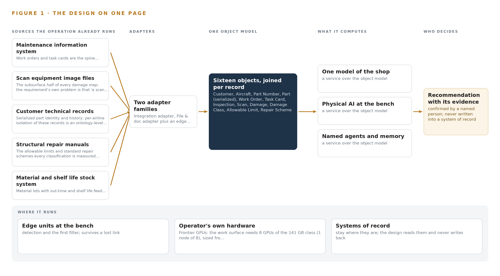
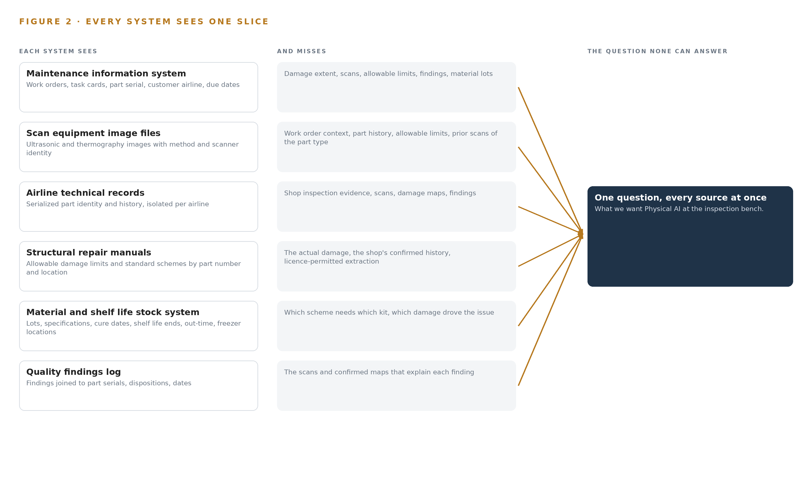
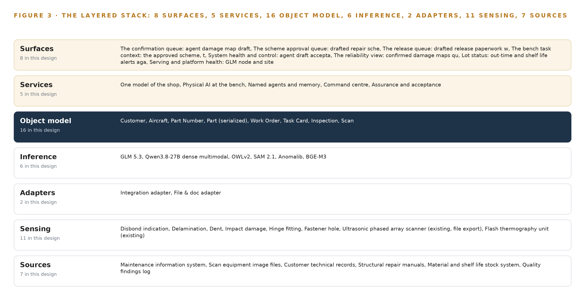
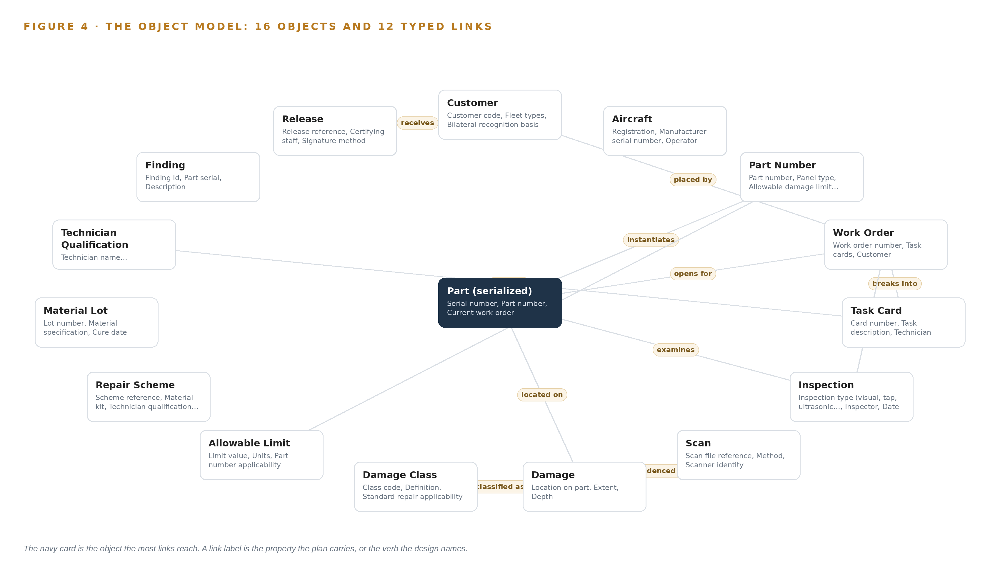
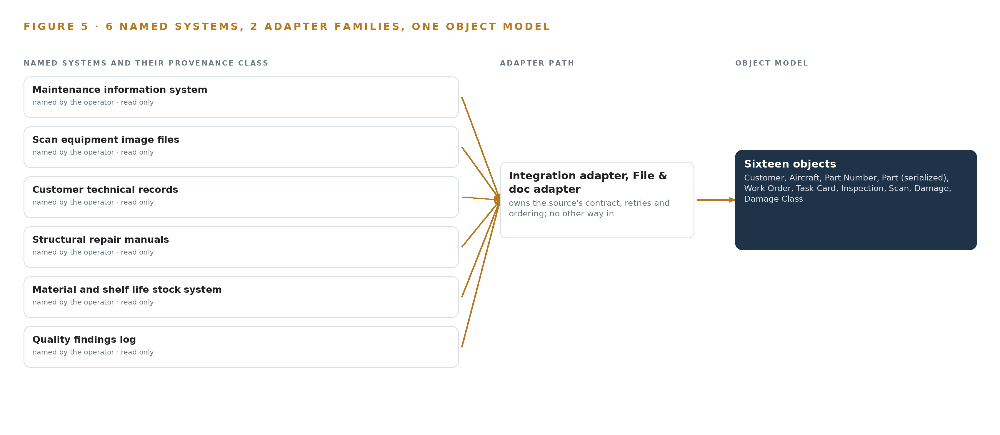
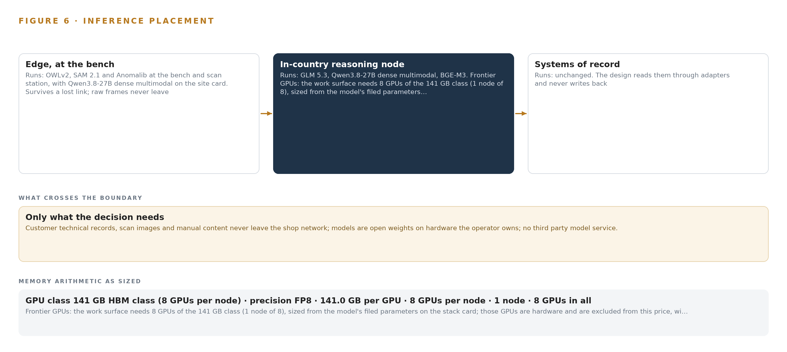
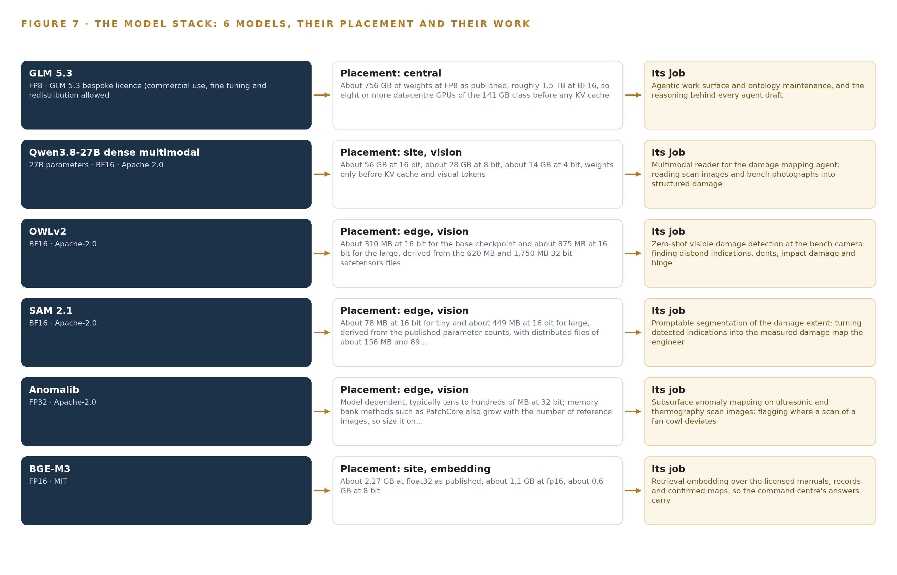
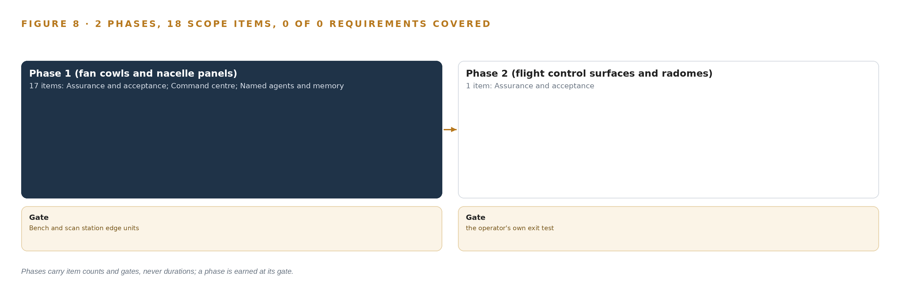
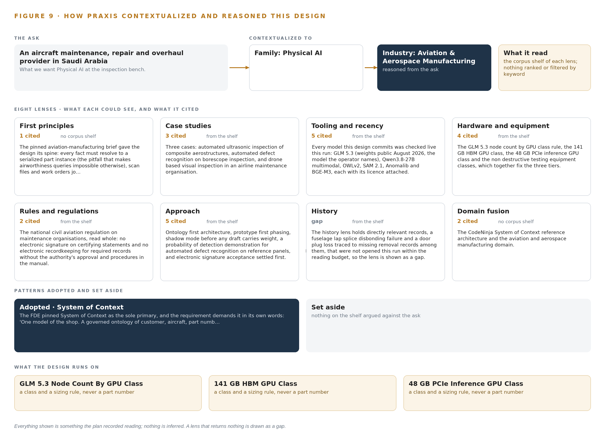

# Physical AI System Design for Composite Part Inspection in an Aviation MRO in Saudi Arabia

Canonical: https://codeatoms.ai/composite-part-inspection-mro-saudi-arabia/
PDF: https://codeatoms.ai/composite-part-inspection-mro-saudi-arabia/paper/composite-part-inspection-mro-saudi-arabia.pdf
License: CC BY 4.0
Publisher: CodeNinja Atoms (https://codeatoms.ai), a fully owned subsidiary of CodeNinja

VERTICAL-DRIVEN ARCHITECTURES · AVIATION & AEROSPACE MANUFACTURING · DESIGNED WITH PRAXIS · NOVEMBER 2026

# Physical AI System Design for Composite Part Inspection in an Aviation MRO in Saudi Arabia

Damage Draft: Sovereign AI Reference Architectures for Composite Repair in Aviation and Aerospace Manufacturing

Muhammad Umar, Cofounder, CodeNinja

For the shop's accountable engineering leader, the certifying and design engineers who approve and sign, and the platform, data and edge engineers who would build and run it.

---

Vertical-Driven Architectures is a CodeNinja series of system designs. Every design in the series is driven by a real-world problem and scenario in a single industry, and every one is designed on Praxis, CodeNinja's platform for designing physical AI systems. Operations are described by class, never by name.

At a glance

## Physical AI System Design for Composite Part Inspection in an Aviation MRO in Saudi Arabia

**What this is.** An open reference architecture for system design in physical AI, built for the composite repair shop of an aircraft maintenance, repair and overhaul provider in Saudi Arabia that repairs radomes, flight control surfaces, nacelle panels, fan cowls and cabin monuments for commercial single aisle and wide body fleets, where owning the three inference tiers that run it costs about 613,000 US dollars over three years. When a fan cowl arrives with a disbond at a hinge fitting larger than it looks, the design joins the bench camera, the ultrasonic and thermography scan, the serialized part's history, the licensed manual's allowable limit and the shop's own confirmed maps into one argument, so the certifying engineer sees the extent, the class, the precedent and whether the manufacturer must be asked before any work starts. Every model runs on the operator's own hardware inside the shop network under the national civil aviation regulations, the manual licences, the personal data protection law and export control on the GPU node and the site card. It is written for the shop's accountable engineering leader, the certifying and design engineers who approve and sign, and the platform, data and edge engineers who would build and run it. The operator is described by class, never by name.

**The answer in numbers.**

| Part | The design |
| --- | --- |
| Sources | Six read only systems of record plus the bench and scan station cameras, entering through two adapter families (an integration adapter against the maintenance information system API and a file and document adapter for scanner exports and parseable manual content) that stamp every fact with its system, timestamp and extraction method: the maintenance information system, the scan equipment's image files, each customer's technical records with per customer isolation, the structural repair manuals under licence, the material and shelf life stock system and the quality findings log; nothing is ever written into a system of record |
| Object model | 16 typed objects with 12 typed links, from the customer, aircraft, part number and serialized part through the work order, task card, inspection and scan to the damage, damage class, allowable limit, repair scheme, material lot, technician qualification, finding and release, with the damage in the focal position and the serialized part carrying the shop's own states from Received to Released or Scrapped, published as JSON for reuse |
| Models | Six: GLM 5.3 (bespoke GLM-5.3 licence, 753B at FP8) for the three drafting agents (damage mapping, repair scheme, release paperwork), the command centre and ontology maintenance; Qwen3.8-27B dense multimodal (Apache-2.0) reading scans and bench photographs into structured damage; OWLv2 zero-shot detection and SAM 2.1 segmentation (Apache-2.0) at the bench; Anomalib (Apache-2.0) mapping subsurface anomalies on scan images; BGE-M3 (MIT) retrieval over manuals, records and confirmed maps; no third party model service, nothing trained into weights |
| Compute | Three tiers inside the shop network in Saudi Arabia: two fanless edge units of the octa core 6 TOPS NPU class at the inspection bench and the scan station; one 48 GB PCIe inference card on a shop server for the reader (about 28 GB at 8 bit) and the embedding model; one node of eight 141 GB HBM GPUs (1,128 GB) holding GLM 5.3's 753 GB of FP8 weights with a 1.2 planning factor, 904 GB. The node and the card are US origin accelerators for a D:3 and D:4 destination, so an export licence determination is a phase one checkpoint before any GPU is quoted |
| Rollout | Two phases carrying 18 scope items (17 and 1) across five workstreams, each closed by a gate, never a date: phase one on fan cowls and nacelle panels for one quarter, baseline first, then shadow mode, then a capability demonstration on reference panels, with the quality system change and the data protection assessment filed in parallel, and its exit gate a dev board run of the actual vision models on the 6 TOPS NPU class; phase two the extension to flight control surfaces and the remaining part families; measures are assessment hours per part, turnaround days, repeat findings on the same part type and rework after final inspection |
| Three-year cost | About 613,000 US dollars to own all three tiers for three years (a range of 583,000 to 639,000: about 570,000 for the node, about 42,000 for the site server and card, under 1,000 for the two edge units, with support and power at the national commercial electricity tariff), against about 773,000 to rent the node and the card on the deepest three year commitment in AWS Middle East (UAE), so ownership costs about four fifths of it, and about 2.06 million on demand, against which ownership costs about three tenths. Renting is a price reference only, because AWS lists no Saudi region on the day read and every rented option would carry customer records, scans and manual content across the border (Appendix A) |
| Human control | Agents map and draft and certifying engineers sign, by name: the certifying engineer confirms, amends or rejects the damage map and its classification, the design engineer approves or supersedes the repair scheme, material kit and qualification, and certifying staff sign the release; no agent classifies damage as repairable or releases a part; the disagreement path is built first and the count of engineer reports is published each week; every confirmed map and approved scheme is kept as memory the next assessment of the same part type reads |

**Reuse it.** The object model, the model register and the figures are free to reuse under CC BY 4.0. Cite as <https://codeatoms.ai/composite-part-inspection-mro-saudi-arabia/.>

**Made with.** Reasoned on [CodeNinja Praxis](<https://codeatoms.ai/praxis/>), the CodeNinja Atoms platform for designing physical AI systems. The object model imports into [Hyper Ontology](<https://codeatoms.ai/hyper-ontology/>), which turns it into a living system. Load it with the [hyper-ontology loader](../hyper-ontology-py/): `hyper-ontology show composite-part-inspection-mro-saudi-arabia`. Both are in beta; access by request.

ABSTRACT

## Physical AI System Design Begins at the Inspection Bench

A physical AI system design for an aircraft maintenance, repair and overhaul provider in Saudi Arabia that repairs radomes, flight control surfaces, nacelle panels and fan cowls for commercial single aisle and wide body fleets starts from one question at the bench: does this damage on this part fall inside the allowable limit, and what has this part type suffered in the same place before? Today that question is assembled by hand from photographs stapled to a paper traveller, scan files stranded on the scanner's own computer and a findings log joined to nothing, so the same disbond on the same panel type is assessed from scratch every time, and no query the shop would recognize as simple can be run at all; the [physical AI system design](https://codeatoms.ai/physical-ai-system-design/) that would fix this must keep customer records, scan images and licensed manual content inside the shop's own network, on the operator's own hardware.

The design is a sovereign system of context built over the shop's existing systems of record: seven sources enter through two adapter families into a governed ontology of sixteen objects, five services run over that model, and eight surfaces carry the work to the people who sign; six models serve the whole, with zero-shot and anomaly vision models on sealed fanless edge units at one inspection bench and one scan station, a dense multimodal reader and a retrieval embedding model on a 48 GB-class site inference card, and a 753B-parameter frontier model served at FP8 on one node of eight 141 GB-class GPUs inside the shop network; three named agents draft damage maps, repair schemes and release paperwork while certifying engineers decide and sign, and every confirmed outcome is kept as memory the next decision reads rather than trained into weights.

The paper covers the industry problem and the join failure in the shop's systems, the constraints that shape the design, the stack and the object model, ingestion through adapters, the placement of inference, the models and their licenses, the rollout in two phases with their item counts and gates, and who owns what the design builds, before closing with how Praxis contextualized and reasoned the design from recorded reading.

---



Figure 1. Damage Draft on one page: the sources the operation already runs, one object model, what it computes, and the person who decides.

## Contents

Each chapter is tagged for the reader it serves most directly: Executive, Team Lead, FDE, Reference.

|  |  |  |
| --- | --- | --- |
|  | Abstract · Physical AI System Design Begins at the Inspection Bench | Executive |
| PART I · THE PROBLEM | | |
| 1 | [Damage Assessment Is the Slowest Step Nobody Can Query](#ch1) | Executive |
| 2 | [Six Systems Hold the Evidence, None the Argument](#ch2) | ExecutiveTeam Lead |
| PART II · THE DESIGN | | |
| 3 | [Sovereignty and the Signature Constrain Every Layer](#ch3) | Team Lead |
| 4 | [One Stack Runs From Records to the Bench](#ch4) | Team LeadFDE |
| 5 | [Sixteen Objects Turn Shop Data Into One Argument](#ch5) | FDE |
| 6 | [Every Source Enters Through an Adapter](#ch6) | FDE |
| 7 | [Vision Runs at the Bench, Reasoning In-Country](#ch7) | FDE |
| 8 | [The License Decides What the Shop Can Own](#ch8) | FDEExecutive |
| PART III · THE ROLLOUT | | |
| 9 | [Shadow Mode Comes Before Any Draft Is Trusted](#ch9) | Team LeadExecutive |
| 10 | [The Intelligence Stays with the Shop](#ch10) | Executive |
| PART IV · HOW IT WAS DESIGNED | | |
|  | Conclusion · The Shop Owns the Argument It Produces | Executive |
| 11 | [How Praxis Contextualized and Reasoned This Design](#ch11) | Team LeadFDE |
|  | [Sources](#sources) | Reference |

PART I · CHAPTER 1

## Damage Assessment Is the Slowest Step Nobody Can Query

The most skilled step in a composite repair shop produces evidence that cannot be searched the next time the same part type arrives, which is why turnaround time suffers and training stalls.

The abstract promised a physical AI system design that drafts damage maps, repair schemes and release paperwork while certifying engineers decide and sign. This chapter starts at the bench, with the question the shop actually needs answered, the evidence it already holds but cannot reach, and the regulatory ground any answer must stand on.

### 1.1  The Question and the Data It Requires

When a fan cowl arrives with a disbond near a hinge fitting, the certifying engineer needs two answers at once: does the measured extent fall inside the allowable limits for that part number at that location, and what happened the previous times this part type showed the same damage in the same place. The first answer requires the scan file, the serialized part's identity, the licensed structural repair manual and the inspection record all resolved to one location on the part. The second requires every confirmed damage map, finding and release for that part type over the last year, and today that evidence lives in photographs stapled to a paper traveller, so the question cannot be asked at all. The regulatory ground is layered: the national civil aviation regulations govern the repair quality system, the qualification of certifying staff and the release of parts to service; the personal data protection law governs records that name technicians and inspectors; and the structural repair manuals are held under license whose terms constrain what may be extracted from them. A system that answers the question must satisfy all three at once, which rules out most of what the market sells as an inspection assistant.

### 1.2  The Documented Cost

The cost of fragmented maintenance evidence is documented publicly, and it is not specific to one shop. One aerospace structures and precision components manufacturer with 85 million dollars in revenue and 340 employees found its data trapped in 7 disconnected systems, so the shop described here is in recognized company (RYSHE n.d.). The American Society for Nondestructive Testing states that standards are vital to the ability of different digital systems to exchange data in maintenance, repair and overhaul, which is precisely the exchange this shop cannot perform today (ASNT n.d.). IATA's TechOps group has published a white paper proposing a more efficient maintenance data standard and a lifelong digital maintenance record for aviation assets, an industry-level admission that the record, not the tooling, is the bottleneck (Aircraftit n.d.). And when an accident occurs, maintenance evidence is read closely by investigators, as the maintenance group factual report following a freighter accident shows (NTSB 2025). Inside this shop the fragmentation costs three things the airlines measure: turnaround time on damage assessment, the scarce hours of the few senior engineers who approve schemes, and the pace at which engineers in training can be shown precedent.

### 1.3  The Operation as a Scenario

The operator is an aircraft maintenance, repair and overhaul provider in Saudi Arabia serving commercial single aisle and wide body fleets, with a composite repair shop expanding under the national program to localise aviation maintenance. The shop repairs radomes, flight control surfaces, nacelle panels, fan cowls and cabin monuments, removed from aircraft in its own hangars and sent in by airlines. Shops of this class handle hundreds of parts a year, and the number is rising with the fleets based in the country. Each part arrives with a work order, is inspected visually and with tap testing, ultrasonic scanning and thermography, has its damage mapped against the manufacturer's structural repair manual, is repaired by laminating technicians under a certifying engineer, is inspected again and released to service. The people in the loop are the laminating technicians, the inspectors who perform and record each inspection, the certifying engineers who confirm damage maps and decide whether a standard repair applies, the design engineers who approve repair schemes or take the question to the manufacturer, and the certifying staff who sign the release. The physical environments are the hangars, the shop floor with its rack, the inspection bench, the scan station and the material store with its freezer. The systems of record number six: the maintenance information system holding work orders and task cards, the scan equipment's own image files, the airlines' technical records, the structural repair manuals under license, the material and shelf life stock system, and the quality findings log.

PART I · CHAPTER 2

## Six Systems Hold the Evidence, None the Argument

Every system of record sees one slice of the part, and the question that matters needs all of them joined, which none of them can do today.

Chapter 1 named the question and the six systems that hold its evidence. This chapter walks those systems one at a time, because the design's whole case rests on what each sees and, more precisely, what each misses.

### 2.1  What Each System Sees

The maintenance information system sees the spine of the work: which part serial arrived, for which airline, under which task cards, and when it is due back. It sees workflow and not damage; a disbond reaches it only as a task description, and the scan that defines the disbond's extent is a file on another computer. The scan equipment's image files hold the subsurface truth, ultrasonic and thermography images with their method and scanner identity, and they miss everything around the scan: which work order it belongs to, which allowable limit it must be measured against, and what the previous scan of the same part type showed. The airlines' technical records hold serialized part identity and history, isolated per airline because records of different carriers mix in one shop, and they miss the shop's own inspection evidence entirely. The structural repair manuals hold the allowable damage limits and the standard repair schemes by part number and location on part, and they miss the actual damage on the bench; their license terms also constrain extraction. The material and shelf life stock system holds lots, cure dates, shelf life ends and accumulated out-time, and cannot see which repair scheme will need which kit. The quality findings log holds findings joined to part serials, and misses the scans and confirmed maps that would explain them.

### 2.2  What None of Them See Together

The question that matters crosses all six: how many fan cowls of one part number showed a disbond at the same hinge fitting in the last year, and did a standard repair apply each time. Answering it means traversing from part number to serialized part, to work order, to inspection, to scan, to damage, to damage class, to allowable limit, a path along which no system holds more than one hop, and the middle hops exist only as photographs on a traveller. Figure 2 sets the six systems side by side and shows the same convergence. The cost in practice is the one the operator stated: the same disbond on the same panel type is assessed from scratch each time, because the precedent is unreachable; repair scheme approval queues on a few senior engineers, because the precedent that would let others judge is unreachable too; engineers in training cannot be shown the shop's own history of a damage class; and turnaround time, the measure the airlines use, stretches exactly at the most skilled step. Investigators have shown the same reach matters after an event, when a maintenance data computer's records must be reconstructed by hand (NTSB 2013).



Figure 2. Six systems, each seeing one part of the answer. The question needs all of them in one place at once.

PART II · CHAPTER 3

## Sovereignty and the Signature Constrain Every Layer

Licensed manuals, a regulator-approved quality system, personal data law and a hard network boundary shape the design before any model is chosen.

Chapter 2 showed the join failure: six systems of record, each holding one slice, with no traversable path between them. This chapter states the goals any design must satisfy before a single component is chosen, because in this industry the constraints, not the models, decide the architecture.

### 3.1  Everything Stays Inside the Shop Network

The first goal is that records, scan images and manual content never leave the shop network, on the operator's own hardware, with no data center or colocation entertained. This is hard in this industry because the reasoning the shop needs, drafting schemes against manual limits with citations, is frontier-class work, and the easy way to obtain it is an external model API that carries the evidence out with every request. Meeting the goal self hosted means the design stands on sovereign infrastructure of its own: one GPU node of the 141 GB class inside the shop network running the work surface, and edge units at the bench and scan station, with no third boundary ever crossed.

### 3.2  The Signature Stays with Named People

The second goal is that agents map and draft while certifying engineers decide and sign, with no autonomous damage classification and no autonomous release. This is hard because the quality system under the national civil aviation regulations assigns release responsibility to named certifying staff, and any system output that holds a required record is a change to that system, which must be filed and approved before it carries weight. Guidance for software management programs during aircraft maintenance exists and shows the shape of that approval path (FAA 2023). Until the change lands, every agent draft runs advisory beside the existing process, and the design accepts that a draft is never a decision.

### 3.3  Nothing Is Trained on the Shop's Records

The third goal is that every confirmed damage map and every approved scheme is kept so the next assessment of the same part type is faster, without training a model on the fly. This is hard because the obvious artificial intelligence play in a damage inspection shop is fine-tuning vision models on accumulated damage images, and that would bake licensed manual content and airline records into weights, crossing both the license and the boundary. The design instead holds memory of confirmed outcomes as retrievable records read before each run, which costs retrieval engineering and buys compounding speed with no retraining pipeline at all.

### 3.4  Two Laws Gate the Records

The fourth goal is to satisfy the personal data protection law and the manual license before anything holds a record. A personal data assessment covers records naming technicians, inspectors and certifying staff; it is filed in the first phase, before the system holds such a record. The manual license is harder: the whole classification comparison depends on extracting allowable limits as queryable objects, and the license terms may not permit it, so written confirmation is required first, with the fallback of citing the manual revision in each draft rather than holding limit objects.

### 3.5  Scoping Decisions

Scope is a constraint like the rest, and Table 1 records the three decisions that bound the first phase, each with what it buys and what it costs.

Table 1 · Scoping Decisions

| Decision | What it buys | What it costs |
| --- | --- | --- |
| Phase one covers fan cowls and nacelle panels only | A bounded, measured first phase on the part family the requirement names first | Flight control surfaces and cabin monuments wait for a later phase |
| Agents draft, certifying engineers decide and sign | A path that changes no decision rights and needs no new signatory | A confirmation step on every agent output, by design |
| Memory of confirmed outcomes, never weights | Compounding assessment speed with no retraining pipeline | Retrieval engineering over the kept record instead of model updates |

### 3.6  What the Design Chose Against

Each layer carries a rejected alternative, and Table 2 records them, ending with what is out of scope and why.

Table 2 · What the Design Chose Against

| Where | What was picked | Instead of, and why |
| --- | --- | --- |
| Reasoning placement | GLM 5.3 self hosted on one node of eight 141 GB-class GPUs inside the shop network | A cloud model API, because the boundary keeps records, scans and manual content off any external network |
| Bench vision | Zero-shot and anomaly models on edge units at one bench and one scan station | A whole-shop camera rollout, because the value concentrates where damage is mapped and the NPU loads are unmeasured until the gate |
| Site reading | A 27B dense multimodal model on a 48 GB site card | Sending images to the frontier node, keeping the reading beside the data it came from |
| Manual limits | Allowable limit objects extracted from the licensed manuals, pending written confirmation | Citing the manual revision in each draft only, the stated fallback if the license refuses extraction |
| Integration | Bespoke read connectors against the six named systems | An integration product, because the maintenance information system exposes its own API and the scanner exports files |
| Out of scope | Autonomous damage classification or release, and any change to who signs | Anything that removes the certifying engineer from the decision, which the quality system does not permit and the design does not seek |

PART II · CHAPTER 4

## One Stack Runs From Records to the Bench

The design keeps the systems of record below, one governed object model in the middle, and applications and agents above, all inside the shop network.

Chapter 3 fixed the four constraints that shape everything downstream: no data leaves the shop network, no system of record is replaced, every required record keeps a named human signature, and nothing is trusted before it is shadowed. This chapter lays the stack that satisfies those constraints, stage by stage, from the records the shop already trusts to the surfaces its engineers already work at.

### 4.1  The Pattern and Why It Fits

The design uses one architectural pattern end to end: systems of record below, one governed object model in the middle, applications and agents above, all inside the shop network. The pattern fits this industry because the records below are already certified, licensed and audited, and the design has no authority to change them; an aerospace structures manufacturer of comparable scale reports its data trapped in disconnected systems, which is the condition this pattern exists to remove (RYSHE n.d.). Nothing in the design writes back to a maintenance information system, a stock system or a licensed manual; every one of them is read, joined and reasoned over, never modified. The middle layer, a single object model of the shop, is where the join happens, and because it is governed, every draft an agent produces can be traced to the record and the scan it came from. Above it sit the five services and the eight surfaces, and the agents that draft while certifying engineers decide and sign. Figure 3 shows the layered stack with the count at each layer: six named systems of record below, two adapter families as the sole path in, one object model of sixteen objects, five services, eight surfaces and six models across three inference tiers. The Federal Aviation Administration's guidance on managing software used during maintenance treats the integrity of such tooling as part of the maintenance process itself, not as an accessory to it, and the stack is built to that standard (FAA 2023). Table 7, printed by the platform from the plan, carries the layer by layer technology choices with the reason each was picked, from Apache Kafka in KRaft mode to Keycloak for on-site identity.



Figure 3. The layered stack: 7 sources, 2 adapter families, 16 objects, 5 services and 8 surfaces.

Table 7 · Architecture, Layer by Layer

| Layer | Component | Choice | Why |
| --- | --- | --- | --- |
| Event streaming and messaging | by class, no product named | Product | Apache Kafka (KRaft mode) |
| The ontology or graph store | by class, no product named | Product | Hyper Ontology v0.9 (Semantics plus Kinetics) |
| Time series and telemetry storage | by class, no product named | Product | PostgreSQL 18 |
| Video ingest, recording and management | by class, no product named | Product | Frigate NVR |
| Edge model serving | by class, no product named | Product | ONNX Runtime |
| On site language model serving | by class, no product named | Product | vLLM |
| Object tracking and trajectory forecasting | by class, no product named | Not needed | Parts are static on the bench and scan station; this design maps damage extent on a stationary fan cowl, and nothing in the requirement asks for trajectory forecasting. |
| Edge orchestration of containers | by class, no product named | Product | Docker Engine |
| An air gapped artifact and model registry | by class, no product named | Product | Harbor (offline installer) |
| Labelling and retraining | by class, no product named | Not needed | The requirement's own words: 'Every confirmed damage map and every approved scheme is kept so the next assessment of the same part type is faster, without training a model on the fly'; under system of context nothing is trained into weights, so there is no retraining pipeline, and the reference panels serve capability demonstration instead. |
| Time synchronisation across sensors and systems | by class, no product named | Product | Chrony (NTP) with linuxptp available |
| Observability of the running system | by class, no product named | Product | Prometheus 3.13 LTS (with Grafana dashboards) |

### 4.2  The Stack Stage by Stage

Each stage has one responsibility and named components that carry it, so that a fault, an upgrade or an audit question lands in one place. Table 3 states the stages in order, what each is responsible for, and how it meets that responsibility; the stages run from the sources through sensing, adapters, the object model and inference to the services and surfaces where people act.

Table 3 · The Stack, Stage by Stage

| Stage | What it is responsible for | How |
| --- | --- | --- |
| Sources | Holding the records the shop already trusts | Six named systems read only: the maintenance information system, scanner image files, airline technical records, licensed structural repair manuals, the material and shelf life stock system, the quality findings log |
| Sensing | Instrumenting the bench and the scan station | Inspection bench, bench overhead and scan station cameras on Frigate NVR, beside the existing ultrasonic phased array scanner, flash thermography unit and recorded tap tests |
| Adapters | Being the sole path data takes into the model | Two families: an integration adapter against the maintenance information system API, and a file and document adapter lifting scanner exports and parseable manual content |
| Object model | Holding the governed model of the shop | Hyper Ontology v0.9 over PostgreSQL 18, with Apache Kafka in KRaft mode moving events between stages |
| Inference | Running the six models where the data sits | ONNX Runtime on the fanless edge units, vLLM on the 48 GB site card and on the 141 GB-class, eight-GPU node |
| Services | Doing the shop's work | Five: one model of the shop, physical AI at the bench, named agents and memory, command center, assurance and acceptance |
| Surfaces | Putting drafts in front of named people | Eight surfaces on the work surface, from the confirmation queue and scheme approval queue to lot status and serving and platform health |

### 4.3  A Reusable Pattern

A team carrying a similar brief can reuse the whole shape: records read and never replaced below, two adapter families as the sole entry path, one governed object model in the middle, agents that draft and named people who confirm and sign above, and a shadow period before any draft carries weight. What they swap is the content: their own named systems of record in the sources stage, their own object set and typed links, their own detection vocabulary at the bench, and models sized to their own hardware. What they keep regardless of industry is the part that carries the constraints: the adapter-only entry, the single write path through human confirmation, hosting inside their own boundary, and the assurance workstream that files the quality system change before anything holds a required record.

PART II · CHAPTER 5

## Sixteen Objects Turn Shop Data Into One Argument

Sixteen typed objects with governed links turn work orders, scans, damage, schemes and releases into one queryable argument that no document store can hold.

Chapter 4 described the stack that carries the design from records to surfaces. This chapter describes what the middle of that stack holds: the sixteen governed objects and their typed links that turn the shop's scattered records into one queryable argument.

### 5.1  Sixteen Objects and the Links Between Them

The object model holds sixteen objects: Customer, Aircraft, Part Number, Part (serialized), Work Order, Task Card, Inspection, Scan, Damage, Damage Class, Allowable Limit, Repair Scheme, Material Lot, Technician Qualification, Finding and Release. Each is anchored in a system of record the shop already runs, and each carries a status vocabulary that mirrors the shop's real states, so a serialized part moves through Received, In assessment, Awaiting scheme approval, In repair, Final inspection, Released or Scrapped exactly as it does on the floor. Figure 4 shows every object and its typed links, with the Damage object in the focal position because it is where the slowest and most skilled step happens. The links are typed, which is what makes the model an argument rather than a pile of documents: a damage event points to the serialized part it sits on, the damage class it is measured against, and the scan that evidences it, while the part number points to the allowable limits that govern the comparison. The question the shop cannot ask today, how many fan cowls of one part number showed a disbond at the same hinge fitting in the last year, is answered by walking four links: from the part number to its serialized instances, to the damage events confirmed on them, to the scans and hinge fitting locations that evidence each one, and out to the findings log. A document store holds each of those facts somewhere, but it holds no path between them, and the industry's own work on a lifelong digital maintenance record argues for exactly this joined form (Aircraftit n.d.). Investigations reconstruct maintenance history from whatever fragments systems happened to keep, which is the failure a governed model prevents (NTSB 2013). Table 8, printed by the platform from the plan, lists every object with the record it is anchored in and its typed links.



Figure 4. The sixteen objects of the model and the typed links that let a query reach across them.

Table 8 · The Object Model

| Object | Anchored in | Typed links |
| --- | --- | --- |
| Customer | The technical records of each customer's parts | receives: Release |
| Aircraft | The maintenance information system (work order header) | no typed link recorded |
| Part Number | The structural repair manuals under license | limited by: Allowable Limit |
| Part (serialized) | The technical records of each customer's parts | instantiates: Part Number |
| Work Order | The maintenance information system | opens for: Part (serialized); placed by: Customer; breaks into: Task Card |
| Task Card | The maintenance information system | requires: Technician Qualification |
| Inspection | event | examines: Part (serialized); belongs to: Work Order |
| Scan | The scan equipment's own computer | no typed link recorded |
| Damage | event | located on: Part (serialized); classified as: Damage Class; evidenced by: Scan |
| Damage Class | The structural repair manuals under license | no typed link recorded |
| Allowable Limit | The structural repair manuals under license | no typed link recorded |
| Repair Scheme | The structural repair manuals under license | no typed link recorded |

### 5.2  The Human Loop and the Hosting Posture

The human loop lives in the status vocabularies and in three of the eight surfaces: the confirmation queue where a certifying engineer confirms, amends or rejects an agent's damage map draft, the scheme approval queue where a design engineer approves or supersedes a drafted repair scheme, and the release queue where certifying staff sign the release paperwork. An agent never moves an object past its drafted status; only a named person's confirmation does, and that confirmation is the single write path into the model for anything that becomes a required record. The hosting posture follows the boundary constraint: the ontology, the memory of confirmed outcomes and the model node all run on the operator's own hardware inside the shop network, in Saudi Arabia, with identity handled by Keycloak on site. No external links leave the boundary except the one-way update path through a hardware data diode, which lets artifacts in and nothing out, and the personal data protection assessment is filed before any record is held. Per-airline isolation of technical records is a property of the model itself, because records of different airlines mix in one shop and must not mix in one query.

### 5.3  One Object in Its Recorded Form

The Customer record below shows the identifier, label, kind, properties, status vocabulary and links the platform prints for every object; the Damage object, the one every assessment turns on, is recorded the same way.

```
{ "id": "customer", "label": "Customer", "kind": "actor", "anchored_in": "The technical records of each customer's parts", "properties": [ "Customer code", "Fleet types", "Bilateral recognition basis", "Release certificate format" ], "status_vocabulary": [], "links": [ { "to": "release", "label": "receives" } ] }
```

PART II · CHAPTER 6

## Every Source Enters Through an Adapter

Seven sources of record enter through two adapter families, so no source system is modified and no data path bypasses the governed model.

Chapter 5 described what the object model holds and how its links carry an argument. This chapter describes how data gets into it: seven sources, two adapter families, and an event backbone that keeps every arrival ordered, buffered and traceable.

### 6.1  Seven Sources and Their Provenance

Seven sources feed the model: the six named systems of record plus the camera stream from the bench and scan station. The maintenance information system, which holds work orders and task cards and exposes a live API, is read through the integration adapter and is the spine every scan, damage map and scheme resolves to. The scan equipment image files, the subsurface half of every damage map, are lifted from the scanner's own computer by the file and document adapter together with whatever metadata each scan carries. The airline technical records supply serialized part identity and history, with per-airline isolation enforced at the ontology. The structural repair manuals, held as licensed digital manuals confirmed parseable at intake, supply the allowable limits and standard repair schemes, with license permission to extract confirmed in writing before go live. The material and shelf life stock system feeds material lots with cure dates, shelf life ends and accumulated out-time. The quality findings log supplies the findings that make the repeat-finding question answerable. Figure 5 shows each named system, its provenance class and its adapter path; all six systems of record carry operator provenance and read-only direction. The nondestructive testing community's own position is that shared standards are what let different digital systems exchange inspection data at all, which is the gap the adapter tier is built to close (ASNT n.d.).



Figure 5. The 7 named systems, the adapter path each one takes, and the object model they all map into.

### 6.2  What the Adapter Tier Guarantees

The adapter tier guarantees four things. First, no source system is modified: every connection is read-only, so the certified systems of record stay exactly as their auditors last saw them, in line with guidance that treats software touching maintenance data as part of the managed process (FAA 2023). Second, provenance is recorded on arrival: every work order, scan file and manual clause enters carrying the system, the timestamp and the extraction method it came from, and where a scanner's export lacks the calibration reference the evidence chain needs, the gap is recorded and shown rather than hidden. Third, per-airline isolation is applied as data lands, so records of one airline never enter a query path for another. Fourth, ingestion is idempotent, so a re-read of the same work order or the same scan file produces the same objects rather than duplicates, which is what lets the pipeline be replayed after any interruption without corrupting the model.

### 6.3  The Event Backbone

Apache Kafka in KRaft mode carries every arrival from the adapters to the object model and every downstream service. Ordering is keyed by work order, so all events for one part arrive in the order the shop generated them, which matters when a damage confirmation must not overtake the inspection that precedes it. Delivery is at least once, paired with the idempotent consumers above, so a repeated event is recognized and dropped rather than double-counted. Buffering absorbs the shop's natural bursts: a scanner export, a batch of task card updates and a camera clip set can arrive together without loss, because Kafka retains them until every consumer has acknowledged. Replication keeps a copy of the stream inside the shop network, so a node restart does not lose an in-flight damage map, and Chrony time synchronization with an OCP Time Card grandmaster keeps sensor and system clocks aligned, which is what makes the evidence chain's timestamps mean the same thing everywhere. Updates to the running system itself arrive the same one way, through the data diode, so the backbone never opens an outbound path.

PART II · CHAPTER 7

## Vision Runs at the Bench, Reasoning In-Country

Zero-shot and anomaly vision run on edge units at the bench and scan station, multimodal reading runs on a site card, and the frontier model runs on one GPU node inside the shop.

Chapter 6 showed every source entering through one of two adapter families and landing in the object model as typed, provenance-carrying records. This chapter fixes where inference runs, because in a shop whose records, scan images and licensed manual content must never leave its network, placement is a boundary decision before it is a performance one: the same weights that are cheap to serve from a data center are impossible to serve there once the evidence they read cannot follow them.

### 7.1  Three Tiers and Their Memory Arithmetic

Figure 6 places the work on three tiers. At the edge sit two units of the on-device class the design carries: an octa-core SoC with a 6 TOPS neural processing unit in a fanless sealed housing, one at the inspection bench and one at the scan station. They run the vision models, whose weights are small enough to state exactly: OWLv2 at about 310 MB for the base checkpoint and about 875 MB for the large at 16 bit, SAM 2.1 at about 78 MB for tiny and about 449 MB for large at 16 bit, and an Anomalib model whose size is model dependent, typically tens to hundreds of MB at 32 bit, with memory bank methods such as PatchCore also growing with the number of reference images. Capacity is therefore not the open question at this tier; rate is, because loads on the neural processing unit are unmeasured, and measurement with the actual models on a development board is the phase one gate before any unit is committed, with the ONNX Runtime CPU provider and a small GPU at the bench as the stated fallbacks.

The site tier is a single card of the 48 GB PCIe inference GPU class on a server inside the shop. It holds the multimodal reader, a 27 billion parameter dense vision-language model at about 28 GB of weights at 8 bit, which leaves the rest of the card for the key-value cache and the visual tokens that scan reading generates. Beside it sits the retrieval embedding model at about 1.1 GB at FP16, small enough that it never competes with the reader for the card.

The central tier is one node of 8 GPUs of the 141 GB class, self-hosted inside the shop network with no data center and no colocation, because the boundary constraint keeps records, scans and manual content on site. The arithmetic comes from the frontier model's filed parameter count: 753 billion parameters at FP8, at one byte per parameter, give 753 GB of weights; multiplying by 1.2 for the key-value cache and activations gives 904 GB the GPUs must hold; and the node offers 8 times 141 GB, or 1,128 GB, which holds it with headroom for the cache ceiling that long drafting sessions push toward.



Figure 6. Where each tier runs, what runs there, and the narrow set of outputs that cross the boundary.

### 7.2  The Latency Budget

The budget is set by the shop's work rather than by any model's benchmark, and each tier has its own clock. At the bench, detection runs on selected frames rather than every frame, so the constraint is that an indication surfaces while the part is still under the technician's hands and the lighting and framing that produced it can be repeated. At the scan station, anomaly mapping of an exported file must finish inside the same inspection slot the scan already occupies, or the operator will read the raw image first and the draft becomes a check rather than a head start. The multimodal reader must turn one scan into a structured damage draft while the work order is still open, and the frontier model's draft must be waiting in the confirmation queue by the time the certifying engineer opens it, because a draft that arrives after the decision has been made is worth less than none. Every tier is therefore sized so that the slowest step a person waits on is the person's own judgement, which is the step the design protects rather than compresses.

### 7.3  What Crosses the Boundary, and What Fails

Nothing crosses outward. The technical records of the airlines' parts, the scan images and the manual content stay on the shop network, and the single write path, a named person's confirmation or signature, lands in the object model and never in a system of record. What crosses inward is the update stream: container images and model weights arrive through a one-way transfer, Lidi over a hardware data diode, into the on-site registry installed from Harbor's offline installer, and the diode's direction is what guarantees that shop data cannot follow an update back out.

The failure paths follow from that shape. If the link between an edge unit and the site server fails, the edge units keep detecting and segmenting against the models they already hold, drafts queue locally, and the queues resynchronize when the link returns; the shop's existing process is unaffected because every draft is advisory until an engineer signs it. If power fails, the NUT-managed UPS carries the edge units and the site server through the interruption, and the systems of record are the shop's own in any case. If the update path fails, the units run the versions already in the on-site registry, and the absence of a new version is a condition the system health surface shows rather than hides, alongside agent draft acceptance and the weekly count of engineer disagreement reports.

PART II · CHAPTER 8

## The License Decides What the Shop Can Own

Six models under permissive or bespoke terms let the operator hold every weight it runs, on hardware whose export path is settled before any order.

Chapter 7 placed the three tiers and sized their memory from the models' filed weights. This chapter states what runs at each tier and on what terms, because the license behind a model, not its benchmark, decides whether the operator can hold the weights its inspection process comes to depend on.



Figure 7. The six models, their placement, and the work each one does.

### 8.1  Six Models the Shop Holds Outright

Figure 7 stacks the six models against the three tiers. At the center sits GLM 5.3, a frontier-class model with about 753 billion filed parameters served at FP8 on the one GPU node. Its role is the agentic work surface and ontology maintenance, and the reasoning behind every agent draft. It carries a bespoke GLM-5.3 license whose terms permit commercial use, fine tuning and redistribution, which is what lets the operator hold and change the weights it runs rather than rent them, and it was chosen because the command center the requirement names, with parts in work, open assessments, approvals waiting and a conversational interface that answers with citations, needs reasoning weight that smaller models cannot supply.

At the site tier, Qwen3.8-27B dense multimodal reads scan images and bench photographs into structured damage for the mapping agent. It is a 27 billion parameter dense vision-language model under Apache-2.0, at about 28 GB of weights at 8 bit on the 48 GB card, and it was chosen to keep the reading of images beside the data while the frontier reasoning stays on its own node.

Three vision models run at the edge. OWLv2 is a zero-shot, text-conditioned detector under Apache-2.0, at about 310 MB for the base checkpoint and about 875 MB for the large at 16 bit; it was chosen because it needs no training for this shop, so the bench unit detects the damage vocabulary the shop already uses, from disbond indication to hinge fitting, without any labelled local damage data, and it runs on selected frames rather than every frame. SAM 2.1 is promptable segmentation under Apache-2.0 on checkpoints, inference and training code with no field of use restriction, at about 78 MB for tiny and about 449 MB for large at 16 bit; the damage map needs masks and extents rather than boxes, and it is driven by the detector's boxes or an operator click. Anomalib, under Apache-2.0, maps subsurface anomalies on ultrasonic and thermography scan images, flagging where a scan of a fan cowl deviates from reference panels; its size is model dependent, typically tens to hundreds of MB at 32 bit, and memory bank methods grow with the reference set, so it is sized on the chosen model.

BGE-M3, under MIT, is the retrieval embedding over the licensed manuals, records and confirmed maps. Its dense, sparse and multi-vector output from a single pass keeps part numbers and clause references retrievable as exact strings, with an 8,192-token window, at about 1.1 GB at FP16 on the site card. The two accelerator purchases carry their own term: the 141 GB class node and the 48 GB site card are US-origin accelerators whose export to the operator needs a license determination before any order, with in-country sourcing weighed as the alternative.

### 8.2  The Model and Equipment Register

Table 4 gathers every choice this chapter and the last rest on: each model, the hardware classes and sizing rules the tiers are built from, the sensing that feeds them, the patterns the design stands on, and the ground the whole system runs on. Read together, the rows show that the intelligence in this design is held, not borrowed: every weight runs on the operator's own hardware inside the shop network, under licenses that permit it, on equipment whose export path is settled before anything is ordered.

Table 4 · Model and Equipment Register

| The choice | What was picked | Why here |
| --- | --- | --- |
| Frontier reasoning | GLM 5.3, about 753B filed parameters, FP8, bespoke GLM-5.3 license | Commercial use, fine tuning and redistribution permitted, so the operator holds and changes the weights its work surface runs on |
| Multimodal reading | Qwen3.8-27B dense multimodal, Apache-2.0 | Reads scans and bench photographs into structured damage beside the data, at about 28 GB of weights at 8 bit on the site card |
| Zero-shot detection | OWLv2, Apache-2.0 | Text-conditioned and untrained, so the bench detects the shop's own damage vocabulary with no labelled local data, on selected frames |
| Promptable segmentation | SAM 2.1, Apache-2.0 | Turns boxes or an operator click into the masks and extents the damage map needs, with no field of use restriction |
| Subsurface anomaly mapping | Anomalib, Apache-2.0 | Flags where ultrasonic and thermography scans deviate from reference panels; sized on the chosen model as the memory bank grows |
| Retrieval embedding | BGE-M3, MIT | Dense, sparse and multi-vector output keeps part numbers and clause references retrievable, with an 8,192-token window |
| Frontier node sizing | GLM 5.3 Node Count By GPU Class | One node of 8 GPUs holds 904 GB of weights, cache and activations from the filed parameter count |
| Frontier GPU class | 141 GB HBM GPU Class | 8 times 141 GB gives 1,128 GB, enough for the FP8 weights and the KV cache ceiling |
| Site inference card | 48 GB PCIe Inference GPU Class | Carries the reader at about 28 GB of weights with the rest of the card for cache and visual tokens |
| Inspection equipment | Non Destructive Testing Equipment Classes | Existing ultrasonic, thermography and tap test capability, lifted with its metadata rather than replaced |
| Bench sensing | Inspection bench camera, bench overhead camera, scan station camera | Fixed framing of the part, the damage and the traveller tag at the two edge units |
| Subsurface sensing | Ultrasonic phased array scanner and flash thermography unit (existing, file export), tap test on the task card | The subsurface half of every damage map, exported with scanner identity and calibration reference |

PART III · CHAPTER 9

## Shadow Mode Comes Before Any Draft Is Trusted

A measured first phase on fan cowls and nacelle panels runs a baseline and then shadow mode before any draft carries weight, with the quality system change filed in parallel.

Chapter 8 settled the model stack and the licenses that let the shop hold every weight it runs. This chapter sets out how the design arrives in the shop: two phases, what each carries, what the rollout measures, and the gates that stop the work cheaply when a premise fails.

### 9.1  Phases, Items and Gates

Phase one carries 17 items across five workstreams: One model of the shop, Physical AI at the bench, Named agents and memory, Command center, and Assurance and acceptance. The first workstream builds the shop ontology from the systems of record, and its items include the maintenance information system read integration and the scanner file export integration; the last workstream carries the assurance work that must land before anything holds a required record. Phase one runs on fan cowls and nacelle panels only. Its exit gate is the bench and scan station edge units: a dev-board run with the actual vision models, because whether they fit the 6 TOPS NPU class at a usable rate decides whether the edge tier is viable at all. Phase two carries a single item, the extension design to flight control surfaces and the remaining part families, under the Assurance and acceptance workstream, and it begins only when the phase one gate has been passed.

Within phase one the order is fixed by what the shop must trust first: the baseline before the drafts, shadow mode before any draft carries weight, and a capability demonstration on reference panels before the quality system change is relied on. The quality system change under the national civil aviation regulations and the personal data protection assessment are filed in phase one, in parallel with the build, because the approval path and not the technology sets the schedule; a precedent recorded in the plan's own risk register makes exactly that point. Figure 8 shows both phases with their item counts, workstreams and gates, and carries the coverage of the 22 requirements, each traced to a workstream and a gate rather than left as a claim.



Figure 8. The two phases and their gates, and coverage of the 22 requirements across them.

### 9.2  What the Rollout Measures

The rollout measures the shop, not the models. The baseline comes first: how long an assessment takes today from received part to confirmed damage map, how often the certifying engineer escalates to the manufacturer, and how many assessments start from scratch for a part type the shop has seen before. Shadow mode comes second, with agent drafts running beside the existing process and no draft holding a required record. Its measures are how often a draft is confirmed without amendment, how often the engineer amends the location, the extent or the class, and how often a draft is rejected outright.

Alongside these the rollout tracks the time from scan ingested to map confirmed, the count of out-time alerts acted on before a material lot expires, and whether the repeat-finding question the shop cannot ask today, how many fan cowls of one type showed a disbond at the same hinge, becomes answerable from confirmed maps joined to part serials.

### 9.3  Failure Modes

Table 5 lists what the design accepts can fail and what it does about each. Every row is a recorded risk with a named answer, and the first two are gates in their own right.

Table 5 · Failure Modes

| What fails | What the design does |
| --- | --- |
| The structural repair manual license may not permit extracting allowable limits into the ontology | Written confirmation from the manual holder before go live; if refused, drafts cite the manual revision instead of holding limit objects |
| Vision model loads may not fit the on-device NPU at a usable rate | Dev-board measurement with the actual models is the phase one gate; the ONNX Runtime CPU provider and a small GPU at the bench are the stated fallbacks |
| The quality system change under the national civil aviation regulations may land after the build | The change is filed in phase one in parallel with the build; drafts run as advisory beside the existing process until it lands |
| The 141 GB class node and the 48 GB site card are US-origin accelerators needing an export license determination | The determination sits at a phase one checkpoint before any GPU is quoted; in-country sourcing is weighed as the alternative |
| Scan file quality, format and metadata vary by scanner and may not carry the calibration reference | A scanner survey is an early phase one item; provenance gaps are recorded per scan and left visible rather than hidden |
| Certifying engineers find drafts slower to check than to redo | Shadow mode with disagreement review beside the engineers; the disagreement path is built first and the count of engineer reports is published each week |

### 9.4  Lessons From the Build

**Shadow the drafts before anyone trusts them.** A draft that reaches a certifying engineer before its agreement rate is known transfers risk to the signature, which is the one place the design cannot afford it. Shadow mode on fan cowls and nacelle panels buys the evidence, and the reference panels buy the demonstration, without either touching a required record.

**Build the disagreement path before the agreement path.** The instructive signal in advisory drafting is where the engineer and the agent diverge, because each divergence is either a model finding or an engineer precedent the memory should hold. Publishing the count of engineer reports each week turns quiet non-use into a visible finding instead of a slow failure that reads as a technology problem.

**File the paperwork with the build.** The quality system change and the data protection assessment run in parallel with the engineering from the first item of phase one, because the recorded precedent in the plan's risk register is that the approval path, not the technology, sets the schedule.

### 9.5  What Is Still Open

Four questions remain open, and settling each changes something concrete. The manual license permission, once confirmed in writing, decides whether allowable limit objects exist in the ontology or every draft cites a manual revision instead. The export license determination decides the sourcing route for the 141 GB HBM class node and the 48 GB site card, and an in-country answer would change the hardware plan rather than the design. The scanner survey decides which provenance fields the evidence chain can rely on and where the gaps will sit. The survey of PoE ports and switch budget at the bench and scan station decides whether the edge units land where the design places them or the shop's existing network constrains the placement.

PART III · CHAPTER 10

## The Intelligence Stays with the Shop

The object model, the weights, the memory of confirmed outcomes and the boundary all belong to the shop, and nothing that compounds ever leaves it.

Chapter 9 ended on the open questions the rollout must settle. This chapter settles the question underneath all of them: who owns what the design builds, and what never leaves the shop that produced it.

### 10.1  What the Shop Owns

The object model is the shop's outright. Its 16 objects are anchored in systems of record the shop already holds: the work order spine in the maintenance information system, the serialized part identity in the per-airline technical records, the allowable limits in the licensed manuals, the material lots in the stock system. Because the ontology is governed and self-contained, it can be exported, audited and rebuilt inside the shop's boundary without any vendor's continuing presence, and the per-airline isolation of technical records is a property of the model itself, since records of different airlines mix in one shop.

The weights are the shop's too. GLM 5.3 runs under a license that permits commercial use, fine tuning and redistribution, so the operator may hold, tune and even redistribute the weights it serves on its own node; the vision and embedding models carry Apache-2.0 and MIT terms with no field of use restriction. Nothing in the stack rents intelligence from outside the boundary.

The decision record, every confirmed damage map, approved scheme and signed release with its signature method and retention expiry, belongs to the shop as evidence. The memory of confirmed outcomes is a record the next decision reads, and nothing in it updates model weights. The boundary itself is owned and enforced: records, scans and manual content never leave the shop network, updates arrive one way over a hardware data diode, and the reasoning node sits inside the shop, self-hosted. This is the shape a physical AI system design takes in practice when the operator owns it, and the shop that produced the intelligence keeps all of it.

### 10.2  The Offer Behind the Design

CodeNinja designed this system on Praxis, its platform for designing physical AI systems, and each element of it maps to the offer behind the design. The bench and scan station sensing, the cameras and the zero-shot and anomaly detection of physical damage, are Adaptive Operations. The confirmation, scheme approval and release queues, where ranking and drafting end in a named person's decision, are Decision Systems. The governed object model of 16 objects is Hyper Ontology, and the command center where certifying engineers, design engineers and certifying staff act on agent drafts is Hyper Pragma, the work surface where the shop's own people build and run their agents. The whole footing, own hardware in the shop, open-weight licenses, in-country self-hosted serving with a data diode at the edge, is Sovereign Infrastructure.

PART IV · CONCLUSION

## The Shop Owns the Argument It Produces

In one view the design is a single governed argument built from records the shop already holds: a part arrives, its scans and photographs join its serialized history and the licensed manual limits, agents draft the damage map, the scheme and the release papers over that joined context, and a named engineer signs each one, with every confirmed outcome kept so the next assessment of the same part type starts from evidence instead of from zero.

Running the same shape elsewhere takes the same four things it took here: systems of record that can be read without being replaced, a boundary the data never crosses and hardware the operator holds inside it, licenses that let the operator keep every weight it runs, and a regulator-approved path in which agents draft and people sign; any operation with serialized assets, a skilled assessment bottleneck and a hard sovereignty constraint can swap its objects, sources and damage vocabulary for its own and keep the shape.

PART IV · CHAPTER 11

## How Praxis Contextualized and Reasoned This Design

Every choice in this design traces to recorded reading, from the ask and its family to the eight lenses and the patterns they returned.

Chapter 10 established that everything the design builds stays with the shop. This chapter turns the design around and shows how it was produced, so any choice in it can be traced back to what justified it. Every design in this series is produced on Praxis, the design team platform for designing physical AI systems, and this chapter lets a reader follow the reasoning the way the platform recorded it. Figure 9 shows the path from the ask to the equipment classes: the ask and its assigned family and industry, what it read, the eight lenses and what each returned, the patterns adopted and set aside, and the ground the design runs on.

### 11.1  Contextualizing the Ask

The ask, in the operator's own words, was a physical AI system design for composite part inspection in a composite repair shop: radomes, flight control surfaces, nacelle panels, fan cowls and cabin monuments, assessed visually and with tap testing, ultrasonic scanning and thermography against allowable limits in licensed manuals. Praxis assigned the family system of context and the industry Aviation and Aerospace Manufacturing, which pinned the architecture before any component was chosen: a governed ontology over the systems of record, agents that draft while certifying engineers decide and sign, and memory of confirmed outcomes instead of any training into weights. What Praxis read was the operator's requirement, written in its own voice and dated 7 November 2026, together with the corpus shelf of each lens, and nothing beyond the published sources cited in this paper's register was consulted.



Figure 9. From the ask to the design: the family and industry Praxis assigned, the eight lenses and what each cited, the patterns adopted and set aside, and the equipment the design lands on.

### 11.2  The Lenses

Table 6 shows all eight lenses, what each could see, what it cited and what it contributed to the design. One lens returned nothing the others had not already carried, and it is shown as a gap rather than folded into a neighbour.

Table 6 · The Lenses and What They Contributed

| Lens | Could see | Cited | What it contributed |
| --- | --- | --- | --- |
| First principles | no corpus shelf | 1 | The pinned aviation and aerospace manufacturing brief gave the design its spine: every fact must resolve to a serialized part instance, because a fact that does not is the pitfall that makes an airworthiness question impossible to answer; scan files and work orders join on that instance. |
| Case studies | the case study shelf | 3 | Three cases: automated ultrasonic inspection of composite aerostructures, automated defect recognition on borescope inspection, and drone based visual inspection in an airline maintenance organisation. |
| Tooling and recency | the tooling and recency shelf | 5 | Every model this design commits was checked live this run: GLM 5.3 (weights public August 2026, the model the operator names), Qwen3.8-27B multimodal, OWLv2, SAM 2.1, Anomalib and BGE-M3, each with its licence attached. |
| Hardware and equipment | the hardware and equipment shelf | 4 | The GLM 5.3 node count by GPU class rule, the 141 GB HBM GPU class, the 48 GB PCIe inference GPU class and the non destructive testing equipment classes, which together fix the three tiers. |
| Rules and regulations | the rules and regulations shelf | 2 | The national civil aviation regulation on maintenance organisations, read whole: no electronic signature on certifying statements and no electronic recordkeeping for required records without the authority's approval and procedures in the manual, which is why the quality system change is filed in phase one. |
| Approach | the approach shelf | 5 | Ontology first architecture, prototype first phasing, shadow mode before any draft carries weight, a probability of detection demonstration for automated defect recognition on reference panels, and electronic signature acceptance settled first. |
| History | the history shelf | 0 | The history lens holds directly relevant records, a fuselage lap splice disbonding failure and a door plug loss traced to missing removal records among them, that were not opened this run within the reading budget, so the lens is shown as a gap. |
| Domain fusion | no corpus shelf | 2 | The CodeNinja System of Context reference architecture and the aviation and aerospace manufacturing domain. |

### 11.3  Patterns Adopted and Set Aside

Four patterns were adopted. Agents draft and engineers sign, because the signature is the airworthiness instrument and the design protects it. Every source enters through an adapter, never directly, so the systems of record stay untouched and provenance is a property of the connection rather than a promise. Vision runs at the edge and reasoning runs on one in-country node, because scan images and bench photographs should never cross the network boundary to be read. Memory of confirmed outcomes substitutes for training, so the shop compounds experience without ever touching weights.

Three patterns were set aside with reasons. Object tracking and trajectory forecasting were rejected because parts are static on the bench and the scan station, and the design maps damage extent on a stationary fan cowl. A labelling and retraining pipeline was rejected because nothing in the architecture trains into weights; the reference panels serve capability demonstration instead. A new network segment was rejected because the shop network already exists and the constraint is that nothing leaves it.

### 11.4  Where the Reasoning Lands

The reasoning lands on equipment classes rather than named hardware where no shelf entry supported a specific part: the octa-core 6 TOPS NPU SoC class in a fanless sealed housing at the bench and scan station, the 48 GB PCIe inference GPU class for the multimodal reader, the 141 GB HBM class node of eight GPUs for GLM 5.3 sized from its filed 753B parameters at FP8, the OCP Time Card grandmaster class for time synchronisation, and the non-destructive testing equipment classes already in the shop. Every figure in this paper, from the 17 items of phase one to the eight lenses of this table, traces to recorded reading, and nothing in it is inferred beyond that record.

Appendix A

## What the Shop's Own Inference Hardware Costs Over Three Years

The paper is written for an aircraft maintenance, repair and overhaul provider in Saudi Arabia, with every model running on the operator's own hardware inside the shop network, "with no data center or colocation entertained" (chapter 1, section 1.3; chapter 3, section 3.1; chapter 7, section 7.1). This appendix therefore prices for Saudi Arabia, with the national commercial electricity tariff for power and the AWS Middle East (UAE) region, me-central-1, as the rental reference. The design has three tiers (chapter 7, section 7.1; Table 4): two edge units of "the on-device class the design carries: an octa-core SoC with a 6 TOPS neural processing unit in a fanless sealed housing, one at the inspection bench and one at the scan station"; a site tier of "a single card of the 48 GB PCIe inference GPU class on a server inside the shop" for Qwen3.8-27B at about 28 GB of weights and BGE-M3 at about 1.1 GB; and a central tier of "one node of 8 GPUs of the 141 GB class" for GLM 5.3 at FP8. Each tier is priced two ways where a rented equivalent exists: owned, from a reseller's or builder's published price with support and power added, and rented, from the AWS price files for the nearest region that offers the same card, on demand and on the two three year all upfront plans. The edge units have no rented equivalent and are priced owned only. Every input is dated and cited, and the arithmetic is shown.

### A.1 The Answer

Owning all three tiers for three years costs **about 613,000 US dollars**, inside a range of 583,000 to 639,000: about 570,000 for the GLM 5.3 node, about 42,000 for the site server with its 48 GB card, and under 1,000 for the two edge units. Renting the node and the card around the clock costs **about 773,000 dollars** on the deepest three year commitment (an AWS EC2 Instance Savings Plan, all upfront, for p5en.48xlarge and g6e.xlarge in Middle East (UAE)), **about 1.36 million dollars** on the three year Compute Savings Plan, all upfront, and **about 2.06 million dollars** on demand. Against the deepest commitment, ownership costs **about four fifths** (613,019 / 773,094 = 0.79, and 0.75 to 0.83 across the range); against on demand, about three tenths (613,019 / 2,056,100 = 0.30). The node alone costs about three quarters of its rented equivalent (569,988 / 750,535 = 0.76); the site server alone costs more owned than rented on the deepest plan (42,114 / 22,559 = 1.87), because a one card server carries a full power supply and support line against a 0.86 dollar an hour instance, and about seven tenths of the on demand price (42,114 / 59,997 = 0.70). No rented option can sit inside the Kingdom today: the AWS price files list no Saudi region on the day read (AWS 2026a), and every rented option would carry customer technical records, scan images and licensed manual content across the border, which the design's own rule that they "never leave the shop network" rules out (chapter 3, section 3.1; chapter 7, section 7.3). Renting is therefore a price reference only. GLM 5.3 carries the bespoke GLM-5.3 licence, under which commercial use, fine tuning and redistribution are permitted (chapter 8, section 8.1); no price is asserted for it here. Qwen3.8-27B, OWLv2, SAM 2.1 and Anomalib carry Apache-2.0 and BGE-M3 carries MIT, with no licence line (chapter 8, section 8.1).

### A.2 What the Hardware Would Cost

| Option | Basis | Three year cost (USD) |
| --- | --- | --- |
| Owned, inside the shop network | One 8x H200 node, one 2U server with one L40S card, two RK3588 edge units, with support and power, broken out below | 582,654 to 639,060, typical 613,019 |
| AWS, Middle East (UAE), on demand | p5en.48xlarge, eight H200 cards, 1,128 GB of HBM3e (AWS 2026c), at 75.9552 dollars an hour, plus g6e.xlarge, one L40S card of 48 GB (AWS 2026d), at 2.283 dollars an hour (AWS 2026b), 26,280 hours each; outside the Kingdom; no edge equivalent | 2,056,100 |
| AWS, Middle East (UAE), three year Compute Savings Plan, all upfront | p5en.48xlarge at 50.66046 and g6e.xlarge at 1.07392 dollars an hour (AWS 2026a), 26,280 hours each; outside the Kingdom | 1,359,580 |
| AWS, Middle East (UAE), three year EC2 Instance Savings Plan, all upfront | p5en.48xlarge at 28.55916 and g6e.xlarge at 0.85841 dollars an hour, the deepest three year plans for these instances in the region (AWS 2026a), 26,280 hours each; outside the Kingdom | 773,094 |

The purchase option priced as the rental reference is the three year EC2 Instance Savings Plan, all upfront, the lowest three year rate the me-central-1 file lists for each instance (the partial upfront and no upfront three year Instance plans list 30.38208 and 32.81265 dollars an hour for p5en.48xlarge, and 0.9132 and 0.98626 for g6e.xlarge). The rented lines are p5en.48xlarge at 750,535 dollars, 1,331,357 and 1,996,103 and g6e.xlarge at 22,559 dollars, 28,223 and 59,997 on the three plans in the order of the table. Egress, storage of the mirrored record and the network link to the region are excluded, and the all upfront plans are paid in full on day one, so every rented figure is a floor.

The owned line, item by item:

| Line | Basis | Three year cost (USD) |
| --- | --- | --- |
| Node | Thinkmate GPX GXS5-2508-8HGX-H2, 5U, NVIDIA HGX H200 with eight H200 SXM5 cards (1.1 TB of HBM3), two Intel Xeon Platinum 8558 processors of 48 cores and 330 W each, 32 x 32 GB of DDR5 memory, 3000 W 4+2 redundant power and a three year depot warranty, the configurator's default build at a configured price of 407,660 dollars (Thinkmate 2026) | 407,660 |
| Node support | 8 to 12 percent of hardware value a year (Introl 2026), 10 percent typical, over three years | 97,838 to 146,758, typical 122,298 |
| Node power | The paper states no power figure for the node, so this line takes the 10.2 kW maximum NVIDIA gives for its own eight H200 system (NVIDIA 2026b): 10.2 kW x 26,280 hours = 268,056 kWh, times a power usage effectiveness of 1.6 (above the 1.54 industry average, Uptime Institute 2025) = 428,890 kWh, about 11,914 kWh a month, in the commercial tier above 6,000 kWh a month: 32 halalas per kWh today and 35 halalas from 1 January 2027, both excluding VAT (Tariff 2026a; Tariff 2026b), at 3.75 riyals to the dollar (SAMA 2026) | 36,599 to 40,030, typical 40,030 |
| Site server | Puget Systems E222-2U, a 2U server with two AMD EPYC 9005 processors, 1+1 redundant 2000 W power and a three year parts warranty, at its published starting price of 16,475.38 dollars (Puget 2026a; Puget 2026b), with one NVIDIA L40S 48 GB card at the builder's option price of 9,882.00 dollars (Puget 2026b), in line with a reseller's 10,737.37 dollars for the same card (SabrePC 2026) | 26,357 |
| Site server support | 8 to 12 percent a year (Introl 2026), 10 percent typical, on 26,357 dollars over three years | 6,326 to 9,489, typical 7,907 |
| Site server power | The paper states no power figure for the server, so this takes the 2000 W rating of one power supply module, which the builder states the whole system must stay under for redundancy to work (Puget 2026b), as a ceiling: 2 kW x 26,280 hours = 52,560 kWh, times 1.6 = 84,096 kWh, about 2,336 kWh a month, at the same 32 and 35 halalas (Tariff 2026a; Tariff 2026b; SAMA 2026) | 7,176 to 7,849, typical 7,849 |
| Edge units | Two Geniatech APC3588 industrial computers, Rockchip RK3588 octa core with a 6 TOPS NPU, "solid aluminum alloy construction, fanless design" (Geniatech 2026a), at the shop's listed 349.00 to 459.00 dollars by memory and storage (Geniatech 2026b); power at a few tens of watts each is not priced | 698 to 918, typical 918 |
| **Total** | Low: 8 percent support, today's tariff, the smallest edge configuration. High: 12 percent, the 2027 tariff, the largest edge configuration. Typical: 10 percent, the 2027 tariff, because the node is ordered only after the export licence determination and its three years run under the 2027 schedule | **582,654 to 639,060, typical 613,019** |

The power lines are ceilings: the node line takes the system maximum around the clock, against an H200 card's "up to 700W" (NVIDIA 2026a), and a composite shop's work surface will rarely hold eight cards at full draw; the server line takes the full rating of one power supply module. Both price every kilowatt hour at the upper commercial tier, which is right if the shop shares a meter with the hangars; a dedicated meter would bill the first 6,000 kWh a month at 22 halalas today and 25 from 2027, and would add the 2027 fixed charge of 350 to 900 riyals a month by breaker size, at most 8,640 dollars over three years (Tariff 2026b). The reseller and builder prices are United States dollar prices from United States vendors, before Saudi customs duty and 15 percent VAT, and a written quote delivered to the Kingdom will differ.

Why this hardware: the paper's sizing line is explicit, "753 billion parameters at FP8, at one byte per parameter, give 753 GB of weights; multiplying by 1.2 for the key-value cache and activations gives 904 GB the GPUs must hold; and the node offers 8 times 141 GB, or 1,128 GB" (chapter 7, section 7.1), and Table 4 fixes the class as "141 GB HBM GPU Class" and the rule as "One node of 8 GPUs holds 904 GB" (Table 4, "Frontier GPU class" and "Frontier node sizing"). Eight H200 cards at 141 GB are 1,128 GB, and that is the node priced, as Thinkmate's HGX H200 configuration and as p5en.48xlarge, whose eight H200 cards carry the same 1,128 GB (AWS 2026c; NVIDIA 2026b). The site tier is "a single card of the 48 GB PCIe inference GPU class" holding the reader "at about 28 GB of weights at 8 bit" with the embedding model beside it (chapter 7, section 7.1; Table 4, "Site inference card"); one L40S at 48 GB is that card, as Puget's option and as g6e.xlarge, the smallest instance in the region with one L40S (AWS 2026d). The edge tier is "an octa-core SoC with a 6 TOPS neural processing unit in a fanless sealed housing" at two stations (chapter 7, section 7.1; chapter 11, section 11.4), which the RK3588 class matches exactly; the paper's own gate is that "whether they fit the 6 TOPS NPU class at a usable rate decides whether the edge tier is viable at all" (chapter 9, section 9.1), so the two units are priced at the shop's list and the dev board run decides the rest.

One inconsistency in the paper's own numbers, which does not change the node count or the price: the weights are 753 GB in chapters 3, 7 and 11 and Table 4, but "about 756 GB of weights at FP8 as published" in Figure 7; this appendix uses chapter 7 and Table 4, and 756 GB times 1.2 is 907 GB, which the same 1,128 GB node holds.

### A.3 What the Price Does Not Include

- **An export licence determination, which is a checkpoint, not a price.** The paper makes the determination for "the 141 GB class node and the 48 GB site card", which "are US-origin accelerators", a phase one checkpoint "before any GPU is quoted", with in-country sourcing weighed as the alternative (Table 5; chapter 8, section 8.1; chapter 9, section 9.5). Saudi Arabia sits in Country Groups D:3 and D:4 (eCFR 2026a), and 15 CFR 742.6(a)(6)(iii), as it reads on the day, carries a worldwide licence requirement for 4A090.a items (eCFR 2026b). The order date for the node and the card is therefore set by that determination, and the paper claims no exemption.
- **Everything the paper's scope boundary keeps out**: autonomous damage classification or release, any change to who signs, model training and the replacement of any system of record (Table 2, "Out of scope"; chapter 3). The maintenance information system, the scanners, the technical records, the manuals, the stock system and the findings log are the operator's own and carry no line here.
- **The cameras and the network at the bench**: the inspection bench, bench overhead and scan station cameras, the Frigate NVR host, the PoE ports and switch budget whose survey is an open question (chapter 9, section 9.5), and the NUT managed UPS (chapter 7, section 7.3), which the paper names by class and does not size.
- **The rest of the platform zone**: the servers for the ontology over PostgreSQL 18, the Kafka backbone, the Harbor registry, the Chrony and OCP Time Card grandmaster, the Keycloak identity service and the Prometheus and Grafana observability stack, chosen by class in Table 7 and not sized.
- **The one-way boundary hardware**: the hardware data diode over which updates arrive (chapter 5, section 5.2; chapter 7, section 7.3), for which the paper gives no part or size.
- **Facilities work** for the node's load and cooling in the shop, which the paper does not discuss.
- **People**: the engineers who build and run the platform, and the certifying engineers, design engineers and certifying staff who confirm, approve and sign every draft, whom every option carries.
- **Customs duty, 15 percent VAT, freight and installation** on the hardware, which a written quote delivered to the Kingdom settles, and residual value at the end of three years.
- **Double counted cover.** The node's configured price already carries a three year depot warranty and the server's a three year parts warranty, so the support lines may count some cover twice.
- **A closed model token comparison**, which is not printed because the paper states no token volume for the work surface.

### A.4 Sources for This Appendix

- AWS. 2026a. EC2 Instance and Compute Savings Plans price files, region index and me-central-1, version 20261107012235 (published 7 November 2026), as read 8 November 2026; p5en.48xlarge and g6e.xlarge, Linux, RunInstances, three year All Upfront EC2 Instance Savings Plan 28.55916 and 0.85841 dollars an hour, three year All Upfront Compute Savings Plan 50.66046 and 1.07392. <https://pricing.us-east-1.amazonaws.com/savingsPlan/v1.0/aws/AWSComputeSavingsPlan/current/region_index.json> and <https://pricing.us-east-1.amazonaws.com/savingsPlan/v1.0/aws/AWSComputeSavingsPlan/20261107012235/me-central-1/index.json>
- AWS. 2026b. EC2 on demand price data for the AWS pricing page, Linux, shared tenancy, Middle East (UAE), published 7 November 2026, as read 8 November 2026; p5en.48xlarge 75.9552 and g6e.xlarge 2.283 dollars an hour. <https://b0.p.awsstatic.com/pricing/2.0/meteredUnitMaps/ec2/USD/current/ec2-ondemand-without-sec-sel/Middle%20East%20(UAE>)/Linux/index.json
- AWS. 2026c. Amazon EC2 P5 instances, p5en.48xlarge, eight NVIDIA H200 GPUs, 1,128 GB HBM3e, as read 2 November 2026 for the ep34 appendices and not re-read. <https://aws.amazon.com/ec2/instance-types/p5/>
- AWS. 2026d. Amazon EC2 G6e instances, NVIDIA L40S, 48 GB per GPU; the g6e sizes from xlarge to 16xlarge carry one card each, as read 2 November 2026 for the ep34 appendices and not re-read. <https://aws.amazon.com/ec2/instance-types/g6e/>
- eCFR. 2026a. 15 CFR Part 740, Supplement No. 1, Country Groups, Saudi Arabia in D:3 and D:4, version of 29 October 2026, as read 2 November 2026 for the ep34 appendices and not re-read. <https://www.ecfr.gov/current/title-15/part-740/appendix-Supplement%20No.%201%20to%20Part%20740>
- eCFR. 2026b. 15 CFR 742.6(a)(6)(iii)(A), worldwide license requirement for 3A090.a and 4A090.a items, version of 29 October 2026, as read 2 November 2026 for the ep34 appendices and not re-read. <https://www.ecfr.gov/current/title-15/section-742.6>
- Geniatech. 2026a. APC3588 Octa-Core 8K AI Industrial Computer, product page: Rockchip RK3588, "6TOPs AI NPU", "solid aluminum alloy construction, fanless design", as read 8 November 2026. <https://www.geniatech.com/product/apc3588/>
- Geniatech. 2026b. APC3588 Octa-Core 8K AI Industrial Computer, shop page, "$349.00 – $459.00" by memory (4 GB or 8 GB) and storage (32 GB to 256 GB), as read 8 November 2026. <https://shop.geniatech.com/?p=6861>
- Introl. 2026. GPU infrastructure TCO model, "Vendor support agreements typically cost 8-12% of hardware value annually", as read 2 November 2026 for the ep34 appendices and not re-read. <https://introl.com/blog/gpu-infrastructure-tco-model-5-year-enterprise-ai-deployment>
- NVIDIA. 2026a. H200 specifications, H200 SXM, up to 700W (configurable), 141GB, as read 2 November 2026 for the ep34 appendices and not re-read. <https://www.nvidia.com/en-us/data-center/h200/>
- NVIDIA. 2026b. DGX H100/H200 User Guide, Introduction, Table 3 Power Specifications, "10.2 kW max", and 8 x H200 GPUs with 1,128 GB total GPU memory, as read 2 November 2026 for the ep34 appendices and not re-read. <https://docs.nvidia.com/dgx/dgxh100-user-guide/introduction-to-dgxh100.html>
- Puget. 2026a. Puget Systems 2U rackmount servers, E222-2U, "Up to 2x NVIDIA RTX or L40S", starting at 16,475.38 dollars, as read 2 November 2026 for the ep34 water utility appendix and not re-read. <https://www.pugetsystems.com/products/rackmount-servers/2u/>
- Puget. 2026b. Puget Systems E222-2U configurator: two AMD EPYC 9005 processors, NVIDIA L40S 48GB at add 9,882.00 dollars, 1+1 redundant 2000W CRPS 80 PLUS Platinum power supply, three year parts warranty, as read 2 November 2026 for the ep34 water utility appendix and not re-read. <https://www.pugetsystems.com/products/rackmount-servers/2u/e222-2u/>
- SabrePC. 2026. NVIDIA L40S Graphic Card, 48 GB GDDR6 with ECC, 900-2G133-0080-000, 10,737.37 dollars, as read 2 November 2026 for the ep34 water utility appendix and not re-read. <https://www.sabrepc.com/900-2G133-0080-000-NVIDIA-S7323682>
- SAMA. 2026. Saudi Central Bank affirms its commitment to the riyal's peg to the US dollar at the official rate of 3.75, as listed in search on 2 November 2026 for the ep34 grid appendix. <https://sama.gov.sa/en-US/MediaCenter/News/Pages/news-557.aspx>
- Tariff. 2026a. National electricity consumption tariffs, published by the Kingdom's electricity service provider, commercial 22 halalas per kWh for 1 to 6,000 kWh a month and 32 above, as read 2 November 2026 for the ep34 grid appendix and not re-read. <https://www.se.com.sa/en/Ourservices/ColumnC/Bills-and-Consumption/ConsumptionTariffs/CT1/>
- Tariff. 2026b. National electricity consumption tariffs after amendment, applied from 1 January 2027, commercial 25 halalas per kWh for 1 to 6,000 kWh a month and 35 above, fixed charge 350 to 900 riyals a month by breaker capacity, excluding VAT, as read 2 November 2026 for the ep34 grid appendix and not re-read. <https://www.se.com.sa/ar-SA/ourservices/columnc/bills-and-consumption/consumptiontariffs/ct2/ct2>
- Thinkmate. 2026. GPX GXS5-2508-8HGX-H2 5U H200 Xeon server, online configurator, default configuration as stated, configured price 407,660 dollars, as read 2 November 2026 for the ep34 appendices and not re-read. <https://www.thinkmate.com/system/gpx-gxs5-2508-8hgx-h2>
- Uptime Institute. 2025. Global Data Center Survey 2025, average annual PUE of 1.54, as read 2 November 2026 for the ep34 appendices and not re-read. <https://intelligence.uptimeinstitute.com/resource/uptime-institute-global-data-center-survey-2025>

SOURCES

## Source Register

NTSB. 2025. Maintenance Group Chair’s Factual. <https://data.ntsb.gov/Docket/Document/docBLOB?FileExtension=pdf&FileName=11A+-+Maintenance+Group+Chairman%27s+Factual+Report-Rel.pdf&ID=20310561>

NTSB. 2013. Maintenance Data Computer Factual Report. <https://data.ntsb.gov/Docket/Document/docBLOB?FileExtension=.PDF&FileName=Maintenance+Data+Computer+Factual+Report-Master.PDF&ID=40430089>

FAA. 2023. AC 43-216A. <https://www.faa.gov/documentLibrary/media/Advisory_Circular/AC_43-216A.pdf>

ASNT. n.d.. DATA-SHARING STANDARDS FOR MRO. <https://source.asnt.org/cdn-1756908315941/24tvpoe.pdf>

Aircraftit. n.d.. White Paper: A more efficient maintenance data standard. <https://www.aircraftit.com/articles/white-paper-a-more-efficient-maintenance-data-standard/>

RYSHE. n.d.. Data Foundations for Aerospace: From 7 Disconnected Systems to Predictive Quality, Ryshe. <https://ryshe.com/case-studies/aerospace-data-foundations/>

---

### About CodeNinja

CodeNinja is a Middle Eastern American artificial intelligence lab and system of context company. It builds sovereign self-improving systems that organizations own, run inside their own boundary and improve with every decision they make.

[codeatoms.ai](https://codeatoms.ai)
