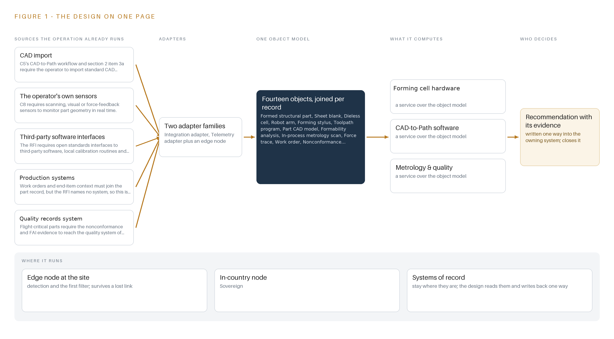
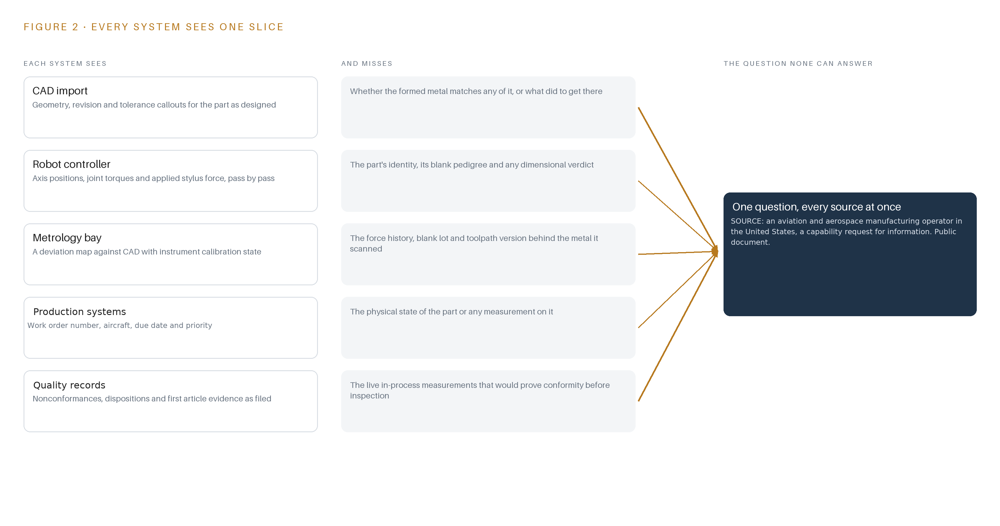
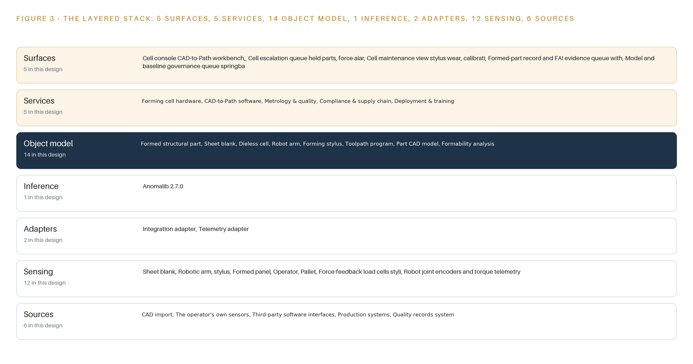
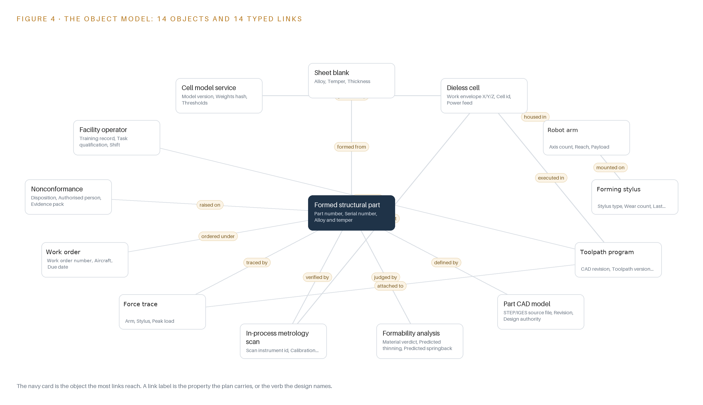
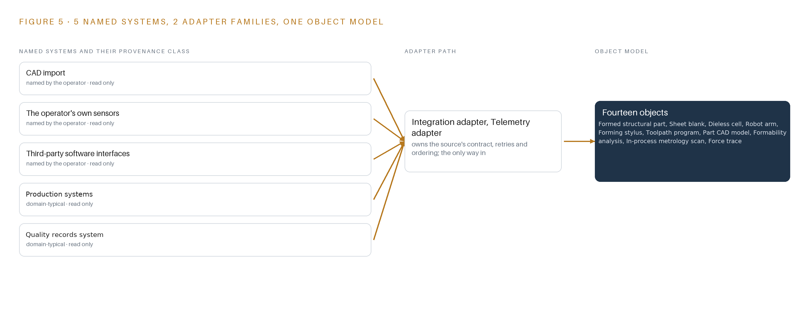
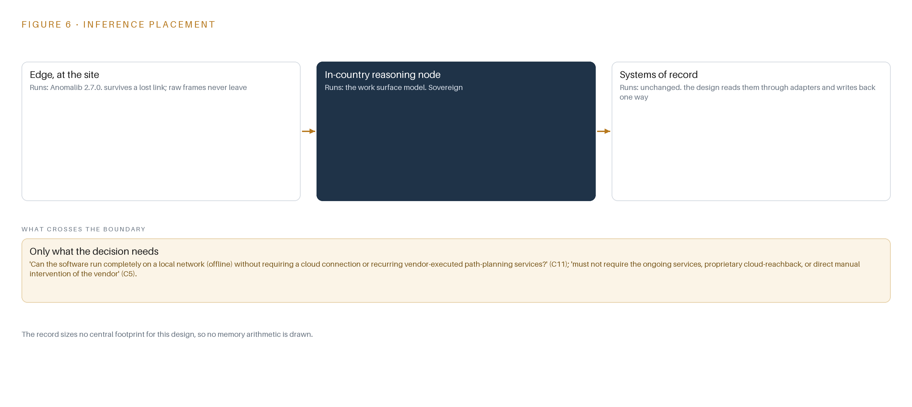
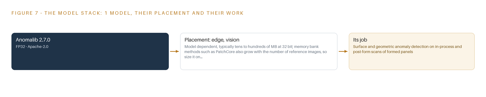
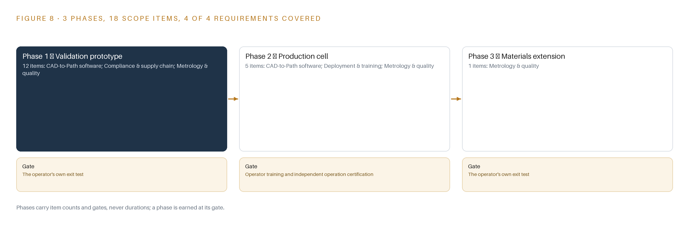
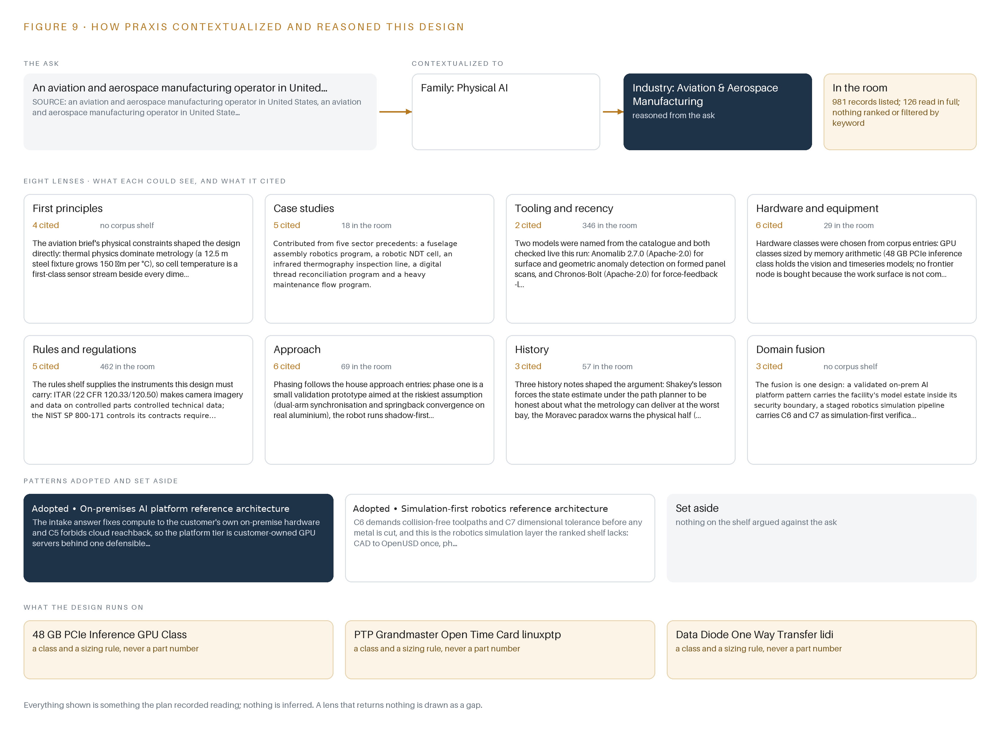

# Hangar Form Cell: Dieless Robotic Sheet Metal From CAD to Certified Part Without Vendor Cloud

Canonical: https://codeatoms.ai/dieless-sheet-metal-cell-aerospace-mro-us/
DOI: https://doi.org/10.5281/zenodo.23308095
PDF: https://codeatoms.ai/dieless-sheet-metal-cell-aerospace-mro-us/paper/hangar-form-cell-dieless-robotic-sheet-metal-aerospace-mro-us.pdf
License: CC BY 4.0
Publisher: CodeNinja Atoms (https://codeatoms.ai), a fully owned subsidiary of CodeNinja

VERTICAL-DRIVEN ARCHITECTURES · AVIATION & AEROSPACE MANUFACTURING · DESIGNED WITH PRAXIS · OCTOBER 2026

# Hangar Form Cell: Dieless Robotic Sheet Metal From CAD to Certified Part Without Vendor Cloud

A vendor-independent dieless robotic sheet metal cell for a United States aircraft maintenance, repair and overhaul (MRO) facility that turns CAD into collision-free, springback-compensated toolpaths with in-process metrology and per-serial traceability, wholly inside the facility's own boundary.

CodeNinja Engineering Team

For the maintenance lead accountable for structural spare production, hangar superintendents and quality and compliance leads, and the manufacturing, robotics, controls, metrology and platform engineers who would build and run it.

---

Vertical-Driven Architectures is a CodeNinja Atoms series of system designs. Every design in the series is driven by a real-world problem and scenario in a single industry, and every one is designed on CodeNinja Praxis, the CodeNinja Atoms platform for designing physical AI systems. Operations are described by class, never by name.

At a glance

## Dieless robotic sheet metal for an aircraft MRO facility in the United States

**What this is.** An open reference architecture for system design in physical AI: a vendor-independent dieless robotic sheet metal cell that takes an aircraft structural part from CAD to a certified, serialized part with collision-free springback-compensated toolpaths, in-process metrology and a per-serial traceability record, wholly inside the facility's own boundary with no vendor cloud. It is written for the maintenance lead accountable for structural spare production and for the manufacturing, robotics, controls, metrology and platform engineers who would build and run it. The operator is described by class, never by name.

**The answer in numbers.**

| Part | The design |
| --- | --- |
| Sources | Six, read-only through two adapter families: CAD import, the operator's own sensors, third-party software interfaces, the production systems, the quality records system and cell control telemetry over MTConnect |
| Object model | 14 typed objects held as Asset Administration Shells, from sheet blank, robot arm and stylus through toolpath program and metrology scan to nonconformance and work order, one joined record per serialized part, published as JSON for reuse |
| Models | Anomalib 2.7.0 (Apache-2.0) for surface and geometric anomaly detection on formed panels, and Chronos-Bolt (Apache-2.0) for force-trace baselines, both on the cell edge box; no language model committed |
| Compute | A fanless industrial inference computer in the cell panel and an eight-card 48 GB PCIe inference server in the facility, joined one way across a hardware data diode; an OCP Time Card grandmaster orders every stream |
| Rollout | Three phases carrying 18 items: a validation prototype on sacrificial blanks under a written kill criterion, the production cell, then a steel and titanium limits investigation before any production claim |
| Three-year cost | About 202,000 to 220,000 US dollars to own the priced classes over three years, the scanner and the server most of it; the two compute tiers alone cost about two fifths of the deepest three-year AWS commitment for eight L40S cards, which the offline requirement rules out anyway (Appendix A) |
| Human control | A named facility operator releases every program, an authorized person dispositions every nonconformance, and the certified safety function admits no software verdict as a control input |

**Reuse it.** The object model, the model register and the figures are free to reuse under CC BY 4.0. Cite as DOI <https://doi.org/10.5281/zenodo.23308095.>

**Made with.** Reasoned on [CodeNinja Praxis](<https://codeatoms.ai/praxis/>), the CodeNinja Atoms platform for designing physical AI systems. The object model imports into [Hyper Ontology](<https://codeatoms.ai/hyper-ontology/>), which turns it into a living system. Both are in beta; access by request.

ABSTRACT

## A Die Should Not Stand Between a Part and Flight

A facility that maintains aircraft needs structural components, brackets, panels, skin sections and spare parts formed on demand, from CAD to a certified part, without part-specific dies, without long tooling lead times, and without any vendor cloud touching controlled technical data. It cannot answer that need today because one-off and low-volume parts depends on heavy, expensive hard tooling that must be designed, cut, stored and paid for before the first blank is bent, and because the dieless robotic alternatives on the market arrive with hosted reachback services and software the facility cannot own, which flight-critical provenance rules will not tolerate.

The design is a dual-arm synchronized dieless cell with generic interchangeable styli, an offline CAD-to-path and springback compensation stack the facility owns outright, and in-process metrology that closes the dimensional loop on the facility's own aluminium, steel and titanium sheet. Six source systems enter through two adapter families into an object model of fourteen objects that carries one Asset Administration Shell record per serialized part; five services and five surfaces run on the facility's own network, and one registered model executes at the cell edge. No artifact leaves the boundary, every disposition stays with a named authorized person, and provenance under the material and cybersecurity rules its contracts flow down is designed in from the first procurement.

The paper states the facility's problem and its documented cost, then the join failure across the systems the facility already runs. It fixes the constraints and what the design chose against, lays out the stack from sources to surfaces, defines the fourteen objects and where the human loop sits, walks the ingestion and event backbone, places each inference tier with its latency budget, registers the models, hardware classes and licenses, and plans a three-phase rollout gated by a written kill criterion on sacrificial blanks. It closes on ownership and on the Praxis chapter that traces every choice back to what justified it.

---



Figure 1. Hangar Form Cell on one page: the sources the operation already runs, one object model, what it computes, and the person who decides.

## Contents

Each chapter is tagged for the reader it serves most directly: Executive, Team Lead, FDE, Reference.

|  |  |  |
| --- | --- | --- |
|  | Abstract · A Die Should Not Stand Between a Part and Flight | Executive |
| PART I · THE PROBLEM | | |
| 1 | [A Spare Part Waits Years for Its Die](#ch1) | Executive |
| 2 | [Every Facility System Sees One Slice of the Part](#ch2) | ExecutiveTeam Lead |
| PART II · THE DESIGN | | |
| 3 | [Four Constraints Shape the Cell](#ch3) | Team Lead |
| 4 | [One Stack Runs From CAD to the Cell](#ch4) | Team LeadFDE |
| 5 | [Fourteen Objects Turn Shop Data Into Traceability](#ch5) | FDE |
| 6 | [Every Source Enters Through an Adapter](#ch6) | FDE |
| 7 | [Detection Runs at the Cell, Reasoning In-Facility](#ch7) | FDE |
| 8 | [The License Decides What the Facility Can Own](#ch8) | FDEExecutive |
| PART III · THE ROLLOUT | | |
| 9 | [Shadow Mode Comes Before Any Flight Part](#ch9) | Team LeadExecutive |
| 10 | [The Toolpaths and Traceability Stay with the Facility](#ch10) | Executive |
| PART IV · HOW IT WAS DESIGNED | | |
|  | Conclusion · One Cell Pattern Forms in Any Hangar | Executive |
| 11 | [How Praxis Contextualized and Reasoned This Design](#ch11) | Team LeadFDE |
|  | [Sources](#sources) | Reference |

PART I · CHAPTER 1

## A Spare Part Waits Years for Its Die

Low-volume structural sheet metal at an aircraft maintenance facility is hostage to hard tooling, and the cost is measured in grounded aircraft, accident findings and supply chains the facility does not control.

The abstract framed the design in one paragraph: a dieless robotic cell, an offline path-planning stack, in-process metrology and a per-part record, gated by a written kill criterion. This chapter establishes why that problem exists at all, what the facility needs to answer it, what the public record says the failure costs, and what the operation looks like as a working scenario.

### 1.1  The Question the Facility Needs Answered

The question is narrow and unforgiving: can this structural sheet metal part, for this serial-numbered aircraft, be formed now on a machine the facility owns, to its drawing tolerance, with evidence a quality authority will accept, without a die and without a vendor's cloud? The request behind the design asks for exactly that: structural components, brackets, panels, skin sections and spare parts at heavy maintenance, line maintenance and factory level, produced from CAD to collision-free toolpath with springback compensation and in-process measurement.

Answering it requires data the facility already holds or can generate in the cell: the CAD model with its revision and tolerance callouts; the blank pedigree, meaning alloy, temper, thickness, mill certificate and lot number; the arm calibration state and encoder health; the force trace of every pass; the deviation map of every scan against CAD; the work order that names the aircraft; and the quality record that carries any nonconformance to disposition. The regulatory ground is equally specific. Camera imagery and process data on export-controlled parts are controlled technical data under the export control regulations (ITAR and the EAR); the controlled information the operator's contracts flag is governed by the NIST SP 800-171 security controls those contracts require; specialty metals provenance binds under the material provenance clauses the operator's customers flow down; record-keeping duties for parts follow 14 CFR 21.137; and the cell itself must satisfy ISO 10218 to 1:2025 robot safety, 29 CFR 1910.212 machine guarding and 1910.147 lockout and tagout.

### 1.2  What the Failure Costs

Hard tooling is the reason the question goes unanswered. Dies and presses carry long lead times, high upfront cost and permanent physical storage, so a low-volume structural part waits for its die or waits for a supply chain the facility does not control. The documented cost of a maintenance enterprise stretched past its ability to produce and verify parts is not hypothetical. An investigation into a 2017 crash that killed 16 blamed consistent production errors at the maintenance complex where the aircraft had undergone maintenance (WJCL 2017). An accident report into the death of a technician working on an aircraft found the death was caused by multiple points of failure (Militarytimes 2024). One large aircraft operator's own fiscal year summary of its most serious aviation accident class lists annual counts for manned aviation ranging from 1 to 23 (AF 2024). None of these findings trace to a single missing die. Together they describe what a maintenance facility looks like when parts, processes and evidence are scarce: schedule pressure, workarounds, and the kind of compounded failures that accident boards then reconstruct.

### 1.3  The Operation as a Scenario

The scenario is one aircraft maintenance facility running one dieless cell beside its existing capability. The cell holds two synchronized robotic arms with generic, interchangeable styli inside an interlocked enclosure, a sheet loading station, a metrology bay with a structured-light scanner and a laser tracker reference channel, and its own compute, running wholly in-country on the facility's power with no external link. The work is low-volume and high-mix: one-off spares on demand, formed panels on the order of two meters, brackets and skin sections in aluminium first, with steel and titanium investigated as a measured extension. Five roles stand in the loop: facility operators who load, run and inspect; process programmers who release toolpaths; cell maintainers who track stylus wear and calibration; quality personnel who hold first article inspection and material review evidence; and an accountable production lead. The environments are a shop floor with thermal drift, dust and temperature swings, and a controlled room for the record layer. The design counts are fixed: five named source systems, two adapter families, fourteen objects, five services, five surfaces, one registered model, three phases and four tracked requirements.

PART I · CHAPTER 2

## Every Facility System Sees One Slice of the Part

CAD, the robot controller, the metrology bay, the work order system and the quality records each hold one fragment of a formed part, and none of them together can prove the part conforming.

Chapter 1 established the question and the regulatory ground. This chapter shows why the facility cannot answer that question today: each of its systems holds one fragment of a formed part, and the fragments have never been joined. Figure 2 sets the slices side by side.

### 2.1  What Each System Sees and What It Misses

The CAD import carries the geometry, its revision and the tolerance callouts, but it knows nothing of the metal: it cannot say whether any formed part matches the drawing, or what the process did to get there. The robot controller sees axis positions, joint torques and the force applied by the stylus, pass by pass, yet it holds no part identity, no blank pedigree and no dimensional verdict; a flawless force signature on the wrong lot is invisible to it. The metrology bay produces a deviation map of the scanned surface against CAD with the instrument's calibration state attached, but the scan arrives orphaned: the force history, the blank lot and the toolpath version behind that piece of metal live elsewhere. The production system sees the work order, the aircraft, the due date and the priority, and none of the physical state of the part or any measurement taken on it. The quality records system files nonconformances, dispositions and first article evidence, but it receives them after the fact; the live in-process measurements that would prove conformity before inspection never reach it.



Figure 2. Five systems, each seeing one part of the answer. the question needs all of them in one place at once.

### 2.2  What None of Them See Together

What no system sees is the argument. To prove a serialized part conforming, someone must join the drawing revision the geometry came from, the certified blank it was cut from, the force signature of every pass against its baseline, the deviation map against tolerance with the instrument's calibration state at the moment of scan, and the named person who dispositioned any departure. Today that join is assembled by hand, after the fact, from exports and paperwork. The cost in practice is measured in repeated first article work, material review queues that hold parts nobody can prove, and the specific hazard the design is built to close: a disturbed part with no record is an event nobody notices until it matters.

PART II · CHAPTER 3

## Four Constraints Shape the Cell

No vendor cloud, owned artifacts, per-serial traceability and a cheap first gate fix every downstream choice from arm pairing to license selection.

Chapter 2 showed that the join failure is not a missing system but a missing connection, and that buying a larger single system would not close it. Four constraints fix the shape of the connection instead, and each one eliminates whole families of downstream choices before any component is named.

### 3.1  No Vendor Cloud and No Reachback

The first constraint is that the cell runs wholly offline on the facility's local network, on hardware the facility owns, inside the United States by the operator's own requirement. This is hard here because aerospace manufacturing software defaults to vendor-hosted services, and because export control makes camera imagery and process data on controlled parts controlled technical data, which means every byte the cell produces is data whose location is a compliance question. The NIST SP 800-171 controls the operator's contracts require govern the controlled information the request itself flags. A hosted assistive service, however convenient, would put controlled technical data outside the perimeter, so the design offers no reachback path at all.

### 3.2  The Facility Owns Every Artifact

The second constraint is ownership of the stack: weights, trained detectors, toolpath baselines, the record layer and every container image, held by the facility. This is hard because industrial software is licensed rather than owned, and because specialty metals provenance under the clauses the operator's customers flow down must be evidenced per item, which the design answers by registering every item before procurement rather than after delivery. Choosing the Apache-2.0 licensed anomaly detector and the open-source Apache line for streaming keeps the bill of materials fully owned by the operator, with no subscription sitting inside a sovereign perimeter.

### 3.3  Traceability Per Serialized Part

The third constraint is that the record attaches to the serialized part instance, never the part type. This is hard because maintenance traceability tools traditionally record part numbers, and because 14 CFR 21.137 quality-system duties and flight-critical practice demand an evidence trail per instance: which certified blank, which program version, which scans, which disposition by which authorized person. Every formed part carries its own Asset Administration Shell record, and the system prepares evidence while the disposition itself remains an airworthiness judgement by a named person, never a system output.

### 3.4  A First Gate That Can Stop the Work Cheaply

The fourth constraint is that the riskiest assumption is tested first, in metal, on the facility's own aluminium, with a written kill criterion in the facility's own numbers before any flight part is attempted. This is hard because robotics programs are typically justified as full production commitments, and because the sector carries a specific warning: a previous industry attempt at automated fuselage assembly was abandoned after dual-arm synchronization proved unreliable on large flexible panels. Phase one therefore spends its twelve items on sacrificial blanks, synchronization and springback convergence, so that if the physics refuses, the work stops at prototype cost.

### 3.5  Scoping Decisions

The constraints resolve into three scoping decisions, each bought at a stated price, as Table 1 records.

Table 1 · Scoping Decisions

| Decision | What it buys | What it costs |
| --- | --- | --- |
| Dual-arm synchronized with generic interchangeable styli | A forming capability independent of part-specific dies; one cell serving brackets, panels, skin sections and one-off spares on demand | Arm synchronization on flexible panels is the riskiest assumption, so phase one spends twelve items proving it on sacrificial blanks before any flight part |
| Wholly in-country, offline operation on facility-owned hardware | A defensible export control and security posture from the first procurement, with every artifact owned by the facility | No cloud elasticity and no vendor reachback; capacity is sized once on the bench against the actual streams before any order |
| Aluminium first, steel and titanium deferred to phase three | A validation scope the first gate can stop cheaply, with measured material limits reported before any production claim | The cell does not answer the request's full materials requirement until the phase three limit investigation reports |

### 3.6  What the Design Chose Against

Each rejection follows from a constraint rather than from preference, as Table 2 records, ending with what sits outside the scope entirely.

Table 2 · What the Design Chose Against

| Where | What was picked | Instead of, and why |
| --- | --- | --- |
| Forming method | Dual-sided synchronized arms with generic interchangeable styli | Single-arm incremental with a backing frame, which cannot react symmetric forces on roughly two-meter double-curvature skin panels and would leave higher springback variance on the one-off spares the facility needs on demand |
| Event backbone | Self-managed Apache Kafka 4.3 in KRaft mode | A commercial streaming platform subscription, which would put a vendor line inside a sovereign perimeter and break the requirement that the bill of materials be fully owned by the operator |
| Anomaly detection | Unsupervised surface and geometric anomaly detection under Apache-2.0 (Anomalib 2.7.0) | A closed-set defect classifier, because formed-part deviations are open-ended rather than a fixed class list, and the facility has no labeled defect set at stand-up |
| Model serving | No language model committed and no external model service of any kind | A hosted assistant, which the perimeter constraint forbids in the interim; the agentic work surface is offered and built only if the issuer confirms technicians will build agents around the workflow |
| Out of scope | Hosted cloud or vendor reachback services, press retirement, engineering disposition of nonconformances, and steel and titanium production before phase three | Nothing substitutes for these exclusions: the first is absolute under the perimeter constraint, disposition stays with an authorized person, and the facility's existing capability remains its own decision |

PART II · CHAPTER 4

## One Stack Runs From CAD to the Cell

A layered architecture puts systems of record below, one object model in the middle, and the path, metrology and governance services above it.

Chapter 3 fixed the constraints: the cell runs wholly offline inside a sovereign perimeter, the facility owns every artifact it produces, compliance controls are engineered from the first procurement, and the riskiest assumption is spent on sacrificial metal first. This chapter shows the stack those constraints produced, layer by layer.

### 4.1  Three Bands, One Object Model

The architecture is three bands with one contract between them. At the bottom sit the systems of record: CAD import, the production systems, the quality records system, and the cell's own control layer. They already hold the engineering truth, and the design replaces none of them; it reads them. In the middle sits one object model: fourteen objects held as Asset Administration Shells in Eclipse BaSyx, an international standard for a machine-readable asset record, where the slices are joined into a single record per serialized part. Above it run five services that do the work and five surfaces where named people see state and decide. Figure 3 shows the layers with their counts: six source systems, two adapter families, fourteen objects, five services, five surfaces and one registered model.

The contract between the bands is the reason the shape fits this industry. Flight-critical manufacturing demands that every judgement about a part be attributable and reproducible, so every write into the model travels through a service that stamps the acting person, the time and the provenance onto the event. A document store per application cannot give that guarantee, because each copy of a part record drifts from its source. Sovereignty is enforced by placement rather than by policy: K3s orchestrates containers on facility hardware, the Harbor registry holds images and the registered model behind an air gap, Prometheus, Grafana and Loki observe the running system inside the perimeter, and Keycloak holds identity. A hardware data diode governs the only egress from the cell's operational technology zone, so monitoring leaves one way and nothing returns.

A single event shows the flow. A structured-light scan of a formed panel is acquired at the metrology bay, timestamped by the site grandmaster clock, carried by the telemetry adapter onto the event backbone, written into the scan object against the part it evaluated, judged by the metrology and quality service, and raised on the formed-part record and first article inspection evidence queue if it falls outside tolerance. No stage touches a source system directly, and no surface writes to the model except through its service.



Figure 3. The layered stack: 6 sources, 2 adapter families, 14 objects, 5 services and 5 surfaces.

### 4.2  The Stack Stage by Stage

Table 3 walks the stack stage by stage, from the systems of record at the bottom to the surfaces on top, and names the components that carry each responsibility.

Table 3 · The Stack, Stage by Stage

| Stage | What it is responsible for | How |
| --- | --- | --- |
| Sources | Holds the engineering and production truth the cell must respect: CAD definition, work order context, quality records and the cell's own control state | Six source systems enter read-only: CAD import in STEP and IGES, the operator's own sensors, third-party software interfaces with auxiliary metrology, the production systems, the quality records system, and cell control telemetry read through MTConnect, the machine-tool data standard |
| Sensing | Turns the physical cell into timestamped signals | Four fixed camera zones served by MediaMTX and Frigate NVR; force load cells at the styli, joint encoders and torque telemetry, a structured-light scanner at the metrology bay, a laser tracker reference channel, frame and fixture temperature sensors, and safety PLC interlock state; InfluxDB 3 Core stores the streams; linuxptp, chrony and an OCP Time Card grandmaster keep every hop ordered |
| Adapters | Fix provenance at the door and carry every payload into the model | Two families: the integration adapter for documents, orders and records, and the telemetry adapter for machine and sensor streams, fronted by an MTConnect C++ agent |
| Object model | One joined record per serialized part and every object around it | Fourteen objects held in Eclipse BaSyx as Asset Administration Shells, fed by the event backbone, written only through services |
| Inference | Judges geometry and health before a part advances | Anomalib 2.7.0 for surface and geometric anomaly detection, exported to ONNX Runtime on a fanless edge computer; springback compensation held as versioned numeric corrections; collision-free paths verified in simulation before any metal moves |
| Services | Do the work and enforce the rules | Forming cell hardware, CAD-to-Path software, Metrology and quality, Compliance and supply chain, and Rollout and training |
| Surfaces | Where named people see state and decide | Cell console CAD-to-Path workbench; cell escalation queue for held parts and force alarms; cell maintenance view for stylus wear and calibration; formed-part record and FAI evidence queue; model and baseline governance queue; identity through Keycloak |

PART II · CHAPTER 5

## Fourteen Objects Turn Shop Data Into Traceability

The object model links every blank, scan, force trace, toolpath release and nonconformance to one serialized part, and the only write path runs through a named person.

Chapter 4 placed one object model at the center of the stack and promised that a query could cross it. This chapter opens the model: its fourteen objects, the typed links between them, the human loop, and the hosting posture that keeps the record sovereign.

### 5.1  Fourteen Objects and Their Typed Links

The focal object is the formed structural part. It carries the part number, the serial number, the alloy and temper, the sheet thickness, the as-built deviation to CAD and a formability verdict, and its status vocabulary runs from Blank staged through In-process scan and Final scan to Conforming, Nonconforming and MRB dispositioned, where MRB is the material review board, the authorized body that dispositions a nonconforming flight-critical part.

Around it, the model holds what the part is made from and where: the sheet blank with its mill certificate reference and lot number, the dieless cell with its work envelope and enclosure state, the robot arms with calibration and encoder health, and the styli with wear counts and assignments. It holds what defines the part: the part CAD model with revision and tolerance callouts, the formability analysis with predicted thinning and springback, and the program whose toolpath version and springback compensation passes were released. It holds what measures the part: the in-process metrology scan with its deviation map and calibration state, and the force trace with peak load and signature residual. And it holds the accountability frame: the work order, the nonconformance with its evidence pack, the facility operator, and the cell model service with its weights hash and release state.

Figure 4 draws the objects and their typed links. The reach is the point: from one serial number, a query follows links to the mill certificate behind the blank, the CAD revision the toolpath was cut from, each scan's deviation map and the calibration state of the instrument that took it, the force traces of every pass, the operator who released the program, the work order's aircraft, and any nonconformance with its evidence pack. A document store keeps one record per part and can reach none of that without copying it; here the links are typed, so the first article inspection pack is assembled by traversal rather than by hand. The record earns its keep on the day a process error is found: an investigation into a 2017 crash that killed 16 blamed consistent production errors at the maintenance complex that had serviced the aircraft (WJCL 2017), and a traversable record is what lets a facility find every affected serial the same day.



Figure 4. The fourteen objects of the model and the typed links that let a query reach across them.

### 5.2  The Human Loop and the Hosting Posture

The human loop lives at three points, and all three are decisions the system prepares but never takes. A program moves from Draft to Released only on the action of a named facility operator. A scan moves to Conforming or Out of tolerance on the metrology service's verdict, but a nonconforming part reaches MRB dispositioned only through an authorized person's disposition, with the evidence pack attached. The model's only write path runs through its five services; the adapters and the event backbone are read-only toward sources, and every write carries the acting person and the timestamp.

The hosting posture follows the same rule. Everything runs on facility infrastructure inside the United States, under the facility's own identity in Keycloak with a named account per person; there are no external links, and controlled technical data never crosses the boundary. The cell model service is the one object that changes underneath the work, so it carries its own governance: a weights hash, thresholds, and a release state of Released, Shadow, Superseded or Rolled back, changed only through the model and baseline governance queue.

### 5.3  The Focal Object in Recorded Form

The recorded form of the focal object, the formed structural part, with its properties, status vocabulary and links, is printed below.

```
{
  "id": "formed-structural-part",
  "label": "Formed structural part",
  "kind": "asset",
  "anchored_in": "",
  "properties": [
    "Part number",
    "Serial number",
    "Alloy and temper",
    "Sheet thickness",
    "As-built deviation to CAD",
    "Formability verdict"
  ],
  "status_vocabulary": [
    "Blank staged",
    "Forming",
    "In-process scan",
    "Final scan",
    "Conforming",
    "Nonconforming",
    "MRB dispositioned"
  ],
  "links": [
    {
      "to": "sheet-blank",
      "label": "formed from"
    },
    {
      "to": "part-cad-model",
      "label": "defined by"
    },
    {
      "to": "formability-analysis",
      "label": "judged by"
    },
    {
      "to": "in-process-metrology-scan",
      "label": "verified by"
    }
  ]
}
```

PART II · CHAPTER 6

## Every Source Enters Through an Adapter

Six source systems reach the object model through two adapter families and an ordered event backbone, so provenance is fixed at the door rather than argued later.

Chapter 5 defined the model that holds the record. This chapter defines the door: which sources enter it, what the adapters guarantee before anything is written, and how the backbone orders it all.

### 6.1  Six Sources and Their Provenance Classes

Six source systems reach the model, and each enters with its provenance class stamped at the door. Three are operator-held, meaning the interface exists at the operator and is described in its own requirement: CAD import in STEP and IGES, the operator's own sensors, and third-party software interfaces with the auxiliary metrology equipment the requirement calls for. Two are domain-typical, meaning every facility of this kind runs them but the requirement names no product, so the exact interface is confirmed at the first facility: the production systems that carry work orders and aircraft context, and the quality records system that must receive nonconformance and first article inspection evidence. The sixth is cell control telemetry, the robot controllers, load cells and safety PLC read through MTConnect, which is operator-held because it belongs to the cell the design builds. Figure 5 maps each system to its class and its adapter path.



Figure 5. The 6 named systems, the adapter path each one takes, and the object model they all map into.

### 6.2  What the Adapter Tier Guarantees

The adapter tier, two families wide, makes guarantees that hold no matter which source sits behind it. Every payload enters through the integration adapter, which carries documents, orders and records, or the telemetry adapter, which carries machine and sensor streams; nothing reaches the object model directly. Provenance is fixed at ingress, so a record's origin is never argued later. The adapters are read-only toward sources and never write back to a system of record. Schema and unit validation reject malformed payloads to a dead-letter path rather than passing them downstream. Idempotency keys mean a replayed scan cannot be counted twice. And calibration state travels with every metrology payload, so a measurement taken with an out-of-calibration instrument is flagged at the door rather than discovered at audit.

### 6.3  The Event Backbone

The backbone is Apache Kafka 4.3 in KRaft mode, the Kafka line that carries its own consensus and removes the separate coordination service, self-managed inside the perimeter, which keeps the bill of materials fully owned by the operator. Ordering is by partition keyed on the part serial, so every event for one serialized part arrives in sequence no matter which source raised it.

Delivery is at least once with idempotent consumers, so a redelivered event changes nothing. Buffering absorbs the bursts that forming produces: the scan, its force trace and the camera metadata for one pass arrive together, and the backbone holds them until services drain the queue. Replication runs across broker nodes on site only; there is no off-site replication, because nothing leaves the boundary.

Time is the quiet guarantee underneath. An OCP Time Card grandmaster with linuxptp and chrony keeps every hop on one clock, so a force trace, a scan and a video frame pass order correctly when the model joins them. Without that shared clock, a joined record is a guess with a timestamp attached.

PART II · CHAPTER 7

## Detection Runs at the Cell, Reasoning In-Facility

Vision and force anomaly detection execute on the cell edge box inside the safety cycle, while model governance and compensation baselines stay on a facility server behind the facility's own controls.

Chapter 6 brought every stream into the object model through its adapter family, with ordering guaranteed at the backbone. This chapter places the computation that turns those streams into verdicts: what runs on the cell floor, what stays on the facility server, and what each failure of link, power or update path leaves standing.

### 7.1  Two Tiers of Inference, Each with a Different Job

Figure 6 places inference in two tiers. The first is a fanless industrial inference computer mounted in the cell panel, chosen for shop-floor temperature and dust rather than for any single model, and sized from the camera and sensor stream budget with headroom; its final capacity is bench-measured on the actual streams before the order is placed. This box serves the Anomalib 2.7.0 vision detectors and the force-trace residual checks through ONNX Runtime, so surface and geometric anomaly detection on in-process and post-form scans executes inside the cell's own rhythm, interleaved between passes. It sits there for two reasons: a flagged pass must be caught before the next pass begins, and the certified safety argument requires the cell to stand on its own hardware without reaching across the plant for a verdict.

The second tier is an air-cooled facility server of the eight-card 48 GB PCIe inference class, running on the facility's own power. It holds the registered model estate with KV and batch headroom, the thresholds that turn a detection into a hold, and the versioned springback compensation baselines; the cell model service governs each release through its states of released, shadow, superseded and rolled back, with retraining data prepared in CVAT and Label Studio and artifacts held in Harbor. No language model role is committed, so no frontier cluster is sized; if an agentic work surface is confirmed later, a US-hosted node class would be sized against this register then. On memory arithmetic, the design sizes from what is known: anomaly detectors at FP32 typically occupy tens to hundreds of megabytes, and memory-bank methods such as PatchCore grow with the number of reference images, so the detector footprint is fixed on the chosen model before the card count is finalized. Event ordering across both tiers rides an OCP Time Card grandmaster with linuxptp, giving sub-millisecond agreement so a scan, its force trace and the arm pose that produced it share one clock.



Figure 6. Where each tier runs, what runs there, and the narrow set of outputs that cross the boundary.

### 7.2  The Latency Budget Follows the Safety Cycle

The budget's spine is non-interference. The certified safety function, the light curtains, safety PLC and interlocks, owns stopping and admits no software verdict as a control input. Around it the design carries three advisory budgets: detection must complete within the pause between passes so a flagged pass stops before the next begins; scan evaluation must complete between acquisition at the metrology bay and the deviation map to CAD reaching the record; and alert routing must land in the escalation queue while the part is still on the fixture. Every hop that must order events carries PTP hardware timestamping, and time-sensitive networking is named only if the bench shows bounded latency is genuinely needed. Each budget is verified against bench-measured streams, not asserted on paper.

### 7.3  What Crosses the Boundary, and What Each Failure Leaves Standing

One thing crosses the boundary, and it crosses one way: lidi and Eurydice carry scan records, force traces, detection events and calibration and stylus wear state over a hardware data diode from the cell OT zone to the facility tier. Nothing flows back over the diode. Released programs reach the cell through the signed, scheduled release path in the registry, never as a return channel. The failure paths are designed explicitly because a published accident report traced a maintenance death to multiple points of failure rather than a single one (Militarytimes 2024). If the link fails, the cell keeps forming, edge detection continues, and records queue until the diode path returns. If power fails, Network UPS Tools signals a clean shutdown, and the safety PLC and interlocks stand on a power path apart from the compute. If an update fails, Harbor still holds the last released artifact set and the model service rolls back; a stuck release degrades the system to its last released state, never to an unversioned one.

PART II · CHAPTER 8

## The License Decides What the Facility Can Own

An Apache-2.0 anomaly detector, open reference architectures and an open streaming backbone keep every weight, threshold and artifact owned by the operator inside the perimeter.

Chapter 7 fixed where inference runs and what crosses between tiers. This chapter fixes what runs there, and why every weight, threshold and artifact that touches a flight-critical part can be owned by the facility outright. Figure 7 shows the model stack in one view: two edge models behind one serving runtime, one governance service above them, and the registry and release queue that decide what the cell is allowed to run. Every entry in it is open weight or open source, and every one was checked against the exclusion that bars software from covered-nation publishers regardless of its license.



Figure 7. The one model, their placement, and the work each one does.

### 8.1  Anomaly Detection on the Facility's Own Good Parts

The committed vision model is Anomalib 2.7.0, an open library of unsupervised anomaly detection methods for industrial imagery. Its role is surface and geometric anomaly detection on in-process and post-form scans of formed panels, placed on the cell edge box and served through ONNX Runtime at FP32 precision. Its footprint is model dependent, typically tens to hundreds of megabytes, and memory-bank methods such as PatchCore also grow with the number of reference images, so the final size is fixed on the chosen variant before the compute box is ordered. The license is Apache-2.0: permissive, with no copyleft obligation and no field-of-use restriction, which is precisely what permits the facility to hold, retrain and redistribute the trained detector as its own property. It was chosen because an unsupervised fit on the facility's own good panels needs no labeled defect set at stand-up, and over the D-FINE closed-set detector family because a formed panel's deviations are open-ended rather than a fixed class list.

Beside it, Chronos-Bolt carries the force-feedback load anomaly baselines, learning what a healthy pass looks like on each arm and stylus combination and flagging signatures that drift. It is also Apache-2.0 and also runs on the edge box. Both models were named from the catalog and checked live against the covered-nation exclusion before entering the register.

### 8.2  Ownership Is a License Question, and the Perimeter Enforces It

The same logic runs through the rest of the stack. Apache Kafka 4.3 is self-managed in KRaft mode on the open Apache line rather than on a commercial platform subscription, keeping the bill of materials fully owned by the operator. The two patterns the design stands on, an on-premises AI platform reference architecture and a simulation-first robotics reference architecture, are adopted as documented architectures the facility implements on its own hardware, not as subscriptions. BaSyx, InfluxDB 3 Core, Harbor and Keycloak are open, so no artifact in the traceability chain sits behind a foreign dependency or a vendor cloud. The capability request requires the cell to run wholly offline on the local network, and the stack honors that by construction. The stakes are not abstract: a 2017 crash that killed 16 was blamed on consistent production errors at an aircraft maintenance complex (WJCL 2017), and the evidence pack, from mill certificate to disposition, is what the quality system reads. Evidence the facility cannot own is evidence it cannot answer for.

### 8.3  The Model and Equipment Register

Table 4 gathers every model, hardware class, sizing rule, sensing element, pattern and the ground each runs on into one register, the same register the provenance workstream reads before any item is procured.

Table 4 · Model and Equipment Register

| The choice | What was picked | Why here |
| --- | --- | --- |
| Vision anomaly detection | Anomalib 2.7.0, FP32, exported to ONNX Runtime | Unsupervised fit on the facility's own good panels needs no labeled defect set; Apache-2.0 keeps the trained detector the operator's own |
| Force baseline model | Chronos-Bolt, Apache-2.0 | Learns per-arm, per-stylus load baselines on the edge box and flags drifting pass signatures |
| Edge AI compute | Fanless industrial inference computer class | Sized from the camera and sensor stream budget with headroom; bench-measured on the actual streams before order |
| Facility inference server | Eight-card 48 GB PCIe air-cooled inference server class | Holds the registered models with KV and batch headroom on the facility's own power |
| Time synchronization | OCP Time Card grandmaster with linuxptp | Sub-millisecond ordering across scan, force and pose streams |
| One-way transfer | lidi and Eurydice over a hardware data diode | One-way egress from the cell OT zone to the facility tier |
| Enclosures, mounting and power | Rugged enclosure class with Network UPS Tools | Clean shutdown on power loss; rated for shop-floor temperature and dust |
| Cameras | Fixed, RTSP-serving class from the facility's approved list | Pixels-on-target density per zone; no export license applies to domestic installation in the United States |
| Sensing set | Force-feedback load cells at the styli, joint encoders and torque telemetry, a structured-light 3D scanner at the metrology bay, a laser tracker reference channel, frame and fixture temperature sensors, safety PLC and interlock state via MTConnect | Covers force, as-built geometry, thermal drift and interlock state beside every measurement |
| Platform pattern | On-premises AI platform reference architecture | Two layers with a clean contract, GPUs managed as declarative Kubernetes operators, compute facility-owned on-premise |
| Robotics pattern | Simulation-first robotics reference architecture | Every asset converted to OpenUSD once; software-in-the-loop path validation before metal is moved |
| Ground it runs on | K3s at both tiers, Harbor, Kafka 4.3 in KRaft mode, BaSyx, InfluxDB 3 Core, MediaMTX with Frigate NVR, Keycloak, Prometheus, Grafana and Loki | Open components the facility operates, patches and owns inside its own perimeter |

PART III · CHAPTER 9

## Shadow Mode Comes Before Any Flight Part

Three phases prove arm synchronization and springback convergence on sacrificial blanks under a written kill criterion before a single flight-critical part is formed.

Chapter 8 closed the model register with a single anomaly detector, Apache-2.0, running on the edge box inside the cell perimeter, and with no language model committed until the work surface question is settled by the issuer. This chapter turns the design into a sequence of three phases whose gates let the facility stop work cheaply, beginning with the riskiest assumption of all: that two robot arms holding generic styli can form a large, flexible panel to aircraft tolerance.

### 9.1  Three Phases and Their Exit Gates

Phase one, the validation prototype, carries 12 items across four workstreams: forming cell hardware, CAD-to-Path software, compliance and supply chain, and metrology and quality. Its items include the cell site survey and footprint definition, the dual-arm synchronized station build, and the offline CAD-to-Path workbench with formability analysis. Its exit gate is a written kill criterion, stated in the facility's own numbers for arm synchronization reliability and springback convergence, tested on sacrificial aluminium blanks in simulation first and then in metal. If the numbers miss the criterion, the work stops there, before any flight-critical part is attempted. Phase two, the production cell, carries 5 items across three workstreams: CAD-to-Path software, rollout and training, and metrology and quality. Its items are the in-process metrology loop with force feedback and scanning, the formed-part digital record with airworthiness traceability, and the surface and force anomaly detection services. Its exit gate is operator training and independent operation certification, meaning facility staff run the cell and its record layer on their own authority. Phase three, the materials extension, carries 1 item, a steel and titanium limit investigation under the metrology and quality workstream, and its gate is a measured limits report that quotes achievable accuracy as a range before any production claim for those alloys is made. Figure 8 shows the three phases, their item counts, workstreams, gates and requirement coverage together: the four stated requirements of the request for information are covered, with none partial and none left open.



Figure 8. The three phases and their gates, and coverage of the 4 requirements across them.

### 9.2  What the Rollout Measures

The rollout measures five things on every formed panel: the number of springback compensation passes needed to reach tolerance, the as-built deviation to CAD at each pass, the load signature residual pass, the conformity rate of in-process scans against their calibration state, and the temperature of the cell frame and fixture recorded beside every measurement. It also measures the record layer itself: every disturbed part must carry a record, and a part without one is an event the system raises. The sector's safety history is the reason the interlock and lockout states sit inside the measured set rather than outside it: a crash investigation once blamed consistent production errors at an aircraft maintenance complex for the loss of an aircraft and its crew (WJCL 2017), and a technician's death in a maintenance workplace was attributed to multiple points of failure rather than one (Militarytimes 2024).

### 9.3  Where the Design Expects Failure

Table 5 lists the six failure modes the design carries plans for, each paired with what the design does about it.

Table 5 · Failure Modes

| What fails | What the design does |
| --- | --- |
| Dual-arm synchronization proves unreliable on a flexible panel the width of a skin section, as it did in an abandoned fuselage robotics program | Phase one targets exactly this on sacrificial blanks, in simulation and in metal, with a written kill criterion in the facility's own numbers before any flight part is attempted |
| Springback compensation fails to converge on new geometries, making the accuracy claim unmeetable | Corrections are learned from the facility's own measured deviations under versioned baselines with a governance release route, and accuracy is quoted as a range until the alloy campaign measures it |
| Specialty metals provenance cannot be evidenced for a needed component, forcing late substitution | Every item is registered before procurement, not after delivery, and United States manufactured alternatives are identified during the market survey the request for information already asks for |
| Security accreditation and safety certification slip the schedule more than any technical work | Accreditation, the zone diagram and the safety case run as phase one engineering workstreams on the critical path, not as post-build paperwork |
| Operators quietly work around the record layer, corrupting traceability | The exception path is instrumented first, alerts route to the people who act within an alert budget, and a disturbed part with no record is itself an event the system raises |
| Thermal drift in the shop degrades metrology below part tolerance | Cell and fixture temperature is a first-class sensor stream beside every scan, with thermal compensation recorded per measurement rather than assumed |

### 9.4  Lessons

**Shadow the flags before anyone trusts them.** The anomaly detector runs in shadow against live scans until its false alarm rate on the facility's own panels is known, and only then does an out-of-tolerance verdict from it hold a part in the escalation queue. An alert stream that pages the floor faster than people can act destroys the record layer it is meant to protect, so the alert budget is set before the detector is promoted. Register provenance before procurement, not after delivery. Specialty metals and prohibited-source rules bite hardest when they surface late, so registration of every item precedes the purchase order, and substitutions are identified while alternatives still exist. Treat accreditation as engineering, not paperwork. The controls the boundary demands shape the network diagram, the camera plan and the record retention path, so the accreditation workstream sits beside the station build in phase one rather than behind it.

### 9.5  What Is Still Open

Three questions remain open. First, whether springback convergence holds across the full range of geometries the facility intends to form: settling it converts the phase one accuracy range into a firm per-alloy figure and widens the part family the cell can accept. Second, whether technicians and engineers will build agents around path planning and springback compensation, which the issuer has not confirmed: settling it would add the agentic work surface and a serving role for a language model that the register currently holds open. Third, whether the steel and titanium limits measured in phase three support production claims or only repair work: settling it decides whether the cell's duty extends beyond aluminium skins and brackets into primary structure.

PART III · CHAPTER 10

## The Toolpaths and Traceability Stay with the Facility

The object model, the trained detector, the decision record and the security boundary are held by the facility, with the platform partner named once at the end.

Chapter 9 left three questions open and set the gates that resolve them. This chapter states who holds what the design builds, because a cell that must run without vendor cloud or vendor reachback is only sovereign if the artifacts themselves sit in the facility's hands.

### 10.1  What the Facility Holds

The object model is the facility's: 14 objects with their typed links and status vocabularies are defined in the facility's own instance, exportable in open formats, and every adapter writes into it rather than into a vendor tenant. The weights are the facility's: the anomaly detector carries an Apache-2.0 license, so the trained detector and any fine-tune against the facility's own good panels are owned outright, and the cell model service object records the weights hash, thresholds and release state so any superseded or rolled-back model is identifiable. The decision record is the facility's: released toolpath programs with their CAD revision and compensation pass count, nonconformance dispositions with their authorized person and evidence pack, and springback baseline versions all live in the facility's quality system of record, where a flight-critical disposition can be audited; the system prepares the evidence and the named person makes the airworthiness judgment. The boundary is the facility's: the cell runs inside an air-gapped operational zone, egress crosses a hardware data diode one way only, identity is administered locally, and the controlled information handling follows the security controls the facility's contracts already require.

### 10.2  The Offer Behind the Design

The design was produced on CodeNinja Praxis, the CodeNinja Atoms platform for designing physical AI systems, and maps to CodeNinja's offer as follows: Adaptive Operations covers the sensing, detection and forecasting of physical behavior, from the force traces and joint telemetry to the surface and geometric anomaly detection on formed panels; Decision Systems covers the ranking, attribution and reconciliation that a named person decides, holding parts in the escalation queue and preparing nonconformance evidence for the authorized disposition; Hyper Ontology is the 14-object model that joins blank, arm, stylus, program, scan and work order into one traceable argument; and Sovereign Infrastructure is the air-gapped, in-country operation on the facility's own hardware, with open licenses the operator can own. CodeNinja builds and runs systems of this shape with the operators who own the problem.

PART IV · CONCLUSION

## One Cell Pattern Forms in Any Hangar

In one view the design is a dieless robotic sheet metal cell the facility owns outright: dual-arm synchronized with generic styli, an offline CAD-to-path and springback compensation stack with versioned baselines, in-process metrology closing the loop through force traces and structured-light scans, and fourteen objects carrying a per-serialized-part record that joins blank certificate, formability verdict, toolpath release and nonconformance evidence into one argument, all running inside the facility's security boundary with no external service and every airworthiness disposition left to a named authorized person.

The same shape runs in any heavy maintenance, line maintenance or factory facility that forms low-volume sheet metal: hold the record per serialized instance rather than part type, validate the riskiest physical assumption on sacrificial material before any flight part moves, keep every toolpath, weight and scan inside the operator's own boundary on open licenses it can hold, treat accreditation and the safety case as first-phase engineering rather than later paperwork, and gate each new alloy or geometry on measured limits before any production claim.

PART IV · CHAPTER 11

## How Praxis Contextualized and Reasoned This Design

Every choice in the paper traces back to recorded reading: the ask, the lens table, the patterns adopted and set aside, and the equipment classes the reasoning landed on.

Chapter 10 placed the object model, the weights, the decision record and the boundary in the facility's hands, with the platform partner named once. This last chapter shows how the design itself was produced, so that any reader can trace a choice in the paper back to what justified it. Every design in this series is produced on CodeNinja Praxis, and Figure 9 shows how this one was reasoned: the ask as stated, the family and industry assigned, the records in the room, the eight lenses consulted, the patterns adopted, and the equipment classes the reasoning landed on. Nothing in the chapters above stands without a line in that figure.

### 11.1  Contextualizing the Ask

The ask, in the operator's own words, was dieless robotic sheet metal of aircraft aluminium, steel and titanium parts, from CAD to collision-free toolpaths with springback compensation and in-process measurement, with no vendor cloud, deploying in the United States. Praxis assigned the design to the Physical AI family and to aviation and aerospace manufacturing, because the operator's own words place the work at heavy maintenance, line maintenance and factory level facilities: structural components, brackets, panels and skin sections. What was in the room: 981 records were listed, 126 were read in full, and 855 are available on demand, including the capability request itself, robotics and maintenance automation precedents, the rules instruments, and the hardware and tooling catalogs.



Figure 9. From the ask to the design: the family and industry Praxis assigned, the eight lenses and what each cited, the patterns adopted and set aside, and the equipment the design lands on.

### 11.2  The Eight Lenses

Table 6 shows what each lens could see, how many sources it cited, and what it contributed. No lens returned nothing, so the register shows no gaps.

Table 6 · The Lenses and What They Contributed

| Lens | Could see | Cited | What it contributed |
| --- | --- | --- | --- |
| First principles | The physics, thermal growth and traceability stripped to their simplest statements | 4 | Thermal physics dominate metrology, so cell temperature became a first-class sensor stream beside every scan; safety standards bound the cell package; serialized part instances, never part types, became the traceability rule |
| Case studies | Robots, sheet metal and facilities running aircraft work | 5 | Contributed the dual-arm synchronization risk from an abandoned fuselage robotics program, automation precedents in inspection and thermography, and maintenance flow patterns |
| Tooling and recency | Current, license-checked models and frameworks | 2 | Named the Apache-2.0 anomaly detector for formed panel scans and the Apache-2.0 time-series baseline for force traces, both verified live and both runnable inside the perimeter, with every model from a covered-nation publisher excluded |
| Hardware and equipment | Compute, timing, networking and enclosure classes sized for a shop floor | 6 | Sized the 48 GB PCIe inference GPU class from the sensor stream budget, chose the PTP grandmaster and the diode one-way path, and ruled out positioning systems and frontier compute as duties with no owner |
| Rules and regulations | The statutory and contractual instruments the cell must carry | 5 | Supplied export control over technical data, security controls for controlled unclassified information, specialty metals provenance duties, and the quality system record obligations that govern evidence |
| Approach | How to phase risky engineering so it can be stopped cheaply | 6 | Fixed the validation-prototype-first phasing, shadow mode before the robot controls a flight part, the written kill criterion, and the first article inspection gate settled with facility quality before build |
| History | Long lessons from fielded autonomous and safety-critical systems | 3 | Forced honesty about what the state estimate can deliver at the worst measurement bay, warned that the physical half of the work carries the budget, and warned against deferring accreditation and integration |
| Domain fusion | Cross-industry patterns that compose into one design | 3 | Fused the on-premises AI platform pattern, the simulation-first robotics pipeline and aviation certification physics into one facility-qualifiable commitment |

### 11.3  Patterns Adopted and Set Aside

Two patterns were adopted. The on-premises AI platform pattern is primary: because the ask fixes compute to the facility's own hardware and forbids cloud reachback, the platform tier runs on facility-owned GPU servers behind one defensible software bill of materials, with infrastructure and application as two layers under a clean contract, models served through standard interfaces, and reference workloads validated before handoff. The robotics simulation pattern is supporting: collision-free toolpaths and dimensional tolerance must be proven before metal is cut, so every asset is converted to OpenUSD once, physics and sensors are applied in simulation, and path validation runs software-in-the-loop before any blank is loaded. No pattern was set aside: the shelf held nothing the design took up and then rejected, because the constraints in Chapter 3 had already removed the alternatives that such a list would hold.

### 11.4  Where the Reasoning Lands

The reasoning lands on four equipment classes: the 48 GB PCIe inference GPU class that holds the vision and time-series models with headroom and needs no frontier node because no language model role is committed; the PTP grandmaster time card with open synchronization software for sub-millisecond event ordering across sensors and controllers; the hardware data diode with its one-way transfer software for egress from the cell's operational zone; and the rugged enclosure and uninterruptible power class that keeps the cell clean, mounted and powered on shop-floor supply. Each class is a sizing rule rather than a product, and each is bench-measured against the facility's actual streams before it is ordered. That is the closing point of the chapter and of the paper: every lens citation, every pattern, every object and every equipment class in these chapters was recorded reading, read in the room, and nothing shown here is inferred.

Appendix A

## What the Cell's Compute and Sensing Cost Over Three Years

The design buys compute at two tiers and a sensing set around one dieless cell: a fanless inference computer in the cell panel, an eight-card 48 GB PCIe inference server in the facility, a PTP grandmaster time card, a hardware data diode, four fixed cameras, a structured-light scanner, a laser tracker reference channel, force load cells and temperature transmitters, in a rugged enclosure with clean shutdown. This appendix prices the classes that Table 4 names from public list prices, dated and cited, and compares the facility server with renting the same eight cards from the nearest hyperscaler region. The robot arms, the styli and the sheet metal are the forming cell itself and are outside Table 4; the laser tracker, the data diode and the safety controller are sold by quotation and are named but left out of the total. Every number can be rerun with a written quote.

### A.1 The Answer

Equipping the classes priced below costs about **151,000 US dollars** in list prices, and with support and power over three years **202,000 to 220,000 dollars**. The structured-light scanner and the eight-card server are most of it. Owning the two compute tiers costs about **132,000 dollars** over three years against **298,000 to 792,000 dollars** to rent eight L40S cards around the clock, so ownership is **about two fifths** the deepest three-year AWS commitment (EC2 Instance Savings Plan, all upfront, US East). The rental is printed for reference only: the request requires the cell to run wholly offline on the local network with no vendor cloud, so no rented option satisfies it. Every model in the register is Apache-2.0 and adds no license line.

### A.2 What Owning Costs

| Line | Basis | Three-year cost (USD) |
| --- | --- | --- |
| Edge inference computer | One fanless industrial inference computer with an embedded GPU, Advantech MIC-733-AO5A1 (Jetson AGX Orin 32G class) at 4,646.41 dollars (Advantech 2026) | 4,600 |
| Facility inference server | One eight-card L40S server, Supermicro SYS-421GE-TNRT-02-G1, at 85,271.00 dollars (Newegg 2026) | 85,300 |
| Time synchronization | One OCP-TAP Time Card grandmaster at 1,500.00 dollars (Makerfabs 2026); antenna not separately priced | 1,500 |
| Structured-light scanner | One ZEISS ATOS Q 8M basic system package at 50,890.00 dollars (MatterHackers 2026) | 50,900 |
| Cameras | Four fixed PoE dome cameras with RTSP, Axis M3086-V at 523.00 dollars each (SHI 2026) | 2,100 |
| Force sensing | Two S-beam load cells, Omega LC103B-2K at 367.41 dollars each (Zot Supply 2026); amplifiers not included | 700 |
| Temperature sensing | Four DIN rail RTD transmitters, Phoenix Contact MINI MCR-2-RTD-UI-PT at 250.68 dollars each (Digi-Key 2026) | 1,000 |
| Enclosure | One nVent Hoffman A603616LP NEMA 12 enclosure, 60 by 36 by 16 inches, at 2,082.59 dollars (Zoro 2026) | 2,100 |
| Clean shutdown | One APC Smart-UPS 3 kVA at 2,425.00 dollars (Markertek 2026), driven by Network UPS Tools | 2,400 |
| **Equipment** |  | **151,000** |
| Support | 8 to 12 percent of equipment value a year (Introl 2026) | 36,200 to 54,200 |
| Power | 3.7 kW average draw for the eight cards, their host and the edge box (an assumption: the L40S is rated at 350 W) at a power usage effectiveness of 1.6 (Uptime Institute 2025), 155,578 kWh at the US average industrial price of 9.77 cents per kWh for July 2026 (EIA 2026) | 15,200 |
| **Total** |  | **202,000 to 220,000** |

Not in the table, because no public list price was found on 12 October 2026: the laser tracker (a used demonstration Leica AT500 set was listed at 18,500 dollars by a surveying reseller, which is a floor, not a list price), the hardware data diode (Fend Inc lists the SE and XE families without prices), and the safety PLC. Each is bought by quotation and each would add to the total.

### A.3 What Renting the Eight Cards Would Cost

| Option | Basis | Three-year cost (USD) |
| --- | --- | --- |
| AWS, US East, on demand | g6e.48xlarge, eight L40S, at 30.13 dollars an hour in us-east-1 (AWS 2026a) | 792,000 |
| AWS, US East, three-year EC2 Instance Savings Plan, all upfront | g6e.48xlarge at 11.329 dollars an hour, the deepest three-year plan in the region (AWS 2026b) | 298,000 |

Storage, egress and the link from the facility to the region are excluded, so every rented figure is a floor. The owned figure it is compared with is the server and the edge box with support at 10 percent a year and their power: 132,000 dollars.

### A.4 Sources for This Appendix

- Advantech. 2026. MIC-733-AO5A1 fanless edge AI system, AGX Orin 32G, read 12 October 2026. <https://buy.advantech.com/Compact-Computers/Edge-AI-Systems-Orin-NX/model-MIC-733-AO5A1.htm>
- AWS. 2026a. Amazon EC2 on-demand prices, US East (N. Virginia), Linux, g6e.48xlarge, read 12 October 2026. <https://instances.vantage.sh/aws/ec2/g6e.48xlarge>
- AWS. 2026b. EC2 Instance Savings Plans price file, us-east-1, read 12 October 2026. <https://pricing.us-east-1.amazonaws.com/savingsPlan/v1.0/aws/AWSComputeSavingsPlan/current/region_index.json>
- Digi-Key. 2026. Phoenix Contact 2902052 MINI MCR-2-RTD-UI-PT, read 12 October 2026. <https://www.digikey.com/en/products/detail/phoenix-contact/2902052/5198268>
- EIA. 2026. Electric Power Monthly, Table 5.6.A, July 2026. <https://www.eia.gov/electricity/monthly/epm_table_grapher.php?t=epmt_5_6_a>
- Introl. 2026. GPU infrastructure TCO model. <https://introl.com/blog/gpu-infrastructure-tco-model-5-year-enterprise-ai-deployment>
- Makerfabs. 2026. OCP-TAP Time Card, read 12 October 2026. <https://www.makerfabs.com/catalogsearch/result/?q=time+card>
- Markertek. 2026. APC SMT3000RM2UC Smart-UPS 3000VA RM 2U LCD 120V with SmartConnect, read 12 October 2026. <https://www.markertek.com/product/apc-smt3000rm2uc/apc-smt3000rm2u-smart-ups-3000va-rm-2u-lcd-120v-with-smartconnec>
- MatterHackers. 2026. ZEISS ATOS Q 3D Scanner, ATOS Q 8M basic system package, read 12 October 2026. <https://www.matterhackers.com/store/l/zeiss-atos-q-3d-scanner>
- Newegg. 2026. Supermicro SYS-421GE-TNRT-02-G1, eight L40S cards, 85,271 dollars, read 12 October 2026. <https://www.newegg.com/p/N82E16859152404>
- SHI. 2026. Axis M3086-V network camera, 523.00 dollars as listed in search results on 12 October 2026; the product page itself refused the routine's fetch. <https://www.shi.com/product/44881768/M3086-V>
- Uptime Institute. 2025. Global Data Center Survey 2025. <https://uptimeinstitute.com>
- Zoro. 2026. nVent Hoffman A603616LP enclosure, read 12 October 2026. <https://www.zoro.com/nvent-hoffman-screw-down-clamps-with-padlocking>
- Zot Supply. 2026. Omega LC103B-2K S-beam load cell, 2,000 lbf, read 12 October 2026. <https://zotsupply.com/Omega-LC103B-2K>

SOURCES

## Source Register

Militarytimes. 2024. Death of airman caused by multiple points of failure, report finds. <https://www.militarytimes.com/news/your-military/2025/12/31/death-of-airman-caused-by-multiple-points-of-failure-report-finds/>

WJCL. 2017. Report: Bad maintenance at Georgia air base led to crash that killed 16 , WJCL. <https://www.wjcl.com/article/report-bad-maintenance-at-georgia-air-base-led-to-crash-that-killed-15/25421105>

AF. 2024. No Slide Title. <https://www.safety.af.mil/Portals/71/documents/Aviation/Mishap%20Summaries/USAF_Aviation_Class_A_Summary-Copy.pdf>

---

### About CodeNinja

CodeNinja is a Middle Eastern-American artificial intelligence lab focused on building self-improving systems. We are reinventing knowledge work to close the loop between vertical AI use cases and the generalized intelligence that fuels it, accelerating the path toward organizational superintelligence.
