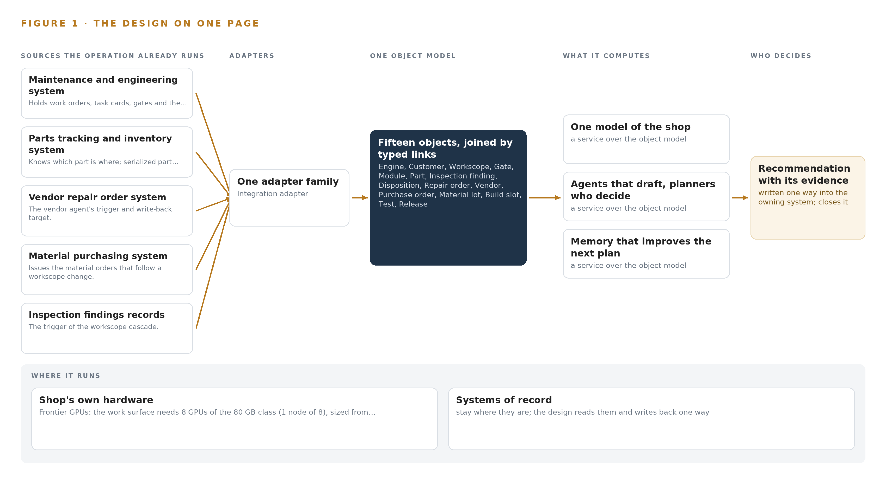
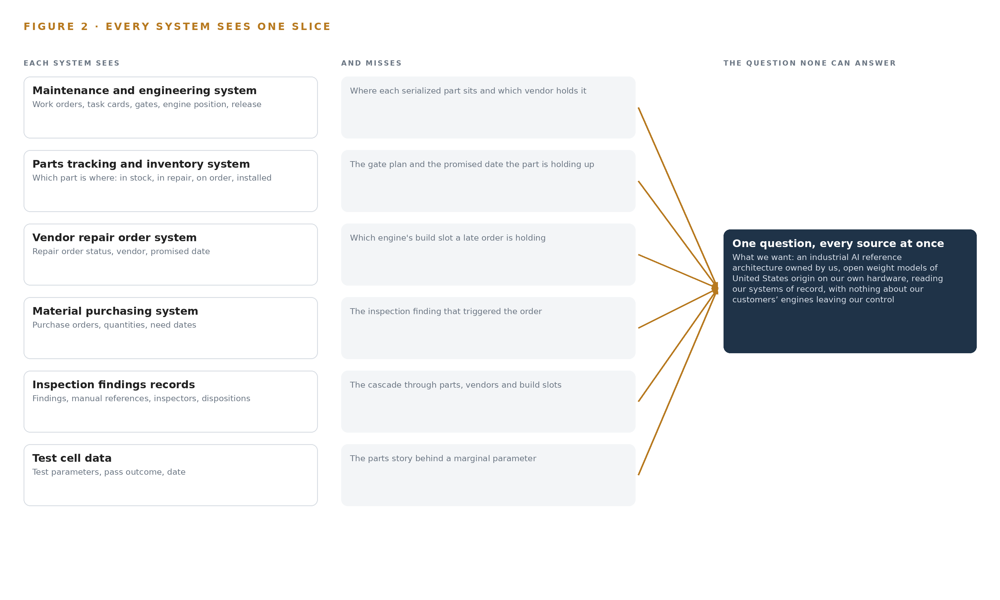
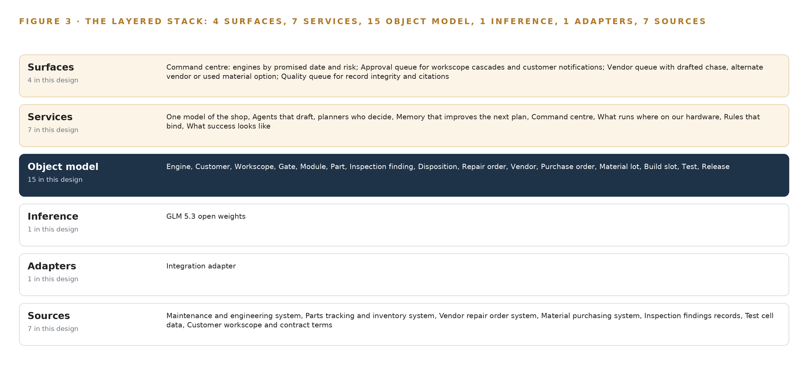
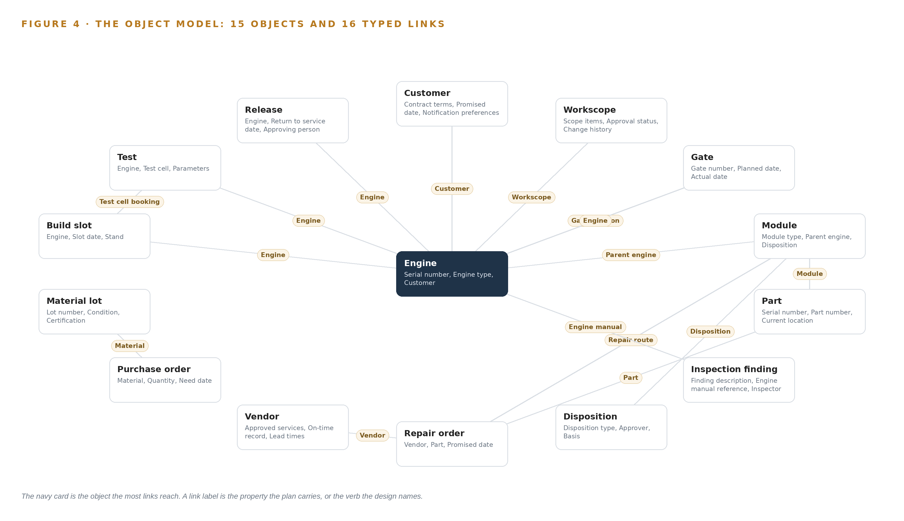
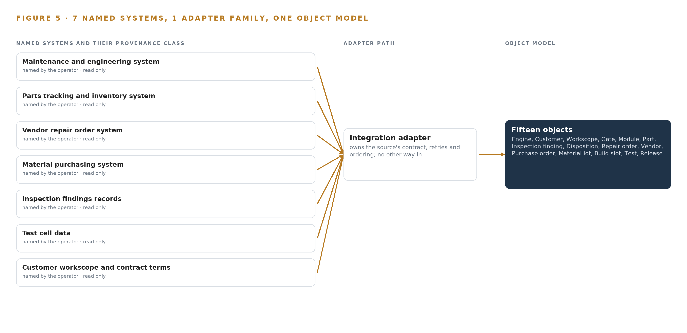
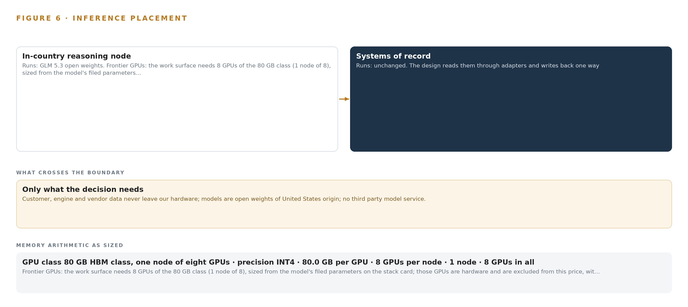
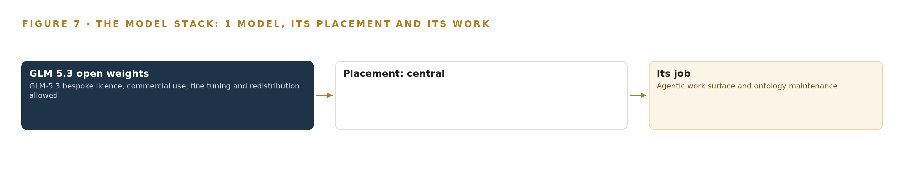
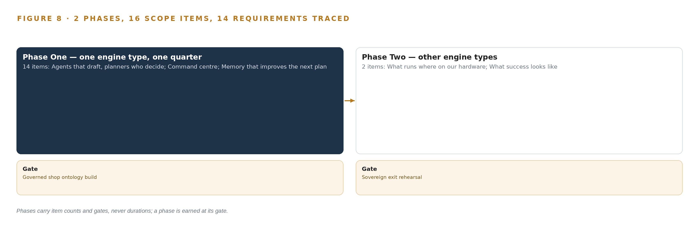
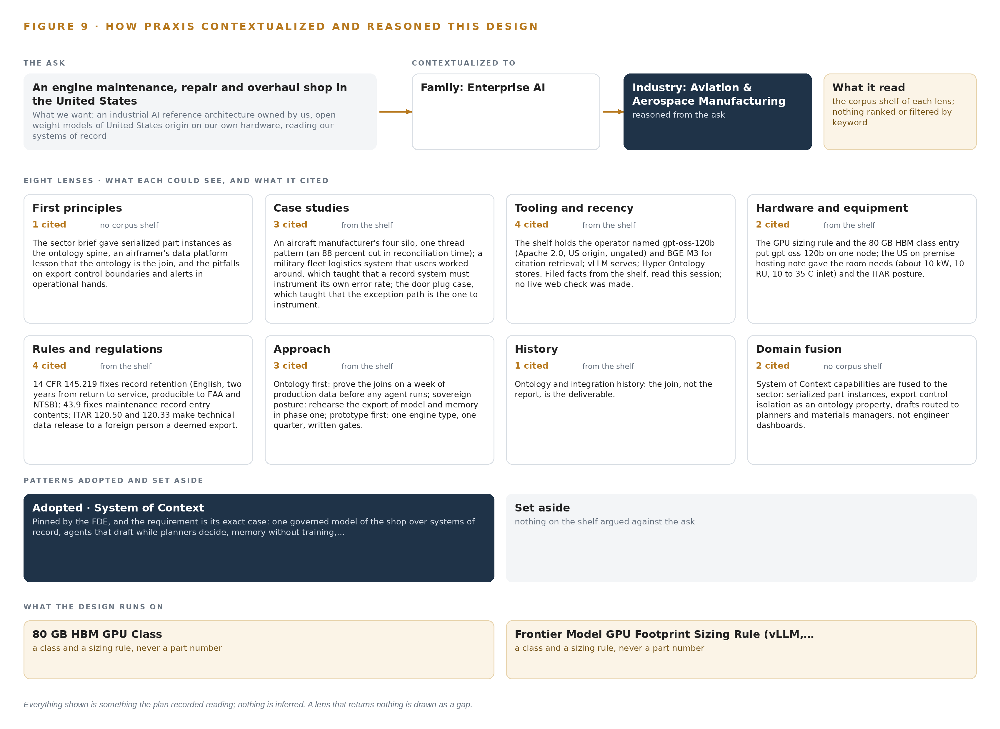

# Industrial AI Reference Architecture for an Engine MRO Shop Floor in the United States

Canonical: https://codeatoms.ai/engine-mro-shop-us/
PDF: https://codeatoms.ai/engine-mro-shop-us/paper/engine-mro-shop-us.pdf
License: CC BY 4.0
Publisher: CodeNinja Atoms (https://codeatoms.ai), a fully owned subsidiary of CodeNinja

VERTICAL-DRIVEN ARCHITECTURES · AVIATION & AEROSPACE MANUFACTURING · DESIGNED WITH PRAXIS · NOVEMBER 2026

# Industrial AI Reference Architecture for an Engine MRO Shop Floor in the United States

Critical Path Watch: Industrial AI in Engine Maintenance on Hardware the Shop Owns

Muhammad Umar, Cofounder, CodeNinja

For the shop general managers and operations directors accountable for engine turnaround, their planning, materials and quality leads, and the data, integration and platform engineers who would build and run it.

---

Vertical-Driven Architectures is a CodeNinja series of system designs. Every design in the series is driven by a real-world problem and scenario in a single industry, and every one is designed on Praxis, CodeNinja's platform for designing physical AI systems. Operations are described by class, never by name.

At a glance

## Industrial AI Reference Architecture for an Engine MRO Shop Floor in the United States

**What this is.** An open reference architecture for system design in physical AI, built for an aircraft engine maintenance, repair and overhaul shop in the United States that serves airlines and lessors, where owning the inference node that runs it costs about 407,000 US dollars over three years. When a high pressure turbine blade set fails inspection and moves a module from repair to replace, the design joins the gate plan, the serialized part's location, the vendor repair order, the purchase orders and the build slot into one argument, so the planner sees which engines' dates move and by how much, the materials manager sees the chase or the used material option, and the customer is told before the date slips. The model runs entirely on the shop's own hardware under the FAA's part 145 record keeping rules, the engine manufacturers' manual licences and export control on engine technical data. It is written for the shop general managers and operations directors accountable for engine turnaround, their planning, materials and quality leads, and the data, integration and platform engineers who would build and run it. The operator is described by class, never by name.

**The answer in numbers.**

| Part | The design |
| --- | --- |
| Sources | Seven read only systems of record, entering through one integration adapter family (one adapter per source, change data capture and interface reads, event by event) that carries the source system, record identifier and capture position onto every object: the maintenance and engineering system, the parts tracking and inventory system, the vendor repair order system, the material purchasing system, the inspection findings records, the test cell data and the customer workscope and contract terms; no cameras, no edge tier, and the single write path back into a system of record runs after a named approval with an audit trail |
| Object model | 15 typed objects with 16 typed links, from the engine, customer, workscope and gate through the module, part, inspection finding and disposition to the repair order, vendor, purchase order, material lot, build slot, test and release, with serialized part instances as the spine and US person access control fenced as a property on the objects, published as JSON for reuse |
| Models | GLM 5.3 open weights (GLM-5.3 bespoke licence permitting commercial use, fine tuning and redistribution; 753 billion parameters, 376 GB at INT4) for the agentic work surface, the cited conversational interface and ontology maintenance; gpt-oss-120b and BGE-M3 set aside as open work because their sources were not returned; no third party model service, nothing trained into weights |
| Compute | One node of eight 80 GB HBM class GPUs (640 GB) on vLLM in the shop's own server room on a segregated VLAN, holding 376 GB of INT4 weights with the 1.2 planning factor (452 GB) and 264 GB of headroom for concurrent planner sessions; Apache Kafka 4.4, Hyper Ontology, Harbor and Prometheus, Grafana and Loki beside it; no edge tier because nothing on the floor is sensed |
| Rollout | Two phases carrying 16 scope items (14 and 2), each closed by a gate, never a date: one engine type and its induction line for one quarter, gated on the governed shop ontology build proved on a week of production data and exited on a simulated high pressure turbine blade set failure drafted the same day; then the engine type extension path and the sovereign exit rehearsal; 14 requirements traced to items, headline measure engines released on the promised date with a nominal of 85 percent |
| Three-year cost | About 407,000 US dollars to own the node for three years (a range of 370,000 to 422,000: server, support and power at the national average commercial price), against about 448,000 to rent the same eight H100 cards on the deepest three year commitment in AWS US East (N. Virginia), a Compute Savings Plan all upfront, so ownership costs about nine tenths of it; about 600,000 on the three year EC2 Instance Savings Plan all upfront, about two thirds; and about 1.45 million on demand, a little over a quarter. Renting is a price reference only, because every rented option would carry customer, engine and vendor data and export controlled technical data out of the shop (Appendix A) |
| Human control | Agents draft and people decide, by name: the engine planner confirms the critical path draft, the customer program manager approves the workscope cascade and the airline notification, the materials manager approves the vendor chase or the alternative, and the quality queue checks record integrity; the disagreement path is built before the agreement path, agreement rates are logged, and every confirmed outcome is kept as memory the next plan reads |

**Reuse it.** The object model, the model register and the figures are free to reuse under CC BY 4.0. Cite as <https://codeatoms.ai/engine-mro-shop-us/.>

**Made with.** Reasoned on [CodeNinja Praxis](<https://codeatoms.ai/praxis/>), the CodeNinja Atoms platform for designing physical AI systems. The object model imports into [Hyper Ontology](<https://codeatoms.ai/hyper-ontology/>), which turns it into a living system. Load it with the [hyper-ontology loader](../hyper-ontology-py/): `hyper-ontology show engine-mro-shop-us`. Both are in beta; access by request.

ABSTRACT

## Industrial AI in Engine Maintenance Must See the Critical Path

An industrial AI reference architecture for an engine maintenance, repair and overhaul shop in the United States has to answer one concrete question that industrial AI in engine maintenance, arriving as dashboards, has not: which of the engines in work will miss its promised release date, and which part, vendor repair or build slot is holding it. It has not been answered because the answer is split across the maintenance and engineering system, the parts tracking system, the vendor repair order system and the workscope contract, and those four meet only when the date is missed; shops of this class carry hundreds of engines in work and tens of thousands of parts in flow at any time, in a year when turnaround on narrowbody engines runs to six months or more, and the fix for a part that goes late at the same vendor every quarter lives in a retiring planner's memory rather than in any system.

The design reads seven systems of record through one integration adapter family into a governed object model of fifteen objects joined by typed links, runs seven services, among them a critical path agent that drafts and a memory that improves the next plan without training, and presents four surfaces: a command center, an approval queue, a vendor queue and a quality queue. One model carries the agentic work surface and ontology maintenance, GLM 5.3 open weights, a frontier-class model at 753 billion parameters, held by the shop itself under a license that permits commercial use, fine tuning and redistribution, and served at INT4 on the shop's own hardware, one node of eight GPUs of the 80 GB HBM class, where 376 GB of weights leave room for the key value cache and activations; there is no edge tier and no third party model service, because the shop floor is watched through records rather than cameras.

The paper covers the industry problem and the join failure across the shop's systems, the constraints that shape the design, the stack from records to surfaces, the fifteen-object model, the adapter tier and event backbone, the placement of inference on the shop's own servers, the model and its license, the two-phase rollout with its gates and measurements, who owns what the design builds, and finally how Praxis contextualized and reasoned the design, so that any choice in it can be traced back to the recorded reading that justified it.

---



Figure 1. Critical Path Watch on one page: the sources the operation already runs, one object model, what it computes, and the person who decides.

## Contents

Each chapter is tagged for the reader it serves most directly: Executive, Team Lead, FDE, Reference.

|  |  |  |
| --- | --- | --- |
|  | Abstract · Industrial AI in Engine Maintenance Must See the Critical Path | Executive |
| PART I · THE PROBLEM | | |
| 1 | [Industrial AI in Engine Maintenance Begins at the Critical Path](#ch1) | Executive |
| 2 | [Every Shop System Sees One Slice of the Engine](#ch2) | ExecutiveTeam Lead |
| PART II · THE DESIGN | | |
| 3 | [Sovereignty and Export Control Shape Everything Downstream](#ch3) | Team Lead |
| 4 | [One Stack Runs From Records to Planners' Screens](#ch4) | Team LeadFDE |
| 5 | [Fifteen Objects Turn Shop Data Into One Argument](#ch5) | FDE |
| 6 | [Every Source Enters Through an Adapter, Never Directly](#ch6) | FDE |
| 7 | [All Inference Runs on the Shop's Own Servers](#ch7) | FDE |
| 8 | [The License Decides What the Operator Can Own](#ch8) | FDEExecutive |
| PART III · THE ROLLOUT | | |
| 9 | [Shadow Mode Comes Before Any Draft Is Trusted](#ch9) | Team LeadExecutive |
| 10 | [The Intelligence Should Stay with the Shop](#ch10) | Executive |
| PART IV · HOW IT WAS DESIGNED | | |
|  | Conclusion · The Shop Should Keep the Intelligence Its Own Flow Produced | Executive |
| 11 | [How Praxis Contextualized and Reasoned This Design](#ch11) | Team LeadFDE |
|  | [Sources](#sources) | Reference |

PART I · CHAPTER 1

## Industrial AI in Engine Maintenance Begins at the Critical Path

Every engine in an overhaul shop has exactly one critical path, and today no system, spreadsheet or person can see it before the promised date is missed.

The abstract put the whole industrial AI reference architecture on one page: seven systems of record, one adapter family, an object model of fifteen objects, seven services, four surfaces and one frontier model on the shop's own hardware. This chapter steps back to the question that design exists to answer, because industrial AI in engine maintenance begins at the critical path of each engine, not at any model, and the shape of the question decides everything downstream.

### 1.1  The Question and the Ground It Stands On

The shop needs one question answered continuously: for every engine in work, what is its critical path today, and what will break it next? Answering it requires data no single system holds. The gate plan lives in the maintenance and engineering system, the physical location of every serialized part in the parts tracking and inventory system, the status of every vendor repair in the vendor repair order system, the material orders that follow a workscope change in the material purchasing system, the findings that trigger cascades in the inspection findings records, the outcome in the test cell data, and the promised date and the terms that govern what the shop may decide in the workscope and contract records. The regulatory ground is fixed alongside the data. As a repair station the shop answers to the FAA's part 145 regime, which requires maintenance records in English, retained two years from return to service and producible to the FAA and the NTSB, with the content of each maintenance record entry fixed by 14 CFR 43.9. Because engine technical data is export-controlled, any release of it to a non-United States person is a deemed export under the ITAR. Any system that reads these records inherits both regimes, and the design must satisfy them rather than route around them.

### 1.2  The Documented Cost

The cost in practice is engines held on stands: turnaround on narrowbody engines at this point in the demand cycle runs to six months or more, and one late vendor repair or one scarce part holds a finished engine regardless of how much bay capacity the shop has. The supply chain that this parts flow runs through carries documented integrity failures, which is the public record of what a shop without sight of its own flow is exposed to. The Department of Transportation's Inspector General concluded that enhancements were needed to the FAA's oversight of the Suspected Unapproved Parts Program (DOT 2017), and a United States District Court has sentenced a machine shop to probation and a fine for aircraft parts fraud (DOT 2023). The FAA alerts owners, operators, air agencies and suppliers to suspected unapproved parts reaching the fleet (FAA 2023), Europe's regulator publishes confirmed and investigated unapproved parts cases (Europa 2018), and an industry coalition's final report recommends controls across the supply chain, including for aircraft on ground situations (ARSA 2024). A shop that cannot join its own parts, vendor and gate records cannot see a bad actor, a bad lot or a late vendor until the engine is already held.

### 1.3  The Operation as a Scenario

The operator is an aircraft engine maintenance, repair and overhaul shop in the United States that serves airlines and lessors, in a year when engine shop visit demand is at its peak. Shops of this class carry hundreds of engines in work and tens of thousands of parts in flow at any time, and the design takes those bands as its scale; anything specific to the shop is an assumption the design confirms rather than a figure it asserts. The people in the loop are the planners who own the gate plans, the materials managers who own orders and vendors, the inspection staff who raise findings, the engineers who disposition them, the quality staff who keep the record honest, and the program manager who faces the airline. The physical environments are the induction line, inspection, in-house repair, vendor repair beyond the wall, assembly stands and test cells. The named estate is seven systems of record, all read-only to the design, at a single site, with a rollout of two phases, each carrying a gate that can stop the work cheaply before it spreads.

PART I · CHAPTER 2

## Every Shop System Sees One Slice of the Engine

The gate plan, the part's location, the late vendor repair and the promised date live in four separate places that only meet when the engine misses its date, and the cost of that join failure is measured in engines held on stands.

Chapter 1 stated the question and the regulatory ground it stands on. This chapter shows why nothing in the shop can answer it today: each of the seven systems of record sees one slice of the engine, and the slices only meet when the promised date is missed.

### 2.1  What Each System Sees

The maintenance and engineering system is the spine: it holds work orders, task cards, gates and the engine's position against them, and it is where release is recorded, yet it has no idea where any serialized part physically sits or which vendor holds it. The parts tracking and inventory system knows exactly which part is where, in stock, in repair at a vendor, on order or installed, but it does not know the gate plan or the date the airline was promised. The vendor repair order system knows a repair order is open, in work, late or closed, and it knows the vendor, but it cannot see which engine's build slot that late order is holding. The material purchasing system issues and tracks the purchase orders that follow a workscope change, without knowing the inspection finding that triggered them. The inspection findings records hold the finding, the engine manual reference, the inspector and the disposition, but not the cascade through parts, vendors and build slots that the finding sets off. The test cell data holds parameters and the pass outcome that closes an engine's story, without the parts story that explains a marginal parameter. The workscope and contract terms hold the promised date and the terms governing what the shop may decide, without any view of where the engine actually stands against that date. Figure 2 sets these seven slices side by side.



Figure 2. Seven systems, each seeing one part of the answer. The question needs all of them in one place at once.

### 2.2  What None of Them See Together

The critical path is a join across all seven: this engine's gate, the module on it, the serialized part in that module, that part's repair order at a particular vendor, that vendor's on-time record and lead times, the build slot and test cell booking waiting at the end, and the promised date judging all of it. No system holds that join, so a planner's head holds it, and the knowledge that the same part on the same engine type goes late at the same vendor every quarter lives in memory that retires with its holder. When a workscope change at inspection moves a module from repair to replace, the cascade through parts, vendors and the build slot is worked by hand over days, and the engine sits on its stand while it is worked. The cost is measured in engines held, in six-month turnarounds on narrowbody engines, and in a planning bench that is thinning into a market short of exactly the people who carry the join. That is the failure this design removes: not any one system's blindness, but the absence of the place where the slices meet.

PART II · CHAPTER 3

## Sovereignty and Export Control Shape Everything Downstream

Open weights of United States origin on the shop's own hardware, export-controlled technical data fenced as an ontology property, every decision left to a named person, and a first gate that can stop the work cheaply, together fix the shape of everything the design does.

Chapter 2 showed the join failure: seven slices and no place where they meet. Four goals now fix the shape of the fix before any component is chosen, because in this industry each goal is hard in a way that removes whole families of architecture before the stack is even discussed.

### 3.1  Sovereign Operation on the Shop's Own Hardware

The first goal is the boundary the operator set in its own words: engine, airline and vendor data never leave the shop's hardware, the models are open weights of United States origin, and no third party model service is ever in the path. This is hard in this industry because the work surface needs a frontier model, and a frontier model is a physical commitment: the design's model carries 753 billion parameters, which at INT4 precision occupies 376 GB of weights, held with headroom for the key-value cache and activations on one node of eight GPUs of the 80 GB class. A hosted service would make that someone else's problem and the operator's exposure, so the design instead owns the arithmetic, the room, the power and the support contracts as part of its own ground, served on site with vLLM.

### 3.2  Export Control Fenced in the Data Model

The second goal follows from the first and is harder than it: engine technical data is export-controlled, and a non-United States person's access to it is a deemed export under the ITAR. A network rule alone cannot be the fence, because the join the ontology exists to build is exactly the kind of crossing a blunt perimeter control would break. The design therefore fences access control as a property on the objects themselves, so the join works inside the fence and stops at it, and it carries a data classification pass before go live so every object's exposure is known rather than assumed.

### 3.3  Every Decision Left to a Named Person

The third goal is that agents draft and people decide: a critical path draft, a workscope cascade, a vendor chase or an airline notification is a draft until a named planner, materials manager or program manager confirms it, and the confirmation is written back with an audit trail. This is hard because part 145 record entries and dispositions require an approving person, and because the likeliest failure of an assistant is over-trust: a planner confirming without reading. The design answers with drafts that carry their sources, a disagreement path built before the agreement path, and agreement rates logged so the agents' own error rate is instrumented.

### 3.4  A First Gate That Can Stop the Work Cheaply

The fourth goal is a stop that costs little: phase one covers one engine type and its induction line for a quarter, and it exits only if the simulated failure of a high pressure turbine blade set is drafted the same day against the shop's own baseline. This is hard because an engine type extension touches manuals, vendors and test cells, so an unproved architecture spread across the estate is expensive to unwind; the gate keeps the unwind cheap and lets the measured baselines decide whether extension happens at all.

### 3.5  Scoping Decisions

Three scoping decisions carry most of the cost and most of the protection, and Table 1 states each with what it buys and what it costs. The narrow first phase buys a proved ontology on live flow at the price of making the rest of the shop wait; event driven reads buy current statuses at the price of integration work on all seven systems; memory instead of training buys inspectable improvement at the price of a slower per-engine learning curve than weights would give.

Table 1 · Scoping Decisions

| Decision | What it buys | What it costs |
| --- | --- | --- |
| One engine type, its induction line, one quarter | A governed shop ontology proved on live flow before any extension | Every other engine type waits for phase two |
| Event driven reads via APIs and change data capture | Statuses current in the ontology, status by status, so drafts run on fresh data | Integration built per system: all seven connectors are built, not bought |
| Memory that improves the next plan | Improvement the shop can read, audit and edit, with no weights touched | Learning accrues more slowly than trained weights would allow |

### 3.6  What the Design Chose Against

Table 2 records the ground the design stands on, each row a choice made against a live alternative, and closes with what stays outside the design entirely: the systems of record are never replaced, the shop floor is never sensed with cameras, nothing is trained into weights, and no notification goes to an airline without a named person sending it, because each of those would multiply cost and regulatory exposure before the join is proved.

Table 2 · What the Design Chose Against

| Where | What was picked | Instead of, and why |
| --- | --- | --- |
| Ingestion | Event driven reads via APIs and change data capture | Batch extracts, which leave the ontology stale between runs and put drafts on bad data |
| Improvement | Memory that the next plan reads before it acts | Fine tuning, which the pinned architecture forbids and the requirement answers with memory instead |
| Write back | Agent write back after named approval with an audit trail | Manual transcription, which recreates the cascade by hand the design exists to remove |
| Model service | Open weights of United States origin served on site | A third party model service, which would carry engine data outside the boundary the operator set |
| Scope | One engine type, one quarter, a gate that stops extension cheaply | An estate wide rollout at once, which spends everything before the first proof |
| Out of scope | Record replacement, cameras, weight training, automatic airline notification | The design reads records and drafts decisions; replacing, sensing, training and notifying would each add cost and risk the first gate exists to avoid |

PART II · CHAPTER 4

## One Stack Runs From Records to Planners' Screens

Systems of record below, one governed object model in the middle, services and surfaces above: a single stack carries seven sources through one adapter family to four queues and one command center, with no edge tier because nothing on the floor is sensed.

Chapter 3 fixed the constraints and priced the scoping decisions taken under them. This chapter lays out the stack those decisions produce, and it carries the paper's central claim: industrial AI in engine maintenance is a join problem before it is a model problem, so one governed object model sits between seven systems of record and four planners' surfaces, with no edge tier because nothing on the floor is sensed.

### 4.1  The Pattern and Why It Fits

The pattern is three layers in a fixed order. Below sit the systems of record, never replaced, never modified, never loaded anywhere else; the seven systems the shop already runs hold every fact the design reads. In the middle sits one object model, a projection over those systems rather than a copy of them, where fifteen objects and the typed links between them form the one model of the shop the operator asked for. Above sit seven services that draft, rank, remember and bind, and four surfaces that put each draft in front of the named person who decides. The counts run end to end: seven sources pass through one adapter family into fifteen objects, seven services and four surfaces, served by one open weights model on the shop's own hardware.

The pattern fits because of what Chapter 2 showed: every system sees one slice of the engine, and the slices meet only when the engine misses its date. A stack that joined nothing would change nothing; a stack that joins the seven changes the question the shop can ask. Figure 3 shows the layered stack with the count at each layer, and it marks one further decision: there is no edge tier, because the design watches records and plans rather than the floor, and all inference runs centrally.



Figure 3. The layered stack: 7 sources, 1 adapter family, 15 objects, 7 services and 4 surfaces.

### 4.2  The Stack Stage by Stage

Table 3 walks the stack stage by stage. The Sources stage is the seven named systems, all read-only. The Sensing stage is empty by decision rather than omission: parts flow arrives as events from the systems of record, not from cameras, so the layers a sensed site would carry are absent. The Adapters stage is a single integration adapter family, one adapter per source, moving each change out by change data capture and interface reads. The Object model stage is the governed graph store holding the fifteen objects and their typed links. The Inference stage serves one open weights model on vLLM at INT4 precision on one node of eight 80 GB class GPUs. The Services stage is the seven services, from the critical path agent that drafts the cascade to the memory loop that improves the next plan, and the Surfaces stage is the four queues where planners decide.

Table 7, printed by the platform beside this section from the plan, carries the same stack layer by layer with the component, the choice and the reason for each row; read together, Table 3 gives the stage view and Table 7 the procurement view of one set of decisions.

Table 3 · The Stack, Stage by Stage

| Stage | What it is responsible for | How |
| --- | --- | --- |
| Sources | Holding every fact the design reads: work orders, task cards, gates, serialized part positions, repair orders, purchase orders, findings, test cell runs, workscope and contract terms | Seven named systems of record the operator already runs, all read-only, never replaced and never migrated |
| Sensing | Nothing: the design watches records and plans, not the shop floor | No cameras and no positioning; parts flow arrives as events from the systems of record |
| Adapters | Moving each change out of its source without modifying the source | One integration adapter family, one adapter per source, change data capture and interface reads, event by event |
| Object model | Joining the streams into one governed model of the shop | Fifteen objects and typed links in the governed graph store, a projection over the sources, never a shadow copy |
| Inference | Serving the one open weights model the design commits | vLLM on one node of eight 80 GB class GPUs at INT4 precision, on the shop's own hardware |
| Services | Turning the model into work: drafting, ranking, memory, rules and measurement | Seven services, from the critical path agent that drafts to the memory loop, the binding rules and the success measure |
| Surfaces | Putting drafts and their citations in front of the person who decides | Four queues: the command center, the approval queue, the vendor queue and the quality queue |

Table 7 · Architecture, Layer by Layer

| Layer | Component | Choice | Why |
| --- | --- | --- | --- |
| Event streaming and messaging | by class, no product named | Product | Apache Kafka 4.4 |
| The ontology or graph store | by class, no product named | Product | Hyper Ontology v0.9 |
| Time series and telemetry storage | InfluxDB 3 Core, TimescaleDB | Class | Test cell data volumes are unstated; the shelf holds InfluxDB 3 Core and TimescaleDB as examples to choose at design. |
| Video ingest, recording and management | by class, no product named | Not needed | The design watches records and plans, not cameras. |
| Edge model serving | by class, no product named | Not needed | All inference runs on the shop's own servers; there is no edge tier. |
| On site language model serving | by class, no product named | Product | VLLM |
| Object tracking and trajectory forecasting | by class, no product named | Not needed | Parts flow arrives from the systems of record, not from cameras. |
| Edge orchestration of containers | by class, no product named | Not needed | Single-site central rollout; no edge fleet. |
| An air gapped artifact and model registry | by class, no product named | Product | Harbor |
| Labelling and retraining | by class, no product named | Not needed | Under system of context nothing is trained into weights; improvement runs through its memory loops. |
| Time synchronisation across sensors and systems | by class, no product named | Class | Ordering comes from CDC offsets and monotonic sequence numbers; no sensor fusion needs PTP. |
| Observability of the running system | by class, no product named | Product | Prometheus 3.13 LTS with Grafana and Loki |

### 4.3  A Reusable Pattern

The reusable shape is the middle of the stack: systems of record left untouched below, one projection ontology over them, drafting agents above with the decision reserved to a named person, memory that improves the next plan without touching weights, and everything running on hardware the operator owns inside its own boundary. A team carrying a similar brief would swap the source inventory, the object list and the model with its GPU class, because those belong to the shop and the brief. What it should keep unchanged is the discipline around them: every source enters through an adapter and never directly, every join is a typed link rather than a keyword match, and the single write path back to a system of record runs after named approval with an audit trail. Those decisions, not any particular component, are what make the pattern sovereign and what let it survive the first workscope change at inspection.

PART II · CHAPTER 5

## Fifteen Objects Turn Shop Data Into One Argument

Fifteen objects anchored in the systems of record and joined by typed links let a planner ask the question no document store can answer: which engine, which part, which vendor, which date, and what changed at inspection.

Chapter 4 placed the object model in the stack. This chapter describes what it holds.

### 5.1  Every Object and Its Links

The 15 objects are Engine, Customer, Workscope, Gate, Module, Part, Inspection finding, Disposition, Repair order, Vendor, Purchase order, Material lot, Build slot, Test, Release. The plan implies 16 typed links, such as the link from an engine to its customer.



Figure 4. The fifteen objects of the model and the typed links that let a query reach across them.

### 5.2  The Human Loop and the Hosting Posture

Customer, engine and vendor data never leave the shop's hardware; models are open weights of United States origin; no third party model service.

### 5.3  One Object in Its Recorded Form

The object below is printed as the plan records it.

Table 8 · The Object Model

| Object | Anchored in | Typed links |
| --- | --- | --- |
| Engine | Maintenance and engineering system | Customer; Workscope; Gate position: Gate |
| Customer | Customer workscope and contract terms | no typed link recorded |
| Workscope | Customer workscope and contract terms | no typed link recorded |
| Gate | Maintenance and engineering system | Engine |
| Module | Maintenance and engineering system | Parent engine: Engine; Disposition; Repair route: Repair order |
| Part | Parts tracking and inventory system | Module |
| Inspection finding | Inspection findings records | Engine manual: Engine |
| Disposition | Inspection findings records | no typed link recorded |
| Repair order | Vendor repair order system | Vendor; Part |
| Vendor | Vendor repair order system | no typed link recorded |
| Purchase order | Material purchasing system | Material lot |
| Material lot | Parts tracking and inventory system | no typed link recorded |

```
{ "id": "engine", "label": "Engine", "kind": "asset", "anchored_in": "Maintenance and engineering system", "properties": [ "Serial number", "Engine type", "Customer", "Workscope", "Promised release date", "Gate position" ], "status_vocabulary": [ "Inducted", "Disassembled", "In repair", "In assembly", "In test", "Released" ], "links": [ { "to": "customer", "label": "Customer" }, { "to": "workscope", "label": "Workscope" }, { "to": "gate", "label": "Gate position" } ] }
```

PART II · CHAPTER 6

## Every Source Enters Through an Adapter, Never Directly

All seven systems of record are read event by event through the integration adapter tier, with change data capture offsets and monotonic sequence numbers ordering the stream, so the model of the shop never goes stale and never writes back except after named approval.

Chapter 5 defined the fifteen objects and their typed links, the argument the shop has never been able to make. This chapter describes how that argument stays current: how each of the seven systems of record is read event by event, and what guarantees the reading carries.

### 6.1  Seven Sources, One Adapter Family

Every source named in the design is an operational system the shop already runs, and each enters the same way: through the integration adapter, never directly. The maintenance and engineering system holds work orders, task cards, gates and build slots, and it anchors the engine, module, gate, build slot and release objects. The parts tracking and inventory system resolves serialized part instances and material lots. The vendor repair order system holds repair orders and the vendor records behind them. The material purchasing system issues purchase orders. The inspection findings records carry the findings and dispositions that trigger the workscope cascade. Test cell data closes each engine's story with parameters and pass findings. The customer workscope and contract terms hold the promised date and the terms governing what the shop may decide, and it is read only. All seven are of operator provenance, all are read, and none is written to by ingestion. Figure 5 sets each named system beside its provenance class and its adapter path. Material integrity makes this tier more than plumbing: the aviation supply chain carries a documented risk of unapproved parts, which the regulator actively works to discover and remove (FAA n.d.), and the adapter preserves each record's certification and condition properties so a quarantined lot can never silently become an installed part.



Figure 5. The 7 named systems, the adapter path each one takes, and the object model they all map into.

### 6.2  What the Adapter Tier Guarantees

The adapter tier is one family, the integration adapter, built per system in scope work rather than bought, and it guarantees four things. It reads event by event through change data capture and APIs rather than batch extracts, so the ontology stays current status by status instead of nightly. It projects: each event becomes a property change or a typed link on an existing object, so the model of the shop is a projection over the systems of record, never a shadow copy of their tables. It preserves provenance, carrying the source system, the record identifier and the capture position onto every object it touches, so any statement the surfaces make can be traced to the record that produced it. And it never writes back: the single write path into a system of record runs after a named person approves an agent draft, with an audit trail.

### 6.3  The Event Backbone

Apache Kafka 4.4 carries the streams between adapters and the object model. Ordering comes from change data capture offsets and monotonic sequence numbers per partition, which is why the design needs no precision time protocol: a gate completion, a disposition and a repair order status change arrive in the order the source systems committed them. Delivery is at least once, with consumers idempotent on the capture position so a replayed event cannot double-apply a status change. Buffering absorbs a slow consumer or a paused source, and replication inside the shop's estate means a broker loss does not lose an event. When a link fails, adapters buffer and resynchronize from the last committed offset, and the status-lag gauge in observability shows how far the model of the shop trails the shop itself.

PART II · CHAPTER 7

## All Inference Runs on the Shop's Own Servers

Because the design watches records and plans rather than cameras, there is no edge tier: every token is generated inside the shop's boundary on one node of eight 80 GB GPUs, and nothing crosses the network boundary except what the shop's own people send.

Chapter 6 described how every one of the seven source systems enters through the integration adapter tier as ordered, event-driven reads, so that the ontology stays current status by status. This chapter describes where the tokens that read and reason over that ontology are generated, and why the answer is a single tier inside the shop's own boundary.

### 7.1  One Tier, Because There Is Nothing to Sense at the Edge

The design watches records and plans, not cameras: the shop floor is not sensed, parts flow arrives from the systems of record, and every fact the reasoning tier touches has already crossed the adapter tier as structured data. Because there is no sensing, there is no edge tier, no edge orchestration of containers, and no edge model serving; the honest architecture is one central inference tier running on the shop's own servers, on the shop's existing network with a segregated VLAN agreed in scope work. Figure 6 shows that single tier, what runs on it, and the one thing that leaves it: what the shop's own people send.

The memory arithmetic fixes the tier's size. The work surface runs GLM 5.3 open weights, a frontier class model with 753 billion parameters filed, at or above the 300 billion parameter threshold that defines the frontier class. At INT4 precision each parameter occupies half a byte, so the weights alone are 376 GB. The 1.2 planning factor reserves roughly another 75 GB for the KV cache, the memory that holds conversation context so each new token does not force a recomputation of everything before it, and for activations; the GPUs must therefore hold about 452 GB in total. One node of eight 80 GB GPUs offers 640 GB of high bandwidth memory, which holds the weights with 264 GB left beside them, headroom that lets the KV cache ceiling rise with concurrent planner sessions rather than capping the number of planners who can work at once. Serving runs on vLLM, the stack's on site language model serving choice, with observability on Prometheus 3.13 LTS, Grafana and Loki.



Figure 6. Where each tier runs, what runs there, and the narrow set of outputs that cross the boundary.

### 7.2  The Latency Budget Is Planner Paced, Not Machine Paced

Every surface in this design faces a person making a decision: the command center with engines by promised date and risk, the approval queue for workscope cascades, the vendor queue with drafted chases, and the quality queue for record integrity. The latency budget is therefore human paced, and the binding constraint is not token generation but ontology freshness. A critical path draft is only as good as the last change data capture event behind it, so the budget is spent on ingestion first: event driven reads via APIs and CDC keep the object model current status by status, and the status lag between a system of record and the ontology is a gauge in observability, a lesson taken from a record system that users worked around because it could not see its own staleness. Generation that completes within a planner's read of the draft it accompanies is inside the budget; a fast answer built on a stale part location is not, which is why the freshness gauge outranks any serving benchmark.

### 7.3  The Boundary, and What Fails When It Fails

What crosses the network boundary is only what the shop's own people send: agents draft the customer notification and the vendor chase, and the customer program manager and the materials manager send them, because people decide. Customer, engine and vendor data never leave the shop's hardware, no third party model service receives anything, and there is no outbound analytics zone. The link that matters most is the update path, not the inference path: artifacts and model weights arrive through Harbor, the air gapped registry, and if that path fails the running versions continue on pinned versions until it recovers, since nothing in the daily loop depends on an external endpoint. If power fails, the node sits in a standard conditioned server room and the clean shutdown practice is confirmed at design, with recovery reading the event backbone's replicated log to resynchronize the object model. The remaining failure is human: drafts that run on stale statuses, which the reconciliation pass and the lag gauge exist to catch.

PART II · CHAPTER 8

## The License Decides What the Operator Can Own

One open-weight frontier model carries the work surface, and the terms of its license, not its benchmark scores, decide whether the shop can hold the weights, fine tune them, redistribute them and keep them when the engagement ends.

Chapter 7 fixed the tier and the arithmetic: one node of eight 80 GB GPUs holding a frontier class model's weights with room for the KV cache. This chapter describes the model that runs there, the terms of its license, and the register of everything the design stands on.



Figure 7. The one model, its placement, and the work it does.

### 8.1  One Open-Weight Frontier Model Carries the Work Surface

Figure 7 shows the model stack, and it is deliberately short: one model in the register, running on the central tier, serving the agentic work surface and ontology maintenance that the command center, the conversational interface with citations, and the drafting agents all depend on. The model is GLM 5.3 open weights, frontier class with 753 billion parameters filed, served at INT4 on vLLM. Its role is the work surface's: every planner works on a frontier model, on open weights only, and the design holds no closed or hosted model anywhere in the loop.

The license, not the benchmark, is what decides whether the operator can own this. The GLM-5.3 license is bespoke, and its terms permit commercial use, fine tuning and redistribution, which is exactly the set of permissions a sovereign posture needs: the operator may run the weights for its own work, adapt them, and hand copies onward inside its own estate without asking permission per use. Because the weights are open and the terms allow holding them, the work surface survives the end of any engagement; the sovereign exit rehearsal in phase two exists to prove that the model, the memory and the object model leave together, which is the ownership argument in operational form. The register also records what was weighed and set aside: gpt-oss-120b, a US-origin model on permissive, ungated terms, was proposed for a site inference server, but its provenance was never rechecked against a returned source this session, so it sits outside the register and the sizing for that layer remains open work rather than a settled figure; BGE-M3, proposed for citation retrieval, was set aside for the same reason.

The retrieval the citations depend on matters beyond convenience, because the shop's records carry safety weight: the regulator runs a standing program on suspected unapproved parts in the aviation supply chain (FAA n.d.), and courts have sentenced parts suppliers for fraud (DOT 2023), so a draft that cites its source records lets the quality queue check the provenance class of every material lot and vendor claim behind it rather than trusting the draft's fluency.

### 8.2  The Model and Equipment Register

Table 4 gathers the register: each model, the hardware classes and sizing rules the arithmetic rests on, the sensing the design chose not to need, the pattern it stands on, and the ground it runs on. The register is the honest boundary of the design's commitments, and anything outside it is labeled open work rather than sized on assumption.

Table 4 · Model and Equipment Register

| The choice | What was picked | Why here |
| --- | --- | --- |
| Frontier model | GLM 5.3 open weights, 753 billion parameters filed, bespoke license allowing commercial use, fine tuning and redistribution | The work surface commits a frontier model on open weights the operator can hold, fine tune and keep when the engagement ends |
| Model set aside | gpt-oss-120b, US origin, permissive and ungated terms | Proposed for a site inference server; its source was never returned this session, so it stays outside the register as open work |
| Retrieval model set aside | BGE-M3 for citation retrieval | Proposed for the citation path; set aside with provenance unrechecked, so the register carries no second model |
| Hardware class | 80 GB HBM GPU class, one node of eight GPUs, 640 GB total | Holds the 376 GB of INT4 weights with 264 GB beside them for KV cache and activations against the 1.2 planning factor |
| Sizing rule | Frontier Model GPU Footprint Sizing Rule (vLLM, SGLang) | Converts filed parameter counts and precision into a node count before any purchase is made |
| Sensing | None; records and plans, not cameras | Parts flow arrives from the systems of record, so there is no edge tier and no vision stack to license or maintain |
| Primary pattern | System of context | One governed model of the shop over systems of record, agents that draft while planners decide, memory without training |
| Ground | The operator's own servers, single site, sovereign posture, Harbor air gapped registry for updates | Customer, engine and vendor data never leave the shop's hardware, and no third party model service is in the loop |

PART III · CHAPTER 9

## Shadow Mode Comes Before Any Draft Is Trusted

Agents run beside the planners' own process through a first phase of one engine type and one quarter, and extension past each gate must be earned against the shop's own baselines, with a simulated high pressure turbine blade failure drafted the same day as the first exit test.

Chapter 8 fixed the model the register holds, GLM 5.3 open weights, and the license terms that let the shop keep it. This chapter sets out how an industrial AI build earns the right to run: two phases carrying item counts and gates rather than promises, every agent drafting beside the planners' own process until the shop's own numbers say otherwise, as Figure 8 shows.

### 9.1  Two Phases, Two Gates and Fourteen Traced Requirements

Phase one covers one engine type and its induction line for one quarter, and it carries 14 items across six workstreams: one model of the shop; agents that draft while planners decide; memory that improves the next plan; the command center; rules that bind; and what runs where on the shop's own hardware. Its first gate is the governed shop ontology build, passed on evidence rather than assertion: the joins are proved on a week of production data before any agent runs, because an object model that cannot reconcile one part's status across the systems of record has nothing to draft from. The phase's exit test is the fault the shop named as the one that hurts, a simulated high pressure turbine blade set failing inspection: the failure is injected into the phase's engine type, and the phase exits only if the drafted cascade appears the same day against the shop's own baseline, covering the parts it moves, the repair orders it re-routes, the purchase orders it raises and the build slot it reschedules.

Phase two carries 2 items, the engine type extension path and the sovereign exit rehearsal, and its gate is that rehearsal: the export of the model, the memory and the object model is practiced end to end before the shop ever needs to exercise it in earnest. Fourteen requirements govern the whole build, and each is traced to a phase item; the trace is reviewed at each gate, and a requirement with no item behind it stops the phase rather than surviving as intent.



Figure 8. The two phases and their gates, and coverage of the 14 requirements across them.

### 9.2  What the Rollout Measures

The headline measure is engines released on the promised date, expressed in percent, with a nominal of 85 and a breach when the measured rate falls below it. That figure is the shop's own promise discipline, not a benchmark imported from another industry, and the simulated blade failure tests the same discipline at the cascade level, comparing the same-day draft against the baseline of how long the same cascade took by hand. Around the headline sit the four baselines the shop keeps today, against which the agents are measured; the agreement rate between planner and draft, logged on every confirmation; and a status-lag gauge in observability that shows how far the object model trails the systems of record. The memory loop records confirmed outcomes from the first day, so the measure of memory is whether the next plan on the same engine type starts better informed than the last.

### 9.3  Failure Modes the Design Answers

The failure modes in Table 5 are drawn from the shop's own risk list and from precedents read in the sector, and the supply chain context sharpens them: regulators maintain a program to discover and remove unapproved parts (FAA n.d.), an industry coalition has published recommendations on supply chain integrity under aircraft on ground pressure (ARSA 2024), and an oversight body has concluded that oversight of such programs needs enhancement (DOT 2017). A shop that cannot see its critical path is exposed to exactly the pressures those documents describe.

Table 5 · Failure Modes

| What fails | What the design does |
| --- | --- |
| Stale statuses in the systems of record, so drafts run on bad data | A reconciliation pass on a week of production data precedes any agent, and a status-lag gauge in observability keeps the lag visible |
| Planners confirm drafts without reading them | Every draft carries its sources, the disagreement path is built first, and agreement rates are logged |
| Export-controlled technical data reaches a non-US person | US-person access control is an ontology property, with a data classification pass before go-live |
| A manual license forbids machine reading | Each manual source is license-reviewed before the retrieval index is built |
| Planner knowledge retires before memory captures it | The memory loop records confirmed outcomes from day one, and an elicitation pass runs with retiring planners |
| Draft quality on the shop's own work is unproven | Agents run beside the planners' process, measured against the four baselines, with gates that can stop extension |

### 9.4  Lessons the Phase Structure Encodes

**Shadow the drafts before anyone trusts them.** The agents run beside the planners' process, never in front of it, and every draft carries the sources it was built from; the disagreement path, the route by which a planner rejects a draft and says why, is built before the agreement path is celebrated, because agreement rates only mean something when disagreement is cheap.

**Instrument the exception path, not the happy path.** A workscope change at inspection, a crack that moves a module from repair to replace, is where the record systems fail in practice, so the design treats that cascade as its exit test rather than as an edge case; the lesson comes from the door plug case read in the sector, where the exception was the path that mattered.

**A record system users work around must instrument its own error rate.** The military fleet logistics lesson holds here: when planners keep private spreadsheets beside the system of record, the system's numbers look clean while the shop runs on the shadow copy, which is why the status-lag gauge and the reconciliation pass exist to make the gap visible.

**Capture the planner's memory before it retires.** The same part goes late at the same vendor every quarter and the fix lives in one planner's head; the memory loop plus an elicitation pass with retiring planners turns that head knowledge into records the next plan reads.

### 9.5  What Is Still Open and What Settling Each Would Change

Three questions remain open, and each narrows the build rather than changing its shape. The on site inference server is sized against a model the register set aside, so its node count is open work until the register's held model is sized; settling it fixes the hardware bill of materials and the KV cache ceiling. The choice between the two time series stores held on the shelf for test cell data is an open decision; settling it picks the store and its retention settings. The scale figures, hundreds of engines in work and tens of thousands of parts in flow, come from public reporting on shops of this class, and confirming the shop's own counts would fix object volumes and size the event backbone.

PART III · CHAPTER 10

## The Intelligence Should Stay with the Shop

The object model, the weights, the memory of confirmed outcomes and the decision record belong to the shop that produced them, and the design rehearses their export before the shop ever needs to exercise it.

Chapter 9 showed how the build earns trust in stages. This chapter settles the question those stages end on: when the gates are passed, what the shop holds, and who can take it away.

### 10.1  What the Shop Owns on the Day the Gates Are Passed

The object model is the shop's from the first day of the build. It is a projection over the seven systems of record, anchored in them object by object, never a copy that could drift into a second source of truth; the crossing mappings, the typed links that answer questions no single system can, are the shop's working asset, and they survive every change to the systems beneath them. The weights are the shop's under a license that permits commercial use, fine tuning and redistribution, and the design deliberately creates no fine-tunes to own: nothing is trained into weights, so what compounds is a memory the shop can read, audit and export rather than a binary it cannot inspect.

The decision record is the shop's as well. Every approval carries the named person who made it and the basis they made it on; release records carry their return to service date, approving person and retention date as properties of the record itself; and material lots carry condition and certification with a quarantined status, in a supply chain where regulators publish confirmed unapproved parts cases (Europa 2018) and maintain a program to discover and remove them (FAA n.d.). The boundary is the shop's to hold: engine, airline and vendor data never leave the shop's own hardware, no third party model service is called, and the sovereign exit rehearsal in phase two proves the shop can walk away with all of it intact.

### 10.2  The Offer Behind the Design

CodeNinja builds this shape as products the shop can own outright. Decision Systems carries the ranking, attribution and reconciliation that a named planner decides on, which is what the critical path drafts and the workscope cascade are. Hyper Ontology holds the governed object model this design projects over the seven systems of record. Hyper Pragma is the work surface on which the shop's own people build and run their agents, on models the shop can change without losing what was built. Hyper Engram is the kept record of decisions and outcomes that the next decision reads, and it never updates model weights. Sovereign Infrastructure is the posture the whole design runs on: the shop's own hardware, open-weight licenses and operation inside its own boundary. Praxis is the platform on which the design was produced, and this paper is its record.

PART IV · CONCLUSION

## The Shop Should Keep the Intelligence Its Own Flow Produced

The design is one governed model of an engine overhaul shop: seven systems of record read through adapters and never replaced, fifteen objects whose typed links answer the questions no single system can, agents that draft a critical path, a chase or a workscope cascade while a named planner decides, and a memory that carries each confirmed outcome into the next plan, all of it running on one node of the shop's own hardware under a license that lets the shop hold its weights, so the intelligence compounds inside the operation that produced it rather than in a service it rents.

Running the same shape elsewhere takes four things the design already names: serialized part instances as the spine of the object model, a reconciliation of live statuses proven on production data before any agent runs, drafts that carry their sources with a disagreement path built first, and a sovereign exit rehearsed before it is needed; any operation whose flow is dictated by parts rather than capacity, from airframes to rotating machinery, can carry this shape by swapping its own systems of record, its own objects and its own regulatory ground for the ones written here.

PART IV · CHAPTER 11

## How Praxis Contextualized and Reasoned This Design

This chapter records the ask, the family and industry assigned, and the reading behind each choice, so that any decision in the paper can be traced back to what justified it.

Chapter 10 settled who owns what the build produces. This chapter opens the reasoning itself, so that any choice in the paper can be traced back to the reading that justified it. Every design in this series is produced on Praxis, and this chapter lets a reader trace any choice back to what justified it; Figure 9 shows the ask, the family and industry assigned, what it read, the eight lenses, the patterns and the equipment the reasoning landed on.

### 11.1  Contextualizing the Ask

The ask arrived as a requirement written in the operator's own words: an industrial AI reference architecture the shop owns, open weight models of United States origin on its own hardware, reading its systems of record, with nothing about airlines' engines leaving its control or reaching a third party model service. Praxis assigned the design to the Enterprise AI family and to Aviation and Aerospace Manufacturing as the industry, with the country of operation, the United States, fixed by the operator's own requirement. Praxis read the case study, tooling, hardware, rules, approach and history shelves; every count, name and figure in this paper traces to that reading.



Figure 9. From the ask to the design: the family and industry Praxis assigned, the eight lenses and what each cited, the patterns adopted and set aside, and the equipment the design lands on.

### 11.2  The Eight Lenses

Table 6 states, for each lens, what it could see, how many records it cited, and what it contributed. No lens returned nothing, but two lenses, First principles and Domain fusion, worked without a shelf: the first from the pinned sector brief, the second by fusing the pinned pattern's capabilities to the sector.

Table 6 · The Lenses and What They Contributed

| Lens | Could see | Cited | What it contributed |
| --- | --- | --- | --- |
| First principles | no corpus shelf | 1 | The sector brief gave serialized part instances as the ontology spine, an airframer's data platform lesson that the ontology is the join, and the pitfalls on export control boundaries and alerts in operational hands. |
| Case studies | the case study shelf | 3 | An aircraft manufacturer's four silo, one thread pattern (an 88 percent cut in reconciliation time); a military fleet logistics system that users worked around, which taught that a record system must instrument its own error rate; the door plug case, which taught that the exception path is the one to instrument. |
| Tooling and recency | the tooling and recency shelf | 4 | The shelf holds the operator named gpt-oss-120b (Apache 2.0, US origin, ungated) and BGE-M3 for citation retrieval; vLLM serves; Hyper Ontology stores. Filed facts from the shelf, read this session; no live web check was made. |
| Hardware and equipment | the hardware and equipment shelf | 2 | The GPU sizing rule and the 80 GB HBM class entry put gpt-oss-120b on one node; the US on premise hosting note gave the room needs (about 10 kW, 10 RU, 10 to 35 C inlet) and the ITAR posture. |
| Rules and regulations | the rules and regulations shelf | 4 | 14 CFR 145.219 fixes record retention (English, two years from return to service, producible to FAA and NTSB); 43.9 fixes maintenance record entry contents; ITAR 120.50 and 120.33 make technical data release to a foreign person a deemed export. |
| Approach | the approach shelf | 3 | Ontology first: prove the joins on a week of production data before any agent runs; sovereign posture: rehearse the export of model and memory in phase one; prototype first: one engine type, one quarter, written gates. |
| History | the history shelf | 1 | Ontology and integration history: the join, not the report, is the deliverable. |
| Domain fusion | no corpus shelf | 2 | System of context capabilities are fused to the sector: serialized part instances, export control isolation as an ontology property, drafts routed to planners and materials managers, not engineer dashboards. |

### 11.3  Patterns Adopted and Set Aside

One pattern was adopted, system of context, as primary and pinned before reasoning began, because the requirement is its exact case: one governed model of the shop over systems of record, agents that draft while planners decide, memory without training, owned by the operator. Its four moves run through the paper: three layers in a fixed order, with the systems of record below, never replaced, never modified, never loaded; the ontology as a projection whose crossing mappings answer the questions no single system can; one small grammar in which nouns become objects, facts become properties and relationships become typed links; and a kinetic loop that closes on the model, sense, decide, act, learn, with the return edge making the model living rather than static. No pattern was set aside. The design stands on one pattern, which is what makes it an [industrial AI reference architecture](https://codeatoms.ai/industrial-ai-reference-architecture/) rather than a survey of examples, because the precedents that shaped it were read as builds that happened, not as illustrations. Two models were set aside, gpt-oss-120b and BGE-M3, in each case because the cited source was never returned by this run's search; GLM 5.3 open weights is the register's one held model.

### 11.4  Where the Reasoning Lands

The equipment the reasoning lands on is two classes: the 80 GB HBM GPU class, and the Frontier Model GPU Footprint Sizing Rule for vLLM and SGLang serving. The sizing arithmetic follows that rule: 753 billion parameters at INT4, at half a byte per parameter, are 376 GB of weights; the 1.2 planning factor for KV cache and activations brings the requirement to 452 GB; and one node of eight 80 GB GPUs holds 640 GB, clearing it with headroom. Everything shown in this chapter was recorded reading: the ask as written, the records read, the lenses with their citations, the precedents read as builds. Nothing is inferred beyond the joins the paper itself states.

Appendix A

## What the Shop's Own Inference Node Costs Over Three Years

The paper is written for an aircraft engine maintenance, repair and overhaul shop in the United States, with every model running on the shop's own servers inside its own boundary (chapter 1, section 1.3; chapter 3, section 3.1; chapter 7, section 7.1). This appendix therefore prices for the United States, with the national average industrial and commercial electricity prices for power and the AWS US East (N. Virginia) region, us-east-1, as the rental reference. The design's single inference tier is "one node of eight GPUs of the 80 GB HBM class" serving GLM 5.3 at INT4 on vLLM (chapter 7, section 7.1; Table 4, "Hardware class" and "Sizing rule"). There is no edge tier and no second model: the register holds one model, and the two set aside (gpt-oss-120b, BGE-M3) carry no line (chapter 8, sections 8.1 and 8.2; Table 4). The node is priced two ways: owned, from a reseller's published price with support and power added, and rented, from the AWS price files for us-east-1, on demand and on the two three year all upfront plans. Every input is dated and cited, and the arithmetic is shown.

### A.1 The Answer

Owning the node for three years costs **about 407,000 US dollars**, inside a range of 370,000 to 422,000. Renting the same eight H100 cards around the clock costs **about 448,000 dollars** on the deepest three year commitment the price file lists for this instance (an AWS Compute Savings Plan, three year, all upfront, for p5.48xlarge in US East (N. Virginia)), **about 600,000 dollars** on the three year EC2 Instance Savings Plan, all upfront, and **about 1.45 million dollars** on demand. Against the deepest commitment, ownership costs **about nine tenths** (406,560 / 448,307 = 0.91, and 0.83 to 0.94 across the range); against the EC2 Instance Savings Plan, about two thirds (406,560 / 599,671 = 0.68); against on demand, a little over a quarter (406,560 / 1,446,451 = 0.28). Renting is a price reference only: every rented option would carry customer, engine and vendor data, and the export controlled technical data the ontology fences, out of the shop to a third party, which the operator's own rule that "engine, airline and vendor data never leave the shop's hardware" and "no third party model service is ever in the path" rules out (chapter 3, section 3.1; Table 2, "Model service"; chapter 10, section 10.1). GLM 5.3 carries the GLM-5.3 bespoke licence, whose terms "permit commercial use, fine tuning and redistribution" (chapter 8, section 8.1); no price is asserted for it here.

### A.2 What the Hardware Would Cost

| Option | Basis | Three year cost (USD) |
| --- | --- | --- |
| Owned, in the shop's own server room | One 8x H100 node with support and power, broken out below | 370,000 to 422,000, typical 407,000 |
| AWS, US East (N. Virginia), on demand | p5.48xlarge, eight H100 cards, 640 GB of HBM3 (AWS 2026c), at 55.04 dollars an hour (AWS 2026b), 26,280 hours; outside the shop | 1,446,451 |
| AWS, US East (N. Virginia), three year EC2 Instance Savings Plan, all upfront | p5.48xlarge at 22.81854 dollars an hour (AWS 2026a), 26,280 hours; outside the shop | 599,671 |
| AWS, US East (N. Virginia), three year Compute Savings Plan, all upfront | p5.48xlarge at 17.05885 dollars an hour, the lowest three year rate the us-east-1 file lists for this instance (AWS 2026a), 26,280 hours; outside the shop | 448,307 |

The purchase option the brief asks for is the three year EC2 Instance Savings Plan, all upfront, which the file lists at 22.81854 dollars an hour (partial upfront 24.2716, no upfront 26.20901). On the day read, the three year Compute Savings Plan, all upfront, lists a lower rate for p5.48xlarge in this region, 17.05885 dollars an hour (partial upfront 17.40588, no upfront 18.79404), so the Compute plan is the deepest commitment and is the one the headline ratio is taken against; both are printed. Egress, storage of the mirrored shop record, the network link to the region and the operating system's own support are excluded, and the all upfront plans are paid in full on day one, so every rented figure is a floor.

The owned line, item by item:

| Line | Basis | Three year cost (USD) |
| --- | --- | --- |
| Node | GIGABYTE G593-SD2-AAX1, 5U, NVIDIA HGX H100 with eight H100 SXM5 cards (640 GB of HBM3), two 4th or 5th generation Intel Xeon Scalable processors, 32 DDR5 DIMM slots, 4+2 3000 W 80 PLUS Titanium redundant power and a three year manufacturer return to base warranty, listed by a United States reseller at 265,000 dollars (Viperatech 2026) | 265,000 |
| Support | 8 to 12 percent of hardware value a year (Introl 2026), 10 percent typical, over three years | 63,600 to 95,400, typical 79,500 |
| Power | The paper states no power figure for the node, so this line takes the 10.2 kW maximum NVIDIA gives for its own eight H100 system (NVIDIA 2026b), consistent with eight cards of up to 700 W each (NVIDIA 2026a): 10.2 kW x 26,280 hours = 268,056 kWh, times a power usage effectiveness of 1.6 (above the 1.54 industry average, Uptime Institute 2025) = 428,890 kWh, about 11,914 kWh a month, at the United States average industrial price of 9.64 cents per kWh or the average commercial price of 14.47 cents per kWh, August 2026, preliminary (EIA 2026) | 41,345 to 62,060, typical 62,060 |
| **Total** | Low: 8 percent support, industrial price. High: 12 percent, commercial price. Typical: 10 percent, commercial price, because a repair station's server room will usually sit on the same commercial supply as its hangars and offices rather than on an industrial tariff | **369,945 to 422,460, typical 406,560** |

The power line is a ceiling: it takes the system maximum around the clock, and a planner paced work surface (chapter 7, section 7.2) will rarely hold eight cards at full draw. It uses the national average price because the paper names no state; the shop's own tariff will differ. The reseller price is a listed United States dollar price before sales tax, freight and installation, and a written quote will differ. An alternative 80 GB class node, eight A100 80 GB cards (p4de.24xlarge, also 640 GB), is listed in the same files at 27.44705 dollars an hour on demand, 11.3281225 on the three year EC2 Instance Savings Plan, all upfront, and 4.45315 on the three year Compute Savings Plan, all upfront (AWS 2026a; AWS 2026b); it is not the node priced because the paper's sizing speaks of frontier GPUs of the 80 GB HBM class and the H100 is the current part in that class.

Why this hardware: the paper's sizing line is explicit, "At INT4 precision each parameter occupies half a byte, so the weights alone are 376 GB. The 1.2 planning factor reserves roughly another 75 GB for the KV cache ... the GPUs must therefore hold about 452 GB in total. One node of eight 80 GB GPUs offers 640 GB of high bandwidth memory" (chapter 7, section 7.1), and Table 4 fixes the class as "80 GB HBM GPU class, one node of eight GPUs, 640 GB" (Table 4, "Hardware class"). Eight H100 SXM5 cards at 80 GB are 640 GB, and that is the node priced, as the GIGABYTE HGX H100 system and as p5.48xlarge, whose eight H100 cards carry the same 640 GB (AWS 2026c).

Two points in the paper's own numbers, neither of which changes the node count or the price: the 1.2 planning factor on 376 GB gives 451 GB, which the paper rounds to 452 GB and then to "roughly another 75 GB" for the cache (chapter 7, section 7.1; chapter 11, section 11.4); and the figures on the one page design (Figure 1 and Figure 6) describe the eight GPUs as "excluded from this price", which refers to the platform's own build price and not to this appendix.

### A.3 What the Price Does Not Include

- **Export control, which is a checkpoint, not a price.** The node is bought and run inside the United States, so no export licence is priced for it. The control the paper does name binds people and data: engine technical data is export controlled, a non United States person's access to it is a deemed export under the ITAR, and the design fences that access as a property on the objects with a data classification pass before go live (chapter 3, section 3.2; Table 5). That fence is design work and carries no hardware line here.
- **Everything the paper's scope boundary keeps out**: record replacement, cameras, weight training and automatic airline notification (Table 2, "Out of scope"). The seven systems of record are the shop's own and carry no line here.
- **The servers for the rest of the stack**: the Apache Kafka 4.4 backbone, Hyper Ontology, the time series store still to be chosen between InfluxDB 3 Core and TimescaleDB, the Prometheus, Grafana and Loki observability stack and the air gapped Harbor registry are chosen by product or class but not sized in the paper (chapter 4, Table 7; chapter 9, section 9.5).
- **The segregated VLAN and the server room**: the paper places the node "on the shop's existing network with a segregated VLAN agreed in scope work" in "a standard conditioned server room" (chapter 7, sections 7.1 and 7.3) and gives no facilities figure.
- **People**: the engineers who build and run the platform, and the planners, materials managers, program managers and quality staff who confirm and approve every draft, whom every option carries.
- **Sales tax, freight and installation** on the hardware, which a written quote settles, and residual value at the end of three years.
- **Double counted cover.** The listed price already carries a three year manufacturer warranty, so the support line may count some cover twice.
- **A closed model token comparison**, which is not printed because the paper states no token volume for the work surface.

### A.4 Sources for This Appendix

- AWS. 2026a. EC2 Instance and Compute Savings Plans price file, region index and us-east-1, version 20261107012235 (published 7 November 2026), as read 8 November 2026; p5.48xlarge, Linux, RunInstances: 3 year All Upfront p5 EC2 Instance Savings Plan 22.81854, Partial Upfront 24.2716, No Upfront 26.20901; 3 year All Upfront Compute Savings Plan 17.05885, Partial Upfront 17.40588, No Upfront 18.79404 dollars an hour; p4de.24xlarge: 3 year All Upfront p4de EC2 Instance Savings Plan 11.3281225, 3 year All Upfront Compute Savings Plan 4.45315. <https://pricing.us-east-1.amazonaws.com/savingsPlan/v1.0/aws/AWSComputeSavingsPlan/current/region_index.json> and <https://pricing.us-east-1.amazonaws.com/savingsPlan/v1.0/aws/AWSComputeSavingsPlan/20261107012235/us-east-1/index.json>
- AWS. 2026b. EC2 on demand price data for the AWS pricing page, Linux, shared tenancy, US East (N. Virginia), published 7 November 2026, as read 8 November 2026; p5.48xlarge 55.04 dollars an hour, p4de.24xlarge 27.44705, p5en.48xlarge 63.296. <https://b0.p.awsstatic.com/pricing/2.0/meteredUnitMaps/ec2/USD/current/ec2-ondemand-without-sec-sel/US%20East%20(N.%20Virginia>)/Linux/index.json
- AWS. 2026c. Amazon EC2 P5 instances, p5.48xlarge, eight NVIDIA H100 GPUs, 640 GB HBM3, as read 2 November 2026 for the ep34 appendices and not re-read. <https://aws.amazon.com/ec2/instance-types/p5/>
- EIA. 2026. Electric Power Monthly, Table 5.6.A, Average Price of Electricity to Ultimate Customers by End-Use Sector, August 2026, U.S. Total: commercial 14.47 and industrial 9.64 cents per kWh, preliminary, as read 8 November 2026. <https://www.eia.gov/electricity/monthly/epm_table_grapher.php?t=epmt_5_6_a>
- Introl. 2026. GPU infrastructure TCO model, "Vendor support agreements typically cost 8-12% of hardware value annually", as read 2 November 2026 for the ep34 appendices and not re-read. <https://introl.com/blog/gpu-infrastructure-tco-model-5-year-enterprise-ai-deployment>
- NVIDIA. 2026a. H100 Tensor Core GPU specifications, H100 SXM, 80GB, Max Thermal Design Power up to 700W (configurable), as read 8 November 2026. <https://www.nvidia.com/en-us/data-center/h100/>
- NVIDIA. 2026b. DGX H100/H200 User Guide, Introduction, Table 3 Power Specifications, "10.2 kW max", and the DGX H100 (640 GB) system of eight H100 GPUs, as read 8 November 2026. <https://docs.nvidia.com/dgx/dgxh100-user-guide/introduction-to-dgxh100.html>
- Uptime Institute. 2025. Global Data Center Survey 2025, average annual PUE of 1.54, as read 2 November 2026 for the ep34 appendices and not re-read. <https://intelligence.uptimeinstitute.com/resource/uptime-institute-global-data-center-survey-2025> and <https://mgrid.org/2025/10/01/uptime-institute-data-center-pue-stagnation-2025-liquid-cooling/>
- Viperatech. 2026. GIGABYTE G593-SD2-AAX1 HPC/AI Server 5U Dual Xeon HGX H100 8x 640GB, listed price 265,000 dollars, in stock, three year manufacturer return to base warranty, 4+2 3000 W 80 PLUS Titanium redundant power, United States office in Austin, Texas, as read 8 November 2026. <https://viperatech.com/product/gigabyte-g593-sd2-aax1-hpc-ai-server-5u-dual-xeon-hgx-h100-8x-640gb>

SOURCES

## Source Register

FAA. n.d.. Suspected Unapproved Parts (SUP) Program Federal Aviation Administration. <https://www.faa.gov/aircraft/safety/programs/sups>

Europa. 2018. Suspected Unapproved Parts (SUP) EASA. <https://www.easa.europa.eu/en/domains/aircraft-products/suspected-unapproved-parts>

FAA. 2023. Safety Alert for Operators 23008, Suspected Unapproved Parts. <https://www.faa.gov/other_visit/aviation_industry/airline_operators/airline_safety/safo/all_safos/SAFO23008.pdf>

DOT. 2017. Enhancements Are Needed to FAA’s Oversight of the Suspected Unapproved Parts Program. <https://www.oig.dot.gov/sites/default/files/FAA%20Oversight%20of%20SUPs%20Final%20Report%5E5-30-17.pdf>

DOT. 2023. Investigations. <https://www.oig.dot.gov/library-item/39579>

ARSA. 2024. Aviation Supply Chain. <https://arsa.org/wp-content/uploads/2024/10/Aviation-Supply-Chain-Integrity-Coalition-Report-FINAL.pdf>

---

### About CodeNinja

CodeNinja is a Middle Eastern American artificial intelligence lab and system of context company. It builds sovereign self-improving systems that organizations own, run inside their own boundary and improve with every decision they make.

[codeatoms.ai](https://codeatoms.ai)
