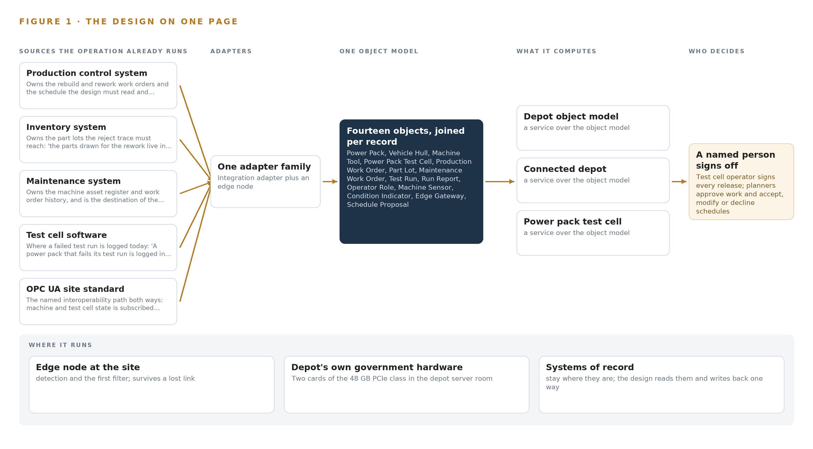
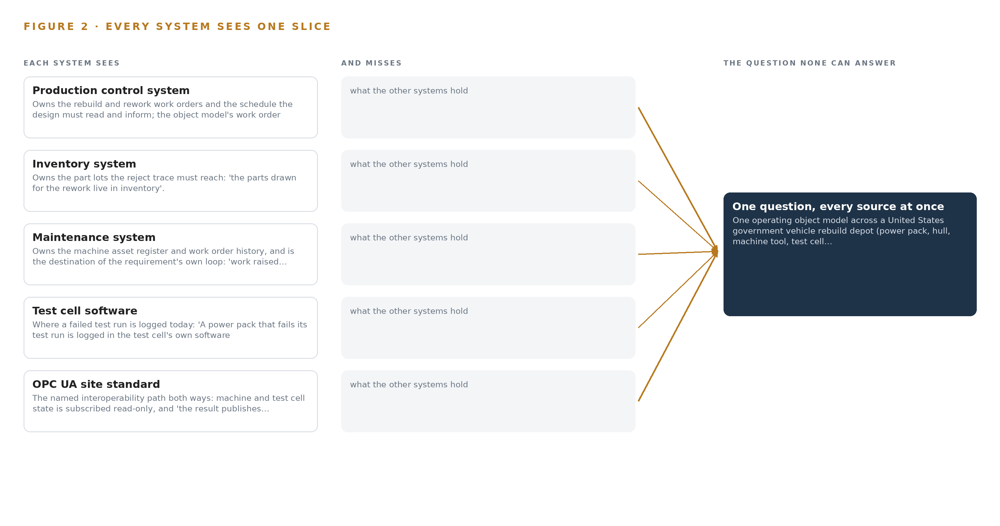
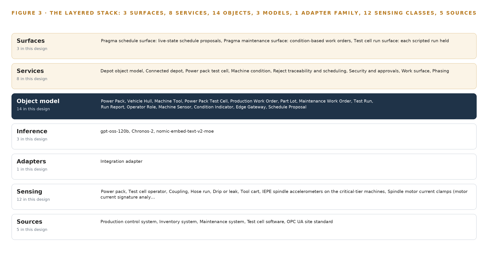
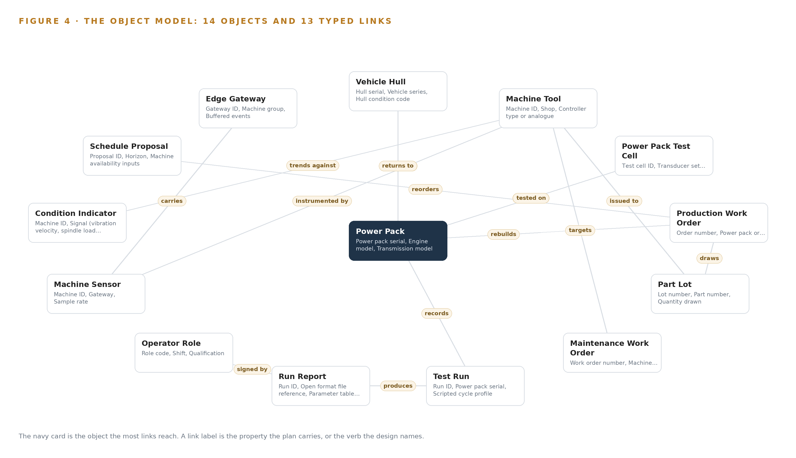
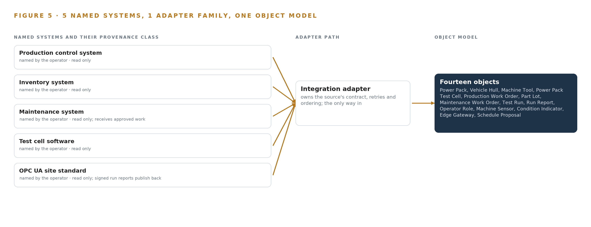
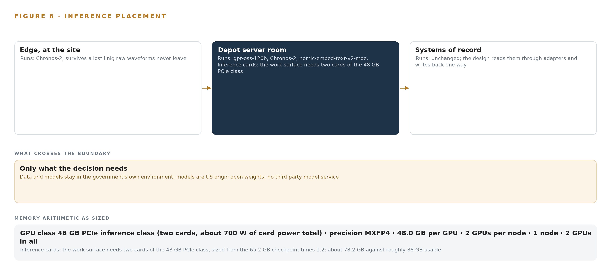
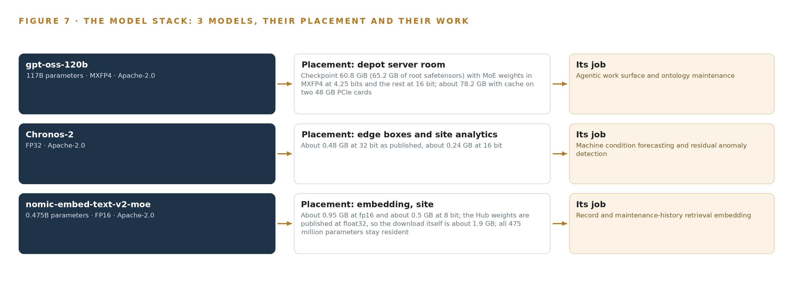
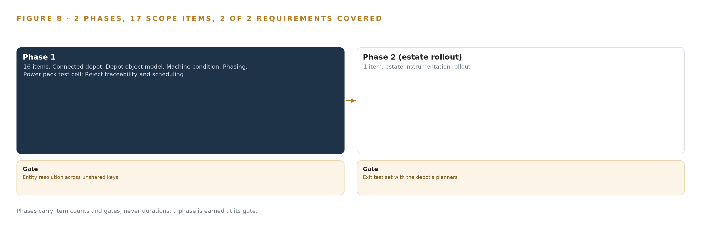
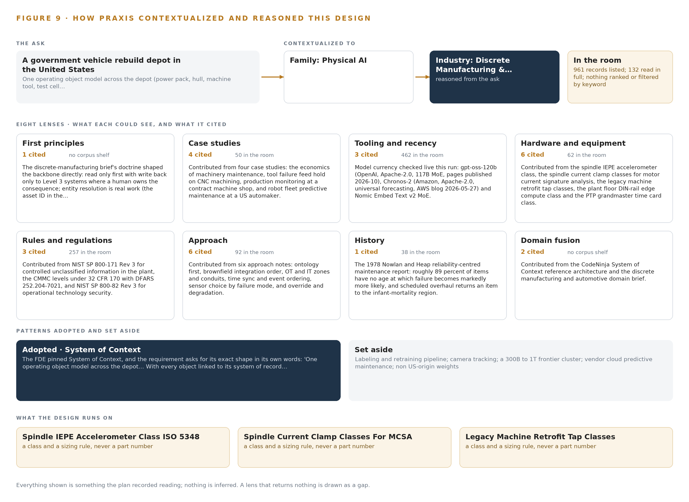

# Depot Operating Object Model: Ontologies for Unifying Factory Systems at a United States Vehicle Rebuild Depot

Canonical: https://codeatoms.ai/factory-ontology-rebuild-depot-us/
DOI: https://doi.org/10.5281/zenodo.23570177
PDF: https://codeatoms.ai/factory-ontology-rebuild-depot-us/paper/depot-operating-object-model-factory-ontology-rebuild-depot-us.pdf
License: CC BY 4.0
Publisher: CodeNinja Atoms (https://codeatoms.ai), a fully owned subsidiary of CodeNinja

VERTICAL-DRIVEN ARCHITECTURES · DISCRETE MANUFACTURING & AUTOMOTIVE · DESIGNED WITH PRAXIS · OCTOBER 2026

# Depot Operating Object Model: Ontologies for Unifying Factory Systems From Test Cell to Part Lot

For a discrete manufacturing and automotive operator in the United States, one operating object model links every power pack, machine tool, test run, work order and part lot to its system of record, keeps every machine interface read only, and leaves each release to a named person's sign-off.

Muhammad Umar, Cofounder, CodeNinja

For the depot operations director, the maintenance and test cell leads, and the platform, controls and data engineers who would build and run it.

---

Vertical-Driven Architectures is a CodeNinja series of system designs. Every design in the series is driven by a real-world problem and scenario in a single industry, and every one is designed on Praxis, CodeNinja's platform for designing physical AI systems. Operations are described by class, never by name.

At a glance

## Depot Operating Object Model: Ontologies for Unifying Factory Systems From Test Cell to Part Lot

**What this is.** An open reference architecture for system design in physical AI, built on ontologies for unifying factory systems at a government vehicle rebuild depot in the United States, where the inference server that runs it costs about 67,000 US dollars to own over three years. One operating object model joins the production control, inventory, maintenance and test cell systems, which never shared a key, so that a power pack failing its scripted test run can be traced the same day to the part lots, the machine that cut them and that machine's condition, and forward to the rework and the schedule it displaces. Every machine interface stays read only, and each release waits on a named person's sign-off. It is written for the depot operations director, the maintenance and test cell leads, and the platform, controls and data engineers who would build and run it. The operator is described by class, never by name.

**The answer in numbers.**

| Part | The design |
| --- | --- |
| Sources | Five named systems, all read only: the production control system, the inventory system, the maintenance system, the test cell software and the OPC UA site standard, entering through one integration adapter family on the Open62541 OPC UA stack, with MTConnect and stack light and serial taps bringing legacy machine tools on beside equipment that stays |
| Object model | 14 typed objects with 13 typed links, from the power pack, vehicle hull, machine tool and power pack test cell through the machine sensor, edge gateway and condition indicator to the production and maintenance work orders, schedule proposal, part lot, test run, run report and operator role, published as JSON for reuse |
| Models | gpt-oss-120b (Apache-2.0, US origin, self-hosted with vLLM) for the agentic work surface and ontology maintenance; Chronos-2 (Apache-2.0) for zero-shot machine condition forecasting and residual anomaly detection; nomic-embed-text-v2-moe (Apache-2.0) for retrieval over work orders, maintenance and test reports; no training run |
| Compute | Fanless DIN-rail edge boxes beside each machine group and at the test cell, their class fixed by a phase one measurement of the vibration load; centrally, two cards of the 48 GB PCIe class air cooled in the depot's own server room on its existing power, holding the 65.2 GB checkpoint with a 1.2 planning factor, about 78.2 GB against roughly 88 GB usable |
| Rollout | Two phases carrying 17 scope items (16, then 1) behind one gate: entity resolution proven on a week of live production records, with power pack serial, machine asset tag, part lot and test run joined at a stated match rate, before the estate instrumentation rollout |
| Three-year cost | About 67,000 US dollars to own the two-card server for three years (a range of 62,000 to 70,000: server, support and power), against about 104,000 dollars to rent the same card class on the deepest three-year commitment in US East and about 276,000 on demand; the cheapest rental that holds the model, one 96 GB card, is about 33,000 on that commitment, so ownership is chosen for the boundary, not the price, and renting is a price reference only because data and weights stay in the government's environment; edge boxes, sensors, cameras, time card and switches are priced by quotation (Appendix A) |
| Human control | The system proposes and a person commits: the test cell operator signs every release or return, a planner approves every maintenance work order and accepts, modifies or declines every schedule proposal, and no machine, test cell or site control is ever written to |

**Reuse it.** The object model, the model register and the figures are free to reuse under CC BY 4.0. Cite as <https://codeatoms.ai/factory-ontology-rebuild-depot-us/> (DOI 10.5281/zenodo.23570177).

**Made with.** Reasoned on [CodeNinja Praxis](<https://codeatoms.ai/praxis/>), the CodeNinja Atoms platform for designing physical AI systems. The object model imports into [Hyper Ontology](<https://codeatoms.ai/hyper-ontology/>), which turns it into a living system. Both are in beta; access by request.

ABSTRACT

## A Failed Test Run Should Explain Itself the Same Day

When a power pack fails its scripted test run, a United States government vehicle rebuild depot needs to know which machine cut the parts, from which lot, on which shift, and whether that machine's condition was already drifting; that is exactly the question ontologies for unifying factory systems exist to answer, and today the depot cannot ask it. The answer is scattered across four systems of record that never shared a key, built from technologies that were never designed to interoperate with each other (NIST 2012). The cost of that gap is not hypothetical: a single update to a parts-ordering system halted a major automaker's production at an estimated 350 million US dollars in lost output (ABI Research 2023), and the depot's own version of the same failure is the failed power pack that returns for rework with no trace of why.

The design builds one living operating object model of fourteen typed objects as a projection over five source systems, all of which enter through a single integration adapter family over the site's OPC UA standard, with legacy machine tools and test equipment brought on read only. Eight services run on the model and reach people through three surfaces: two planner surfaces for schedules and condition-based maintenance work, and one test cell surface holding each scripted run. Three Apache-2.0 models carry the work, with condition forecasting on fanless edge boxes beside each machine group and the 117-billion-parameter work surface model on a two-card 48 GB inference server in the depot's own server room, so that every byte of data and every weight stays on government hardware inside the government facility's security rules.

The paper covers the problem and the join failure, the four constraints, the layered stack, the fourteen objects with their typed links, the ingestion path, the inference placement with its memory arithmetic, and the three models with their licenses; readers weighing [industrial ontology examples](https://codeatoms.ai/industrial-ontology-examples/) will find the object model chapter shows every object in its recorded form. It then sets out the two-phase rollout with its item counts and the entity resolution gate, the ownership of what the design builds, and closes with the chapter on how Praxis contextualized and reasoned this design.

---



Figure 1. Depot Operating Object Model on one page: the sources the operation already runs, one object model, what it computes, and the person who decides.

## Contents

Each chapter is tagged for the reader it serves most directly: Executive, Team Lead, FDE, Reference.

|  |  |  |
| --- | --- | --- |
|  | Abstract · A Failed Test Run Should Explain Itself the Same Day | Executive |
| PART I · THE PROBLEM | | |
| 1 | [Ontologies for Unifying Factory Systems Start at the Test Cell](#ch1) | Executive |
| 2 | [Four Systems of Record Never Shared a Key](#ch2) | ExecutiveTeam Lead |
| PART II · THE DESIGN | | |
| 3 | [Sovereignty and Sign-Off Shape Every Choice Downstream](#ch3) | Team Lead |
| 4 | [One Stack Reaches From Record Systems to Surfaces](#ch4) | Team LeadFDE |
| 5 | [Fourteen Objects Turn Depot Data Into One Argument](#ch5) | FDE |
| 6 | [Five Sources Enter Through One Adapter Family](#ch6) | FDE |
| 7 | [Forecasting Lives at the Edge, Reasoning in the Server Room](#ch7) | FDE |
| 8 | [The License Terms Decide What the Depot Owns](#ch8) | FDEExecutive |
| PART III · THE ROLLOUT | | |
| 9 | [A Week of Live Joins Comes Before Any Trust](#ch9) | Team LeadExecutive |
| 10 | [The Depot Owns the Model and Its Memory](#ch10) | Executive |
| PART IV · HOW IT WAS DESIGNED | | |
|  | Conclusion · The Same Shape Joins Any Set of Record Systems | Executive |
| 11 | [How Praxis Contextualized and Reasoned This Design](#ch11) | Team LeadFDE |
|  | [Sources](#sources) | Reference |

PART I · CHAPTER 1

## Ontologies for Unifying Factory Systems Start at the Test Cell

A power pack that fails its test run is logged in one system while the machine that cut its parts, the lot those parts came from and the schedule it displaces live in three others, so the question the depot most needs to ask has never been askable.

Ontologies for unifying factory systems are usually argued as an enterprise data program whose payback sits somewhere off in a roadmap. At a vehicle rebuild depot run by a discrete manufacturing and automotive operator in the United States, they stand or fall on one question asked at a test cell door: this power pack just failed its run, and no one can say which machine cut its parts, from which lots, in what condition, or what the rework does to next week's schedule. The abstract promised a design that makes that question askable; this chapter states the question exactly, prices the cost of leaving it unanswered, and describes the operation that has to live with it.

### 1.1  The Question the Depot Needs Answered

The question, in the operator's own shape: when a power pack fails a scripted test cycle, trace the failure back through the rebuild work order and its routing to the part lots drawn for each operation, then to the machine and operation each lot was issued to, and to that machine's condition while the cuts were made, then forward again to the rework the failure forces and the schedule it displaces. Answering it requires data no single system holds: work orders and routings from production control, part lots and issue dates from inventory, the machine asset register and maintenance history, transducer traces and limit sets from the test cell's own software, and live machine and cell state over the site's industrial interoperability standard. The regulatory regimes sit on top of the data. The depot is a US government site, so drawings, programs and test data are treated as controlled unclassified information (CUI) at most, which brings the platform enclave under NIST SP 800-171 Rev 3 and a named federal cybersecurity certification status before any such data is processed; models must be US-origin open weights with no third-party model service; and every machine and test cell interface is a read-only subscription, with findings published back over the same site standard rather than written into any control.

### 1.2  The Documented Cost of the Problem

The cost of systems that touch but do not join is public and large. In 2023 a single update to a parts-ordering system halted Toyota's production, and ABI Research put the lost production at about 350 million US dollars (Automotive Manufacturing Solutions 2023; ABI Research 2023). That failure mode is not exotic: manufacturing integration routinely combines technologies that were never designed to interoperate with each other, which is why a change in one system surfaces as a defect in another (NIST 2012). At a rebuild depot the everyday version is quieter and compounds: an untraceable reject cannot be closed with evidence, so it is reworked on judgment; a machine drifting out of condition cuts parts that fail test weeks later; and each failed run consumes test cell time the schedule had already promised elsewhere.

### 1.3  The Operation as a Scenario

The operator runs a vehicle rebuild depot: power packs and hulls arrive, are disassembled, rebuilt across several shops of mixed legacy machine tools that cannot be replaced, and must pass a scripted test cycle in the power pack test cell before release. The cell carries the site's transducer suite and data bus capture, and the design adds three observation cameras: the test cell, its control panel, and a machine shop aisle. The people in the loop are named by role: the test cell operator who signs off every release or return, the production planner who accepts, modifies or declines schedule proposals, the maintenance planner who approves condition-based work orders, and the site authorizing official and information systems security manager who own the security approvals package. The physical environments are machining halls with mist and coolant, the test cell, the machine cabinets holding edge hardware, and the depot's own server room, whose existing power and air cooling take two cards of the 48 GB PCIe inference class. The regulatory ground is a government facility with the CUI enclave described above, US-origin weight rules, and an export control regime a domestic camera install on the depot's own premises does not trigger. The design reads five named source systems plus the one site interoperability standard, through a single adapter family, with the test cell as the first live case and the machine shops following in a second phase.

PART I · CHAPTER 2

## Four Systems of Record Never Shared a Key

The production control, inventory, maintenance and test cell systems each hold a true and complete slice of the rebuild, and none of them can see the power pack whole, which is why four more interfaces would reproduce the problem instead of solving it.

Chapter 1 set out the question. This chapter explains why no system the operation already runs can answer it.

### 2.1  What Each System Sees

Production control system owns the rebuild and rework work orders and the schedule the design must read and inform; the object model's work order and routing objects are anchored here.

Inventory system owns the part lots the reject trace must reach: 'the parts drawn for the rework live in inventory'.

Maintenance system owns the machine asset register and work order history, and is the destination of the requirement's own loop: 'work raised in the maintenance system for a planner to approve'.

Test cell software where a failed test run is logged today: 'A power pack that fails its test run is logged in the test cell's own software'; the test run and run report objects are anchored here.

OPC UA site standard the named interoperability path both ways: machine and test cell state is subscribed read-only, and 'the result publishes to the depot's systems over the industrial interoperability standard the site uses'.



Figure 2. Five systems, each seeing one part of the answer. The question needs all of them in one place at once.

### 2.2  What None of Them See Together

Each holds one slice, and the question needs all of them in one place at once, which today is done by hand at the cadence of whoever has the time.

PART II · CHAPTER 3

## Sovereignty and Sign-Off Shape Every Choice Downstream

Read-only machine interfaces, legacy equipment that cannot be replaced, a person deciding every release and schedule change, and US-origin open weights on government hardware together fix the shape of every layer above them.

Chapter 2 showed that each system of record sees one slice and that the shared standard carries state without meaning. This chapter fixes the constraints that follow, because read-only interfaces, irreplaceable legacy equipment, a person deciding every change, and US-origin weights on government hardware together settle the shape of every layer above them before a single component is chosen.

### 3.1  One Object Model Over Systems That Never Shared a Key

The first goal is one operating object model linking power pack, hull, machine tool, test cell, work order, part lot and operator role, each object anchored in its system of record. It is hard in this industry because the four systems key the same physical world with unrelated identifiers: a power pack serial, a machine asset tag, a lot number and a run ID were never designed to meet. Most industrial ontology examples stop at the join; here the join must also stay live, because the model is a projection over the systems of record rather than a new system that would add a fifth key. Where no shared key exists, a supervised crosswalk is built and owned in the ontology with lineage, and proving the joins on live records is the first phase gate, not an assumption.

### 3.2  Read-Only Sensing Beside Equipment That Cannot Be Replaced

The second goal is to bring legacy machine tools and test equipment onto the network read only, with sensing and gateways placed beside equipment that stays. It is hard because a mixed legacy fleet has no uniform controller: retrofit taps on stack lights and serial printer ports, IEPE accelerometers stud-mounted per ISO 5348 on the critical tier, and current clamps must each be additive and reversible, and no write to the site or any machine is part of the design in any phase. Safety functions are excluded outright: interlocks, light curtains and emergency stops belong to the depot's certified systems, and the platform observes machine state without configuring any protective device.

### 3.3  A Person Decides Every Release, Work Order and Schedule Change

The third goal is that the platform proposes and a person commits: the test cell operator signs off every release or return, maintenance work is raised for a planner to approve, and schedule changes are proposals a planner accepts, modifies or declines. It is hard because the scheduling and maintenance software market defaults to automated optimization, and because a proposal must be good enough to trust without ever being obeyed; a deterministic layer records every proposal and every decision so the reasoning is auditable after the fact.

### 3.4  Sovereign Compute, US-Origin Weights and a Scoped CUI Enclave

The fourth goal is that data and models stay in the government's own environment, on the depot's own hardware, with US-origin open weights and no third-party model service. It is hard because the US-origin rule bars whole families of open weights whose publishers sit on the US Entity List, and because a government enclave must be scoped before it is assessed: the design assumes controlled unclassified information at most, keeps the NIST SP 800-171 enclave small with the authorizing official and information systems security manager as named owners, and touches nothing classified. Everything from the edge boxes to the work surface runs on site, and the server room's existing power and air cooling take the two 48 GB inference cards without a room upgrade.

### 3.5  Scoping Decisions

Three decisions bound the design, each buying something specific at a stated cost, set out in Table 1: the ontology as projection rather than replacement, the test cell as the only first live case, and baselines rather than trained weights.

Table 1 · Scoping Decisions

| Decision | What it buys | What it costs |
| --- | --- | --- |
| One ontology as a projection over the four systems of record | Every object joined and no system of record replaced; the vocabulary problem solved once, at the center | A supervised crosswalk must be built and owned for every key that never matched, with lineage kept |
| The power pack test cell as the first live case | The full chain, run, report, rework, schedule, proven on one cell before anything else is trusted | Machine condition and scheduling wait on the test cell proof; estate instrumentation is a second phase |
| No training or fine-tuning into weights | Per-machine-class baselines and thresholds computed from live data, with nothing to retrain or reship | A signal outside the baseline vocabulary needs a new baseline, not a new model, and the failure mode register must say so |

### 3.6  What the Design Chose Against

Each rejection below was made against a live alternative with a reason the requirement itself supplies, set out in Table 2, closing with the boundary of what the design will not touch at all.

Table 2 · What the Design Chose Against

| Where | What was picked | Instead of, and why |
| --- | --- | --- |
| Condition forecasting | Chronos-2 residual anomaly detection baselined per machine class on depot hardware | A vendor cloud predictive maintenance service; the requirement bars third-party model service and keeps data in the government's own environment |
| Integration | One ontology as a projection over the four systems of record | Point-to-point interfaces between each pair of systems; four more interfaces would reproduce the vocabulary problem, not solve it |
| Edge compute | Fanless on-device units at the test cell and each machine group | A rack server per machine group; units must keep working through a network outage and catch up beside the machines they watch |
| Work surface model | gpt-oss-120b, Apache-2.0, from a US publisher | The house GLM class of open weights; the US-origin rule and that publisher's Entity List listing bar it for this operator |
| Machine controls | Read-only subscription in every phase | Any write to the site or a machine; forbidden in the requirement's own words, and safety functions stay with certified systems |
| Scope boundary | Controlled unclassified information at most, in a small scoped enclave | Classified networks and data; those live on separately accredited systems this design does not touch |

PART II · CHAPTER 4

## One Stack Reaches From Record Systems to Surfaces

Sources feed adapters, adapters feed one object model, the model feeds services, and services feed the surfaces where planners and operators act, with the count at every layer fixed by the layers beneath it.

Chapter 3 fixed the constraints and priced every scoping decision against them: read-only machine interfaces, the depot's own government hardware, US-origin open weights, and a person committing every change. This chapter lays the stack that satisfies them, and it is the working answer to ontologies for unifying factory systems: five source systems, one adapter family, one object model of fourteen objects, three models, eight services and three surfaces, with the count at every layer fixed by the layers beneath it.

### 4.1  The Pattern and Why It Fits

The pattern is three strata. Below sit the systems of record: production control, inventory, maintenance and the test cell software, each still owning its own keys and its own truth. In the middle sits one object model, built as a projection over those systems rather than a migration of them, so no system of record is replaced and none is asked to adopt another's identifier. Above sit the applications and agents: eight deterministic services and three surfaces, with the agents running on the work surface model under the site's own identity. The National Institute of Standards and Technology observes that manufacturing integration routinely means combining technologies that were never designed to interoperate with each other (NIST 2012), and a government depot that has accreted systems across decades is that observation at full scale. Point-to-point interfaces between each pair of systems would reproduce the vocabulary problem the design exists to solve; one projection resolves it once, for every consumer at once. Figure 3 shows the layered stack with the count at every layer: five sources, one adapter family, fourteen objects, three models, eight services and three surfaces, each number downstream of the one below it.



Figure 3. The layered stack: 5 sources, 1 adapter family, 14 objects, 8 services and 3 surfaces.

### 4.2  The Stack Stage by Stage

Table 3 states each stage's responsibility and the named components that discharge it. Table 7 below carries the same stack layer by layer with the product chosen at each layer and the reason for the choice, including the layers this design deliberately leaves without any product at all.

Table 3 · The Stack, Stage by Stage

| Stage | What it is responsible for | How |
| --- | --- | --- |
| Sources | Owning the work orders, part lots, machine history and test runs without surrendering their keys | Five systems read by subscription: the production control system, the inventory system, the maintenance system, the test cell software and the OPC UA site standard |
| Sensing | Turning machine and test cell state into signals the platform can read continuously | IEPE spindle accelerometers on critical-tier machines, spindle motor current clamps, stack light and serial DPRNT taps on legacy machines, the test cell transducer suite and data bus capture, and controller state over OPC UA and MTConnect |
| Adapters | Carrying every source onto one path with no write to any machine | One integration adapter family built on the Open62541 OPC UA stack, every interface a read-only subscription |
| Object model | Holding the fourteen typed objects and their links as a projection over the record systems | The Depot Operating Object Model, with supervised crosswalks and their lineage owned in the model wherever keys do not join |
| Inference | Scoring and reasoning where the data already lives | Chronos-2 forecasting on the machine-group edge boxes under ONNX Runtime; gpt-oss-120b and nomic-embed-text-v2-moe on the site inference server under vLLM, all Apache-2.0 and US-origin |
| Services | Doing the deterministic work between the model and the people | Eight services: depot object model, connected depot, power pack test cell, machine condition, reject traceability and scheduling, security and approvals, work surface, phasing |
| Surfaces | Putting every proposal in front of a named person who commits it | Three surfaces: the Pragma schedule surface, the Pragma maintenance surface and the test cell run surface |

Table 7 · Architecture, Layer by Layer

| Layer | Component | Choice | Why |
| --- | --- | --- | --- |
| Event streaming and messaging | Apache Kafka 4.3 (KRaft) | Product | Orders every event per machine or test run and delivers at least once into idempotent writes, inside the site |
| The ontology or graph store | Hyper Ontology | Product | Holds the fourteen objects as a projection over the record systems, with crosswalks and their lineage |
| Time series and telemetry storage | InfluxDB 3 Core | Product | Takes idempotent writes from the backbone, so a replay cannot double-count |
| Video ingest, recording and management | Frigate NVR | Product | Records the three observation cameras as run record only |
| Edge model serving | ONNX Runtime | Product | Runs Chronos-2 on the fanless edge boxes beside each machine group |
| On site language model serving | vLLM | Product | Serves gpt-oss-120b and nomic-embed-text-v2-moe on the depot's two-card inference server |
| Object tracking and trajectory forecasting | None | Not needed | No camera tracking duty exists in this requirement: the test cell cameras are observation and run record only, and machine and test cell state comes from transducers and controller taps, not from trajectories. |
| Edge orchestration of containers | K3s | Product | Runs the edge services on the depot's own boxes, which keep working through a network outage |
| An air gapped artifact and model registry | Harbor | Product | Moves every update under the air-gapped transfer discipline, so no update channel doubles as an inbound path |
| Labeling and retraining | None | Not needed | Under system of context nothing is trained or fine tuned into weights for this operator: per-machine-class baselines and alarm thresholds are computed from live data, and improvement runs through a kept record of decisions and outcomes that the next decision reads, so no labeling and retraining pipeline is built. |
| Time synchronization across sensors and systems | linuxptp (ptp4l, phc2sys) | Product | Carries PTP time from the grandmaster across every hop, because a store that merges streams on a sloppy clock cannot support a trace |
| Observability of the running system | Prometheus, Grafana and Loki | Product | Shows the running system, including each gateway's clock offset and buffered events |

### 4.3  A Reusable Pattern

The shape worth carrying to any similar brief is the projection over read-only record systems: adapters subscribe, the model links, services compute, surfaces propose, a person commits. A team reusing it swaps the interoperability standard for whatever their site already runs, swaps the object set for their own assets and records, and swaps the models within their own origin and licensing rules. What they keep is the discipline that makes the shape hold: machines are never written to, no system of record is replaced, the only write path is a person-approved record, and the first gate proves the joins on live production data before any analytics is trusted.

PART II · CHAPTER 5

## Fourteen Objects Turn Depot Data Into One Argument

Power pack, vehicle hull, machine tool, test cell, work order, part lot and operator role become fourteen typed objects whose links let one query walk from a failed test run back to the part lot and the machine that cut it.

Chapter 4 showed the stack as layers with fixed counts. This chapter opens the middle layer, where fourteen typed objects turn record systems that never shared a key into one argument a planner can query.

### 5.1  Fourteen Objects and Their Links

Four objects carry asset identity: the power pack, the vehicle hull, the machine tool and the power pack test cell, joined by the machine sensor as the instrumented asset and the edge gateway as the system object that carries its traffic. Three carry intent as records: the production work order, the maintenance work order and the schedule proposal. The rest are one each by kind: the part lot as material, the test run as event, the run report as document, the operator role as actor, and the condition indicator as measure. Figure 4 draws every object and its typed links. The links are what a document store cannot hold: an out-of-tolerance test run links by power pack serial to the power pack, whose rebuild work order links to the part lots drawn, each lot issued to a machine and operation, and that machine links to its sensors and its condition indicators. One query walks from a failed test run to the machine that cut the failing part and the vibration baseline it was running against, crossing four systems of record in a single traversal; in a document store every hop is a separate search against a separate index, and the hops are exactly where the trace dies today. Table 8 below anchors each object in its system of record and lists its typed links. Many industrial ontology examples stop at the schema; this one is a live projection whose links are walked by queries every day, and whose crosswalks carry lineage wherever the record systems never shared a key.



Figure 4. The fourteen objects of the model and the typed links that let a query reach across them.

Table 8 · The Object Model

| Object | Anchored in | Typed links |
| --- | --- | --- |
| Power Pack | The production control system | tested on: Power Pack Test Cell; returns to: Vehicle Hull; records: Test Run |
| Vehicle Hull | The production control system | no typed link recorded |
| Machine Tool | The maintenance system | instrumented by: Machine Sensor |
| Power Pack Test Cell | The test cell's own software | no typed link recorded |
| Production Work Order | The production control system | rebuilds: Power Pack; draws: Part Lot |
| Part Lot | The inventory system | issued to: Machine Tool |
| Maintenance Work Order | The maintenance system | targets: Machine Tool |
| Test Run | The test cell's own software | produces: Run Report |
| Run Report | The test cell's own software | signed by: Operator Role |
| Operator Role | The on-site identity service (Keycloak) | no typed link recorded |
| Machine Sensor | The maintenance system | no typed link recorded |
| Condition Indicator | Computed in the model from the time series store | trends against: Machine Tool |
| Edge Gateway | The on-site edge box | carries: Machine Sensor |
| Schedule Proposal | The production control system | reorders: Production Work Order |

### 5.2  The Human Loop and the Hosting Posture

The loop lives in status vocabularies, not in prose. A maintenance work order moves through Proposed, Approved, Scheduled, In work, Complete or Declined, and only a planner moves it; a schedule proposal is accepted, modified or declined by the planner it names; a run report stays draft until the test cell operator signs it, and only a signed report publishes over OPC UA. The operator role object carries the qualification and sign-off authority that makes each of those signatures mean something. The hosting posture is fixed by the requirement itself: everything runs on the depot's own government hardware inside the facility's security rules, data and models stay in the government's own environment, identity is issued on site through Keycloak, there is no external link and no third-party model service, and one-way transfer hardware is the only path by which anything would ever leave. The only write path out of the platform is the person-approved record: work raised in the maintenance system, and the signed run report. No machine or site control is ever written to.

### 5.3  One Object in Its Recorded Form

The power pack, anchored in the production control system, is recorded in the model in the following form:

```
{ "id": "power-pack", "label": "Power Pack", "kind": "asset", "anchored_in": "The production control system", "properties": [ "Power pack serial", "Engine model", "Transmission model", "Vehicle series it returns to", "Rebuild work order", "Current shop", "Test history" ], "status_vocabulary": [ "Received", "Disassembled", "In rebuild", "Awaiting test", "On test", "Test failed, returned for rework", "Passed, released" ], "links": [ { "to": "power-pack-test-cell", "label": "tested on" }, { "to": "vehicle-hull", "label": "returns to" }, { "to": "test-run", "label": "records" } ] }
```

PART II · CHAPTER 6

## Five Sources Enter Through One Adapter Family

Every source system arrives through the integration adapter family over the site's OPC UA standard and MTConnect taps, with the event backbone preserving order and buffering through outages so no machine is ever written to.

Chapter 5 described what the model holds. This chapter describes how data gets into it: five source systems, all of them the operator's own, all arriving through one adapter family that never writes to a machine.

### 6.1  Five Sources and Their Provenance

Figure 5 maps them. The production control system, the operator's own system of record for rebuild and rework, contributes the work order and routing objects, read only. The inventory system owns the part lots the reject trace must reach. The maintenance system owns the machine asset register and work order history, and it also receives: the design's own loop ends as work raised there for a planner to approve, though that write is a person-approved record rather than a machine interface. The test cell software holds the test runs and the run reports. The OPC UA site standard is the fifth source and the interoperability path in both directions: machine and test cell state is subscribed read-only over it, and the signed run report publishes back over it. NIST defines interoperability as the ability of two system components to communicate correctly and completely with each other, and notes how rarely the word is met in practice (NIST n.d.). The design therefore rides the standard the site already runs rather than inventing a parallel one.



Figure 5. The 5 named systems, the adapter path each one takes, and the object model they all map into.

### 6.2  What the Adapter Tier Guarantees

One adapter family, built on the Open62541 OPC UA stack, carries every source, and its guarantees are fixed. Every interface is a read-only subscription, in every phase, with no write to the site or any machine. Identity is checked on site before any subscription opens. Each message carries provenance, so every property in the object model traces back to the record system that owns it, and where two systems do not share a key a supervised crosswalk is built and owned in the ontology with lineage rather than silently matched. Legacy machines join the network the same way, through stack light and serial taps beside the controller, additive and reversible, replacing nothing.

### 6.3  The Event Backbone

Apache Kafka 4.3 with KRaft runs the backbone inside the site. Ordering is per key: every event for one machine or one test run is totally ordered, so a scripted cycle's parameter sequence never reorders in the store. Delivery is at-least-once with idempotent writes into InfluxDB 3 Core and the object model, so a replay cannot double-count a part lot. Buffering lives at the edge: each machine-group gateway holds events through a network outage and catches up when the link returns, and its clock offset and last sync are themselves visible objects. Time comes from a PTP grandmaster through linuxptp, because a store that merges sensor streams on a sloppy clock cannot support a trace. Replication stays inside the site, on the depot's own hardware. The posture is earned from the industry's own losses: a simple update to a parts ordering system halted Toyota's production (Automotive Manufacturing Solutions 2023) at an estimated 350 million US dollars (ABI Research 2023), and because this design is additive and read-only against every machine, the worst it can do to production is stop reporting on it.

PART II · CHAPTER 7

## Forecasting Lives at the Edge, Reasoning in the Server Room

Condition scoring and vibration acquisition run on fanless edge boxes beside each machine group, the 117-billion-parameter work surface model runs on the depot's own two-card inference server, and only derived states cross the boundary between them.

Chapter 6 described how five source systems enter through adapters and an event backbone without any of them surrendering control of its records. This chapter describes where the computing happens once the data is inside, and why the split between the machine cabinet and the server room is a load-bearing decision rather than a convenience.

### 7.1  Three Tiers, Each Sized for Its Own Duty

The design places inference at three tiers. At the edge, fanless DIN-rail industrial computers sit beside each machine group and at the test cell, running the vibration acquisition channels, the controller state subscriptions and the first-pass condition scoring; the forecasting model that carries that scoring, Chronos-2, occupies about 0.48 GB at 32 bit as published and about 0.24 GB at 16 bit, which leaves the bulk of a fanless unit's memory for waveform capture at tens of kilosamples per second. The vibration acquisition load on this unit is unmeasured, so a dev board measurement of the actual channel count and sample rate is the phase one gate before the edge class is fixed, and the PCIe accelerator module is the named growth path if the measurement lands high. At the site tier, the same forecasting model runs in an analytics role beside the embedding model and the time series store. At the top, the agentic work surface model runs on the depot's own inference server: two cards of the 48 GB PCIe class, air-cooled in the depot's server room on its existing power, drawing about 700 W of card power between them. The memory arithmetic comes from the published checkpoint: the 117 billion parameters ship as about 65.2 GB, the MoE weights in MXFP4 and the rest at 16 bit; multiplied by 1.2 to reserve room for the KV cache and activations, the cards must hold about 78.2 GB, against 96 GB of memory on two 48 GB cards and roughly 88 GB usable after the serving runtime takes its share, about 10 GB of headroom. The KV cache ceiling that remains is enough for the planner-facing sessions the work surface actually serves, and no larger model is committed. Figure 6 sets the three tiers side by side with what runs on each.



Figure 6. Where each tier runs, what runs there, and the narrow set of outputs that cross the boundary.

### 7.2  The Latency Budget

The budget is set by the fastest consumer of each signal, and the design's read-only posture removes the tightest class from the budget entirely: because no machine or test cell interface ever writes to a control, there is no control-loop latency to guarantee, only an observation and advisory one. Continuous transducer and data bus reads must arrive in order and with a trustworthy timestamp, which is why the design carries a PTP grandmaster of the OCP Time Card class and boundary or transparent clock support on every hop between it and the edge boxes, since an unmeasured queueing delay would spend the whole time error budget. Condition scoring wants to land near the machine so a rising indicator is visible within the shift. The work surface and the scheduling proposals it drafts serve planners, so its latency tolerance is human, measured in how long a planner waits for a drafted schedule, not in milliseconds; the same holds for the run report, which is produced at the end of a scripted test cycle and signed off by a person before anything is published.

### 7.3  What Crosses the Boundary, and What Each Failure Costs

The network boundary between the edge boxes and the site tier is crossed by derived states, not raw waveforms: condition indicators with their zones, machine state, test run outcomes and signed run reports, all carried on the event backbone toward the object model, and run reports publish onward over the site's OPC UA interoperability standard. When the link fails, the edge boxes keep working and catch up: each gateway object records its buffered events, clock offset and last sync, and resynchronizes on recovery, so a dark uplink delays visibility rather than losing it. When power fails, Network UPS Tools rides the units through the gap and the buffers absorb the rest. When the update path is exercised, artifacts move through the Harbor registry under the air-gapped transfer discipline, with Lidi handling any one-way transfer out of the enclave, so no update channel doubles as an inbound path. None of these failures reaches a machine control, because none of these paths writes to one.

PART II · CHAPTER 8

## The License Terms Decide What the Depot Owns

Three Apache-2.0 models from US publishers carry forecasting, retrieval and the agentic work surface, and the plainness of the license is what lets the depot hold its own weights inside the government boundary rather than rent them back.

Chapter 7 fixed where each model runs and proved the two-card server holds the work surface with headroom. This chapter turns to the terms under which those weights are held at all, because on a government site the license is not fine print: it decides whether the depot owns its intelligence or rents it back. Figure 7 sets out the model stack in one view, and its shape follows from a single constraint stated in the operator's own words: the models are US origin open weights, with no third-party model service. Three models, all Apache-2.0, all from US publishers, satisfy that constraint outright. The work surface model is gpt-oss-120b, a 117-billion-parameter mixture of experts published by OpenAI and filed under the 300-billion-parameter threshold that would have forced a frontier cluster class. Its checkpoint is 60.8 GiB, with the MoE weights in MXFP4 at 4.25 bits and the remainder at 16 bit; its role is agentic work surface and ontology maintenance, running on the site inference server described in Chapter 7, where it carries Pragma's agents over the ontology, the run reports and the maintenance histories. It was chosen because the requirement's US-origin rule sets aside the house GLM class, whose publisher's US Entity List listing would bar it for this site regardless of fit. Apache-2.0 imposes no field-of-use restriction and no per-seat trigger, so the depot holds the weights as property. The forecasting model is Chronos-2, a zero-shot multivariate forecaster with covariate support under Apache-2.0 from a US publisher. It occupies about 0.48 GB at 32 bit and about 0.24 GB at 16 bit, which is why it fits both the machine-group edge boxes and the site analytics tier. Its role is machine condition forecasting and residual anomaly detection: baselines and thresholds are computed per machine class from live data, and no weights are ever trained, which is the system of context rule for this site. The retrieval model is nomic-embed-text-v2-moe, a 475-million-parameter Apache-2.0 embedder from a US publisher, with Matryoshka truncation to 256 dimensions so the depot's work order, maintenance and test report corpus fits the site index. All 475 million parameters stay resident because every expert is exercised; the footprint is about 0.95 GB at FP16 and about 0.5 GB at 8 bit. The other embedders considered that are large enough for this job are of Chinese origin and barred by the same rule that set aside the GLM class.



Figure 7. The three models, their placement, and the work each one does.

### 8.1  The Model and Equipment Register

The register gathers every choice this chapter and Chapter 7 stand on, so a reader can audit the reasoning in one place: each model, the hardware classes and their sizing rules, the sensing, the patterns the design rests on, and the ground all of it runs on, shown in Table 4.

Table 4 · Model and Equipment Register

| The choice | What was picked | Why here |
| --- | --- | --- |
| Work surface model | gpt-oss-120b, 117B-parameter MoE, MXFP4, Apache-2.0 | A US-origin open-weight model that satisfies the no-third-party-service rule while carrying Pragma's agents |
| Forecasting model | Chronos-2, zero-shot multivariate forecasting, about 0.48 GB at 32 bit | Per-machine-class baselines and residual thresholds without training any weights, small enough for the edge boxes |
| Embedding model | nomic-embed-text-v2-moe, 475M parameters, truncated to 256 dimensions | US-origin Apache-2.0 embedder for the work order and maintenance corpus; alternatives of Chinese origin are barred |
| Spindle sensing | Spindle IEPE accelerometer class, stud-mounted per ISO 5348, critical tier only | Low-cost MEMS shows amplitude deviations of 50 to 70 percent against a reference, so IEPE carries the alarm duty |
| Motor current sensing | Spindle current clamp classes for motor current signature analysis | Reads load and degradation on machines where an accelerometer cannot be mounted |
| Legacy retrofit | Stack light and serial DPRNT tap classes on analogue machines | Brings legacy machines onto the network read-only, beside equipment that cannot be replaced |
| Edge compute | Plant floor edge compute, DIN-rail fanless class | Keeps inference local through a network outage; dev board measurement is the phase one gate before the class is fixed |
| Site inference server | Two cards of the 48 GB PCIe class, air-cooled in the depot server room | Holds about 78.2 GB of weights, cache and activations against roughly 88 GB usable, on existing power |
| Test cell sensing | The test cell transducer suite and data bus capture, read continuously | Anchors the scripted test cycles and the parameter excursions the run report records |
| Observation cameras | IP66/IP67 industrial machine-shop camera class, test cell and one shop overview | Observation and run record only; no tracking duty exists, so no trajectory model is built |
| Pattern: projection ontology | One ontology projected over four systems of record | Point-to-point interfaces would reproduce the vocabulary problem instead of solving it |
| Pattern: read-only backbone | OPC UA read-only subscriptions in every phase | The requirement forbids any write to the site or a machine, including automatic interventions |

PART III · CHAPTER 9

## A Week of Live Joins Comes Before Any Trust

Phase one is sixteen items across six workstreams ending in a gate that proves entity resolution on a week of live records with a stated match rate, and phase two carries the estate instrumentation rollout only after that gate holds.

Chapter 8 settled the models and the licenses that let the depot hold its own weights on its own government hardware. This chapter sequences the build so that the joins are proven on live records before any alarm, trace or proposal is trusted, and it names the gates that can stop the work cheaply.

### 9.1  Two Phases, Sixteen Items and One Gate

Phase one carries 16 items across six workstreams: Connected depot, Depot object model, Machine condition, Phasing, Power pack test cell, and Reject traceability and scheduling. The items include the depot operating object model core, entity resolution across the unshared keys, and the read-only machine data backbone over OPC UA, alongside the test cell instrumentation, the condition baselining per machine class, the reject trace through part lots, and the schedule proposals a planner decides. The phase ends at a single exit gate: entity resolution proven across one week of live production records, with the power pack serial, the machine asset tag, the part lot and the test run identifier, four keys no system of record shares, joined at a stated match rate. Phase two carries one item, the estate instrumentation rollout, and it is admitted only once that gate holds. Requirement coverage stands at two requirements covered, none partial and none open, and Figure 8 sets the phases, their item counts, their workstreams and the gate against that coverage.



Figure 8. The two phases and their gates, and coverage of the 2 requirements across them.

### 9.2  What the Rollout Measures

Every gate in this build is a measurement, not an assertion. The match rate across the four identifiers is measured on the week of live records before any crosswalk is accepted, and where a key does not exist, the supervised crosswalk built in its place carries lineage and an owner. Baseline stability is measured per machine class and per machine, so a fan and a spindle are never held to one threshold. Alarm precision is measured by checking elevated and alarm zones against what maintenance actually finds when work is raised. The disagreement rate between operator-entered downtime and reject reason codes and machine state taken from the controller taps is measured continuously, because that rate is itself a signal about data quality rather than a fact to be filed. Clock offset and buffered event count are read from each edge gateway, and the open-format run report is checked for fidelity as published over the site's OPC UA standard.

### 9.3  Failure Modes

The design names what can fail and what it does about each; Table 5 holds the register, and the cost of getting integration wrong at scale is documented: a single update to a parts-ordering system halted production across a major manufacturer's plants at an estimated 350 million US dollars in lost output (ABI Research 2023).

Table 5 · Failure Modes

| What fails | What the design does |
| --- | --- |
| The four systems of record may not join on a week of production data, because the four identifiers share no key | Phase one proves the joins on one week of live records with a stated match-rate gate before any analytics is trusted; where a key does not exist, a supervised crosswalk is built and owned in the ontology with lineage |
| Vibration baselines may not generalize across a mixed legacy fleet, and low-cost MEMS units have shown amplitude deviations of 50 to 70 percent | IEPE sensors stud-mounted per ISO 5348 on the critical tier only, with baselines per machine class and per machine, and alarms on change against each machine's own baseline as well as absolute zone |
| Some failure modes give no measurable precursor, and roughly nine in ten items have no wear-out zone at all | The machine population is classified by failure pattern and consequence before instrumenting; calendar preventive maintenance stays where no detectable condition exists, and the failure mode register says so |
| Controlled unclassified information scope discovered late brings the program under NIST SP 800-171 Rev 3 and halts it | The security approvals workstream scopes the enclave in phase one with the site authorizing official and the information systems security manager named as owners, keeping the enclave small enough to assess |
| Waveform acquisition at tens of kilosamples per second beside edge scoring may exceed the fanless DIN-rail edge class | A dev board measurement of the actual channel count and sample rate is the phase gate before the edge class is fixed, with the PCIe accelerator module as the named growth path |
| Operator-entered downtime and reject reason codes decay in quality over months | Reason codes are cross-checked against machine state from the taps, and the disagreement rate is itself a monitored signal on the work surface |

### 9.4  Lessons

**Prove the joins before the analytics.** The whole design rests on one projection over four systems that never shared a key, so the week of live records and its match rate come first, and no condition indicator, reject trace or schedule proposal is trusted ahead of them; the documented cost of an integration fault in this sector is measured in hundreds of millions of dollars (ABI Research 2023), and a gate that costs a week of records is cheap insurance against that cost.

**Instrument only the machines whose failures announce themselves.** Condition monitoring on a machine with no wear-out zone buys nothing and calendar removal of such items can add infant-mortality failures, so classification by failure pattern and consequence precedes every sensor purchase, and the register records where the answer is to leave the calendar alone.

**Keep the enclave small enough to assess.** A controlled unclassified information boundary scoped late stops a program rather than slowing it, so the enclave is scoped in phase one with named owners, and everything that does not need to touch the drawings, programs and test data stays outside it.

**Treat reason codes as a signal, not a fact.** Operator-entered codes decay, so the design never reasons from them alone; it reasons from machine state and treats the disagreement between the two as a monitored quantity a planner can see.

### 9.5  What Is Still Open

Three questions remain open, and each has a named settling path. The match-rate threshold that constitutes a pass at the gate is set with the depot's planners once the week of live records is in view, and settling it fixes how much crosswalk effort phase two inherits. The controlled unclassified information determination for the drawings, programs and test data rests with the site authorizing official, and settling it fixes the enclave boundary and therefore the assessment scope. The dev board measurement of vibration acquisition load fixes the edge hardware class or moves it to the PCIe accelerator module, and settling it fixes the per-machine-group bill of materials for the estate instrumentation rollout.

PART III · CHAPTER 10

## The Depot Owns the Model and Its Memory

The object model, the per-class baselines, the decision record and the hardware all belong to the depot, which means the intelligence compounds inside the government boundary instead of leaving it with every improvement.

Chapter 9 showed how the build earns trust one gate at a time. This chapter settles who holds what the build produces, because a system that compounds learning inside a government boundary is worth nothing if every improvement walks out of it.

### 10.1  What the Depot Owns

The object model belongs to the depot. It is a projection over the production control, inventory, maintenance and test cell systems, but the projection, the crosswalks and their lineage are assets the depot keeps, expressed in its own vocabulary and re-pointable if a system of record is ever replaced. The weights belong to the depot as well: every model in the design is an Apache-2.0 open-weight model of US origin, held on the depot's own government hardware, and because nothing in this design is trained or fine-tuned into weights, the improving assets are the per-machine-class baselines, the alarm thresholds and the failure mode register, all of which are data the depot produced and owns outright. The decision record belongs to the depot: every sign-off on a run report, every planner acceptance, modification or decline of a schedule proposal, and every maintenance work order approved or declined is a kept record the next decision reads, so the memory of how the depot actually judges its own machines stays with the depot. The boundary belongs to the depot: the edge boxes, the site inference server and the work surface run on government hardware inside the facility's security rules, updates arrive through a one-way transfer path, and no data or model leaves the boundary to any third-party service.

### 10.2  The Offer Behind the Design

CodeNinja builds this shape under five names, and this design maps to each of them: Adaptive Operations is the sensing and forecasting of physical behavior, the transducer and data bus reads in the test cell and the vibration, spindle load and temperature trending on the machine tools; Decision Systems is the ranking, attribution and recommendation a named person decides, the reject trace through part lots, the schedule proposals a planner accepts or declines, and the maintenance work a planner approves; Hyper Ontology is the object model itself, the projection over the four systems of record; Hyper Pragma is the work surface on which the depot's own planners and engineers build and run their agents; and Sovereign Infrastructure is the posture the whole design takes, own government hardware, Apache-2.0 open-weight models of US origin, and operation inside the facility's security boundary with no third-party model service. Praxis is the platform on which the design was produced, and Chapter 11 traces how.

PART IV · CONCLUSION

## The Same Shape Joins Any Set of Record Systems

In one view, the design is a read-only projection: five systems of record keep their authority, one object model of fourteen types joins them across keys they never shared, edge boxes watch machines without touching their controls, models forecast and reason inside the government boundary, and every release, work order and schedule change lands on a named person's decision.

Running the same shape elsewhere takes three things rather than a new architecture: an entity resolution gate proved on a week of live records before any analytics is trusted, per-class baselines and a failure mode register instead of trained weights, and licenses plain enough that the operator can hold its own weights on its own hardware, wherever the systems of record are the only things that differ.

PART IV · CHAPTER 11

## How Praxis Contextualized and Reasoned This Design

Every design in this series is produced on Praxis, and this chapter traces each choice in the paper back to the recorded reading that justified it, through the eight lenses and the patterns they returned.

Chapter 10 settled ownership, and it closed by naming the platform that produced the design. This chapter opens the record of that work, so a reader can trace any choice in this paper back to the recorded reading that justified it (Figure 9). Every design in the Vertical-Driven Architectures series is produced on Praxis, and this chapter is the trace for this one. Nothing in it is reconstructed after the fact: the ask, the reading and the patterns below are the recorded basis of the choices the paper has presented.

### 11.1  Contextualizing the Ask

The ask reached Praxis in the operator's own words: one operating object model across a United States discrete manufacturing and automotive operator, with power pack, vehicle hull, machine tool, test cell, work order, part lot and operator role each linked to its system of record; legacy machine tools and test equipment brought onto the network read only; the power pack test cell as the first live case with scripted cycles, continuous transducer and data bus reads, automatic open-format run reports published over the site's industrial interoperability standard, and a person's sign-off on every release; predictive maintenance on machine tools from live process data; reject causes traced through the model; scheduling proposals a planner decides; and, binding everything, a United States government site, US-origin open weights and named federal information security approvals. Praxis assigned the design to the Physical AI family in the Discrete Manufacturing and Automotive industry. In the room were the operator's stated requirement, read in full; the shelf of stack cards carrying the tooling choices with their versions; the model register with verified parameter counts, footprints, precisions and licenses; the hardware class register with its sizing rules; and the recorded failure-mode notes that became Table 5. The requirement was read in full; of 961 shelf records listed, 132 were read in full; all are available on request.



Figure 9. From the ask to the design: the family and industry Praxis assigned, the eight lenses and what each cited, the patterns adopted and set aside, and the equipment the design lands on.

### 11.2  The Eight Lenses

Praxis reasoned the design through eight lenses, and Table 6 records what each could see, what it cited and what it contributed; a lens that returned nothing is shown as a gap rather than smoothed over.

Table 6 · The Lenses and What They Contributed

| Lens | Could see | Cited | What it contributed |
| --- | --- | --- | --- |
| First principles | no corpus shelf | 1 | The discrete-manufacturing brief's doctrine shaped the backbone directly: read only first with write back only to Level 3 systems where a human owns the consequence. |
| Case studies | 50 records listed, 50 read in full | 4 | Contributed from four case studies: the economics of machinery maintenance, tool failure feed hold on CNC machining, production monitoring at a contract machine shop, and robot fleet predictive maintenance at a US automaker. |
| Tooling and recency | 462 records listed, 0 read in full | 3 | Model currency checked live this run: gpt-oss-120b (OpenAI, Apache-2.0, 117B MoE, pages published 2026-10), Chronos-2 (Amazon, Apache-2.0, universal forecasting, AWS blog 2026-05-27) and Nomic Embed Text v2 MoE. |
| Hardware and equipment | 62 records listed, 62 read in full | 6 | Contributed from the spindle IEPE accelerometer class, the spindle current clamp classes for motor current signature analysis, the legacy machine retrofit tap classes, the plant floor DIN-rail edge compute class and the PTP grandmaster time card class. |
| Rules and regulations | 257 records listed, 0 read in full | 3 | Contributed from NIST SP 800-171 Rev 3 for controlled unclassified information in the plant, the CMMC levels under 32 CFR 170 with DFARS 252.204-7021, and NIST SP 800-82 Rev 3 for operational technology security. |
| Approach | 92 records listed, 20 read in full | 6 | Contributed from six approach notes: ontology first, brownfield integration order, OT and IT zones and conduits, time sync and event ordering, sensor choice by failure mode, and override and degradation. |
| History | 38 records listed, 0 read in full | 1 | The 1978 Nowlan and Heap reliability-centred maintenance report: roughly 89 percent of items have no age at which failure becomes markedly more likely, and scheduled overhaul returns an item to the infant-mortality region. |
| Domain fusion | no corpus shelf | 2 | Contributed from the CodeNinja System of Context reference architecture and the discrete manufacturing and automotive domain brief. |

### 11.3  Patterns Adopted and Set Aside

The patterns adopted are the ones the paper has argued: the projection ontology over four systems of record instead of point-to-point interfaces, because the failure is one of vocabulary that more interfaces reproduce; the read-only subscription backbone over OPC UA with no write to any machine or site control; per-machine-class baselines and thresholds instead of any trained weights; and edge buffering with catch-up after an outage, beside the machines it watches. The patterns set aside are equally recorded: the labeling and retraining pipeline is not built, because nothing is trained into weights and improvement runs through memory loops; camera tracking and people or vehicle positioning are not built, because crews, hulls and power packs are tracked through work orders, test runs and part lots rather than worn tags; no frontier 300B to 1T parameter cluster is designed, because the committed work surface model sits at 117B parameters under the US-origin constraint; a vendor cloud predictive maintenance service is set aside for the same rule that bars third-party model service; and the house default open-weight class of Chinese origin is set aside for the operator's own US-origin requirement.

### 11.4  Where the Reasoning Lands

The reasoning lands on four equipment classes that carry the machine condition duty: the spindle IEPE accelerometer class mounted per ISO 5348, the spindle current clamp classes for motor current signature analysis, the legacy machine retrofit tap classes for stack light and serial DPRNT taps, and the plant floor edge compute class, fanless and DIN-rail mounted, whose vibration acquisition load is the phase one measurement before the class is fixed. Around them sit the 48 GB PCIe inference class holding the work surface model at its native 4-bit build, the hardened managed switch class with PTP clock support on every hop, and the time card grandmaster class that anchors the clocks the joins depend on. Every choice in this chapter, and therefore every choice in this paper, traces to recorded reading: the requirement in the operator's words, the stack shelf, the model register, the hardware register and the lens notes. Nothing shown was inferred, and nothing in the design rests on a source this paper has not cited.

Appendix A

## What the Site Inference Server Costs Over Three Years

The design keeps every byte of data and every weight inside the depot, with no third party model service (chapter 3). Its work surface model, gpt-oss-120b, runs at its native 4 bit build on the depot's own inference server, two cards of the 48 GB PCIe class, air cooled in the depot's server room on its existing power, and nomic-embed-text-v2-moe runs beside it under vLLM (chapter 4, Table 3; chapter 7, section 7.1; Table 4, "Site inference server"). This appendix prices that server two ways: owned, from a published reseller configured price with support and power added, and rented, from the AWS price files for the US East region, as a price reference. Every input is dated and cited, and the arithmetic is shown. The fanless edge boxes that run Chronos-2 under ONNX Runtime beside each machine group are named in the paper as a class whose size waits on a phase one measurement, with no count given, so they are named and left out of the total rather than guessed.

### A.1 The Answer

Owning the server for three years costs **about 67,000 US dollars**, inside a range of 62,000 to 70,000. Renting the same card class around the clock costs **about 104,000 dollars** on the deepest three year commitment for g6e.12xlarge (an AWS EC2 Instance Savings Plan, all upfront, US East) and **about 276,000 dollars** on demand. The cheapest rental that holds the model is a different card: g7e.2xlarge, one 96 GB card, at **about 33,000 dollars** on the same deepest commitment and about 88,000 dollars on demand. Against the same card class, ownership costs a little under two thirds of the commitment (66,847 / 103,681 = 0.64, and 0.60 to 0.67 across the range). Against the cheapest rental, ownership costs about twice as much (66,847 / 33,232 = 2.01, and 1.87 to 2.10 across the range), so the arithmetic does not support a saving there. Renting is a price reference only, because the requirement keeps data and weights in the government's own environment (chapter 3). All three models are open weights under Apache-2.0, gpt-oss-120b, Chronos-2 and nomic-embed-text-v2-moe (chapter 8), and carry no license line.

### A.2 What the Server Would Cost

| Option | Basis | Three year cost (USD) |
| --- | --- | --- |
| Owned, in the depot server room | One 2U server with two L40S cards of 48 GB, with support and power, broken out below | 62,000 to 70,000, typical 67,000 |
| AWS, US East, on demand | g6e.12xlarge, four L40S cards of 48 GB, at 10.49264 dollars an hour (Vantage 2026), 26,280 hours | 276,000 |
| AWS, US East, three year Compute Savings Plan, all upfront | g6e.12xlarge at 4.93574 dollars an hour (AWS 2026), 26,280 hours | 130,000 |
| AWS, US East, three year EC2 Instance Savings Plan, all upfront | g6e.12xlarge at 3.94523 dollars an hour, the deepest three year plan for this instance in the region (AWS 2026), 26,280 hours | 104,000 |
| AWS, US East, on demand | g7e.2xlarge, one RTX PRO 6000 Blackwell card of 96 GB, at 3.36312 dollars an hour (Vantage 2026), 26,280 hours | 88,000 |
| AWS, US East, three year Compute Savings Plan, all upfront | g7e.2xlarge at 1.77976 dollars an hour (AWS 2026), 26,280 hours | 47,000 |
| AWS, US East, three year EC2 Instance Savings Plan, all upfront | g7e.2xlarge at 1.26453 dollars an hour, the deepest three year plan for this instance in the region (AWS 2026), 26,280 hours | 33,000 |

The owned line, item by item:

| Line | Basis | Three year cost (USD) |
| --- | --- | --- |
| Server | Thinkmate GPX QH8-12E4-8GPU, 2U, configured with two NVIDIA L40S cards of 48 GB, one AMD EPYC 9124 processor of 16 cores, 128 GB of DDR5 memory, one 1.92 TB NVMe drive, 3000 W redundant power and a three year advanced parts replacement warranty, published configured price of 47,191 dollars (Thinkmate 2026) | 47,191 |
| Support | 8 to 12 percent of hardware value a year (Introl 2026), 10 percent typical, over three years | 11,326 to 16,989, typical 14,157 |
| Power | 0.9 kW of IT load, the 700 W of card power the paper states (chapter 7, section 7.1) plus the processor's 200 W rating (Thinkmate 2026), 0.9 x 26,280 = 23,652 kWh, times a power usage effectiveness of 1.6 (above the 1.54 industry average, Uptime Institute 2025) = 37,843 kWh, at the US average of 9.77 cents per kWh industrial or 14.53 cents commercial, July 2026 (EIA 2026) | 3,697 to 5,499 |
| **Total** | Low: 8 percent support, industrial tariff. High: 12 percent, commercial. Typical: 10 percent, commercial | **62,214 to 69,678, typical 66,847** |

The 0.9 kW is a ceiling for the cards and the processor at full rated draw around the clock; memory, the drive and fans are not counted, and the cards will rarely sit at full draw on planner facing sessions. Each L40S adds 11,512 dollars to the configured price and the drive adds 3,766 (Thinkmate 2026). The chassis takes up to eight cards, more than the design needs; it is the lowest priced system on the reseller's published L40S page that day, and a smaller two card chassis may quote lower.

Why two cards of 48 GB: the gpt-oss-120b checkpoint as shipped is about 65.2 GB, its MoE weights in MXFP4 and the rest at 16 bit, and the paper's 1.2 planning factor for the KV cache and activations brings it to about 78.2 GB, against 96 GB on two 48 GB cards and roughly 88 GB usable after the serving runtime takes its share, about 10 GB spare (chapter 7, section 7.1; Table 4; chapter 8). One 48 GB card cannot hold it, and nomic-embed-text-v2-moe adds about 0.95 GB at FP16 (chapter 8). No AWS instance carries exactly two L40S cards. g6e.12xlarge is the smallest US East instance with at least two cards of the same class on one host, and it carries four, so it prices twice the cards the design needs. g7e.2xlarge carries one 96 GB card, the same memory as the two card design on a newer card class, and is the cheapest US East instance that holds the 78.2 GB on one host; its 8 vCPUs and 64 GiB of host memory make it a floor. Two single card g6e.xlarge instances are not priced, because the model cannot be split across two hosts with 48 GB each the way the design splits it across two cards in one server.

Not in the table: the fanless DIN rail edge boxes beside each machine group and at the test cell, which run Chronos-2 under ONNX Runtime; the paper gives no count of machine groups and makes a dev board measurement of the vibration acquisition load the phase one gate before the edge class is fixed (chapter 7, section 7.1; Table 4; chapter 9), so they are sold by quotation once that gate holds. Also out: the site analytics tier where Chronos-2 runs beside the embedding model and the time series store, which the paper does not size as a separate host; the spindle IEPE accelerometers, current clamps, stack light and serial DPRNT taps, the three observation cameras, the PTP grandmaster of the OCP Time Card class, the hardened managed switches and the UPS units (Table 4; chapter 7), all named as classes, not part numbers; sales tax, freight and installation, which a written quote settles; people, facilities and the security approvals work, which every option carries; and residual value at the end of three years. The configured price already carries a three year parts warranty, so the support line may count some cover twice. Every rented figure is a floor, because egress, storage and support plans are excluded, the all upfront plan is paid in full on day one, and a government enclave would more likely sit in AWS GovCloud (US), which is not priced here.

### A.3 Sources for This Appendix

- AWS. 2026. EC2 Instance and Compute Savings Plans price file, us-east-1, version 20261022033042, as read 22 October 2026. <https://pricing.us-east-1.amazonaws.com/savingsPlan/v1.0/aws/AWSComputeSavingsPlan/current/region_index.json> and <https://pricing.us-east-1.amazonaws.com/savingsPlan/v1.0/aws/AWSComputeSavingsPlan/20261022033042/us-east-1/index.json>
- EIA. 2026. Electric Power Monthly, Table 5.6.A, Average Price of Electricity to Ultimate Customers by End-Use Sector, US total, July 2026, as read 22 October 2026. <https://www.eia.gov/electricity/monthly/epm_table_grapher.php?t=epmt_5_6_a>
- Introl. 2026. GPU infrastructure TCO model, as read 22 October 2026. <https://introl.com/blog/gpu-infrastructure-tco-model-5-year-enterprise-ai-deployment>
- Thinkmate. 2026. GPX QH8-12E4-8GPU rackmount server, online configurator, configured with two NVIDIA L40S 48 GB cards, as read 22 October 2026. <https://www.thinkmate.com/system/gpx-qh8-12e4-8gpu> and <https://www.thinkmate.com/systems/servers/gpx/l40s>
- Uptime Institute. 2025. Global Data Center Survey 2025, as read 22 October 2026. <https://intelligence.uptimeinstitute.com/resource/uptime-institute-global-data-center-survey-2025>
- Vantage. 2026. g6e.12xlarge and g7e.2xlarge pricing, US East (N. Virginia), Linux on demand, as read 22 October 2026. <https://instances.vantage.sh/aws/ec2/g6e.12xlarge> and <https://instances.vantage.sh/aws/ec2/g7e.2xlarge>

SOURCES

## Source Register

NIST. 2012. Toward Better Integration of Vehicle Assembly Production Systems (J. Arinez, J. Yen, J. Michaloski, F. Proctor, W. Rippey; ASME IMECE2012, paper IMECE2012-87941). <https://tsapps.nist.gov/publication/get_pdf.cfm?pub_id=911930>

NIST. n.d. Making interoperability happen. <https://tsapps.nist.gov/publication/get_pdf.cfm?pub_id=822682>

Automotive Manufacturing Solutions. 2023. Toyota’s huge production shutdown was due to a simple parts-ordering “system update”. <https://www.automotivemanufacturingsolutions.com/oems/toyotas-huge-production-shutdown-was-due-to-a-simple-parts-ordering-system-update/527527>

ABI Research. 2023. Toyota’s US$350 Million Production Halt: Focus on OT/IT Transparency, Hiring Processes, and Evaluation of Cyber Threats Needed to Avoid the Risks of the Increasing Use of Software and Automation. <https://www.abiresearch.com/market-research/insight/7782516-toyotas-us350-million-production-halt-focu>

---

### About CodeNinja

CodeNinja is a Middle Eastern American artificial intelligence lab and system of context company. It builds sovereign self-improving systems that organizations own, run inside their own boundary and improve with every decision they make.

[codeatoms.ai](https://codeatoms.ai)
