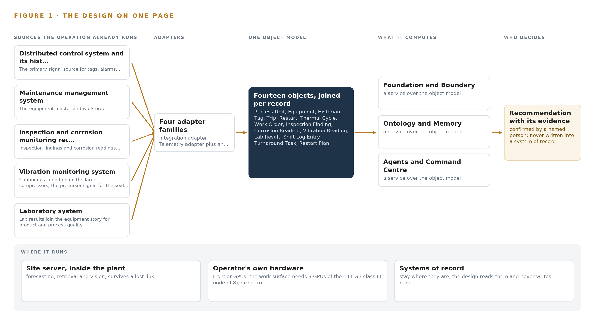
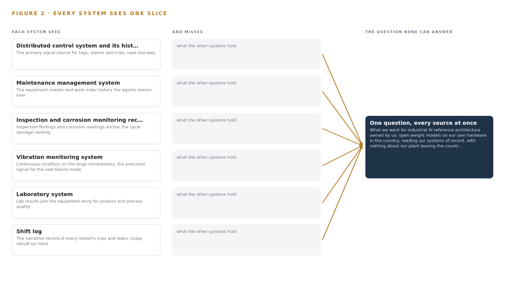
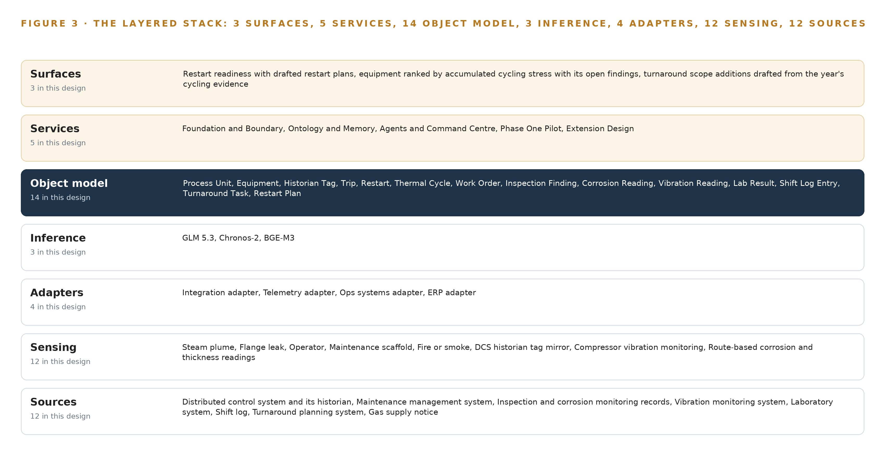
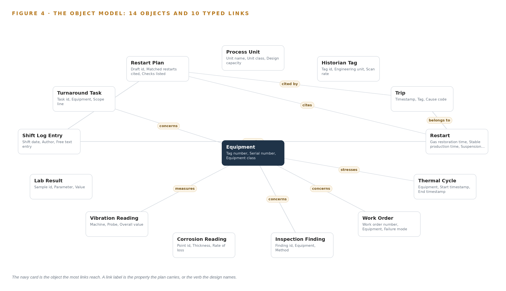
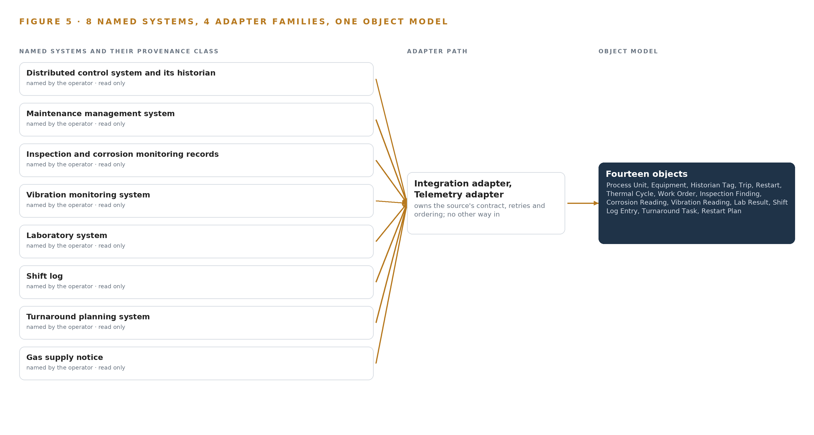
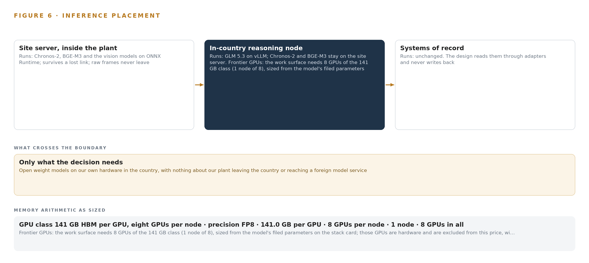
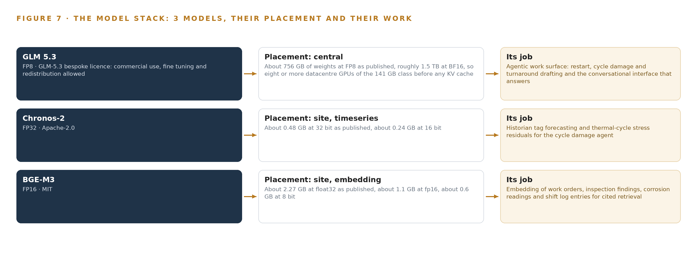
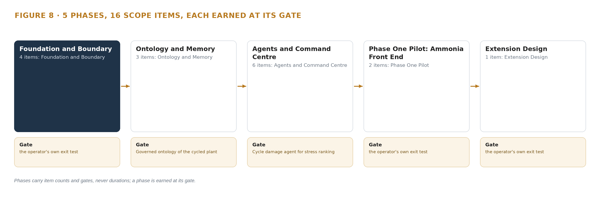
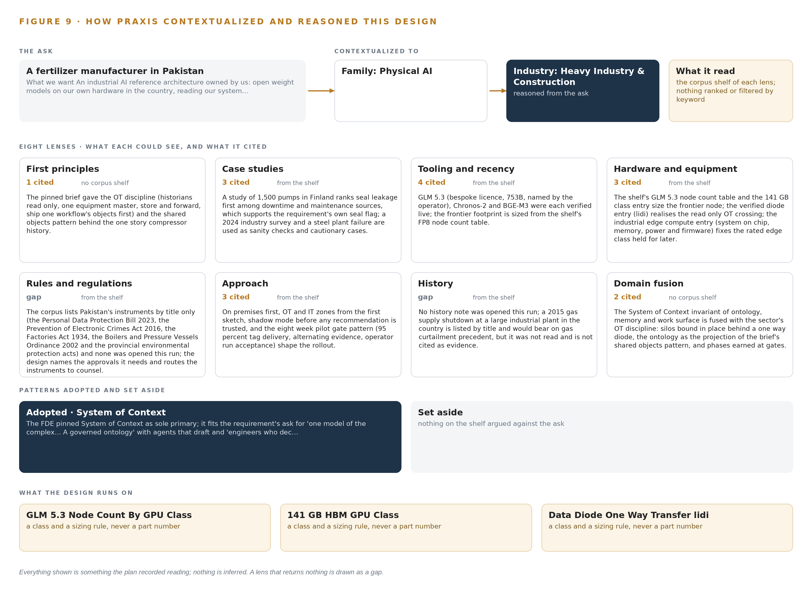

# Industrial AI Reference Architecture for Fertilizer Plant Reliability in Pakistan

Canonical: https://codeatoms.ai/fertilizer-plant-reliability-pakistan/
PDF: https://codeatoms.ai/fertilizer-plant-reliability-pakistan/paper/fertilizer-plant-reliability-pakistan.pdf
License: CC BY 4.0
Publisher: CodeNinja Atoms (https://codeatoms.ai), a fully owned subsidiary of CodeNinja

VERTICAL-DRIVEN ARCHITECTURES · HEAVY INDUSTRY & CONSTRUCTION · DESIGNED WITH PRAXIS · NOVEMBER 2026

# Industrial AI Reference Architecture for Fertilizer Plant Reliability in Pakistan

Cycle Watch: Sovereign AI Reference Architectures for Plant Reliability in Pakistan

Muhammad Umar, Cofounder, CodeNinja

For the complex's reliability and turnaround leads, the control, inspection and maintenance engineers in the loop, and the platform, data and OT engineers who would build and run it.

---

Vertical-Driven Architectures is a CodeNinja series of system designs. Every design in the series is driven by a real-world problem and scenario in a single industry, and every one is designed on Praxis, CodeNinja's platform for designing physical AI systems. Operations are described by class, never by name.

At a glance

## Industrial AI Reference Architecture for Fertilizer Plant Reliability in Pakistan

**What this is.** An open industrial AI reference architecture for system design in physical AI, built for a fertilizer manufacturer in Pakistan whose ammonia and urea complex, designed to run steadily between annual turnarounds, has been stopped and restarted repeatedly in 2026 by gas supply suspensions, where owning the inference node that runs it costs about 572,000 US dollars over three years. When the gas comes back after a two week suspension, the design joins the historian, the work orders, the inspection and corrosion records, the vibration readings and the shift log into one story per piece of equipment, so the restart agent drafts the plan from the last three restarts, the synthesis compressor's seal is flagged for inspection before the start, and the shift superintendent confirms every step. The models run entirely on the operator's own hardware inside the country, behind a hardware data diode that makes the read of the control system physically one way. It is written for the complex's reliability and turnaround leads, the control, inspection and maintenance engineers in the loop, and the platform, data and OT engineers who would build and run it. The operator is described by class, never by name.

**The answer in numbers.**

| Part | The design |
| --- | --- |
| Sources | Twelve sources once sensing is counted: eight systems of record named by the operator and read only (the distributed control system and its historian, the maintenance management system, the inspection and corrosion monitoring records, the vibration monitoring system on the large compressors, the laboratory system, the shift log, the turnaround planning system and the gas supply notice that triggers the restart agent), the fixed camera lanes at the reformer top deck, the synthesis compressor train and the bagging plant lane, and a citation check on conversational answers; four adapter families cross the OT boundary through a hardware data diode carrying a one way file transfer, and nothing writes back |
| Object model | 14 typed objects with 10 typed links, from the process unit and equipment through the historian tag, trip, restart and thermal cycle to the work order, inspection finding, corrosion reading, vibration reading, lab result, shift log entry, turnaround task and restart plan, with Equipment as the focal object, anchored on the equipment master and refreshed shift by shift, published as JSON for reuse |
| Models | GLM 5.3 (GLM-5.3 bespoke licence, 753B at FP8) for the restart, cycle damage and turnaround drafting agents and the cited conversational interface; Chronos-2 (Apache-2.0) forecasting historian tags and thermal cycle stress residuals on the site server; BGE-M3 (MIT) embedding work orders, findings, readings and shift log entries for cited retrieval; vision models on Frigate NVR and ONNX Runtime for steam plume, flange leak, operator, scaffold and fire or smoke; no third party model service, nothing trained into weights |
| Compute | One node of eight 141 GB HBM cards (1,128 GB) on new dedicated in country hardware the operator owns, holding 753 GB of FP8 weights with a 1.2 planning factor, 904 GB; an air cooled site server inside the plant for Chronos-2, BGE-M3 and vision; a hardware data diode on the OT boundary and an OCP Time Card grandmaster for time. The node is a 4A090 class item for a destination in Country Groups D:2, D:3 and D:4, so an ECCN 3A090 and 4A090 licence determination is a phase one checkpoint before any card is quoted, with an approved in country data centre held as the fallback |
| Rollout | Five phases carrying 16 scope items (4, 3, 6, 2 and 1), each closed by a gate, never a date: Foundation and Boundary, Ontology and Memory (gate: the governed ontology of the cycled plant), Agents and Command Centre (gate: the cycle damage agent ranking stress), Phase One Pilot on the ammonia front end and the synthesis compressor train for one quarter including at least one restart, gated on four frozen baselines (hours from gas restoration to stable production, trips per restart, inspections brought forward with a confirmed finding, reliability engineer hours per failure investigation), then Extension Design to the urea unit and utilities behind its own gate; restart drafts run in shadow beside the standing written procedure until measured agreement |
| Three-year cost | About 572,000 US dollars to own the node for three years (a range of 542,000 to 610,000: server, support and power at the national industrial tariff), against about 751,000 to rent the same eight cards on the deepest three year commitment in AWS Asia Pacific (Mumbai), so ownership costs about three quarters of it, and about 2.00 million on demand, against which ownership costs a little over a quarter. Renting is a price reference only, because AWS lists no region in Pakistan and every rented option would carry plant data across the border (Appendix A) |
| Human control | Agents draft and people decide, by name: the shift superintendent confirms every step of the restart plan, the reliability engineer approves the cycle damage draft and the inspections it brings forward, the turnaround manager approves the scope additions, and report packs for the insurer's engineer leave only through a controlled export path after a disclosure review; every status change carries a named person and a timestamp, and every confirmation is kept as memory the next restart reads, never as a weight update |

**Reuse it.** The object model, the model register and the figures are free to reuse under CC BY 4.0. Cite as <https://codeatoms.ai/fertilizer-plant-reliability-pakistan/.>

**Made with.** Reasoned on [CodeNinja Praxis](<https://codeatoms.ai/praxis/>), the CodeNinja Atoms platform for designing physical AI systems. The object model imports into [Hyper Ontology](<https://codeatoms.ai/hyper-ontology/>), which turns it into a living system. Load it with the [hyper-ontology loader](../hyper-ontology-py/): `hyper-ontology show fertilizer-plant-reliability-pakistan`. Both are in beta; access by request.

ABSTRACT

## An Industrial AI Reference Architecture for Plant Reliability Begins With the Cycle Count

An [industrial AI reference architecture](https://codeatoms.ai/industrial-ai-reference-architecture/) for plant reliability exists to answer one question this operation cannot answer today: what several gas-suspension restarts in 2026 have done to the reformer tubes, the synthesis compressor and the seal history of a plant in Pakistan designed to run steadily between annual turnarounds. Each stop and hot restart costs days of production and stresses equipment built for continuous duty, and the hidden cost of every thermal cycle only surfaces at the turnaround, while the reliability engineers rebuild each failure's history by hand across the historian, the work orders and the inspection files, and the engineers who remember the last five restarts are retiring. The records needed to answer the question already sit in the plant's systems of record, but they are joined after the failure rather than read together before the next restart.

The design reads twelve source systems one-way, through four adapter families and across a hardware data diode, into a governed object model of fourteen objects linked by typed relations; five services run three drafting agents, for restart plans, cycle damage and turnaround scope, onto three surfaces for the reliability team, with every draft confirmed by a named superintendent. Three models carry the reasoning: Chronos-2 forecasts historian tags and thermal-cycle stress residuals, and BGE-M3 embeds work orders, findings and shift log entries for cited retrieval, both on the site's air-cooled inference server, while GLM 5.3, a 753B-parameter frontier model held at FP8, runs the command center on one node of eight 141 GB-class GPUs on dedicated in-country hardware, so nothing about the plant leaves the country and nothing ever writes to the control system.

The paper covers the industry problem and the join failure, the constraints that shape everything downstream, the stack, the object model, ingestion through adapters, inference placement, the models and their licenses, the rollout with its five phases, sixteen items and gates, ownership of what the design builds, and it closes with the chapter on how Praxis contextualized and reasoned this design.

---



Figure 1. Cycle Watch on one page: the sources the operation already runs, one object model, what it computes, and the person who decides.

## Contents

Each chapter is tagged for the reader it serves most directly: Executive, Team Lead, FDE, Reference.

|  |  |  |
| --- | --- | --- |
|  | Abstract · An Industrial AI Reference Architecture for Plant Reliability Begins With the Cycle Count | Executive |
| PART I · THE PROBLEM | | |
| 1 | [Every Thermal Cycle Borrows Against the Turnaround](#ch1) | Executive |
| 2 | [Each System of Record Sees One Slice](#ch2) | ExecutiveTeam Lead |
| PART II · THE DESIGN | | |
| 3 | [Sovereignty and One-Way Reads Shape Everything Downstream](#ch3) | Team Lead |
| 4 | [One Stack Runs From Diode to Command Center](#ch4) | Team LeadFDE |
| 5 | [Fourteen Objects Turn Cycling Into One Argument](#ch5) | FDE |
| 6 | [Every Source Enters Through an Adapter, Never Directly](#ch6) | FDE |
| 7 | [Forecasting Belongs on Site and Reasoning in Country](#ch7) | FDE |
| 8 | [The Licenses Let the Operator Hold Its Weights](#ch8) | FDEExecutive |
| PART III · THE ROLLOUT | | |
| 9 | [Shadow Mode Earns Trust Before Any Flag Moves](#ch9) | Team LeadExecutive |
| 10 | [The Intelligence Stays with the Plant That Produced It](#ch10) | Executive |
| PART IV · HOW IT WAS DESIGNED | | |
|  | Conclusion · The Cycling Becomes Countable, and the Count Stays Owned | Executive |
| 11 | [How Praxis Contextualized and Reasoned This Design](#ch11) | Team LeadFDE |
|  | [Sources](#sources) | Reference |

PART I · CHAPTER 1

## Every Thermal Cycle Borrows Against the Turnaround

A plant built to run around the clock between annual turnarounds is being cycled by gas suspensions, and no system counts what each thermal cycle is costing the reformer tubes, the compressors and the urea reactor until the damage is uncovered too late to plan for.

The abstract set out an industrial AI reference architecture that reads the plant's own records and drafts what named people confirm. This chapter stays on the plant floor and states the problem in the operator's own terms before any architecture answers it: what the cycling is doing to equipment built to run steadily, what that costs, and who is in the room when it bites.

### 1.1  The Question the Operation Needs Answered

An industrial AI reference architecture for plant reliability exists to answer one question, and this operation needs it answered per asset: what has every thermal cycle since the gas suspensions began cost the reformer tubes, the synthesis compressor and the urea reactor, and what should the next restart and the next turnaround therefore do differently. The data that answers it is data the operation already holds: tags, alarms and trips from the distributed control system and its historian, the equipment master and work order history, inspection findings and corrosion readings, vibration spectra on the large compressors, laboratory findings, the shift log narrative, turnaround scope lines and the gas restoration notices that start each restart. The answer must also satisfy the country's own instruments: data protection, cyber crime, factories, boilers and pressure vessels and provincial environmental acts, together with the insurer's engineer and the plant's management of change discipline, and none of it may leave the country.

### 1.2  The Documented Cost of the Problem

In 2026 the plant and others of its class were stopped and restarted repeatedly by gas supply suspensions, pipeline damage after floods and import constraints, and the country reported a fertilizer shortfall of over two hundred thousand tonnes as a result. Each unplanned stop and hot restart costs days of production and stresses equipment designed to run steadily for a year between annual turnarounds, and each restart produces trips, leaks and alarms that are handled and then forgotten while the hidden cost accrues toward the turnaround. The cost of forgetting is documented well beyond this industry: a review of publicly available coronial inquiries into fatalities in the resources sector since the year 2000 traces deaths to the loss of corporate memory (Ausimm n.d.), and a coronial inquiry held that the loss of workplace knowledge that followed changes in ownership was explainable but not excusable when it contributed to a worker's death (Ohsalert 2025). At this complex the engineers who remember the last five restarts are retiring, which turns a documented industry hazard into this plant's own exposure.

### 1.3  The Operation as a Scenario

The operator is a fertilizer manufacturer in Pakistan running an ammonia and urea complex on pipeline gas and imported regasified gas: reformers, synthesis compressors, a granulation train and a bagging plant, working around the clock between annual turnarounds and now cycled on the order of a dozen times a year by gas suspensions. Scale figures come from public reporting on plants of this class in the country, and anything specific to the complex is an assumption to confirm. The people in the loop are the shift superintendents who confirm each restart, the reliability engineers who today rebuild equipment histories by hand, the control engineers who own the boundary, the inspectors who walk the corrosion routes, the turnaround planners, and the senior engineers, several of them retiring, who hold the undocumented memory of the restarts. The physical environments are the reformer top deck, the synthesis compressor train and the bagging plant lane, the three places sensing must watch. The named estate holds seven systems of record plus the gas supply notice, and the full design draws on twelve sources once sensing is counted, across one site in one country.

PART I · CHAPTER 2

## Each System of Record Sees One Slice

The historian, the maintenance system, the inspection files, the vibration monitors, the laboratory, the shift log and the turnaround plan each hold part of the story of one compressor, and none of them can hold it together before the equipment fails.

Chapter 1 set out the question. This chapter explains why no system the operation already runs can answer it.

### 2.1  What Each System Sees

Distributed control system and its historian the primary signal source for tags, alarms and trips, read one-way

Maintenance management system the equipment master and work order history the agents reason over

Inspection and corrosion monitoring records inspection findings and corrosion readings anchor the cycle damage ranking

Vibration monitoring system continuous condition on the large compressors, the precursor signal for the seal failure mode

Laboratory system lab findings join the equipment story for product and process quality

Shift log the narrative record of every restart's trips and leaks, today rebuilt by hand



Figure 2. Eight systems, each seeing one part of the answer. The question needs all of them in one place at once.

### 2.2  What None of Them See Together

Each holds one slice, and the question needs all of them in one place at once, which today is done by hand at the cadence of whoever has the time.

PART II · CHAPTER 3

## Sovereignty and One-Way Reads Shape Everything Downstream

Reading only and never writing to the control system, keeping every byte inside the country, improving the restart plan without training a model on the fly, and putting a cheap first gate in front of the work are the four constraints that decide every layer below them.

Chapter 2 showed the join failure: seven systems and a notice, each holding one slice of the same compressor. This chapter turns the operator's own requirements into four constraints that decide every layer below them, and then records what the design scoped and what it chose against.

### 3.1  The Control System Is Read Only

The first constraint is the operator's own sentence: the architecture never writes to the control system. This is hard in this industry because the distributed control system is the plant's safety-relevant nervous system, and the standard integration habit is a firewalled read-only database connection, which is one-way only as a matter of policy and policy drifts with time and staff turnover. The design therefore crosses the OT boundary through a hardware data diode carrying a one-way file transfer, physically incapable of a write, and any later change to the boundary passes management of change with the control engineer's signature. The plant keeps running exactly as it does today if the read path is cut.

### 3.2  Nothing Leaves the Country

The second constraint keeps every byte about the plant inside Pakistan, which rules out foreign clouds and any inference outside the boundary. It is hard because the work surface model is frontier class: 753 billion parameters at FP8 precision mean roughly 756 GB of weights that must be held on the operator's own new dedicated in-country hardware, and the country's export control position means a license determination under the ECCN 3A090 and 4A090 categories, which turn on total processing performance rather than memory, precedes any GPU class being quoted. This is where an industrial AI reference architecture earns the word sovereign: the weights, the records and the decision all stay with the operation that produced them, with an approved in-country data center held as the fallback placement.

### 3.3  Improvement Runs Through Memory, Not Weights

The third constraint is the requirement's own phrasing: the next restart plan must be better without training a model on the fly. This is hard because the obvious way to make an agent better at restarts is to fine tune it on restart histories, which the requirement rules out. The design instead keeps a memory of confirmed restart causes and accepted inspections that every run reads before it acts, so improvement compounds through what people have confirmed rather than through weight updates, and the weights the operator holds remain the ones it can account for.

### 3.4  A Cheap First Gate Stands in Front of the Work

The fourth constraint puts a stoppable gate before the expensive commitments. Phase one covers only the ammonia front end and the synthesis compressor train for one quarter, including at least one restart, and it is gated on the operator's four baselines. If the baselines are not met, the work stops before the ontology of the whole estate, the extension to urea and utilities and any further hardware are committed, which is where learning the design is wrong still costs little.

### 3.5  Scoping Decisions

The scoping decisions trade reach for control, and Table 1 records each one with what it buys and what it costs.

Table 1 · Scoping Decisions

| Decision | What it buys | What it costs |
| --- | --- | --- |
| One-way read through a hardware data diode | A physically un-writable control system and a boundary that cannot drift quietly | A second infrastructure layer and a file-based crossing instead of a live query |
| Improvement through memory, never fine tuning | Plans that improve without training a model on the fly, and weights that stay accountable | Each gain depends on people confirming causes and inspections, so unconfirmed events teach nothing |
| Phase one on the ammonia front end and the synthesis compressor train only | A cheap first gate on the operator's four baselines before the estate is committed | The urea unit, granulation and utilities wait as gated extensions |

### 3.6  What the Design Chose Against

Each rejected alternative was rejected for a stated reason, and Table 2 records them, ending with what sits outside the scope entirely.

Table 2 · What the Design Chose Against

| Where | What was picked | Instead of, and why |
| --- | --- | --- |
| OT boundary crossing | Hardware data diode with one-way transfer | A firewalled read-only database connection, which is policy one-way where the diode is physically one-way |
| Improvement mechanism | Memory of confirmed restart causes and accepted inspections | Fine tuning the work surface model on restart histories, which the requirement rules out by asking for improvement without training on the fly |
| Frontier model placement | The operator's own dedicated in-country hardware | In-country colocation or any outside data center, both weaker on the nothing-leaves rule |
| Vision compute in phase one | The site server | A camera-group edge unit, held as a rated class for later since the cameras watch fixed process equipment |
| Out of scope | Closed-loop control writes, training on plant data, the urea unit and utilities in phase one, continuous sensing off the critical tier | Each excluded by the operator's own constraint, phasing or requirement: control writes are barred, weights are never updated, urea and utilities are gated extensions, and condition collection is route based as the requirement describes it |

PART II · CHAPTER 4

## One Stack Runs From Diode to Command Center

Systems of record sit below a hardware data diode, one governed object model holds the plant's story in the middle, and drafting agents, services and the reliability team's surfaces run above it, all on the operator's own hardware.

Chapter 3 settled the constraints that shape everything downstream: nothing about the plant leaves the country, the control system is never written to, the plant's story must outlast the engineers who hold it in memory, and the first gate must be cheap to stop. This chapter sets the stack that meets them, from the diode at the bottom to the command center at the top.

### 4.1  Three Layers, One Boundary

The architecture is a three-layer pattern. Below sit the systems of record in the OT zone: the distributed control system and its historian, the maintenance management system, the inspection and corrosion records, the vibration monitoring system, the laboratory system, the shift log, the turnaround planning system and the gas supply notice. In the middle sits one governed object model that turns those records into a single story of equipment under cycling stress. Above it run the applications and agents: three drafting agents for restart, cycle damage and turnaround scope, five services and the reliability team's three surfaces. The layers are separated by hardware, not by policy: lidi over a hardware data diode carries the read out of the OT zone, and nothing above the diode has a path back in. The pattern fits because the problem is a join failure rather than a sensing failure, and because it keeps every tier on the operator's own hardware in Pakistan, which is the shape every sovereign industrial AI reference architecture shares. Figure 3 shows the layered stack with its counts: twelve sources, four adapter families, fourteen objects, three models, five services and three surfaces, with the frontier tier on one in-country node.



Figure 3. The layered stack: 12 sources, 4 adapter families, 14 objects, 5 services and 3 surfaces.

### 4.2  The Stack Stage by Stage

Table 3 walks the same stack stage by stage, naming what each stage is responsible for and the components that carry it. Two disciplines govern the choices. Where a product is named it was verified against the current release line: Kafka 4.3.x with KRaft for the backbone, Hyper Ontology v0.9 for the object model, Frigate NVR for video, ONNX Runtime for edge serving, vLLM for on-site language model serving, K3s for container orchestration, Harbor for the air-gapped artifact registry, Keycloak for identity, and Prometheus, Grafana and Loki for observability. Where the design names a class instead, the pick is deliberately deferred: the time series store is named as the InfluxDB 3 Core, TimescaleDB and QuestDB family because the choice turns on the historian's volume and the operator's estate, and the GPU class is preceded by an export license determination under ECCN 3A090 and 4A090 before any card is quoted. Table 7, printed by the platform, sets the same stack out layer by layer as Layer, Component, Choice and Why, including the rows where the design chose nothing because no duty exists: no object tracking, since the cameras watch fixed process equipment, and no labelling and retraining tier, since improvement runs through memory rather than weights.

Table 3 · The Stack, Stage by Stage

| Stage | What it is responsible for | How |
| --- | --- | --- |
| Sources | Holding the plant's systems of record in the OT zone | The distributed control system and its historian, the maintenance management system, the inspection and corrosion records, the vibration monitoring system, the laboratory system, the shift log, the turnaround planning system and the gas supply notice |
| Sensing | Watching the plant and mirroring condition | Frigate NVR on fixed cameras at the reformer top deck, the synthesis compressor train and the bagging plant lane, plus the historian tag mirror, compressor vibration, route-based corrosion readings, the laboratory feed and gas restoration notices, with time held by an OCP Time Card grandmaster under linuxptp and a chrony NTP fallback |
| Adapters | Carrying each source across the boundary with its provenance | Four families, integration, telemetry, ops systems and ERP, crossing through lidi over a hardware data diode with store and forward |
| Object model | Holding the plant's story as one governed graph | Hyper Ontology v0.9 (Semantics plus Kinetics), fourteen objects refreshed shift by shift |
| Inference | Forecasting, embedding and reasoning on the operator's own hardware | ONNX Runtime serving Chronos-2, BGE-M3 and the vision models on the site server; vLLM serving GLM 5.3 on one node of eight GPUs of the 141 GB class in country |
| Services | Running the five services of the design | Foundation and Boundary, Ontology and Memory, Agents and Command Center, Phase One Pilot, Extension Design |
| Surfaces | Serving the reliability team's three surfaces | Restart readiness with drafted restart plans, equipment ranked by accumulated cycling stress, and turnaround scope additions drafted from the year's evidence |

Table 7 · Architecture, Layer by Layer

| Layer | Component | Choice | Why |
| --- | --- | --- | --- |
| Event streaming and messaging | by class, no product named | Product | Apache Kafka 4.3.x (KRaft) |
| The ontology or graph store | by class, no product named | Product | Hyper Ontology v0.9 (Semantics plus Kinetics) |
| Time series and telemetry storage | InfluxDB 3 Core / TimescaleDB / QuestDB family | Class | The shelf holds the family but the pick is made against the historian's volume and the operator's estate, so the class is named and the product confirmed at design. |
| Video ingest, recording and management | by class, no product named | Product | Frigate NVR |
| Edge model serving | by class, no product named | Product | ONNX Runtime |
| On site language model serving | by class, no product named | Product | vLLM |
| Object tracking and trajectory forecasting | by class, no product named | Not needed | No tracking or trajectory duty exists; the cameras watch fixed process equipment, not moving objects. |
| Edge orchestration of containers | by class, no product named | Product | K3s |
| An air gapped artifact and model registry | by class, no product named | Product | Harbor |
| Labelling and retraining | by class, no product named | Not needed | Under system of context nothing is trained or distilled into weights; improvement runs through its memory loops, per the operator's own 'without training a model on the fly'. |
| Time synchronisation across sensors and systems | by class, no product named | Product | Linuxptp with chrony NTP fallback |
| Observability of the running system | by class, no product named | Product | Prometheus / Grafana / Loki |

### 4.3  A Reusable Pattern

The shape a team can carry away is this: read the systems of record through a physically one-way crossing into a governed object model anchored on one equipment master, let agents draft against that model, put a named person between every draft and every action, and let memory rather than fine tuning carry what each cycle teaches. A team carrying a similar brief swaps the object set, here fourteen objects for a cycled ammonia-urea complex, the source list and the agent set, here restart, cycle damage and turnaround. What they keep is the diode, the single equipment master, the confirmation loop and shadow mode before any draft is trusted, because those four are what make the pattern safe to point at a running plant.

PART II · CHAPTER 5

## Fourteen Objects Turn Cycling Into One Argument

Equipment, tags, trips, restarts, thermal cycles, work orders, findings, readings and plans link into one typed graph, so the question the turnaround asks can be answered by query instead of by the archaeology reliability engineers perform by hand today.

Chapter 4 put one governed object model at the middle of the stack and made it the one place the plant's story is joined. This chapter opens that model: fourteen objects, the typed links between them, the human loop wrapped around them and the posture they are hosted under.

### 5.1  Every Object and Its Links

Fourteen objects hold the story. On the asset side sit Process Unit and Equipment; on the measure side, Historian Tag, Corrosion Reading and Vibration Reading; on the event side, Trip, Restart and Thermal Cycle; on the record side, Work Order, Inspection Finding, Lab Result and Turnaround Task; on the document side, Shift Log Entry and Restart Plan. Each is anchored in a system of record: Equipment in the maintenance management system, Historian Tag and Trip in the distributed control system and its historian, Restart in the shift log, Inspection Finding and Corrosion Reading in the inspection and corrosion records, and the rest accordingly. The links are typed and directional: a Trip belongs to a Restart and is cited by a Restart Plan; a Thermal Cycle, a Work Order, an Inspection Finding and a Turnaround Task each point at the Equipment they concern; a Shift Log Entry references the Restart it narrates and the Restart Plan it supports. Figure 4 draws all fourteen objects and their links, with Equipment as the focal object. What the links buy is traversal: a query can ask for every trip on the synthesis compressor across this year's restarts, each with the shift log entry that narrates it, the work orders that followed and the vibration readings either side, and get one answer, where a document store holds all those records but cannot join them. That join failure is why reliability engineers rebuild equipment histories by hand today, and its cost is documented well beyond this plant: reviews of coronial inquiries into resources-sector fatalities trace deaths to the loss of corporate memory (Ausimm n.d.), a coroner has called the loss of workplace information after ownership changes explainable but not excusable (Ohsalert 2025), and a labor union has had to mine its own old newsletters to recover its record of past accidents (OR 2021). Cycling a plant a dozen times a year makes that loss more likely, not less. Table 8, printed by the platform, sets out each object, the system of record it is anchored in and its typed links.



Figure 4. The fourteen objects of the model and the typed links that let a query reach across them.

Table 8 · The Object Model

| Object | Anchored in | Typed links |
| --- | --- | --- |
| Process Unit | The maintenance management system (equipment hierarchy) | no typed link recorded |
| Equipment | Maintenance management system | no typed link recorded |
| Historian Tag | The distributed control system and its historian | no typed link recorded |
| Trip | The distributed control system and its historian | belongs to: Restart; cited by: Restart Plan |
| Restart | Shift log | no typed link recorded |
| Thermal Cycle | Derived from the distributed control system and its historian | stresses: Equipment |
| Work Order | Maintenance management system | concerns: Equipment |
| Inspection Finding | The inspection and corrosion monitoring records | concerns: Equipment |
| Corrosion Reading | The inspection and corrosion monitoring records | no typed link recorded |
| Vibration Reading | The vibration monitoring system on the large compressors | measures: Equipment |
| Lab Result | The laboratory system | no typed link recorded |
| Shift Log Entry | The shift log | narrates: Restart; supports: Restart Plan |
| Turnaround Task | The turnaround planning system | concerns: Equipment |
| Restart Plan | Drafted by the restart agent, confirmed by the shift superintendent | cites: Trip |

### 5.2  The Human Loop and the Hosting Posture

The human loop lives in the status vocabularies. A Restart moves from Drafted to Confirmed by superintendent to In progress to Stable; an Inspection Finding moves from Open to Accepted to Closed or Brought forward; a Restart Plan moves from Drafted to Confirmed to Superseded, never silently overwritten. Every status change carries a named person and a timestamp, so the graph records who confirmed what, and an agent's output remains a draft until someone with authority says otherwise. The hosting posture follows the constraints. The model runs on the operator's own hardware in Pakistan, identity is held on site by Keycloak, external links are blocked except the controlled export path through which report packs for the insurer's engineer leave after a disclosure review, and the single write path into the object model is the adapter tier below and the confirmation loop above. Nothing writes back through the diode, and nothing about the plant leaves the country.

### 5.3  One Object in Its Recorded Form

The code block below records the Process Unit object exactly as the model holds it, with its identifier, label, kind, properties, status vocabulary and links.

```
{ "id": "process-unit", "label": "Process Unit", "kind": "asset", "anchored_in": "", "properties": [ "Unit name", "Unit class", "Design capacity", "Commissioning year" ], "status_vocabulary": [], "links": [] }
```

PART II · CHAPTER 6

## Every Source Enters Through an Adapter, Never Directly

Twelve named sources cross the boundary through four adapter families, each carrying its provenance class, so the plant's systems of record are read one-way and the ontology refreshes shift by shift without any write path back to the OT zone.

Chapter 5 defined the fourteen objects the model holds and the confirmation loop that guards them. This chapter describes how data reaches those objects: every source crosses the boundary through an adapter, and nothing crosses back.

### 6.1  Twelve Sources and Their Provenance

Twelve sources feed the model, and each arrives with its provenance class stamped on every record. Eight are systems of record named by the operator, all read-only: the distributed control system and its historian, the maintenance management system, the inspection and corrosion monitoring records, the vibration monitoring system on the large compressors, the laboratory system, the shift log, the turnaround planning system and the gas supply notice whose arrival triggers the restart agent. The design adds the rest as sensing feeds: the fixed camera lanes at the reformer top deck, the synthesis compressor train and the bagging plant lane, and the citation check that runs on conversational answers before they are shown. Each source is assigned to one of four adapter families, integration, telemetry, ops systems and ERP, chosen by the shape of the interface rather than by the vendor, and Figure 5 maps every source to its family, its provenance class and its path across the boundary. The shift log deserves its own note, because it is the narrative record of every restart's trips and leaks and today it is written but rarely retrieved: an inquest into a site death heard that none of the contractor's employees had read the safety manual for the machine that killed him (Constructionnews 2009), the familiar pattern of records held but never joined, which is exactly what the digitized shift log and its links exist to end.



Figure 5. The 12 named systems, the adapter path each one takes, and the object model they all map into.

### 6.2  What the Adapter Tier Guarantees

The adapter tier guarantees five things. First, one-way flow: the crossing is lidi over a hardware data diode, which is physically one-way where a firewalled read-only connection is only policy one-way, and any later change to the boundary passes management of change with the control engineer's signature. Second, provenance: every record carries the source system it came from and its class, so a trip from the historian and a trip recalled in a shift log entry are distinguishable forever. Third, binding in place: adapters translate each source into the object model's vocabulary, so the systems of record are never replaced and never moved. Fourth, no bulk migration: the build reads live feeds and the agreed opening balances only, leaving historic cleansing out of scope. Fifth, store and forward: when the far side of the diode is unavailable the near side buffers, and the plant's systems never wait on the model.

### 6.3  The Event Backbone

Apache Kafka 4.3.x with KRaft is the backbone the adapters publish onto. Ordering is per partition key, the tag id, the work order number or the restart identifier, so a trip never arrives in its partition before the restart it belongs to. Delivery is at least once with idempotent writes keyed by source timestamp and source identifier, so a replay after a store and forward drain deduplicates instead of double-counting a trip. Buffering sits on the OT side of the diode, where store and forward rides out link loss without touching the control system. Replication stays in country on the operator's own hardware, consistent with the nothing-leaves rule. Time is held by the OCP Time Card grandmaster under linuxptp with a chrony NTP fallback, so the historian, vibration and shift log records join on a common clock, and Prometheus, Grafana and Loki watch delivery lag so a stalled feed is seen before the next shift's refresh is short.

PART II · CHAPTER 7

## Forecasting Belongs on Site and Reasoning in Country

Chronos-2 forecasting and BGE-M3 retrieval run beside the historian on the site server, GLM 5.3 drafts and answers on the dedicated in-country node, and only confirmed objects, residuals and drafts cross between the tiers, with defined behavior when the link, the power or the update path fails.

Chapter 6 described how every source enters through one of four adapter families and lands on the event backbone, with nothing written back to a system of record. This chapter decides where the three models run, and the decision follows two forces: the home of the data each model reads, and the patience of the person waiting on its output.

### 7.1  Two Places to Run, and the Arithmetic That Fixes One of Them

The design runs inference in two places. A site server, air-cooled and inside the plant boundary, holds Chronos-2, BGE-M3 and the vision models, with ONNX Runtime serving the edge duties; phase one runs vision on this server rather than on camera-group edge units. A dedicated in-country node holds GLM 5.3, served with vLLM. Forecasting belongs beside the historian because it reads the tag stream continuously and writes residuals no one watches in real time; retrieval belongs on site because the work orders, inspection findings and shift log entries it embeds are already there; vision watches the reformer top deck, the synthesis compressor train and the bagging plant lane for steam plume, flange leak, operator, maintenance scaffold and fire or smoke. Figure 6 sets the two tiers side by side with what crosses between them.

The frontier node is fixed by arithmetic rather than preference. GLM 5.3 carries 753 billion parameters, and at FP8, one byte per parameter, its weights are 753 GB; a node of eight GPUs of the 141 GB class holds 1,128 GB, leaving 375 GB beside the weights, of which the 1.2 planning factor reserves about 151 GB for KV cache and activations. At BF16 the same weights would be roughly 1.5 TB and would not fit the node. The site models are hardly a question: Chronos-2 is about 0.48 GB at 32 bit as published and about 0.24 GB at 16 bit, and BGE-M3 is about 2.27 GB at float32 and about 1.1 GB at the FP16 the design runs, so both sit beside the vision models with room to spare. The retrieval tier exists because the records it makes findable are the ones that leave with retiring engineers, and reviews of coronial inquiries tie fatalities in the resources sector to exactly that loss of corporate memory (Ausimm n.d.).



Figure 6. Where each tier runs, what runs there, and the narrow set of outputs that cross the boundary.

### 7.2  The Latency Budget

The budget is set by who waits, and only one model has a person in front of it. Chronos-2 runs on cadence against the tag stream, so its budget is the freshness of the residuals the cycle damage agent ranks against, not a human attention span. BGE-M3 answers inside a conversation: the query is embedded, the matching records return, and only then does the answer begin, with a citation check on conversational answers keeping it honest. GLM 5.3 carries the one real deadline, because a gas restoration notice starts a clock that ends when the plant is stable; a restart draft must reach the superintendent's surface before the walkthrough, and it never blocks one, since drafts run in shadow beside the standing procedure the plant executes either way. An inquest into a fatal machine accident heard that none of the employees had read the machine's safety manual (Constructionnews 2009), which is the case for keeping the written procedure warm and the superintendent's confirmation real rather than ceremonial. The slowest cadence is the shift by shift ontology refresh, which no one waits on at all.

### 7.3  What Crosses, and What Happens When Something Fails

Only three kinds of thing cross between the tiers: confirmed objects, residuals and drafts. Telemetry crosses the OT boundary once, through a hardware data diode carrying the lidi file service, and never crosses back; the diode is physically one-way where a firewall would be policy one-way, and any change to the boundary passes management of change with the control engineer's signature. Report packs for the insurer's engineer are generated inside the boundary, checked against a disclosure checklist and released only through the controlled export path.

Each failure has a defined behavior. If the link between the tiers drops, the backbone's store and forward buffers the confirmed objects while the site tier keeps forecasting and retrieving, the command center degrades to its last complete model state, and the standing written procedure stays warm; the plant runs as it does today. If power takes the site server, the historian's own record remains the authority and the site tier resynchronizes from the backbone on return. If the update path stalls, the running versions continue: artifacts arrive through the air-gapped Harbor registry on the controlled import path, and the registry's versions are the rollback, so a stalled update is an inconvenience rather than an outage.

PART II · CHAPTER 8

## The Licenses Let the Operator Hold Its Weights

GLM 5.3, Chronos-2 and BGE-M3 were each verified against their published footprints and license terms, and those terms permit a fertilizer manufacturer in Pakistan to hold the weights, run them internally and keep improvement in memory rather than in fine-tunes.

Chapter 7 placed each model on the tier its data and its deadline demanded, and sized the frontier node from the weights. This chapter presents the models themselves, their published footprints and the license terms that let a fertilizer manufacturer in Pakistan hold what it runs.



Figure 7. The three models, their placement, and the work each one does.

### 8.1  The Command Center Model

Figure 7 shows the model stack: one frontier model on the in-country node, two small models on the site server, and the licenses beneath all three. GLM 5.3 is the command center model, the one the operator's own requirement names. Its filed count is 753 billion parameters, frontier class at or above the 300 billion threshold, published at about 756 GB of weights at FP8 and roughly 1.5 TB at BF16; the design runs it at FP8 on one node of the 141 GB class, as Chapter 7 sized. Its role is the agentic work surface: the restart, cycle damage and turnaround drafting agents and the conversational interface that answers with citations. Its license is the GLM-5.3 bespoke license, whose terms allow commercial use, fine tuning and redistribution, and whose MaaS trigger does not bind an operator using the model internally. It was chosen because it is the one model in the register whose filed parameter count is frontier class, and because the requirement asks for a command center whose agent drafts and cited answers run on a single model the operator holds.

### 8.2  The Site Models and Why Holding the Weights Matters

Chronos-2 forecasts. It is about 0.48 GB at 32 bit as published and about 0.24 GB at 16 bit, it performs zero-shot multivariate forecasting with covariates, and it runs on the site server against the historian tag mirror, where thresholded residuals give the cycle damage agent its cycling-stress signal. Its Apache-2.0 terms place no condition on internal use, and the plan fine tunes nothing, which fits the rule that improvement never runs through weights. BGE-M3 retrieves. It is about 2.27 GB at float32, about 1.1 GB at the FP16 the design runs and about 0.6 GB at 8 bit, and it produces dense, sparse and multi-vector retrieval from one pass, which keeps tag numbers and error codes findable across the free-text records engineers rebuild by hand today; its MIT terms sit at the permissive end of the register.

The licenses matter beyond permission, because they are the reason the intelligence can stay. A coronial inquiry linked a worker's death to the loss of workplace information that followed changes in ownership and management, and called that loss explainable but not excusable (Ohsalert 2025); at another operation a labor union had to mine its own old newsletters to recover records of past accidents (OR 2021). An operator whose restart memory lives in file paths and retiring engineers stands in that position, and an operator whose memory lives in weights and records held on its own ground does not.

### 8.3  The Model and Equipment Register

Table 4 gathers what the design stands on beyond the three models: the hardware classes and sizing rules, the sensing, the patterns and the ground it runs on. Read beside Figure 7, the register is what separates industrial AI reference architectures that stop at software from one that names its ground: every row is either a model the operator holds or equipment it procures, and nothing in it routes plant data outside the country.

Table 4 · Model and Equipment Register

| The choice | What was picked | Why here |
| --- | --- | --- |
| Frontier language model | GLM 5.3, 753 billion parameters at FP8, about 753 GB of weights | The command center, the three drafting agents and the cited conversational interface run on one model; the bespoke license allows commercial use, fine tuning and redistribution |
| Forecasting model | Chronos-2, about 0.48 GB at 32 bit as published | Zero-shot multivariate forecasting with covariates; thresholded residuals give the cycling-stress signal with no fine tuning |
| Embedding model | BGE-M3, about 2.27 GB at float32, run at FP16 | Dense, sparse and multi-vector retrieval in one pass keeps tag numbers and error codes findable across free text |
| Frontier sizing rule | GLM 5.3 node count by GPU class: one node of eight 141 GB GPUs | 753 GB of weights at FP8, times 1.2 for KV cache and activations, is 904 GB against 1,128 GB of memory |
| Site inference server | An air-cooled server holding Chronos-2, BGE-M3 and the vision models | Forecasting and retrieval sit beside the historian; an ECCN 3A090 and 4A090 license determination precedes any card quoted |
| One-way crossing | A hardware data diode carrying the lidi file service | The requirement never writes to the control system, and a diode is physically one-way where a firewall is policy one-way |
| Sensing | Fixed cameras at the reformer top deck, the synthesis compressor train and the bagging plant lane; historian tag mirror, compressor vibration, route-based corrosion, laboratory feed, gas notices, digitized shift log | Steam plume, flange leak, operator, scaffold and fire or smoke detections, with a citation check on conversational answers |
| Improvement pattern | A kept record of decisions and outcomes that the next decision reads: a memory of confirmed restart causes and accepted inspections | The next restart plan improves without training a model on the fly |
| Shadow pattern | Restart drafts run beside the standing procedure until measured agreement | The superintendent confirms every step before any draft is trusted |
| Ground | New dedicated in-country hardware in Pakistan | Nothing about the plant leaves the country; servers, GPUs and data center capacity are the operator's |

PART III · CHAPTER 9

## Shadow Mode Earns Trust Before Any Flag Moves

Five phases carrying sixteen items and their exit gates put the restart drafts in shadow beside the standing written procedure, cover the ammonia front end and the synthesis compressor train for one quarter including at least one restart, and hold the extension to urea and utilities behind its own gate.

Chapter 8 closed the model register and showed that every license in it lets the operator hold its own weights on its own hardware. An industrial AI reference architecture for plant reliability is earned in one place only, on a cycled plant beside the procedure the crew already trusts, so this chapter sets out how the design arrives there: five phases carrying sixteen items, each held to an exit gate, with the restart drafts kept in shadow until measured agreement says otherwise.

### 9.1  Five Phases, Sixteen Items and Their Gates

Figure 8 lays the five phases with their item counts, workstreams, exit gates and requirement coverage. Foundation and Boundary carries four items, among them the one-way historian read path, the signed zones and conduits architecture and the dedicated in-country compute sizing; its exit test is the operator's acceptance of those items, since everything downstream reads through the boundary they define. Ontology and Memory carries three items, among them the governed ontology of the cycled plant, the shift by shift ontology refresh and the route-based condition collection, and its gate is that governed ontology. Agents and Command Center carries six items, among them the restart agent with superintendent confirmation, the cycle damage agent for stress ranking and the turnaround scope agent, and its gate is the cycle damage agent ranking stress. Phase One Pilot: Ammonia Front End carries two items, the pilot itself on the ammonia front end and the synthesis compressor train spanning at least one restart, and the baseline measurement and phase gates that hold it; the pilot is gated on the operator's own four baselines. Extension Design carries one item, the extension design to urea and utilities, which stays behind its own gate until the pilot's baselines are met. The sixteen scope items are tracked across the phases, and a phase cannot close its gate while an item it carries remains open.



Figure 8. The five phases and their gates, and the scope items each one carries.

### 9.2  What the Rollout Measures

The rollout measures against the operator's own four baselines, taken before the agents draft anything. It measures tag delivery from the historian read path against the threshold the pilot gate pattern sets, and it measures agreement between the shadowed restart drafts and the standing written procedure, since agreement is what moves a draft from shadow toward confirmation. It also measures the restart object's own recorded properties: gas restoration time, stable production time, suspension duration, trips count and leaks observed, which together say whether a restart went better than the last one. The cycle damage ranking is measured against the inspection findings it points to, because a ranking that survives the next inspection is a ranking worth trusting.

### 9.3  Failure Modes

Table 5 states what fails and what the design does about it. Each row is a failure the design assumes will arrive, paired with the mechanism already placed to meet it.

Table 5 · Failure Modes

| What fails | What the design does |
| --- | --- |
| Export controls delay or block the GPU classes the frontier node needs | The license determination runs as a phase one checkpoint before any card is quoted, and the approved in-country data center route is held as the fallback for the frontier model |
| Inspection and shift log free text is old or uneven, and the retiring engineers hold the memory of the last restarts | Normalisation and a knowledge elicitation phase run before the cycle damage agent ranks anything, with the elicitation named as its own item |
| The one-way read path is quietly converted to a write path | The diode is hardware enforced and any change to the boundary passes management of change with the control engineer's signature |
| The single frontier node fails | The agents degrade to the last complete model state, the standing written procedure stays warm, and the plant runs as it does today |
| Report packs leak plant data outside the controlled path | Packs are generated inside the boundary, reviewed against a disclosure checklist and released only through the controlled export path |
| Restart drafts are trusted before they have earned it | Drafts run in shadow beside the standing procedure until measured agreement, and the superintendent confirms every step |

### 9.4  Lessons

**Shadow the drafts before anyone trusts them.** The standing written procedure remains the sole restart authority until agreement is measured, because a procedure nobody reads is no protection at all; an inquest into a worker's death heard that none of the contractor's employees had read the safety manual for the machine that killed him (Constructionnews 2009). Shadow mode keeps the draft beside the procedure the crew actually uses, and the superintendent confirms every step of it.

**Make the license determination a gate, not a procurement step.** Export controls turn on total processing performance rather than memory, so the determination precedes any card quoted; if it blocks the class the frontier node was sized on, the fallback route is already held and the rest of the design is unchanged.

**Elicit the retiring memory before the ranking depends on it.** The engineers who remember the last restarts are leaving, and the cost of that kind of loss is documented: coronial review of fatalities in the resources sector traces them to corporate memory loss (Ausimm n.d.), a coroner called the loss of workplace information after management change explainable but not excusable (Ohsalert 2025), and one workforce had to mine its own old newsletters to recover records of past accidents (OR 2021). The elicitation is an item with a gate, not a courtesy.

### 9.5  What Is Still Open

Four questions stay open, and each one changes something concrete when settled. The export license determination for the GPU classes decides whether the frontier model runs on the operator's own node or the fallback in-country route, which moves the work surface but not the agents. The application of the operator's own cited legal instruments is routed to counsel, and settling it fixes what the disclosure checklist for report packs must satisfy. The agreed opening balances of historic records decide how far back the cycle damage ranking can reach, since the build reads live feeds and those balances only. Whether continuous sensing is added on the critical tier decides the sensing plan's shape, because condition collection is route based as the requirement describes it everywhere else.

PART III · CHAPTER 10

## The Intelligence Stays with the Plant That Produced It

The object model, the weights and their memory, the decision record and the boundary all belong to the operator, so the intelligence compounds inside the organization whose cycled equipment produced it rather than leaking out through a vendor, a cloud or a report pack.

Chapter 9 left four questions open, each of which moves a mechanism rather than the design's shape. This chapter states who owns what the rollout builds, because a system that reads a cycled plant's own records and improves its own restart plans is only worth building if the intelligence it accumulates stays where the cycling happened.

### 10.1  What the Operator Owns

The operator owns the object model. Its fourteen objects are anchored in systems of record the operator already holds: the equipment master in the maintenance management system, the tags and trips in the distributed control system and its historian, the findings in the inspection and corrosion records. The ontology is a governed projection of those records, so it is an asset of the plant it describes, and every typed link in it was built for this operation's questions. The operator owns the weights. GLM 5.3 runs under a license that permits commercial use, fine tuning and redistribution, and it runs on the operator's own hardware inside the country; Chronos-2 carries the Apache-2.0 license and BGE-M3 the MIT license, so every model in the register can be held, audited and re-served by the operator without a vendor's permission. No fine tune is in scope, and any the operator later makes under these licenses is the operator's. The operator owns the decision record: every confirmed restart plan, every accepted inspection, every ranking a named superintendent acted on, held as a memory the next run reads before it acts and one that never updates model weights. And the operator owns the boundary: the hardware diode, the zones and conduits architecture and the controlled export path, with any change to them passing management of change under the control engineer's signature.

### 10.2  The Offer Behind the Design

CodeNinja built this design on Praxis, and its parts map onto what CodeNinja offers where the design contains the matching element. Adaptive Operations covers the sensing, detection and forecasting of physical behavior: the historian tag mirror, the compressor vibration monitoring, the route-based corrosion readings, the fixed cameras on the reformer top deck and the bagging plant lane, and the Chronos-2 residuals that turn thermal cycles into a stress signal. Decision Systems covers the rankings and drafts a named person decides: the cycling stress ranking, the restart drafts the superintendent confirms step by step, and the turnaround scope additions the planner accepts or rejects. Hyper Ontology is the object model itself, the governed model of the cycled plant. Hyper Pragma is the work surface on which the reliability team builds and runs its own agents against that model. Sovereign Infrastructure is the posture the whole design rests on: the operator's own hardware, open-weight licenses and in-country operation with nothing about the plant leaving the country. Praxis is the platform that produced the design, and the design stands with industrial AI reference architectures that keep the intelligence, the weights and the record of every decision inside the organization whose equipment produced them.

PART IV · CONCLUSION

## The Cycling Becomes Countable, and the Count Stays Owned

In one view, the design is a one-way read of a cycled plant's own records into fourteen governed objects, three drafting agents whose drafts are confirmed by named people, and a command center running on a frontier model the operator holds on its own hardware in Pakistan; the diode makes the read physically one-way, the ontology makes the cycling countable before the turnaround, and the memory loops make the next restart plan better without touching a single weight.

Running the same shape elsewhere takes a plant whose systems of record are worth reading, a boundary someone is accountable for defending, an export-control determination made before any GPU class is quoted, and a named person willing to confirm each draft before it is trusted; the objects and the agents change with the plant, but the diode, the governed model and the shadow gate travel unchanged.

PART IV · CHAPTER 11

## How Praxis Contextualized and Reasoned This Design

Every choice in this paper traces back to recorded reading on Praxis, and this chapter shows the ask as it arrived, the eight lenses and what each contributed, the patterns adopted and set aside, and the equipment classes the reasoning landed on.

Chapter 10 closed the argument on ownership, and everything it claimed about what the operator holds traces back to recorded reading. Every design in this series is produced on Praxis, and this chapter lets a reader trace any choice in the paper back to what justified it, from the ask as it arrived to the equipment classes the reasoning landed on (Figure 9).

### 11.1  Contextualizing the Ask

The ask arrived as a requirement written in the operator's voice: an industrial AI reference architecture for fertilizer plant reliability in Pakistan, for a fertilizer manufacturer running an ammonia and urea complex on pipeline gas and imported regasified gas, cycled repeatedly by gas supply suspensions and restarted from a procedure written for a plant that was not cycled. Praxis assigned it to the heavy industry and construction family and to that industry's reliability problem. What Praxis read was recorded per lens: the case study, tooling and recency, hardware and equipment, rules and regulations, approach and history shelves, with every cited record read whole.



Figure 9. From the ask to the design: the family and industry Praxis assigned, the eight lenses and what each cited, the patterns adopted and set aside, and the equipment the design lands on.

### 11.2  The Eight Lenses

Table 6 states what each lens could see, how many records it cited, and what it contributed to the design. Two lenses returned nothing this run and are shown as gaps rather than papered over, because a gap that is named is a question the operator can put to counsel or to a later run.

Table 6 · The Lenses and What They Contributed

| Lens | Could see | Cited | What it contributed |
| --- | --- | --- | --- |
| First principles | no corpus shelf | 1 | The pinned brief gave the OT discipline (historians read only, one equipment master, store and forward, ship one workflow's objects first) and the shared objects pattern behind the one story compressor history. |
| Case studies | the case study shelf | 3 | A study of 1,500 pumps in Finland ranks seal leakage first among downtime and maintenance sources, which supports the requirement's own seal flag; a 2024 industry survey and a steel plant failure are used as sanity checks and cautionary cases. |
| Tooling and recency | the tooling and recency shelf | 4 | GLM 5.3 (bespoke licence, 753B, named by the operator), Chronos-2 and BGE-M3 were each verified live; the frontier footprint is sized from the shelf's FP8 node count table. |
| Hardware and equipment | the hardware and equipment shelf | 3 | The shelf's GLM 5.3 node count table and the 141 GB class entry size the frontier node; the verified diode entry (lidi) realises the read only OT crossing; the industrial edge compute entry (system on chip, memory, power and firmware) fixes the rated edge class held for later. |
| Rules and regulations | the rules and regulations shelf | 0 | The corpus lists Pakistan's instruments by title only (the Personal Data Protection Bill 2023, the Prevention of Electronic Crimes Act 2016, the Factories Act 1934, the Boilers and Pressure Vessels Ordinance 2002 and the provincial environmental protection acts) and none was opened this run; the design names the approvals it needs and routes the instruments to counsel. |
| Approach | the approach shelf | 3 | On premises first, OT and IT zones from the first sketch, shadow mode before any recommendation is trusted, and the eight week pilot gate pattern (95 percent tag delivery, alternating evidence, operator run acceptance) shape the rollout. |
| History | the history shelf | 0 | No history note was opened this run; a 2015 gas supply shutdown at a large industrial plant in the country is listed by title and would bear on gas curtailment precedent, but it was not read and is not cited as evidence. |
| Domain fusion | no corpus shelf | 2 | The System of Context invariant of ontology, memory and work surface is fused with the sector's OT discipline: silos bound in place behind a one way diode, the ontology as the projection of the brief's shared objects pattern, and phases earned at gates. |

### 11.3  Patterns Adopted and Set Aside

Three patterns were adopted. The hardware data diode with one-way file transfer was adopted instead of a firewalled read-only database connection into the OT zone, because the ask says the architecture never writes to the control system and a diode is physically one-way where a firewall is only policy one-way. A memory loop of confirmed restart causes and accepted inspections was adopted instead of fine tuning the frontier model on restart histories, because the ask requires the next restart plan to improve without training a model on the fly. The shared-objects pattern was adopted for the compressor's history, so one story joins tags, work orders, vibration and inspections across the links. Three duties were set aside with reasons: object tracking and trajectory forecasting, because the cameras watch fixed process equipment rather than moving objects; labelling and retraining, because nothing is trained or distilled into weights and improvement runs through memory; and people and vehicle positioning, because the design senses process and condition data, not people.

### 11.4  Where the Reasoning Lands

The reasoning lands on named equipment classes rather than named products where the choice belongs to the operator's estate: the 141 GB HBM GPU class, one node of eight GPUs holding the FP8 weights with the KV cache ceiling beside them; the hardware data diode carrying the one-way file service across the OT boundary; the GNSS time card grandmaster with holdover oscillator for time synchronisation; and the rated edge compute class, specified for the plant environment if a camera-group edge unit is ever needed, with phase one running vision on the site server instead. Every figure in this chapter, from the shelf reads to the node sizing, was recorded reading on Praxis, and nothing in it is inferred.

Appendix A

## What the Operator's Own Inference Node Costs Over Three Years

The paper is written for a fertilizer manufacturer in Pakistan, with every model running on the operator's own hardware inside the country (chapter 1, section 1.3; chapter 3, section 3.2; Table 4, "Ground"). This appendix therefore prices for Pakistan, with the national industrial electricity tariff for power and the AWS Asia Pacific (Mumbai) region, ap-south-1, as the rental reference, because it is the nearest region that offers the same card. The design's frontier tier is "one node of eight GPUs of the 141 GB class" serving GLM 5.3 at FP8 on vLLM (chapter 7, section 7.1; Table 4, "Frontier sizing rule"). The two site models need no further GPU line: Chronos-2 and BGE-M3 "sit beside the vision models with room to spare" on "a site server, air-cooled and inside the plant boundary" (chapter 7, section 7.1), and the paper names that server by class and does not size it, so nothing is added for it rather than a server guessed. The node is priced two ways: owned, from a reseller's published configured price with support and power added, and rented, from the AWS price files for the nearest region that offers the same card, on demand and on the two three year all upfront plans. Every input is dated and cited, and the arithmetic is shown.

### A.1 The Answer

Owning the node for three years costs **about 572,000 US dollars**, inside a range of 542,000 to 610,000. Renting the same eight H200 cards around the clock costs **about 751,000 dollars** on the deepest three year commitment (an AWS EC2 Instance Savings Plan, all upfront, for p5en.48xlarge in Asia Pacific (Mumbai)), **about 1.33 million dollars** on the three year Compute Savings Plan, all upfront, and **about 2.00 million dollars** on demand. Against the deepest commitment, ownership costs **about three quarters** (571,792 / 750,535 = 0.76, and 0.72 to 0.81 across the range); against on demand, a little over a quarter (571,792 / 1,996,103 = 0.29). No rented option can sit inside Pakistan: AWS's price files list no region in the country on the day read (AWS 2026a), and every rented option would carry historian tags, trips, inspection findings, shift log entries and the decision record across the border, which the design's own rule that nothing about the plant leaves the country rules out (chapter 3, section 3.2; chapter 5, section 5.2). Renting is therefore a price reference only. GLM 5.3 carries the GLM-5.3 bespoke licence, "whose terms allow commercial use, fine tuning and redistribution, and whose MaaS trigger does not bind an operator using the model internally" (chapter 8, section 8.1); no price is asserted for it here. Chronos-2 (Apache-2.0) and BGE-M3 (MIT) carry no licence line (chapter 8, section 8.2).

### A.2 What the Hardware Would Cost

| Option | Basis | Three year cost (USD) |
| --- | --- | --- |
| Owned, on the operator's own premises in Pakistan | One 8x H200 node with support and power, broken out below | 542,000 to 610,000, typical 572,000 |
| AWS, Asia Pacific (Mumbai), on demand | p5en.48xlarge, eight H200 cards, 1,128 GB of HBM3e (AWS 2026c), at 75.9552 dollars an hour (AWS 2026b), 26,280 hours; outside Pakistan | 1,996,103 |
| AWS, Asia Pacific (Mumbai), three year Compute Savings Plan, all upfront | p5en.48xlarge at 50.6602 dollars an hour (AWS 2026a), 26,280 hours; outside Pakistan | 1,331,350 |
| AWS, Asia Pacific (Mumbai), three year EC2 Instance Savings Plan, all upfront | p5en.48xlarge at 28.55916 dollars an hour, the deepest three year plan for this instance in the region (AWS 2026a), 26,280 hours; outside Pakistan | 750,535 |

The purchase option priced as the rental reference is the three year EC2 Instance Savings Plan, all upfront, the lowest three year rate the ap-south-1 file lists for p5en.48xlarge (the partial upfront and no upfront three year Instance plans list 30.38208 and 32.81265 dollars an hour). The same file lists the older p5.48xlarge, eight H100 cards of 80 GB, at 24.83405 dollars an hour on the same plan, but 640 GB cannot hold 753 GB of weights on one node, so it is not the design's node. Egress, storage of the mirrored record and the network link from the plant to the region are excluded, and the all upfront plans are paid in full on day one, so every rented figure is a floor.

The owned line, item by item:

| Line | Basis | Three year cost (USD) |
| --- | --- | --- |
| Node | Thinkmate GPX GXS5-2508-8HGX-H2, 5U, NVIDIA HGX H200 with eight H200 SXM5 cards (1.1 TB of HBM3), two Intel Xeon Platinum 8558 processors of 48 cores and 330 W each, 32 x 32 GB of DDR5 memory, 3000 W 4+2 redundant power and a three year depot warranty, the configurator's default build: barebone 309,855, processors 2 x 5,584, memory 32 x 2,688, assembly and testing 330, warranty 45, a configured price of 407,660 dollars (Thinkmate 2026, as read 2 November 2026 for the ep34 appendices; the configurator sat behind a bot check on 8 November and was not re-read) | 407,660 |
| Support | 8 to 12 percent of hardware value a year (Introl 2026), 10 percent typical, over three years | 97,838 to 146,758, typical 122,298 |
| Power | The paper states no power figure for the node, so this line takes the 10.2 kW maximum NVIDIA gives for its own eight H200 system (NVIDIA 2026b): 10.2 kW x 26,280 hours = 268,056 kWh, times a power usage effectiveness of 1.6 (above the 1.54 industry average, Uptime Institute 2025) = 428,890 kWh, about 11,914 kWh a month, billed on the B3 industrial tariff for supply at 11 to 33 kilovolts: an average energy price of 27 rupees per kWh, 23.67 rupees off peak and 35.68 rupees at peak, notified from 11 February 2026 (Dawn 2026), at 276.8121 rupees to the dollar, the State Bank's weighted average selling rate (SBP 2026) | 36,674 (all hours at the off peak rate) to 55,282 (all hours at the peak rate), typical 41,834 (the notified average) |
| **Total** | Low: 8 percent support, the off peak rate. High: 12 percent, the peak rate. Typical: 10 percent, the average rate | **542,172 to 609,700, typical 571,792** |

The power line is a ceiling: it takes the system maximum around the clock, against an H200 card's "up to 700W" (NVIDIA 2026a), and a reliability work surface will rarely hold eight cards at full draw outside a restart. The tariff is the notified base rate; the quarterly and monthly fuel adjustments that the regulator adds or subtracts on top of it, a fraction of a rupee per kWh in the notifications of 2026, are not modelled, and a plant with its own gas fired power island would price the kilowatt hour differently again. The reseller price is a United States dollar price from a United States reseller, before Pakistani customs duty, sales tax and freight, and a written quote delivered to the plant will differ.

Why this hardware: the paper's sizing line is explicit, "GLM 5.3 carries 753 billion parameters, and at FP8, one byte per parameter, its weights are 753 GB; a node of eight GPUs of the 141 GB class holds 1,128 GB, leaving 375 GB beside the weights, of which the 1.2 planning factor reserves about 151 GB for KV cache and activations" (chapter 7, section 7.1), and Table 4 fixes the class as "one node of eight 141 GB GPUs" (Table 4, "Frontier sizing rule"). Eight H200 cards at 141 GB are 1,128 GB, and that is the node priced, as Thinkmate's HGX H200 configuration and as p5en.48xlarge, whose eight H200 cards carry the same 1,128 GB (AWS 2026c; NVIDIA 2026b).

One inconsistency in the paper's own numbers, which does not change the node count or the price: the weights are 753 GB in chapter 7 and Table 4, but "about 756 GB of weights at FP8 as published" in chapter 3, section 3.2, chapter 8, section 8.1, and Figure 7; this appendix uses chapter 7 and Table 4, and 756 GB times 1.2 is 907 GB, which the same 1,128 GB node holds.

### A.3 What the Price Does Not Include

- **An export licence determination, which is a checkpoint, not a price.** The paper makes "a license determination under the ECCN 3A090 and 4A090 categories" precede "any GPU class being quoted" (chapter 3, section 3.2; Table 5; chapter 9, section 9.4). Pakistan sits in Country Groups D:2, D:3 and D:4 (eCFR 2026a), and 15 CFR 742.6(a)(6)(iii)(A), as it reads on the day, carries a worldwide licence requirement for 4A090.a items (eCFR 2026b). The order date for the node is therefore set by that determination, and the paper holds "the approved in-country data center route" as the fallback if the class is blocked (Table 5).
- **Everything the paper's scope boundary keeps out**: closed loop control writes, training on plant data, the urea unit and utilities in phase one, and continuous sensing off the critical tier (Table 2, "Out of scope"). The control system, historian, maintenance, inspection, vibration, laboratory, shift log and turnaround systems are the operator's own and carry no line here.
- **The servers for the rest of the stack**: the air cooled site server for Chronos-2, BGE-M3 and the vision models, the Kafka backbone, the time series store, the Harbor registry, Keycloak and the observability stack are chosen by class and not sized in the paper (chapter 4, Table 3 and Table 7; chapter 7, section 7.1).
- **The one way boundary hardware**: the hardware data diode carrying the lidi file service is committed (chapter 3, section 3.1; Table 4, "One-way crossing"), but the paper gives no part or size, and diodes of this class are sold by quotation.
- **Cameras and the time reference**: the fixed cameras at the three lanes and the OCP Time Card grandmaster (Table 3, "Sensing"), whose counts the site survey fixes.
- **Facilities work** for the node's load and cooling on the plant's premises, which the paper does not discuss.
- **People**: the engineers who build and run the platform, and the superintendents and engineers who confirm every draft, whom every option carries.
- **Customs duty, sales tax, freight and installation** on the hardware, which a written quote delivered to the plant settles, and residual value at the end of three years.
- **Double counted cover.** The configured price already carries a three year depot warranty, so the support line may count some cover twice.
- **A closed model token comparison**, which is not printed because the paper states no token volume for the work surface.

### A.4 Sources for This Appendix

- AWS. 2026a. EC2 Instance and Compute Savings Plans price files, region index and ap-south-1, version 20261107012235, published 7 November 2026, as read 8 November 2026. <https://pricing.us-east-1.amazonaws.com/savingsPlan/v1.0/aws/AWSComputeSavingsPlan/current/region_index.json> and <https://pricing.us-east-1.amazonaws.com/savingsPlan/v1.0/aws/AWSComputeSavingsPlan/20261107012235/ap-south-1/index.json>
- AWS. 2026b. EC2 on demand price data for the AWS pricing page, Linux, shared tenancy, Asia Pacific (Mumbai), published 7 November 2026, as read 8 November 2026. <https://b0.p.awsstatic.com/pricing/2.0/meteredUnitMaps/ec2/USD/current/ec2-ondemand-without-sec-sel/Asia%20Pacific%20(Mumbai>)/Linux/index.json
- AWS. 2026c. Amazon EC2 P5 instances, p5en.48xlarge, eight NVIDIA H200 GPUs, 1,128 GB HBM3e, as read 27 October 2026 for the ep28 appendix and not re-read; the Mumbai price file read on 8 November 2026 lists the same instance with 192 vCPUs and 2,048 GiB of memory. <https://aws.amazon.com/ec2/instance-types/p5/>
- Dawn. 2026. Govt notifies Rs4.04 per unit cut in industrial tariffs, 17 February 2026: B3 consumers on 11 to 33 kV lines pay an average energy price of 27 rupees per unit, off peak 23.67 and peak 35.68, effective 11 February 2026, as read 8 November 2026. <https://www.dawn.com/news/1973828>
- eCFR. 2026a. 15 CFR Part 740, Supplement No. 1, Country Groups, Pakistan in D:2, D:3 and D:4, version of 5 November 2026, as read 8 November 2026. <https://www.ecfr.gov/current/title-15/part-740/appendix-Supplement%20No.%201%20to%20Part%20740> (read through <https://www.ecfr.gov/api/versioner/v1/full/2026-11-05/title-15.xml?part=740>)
- eCFR. 2026b. 15 CFR 742.6(a)(6)(iii)(A), worldwide license requirement for 3A090.a and 4A090.a items, version of 5 November 2026, as read 8 November 2026. <https://www.ecfr.gov/current/title-15/section-742.6> (read through <https://www.ecfr.gov/api/versioner/v1/full/2026-11-05/title-15.xml?part=742&section=742.6>)
- Introl. 2026. GPU infrastructure TCO model, "Vendor support agreements typically cost 8-12% of hardware value annually", as read 8 November 2026. <https://introl.com/blog/gpu-infrastructure-tco-model-5-year-enterprise-ai-deployment>
- NVIDIA. 2026a. H200 specifications, H200 SXM, up to 700W (configurable), 141GB, as read 8 November 2026. <https://www.nvidia.com/en-us/data-center/h200/>
- NVIDIA. 2026b. DGX H100/H200 User Guide, Introduction, power specifications, "10.2 kW max", and 8 x H200 GPUs with 1,128 GB total GPU memory, as read 8 November 2026. <https://docs.nvidia.com/dgx/dgxh100-user-guide/introduction-to-dgxh100.html>
- SBP. 2026. State Bank of Pakistan, weighted average customer exchange rates as on 5 November 2026, USD buying 276.3552 and selling 276.8121, as read 8 November 2026. <https://www.sbp.org.pk/assets/document/weighted-average-customer-exchange-rates-05-November-2026.pdf>
- Thinkmate. 2026. GPX GXS5-2508-8HGX-H2 5U H200 Xeon server, online configurator, default configuration as stated, configured price 407,660 dollars (sum of the page's default selections), as read 2 November 2026 for the ep34 appendices; on 8 November 2026 the page returned a bot check and was not re-read. <https://www.thinkmate.com/system/gpx-gxs5-2508-8hgx-h2>
- Uptime Institute. 2025. Global Data Center Survey 2025, average annual PUE of 1.54, as read 8 November 2026 through <https://mgrid.org/2025/10/01/uptime-institute-data-center-pue-stagnation-2025-liquid-cooling/> (survey page <https://intelligence.uptimeinstitute.com/resource/uptime-institute-global-data-center-survey-2025>)

SOURCES

## Source Register

Ohsalert. 2025. Loss of WHS info explainable but not excusable: coroner. <https://www.ohsalert.com.au/news/loss-of-whs-info-explainable-but-not-excusable-coroner-83254>

Constructionnews. 2009. No employee trained on machine that killed Steven Allen, inquest told. <https://www.constructionnews.co.uk/sections/news/no-employee-trained-on-machine-that-killed-steven-allen-inquest-told-04-02-2009/>

Ausimm. n.d.. Preventing Fatalities Arising from Corporate Memory Loss within the Resources Sector. <https://www.ausimm.com/publications/conference-proceedings/sustainable-mining-2010/preventing-fatalities-arising-from-corporate-memory-loss-within-the-resources-sector/>

OR. 2021. White paper on fatal accidents at Hyundai Heavy Industries , 1(2021) , KILSH. <https://kilsh.or.kr/en/white-paper-on-fatal-accidents-at-hyundai-heavy-industries-1/>

---

### About CodeNinja

CodeNinja is a Middle Eastern American artificial intelligence lab and system of context company. It builds sovereign self-improving systems that organizations own, run inside their own boundary and improve with every decision they make.

[codeatoms.ai](https://codeatoms.ai)
