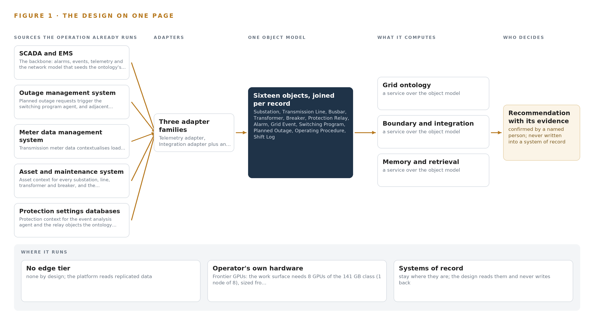
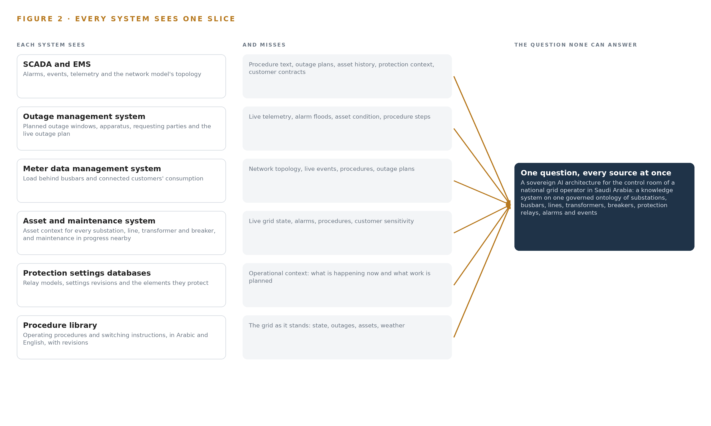
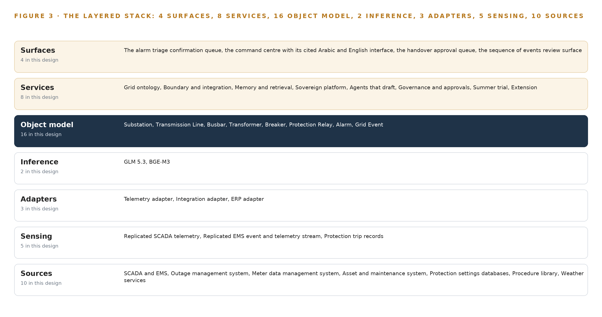
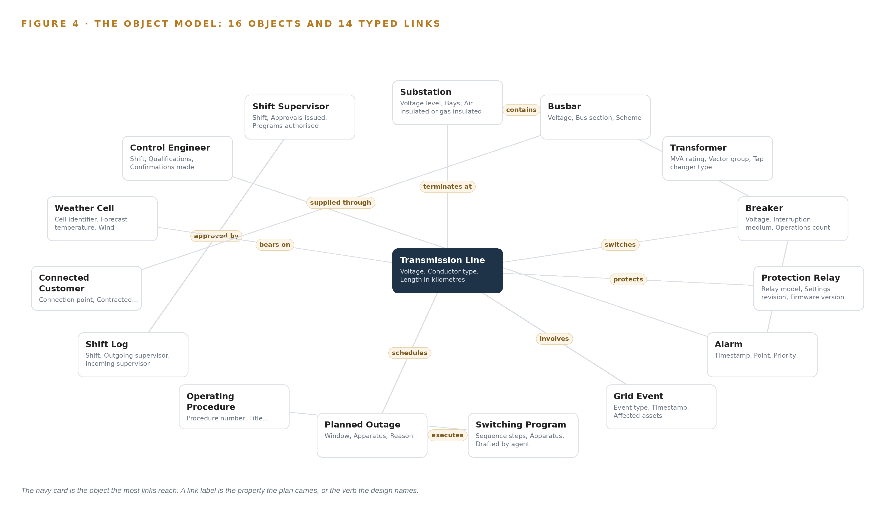
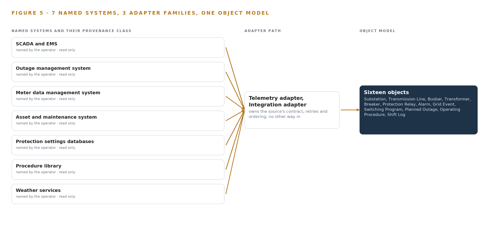
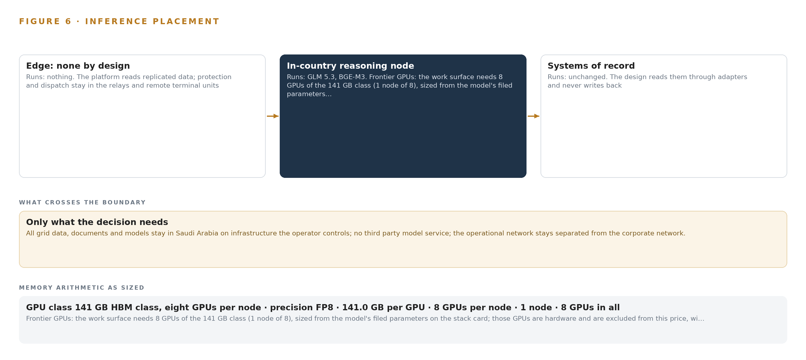
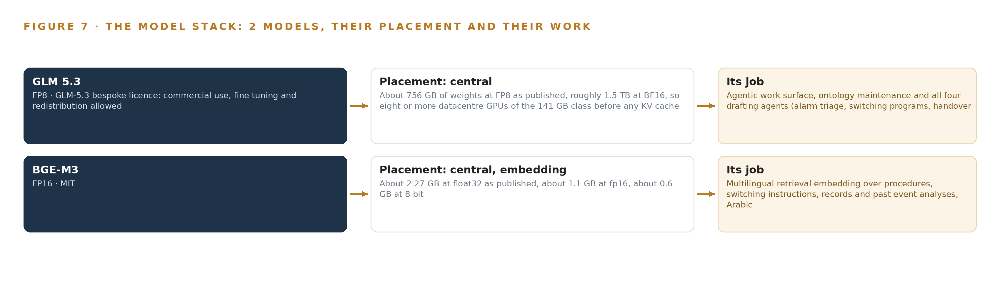
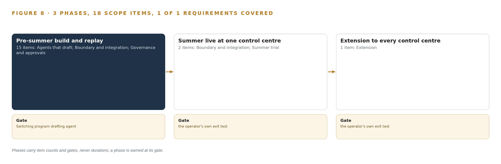
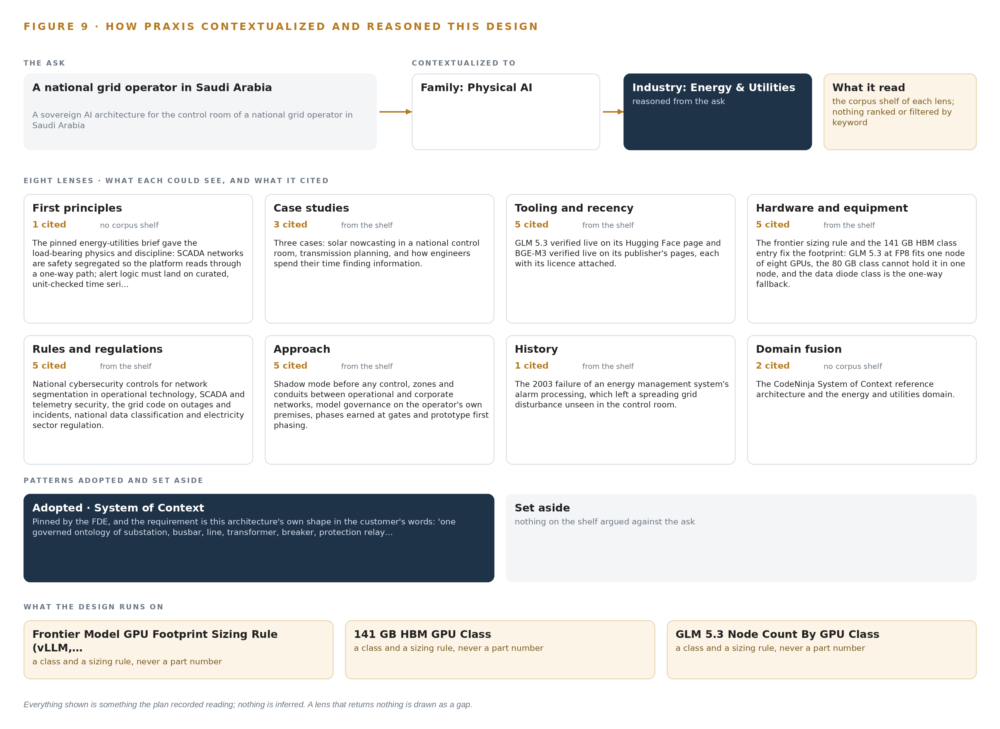

# Sovereign AI Architecture for a Grid Control Room in Saudi Arabia

Canonical: https://codeatoms.ai/grid-control-room-saudi-arabia/
DOI: https://doi.org/10.5281/zenodo.23889768
PDF: https://codeatoms.ai/grid-control-room-saudi-arabia/paper/grid-control-room-saudi-arabia.pdf
License: CC BY 4.0
Publisher: CodeNinja Atoms (https://codeatoms.ai), a fully owned subsidiary of CodeNinja

VERTICAL-DRIVEN ARCHITECTURES · ENERGY & UTILITIES · DESIGNED WITH PRAXIS · NOVEMBER 2026

# Sovereign AI Architecture for a Grid Control Room in Saudi Arabia

Energy & Utilities Watch: One Living Picture of the Operation

Muhammad Umar, Cofounder, CodeNinja

For the leaders accountable for energy & utilities operations, their supervisors, and the data and platform engineers who would build and run it.

---

Vertical-Driven Architectures is a CodeNinja series of system designs. Every design in the series is driven by a real-world problem and scenario in a single industry, and every one is designed on Praxis, CodeNinja's platform for designing physical AI systems. Operations are described by class, never by name.

At a glance

## Sovereign AI Architecture for a Grid Control Room in Saudi Arabia

**What this is.** An open reference architecture for system design in physical AI, built for a national grid operator in Saudi Arabia that runs the electricity transmission grid from regional and national control centers, where owning the inference node that runs it costs about 570,000 US dollars over three years. When one 380 kilovolt line trips at summer peak, the design joins the alarms, the network model, the outage plan, the protection record and the procedure library into one argument, so the control engineer sees which protection operated, what it affects, what work is already in progress nearby and which procedure governs the next step. The model runs entirely on the operator's own hardware under the national cybersecurity controls for operational technology, the grid code and export control on the GPU node. It is written for the leaders accountable for grid operations, their supervisors, and the data and platform engineers who would build and run it. The operator is described by class, never by name.

**The answer in numbers.**

| Part | The design |
| --- | --- |
| Sources | Ten read only systems of record, entering through three adapter families (telemetry, integration and ERP) behind a one-way replicated boundary that stamps every fact with the system it came from: SCADA and EMS, the outage management system, meter data management, the asset and maintenance system, the protection settings databases, the procedure library in Arabic and English, and weather services among them; the platform never sends a control command and never writes into a system of record |
| Object model | 16 typed objects with 13 typed links, from the substation, transmission line, busbar, transformer, breaker and protection relay through the alarm and grid event to the switching program, planned outage, shift log and operating procedure, with the weather cell, connected customer, control engineer and shift supervisor, seeded by the CIM export from the EMS network model and published as JSON for reuse |
| Models | GLM 5.3 (GLM-5.3 bespoke licence, 753B at FP8) for all four drafting agents (alarm triage, switching programs, handover and the sequence of events), the command center and ontology maintenance; BGE-M3 (MIT) for Arabic and English retrieval so every answer cites its procedure or record; no third party model service, nothing trained into weights |
| Compute | One node of eight 141 GB HBM cards (1,128 GB) in the operator's own data center in the Kingdom, holding 753 GB of FP8 weights with a 1.2 planning factor, 904 GB; BGE-M3 on the platform zone's rack server class; no edge tier. The node is a 4A090 class item for a D:3 and D:4 destination, so an export licence determination naming the end user is a phase one checkpoint before the order |
| Rollout | Three phases carrying 18 scope items (15, 2 and 1), each closed by a gate, never a date: a pre-summer build and replay whose gate is the switching program drafting agent run end to end on replayed records, one regional control center live through one summer, then extension gates for every control center; baselines frozen before go-live, headline measure trip to first correct action |
| Three-year cost | About 570,000 US dollars to own the node for three years (a range of 542,000 to 594,000: server, support and power at the national commercial electricity tariff), against about 751,000 to rent the same eight cards on the deepest three year commitment in AWS Middle East (UAE), so ownership costs about three quarters of it, and about 2.00 million on demand, against which ownership costs a little over a quarter. Renting is a price reference only, because AWS lists no Saudi region on the day read and every rented option would carry grid data across the border (Appendix A) |
| Human control | Agents draft and people decide, by name: the control engineer confirms the alarm triage ranking, the shift supervisor approves every switching program draft, the incoming supervisor approves the handover, and the event analysis is prepared for the protection engineer; disagreement is a first class path faster than agreement, and every confirmation is kept as memory the next shift reads |

**Reuse it.** The object model, the model register and the figures are free to reuse under CC BY 4.0. Cite as <https://codeatoms.ai/grid-control-room-saudi-arabia/.>

**Made with.** Reasoned on [CodeNinja Praxis](<https://codeatoms.ai/praxis/>), the CodeNinja Atoms platform for designing physical AI systems. The object model imports into [Hyper Ontology](<https://codeatoms.ai/hyper-ontology/>), which turns it into a living system. Load it with the [hyper-ontology loader](../hyper-ontology-py/): `hyper-ontology show grid-control-room-saudi-arabia`. Both are in beta; access by request.

ABSTRACT

## The Answer Already Exists in the Systems the Operation Runs

A sovereign AI architecture for the control room of a national grid operator in Saudi Arabia: a knowledge system on one governed ontology of substations, busbars, lines, transformers, breakers, protection relays, alarms, events, switching programs, planned outages, procedures, shift logs, connected customers and weather cells, each fact tied to its source system.

The design reads 10 source systems through 3 adapter families into one object model of 16 objects, runs 8 services over it and opens 4 surfaces to the people who decide, with 2 models placed where the data is. A sovereign system of context for one regional control center: a governed grid ontology built from the network model and the systems of record behind a one-way replicated boundary, four drafting agents for alarm triage, switching programs, handover and the sequence of events, whose drafts control engineers and supervisors confirm and approve, GLM 5.3 self hosted on one 141 GB class node in the operator's own Kingdom data center, and a summer trial gated on frozen baselines from trip to first correct action. Nothing is trained into weights, no control command is ever sent, and every fact, draft and approval traces to its source system and a named person.

The paper covers the operation and the problem its systems cannot answer, the constraints, the stack, the object model, ingestion, inference placement, the models and their licenses, the rollout and its proof, ownership, and finally how Praxis contextualized and reasoned the design.

---



Figure 1. Energy & Utilities Watch on one page: the sources the operation already runs, one object model, what it computes, and the person who decides.

## Contents

Each chapter is tagged for the reader it serves most directly: Executive, Team Lead, FDE, Reference.

|  |  |  |
| --- | --- | --- |
|  | Abstract · The Answer Already Exists in the Systems the Operation Runs | Executive |
| PART I · THE PROBLEM | | |
| 1 | [A Daily Question Goes Unanswered in the Systems That Hold the Data](#ch1) | Executive |
| 2 | [Every System Sees One Slice of the Operation](#ch2) | ExecutiveTeam Lead |
| PART II · THE DESIGN | | |
| 3 | [Four Constraints Shape Everything Downstream](#ch3) | Team Lead |
| 4 | [One Stack Runs From the Systems of Record to the Surfaces](#ch4) | Team LeadFDE |
| 5 | [Sixteen Objects Turn Operational Data Into One Argument](#ch5) | FDE |
| 6 | [Every Source Enters Through an Adapter, Never Directly](#ch6) | FDE |
| 7 | [Inference Belongs Where the Data Is](#ch7) | FDE |
| 8 | [The License Decides What the Operator Can Own](#ch8) | FDEExecutive |
| PART III · THE ROLLOUT | | |
| 9 | [Shadow Mode Comes Before Any Flag Is Trusted](#ch9) | Team LeadExecutive |
| 10 | [The Intelligence Should Stay with the Operation That Produced It](#ch10) | Executive |
| PART IV · HOW IT WAS DESIGNED | | |
|  | Conclusion · The Pattern Repeats Wherever Systems of Record Do Not Meet | Executive |
| 11 | [How Praxis Contextualized and Reasoned This Design](#ch11) | Team LeadFDE |
|  | [Sources](#sources) | Reference |

PART I · CHAPTER 1

## A Daily Question Goes Unanswered in the Systems That Hold the Data

The operation holds every fact the question needs and no system answers it.

The abstract promised a sovereign AI architecture that turns data an operation already holds into answers a named person can act on. This chapter states the question that system exists to answer, what answering it costs today, and the operation that will live with it.

### 1.1  The Question, the Data It Requires and the Regimes It Must Satisfy

Every shift in a transmission control room asks one question in a hundred forms: what just happened on the grid, what does it affect, and what must be done next within the rules. At its sharpest, when one 380 kilovolt line trips at summer peak, the question becomes a list with a clock on it: which protection operated and in what order, which busbars and connected operators now sit de-energized, what maintenance is already in progress on the affected apparatus, which procedure governs the switching that follows, and who must approve each step. The data that answers it all exists: alarms, events and telemetry from the SCADA and energy management systems, topology from the network model, outage windows from the outage management system, load behind busbars from meter data, asset condition, relay settings, the procedure library in Arabic and English, weather forecasts tied to the lines, the shift log, and the contracted sensitivity of every connected operator. The regimes it must satisfy are just as fixed: the operator's own rule that the operational network stays separated from everything else, national cybersecurity and communications controls that grade that network into segmentation zones, the grid code that governs outage planning, and a clear direction of international regulatory travel, from safety and security guidance for AI in critical infrastructure (DHS 2024) to an initial risk assessment of AI in energy infrastructure (Energy 2024) and a regulatory inquiry into utility AI use that begins by inventorying use cases and internal controls (NY 2026).

### 1.2  The Documented Cost of the Problem

Today the list is assembled by hand, and the industry has documented what that costs. An independent review of AI use in electricity networks, published by the UK government, was commissioned precisely because networks were adopting AI in fragments, without a joined view of risk and benefit across their operational systems (Service 2026). Researchers at a major energy company go further and argue that introducing AI into major accident hazard operations without a systemic safety risk assessment creates new accident risk rather than reducing it, because knowledge that lives in separate systems cannot be reasoned over safely (DOI 2025). At the console the cost is concrete rather than abstract: minutes spent finding what a joined query would return in seconds, adjacent work discovered by phone after switching has begun, and a connected operator's interruption sensitivity learned only when that operator calls.

### 1.3  The Operation as a Scenario

The scenario is a national grid operator in Saudi Arabia that runs the electricity transmission grid: the substations, busbars, lines, transformers and breakers that carry bulk power across the Kingdom, operated from control rooms at regional and national level. The first phase covers one regional control center for one summer, the season when peak load and peak heat coincide and the proving event, one 380 kilovolt line tripping at summer peak, is a realistic day rather than a worst case. Four roles are in the loop by name: the control engineer who confirms alarm triage, the shift supervisor who approves switching drafts, the incoming supervisor who approves the handover, and the protection engineer who receives the event analysis. The physical environment is the control center itself, a conditioned room watching remote substations and corridors, and the regulatory ground is national cybersecurity and communications controls together with the grid code. The design names ten source systems, three adapter families, sixteen ontology objects, eight services, four surfaces, two models and four drafting agents, arranged in three phases carrying eighteen items, every figure traceable to its source or marked as an assumption.

PART I · CHAPTER 2

## Every System Sees One Slice of the Operation

Each system of record sees its own part of the answer and none sees the whole.

Chapter 1 named the question and every piece of data it requires. This chapter shows where that data lives today and why no system of record can assemble the answer alone.

### 2.1  What Each System Sees

The SCADA and energy management systems are the backbone: they see every alarm, every event, the telemetry stream and the network model that describes how substations, busbars, lines and breakers connect, and they miss everything written down elsewhere, from procedure text and outage plans to asset history and operator contracts. The outage management system sees planned outage windows, the apparatus involved and the requesting parties, and misses the live state of the grid those windows sit inside. The meter data management system sees load behind busbars and what connected operators actually drew, and misses the topology that would explain it, along with alarms, procedures and outage plans. The asset and maintenance system sees the condition of every substation, line, transformer and breaker, and the maintenance already in progress nearby, and misses the grid as it stands right now. The protection settings databases see relay models, settings revisions and the elements each relay protects, and miss the operational context that would make a settings change meaningful. The procedure library sees the operating procedures and switching instructions, in Arabic and English with their revisions, and misses the state of the equipment they govern. Weather services see forecasts of temperature, wind and dust tied to lines and load at summer peak, and miss anything operational at all.

### 2.2  What None of Them Sees Together

The trip question crosses every one of these systems at once: the alarm and its sequence of events come from SCADA and EMS, the affected apparatus and its maintenance state from the asset system, the relay behavior from the protection databases, the restoration steps from the procedure library, the outage window from the outage plan, the load at risk from meter data, the thermal context from weather, and the sensitivity of who sits behind the busbar from the connection records. Figure 2 sets these views side by side and shows them converging on a question none can answer alone. In practice the control engineer is the join, working from memory, phone calls and window switching while an alarm flood is still arriving at summer peak; the handover is only as good as what the outgoing shift can recall; and the event analysis waits until the protection engineer can gather the pieces by hand. The cost is the minutes between the trip and the first correct action, and the adjacent work found too late.



Figure 2. Seven systems, each seeing one part of the answer. The question needs all of them in one place at once.

PART II · CHAPTER 3

## Four Constraints Shape Everything Downstream

The goals, the scoping decisions and the exclusions were fixed before any component was chosen.

Chapter 2 showed that the join failure, not any single system, is the problem. This chapter fixes the goals and exclusions that every component choice in Part II had to satisfy, and records what was weighed and set aside.

### 3.1  Inference Stays Sovereign

The first goal is that every token of reasoning runs on the operator's own hardware, in the operator's own data center in the Kingdom, on open weights the operator can hold. This is hard in this industry because the easy path is a managed service, and a managed service puts grid data and grid reasoning outside the boundary the operator is required to keep. The design therefore places all inference centrally: no edge compute, no field site serving, one frontier class model, GLM 5.3 at 753 billion parameters, served at FP8 precision where its weights occupy 753 gigabytes, held on a single node of eight GPUs of the 141 gigabyte class with the remainder left for the key value cache and activations.

### 3.2  The Boundary Is One Way and Read Only

The second goal is that the platform never sends a control command and never writes into a system of record. SCADA and EMS networks are safety segregated, and the operational technology segmentation zones, OTCC 2 to 4, together with the operator's own rule that the operational network stays separated, make any direct platform path into the control network a compliance breach rather than a shortcut. The design reads through a replicated historian or demilitarized zone feed into a separate AI platform zone, and a hardware-enforced data diode remains the committed fallback where the segmentation review demands demonstrably one-way flow, with forward error correction sized to the link because nothing can be resent.

### 3.3  Every Decision Has a Named Owner

The third goal is that agents draft and people decide, always by name. The alarm triage agent's ranking is confirmed by the control engineer, the switching draft by the shift supervisor, the handover by the incoming supervisor, and the event analysis is prepared for the protection engineer. This is hard in a control room because the temptation under pressure is to trust whichever answer arrives first, so the design makes the approval a first-class object with its own status vocabulary, and keeps an immutable record of every confirmed decision, which is also what regulators inventorying use cases and internal controls expect to find (NY 2026).

### 3.4  The System Improves Without Training

The fourth goal is that memory improves every shift without training a model. Nothing is fine tuned, trained or distilled into weights: agents improve through memory loops over confirmed decisions and event analyzes, each run reading what was decided before it acts. This is hard because fine tuning is the industry's reflex answer to improvement, but a moving model would invalidate the frozen baselines the summer trial is gated on, and the license terms that let the operator hold its weights carry conditions that a training pipeline would put under new scrutiny.

### 3.5  Scoping Decisions

The scope was fixed before any component was chosen, and each decision bought something at a known cost. Table 1 records the three decisions that bound the first phase: where the trial runs, which sources feed it and in what order, and how much compute the sovereign answer is sized on.

Table 1 · Scoping Decisions

| Decision | What it buys | What it costs |
| --- | --- | --- |
| One regional control center for one summer, with frozen baselines and gates | A trial the operator can stop cheaply at a gate, judged against baselines fixed before go-live | Evidence covers one center's workload until the extension gates open |
| Core sources first, with meter, asset and protection added during the season | The ontology build cannot slip past the summer window | Those systems' context arrives mid-trial and is integrated mid-summer |
| One node of the 141 GB GPU class at FP8 | The smallest single-node sovereign answer, with the export license question asked once, early | KV cache headroom bounded beside the weights for the trial workload |

### 3.6  What the Design Chose Against

Each of the goals above had credible alternatives, and Table 2 records what was picked, what it was picked instead of, and why. The final row marks the boundary of the work itself: the design is a read-only projection over the systems of record on the operator's own hardware, and everything beyond that projection is out of scope.

Table 2 · What the Design Chose Against

| Where | What was picked | Instead of, and why |
| --- | --- | --- |
| Frontier inference | One node of the 141 GB HBM class at FP8 serving GLM 5.3 | Two nodes of the 80 GB class, or one node of the 180 to 192 GB class: the smaller class needs two nodes and a fabric between them, and the larger buys key value headroom this control-room workload does not need |
| Access to operational data | A replicated historian or DMZ feed into the AI platform zone | Direct read-only links inside the operational network: the segmentation controls and the operator's own separation rule make any direct path a compliance breach rather than a shortcut |
| How the system improves | Memory loops over confirmed decisions, nothing trained into weights | Fine tuning GLM 5.3 on event and decision history: the ask is improvement without training, and a moving model would invalidate the frozen baselines |
| One-way enforcement | Replication now, with a hardware-enforced diode as the committed fallback | Software-only read-only links: where the segmentation review demands demonstrable one-way flow, only a diode shows it, with forward error correction sized to the link because nothing can be resent |
| Field sensing | Replicated telemetry and existing documents only | Cameras and new field hardware: no camera answers a control-room question, and the requirement adds none |
| Scope boundary | A read-only projection over the systems of record, on the operator's own hardware | Any control path into SCADA or EMS, model training, replacement of a system of record, or historic data migration: all out of scope, because the systems of record stay exactly where they are |

PART II · CHAPTER 4

## One Stack Runs From the Systems of Record to the Surfaces

Systems of record below, one object model in the middle, services and surfaces above.

Chapter 3 fixed the four constraints that shape everything downstream: data and weights stay inside the operator's boundary, no control command is ever sent, every draft is confirmed or approved by a named person, and a first gate can stop the work cheaply. This chapter lays out the stack that satisfies those constraints, stage by stage.

### 4.1  The Pattern and Why It Fits

The design uses the layered shape that a [sovereign AI architecture](https://codeatoms.ai/sovereign-ai-reference-architectures/) in critical infrastructure converges on: systems of record below, one object model in the middle, applications and agents above. Below sit the ten read-only sources the control room already trusts, among them SCADA and EMS, the outage management system, the asset and maintenance system, the protection settings databases, the procedures library and weather services. In the middle sits the grid ontology, sixteen objects joined by typed links and seeded by the CIM export from the EMS network model rather than assembled from documents. Above sit the eight services and four surfaces where the agents draft and the control engineers and shift supervisors decide.

The pattern fits because the control room's real problem is a join problem. When one 380 kilovolt line trips at summer peak, the question that matters spans the alarms, the network model, the outage plan, the protection record and the procedures library, and no single system of record holds that join. The pattern also fits the regulatory ground: safety and security guidance for critical infrastructure treats AI risk as something to govern before use (DHS 2024), and an independent review of AI in electricity networks found the binding constraint to be trustworthy data foundations under operator control (Service 2026). Figure 3 shows the layered stack with the count at each layer.



Figure 3. The layered stack: 10 sources, 3 adapter families, 16 objects, 8 services and 4 surfaces.

### 4.2  The Stack Stage by Stage

Table 3 walks the stack from sources to surfaces. Each stage carries one responsibility and named components, and each stage speaks only to its neighbors: sources never address the ontology, the ontology never addresses a surface, and nothing above the adapter tier ever touches a source system directly.

Table 3 · The Stack, Stage by Stage

| Stage | What it is responsible for | How |
| --- | --- | --- |
| Sources | Ten read-only systems of record, held exactly where they are | SCADA and EMS, outage management, meter data management, asset and maintenance, protection settings, the procedures library, weather services |
| Sensing | Turns physical and record reality into monitored signals | Replicated SCADA telemetry, the EMS event stream, protection trip records, platform heartbeat and data freshness signals, citation resolution checks on every answer |
| Adapters | Owns every contract; nothing reaches the model directly | Telemetry adapter, integration adapter, ERP adapter |
| Object model | Holds the join the systems never made | Sixteen objects with typed links, seeded by the CIM export from the EMS network model |
| Inference | Drafts, retrieves and ranks inside the boundary | GLM 5.3 at FP8 on one node of eight 141 GB class GPUs, BGE-M3 for multilingual retrieval |
| Services | Carries the eight platform capabilities | Grid ontology, boundary and integration, memory and retrieval, sovereign platform, agents that draft, governance and approvals, summer trial, extension |
| Surfaces | Where named people decide | Alarm triage confirmation queue, command center, handover approval queue, sequence of events review surface |

### 4.3  Where Each Layer's Choice Is Recorded

Every layer's component choice is recorded in Table 7, which the platform prints from the design record in Layer, Component, Choice and Why columns. Two entries are classes rather than products and are settled at design: the time series store for the replicated SCADA and EMS series is chosen against the historian's export format and scan rate, and the ontology or graph store class is fixed by what the sixteen objects and their links demand. The rest are committed by name, from the streaming backbone to the identity service, and the reasoning behind each row sits in the table.

Table 7 · Architecture, Layer by Layer

| Layer | Component | Choice | Why |
| --- | --- | --- | --- |
| Event streaming and messaging | by class, no product named | Product | Apache Kafka |
| The ontology or graph store | by class, no product named | Class | An ontology or graph store class, fixed by what the sixteen objects and their links demand |
| Time series and telemetry storage | InfluxDB 3 Core, TimescaleDB | Class | No product is committed yet: the platform zone needs a self hosted, openly licensed time series store for the replicated SCADA and EMS series, chosen at design against the historian's export format and scan rate. |
| Video ingest, recording and management | by class, no product named | Not needed | No cameras anywhere in this design: the control room problem is telemetry, records and documents, and the requirement adds no video. |
| Edge model serving | by class, no product named | Not needed | There is no edge: all inference runs centrally in the operator's own data center, and the platform consumes replicated data rather than serving models at field sites. |
| On site language model serving | by class, no product named | Product | VLLM |
| Object tracking and trajectory forecasting | by class, no product named | Not needed | Nothing moves in frame: there is no vision input, so there is nothing to track. |
| Edge orchestration of containers | by class, no product named | Product | Kubernetes |
| An air gapped artifact and model registry | by class, no product named | Product | Harbor |
| Labelling and retraining | by class, no product named | Not needed | Under system of context nothing is trained, fine tuned or distilled into weights: agents improve through its memory loops, which is the requirement's own ask ('How memory improves every shift without training a model'). |
| Time synchronisation across sensors and systems | by class, no product named | Product | Linuxptp with chrony |
| Observability of the running system | by class, no product named | Product | Prometheus, Grafana and Loki |

### 4.4  A Reusable Pattern

The reusable shape is the whole vertical slice: a replicated, read-only boundary out of the operational network; an adapter tier that owns every contract; one governed object model that joins the records; drafting agents that propose and named people who dispose; and weights the operator holds in its own data center. A team carrying a similar brief swaps the source systems, the object set and the model sized to its own budget, and keeps the rest unchanged, because the parts worth keeping are the ones that make a system safe to stand next to a control room: no write path into the systems of record, adapters owning contracts, and every decision tracing to a person.

PART II · CHAPTER 5

## Sixteen Objects Turn Operational Data Into One Argument

The object model is the join the systems never made.

Chapter 4 showed the stack's layers and what each is responsible for. This chapter opens the middle layer, where the design's whole claim rests: sixteen objects, joined by typed links, that turn the systems' separate records into one argument.

### 5.1  Sixteen Objects and the Links Between Them

The model holds sixteen objects in five kinds. Sites and assets: the Substation, the Transmission Line, the Busbar, the transformer, the breaker and the relay, each anchored in the network model or the asset system and each carrying the properties its system of record already holds, from thermal rating to settings revision. Events: the Alarm, anchored in SCADA, and the Grid Event, anchored in EMS. Records: the switching program, the Planned Outage and the shift log. Documents: the Operating Procedure, anchored in the procedures library. Measures and people: the weather cell, the Connected Operator, the Control Engineer and the Shift Supervisor.

The typed links are what make this more than a list. When the 380 kilovolt line trips, the triage reasoning starts at the alarm, reaches the line it references, the substations at both ends, the busbars behind them, the operators whose supply runs through those busbars, the relays that protect the line with their settings revisions, the procedures that govern restoring it, and the shift logs where the last comparable event was handled. A document store holds all of those facts as text and cannot walk them; the object model walks them in one traversal, which is the difference between a search result and an argument. Figure 4 shows every object and its typed links, with the alarm at the focal center, and Table 8 records, for every object, the system it is anchored in and the links the plan implies.



Figure 4. The sixteen objects of the model and the typed links that let a query reach across them.

Table 8 · The Object Model

| Object | Anchored in | Typed links |
| --- | --- | --- |
| Substation | The network (CIM export) | contains: Busbar |
| Transmission Line | The network (CIM export) | terminates at: Substation |
| Busbar | The network (CIM export) | connects: Transformer |
| Transformer | The asset and maintenance system | no typed link recorded |
| Breaker | The asset and maintenance system | switches: Transmission Line |
| Protection relay | Protection settings databases | protects: Transmission Line |
| Alarm | SCADA | references: Protection relay |
| Grid Event | EMS | involves: Transmission Line |
| Switching program | The outage management system | executes: Planned Outage |
| Planned Outage | The outage management system | schedules: Transmission Line |
| Operating Procedure | The procedures library | governs: Switching program |
| Shift log | Shift records kept by the supervisors | approved by: Shift Supervisor |

### 5.2  The Human Loop and the Hosting Posture

The human loop lives in the status vocabularies and the links to people. An alarm moves from Raised to Acknowledged only under the control engineer's confirmation; a switching program moves from Drafted to Approved only under the shift supervisor; a shift log is approved by the incoming supervisor, not the outgoing one. Regulators are moving toward exactly this discipline, inventorying utility AI use cases and their internal controls (NY 2026), and sector guidance on ethical AI treats named human accountability as a condition of use, not a courtesy (OFGEM 2026).

The hosting posture follows the same line. Everything runs in the operator's own data center in the Kingdom: the ontology, the memory, the weights and the surfaces. Identity is issued inside the boundary, so no decision is attributable to an account the operator does not control. The one external input, weather services, enters through the integration adapter as data on a schedule, never as a live call the model makes on its own. The single write path anywhere in the design is the recorded confirmation or approval, written into the object model and the memory service, and never into any system of record.

### 5.3  One Object in Its Recorded Form

The substation record below shows the id, label, kind, properties and status vocabulary the platform prints for every object; the breaker, which carries the trip in the simulated event, is recorded the same way.

```
{ "id": "substation", "label": "Substation", "kind": "site", "anchored_in": "The network (CIM export)", "properties": [ "Voltage level", "Bays", "Air insulated or gas insulated", "Region", "Single line diagram reference" ], "status_vocabulary": [], "links": [ { "to": "busbar", "label": "contains" } ] }
```

PART II · CHAPTER 6

## Every Source Enters Through an Adapter, Never Directly

Nothing reaches the object model except through an adapter that owns its contract.

Chapter 5 described what the object model holds. This chapter describes how data gets into it: through three adapter families and an event backbone, and by no other route.

### 6.1  Every Source and Its Provenance Class

Ten sources feed the platform, all read-only, all of operator provenance, meaning every fact they contribute carries the name of the system it came from. SCADA and EMS is the backbone: alarms, events, telemetry and the network model that seeds the ontology's topology, read through the replicated boundary and never commanded. The outage management system supplies the planned outage requests that trigger the switching program agent and the live outage plan its adjacent work checks read. Meter data management contextualises load behind busbars and connected operators, and joins during the summer under the phasing the intake set. The asset and maintenance system gives every substation, line, transformer and breaker its asset context, including the maintenance already in progress nearby that a switching draft must respect. Protection settings databases supply the relay context the event analysis agent reasons from. The procedures library is the corpus every answer and every switching draft must cite, in Arabic and English. Weather services tie forecast cells to lines and load at summer peak. The remaining sources enter on the same contracts as the phasing allows. Figure 5 shows each named system, its provenance class and its adapter path into the object model.



Figure 5. The 10 named systems, the adapter path each one takes, and the object model they all map into.

### 6.2  What the Adapter Tier Guarantees

Three adapter families own every contract. The telemetry adapter carries the replicated SCADA and EMS series into the time series store. The integration adapter carries documents and records: outage plans, protection settings, procedures, weather. The ERP adapter carries asset, maintenance and meter data from the operator's enterprise systems. Together the tier guarantees four things. Schema and unit checking, so alert logic lands on curated, unit-checked series rather than raw tags. One-way flow, so no path exists from the platform back into the operational network. Provenance stamped on every fact at the moment it lands, so any answer can be traced to its source system. Citation resolution and freshness checks on every answer, so a draft that cites a superseded procedure or a stale feed is caught before a person reads it. This discipline is the operational answer to the risk picture the US Department of Energy drew in its initial assessment of AI in critical energy infrastructure (Energy 2024): the guardrail is architectural, not procedural.

### 6.3  The Event Backbone

Apache Kafka carries everything between the adapters and the platform. Ordering is per partition, keyed by point or asset, so any one telemetry point's series arrives in order even when the flood is wide. Delivery is at least once with idempotent writes into the time series store, so a replayed record cannot double count an alarm or an event. Buffering absorbs alarm floods, which arrive in bursts, and lets the platform drain at its own pace rather than at the SCADA scan rate. Replication runs inside the platform zone, so the loss of a broker node costs availability, not data. The retained log is also the replay mechanism: the pre-summer phase validates the triage agent on the operators' own recorded floods by feeding them back through the same backbone. Time is held by linuxptp with chrony, disciplined by a GNSS PTP grandmaster with holdover, so alarms, events and telemetry from different systems can be placed in one sequence of events, which is the evidence the event analysis agent drafts from and the protection engineer reviews.

PART II · CHAPTER 7

## Inference Belongs Where the Data Is

Each tier runs what its data and its link can carry.

Chapter 6 followed every source through its adapter into the event backbone inside the AI platform zone. This chapter decides where the models that read that backbone run, what each tier must hold in memory, and what the placement owes the control room when the link, the power or the update path fails.

### 7.1  Two Central Tiers and a Deliberately Empty Edge

The design has two inference tiers and both are central: a frontier tier that carries GLM 5.3 for all four drafting agents, the command center surface and ontology maintenance, and an embedding tier that carries BGE-M3 for retrieval over procedures, records and past event analyzes. Both run in the operator's own data center in the Kingdom, on the operator's own hardware. The absent edge tier is a decision rather than an omission: the platform consumes replicated data instead of serving models at field sites, and fast protection and dispatch decisions stay in the relays and remote terminal units where they have always lived.

The memory arithmetic fixes the frontier tier. GLM 5.3 is filed at 753 billion parameters, and at FP8 precision one byte per parameter gives 753 GB of weights; multiplying by the 1.2 planning factor for KV cache and activations gives 904 GB the GPUs must hold. One node of eight GPUs of the 141 GB class gives 1,128 GB, which carries the weights with 375 GB left beside them, well above the 151 GB the planning factor reserves. That spare capacity is the KV cache ceiling, the memory that holds each in-flight request's context, and it is what buys concurrent served requests during an alarm flood. The embedding tier is small by comparison: BGE-M3 at FP16 is about 1.1 GB of weights, running on the platform zone's dual-socket x86 rack server class beside the ontology, streaming and retrieval services. Figure 6 sets the two tiers side by side, with what runs on each and what crosses into them.



Figure 6. Where each tier runs, what runs there, and the narrow set of outputs that cross the boundary.

### 7.2  The Latency Budget

The budget is built on the control room's own rhythm rather than a single number, because the human terms dominate it. In order, the terms are replication lag across the one-way boundary, then retrieval, then generation, then the named person's confirmation. Replication lag bounds the alarm triage agent, which must rank a flood while the flood is still unfolding, and the embedding tier's small footprint keeps the retrieval term short. Generation is the longest machine term, and the design spends it where the work tolerates it: an event analysis draft for the protection engineer can take the time a careful engineer would take, and a handover draft is bounded by the end of shift window rather than by seconds. Stated as an ordering, nothing the machine does may outrun the freshness of the replicated stream, and nothing the machine does substitutes for the confirmation that closes the loop.

### 7.3  What Crosses the Boundary, and What Happens When It Fails

Everything that crosses the network boundary crosses in one direction: replicated SCADA telemetry and alarms, EMS events and the network model, outage plans, asset and protection records, the procedure library, meter data and weather forecasts flow into the AI platform zone, and nothing flows back. No agent sends a control command, no agent issues a switching instruction without a named approval, and the platform holds no write path of any kind into SCADA or EMS. The advisory placement is also the safety argument: guidance for critical infrastructure owners treats an AI system that can act on physical plant as a materially different risk from one that advises a named person (DHS 2024), and work on major accident risk argues that AI placed inside safety-critical loops demands systemic assessment the advisory placement avoids (DOI 2025).

Failure is designed for rather than hoped away. If the link fails, platform heartbeat and data freshness signals mark every surface stale, and the control room keeps operating on SCADA and EMS directly because the platform was never in the control path; the degraded-mode procedure is written down and rehearsed before summer go-live. If power fails, the conditioned data center room restarts the services and the event backbone replays what was buffered, so the platform resynchronizes rather than loses the record. If the update path fails, models and artifacts move through the Harbor registry as staged, signed images, and the platform keeps serving the last verified version until the path returns. A named owner watches these signals, because the US Department of Energy's initial risk assessment on AI in critical energy infrastructure stresses governance and accountability from the start rather than after an incident (Energy 2024).

PART II · CHAPTER 8

## The License Decides What the Operator Can Own

Every model was chosen against its license before its accuracy.

Chapter 7 fixed where inference runs and what each tier holds in memory. This chapter fixes which models run there, and on what terms the operator can hold them, because the license decides the ownership before the benchmark decides the accuracy. Figure 7 opens the chapter: the model stack, with the frontier reasoning model above and the multilingual embedding model beneath it, each carrying its specification, its placement and its job.



Figure 7. The two models, their placement, and the work each one does.

### 8.1  GLM 5.3 on Terms That Let the Operator Hold Its Weights

GLM 5.3 is the register's frontier model, filed at 753 billion parameters, with about 756 GB of weights at FP8 as published and roughly 1.5 TB at BF16; the design serves it at FP8 on one node of eight 141 GB class GPUs in the operator's own Kingdom data center. Its role spans the agentic work surface, ontology maintenance and all four drafting agents: alarm triage on a flood, the switching draft on a planned outage request, the handover draft at end of shift and the event analysis draft on a protection trip. Its license is the GLM-5.3 bespoke license: commercial use, fine tuning and redistribution are allowed, with an attribution notice to carry and a trigger that applies only where a group's revenue rises above 10 billion US dollars from managed access services. Internal control-room use does not reach that trigger, and procurement reads the license and confirms the group position in writing before contract. The model was chosen first because it is the one frontier-class model in the register, and second because its license lets the operator hold the weights itself; the design trains nothing into weights, so the fine-tuning right matters as ownership rather than as a training plan. That ownership is what regulators are beginning to ask about: one state commission has opened an inquiry into how utilities use AI, starting from an inventory of use cases and internal controls (NY 2026), and the British energy regulator's guidance on ethical AI in the sector asks operators to account for the systems that shape their decisions (OFGEM 2026). A stack whose weights, memory and decision record sit inside the operator's boundary answers those questions in one place.

### 8.2  BGE-M3 Under MIT for Arabic and English Retrieval

BGE-M3 is the register's embedding model, a multilingual retrieval model that indexes the procedure library, switching instructions, records and past event analyzes in Arabic and English. Its footprint is about 2.27 GB at float32, about 1.1 GB at FP16 and about 0.6 GB at 8 bit; the design serves it at FP16 on the platform zone's rack server class, where its retrieval latency sits inside the fast path of the budget Chapter 7 set out. Its MIT license lets the operator hold, run and redistribute it without obligation, which is why it was chosen against the license before its accuracy was weighed. Its accuracy is still proven before trust: retrieval recall over the operator's own Arabic procedures is evaluated as part of the frozen evaluation set before summer go-live, because a cited answer that misses the right procedure is worse than no answer at all.

### 8.3  The Model and Equipment Register

Table 4 gathers what Chapter 7 and this chapter have fixed into one register: each model, the hardware classes and sizing rules that place it, the sensing the platform watches, the patterns the design stands on, and the ground everything runs on. Each row is a decision already argued in the body; the table exists so an engineer ordering hardware or clearing licenses can read the whole position at once.

Table 4 · Model and Equipment Register

| The choice | What was picked | Why here |
| --- | --- | --- |
| Reasoning model | GLM 5.3, filed at 753B parameters, served at FP8 | The register's one frontier-class model, held under a license permitting commercial use, fine tuning and redistribution |
| Embedding model | BGE-M3, about 1.1 GB at FP16 | Multilingual Arabic and English retrieval over procedures and records, held under MIT without obligation |
| Frontier sizing rule | Frontier Model GPU Footprint Sizing Rule, vLLM and SGLang | Fixes weights, KV cache and activations against usable memory before any node is ordered |
| GPU class | 141 GB HBM class, eight GPUs per node | Carries GLM 5.3's 753 GB of FP8 weights on one node, the smallest single-node sovereign answer |
| Node count rule | GLM 5.3 Node Count By GPU Class | Holds the sizing at one node so the export license question is asked once, early |
| One-way transfer | Data diode class with forward error correction | Committed fallback where the segmentation review demands demonstrable one-way flow |
| Serving runtime | vLLM | Serves the FP8 weights within the KV cache ceiling the sizing reserves |
| Registry | Harbor | Air-gapped artifact and model registry, so updates are staged and signed inside the boundary |
| Sensing | Replicated SCADA and EMS streams, protection trip records, heartbeat and freshness signals, citation resolution checks | The platform watches its own data freshness and checks the citations on every answer |
| Memory pattern | Memory loops over confirmed decisions, nothing trained into weights | The requirement asks that memory improve every shift without training a model |
| Validation pattern | Replay of the operators' own recorded alarm floods | Trust is built on the control room's own history before summer go-live |
| Topology pattern | CIM import from the network model seeds the ontology | Topology comes from the model of record rather than assembled from documents |

PART III · CHAPTER 9

## Shadow Mode Comes Before Any Flag Is Trusted

The rollout earns each phase at a gate the operator can read.

Chapter 8 fixed the model register and the license terms under which the operator holds its own weights. This chapter sets out how the build earns each stage of the rollout: three phases closed by gates the operator can read, with every measurement named and frozen before the summer starts.

### 9.1  Phases, Workstreams and Exit Gates

The rollout carries 18 items across three phases, and requirement coverage stands at one requirement covered in full, with nothing partial and nothing open. Figure 8 shows the phases, their item counts, their workstreams and the gates between them. Phase one, the pre-summer build and replay, carries 15 items across six workstreams: the grid ontology, boundary and integration, memory and retrieval, the agents that draft, governance and approvals, and the sovereign platform. Its items include the ontology built from the systems of record, the one-way boundary from the operational network, and telemetry ingestion on curated series. Its exit gate is the switching program drafting agent, the workflow that chains a planned outage request through topology, procedure citation, adjacent-work checks and supervisor approval end to end on replayed records, before anything runs live. Phase two, summer live at one regional control center, carries 2 items across boundary and integration and the summer trial: the phased integration of the remaining source systems during the season, and live operation at one regional control center through one summer. Phase three, extension to every control center, carries a single item, the extension gates that decide whether the design spreads beyond the first center. No phase carries a duration; each closes on evidence, not on a calendar.



Figure 8. The three phases and their gates, and coverage of the one requirement across them.

### 9.2  What the Rollout Measures

Every baseline is frozen before go-live, and the headline measure is the interval from trip to first correct action, exercised against the design's simulated event: one 380 kilovolt transmission line tripping at summer peak. Around the alarm triage agent the rollout measures alerts surfaced per shift against the alert budget, confirmation time in the triage queue, and how often engineers take the disagreement path rather than confirming a ranking they doubt. Around the drafting agents it measures citation resolution on every answer, retrieval recall over the operator's own Arabic procedures, and adoption as a gate in its own right: the share of drafts confirmed unchanged against the share edited or rejected. Replay validation runs on the operators' own recorded alarm floods before go-live, so the first live flood is not the first test. Platform heartbeat and data freshness signals run throughout. The measurement-first posture follows published guidance for this infrastructure class: safety and security guidelines for owners and operators (DHS 2024), an initial risk assessment on AI in critical energy infrastructure (Energy 2024), and an independent review of AI use in electricity networks that asks for evidence before scale (Service 2026).

### 9.3  Failure Modes

Table 5 states what fails and what the design does about each failure.

Table 5 · Failure Modes

| What fails | What the design does |
| --- | --- |
| Control engineers do not trust the triage rankings and quietly work around them | Replay validation on the operators' own recorded floods before go-live, an alert budget per shift, a first-class disagreement path faster than agreeing, and adoption measured as a gate in its own right |
| The ontology build across the systems of record slips past the summer window | Core sources first (SCADA, EMS, outage management, procedures) with meter, asset and protection added during the season, and the CIM import from the network model seeding topology rather than assembling it from records |
| The 141 GB class GPU node is delayed by export license timelines outside the vendor's control | A license determination naming this end user as a phase one checkpoint before the order is placed, and the sizing held at one node so the license question is asked once, early |
| Arabic retrieval recall over the procedures is unproven and cited answers miss the right procedure | BGE-M3 retrieval evaluated on the operator's own Arabic procedures before go-live as part of the frozen evaluation set, with a human check stage on every switching draft |
| GLM 5.3's license obligations are not cleared for the operator's corporate group | Internal control-room use does not trigger the managed-service clause, and procurement reads the license and confirms the group position in writing before contract |
| No named owner for the platform after go-live, so health signals fire into a vacuum | Platform ownership, on-call and the degraded-mode procedure agreed and rehearsed before summer go-live, with the support interface between platform staff and the control room written down |

### 9.4  Lessons

**Shadow the flags before anyone trusts them.** The triage agent earns its place on replayed alarm floods from the operator's own historians before any live shift sees a ranking, and adoption is measured as a gate in its own right. Work on systemic safety risk argues that new failure paths appear at the joins between human and machine judgement (DOI 2025), and replay is how those joins are inspected before the summer rather than during it.

**Ask the license question once, early.** The sizing holds at one node of the 141 GB class precisely so the export license determination is asked once, naming this end user, before the order is placed; a two-node answer would ask the same question twice and double the exposure to timelines nobody controls.

**Make disagreement faster than agreement.** If disputing a doubtful ranking takes longer than confirming it, engineers will confirm, and the summer will measure politeness instead of accuracy; the disagreement path is therefore a first-class control whose usage is counted alongside confirmation time.

### 9.5  What Is Still Open

Four questions remain open, and settling each changes a parts list or a gate. Which self hosted time series store carries the replicated SCADA and EMS series is chosen at design against the historian's export format and scan rate, and settling it fixes the telemetry tier. Whether the segmentation review demands the hardware diode in place of the replicated feed decides the boundary's components and its forward error correction budget. Whether Arabic retrieval meets the recall bar on the operator's own procedures decides whether the human check stage stays a permanent cost on every switching draft. Whether feeder risk ranking and outage prediction clear the summer evidence decides the shape of the extension gates in phase three.

PART III · CHAPTER 10

## The Intelligence Should Stay with the Operation That Produced It

What the design builds belongs to the operator.

Chapter 9 showed the gates at which the rollout earns each phase. This chapter states who holds what those gates protect: the model, the record and the boundary.

### 10.1  What the Operator Owns

The object model is the operator's. Its 16 objects and typed links are a projection over the operator's own systems of record, never a migration or a shadow copy that competes with them, and the vocabulary, property lists and status sets are the operator's people's to extend and govern. The weights are the operator's. GLM 5.3 runs self hosted on one 141 GB class node in the operator's own data center in the Kingdom, under a license that allows commercial use, fine tuning and redistribution; the operator may hold, patch and resynchronize the weights without asking anyone's permission, subject to the attribution notice and the managed-service trigger above 10 billion US dollars of group revenue, which internal control-room use does not touch. No fine-tune exists by design: memory improves every shift without training a model, so there is no forked weight set to reconcile at any future date. The decision record is the operator's. Every confirmed decision, draft and approval traces to its source system and a named person, and the record is kept as memory the next decision reads; it is the operation's own history, not a corpus held elsewhere. The boundary is the operator's. The one-way replicated path from the operational network into the platform zone, with the hardware diode as the committed fallback where the segmentation review demands demonstrable one-way flow, is a control the operator owns and can demonstrate to its regulator. The design sits squarely in the family of sovereign AI reference architectures: intelligence that stays inside the boundary of the operation that produced it.

### 10.2  The Offer Behind the Design

CodeNinja builds this shape as its offer. Adaptive Operations covers the sensing and detection of physical behavior over the replicated telemetry streams and curated series; Decision Systems covers the rankings, attributions and drafts that a named person decides; Hyper Ontology holds the governed object model this design is built on; Hyper Pragma is the command center and the cited Arabic and English conversational interface, the surface where the operator's people build and run their own agents; Hyper Engram keeps the record of decisions and outcomes that each run reads before it acts; Sovereign Infrastructure covers own hardware, open-weight licenses and in-country operation in the operator's own Kingdom data center; and the design itself was produced on Praxis, the platform for designing physical AI systems.

PART IV · CONCLUSION

## The Pattern Repeats Wherever Systems of Record Do Not Meet

Seen whole, the design is one object model over the systems a national grid operator in Saudi Arabia already runs, with inference placed where the data is and every decision left to a named person.

Running the same shape elsewhere takes the same four things: the named systems, an object model anchored in them, a first gate that can stop the work cheaply, and the license posture that lets the operator own what it learns.

PART IV · CHAPTER 11

## How Praxis Contextualized and Reasoned This Design

Every choice above traces back to something Praxis recorded reading.

Chapter 10 closed the ownership argument by naming the offer behind the design. Every design in this series is produced on Praxis, and this chapter lets a reader trace any choice above back to what justified it (Figure 9).

### 11.1  Contextualizing the Ask

The ask, as the operator stated it, was a sovereign knowledge system for a national electricity transmission grid control room: one governed ontology over substation, line, transformer, breaker, alarm, event, outage, procedure and shift data, reading SCADA, EMS, outage management, meter data, asset and protection systems and the procedure library, never sending a control command, with four drafting agents confirmed by named people, a cited Arabic and English conversational interface, and reasoning self hosted in the Kingdom. Praxis assigned it the Vertical-Driven Architectures family in the Energy & Utilities industry, with the country stated by the operator's own requirement. What Praxis read: the case study, tooling, hardware, rules, approach and history shelves, together with the pinned energy and utilities brief and the platform's own ontology specification at version 0.9. The two models were verified live on their public pages, GLM 5.3 and BGE-M3, each with its license attached, so no specification in this paper rests on a secondary description.



Figure 9. From the ask to the design: the family and industry Praxis assigned, the eight lenses and what each cited, the patterns adopted and set aside, and the equipment the design lands on.

### 11.2  The Lenses

Table 6 states what each of the eight lenses could see, what it cited and what it contributed. The rules lens read the regulator guidance now shaping this sector, from ethical AI guidance for energy (OFGEM 2026) to a public service commission's inventory of utility AI use (NY 2026), and fed the auditable decision trail and the named human decision that run through every chapter above.

Table 6 · The Lenses and What They Contributed

| Lens | Could see | Cited | What it contributed |
| --- | --- | --- | --- |
| First principles | no corpus shelf | 1 | The pinned energy and utilities brief gave the load bearing physics and discipline: SCADA networks are safety segregated, so the platform reads through a one-way path, and alert logic must land on curated, unit checked time series. |
| Case studies | the case study shelf | 3 | Three cases: solar nowcasting in a national control room, transmission planning, and how engineers spend their time finding information. |
| Tooling and recency | the tooling and recency shelf | 5 | GLM 5.3 verified live on its Hugging Face page and BGE-M3 verified live on its publisher's pages, each with its licence attached. |
| Hardware and equipment | the hardware and equipment shelf | 5 | The frontier sizing rule and the 141 GB HBM class entry fix the footprint: GLM 5.3 at FP8 fits one node of eight GPUs, the 80 GB class cannot hold it in one node, and the data diode class is the one-way fallback. |
| Rules and regulations | the rules and regulations shelf | 5 | The national cybersecurity controls for network segmentation in operational technology, SCADA and telemetry security, the grid code on outages and incidents, national data classification, and electricity sector regulation. |
| Approach | the approach shelf | 5 | Shadow mode before any control, zones and conduits between operational and corporate networks, model governance on the operator's own premises, phases earned at gates, and prototype first phasing. |
| History | the history shelf | 1 | The 2003 failure of an energy management system's alarm processing, which left a spreading grid disturbance unseen in the control room. |
| Domain fusion | no corpus shelf | 2 | The CodeNinja System of Context reference architecture and the energy and utilities domain. |

### 11.3  Patterns Adopted and Set Aside

Four patterns were adopted. The CIM import from the network model seeds the ontology's topology rather than assembling it from records; the replicated historian feed replaces any direct platform path into the control network; memory loops replace fine tuning, because the ask itself demanded improvement without training; and core sources first, with meter, asset and protection phased in during the season, protects the summer window. Four were set aside with reasons. Two nodes of the 80 GB class were rejected because they add an RDMA fabric to a footprint one 141 GB class node already holds; direct read-only links inside the operational network were rejected as a compliance breach rather than a shortcut; fine tuning GLM 5.3 on event history was rejected against the ask's own words; and edge serving, cameras and tracking were rejected because the requirement's world is control-room work over telemetry and documents.

### 11.4  Where the Reasoning Lands

The reasoning lands on four equipment classes: the frontier model GPU footprint sizing rule that fixes FP8 weights against usable memory, the 141 GB HBM GPU class, the GLM 5.3 node count by GPU class, and the data diode one-way transfer class held as the committed fallback. Everything shown in this chapter was recorded reading: the ask, the records read, the lenses and the patterns are what Praxis read and filed, and nothing in the design is inferred beyond them.

Appendix A

## What the Operator's Own Inference Node Costs Over Three Years

The paper is written for a national grid operator in Saudi Arabia, with every model running in the operator's own data center in the Kingdom (chapter 1, section 1.3; chapter 3, section 3.1). This appendix therefore prices for Saudi Arabia, with the national commercial electricity tariff for power and the AWS Middle East (UAE) region, me-central-1, as the rental reference. The design's frontier tier is "one node of eight GPUs of the 141 GB class" serving GLM 5.3 at FP8 on vLLM (chapter 7, section 7.1; Table 4, "GPU class" and "Serving runtime"). The second model needs no further hardware line: BGE-M3 is "about 1.1 GB of weights, running on the platform zone's dual-socket x86 rack server class beside the ontology, streaming and retrieval services" (chapter 7, section 7.1; Table 4), and the paper does not size that server class, so nothing is added for it rather than a server guessed. The node is priced two ways: owned, from a reseller's published configured price with support and power added, and rented, from the AWS price files for the nearest region that offers the same card, on demand and on the two three year all upfront plans. Every input is dated and cited, and the arithmetic is shown.

### A.1 The Answer

Owning the node for three years costs **about 570,000 US dollars**, inside a range of 542,000 to 594,000. Renting the same eight H200 cards around the clock costs **about 751,000 dollars** on the deepest three year commitment (an AWS EC2 Instance Savings Plan, all upfront, for p5en.48xlarge in Middle East (UAE)), **about 1.33 million dollars** on the three year Compute Savings Plan, all upfront, and **about 2.00 million dollars** on demand. Against the deepest commitment, ownership costs **about three quarters** (569,988 / 750,535 = 0.76, and 0.72 to 0.79 across the range); against on demand, a little over a quarter (569,988 / 1,996,103 = 0.29). No rented option can sit inside the Kingdom today: AWS's Saudi region is scheduled to open by December 2026 (W.Media 2026) and its price files list no Saudi region on the day read (AWS 2026a), and every rented option would carry grid telemetry, alarms, procedures and the decision record across the border, which the design's own rule that grid data and grid reasoning stay inside the operator's boundary rules out (chapter 3, section 3.1; chapter 5, section 5.2). Renting is therefore a price reference only. GLM 5.3 carries the GLM-5.3 bespoke licence, under which "commercial use, fine tuning and redistribution are allowed", with an attribution notice and a trigger above 10 billion US dollars of group revenue from managed access services that internal control room use does not reach (chapter 8, section 8.1); no price is asserted for it here. BGE-M3 (MIT) carries no licence line (chapter 8, section 8.2).

### A.2 What the Hardware Would Cost

| Option | Basis | Three year cost (USD) |
| --- | --- | --- |
| Owned, in the operator's own data center | One 8x H200 node with support and power, broken out below | 542,000 to 594,000, typical 570,000 |
| AWS, Middle East (UAE), on demand | p5en.48xlarge, eight H200 cards, 1,128 GB of HBM3e (AWS 2026c), at 75.9552 dollars an hour (AWS 2026b), 26,280 hours; outside the Kingdom | 1,996,103 |
| AWS, Middle East (UAE), three year Compute Savings Plan, all upfront | p5en.48xlarge at 50.66046 dollars an hour (AWS 2026a), 26,280 hours; outside the Kingdom | 1,331,357 |
| AWS, Middle East (UAE), three year EC2 Instance Savings Plan, all upfront | p5en.48xlarge at 28.55916 dollars an hour, the deepest three year plan for this instance in the region (AWS 2026a), 26,280 hours; outside the Kingdom | 750,535 |

The purchase option priced as the rental reference is the three year EC2 Instance Savings Plan, all upfront, the lowest three year rate the me-central-1 file lists for p5en.48xlarge (the partial upfront and no upfront three year Instance plans list 30.38208 and 32.81265 dollars an hour). Egress, storage of the mirrored record and the network link to the region are excluded, and the all upfront plans are paid in full on day one, so every rented figure is a floor.

The owned line, item by item:

| Line | Basis | Three year cost (USD) |
| --- | --- | --- |
| Node | Thinkmate GPX GXS5-2508-8HGX-H2, 5U, NVIDIA HGX H200 with eight H200 SXM5 cards (1.1 TB of HBM3), two Intel Xeon Platinum 8558 processors of 48 cores and 330 W each, 32 x 32 GB of DDR5 memory, 3000 W 4+2 redundant power and a three year depot warranty, the configurator's default build: barebone 309,855, processors 2 x 5,584, memory 32 x 2,688, assembly and testing 330, warranty 45, a configured price of 407,660 dollars (Thinkmate 2026) | 407,660 |
| Support | 8 to 12 percent of hardware value a year (Introl 2026), 10 percent typical, over three years | 97,838 to 146,758, typical 122,298 |
| Power | The paper states no power figure for the node, so this line takes the 10.2 kW maximum NVIDIA gives for its own eight H200 system (NVIDIA 2026b): 10.2 kW x 26,280 hours = 268,056 kWh, times a power usage effectiveness of 1.6 (above the 1.54 industry average, Uptime Institute 2025) = 428,890 kWh, about 11,914 kWh a month, which sits in the commercial tier above 6,000 kWh a month: 32 halalas per kWh today and 35 halalas from 1 January 2027, both excluding VAT (Tariff 2026a; Tariff 2026b), at 3.75 riyals to the dollar (SAMA 2026) | 36,599 to 40,030, typical 40,030 |
| **Total** | Low: 8 percent support, today's tariff. High: 12 percent, the 2027 tariff. Typical: 10 percent, the 2027 tariff, because the node is ordered only after the export licence determination and its three years run under the 2027 schedule | **542,097 to 594,447, typical 569,988** |

The power line is a ceiling: it takes the system maximum around the clock, against an H200 card's "up to 700W" (NVIDIA 2026a), and a control room work surface will rarely hold eight cards at full draw outside an alarm flood. It also prices every kilowatt hour at the upper commercial tier, which is right if the room shares a meter with other loads; a dedicated meter would bill the first 6,000 kWh a month at 22 halalas today and 25 from 2027, and would add the 2027 fixed charge of 350 to 900 riyals a month by breaker size, at most 8,640 dollars over three years (Tariff 2026b). The reseller price is a United States dollar price from a United States reseller, before Saudi customs duty and 15 percent VAT, and a written quote delivered to the Kingdom will differ.

Why this hardware: the paper's sizing line is explicit, "multiplying by the 1.2 planning factor for KV cache and activations gives 904 GB the GPUs must hold. One node of eight GPUs of the 141 GB class gives 1,128 GB" (chapter 7, section 7.1), and Table 4 fixes the class as "141 GB HBM class, eight GPUs per node" (Table 4, "GPU class"), held "at one node so the export license question is asked once, early" (Table 4, "Node count rule"). Eight H200 cards at 141 GB are 1,128 GB, and that is the node priced, as Thinkmate's HGX H200 configuration and as p5en.48xlarge, whose eight H200 cards carry the same 1,128 GB (AWS 2026c; NVIDIA 2026b).

One inconsistency in the paper's own numbers, which does not change the node count or the price: the weights are 753 GB in chapters 3 and 7 and Table 4, but "about 756 GB of weights at FP8 as published" in chapter 8, section 8.1, and Figure 7; this appendix uses chapter 7 and Table 4, and 756 GB times 1.2 is 907 GB, which the same 1,128 GB node holds.

### A.3 What the Price Does Not Include

- **An export licence determination, which is a checkpoint, not a price.** The paper makes "a license determination naming this end user" a phase one checkpoint before the order is placed (Table 5; chapter 9, section 9.4). Saudi Arabia sits in Country Groups D:3 and D:4 (eCFR 2026a), and 15 CFR 742.6(a)(6)(iii), as it reads on the day, carries a worldwide licence requirement for 4A090.a items (eCFR 2026b). The order date for the node is therefore set by that determination.
- **Everything the paper's scope boundary keeps out**: any control path into SCADA or EMS, model training, replacement of a system of record and historic data migration (Table 2, "Scope boundary"). The SCADA and EMS, outage, meter, asset and protection systems are the operator's own and carry no line here.
- **The servers for the rest of the stack**: the platform zone's rack server class for BGE-M3, the ontology, streaming and retrieval services, the time series store, the Kafka backbone, the observability stack and the air gapped Harbor registry are chosen by class and not sized in the paper (chapter 4, Table 7; chapter 7, section 7.1).
- **The one-way boundary hardware**: the data diode class with forward error correction is a committed fallback whose need the segmentation review decides (chapter 3, section 3.2; chapter 9, section 9.5), and the paper gives no part or size.
- **Facilities work** for the node's load and cooling in the operator's data center, which the paper does not discuss.
- **People**: the engineers who build and run the platform, and the control engineers and supervisors who confirm and approve every draft, whom every option carries.
- **Customs duty, 15 percent VAT, freight and installation** on the hardware, which a written quote delivered to the Kingdom settles, and residual value at the end of three years.
- **Double counted cover.** The configured price already carries a three year depot warranty, so the support line may count some cover twice.
- **A closed model token comparison**, which is not printed because the paper states no token volume for the work surface.

### A.4 Sources for This Appendix

- AWS. 2026a. EC2 Instance and Compute Savings Plans price files, region index and me-central-1, version 20261029175641, as read 2 November 2026. <https://pricing.us-east-1.amazonaws.com/savingsPlan/v1.0/aws/AWSComputeSavingsPlan/current/region_index.json> and <https://pricing.us-east-1.amazonaws.com/savingsPlan/v1.0/aws/AWSComputeSavingsPlan/20261029175641/me-central-1/index.json>
- AWS. 2026b. EC2 on demand price data for the AWS pricing page, Linux, shared tenancy, Middle East (UAE), published 29 October 2026, as read 2 November 2026. <https://b0.p.awsstatic.com/pricing/2.0/meteredUnitMaps/ec2/USD/current/ec2-ondemand-without-sec-sel/Middle%20East%20(UAE>)/Linux/index.json
- AWS. 2026c. Amazon EC2 P5 instances, p5en.48xlarge, eight NVIDIA H200 GPUs, 1,128 GB HBM3e, as read 27 October 2026 for the ep28 appendix and not re-read. <https://aws.amazon.com/ec2/instance-types/p5/>
- eCFR. 2026a. 15 CFR Part 740, Supplement No. 1, Country Groups, Saudi Arabia in D:3 and D:4, version of 29 October 2026, as read 2 November 2026. <https://www.ecfr.gov/current/title-15/part-740/appendix-Supplement%20No.%201%20to%20Part%20740> (read through <https://www.ecfr.gov/api/versioner/v1/full/2026-10-29/title-15.xml?part=740>)
- eCFR. 2026b. 15 CFR 742.6(a)(6)(iii)(A), worldwide license requirement for 3A090.a and 4A090.a items, version of 29 October 2026, as read 2 November 2026. <https://www.ecfr.gov/current/title-15/section-742.6> (read through <https://www.ecfr.gov/api/versioner/v1/full/2026-10-29/title-15.xml?part=742&section=742.6>)
- Introl. 2026. GPU infrastructure TCO model, "Vendor support agreements typically cost 8-12% of hardware value annually", as read 2 November 2026. <https://introl.com/blog/gpu-infrastructure-tco-model-5-year-enterprise-ai-deployment>
- NVIDIA. 2026a. H200 specifications, H200 SXM, up to 700W (configurable), 141GB, as read 2 November 2026. <https://www.nvidia.com/en-us/data-center/h200/>
- NVIDIA. 2026b. DGX H100/H200 User Guide, Introduction, Table 3 Power Specifications, "10.2 kW max", and 8 x H200 GPUs with 1,128 GB total GPU memory, as read 2 November 2026. <https://docs.nvidia.com/dgx/dgxh100-user-guide/introduction-to-dgxh100.html>
- SAMA. 2026. Saudi Central Bank affirms its commitment to the riyal's peg to the US dollar at the official rate of 3.75, listed in search on 2 November 2026; the page did not load for direct reading that day. <https://sama.gov.sa/en-US/MediaCenter/News/Pages/news-557.aspx>
- Tariff. 2026a. National electricity consumption tariffs, published by the Kingdom's electricity service provider, commercial 22 halalas per kWh for 1 to 6,000 kWh a month and 32 above, as read 2 November 2026. <https://www.se.com.sa/en/Ourservices/ColumnC/Bills-and-Consumption/ConsumptionTariffs/CT1/>
- Tariff. 2026b. National electricity consumption tariffs after amendment, published by the same provider, applied from 1 January 2027, commercial 25 halalas per kWh for 1 to 6,000 kWh a month and 35 above, fixed charge 350 to 900 riyals a month by breaker capacity, excluding VAT, as read 2 November 2026. <https://www.se.com.sa/ar-SA/ourservices/columnc/bills-and-consumption/consumptiontariffs/ct2/ct2>
- Thinkmate. 2026. GPX GXS5-2508-8HGX-H2 5U H200 Xeon server, online configurator, default configuration as stated, configured price 407,660 dollars (sum of the page's default selections), as read 2 November 2026. <https://www.thinkmate.com/system/gpx-gxs5-2508-8hgx-h2>
- Uptime Institute. 2025. Global Data Center Survey 2025, average annual PUE of 1.54, as read 2 November 2026 through <https://mgrid.org/2025/10/01/uptime-institute-data-center-pue-stagnation-2025-liquid-cooling/> (survey page <https://intelligence.uptimeinstitute.com/resource/uptime-institute-global-data-center-survey-2025>)
- W.Media. 2026. AWS Saudi Arabia cloud region set for December 2026 launch, 1 September 2026, as read 2 November 2026. <https://w.media/aws-saudi-arabia-cloud-region-set-for-december-2026-launch/>

SOURCES

## Source Register

Energy. 2024. DOE Delivers Initial Risk Assessment on Artificial .... <https://www.energy.gov/ceser/articles/doe-delivers-initial-risk-assessment-artificial-intelligence-critical-energy>

DHS. 2024. Safety and Security Guidelines for Critical Infrastructure .... <https://www.dhs.gov/sites/default/files/2024-04/24_0426_dhs_ai-ci-safety-security-guidelines-508c.pdf>

OFGEM. 2026. Ethical AI use in the energy sector (version 2). <https://www.ofgem.gov.uk/sites/default/files/2026-05/ethical-ai-use-in-the-energy-sector.pdf>

NY. 2026. PSC Launches Inquiry into the Use of Artificial Intelligence by .... <https://dps.ny.gov/news/psc-launches-inquiry-use-artificial-intelligence-new-yorks-utilities>

Service. 2026. The grid we need now: independent review of AI deployment in electricity networks. <https://assets.publishing.service.gov.uk/media/6a9fea93c5796a7a179c641f/the-grid-we-need-now-independent-review.pdf>

DOI. 2025. Artificial Intelligence and Major Accident Risk: Towards a Framework for Systemic Safety Risk Assessment. <https://doi.org/10.3850/978-981-94-3281-3_esrel-sra-e2025-p0734-cd>

---

### About CodeNinja

CodeNinja is a Middle Eastern American artificial intelligence lab and system of context company. It builds sovereign self-improving systems that organizations own, run inside their own boundary and improve with every decision they make.

[codeatoms.ai](https://codeatoms.ai)
