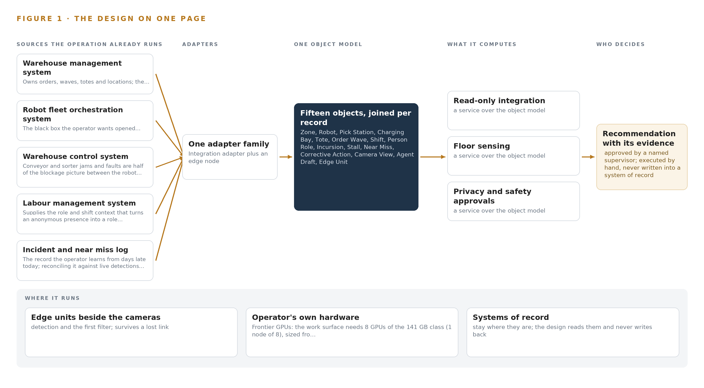
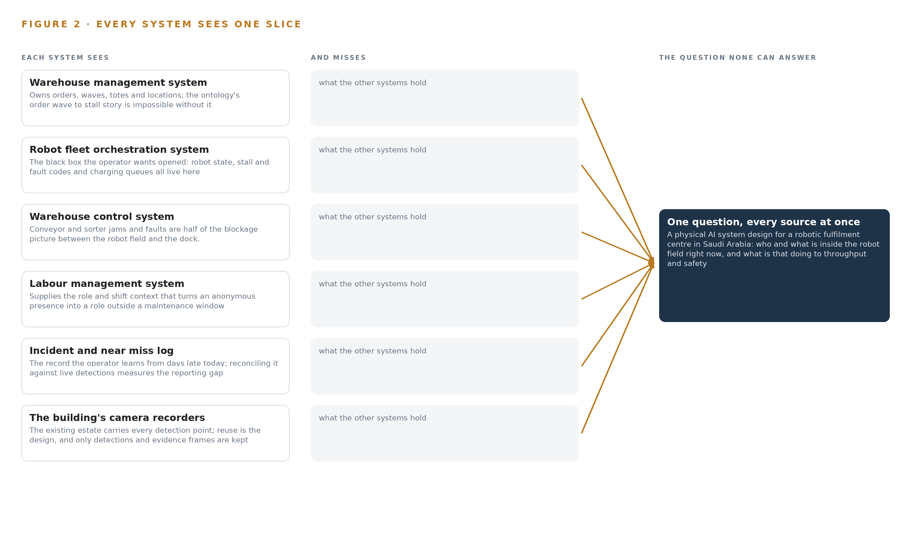
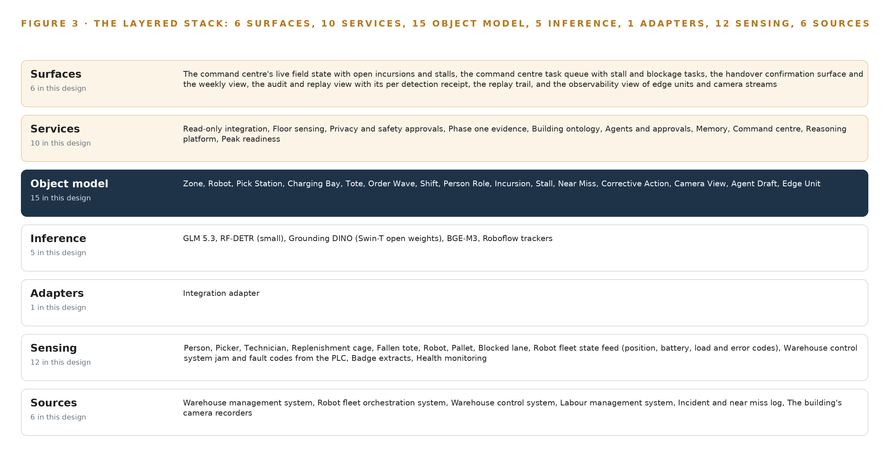
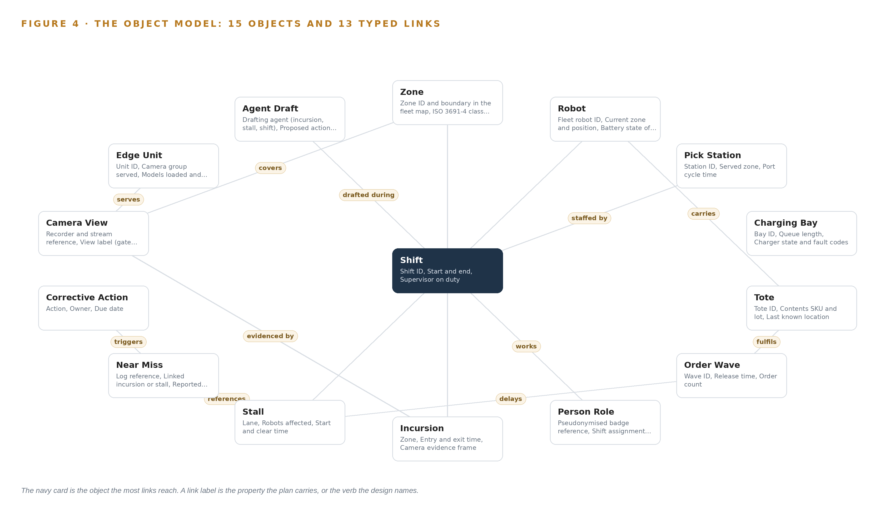
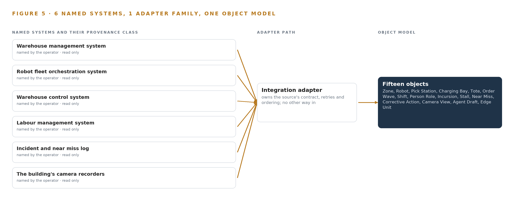
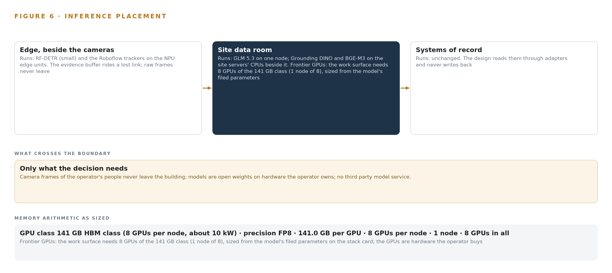
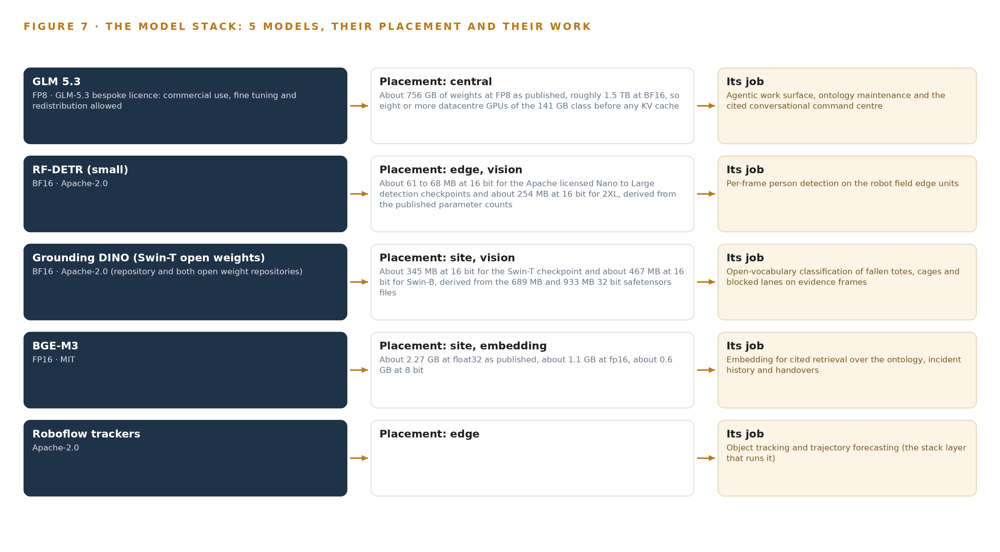
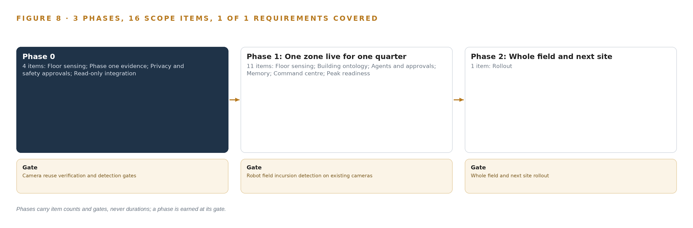
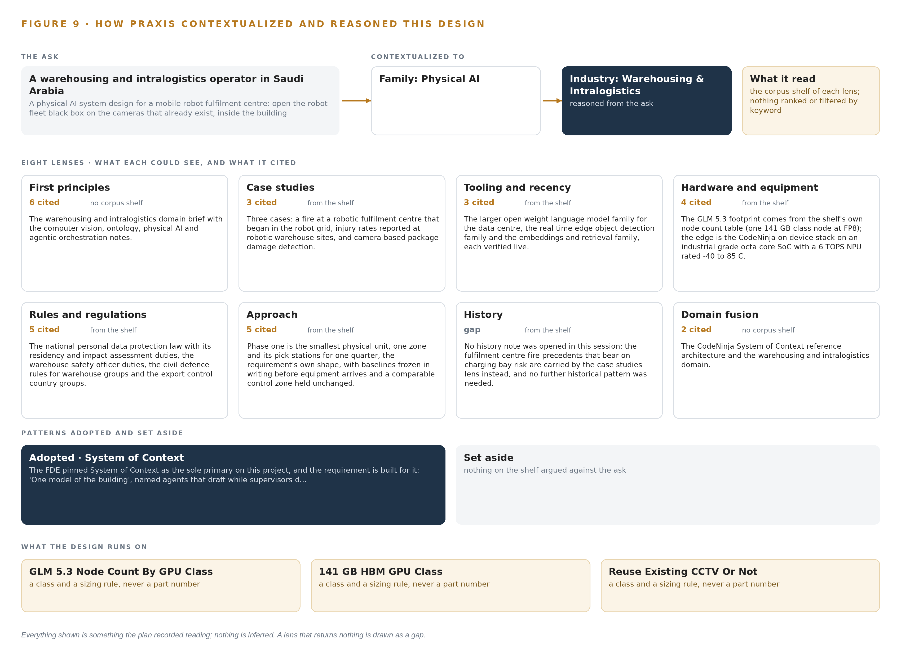

# Physical AI System Design for a Mobile Robot Fulfilment Centre in Saudi Arabia

Canonical: https://codeatoms.ai/mobile-robot-fulfilment-centre-saudi-arabia/
PDF: https://codeatoms.ai/mobile-robot-fulfilment-centre-saudi-arabia/paper/mobile-robot-fulfilment-centre-saudi-arabia.pdf
License: CC BY 4.0
Publisher: CodeNinja Atoms (https://codeatoms.ai), a fully owned subsidiary of CodeNinja

VERTICAL-DRIVEN ARCHITECTURES · WAREHOUSING & INTRALOGISTICS · DESIGNED WITH PRAXIS · NOVEMBER 2026

# Physical AI System Design for a Mobile Robot Fulfilment Centre in Saudi Arabia

Robot Field Watch: Physical AI for Warehouse Robot Safety at Every Gate, Pick Front and Charging Bay. A sovereign physical AI system that detects people inside the robot field, fallen totes and blocked lanes on the cameras a robotic fulfilment center in Saudi Arabia already runs, and drafts the zone slowdowns, clearance tasks and handovers that supervisors approve.

Muhammad Umar, Cofounder, CodeNinja

For fulfilment center operations directors, shift supervisors and safety leads, and the platform, data and vision engineers who would build and run it.

---

Vertical-Driven Architectures is a CodeNinja series of system designs. Every design in the series is driven by a real-world problem and scenario in a single industry, and every one is designed on Praxis, CodeNinja's platform for designing physical AI systems. Operations are described by class, never by name.

At a glance

## Physical AI System Design for a Mobile Robot Fulfilment Centre in Saudi Arabia

**What this is.** An open reference architecture for system design in physical AI, built for a warehousing and intralogistics operator in Saudi Arabia that runs a robotic e-commerce fulfilment centre of roughly 400,000 square feet with more than 250 autonomous mobile robots, where owning the inference node that runs it costs about 569,000 US dollars over three years. When a replenishment cage is left in a lane during a peak wave, the design detects the blocked lane on the cameras that already cover the field, joins the stalled robots to the totes they carry and the order wave those totes fulfil, and drafts the clearance task and reroute request that the fleet controller approves, so the wave is recovered while it still matters rather than seen an hour later in orders per hour. Every model runs on the operator's own hardware inside the building, under the national personal data protection law, the occupational safety rules for automated warehouses, the civil defence fire code and export control on the GPU node. It is written for fulfilment centre operations directors, shift supervisors and safety leads, and the platform, data and vision engineers who would build and run it. The operator is described by class, never by name.

**The answer in numbers.**

| Part | The design |
| --- | --- |
| Sources | Six read only systems of record, entering through one family of integration adapters (change data capture for the transactional systems, stream ingest for the cameras) that stamps every message with its source, time and adapter version: the warehouse management system, the robot fleet orchestration system, the warehouse control system, the labour management system, the incident and near miss log and the building's camera recorders; the platform never drives a robot, never issues a motion command and never writes into a system of record |
| Object model | 15 typed objects with 13 typed links, from the zone, robot, charging bay, pick station and camera view through the tote, order wave, shift, incursion and stall to the person role, near miss, corrective action, agent draft and edge unit, so a query walks from a person at a gate to the orders their presence delayed; published as JSON for reuse |
| Models | Five: RF-DETR (small) (Apache-2.0) per frame on the edge NPUs for person detection; Grounding DINO Swin-T (Apache-2.0) on evidence frames for fallen totes, cages and blocked lanes; the Roboflow trackers (Apache-2.0) with re-identification switched off; BGE-M3 (MIT) for Arabic and English cited retrieval; GLM 5.3 (GLM-5.3 bespoke licence, 753B at FP8) for the three drafting agents, ontology maintenance and the command centre; no third party model service, nothing trained into weights |
| Compute | Three tiers inside the building: camera group edge units on an industrial grade octa core SoC with a 6 TOPS NPU beside the reused cameras, counted only after a dev board measurement on the real substreams; site servers on CPU for ingest, the backbone, the ontology, the embedder and the open vocabulary classifier; and one node of eight 141 GB HBM accelerators (1,128 GB) in the site data room holding 753 GB of FP8 weights with a 1.2 planning factor, 904 GB. The node is a 4A090 class item for a D:3 and D:4 destination, so an export licence determination is a phase one procurement gate before the order |
| Rollout | Three phases carrying 16 scope items (4, 11 and 1), each closed by a gate, never a date: camera reuse verification with six gates per view and detection gates passed with recorded evidence at the worst hour; one robot field zone and its pick stations live for one quarter against the operator's own baselines (incursions per thousand robot hours, stoppage minutes per shift, time from stall to clearance, orders per labour hour); then the whole field and the next site, earned by that evidence |
| Three-year cost | About 569,000 US dollars to own the node for three years (a range of 541,000 to 594,000: server, support and power at the national commercial electricity tariff), against about 751,000 to rent the same eight cards on the deepest three year commitment in AWS Middle East (UAE), so ownership costs about three quarters of it, and about 2.00 million on demand, against which ownership costs a little over a quarter. Renting is a price reference only, because the design keeps frames, weights and memory inside the building and AWS lists no Saudi region on the day read; the edge units and site servers are not priced because the paper does not count or size them (Appendix A) |
| Human control | Agents detect and draft, people decide, by name: the shift supervisor approves the incursion agent's zone slow down and supervisor call, the fleet controller approves the stall agent's clearance task and reroute request, the operations manager confirms the shift agent's handover; execution is manual, every approval is logged with its reasoning, known answer probes measure whether approvers are rubber stamping, and people appear in the record as anonymous presence with a role, never as an identity |

**Reuse it.** The object model, the model register and the figures are free to reuse under CC BY 4.0. Cite as <https://codeatoms.ai/mobile-robot-fulfilment-centre-saudi-arabia/.>

**Made with.** Reasoned on [CodeNinja Praxis](<https://codeatoms.ai/praxis/>), the CodeNinja Atoms platform for designing physical AI systems. The object model imports into [Hyper Ontology](<https://codeatoms.ai/hyper-ontology/>), which turns it into a living system. Load it with the [hyper-ontology loader](../hyper-ontology-py/): `hyper-ontology show mobile-robot-fulfilment-centre-saudi-arabia`. Both are in beta; access by request.

ABSTRACT

## A Near Miss Should Surface in Seconds, Not in Days

A physical AI system design for a warehousing and intralogistics operator in Saudi Arabia that runs a robotic e-commerce fulfilment center of roughly 400,000 square feet with more than 250 autonomous mobile robots and needs one question answered continuously: who and what is inside the robot field right now, and what is that doing to throughput and safety. The operator's own framing of the ask is physical AI for warehouse robot safety, and today that question cannot be answered because the answer is scattered across six systems of record that were never built to join: the robot fleet orchestration system holds stall codes but not causes, the warehouse management system holds waves but not field state, and the incident and near miss log records people entering the field days after the event, if at all. Throughput drops are seen an hour later in orders per hour rather than in the field where they start, and supervisors rebuild every incident by scrubbing camera recordings by hand.

The design joins those six sources, the warehouse management system, the robot fleet orchestration system, the warehouse control system, the labour management system, the incident and near miss log and the building's camera recorders, through one adapter family of read-only integration adapters into a governed object model of fifteen objects, served by ten services and six surfaces, with five models: RF-DETR small detectors run on the edge units of the CodeNinja on device AI stack, industrial SoCs watching the existing cameras, Grounding DINO and BGE-M3 run on the site servers beside the ontology, motion-only trackers run at the edge, and GLM 5.3 is self hosted in the site data room on one node of eight 141 GB-class GPUs that holds its 753 billion FP8 parameters with KV cache headroom. Every frame, detection, weight and memory record stays inside the building, and named incursion, stall and shift agents draft zone slowdowns, clearance tasks and handovers that supervisors and the fleet controller approve and execute manually.

The paper covers the problem and the join failure, the constraints and the stack, the object model, ingestion, inference placement, and the models with their licenses, then the rollout in three phases from one zone for one quarter to the whole field and the next site, ownership of what the system produces, and finally how Praxis contextualized and reasoned the design, so that every choice can be traced to what justified it.

---



Figure 1. Robot Field Watch on one page: the sources the operation already runs, one object model, what it computes, and the person who decides.

## Contents

Each chapter is tagged for the reader it serves most directly: Executive, Team Lead, FDE, Reference.

|  |  |  |
| --- | --- | --- |
|  | Abstract · A Near Miss Should Surface in Seconds, Not in Days | Executive |
| PART I · THE PROBLEM | | |
| 1 | [Physical AI for Warehouse Robot Safety Starts in the Field](#ch1) | Executive |
| 2 | [Every System Sees One Slice of the Floor](#ch2) | ExecutiveTeam Lead |
| PART II · THE DESIGN | | |
| 3 | [Sovereignty and Privacy Shape Every Downstream Choice](#ch3) | Team Lead |
| 4 | [One Stack Runs From the Cameras to the Command Center](#ch4) | Team LeadFDE |
| 5 | [Fifteen Objects Turn the Field Into One Argument](#ch5) | FDE |
| 6 | [Every Source Enters Through an Adapter, Never Directly](#ch6) | FDE |
| 7 | [Edge Units Detect and the Data Room Reasons](#ch7) | FDE |
| 8 | [Licenses Decide What the Operator Can Own](#ch8) | FDEExecutive |
| PART III · THE ROLLOUT | | |
| 9 | [One Zone Earns the Whole Field](#ch9) | Team LeadExecutive |
| 10 | [The Intelligence Stays Inside the Building](#ch10) | Executive |
| PART IV · HOW IT WAS DESIGNED | | |
|  | Conclusion · The Robot Field Becomes Observable Without Becoming Autonomous | Executive |
| 11 | [How Praxis Contextualized and Reasoned This Design](#ch11) | Team LeadFDE |
|  | [Sources](#sources) | Reference |

PART I · CHAPTER 1

## Physical AI for Warehouse Robot Safety Starts in the Field

The operator's safety and throughput losses both begin inside the robot field, but every system that could see them records only a slice, and always too late.

The abstract promised a physical AI system design that opens the robot field to the people who run it, and this chapter states the problem that design must solve. Physical AI for warehouse robot safety is the operator's own requirement, in the operator's own words, and it exists because the place where people and robots share a building is exactly the place the operation cannot see. The losses, human and financial, both start there.

### 1.1  The Question and the Regimes It Must Satisfy

The operation needs two questions answered at the moment they arise, not an hour or a week later: who is inside the robot field right now, where, how often and why; and why has throughput dropped, in the field where it starts rather than in the orders per hour figure that surfaces an hour later. Answering them requires data the operator already holds but never joins: per-robot state, position, battery and fault codes from the fleet system; order and wave progress from the warehouse management system; role and shift context from the labour system; camera coverage of the field gates, pick station fronts, charging bays and dock crossings; and the incident record against which any live detection must be reconciled. Three regimes frame the work. The kingdom's Personal Data Protection Law makes an impact assessment mandatory for constant monitoring and dataset linking, which rules out identifying individuals and pushes the design toward anonymous presence with role context. Civil Defense licensing governs the building and anything added near the field. The ISO 3691-4 standard for automated industrial trucks defines the zone classes the robot field is divided into, and national cybersecurity and communications controls govern what may be connected and how.

### 1.2  The Documented Cost of Learning Late

The cost of this blindness is documented in the industry's own enforcement record. A United Kingdom manufacturer was fined £500,000 after a worker was killed when the forklift truck he was driving overturned, a case in which the underlying machinery risk was ordinary and the failure was in its management (HSE 2023). Warehouse fatalities from struck-by events remain a recurring pattern in federal investigations, including a worker killed by material falling from a pallet (DOI 2022) and an operator crushed by a shifting load (CDC 2020). The safety profession's own guidance treats investigation as a structured discipline that must be performed deliberately after an incident (HSE n.d.), with root cause analysis for logistics incidents set out as a formal method (CEFIC 2015); an operation that learns of near misses days late, if at all, cannot run that discipline on time, and its supervisors rebuild each incident by scrubbing recordings by hand.

### 1.3  The Operation as a Scenario

The operator is a warehousing and intralogistics operator in Saudi Arabia, running a robotic fulfilment center opened in 2026. The building covers roughly 400,000 square feet and runs more than 250 autonomous mobile robots for goods to person picking and order sorting, with robot shuttles feeding the pick stations; sites of this class are designed to process over three million orders a month at peak, and peak season doubles the fleet's workload. People and robots share the building: pickers at the stations, replenishment teams in the robot field during maintenance windows, technicians at the charging bays, dock crews where inbound pallets meet the sortation output, and shift supervisors above all of them, the newest of whom have never run a peak. The physical environments are the robot field with its lanes, the pick station fronts, the charging bays where fire load concentrates, and the dock crossings. The operation holds six named systems of record: the warehouse management system, the robot fleet orchestration system supplied with the robots, the warehouse control system for conveyors and sorters, the labour management system, the incident and near miss log, and the building's camera recorders. One site, one robot field and one data room define the places; the roles in the loop are the pickers, replenishment teams, technicians, dock crews and supervisors named above.

PART I · CHAPTER 2

## Every System Sees One Slice of the Floor

Six systems of record each hold a true but partial picture of the same building, and the question that matters lives only in their join.

Chapter 1 set out the question. This chapter explains why no system the operation already runs can answer it.

### 2.1  What Each System Sees

Warehouse management system owns orders, waves, totes and locations; the ontology's order wave to stall story is impossible without it, and entity resolution starts from its identifiers.

Robot fleet orchestration system the black box the operator wants opened: robot state, stall and fault codes and charging queues all live here, and no command path is ever opened into it.

Warehouse control system conveyor and sorter jams and faults are half of the blockage picture between the robot field and the dock.

Labour management system supplies the role and shift context that turns an anonymous presence into 'a replenishment team member outside a maintenance window' without identifying the individual.

Incident and near miss log the record the operator learns from days late today; reconciling it against live detections measures the reporting gap and seeds the memory with confirmed causes.

The building's camera recorders the existing estate carries every detection point; reuse is the design, and only detections and evidence frames are kept from it.



Figure 2. Six systems, each seeing one part of the answer. The question needs all of them in one place at once.

### 2.2  What None of Them See Together

Each holds one slice, and the question needs all of them in one place at once, which today is done by hand at the cadence of whoever has the time.

PART II · CHAPTER 3

## Sovereignty and Privacy Shape Every Downstream Choice

Four constraints, national data protection law, nothing leaving the building, no write path into the fleet, and every decision owned by a named person, decide the stack before any component is chosen.

Chapter 2 showed that the answer lives in the join of six systems, not in any one of them. Before any component is chosen, four constraints decide what that join may look like: national data protection law, nothing leaving the building, no write path into the fleet, and every decision owned by a named person. They shape every downstream choice in this design.

### 3.1  Privacy Is Settled by Law Before It Is Settled by Design

The kingdom's Personal Data Protection Law makes an impact assessment mandatory for exactly what this system does: dataset linking, constant monitoring, new technology and automated processing together trigger Article 25, and its absence blocks go live. The design therefore detects anonymous presence and infers role from pseudonymised badge and shift data, never identity; there is no face recognition and no person re-identification across cameras, the tracking runs motion-only with the re-identification branch switched off, and frames, detections and the incident memory stay on site. This is hard in intralogistics because the temptation runs the other way: identifying the individual would make enforcement easier, and wearable or tag-based positioning of people would add personal data the minimization case does not need.

### 3.2  Nothing Leaves the Building

Frames, detections, weights and the memory the system accumulates all stay inside one perimeter, on the operator's own hardware in the site data room. The one boundary crossing is the read-only conduit from the fleet and control systems through a firewalled DMZ, which is a firewall, not a one-way diode. This is hard because the reasoning tier wants frontier-class compute: the self-hosted model runs on one node of the 141 GB HBM class in the data room, and export controls on that accelerator class may require a license before order, with an in-country sovereign data center as the fallback placement rather than a cloud endpoint outside the operator's control.

### 3.3  No Write Path Is Ever Opened Into the Fleet

The fleet's own sensors stop robots when they detect a person, and its safety case depends on that. This design never drives a robot, never issues a motion command, and treats its camera analytics as an operational feedback loop, never a safety-rated stop; integration with all six systems of record is read-only. This is hard because the visible value of a write path is real: a slowdown applied automatically would recover throughput faster than one a supervisor must approve by hand. The design declines it, because a system that could move robots would have to be certified as a safety function, and nothing in this design is.

### 3.4  Every Decision Is Owned by a Named Person

Agents draft; supervisors and the fleet controller approve and execute manually. Each draft carries its own evidence and citations, each approval is logged with reasoning, and known-answer probes on the review queue measure whether approvers are rubber-stamping, because an approval that always confirms the model is not a decision. This is hard on a warehouse floor at peak, when the review queue is longest and the newest supervisors have never run one.

### 3.5  Scoping Decisions

Three scoping decisions carry most of the shape: reusing the existing camera estate, proving the system on one zone for a quarter before earning the field, and self-hosting the reasoning tier on site. Table 1 states what each buys and what it costs.

Table 1 · Scoping Decisions

| Decision | What it buys | What it costs |
| --- | --- | --- |
| Reuse the existing camera estate | No new cameras in phase one, no new cabling, and the evidence base already covers every detection point | Six reuse gates per view, recorded at the worst hour; purpose-placed cameras bought only where a gate fails, from a contingency budget |
| One zone live for one quarter | Evidence against the operator's own baselines before the field and the next site are earned | A quarter of delayed coverage elsewhere, and a measured NPU load gate that must pass before units are ordered at fleet scale |
| Self-host the reasoning tier in the data room | Frames, weights and memory inside one perimeter, with no cloud endpoint and no data leaving the building | One 141 GB-class node to procure and power, and an export license determination on the accelerator class before order |

### 3.6  What the Design Chose Against

Each rejected alternative below was rejected for a reason the constraints state, not for convenience. The final row records what is out of scope entirely, and why it stays there.

Table 2 · What the Design Chose Against

| Where | What was picked | Instead of, and why |
| --- | --- | --- |
| Reasoning placement | GLM 5.3 self-hosted on one 141 GB-class node in the site data room | Frontier model APIs, which would send frames and memory outside the building the design is required to keep closed |
| Person sensing | Existing cameras with role inferred from badge and shift data | Wearable or tag-based positioning, which adds personal data the PDPL minimization case does not need |
| Detection models | Pretrained RF-DETR per frame and Grounding DINO on evidence frames, needing no site labels | Site-trained custom detectors, which need labelled data phase one does not have and cannot wait for |
| Tracking | Motion-only tracking with the re-identification branch switched off | Person re-identification across cameras, which the anonymous-presence posture rules out |
| Approvals | Agent drafts approved and executed manually by named supervisors | Autonomous execution of slowdowns or clearances, which would cross into the fleet's safety case |
| Scope boundary | Operational feedback and decision support only | Robot motion control and safety functions, order release and wave orchestration, and individual identification, all out of scope because the fleet's safety case and the PDPL posture depend on their exclusion |

PART II · CHAPTER 4

## One Stack Runs From the Cameras to the Command Center

A layered architecture of sources, adapters, one object model, services and surfaces fits this site because it opens the fleet black box without opening a command path into it.

Chapter 3 fixed the constraints that shape everything downstream: intelligence stays inside the building, people on the floor stay anonymous, the existing camera estate is reused, and no command path is ever opened into the fleet. This chapter sets out the architecture that satisfies all four at once, by separating what the design reads from what it can ever touch.

### 4.1  The Pattern and Why It Fits

The architecture is three tiers with one spine. Below sit the systems of record, all six of them: the warehouse management system, the robot fleet orchestration system, the warehouse control system, the labour management system, the incident and near miss log and the building's camera recorders. In the middle sits one governed object model, fifteen objects joined by typed links that carry the site's own vocabulary, such as the link from a robot to the tote it carries. Above sit ten services, six surfaces, and the three named agents, for incursions, stalls and shift handovers, that draft actions for a supervisor to approve.

The pattern fits this site because it opens the fleet black box without opening a command path into it. The robot fleet orchestration system is a source at the bottom of the stack, never a destination; the design reads robot state, stall codes and charging queues, and nothing above the adapter tier holds credentials to write to it. The same separation delivers sovereignty, because every rung runs on site, from the NPUs of the edge units reading the reused cameras to the single 141 GB-class node in the site data room serving the reasoning model, so no frame, detection, weight or memory record crosses the building's boundary. Figure 3 shows the layered stack with the count at each layer, and every arrow points upward: sources feed adapters, adapters feed the object model, and only the services and surfaces above it compose the argument.



Figure 3. The layered stack: 6 sources, 1 adapter family, 15 objects, 10 services and 6 surfaces.

### 4.2  The Stack Stage by Stage

Table 3 walks the stack stage by stage, naming what each stage is responsible for and the components that carry it. Two stages deserve comment. The sensing stage is the one stage that touches the physical floor: edge units on the on-device stack read the gate, pick front, charging bay and dock crossing cameras, while the fleet state feed, the control system's jam codes and the pseudonymised badge extracts arrive as machine feeds alongside them. The inference stage is deliberately split in three: per-frame detection runs on the edge NPUs under OpenVINO, open-vocabulary classification on selected evidence frames and embedding run on site CPUs, and reasoning runs as GLM 5.3 under vLLM on the single node in the data room, which matches each tier's cost and latency to its job.

Table 7, printed by the platform beneath the stages, records the same stack at the component level, each layer with its choice and the reason for it. The two tables read together: the stages name responsibility, and the components name the selection, from the event backbone to the time synchronisation hardware that keeps every tier on one clock.

Table 3 · The Stack, Stage by Stage

| Stage | What it is responsible for | How |
| --- | --- | --- |
| Sources | Own the truth about orders, robots, conveyors, labour, incidents and the floor on camera | Six operator-held systems of record, all read only: the warehouse management system, the robot fleet orchestration system, the warehouse control system, the labour management system, the incident and near miss log and the building's camera recorders |
| Sensing | Turn the physical floor into signals: person, fallen tote, replenishment cage, blocked lane, robot state, jam codes | Edge units on the on-device stack read the reused gate, pick front, charging bay and dock crossing cameras; the fleet state feed, the control system fault codes and pseudonymised badge extracts arrive as machine feeds |
| Adapters | Carry every source onto the backbone with provenance and without a write path | One family of read-only integration adapters: change data capture for the transactional systems and stream ingest for the cameras, every message stamped with source, time and adapter version |
| Object model | Hold the fifteen objects and their typed links as one governed graph | A graph store with the BGE-M3 embedder beside it on CPU, written only by the adapter tier and the approvals service |
| Inference | Run detection at the edge, classification and embedding on site, and reasoning on one node | RF-DETR per frame on the edge NPUs under OpenVINO, Grounding DINO on selected evidence frames and BGE-M3 on site CPUs, and GLM 5.3 under vLLM on the 141 GB-class node in the data room |
| Services | Compose the ten capabilities the floor needs, from reading the sources to proving peak readiness | Read-only integration, floor sensing, privacy and safety approvals, phase one evidence, building ontology, agents and approvals, memory, command center, reasoning platform and peak readiness |
| Surfaces | Put the whole argument in front of the people who decide | Six surfaces: the command center's live field state and task queue, the handover confirmation and weekly view, the audit and replay view, the replay trail and the observability view |

Table 7 · Architecture, Layer by Layer

| Layer | Component | Choice | Why |
| --- | --- | --- | --- |
| Event streaming and messaging | by class, no product named | Product | Apache Kafka 4.3.x (KRaft) |
| The ontology or graph store | by class, no product named | Class | An ontology or graph store class, fixed by what the fifteen objects and their links demand |
| Time series and telemetry storage | by class, no product named | Product | InfluxDB 3 Core |
| Video ingest, recording and management | by class, no product named | Product | MediaMTX + Frigate |
| Edge model serving | by class, no product named | Product | OpenVINO |
| On site language model serving | by class, no product named | Product | VLLM |
| Object tracking and trajectory forecasting | by class, no product named | Product | Roboflow trackers |
| Edge orchestration of containers | by class, no product named | Product | K3s |
| An air gapped artifact and model registry | by class, no product named | Product | MLflow model registry (on site) |
| Labelling and retraining | by class, no product named | Product | CVAT |
| Time synchronisation across sensors and systems | by class, no product named | Product | Linuxptp + chrony |
| Observability of the running system | by class, no product named | Product | Prometheus + Grafana + Loki |

### 4.3  A Reusable Pattern

The reusable shape of this [physical AI system design](https://codeatoms.ai/physical-ai-system-design/) is this: read-only adapters carry an operation's systems of record onto a replicated event backbone; one governed object model joins them; agents draft, named people approve, and execution stays manual; and every tier of inference runs inside the operator's perimeter. A team carrying a similar brief into a port terminal, a mine or a baggage hall would swap the source list, the fifteen objects and the detection classes for their own, and resize the models to their sensors, but should keep four things unchanged: the read-only direction, the single object model that every service reads, the evidence frame attached to every detection, and the approval loop with logged reasoning. The single-zone phase one gate belongs to the pattern too, because it is what lets an operator stop cheaply if the sensing does not hold up on its own cameras.

PART II · CHAPTER 5

## Fifteen Objects Turn the Field Into One Argument

The object model gives every detection, robot, wave and shift a typed place in one governed graph, so a query can walk from a person at a gate to the orders their presence delayed.

Chapter 4 placed one object model at the center of the stack and made it the one thing the services above read. This chapter opens that model: what its fifteen objects are, how they are linked, and why the links rather than the objects carry the argument.

### 5.1  The Fifteen Objects and Their Links

The fifteen objects fall into seven kinds. Of these, the zone is the one site object, anchored in the fleet map with its boundary, its ISO 3691-4 zone class and its maintenance window schedule. Four assets follow: the robot and the charging bay, both anchored in the fleet orchestration system; the pick station, anchored in the warehouse management system; and the camera view, anchored in the building's camera recorders. The tote is the one material object, anchored in the warehouse management system. Four events carry the operational story: the order wave, anchored in the warehouse management system; the shift, anchored in the labour management system; and the incursion and the stall, which are the design's own, anchored in its detections. The person role, anchored in the labour management system, holds a pseudonymised badge reference with authorized zones. Three records close the loop: the near miss and the corrective action, anchored in the incident and near miss log, and the agent draft, the design's own. The edge unit, the fifteenth object, is the system that watches the cameras.

The typed links are what a query walks. An incursion is evidenced by a camera view and sits inside a zone; the robots in that zone suffer stalls; a stalled robot carries a tote that fulfils an order wave with a carrier cutoff; the shift names the supervisor on duty and the person role whose badge explains the presence; a near miss references the stall and triggers a corrective action with an owner and a verification. A document store holding the same content returns documents that mention the gate; it cannot walk that chain in typed hops, it cannot enforce that every delayed wave carries a stall with an approved reroute, and it cannot answer which orders the person at a gate delayed without a join rebuilt by hand each time. Figure 4 shows every object and its typed links, with the incursion as the focal object. Table 8, printed by the platform, records each object with the source it is anchored in and its typed links.



Figure 4. The fifteen objects of the model and the typed links that let a query reach across them.

Table 8 · The Object Model

| Object | Anchored in | Typed links |
| --- | --- | --- |
| Zone | Robot fleet orchestration system | covers: Camera View |
| Robot | Robot fleet orchestration system | carries: Tote; suffers: Stall |
| Pick Station | Warehouse management system | staffed by: Shift |
| Charging Bay | Robot fleet orchestration system | no typed link recorded |
| Tote | Warehouse management system | fulfils: Order Wave |
| Order Wave | Warehouse management system | no typed link recorded |
| Shift | Labour management system | no typed link recorded |
| Person Role | Labour management system | works: Shift |
| Incursion | The design's own detections | inside: Zone; evidenced by: Camera View |
| Stall | The design's own detections | delays: Order Wave |
| Near Miss | Incident and near miss log | references: Stall; triggers: Corrective Action |
| Corrective Action | Incident and near miss log | no typed link recorded |

### 5.2  The Human Loop and the Hosting Posture

The human loop lives in one object: the agent draft, with its drafting agent, its approver role, its approval state and its citations. The incursion, stall and shift agents draft zone slowdowns, clearance tasks and handovers; a supervisor approves or rejects with logged reasoning, and execution is manual, by the fleet controller or the floor team. The single write path into the object model runs through the adapter tier and the approvals service, so no detection, no draft and no approval can enter any other way. The hosting posture follows the same closed loop: the graph store and the reasoning node run in the site data room, identity is served by the on-site Keycloak, and there are no external links, the sole boundary crossing being the read-only conduit from the fleet and control zone through a firewalled DMZ. Person data stays a pseudonymised badge reference with role and shift context, never a face, under the national personal data protection law and its mandatory impact assessment. The near miss and corrective action objects carry structured investigation and root cause discipline into a live record rather than a workbook exercise, which is exactly the discipline the investigation literature prescribes (HSE n.d.; CEFIC 2015).

### 5.3  One Object in Its Recorded Form

The record printed below is the zone's, and it shows the id, label, kind, anchor, properties, status vocabulary and links the platform prints for every object; the incursion, anchored in nothing the operator already holds, is the whole argument in one record, because it holds anonymous presence, role inferred from badge and shift data, the evidence frame, the confirmed cause and the supervisor's decision, and it is recorded the same way.

```
{ "id": "zone", "label": "Zone", "kind": "site", "anchored_in": "Robot fleet orchestration system", "properties": [ "Zone ID and boundary in the fleet map", "ISO 3691-4 zone class (operating, restricted\u2026", "Maintenance window schedule", "Camera views covering it", "Current slow down state", "Peak wave assignment" ], "status_vocabulary": [ "Normal", "Slowed", "Closed", "Maintenance window open" ], "links": [ { "to": "camera-view", "label": "covers" } ] }
```

PART II · CHAPTER 6

## Every Source Enters Through an Adapter, Never Directly

One adapter family of read-only integration adapters carries all six sources onto a replicated event backbone, guaranteeing that the design can read the operation but never write to it.

Chapter 5 described what the object model holds. This chapter describes how data gets into it, through one adapter family onto one event backbone, with the guarantee the whole design stands on: the system can read the operation but never write to it.

### 6.1  Six Sources, One Provenance Class

All six named sources carry the same provenance class, operator-held, and the same direction, read. The warehouse management system owns orders, waves, totes and locations, and entity resolution starts from its identifiers, so the order wave to stall story is impossible without it. The robot fleet orchestration system is the black box the operator wants opened: robot state, stall and fault codes and charging queues all live there, and no command path is ever opened into it. The warehouse control system supplies the conveyor and sorter jams and faults that are half the blockage picture between the robot field and the dock. The labour management system supplies the role and shift context that turns an anonymous presence into a replenishment team member outside a maintenance window, without identifying the individual. The incident and near miss log is the record the operator learns from days late; reconciling it against live detections measures the reporting gap, and investigation guidance treats that lag as evidence lost (HSE n.d.). The building's camera recorders carry every detection point, reuse is the design, and only detections and evidence frames are kept from them. Figure 5 maps each named system, its provenance class and its adapter path.



Figure 5. The 6 named systems, the adapter path each one takes, and the object model they all map into.

### 6.2  What the Adapter Tier Guarantees

The read-only direction is guaranteed structurally rather than by policy: the adapters hold credentials for read endpoints only, so no service above them can reach a write path even by mistake. One adapter family means all six integrations share one behavior, one failure mode and one upgrade path, instead of six bespoke connectors. Change data capture through Debezium reads the transactional systems' change logs rather than polling them, which adds no query load to a system running a peak, and stream ingest through MediaMTX and Frigate takes the camera substreams where they already exist. Every message is stamped with its source, its timestamp and its adapter version, so provenance is a queryable property of every object rather than a claim. Because the backbone retains messages, the object model can be rebuilt from the log, and schema contracts are versioned so that an upgrade to a source system degrades coverage rather than breaking the join.

### 6.3  The Event Backbone

The backbone is Apache Kafka 4.3.x in KRaft mode, running on the site servers. Ordering is per partition, keyed by robot, zone and wave, so the sequence for each entity holds even when global order does not, which is what lets a stall's start and clear times be trusted. Delivery is at least once, and the writes into the object model are idempotent, keyed by message offset, so a replayed message cannot double-count an incursion. The retained log is the buffer: when peak season doubles the fleet's workload and the detection rate with it, consumers fall behind and catch up rather than drop, and the correlated worst hour is what the segment was sized against. Replication runs inside the data room with no off-site mirror, since nothing leaves the building. Time synchronisation through linuxptp and chrony, disciplined by a GNSS PTP grandmaster, puts evidence frames, robot positions and badge extracts on one clock, which is what makes the reporting-lag property of the near miss object measurable at all. Telemetry lands in InfluxDB 3 Core, model versions live in the on-site registry, and the observability stack watches the whole path.

PART II · CHAPTER 7

## Edge Units Detect and the Data Room Reasons

Per-frame detection runs on NPU edge units beside the cameras, open-vocabulary classification and embedding run on the site servers, and the frontier model runs on one self hosted node, with a latency budget that keeps each tier inside its job.

Chapter 6 described how six source systems enter through one adapter family and land on the event backbone. This chapter places the computing that consumes them, sizes each tier from the weights up, states the latency budget that keeps every tier inside its job, and says what happens when the link, the power or the update path fails.

### 7.1  Three Tiers, Each with Its Own Job

The edge tier is a camera-group unit built on an industrial-grade octa-core SoC with a 6 TOPS NPU rated for -40 to 85 C, mounted beside the cameras it serves. It decodes the RTSP substreams of the reused estate and runs RF-DETR (small) per frame for person detection, with the Roboflow trackers holding identities across frames; the Apache-licensed checkpoints run about 61 to 68 MB at 16 bit, so the binding constraint is NPU load rather than weight storage. The shelf's published load figures cover forklift dashcam workloads on MIPI cameras rather than substream decode from an existing estate, so the design settles its own load with a dev-board measurement on the real substreams at the analyzed frame rate, and that measurement is the phase one gate before any unit is ordered at fleet scale.

The site tier runs on the site servers in the data room, on CPU: ingest, the backbone, the ontology, the BGE-M3 embedder and Grounding DINO on selected evidence frames only, never per frame. Grounding DINO's Swin-T checkpoint is about 345 MB at 16 bit, Swin-B about 467 MB and BGE-M3 about 1.1 GB at FP16, all comfortable in server memory; the constraint here is CPU latency on the evidence path, which is why the open-vocabulary classifier sees only frames the edge tier has already flagged, and no third accelerated tier is bought.

The central tier is one self hosted node in the site data room holding GLM 5.3, and the arithmetic fixes its size: 753 billion parameters at FP8, one byte per parameter, is 753 GB of weights; a factor of 1.2 for KV cache and activations gives 904 GB the accelerators must hold; one node of eight accelerators at 141 GB each provides 1,128 GB, which leaves roughly 280 GB of KV cache ceiling. Figure 6 shows the three tiers, what runs on each, and what crosses between them.



Figure 6. Where each tier runs, what runs there, and the narrow set of outputs that cross the boundary.

### 7.2  The Latency Budget

The budget is an ordering of loops rather than one number, because nothing in this design closes a control loop: the fleet's own sensors stop robots when they detect a person, and these analytics are an operational feedback loop, never a safety-rated stop. The shortest loop is awareness, so detection runs per frame on the edge unit at the analyzed frame rate; a person inside the robot field must surface while it still matters, and a round trip to the data room would make the answer stale on arrival. The middle loop is confirmation: the evidence frame, the open-vocabulary classification and the ontology join may take the time a supervisor needs to read a draft, since a named person decides. The longest loop is conversation, bounded by a shift team's questions rather than any actuation deadline, and that ordering is what lets the frontier tier be sized for reasoning quality instead of control latency.

### 7.3  The Boundary and the Failures

Only one thing crosses a network boundary: the read-only conduit from the fleet and control zone through a firewalled DMZ, which is a firewall, not a diode, and if a future phase ever exports analytics off site a one-way transfer layer is added then. Frames, detections, weights and memory never leave the building.

Each failure path has a named answer. When a recorder link fails, the edge unit moves from Healthy to Degraded in its status vocabulary, Kafka buffers what the backbone misses, and the command center shows the gap rather than a silent absence. When power fails, Network UPS Tools watches the units and the servers, and each edge unit's evidence buffer rides the interruption it was sized for. When the update path is in question, the air-gapped MLflow registry on site holds every model version, K3s orchestrates the containers, and each edge unit records the models loaded and their versions, so an update is a versioned change with a rollback rather than a reflash. Time is the silent dependency: linuxptp and chrony, fed by a GNSS PTP grandmaster of the OCP Time Card class, hold camera frames, fleet telemetry and control fault codes to one clock, because the join between an incursion and a stall is only as good as its timestamps. The one placement risk is regulatory: the 141 GB-class accelerator falls inside export controls for the operator's country position, so license determination is a phase one procurement gate, with an in-country sovereign data center as the fallback placement for the reasoning tier.

PART II · CHAPTER 8

## Licenses Decide What the Operator Can Own

Five models with Apache, MIT and bespoke terms were chosen so the operator can hold its weights, fine tune them and keep serving them inside the building even if every vendor relationship ends.

Chapter 7 placed the three inference tiers and sized them from the weights up. This chapter names the five models that run on them and shows why each license lets the operator hold what it runs, fine tune it and keep serving it inside the building even if every vendor relationship ends.



Figure 7. The five models, their placement, and the work each one does.

### 8.1  Five Models and the Terms That Bind Them

Figure 7 sets the model stack out from the edge checkpoints to the frontier node: two Apache-2.0 vision models and an Apache-2.0 tracker across the edge and site tiers, an MIT-licensed embedder beside the ontology, and one frontier-class model under a bespoke license in the data room. Every term in the stack permits the operator to keep the weights.

GLM 5.3 is a 753 billion total parameter mixture of experts model published at FP8: about 756 GB of weights as published, roughly 1.5 TB at BF16, so it needs the eight-accelerator 141 GB-class node before any KV cache. It runs in the site data room on the operator's own hardware, and the operator named it. It carries the agentic work surface, ontology maintenance and the cited conversational command center, and it is the one model in the register whose filed parameter count is frontier class. Its bespoke license permits commercial use, fine tuning and redistribution with an attribution notice, and its MaaS trigger does not reach a third-party logistics operation, so the operator can hold the weights it reasons on.

RF-DETR (small) is a pretrained COCO detector under Apache-2.0 across the small sizes, with checkpoints of about 61 to 68 MB at 16 bit for the Nano through Large sizes and about 254 MB for 2XL. It runs per frame on the edge units' NPUs for person detection, and it was chosen because a pretrained detector needs no training for this operator, per Zone 1 of system of context; the dev-board measurement on the real substreams gates phase one before any fleet-scale order.

Grounding DINO supplies open-vocabulary classification of fallen totes, replenishment cages and blocked lanes on evidence frames, on the site servers. Its zero-shot, text-conditioned boxes find site objects from a text prompt with no training and no site labels, which is the same Zone 1 constraint. Only the Apache-2.0 Swin-T and Swin-B checkpoints are used, never the commercial API versions; Swin-T is about 345 MB at 16 bit and Swin-B about 467 MB.

BGE-M3 embeds the cited retrieval over the ontology, incident history and handovers, on CPU beside the ontology. It is multilingual across Arabic and English, produces dense and sparse retrieval in one pass so robot IDs and fault codes survive the embedding, carries an 8,192 token window, and is MIT licensed; at about 2.27 GB at float32, about 1.1 GB at FP16 and about 0.6 GB at 8 bit, it is small enough that no third inference tier is bought. The Roboflow trackers carry object tracking and trajectory forecasting at the edge under Apache-2.0: motion-only tracking with the re-identification branch switched off keeps the incursion record anonymous under the personal data protection posture, and the trackers eval command chooses the association on the site's own labelled clip.

### 8.2  The Register, and the Ground It Runs On

Table 4 gathers the model and equipment register: each model, the hardware classes and sizing rules, the sensing, the patterns the design stands on, and the ground it runs on. The through-line is ownership, because every choice in the register is either an Apache-2.0 or MIT weight the operator can hold without asking permission, or a bespoke license whose terms permit internal commercial use with an attribution notice, running on hardware classes bought by class on the operator's own ground in the site data room.

Table 4 · Model and Equipment Register

| The choice | What was picked | Why here |
| --- | --- | --- |
| GLM 5.3 | Frontier class, 753B parameters at FP8, one node of 141 GB-class accelerators in the site data room | The bespoke license permits commercial use, fine tuning and redistribution with an attribution notice, and its MaaS trigger does not reach a third-party logistics operator |
| RF-DETR (small) | Pretrained COCO detector, Apache-2.0, on the 6 TOPS NPU edge units | Needs no training for this operator, and the small checkpoints fit the edge constraint, with the dev-board measurement gating phase one |
| Grounding DINO (Swin-T) | Open-vocabulary detector on evidence frames, site servers, Apache-2.0 checkpoints only | Text-conditioned boxes find fallen totes, cages and blocked lanes with no training and no site labels |
| BGE-M3 | Multilingual embedder on CPU beside the ontology, MIT | Arabic and English, dense and sparse retrieval in one pass over an 8,192 token window, with no third inference tier bought |
| Roboflow trackers | Motion-only tracking with re-identification switched off, Apache-2.0 | Anonymous incursion records under the privacy posture, with the association chosen on the site's own labelled clip |
| GLM 5.3 node count by GPU class | One node of eight 141 GB accelerators | 753 GB of FP8 weights at a factor of 1.2 for KV cache and activations is 904 GB, and the node holds 1,128 GB |
| 141 GB HBM GPU class | Eight accelerators per node, bought by the operator | Keeps frames, weights and memory in one perimeter; export license determination is a phase one procurement gate with an in-country fallback placement |
| Reuse existing CCTV or not | Reuse, verified by six gates per view with recorded evidence at the worst hour | The estate already covers every detection point; purpose-placed cameras are bought only where a gate fails, from contingency |
| Size edge compute from streams | Octa-core SoC with a 6 TOPS NPU per camera group, rated -40 to 85 C | Substream decode plus detector load is settled by the dev-board measurement on the real substreams before fleet-scale order |
| Sensing | Gate, pick front, charging bay and dock cameras; person, picker, technician, cage, fallen tote, robot, pallet and blocked lane; fleet state feed, PLC fault codes, badge extracts, health monitoring | Reuse is the design, and only detections and evidence frames are kept from the recorders |
| Pattern: System of context | Pinned as the primary architecture | The work surface is part of the architecture and is never offered or declined |
| Pattern: pretrained and zero-shot models | Zone 1 of system of context | COCO and text-conditioned checkpoints work before any site label exists, so phase one needs no training loop |

PART III · CHAPTER 9

## One Zone Earns the Whole Field

Three phases carry the work from read-only feeds and camera reuse gates through one zone live for a quarter against the operator's own baselines to the whole field and the next site.

Chapter 8 closed the model register with licenses that let the operator hold every weight it runs. This chapter turns to the order of work: how one zone earns the whole field, what each phase must prove before the next begins, and what the gates measure along the way.

### 9.1  Phases, Workstreams and Gates

Three phases carry the sixteen items, and each phase ends at a gate that can stop the work cheaply. Phase 0 carries four items across four workstreams, Floor sensing, Phase one evidence, Privacy and safety approvals, and Read-only integration: the read-only feeds from the warehouse management system, the robot fleet orchestration system and the warehouse control system; camera reuse verification with its six gates per view, covering access, density and angle, time behavior, condition, worst-hour environment and headroom; and the privacy and safety approval pack. Its exit gate is camera reuse verification and detection gates passed with recorded evidence at the worst hour, and until it passes nothing is ordered at fleet scale.

Phase 1 carries eleven items across six workstreams, Floor sensing, Building ontology, Agents and approvals, Memory, Command center, and Peak readiness. Its items include robot field incursion detection on the existing cameras, fallen tote and blocked lane detection, and stall signatures drawn from fleet telemetry, and its exit gate is incursion detection proven live on one zone against the operator's own baselines. Phase 2 carries a single item, the whole field and next site rollout, and it is earned by that evidence rather than scheduled on a calendar. Requirement coverage closes at one requirement covered, none partial and none open. Figure 8 sets the three phases, their item counts, their workstreams and their gates side by side.



Figure 8. The three phases and their gates, and coverage of the one requirement across them.

### 9.2  What the Rollout Measures

The rollout measures two families of numbers, one about detection and one about the floor. On detection, it measures precision and recall of incursion, fallen tote and blocked lane detections on the live zone, and it measures the reporting gap: how many detections have no matching entry in the incident and near miss log, and how much time passes between a detection and its report. Reconciling detections against that log both quantifies the gap and seeds the memory with confirmed causes, which is the same root cause discipline the investigation workbooks and logistics incident guidelines teach (HSE n.d.; CEFIC 2015). On the floor, it measures orders per hour on waves delayed by stalls, stall clear times, charging queue lengths and the uphold rate on the review queue, the last measured with known-answer probes planted among the drafts supervisors see. System health is watched throughout: NPU load, evidence buffer fill and stream health per camera view.

### 9.3  Failure Modes

Each failure mode below has a designed answer rather than a hope, and Table 5 states them together.

Table 5 · Failure Modes

| What fails | What the design does |
| --- | --- |
| The edge units' NPU load for RF-DETR plus multi-stream RTSP decode is unmeasured on this estate | Dev-board measurement on the real substreams at the analyzed frame rate gates Phase 1 before any unit is ordered at fleet scale |
| Cameras hung for human review fail density, angle or frame-rate gates at the far edge of the field | Purpose-placed cameras are bought only where one of the six reuse gates fails, from a budget held as contingency |
| Supervisors rubber-stamp agent drafts, so approvals confirm the model and genuine disagreement never surfaces | Drafts carry independent evidence and citations, approvals are logged with reasoning, and known-answer probes measure the uphold rate |
| Export controls sit on the 141 GB-class accelerator, so the GLM 5.3 node may need a license before order | License determination is a Phase 1 procurement gate, with the in-country data center as the fallback placement for the reasoning tier |
| The personal data protection impact assessment is mandatory and its absence blocks go live | The assessment is written in Phase 1 together with the pseudonymisation and on-site retention design, and given to every processor under contract |
| Charging bays concentrate fire load and ignition in one place | Charging queues and charger fault codes are watched, and any equipment added near the field is checked against the Civil Defense license basis |

### 9.4  Lessons

**Measure the silicon on the real streams before ordering it.** The shelf's measured NPU loads are forklift dashcam mixes on MIPI cameras, not RTSP substream decode plus a detector, so the dev-board measurement on the actual estate is the gate that decides the edge unit count, and no catalog figure substitutes for it.

**Gate the cameras, not the assumption.** A camera hung for human review can be adequate for its original purpose and still fail a detector that needs pixel density, angle and frame rate at the far edge of the robot field; the six reuse gates with recorded evidence at the worst hour convert that risk into a bounded contingency.

**Make disagreement visible while it is still cheap.** A human loop that only confirms the model is worse than no loop, because it launders the model's errors into decisions; probes, logged reasoning and drafts that carry their own evidence keep the supervisors' judgement real, in the same spirit that investigation guidance insists causes be established from evidence rather than assumption (HSE n.d.).

**Treat the near miss log as a baseline, not a record of truth.** People enter the robot field more often than procedure allows, and the log records only what someone chose to report days later; reconciling it against live detections turns an unknown rate into a measured one, which is the number the safety case actually needs (CEFIC 2015).

### 9.5  What Is Still Open

Four questions stay open after the design. The measured NPU load on the real substreams is unknown until the dev-board runs, and a load above headroom splits each camera group across more edge units. The export license path for the 141 GB-class accelerator is undetermined, and a failed path moves the reasoning tier from the site data room to the in-country fallback placement. Which camera views fail the reuse gates is unknown until the worst hour is recorded, and each failure converts contingency budget into one purpose-placed camera. The size of the reporting gap is unknown until reconciliation runs, and it sets how much of the memory seeding rests on live supervisor confirmation rather than on the historic log.

PART III · CHAPTER 10

## The Intelligence Stays Inside the Building

The operator owns the object model, the weights and fine tunes, the decision record and the boundary, because intelligence produced by its floor should compound inside its own perimeter.

Chapter 9 showed how one zone earns the whole field. This chapter settles who holds what that work produces, because intelligence made from this floor should compound inside the operator's perimeter rather than leave it.

### 10.1  What the Operator Holds

The operator holds four things, and each is designed to be holdable. The first is the object model: fifteen objects, every one anchored in a system of record the operator already owns, the zone and the robot in the fleet orchestration system, the order wave and the tote in the warehouse management system, the shift and the person role in the labour management system. Because each object resolves to an identifier the operator already controls, the model is the operator's asset and survives any change of tooling around it.

The second is the weights and the fine-tunes. GLM 5.3 runs under a bespoke license that permits commercial use, fine-tuning and redistribution with an attribution notice; RF-DETR and Grounding DINO run under Apache-2.0; BGE-M3 runs under MIT; the trackers run under Apache-2.0. Every license in the register permits the operator to hold its weights, keep serving them and keep whatever fine-tunes its own labelled evidence produces, which is the whole basis for hosting them in the site data room.

The third is the decision record: every agent draft, every approval and rejection with its reasoning, and every reconciliation of a detection against the near miss log. This is the record the next decision reads, it is kept on site, and it is never used to update model weights.

The fourth is the boundary. Nothing leaves the building: frames, detections, weights and memory all stay inside one perimeter. The one crossing is the read-only conduit from the fleet and control zone through a firewalled DMZ, and people appear in the record as anonymous presence with a role, never as an identity.

### 10.2  The Offer Behind the Design

CodeNinja builds each of these elements as part of its offer, and this design maps onto it directly: Adaptive Operations is the edge sensing that detects people, fallen totes and blocked lanes from the existing cameras; Decision Systems is the ranking, attribution and recommendation layer whose drafts a named supervisor approves or rejects; Hyper Ontology is the governed object model that joins those detections to the robots, waves and shifts they affect; Hyper Pragma is the work surface on which the operator's own people build and run their agents; Hyper Engram is the kept record of decisions and outcomes that each next decision reads; Sovereign Infrastructure is the posture of own hardware, open-weight licenses and everything inside the building; and Praxis is the platform on which the design was produced.

PART IV · CONCLUSION

## The Robot Field Becomes Observable Without Becoming Autonomous

The design is one sovereign loop for a single robotic fulfilment center: the cameras that already cover the robot field gates, pick station fronts, charging bays and dock crossings feed edge units that detect people, fallen totes and blocked lanes; a governed object model of fifteen objects joins each detection to the robots, waves and shifts it affects; three named agents draft the slowdowns, clearance tasks and handovers; and supervisors approve and execute every one of them, with GLM 5.3 reasoning self hosted in the site data room so that frames, weights and memory never leave the building.

Running the same shape elsewhere takes three things more than money: an existing camera estate whose views can pass six reuse gates at the worst hour, read-only access to the fleet, control and labour systems that hold the identifiers the ontology is anchored in, and the discipline to hold phase one to one zone for one quarter against the operator's own baselines before the whole field is earned. Any operator with a robotic field, a fleet feed and an incident log can carry the pattern; what each swaps is the zone class vocabulary, the stall signatures of its own fleet and the license path for its accelerator class.

PART IV · CHAPTER 11

## How Praxis Contextualized and Reasoned This Design

Every design in the series is produced on Praxis, and this chapter traces each choice in the paper back to the recorded reading, the eight lenses and the patterns that justified it.

Chapter 10 closed the argument for keeping the intelligence inside the building. This chapter opens the record of how the design itself was reasoned, so a reader can trace any choice in the paper back to what justified it. Every design in this series is produced on Praxis, and this chapter lets a reader audit that production: the ask as it arrived, the family and industry Praxis assigned it, what it read, and what each of the eight lenses contributed. Figure 9 shows the whole path, from ask to patterns to the equipment classes the reasoning landed on.

### 11.1  Contextualizing the Ask

The ask was a physical AI system design for a mobile robot fulfilment center at a warehousing and intralogistics operator in Saudi Arabia, written in the operator's own voice: open the robot fleet black box, detect people inside the field on the cameras that already exist, and do it all inside the building. Praxis assigned the design to the system of context family and to the Warehousing and Intralogistics industry, which fixed the shape before any component was chosen: systems of record below, one object model in the middle, agents and surfaces above, and the work surface as part of the architecture rather than an option. What Praxis read was the operator's requirement, the model cards and license texts for every model in the register, the hardware shelf data for the edge system on chip and the accelerator class, and the regulatory reading covering the national personal data protection law, the industrial truck safety standard's zone classes and the export control position.



Figure 9. From the ask to the design: the family and industry Praxis assigned, the eight lenses and what each cited, the patterns adopted and set aside, and the equipment the design lands on.

### 11.2  The Eight Lenses

Table 6 records what each lens could see, what it cited and what it contributed to the design; a lens that returned nothing would appear here as a gap, and none did.

Table 6 · The Lenses and What They Contributed

| Lens | Could see | Cited | What it contributed |
| --- | --- | --- | --- |
| First principles | no corpus shelf | 6 | The warehousing and intralogistics domain brief with the computer vision, ontology, physical AI and agentic orchestration notes: people and robots share one floor, so presence is detected anonymously and joined to the fleet's own state. |
| Case studies | the case study shelf | 3 | Three cases: a fire at a robotic fulfilment centre that began in the robot grid, injury rates reported at robotic warehouse sites, and camera based package damage detection in a warehouse. |
| Tooling and recency | the tooling and recency shelf | 3 | The larger open weight language model family for the data centre, the real time edge object detection family and the embeddings and retrieval family, each verified live. |
| Hardware and equipment | the hardware and equipment shelf | 4 | The GLM 5.3 footprint comes from the shelf's own node count table (one 141 GB class node at FP8); the edge is the CodeNinja on device stack on an industrial grade octa core SoC with a 6 TOPS NPU, with the dev board measurement on the real substreams as the gate. |
| Rules and regulations | the rules and regulations shelf | 5 | The national personal data protection law with its residency and impact assessment duties, the warehouse safety officer duties under the occupational safety rules, the civil defence rules for warehouse groups, and the export control country groups for the accelerator class. |
| Approach | the approach shelf | 5 | Phase one is the smallest physical unit, one zone and its pick stations for one quarter, the requirement's own shape, with baselines frozen in writing before equipment arrives and a comparable control zone held unchanged. |
| History | the history shelf | 0 | No history note was opened in this session; the fulfilment centre fire precedents that bear on charging bay risk are carried by the case studies lens instead, and no further historical pattern was needed. |
| Domain fusion | no corpus shelf | 2 | The CodeNinja System of Context reference architecture and the warehousing and intralogistics domain. |

### 11.3  Patterns Adopted and Set Aside

Four patterns were adopted. Read-only integration, with no command path ever opened into the fleet system, keeps the safety case with the fleet's own sensors. Pretrained detectors before any training keep Phase 1 free of a labelling program. Evidence frames with citations on every draft make each recommendation checkable at the moment of decision. Motion-only tracking with the re-identification branch switched off keeps the incursion record anonymous. Three were set aside. Wearable positioning of people was rejected because the data minimization case does not need it and the cameras already carry presence. A separate site inference server was rejected because all accelerated inference sits either on the edge NPUs or on the GLM 5.3 node, and the site servers run ingest, the backbone, the ontology and the embedder on CPU. A one-way transfer diode was rejected because the one boundary crossing is a firewalled read-only conduit, not a data export, so a diode would add hardware without adding a guarantee.

### 11.4  Where the Reasoning Lands

The reasoning lands on four equipment classes, and every sizing in the paper traces back to one of them: the GLM 5.3 node count by GPU class, which fixes the reasoning tier at one node; the 141 GB HBM GPU class, whose eight GPUs hold the 753B FP8 weights with the KV cache ceiling; reuse of the existing CCTV estate rather than new cameras, verified through the six gates per view; and edge compute sized from the streams, with the dev-board measurement as the gate. Everything shown in this paper was recorded reading, and nothing is inferred.

Appendix A

## What the Operator's Own Inference Node Costs Over Three Years

The paper is written for a warehousing and intralogistics operator in Saudi Arabia, with every model running inside the building: detection on edge units beside the cameras, classification and embedding on the site servers, and the frontier model on one node in the site data room (chapter 3, section 3.2; chapter 7, section 7.1). This appendix therefore prices for Saudi Arabia, with the national commercial electricity tariff for power and the AWS Middle East (UAE) region, me-central-1, as the rental reference. The design's frontier tier is "one self hosted node in the site data room holding GLM 5.3", sized as "one node of eight accelerators at 141 GB each" (chapter 7, section 7.1; Table 4, "141 GB HBM GPU class" and "GLM 5.3 node count by GPU class"). The two other tiers carry no hardware line here, for the reasons the paper gives: the edge tier is "a camera-group unit built on an industrial-grade octa-core SoC with a 6 TOPS NPU", but its unit count is set by "a dev-board measurement on the real substreams at the analyzed frame rate, and that measurement is the phase one gate before any unit is ordered at fleet scale" (chapter 7, section 7.1; chapter 9, section 9.5), so the paper states no count to multiply; and the site tier "runs on the site servers in the data room, on CPU", a server class the paper names but does not size (chapter 7, section 7.1). Nothing is added for either rather than a number guessed. The node is priced two ways: owned, from a reseller's published configured price with support and power added, and rented, from the AWS price files for the nearest region that offers the same card, on demand and on the two three year all upfront plans. Every input is dated and cited, and the arithmetic is shown.

### A.1 The Answer

Owning the node for three years costs **about 569,000 US dollars**, inside a range of 541,000 to 594,000. Renting the same eight H200 cards around the clock costs **about 751,000 dollars** on the deepest three year commitment (an AWS EC2 Instance Savings Plan, all upfront, for p5en.48xlarge in Middle East (UAE)), **about 1.33 million dollars** on the three year Compute Savings Plan, all upfront, and **about 2.00 million dollars** on demand. Against the deepest commitment, ownership costs **about three quarters** (569,203 / 750,535 = 0.76, and 0.72 to 0.79 across the range); against on demand, a little over a quarter (569,203 / 1,996,103 = 0.29). No rented option can satisfy the design: the paper's rule is that "frames, detections, weights and memory never leave the building" (chapter 7, section 7.3), and AWS's price files list no Saudi region on the day read (AWS 2026a), so every rented option would carry camera evidence frames of the operator's people, fleet telemetry and the decision record across the border, which chapter 3, section 3.2 rules out. Renting is therefore a price reference only. GLM 5.3 carries the GLM-5.3 bespoke licence, which "permits commercial use, fine tuning and redistribution with an attribution notice", with a managed access trigger that "does not reach a third-party logistics operation" (chapter 8, section 8.1); no price is asserted for it here. RF-DETR, Grounding DINO and the Roboflow trackers (Apache-2.0) and BGE-M3 (MIT) carry no licence line (chapter 8, sections 8.1 and 8.2).

### A.2 What the Hardware Would Cost

| Option | Basis | Three year cost (USD) |
| --- | --- | --- |
| Owned, in the operator's site data room | One 8x H200 node with support and power, broken out below | 541,000 to 594,000, typical 569,000 |
| AWS, Middle East (UAE), on demand | p5en.48xlarge, eight H200 cards, 1,128 GB of HBM3e (AWS 2026c), at 75.9552 dollars an hour (AWS 2026b), 26,280 hours; outside the building and outside the Kingdom | 1,996,103 |
| AWS, Middle East (UAE), three year Compute Savings Plan, all upfront | p5en.48xlarge at 50.66046 dollars an hour (AWS 2026a), 26,280 hours; outside the building and outside the Kingdom | 1,331,357 |
| AWS, Middle East (UAE), three year EC2 Instance Savings Plan, all upfront | p5en.48xlarge at 28.55916 dollars an hour, the deepest three year plan for this instance in the region (AWS 2026a), 26,280 hours; outside the building and outside the Kingdom | 750,535 |

The purchase option priced as the rental reference is the three year EC2 Instance Savings Plan, all upfront, the lowest three year rate the me-central-1 file lists for p5en.48xlarge (the partial upfront and no upfront three year Instance plans list 30.38208 and 32.81265 dollars an hour). Egress, storage of the mirrored record and the network link to the region are excluded, and the all upfront plans are paid in full on day one, so every rented figure is a floor.

The owned line, item by item:

| Line | Basis | Three year cost (USD) |
| --- | --- | --- |
| Node | Thinkmate GPX GXS5-2508-8HGX-H2, 5U, NVIDIA HGX H200 with eight H200 SXM5 cards (1.1 TB of HBM3), two Intel Xeon Platinum 8558 processors of 48 cores and 330 W each, 32 x 32 GB of DDR5 memory, 3000 W 4+2 redundant power and a three year depot warranty, the configurator's default build: barebone 309,855, processors 2 x 5,584, memory 32 x 2,688, assembly and testing 330, warranty 45, a configured price of 407,660 dollars (Thinkmate 2026) | 407,660 |
| Support | 8 to 12 percent of hardware value a year (Introl 2026), 10 percent typical, over three years | 97,838 to 146,758, typical 122,298 |
| Power | The paper's own sizing card states "8 GPUs per node, about 10 kW" (Figure 6), close to the 10.2 kW maximum NVIDIA gives for its own eight H200 system (NVIDIA 2026b), so this line takes the paper's 10 kW: 10 kW x 26,280 hours = 262,800 kWh, times a power usage effectiveness of 1.6 (above the 1.54 industry average, Uptime Institute 2025) = 420,480 kWh, 11,680 kWh a month, which sits in the commercial tier above 6,000 kWh a month: 32 halalas per kWh today and 35 halalas from 1 January 2027, both excluding VAT (Tariff 2026a; Tariff 2026b), at 3.75 riyals to the dollar (SAMA 2026) | 35,881 to 39,245, typical 39,245 |
| **Total** | Low: 8 percent support, today's tariff. High: 12 percent, the 2027 tariff. Typical: 10 percent, the 2027 tariff, because the node is ordered only after the export licence determination and its three years run under the 2027 schedule | **541,379 to 593,662, typical 569,203** |

The power line is a ceiling: it takes the system figure around the clock, against an H200 card's "up to 700W" (NVIDIA 2026a), and a fulfilment centre's reasoning tier will rarely hold eight cards at full draw outside a peak wave. It also prices every kilowatt hour at the upper commercial tier, which is right if the data room shares a meter with the building; a dedicated meter would bill the first 6,000 kWh a month at 22 halalas today and 25 from 2027, and would add the 2027 fixed charge of 350 to 900 riyals a month by breaker size, at most 8,640 dollars over three years (Tariff 2026b). The reseller price is a United States dollar price from a United States reseller, before Saudi customs duty and 15 percent VAT, and a written quote delivered to the Kingdom will differ.

Why this hardware: the paper's sizing line is explicit, "753 billion parameters at FP8, one byte per parameter, is 753 GB of weights; a factor of 1.2 for KV cache and activations gives 904 GB the accelerators must hold; one node of eight accelerators at 141 GB each provides 1,128 GB" (chapter 7, section 7.1), and Table 4 fixes the class as "Eight accelerators per node, bought by the operator" (Table 4, "141 GB HBM GPU class"). Eight H200 cards at 141 GB are 1,128 GB, and that is the node priced, as Thinkmate's HGX H200 configuration and as p5en.48xlarge, whose eight H200 cards carry the same 1,128 GB (AWS 2026c; NVIDIA 2026b).

Two inconsistencies in the paper's own numbers, neither of which changes the node count or the price: the weights are 753 GB in chapters 3 and 7 and Table 4, but "about 756 GB of weights at FP8 as published" in chapter 8, section 8.1, and Figure 7 (756 GB times 1.2 is 907 GB, which the same 1,128 GB node holds); and chapter 7, section 7.1 says the node "leaves roughly 280 GB of KV cache ceiling", where 1,128 minus 904 is 224 GB and 1,128 minus 753 is 375 GB. This appendix uses chapter 7 and Table 4 for the weights and prices the node, not the ceiling.

### A.3 What the Price Does Not Include

- **An export licence determination, which is a checkpoint, not a price.** The paper makes "license determination" a "Phase 1 procurement gate, with the in-country data center as the fallback placement for the reasoning tier" (Table 5; chapter 7, section 7.3; chapter 9, section 9.5). Saudi Arabia sits in Country Groups D:3 and D:4 (eCFR 2026a), and 15 CFR 742.6(a)(6)(iii), as it reads on the day, carries a worldwide licence requirement for 4A090.a items (eCFR 2026b). The order date for the node is therefore set by that determination, and the paper claims no exemption.
- **The edge units.** The camera group units on the 6 TOPS NPU SoC are not counted in the paper; the count follows the dev board measurement on the real substreams, which is the phase one gate (chapter 7, section 7.1; Table 5), and a load above headroom "splits each camera group across more edge units" (chapter 9, section 9.5).
- **Purpose placed cameras**, bought only where one of the six reuse gates fails, from a budget the paper holds as contingency and does not size (Table 1; Table 5).
- **Everything the paper's scope boundary keeps out**: robot motion control and safety functions, order release and wave orchestration, and individual identification (Table 2, "Scope boundary"). The warehouse management, fleet orchestration, warehouse control and labour systems, the incident log and the camera recorders are the operator's own and carry no line here.
- **The servers for the rest of the stack**: the site servers for Grounding DINO, BGE-M3, the ontology, Kafka, InfluxDB 3 Core, MediaMTX and Frigate, the MLflow registry, K3s, Keycloak and the observability stack are chosen by class and not sized in the paper (chapter 4, Table 7; chapter 6, section 6.3; chapter 7, section 7.1), and so is the GNSS PTP grandmaster of the OCP Time Card class and the Network UPS Tools supervised power (chapter 7, section 7.3).
- **Facilities work** for the node's load and cooling in the site data room, which the paper does not discuss.
- **People**: the engineers who build and run the platform, and the supervisors, fleet controller and operations manager who approve every draft, whom every option carries.
- **Customs duty, 15 percent VAT, freight and installation** on the hardware, which a written quote delivered to the Kingdom settles, and residual value at the end of three years.
- **Double counted cover.** The configured price already carries a three year depot warranty, so the support line may count some cover twice.
- **A closed model token comparison**, which is not printed because the paper states no token volume for the work surface.

### A.4 Sources for This Appendix

- AWS. 2026a. EC2 Instance and Compute Savings Plans price files, region index and me-central-1, version 20261029175641, as read 2 November 2026 for the ep34 grid control room appendix and reused here. <https://pricing.us-east-1.amazonaws.com/savingsPlan/v1.0/aws/AWSComputeSavingsPlan/current/region_index.json> and <https://pricing.us-east-1.amazonaws.com/savingsPlan/v1.0/aws/AWSComputeSavingsPlan/20261029175641/me-central-1/index.json>
- AWS. 2026b. EC2 on demand price data for the AWS pricing page, Linux, shared tenancy, Middle East (UAE), published 29 October 2026, as read 2 November 2026 and reused here. <https://b0.p.awsstatic.com/pricing/2.0/meteredUnitMaps/ec2/USD/current/ec2-ondemand-without-sec-sel/Middle%20East%20(UAE>)/Linux/index.json
- AWS. 2026c. Amazon EC2 P5 instances, p5en.48xlarge, eight NVIDIA H200 GPUs, 1,128 GB HBM3e, as read 27 October 2026 for the ep28 appendix and not re-read. <https://aws.amazon.com/ec2/instance-types/p5/>
- eCFR. 2026a. 15 CFR Part 740, Supplement No. 1, Country Groups, Saudi Arabia in D:3 and D:4, version of 29 October 2026, as read 2 November 2026. <https://www.ecfr.gov/current/title-15/part-740/appendix-Supplement%20No.%201%20to%20Part%20740> (read through <https://www.ecfr.gov/api/versioner/v1/full/2026-10-29/title-15.xml?part=740>)
- eCFR. 2026b. 15 CFR 742.6(a)(6)(iii)(A), worldwide license requirement for 3A090.a and 4A090.a items, version of 29 October 2026, as read 2 November 2026. <https://www.ecfr.gov/current/title-15/section-742.6> (read through <https://www.ecfr.gov/api/versioner/v1/full/2026-10-29/title-15.xml?part=742&section=742.6>)
- Introl. 2026. GPU infrastructure TCO model, "Vendor support agreements typically cost 8-12% of hardware value annually", as read 2 November 2026. <https://introl.com/blog/gpu-infrastructure-tco-model-5-year-enterprise-ai-deployment>
- NVIDIA. 2026a. H200 specifications, H200 SXM, up to 700W (configurable), 141GB, as read 2 November 2026. <https://www.nvidia.com/en-us/data-center/h200/>
- NVIDIA. 2026b. DGX H100/H200 User Guide, Introduction, Table 3 Power Specifications, "10.2 kW max", and 8 x H200 GPUs with 1,128 GB total GPU memory, as read 2 November 2026. <https://docs.nvidia.com/dgx/dgxh100-user-guide/introduction-to-dgxh100.html>
- SAMA. 2026. Saudi Central Bank affirms its commitment to the riyal's peg to the US dollar at the official rate of 3.75, listed in search on 2 November 2026; the page did not load for direct reading that day. <https://sama.gov.sa/en-US/MediaCenter/News/Pages/news-557.aspx>
- Tariff. 2026a. National electricity consumption tariffs, published by the Kingdom's electricity service provider, commercial 22 halalas per kWh for 1 to 6,000 kWh a month and 32 above, as read 2 November 2026. <https://www.se.com.sa/en/Ourservices/ColumnC/Bills-and-Consumption/ConsumptionTariffs/CT1/>
- Tariff. 2026b. National electricity consumption tariffs after amendment, published by the same provider, applied from 1 January 2027, commercial 25 halalas per kWh for 1 to 6,000 kWh a month and 35 above, fixed charge 350 to 900 riyals a month by breaker capacity, excluding VAT, as read 2 November 2026. <https://www.se.com.sa/ar-SA/ourservices/columnc/bills-and-consumption/consumptiontariffs/ct2/ct2>
- Thinkmate. 2026. GPX GXS5-2508-8HGX-H2 5U H200 Xeon server, online configurator, default configuration as stated, configured price 407,660 dollars (sum of the page's default selections), as read 2 November 2026. <https://www.thinkmate.com/system/gpx-gxs5-2508-8hgx-h2>
- Uptime Institute. 2025. Global Data Center Survey 2025, average annual PUE of 1.54, as read 2 November 2026 through <https://mgrid.org/2025/10/01/uptime-institute-data-center-pue-stagnation-2025-liquid-cooling/> (survey page <https://intelligence.uptimeinstitute.com/resource/uptime-institute-global-data-center-survey-2025>)

All prices and regulatory readings dated 2 November 2026 are the sourced numbers of the ep34 appendices for the same instance class in the same region, cited with that date as the brief of 8 November 2026 allows; none was re-read today.

SOURCES

## Source Register

DOI. 2022. Warehouse worker dies when material falling off of pallet strikes him. <https://doi.org/10.26616/nioshsface22ca002>

CDC. 2020. FACE Report No. 20OR010, Forklift Operator Crushed by Pallet of Soft Drink Cans. <https://stacks.cdc.gov/view/cdc/164868/cdc_164868_DS1.pdf>

HSE. 2023. Manufacturing company fined half a million pounds after forklift truck death, HSE Media Centre. <https://press.hse.gov.uk/2023/11/08/manufacturing-company-fined-half-a-million-pounds-after-forklift-truck-death/>

HSE. n.d.. Investigating accidents and incidents: A workbook for employers, unions, safety representatives and safety professionals HSG245. <https://www.hse.gov.uk/Pubns/hsg245.pdf>

CEFIC. 2015. guidanCE for investigating LOGISTICS incidents and IDENTIFYING Root CauseS. <https://cefic.org/app/uploads/2024/05/Guidelines-for-investigation-of-logistics-incidents-and-identifying-root-cause-EN-2015-GUIDELINES-R-R-S-B-A.pdf>

---

### About CodeNinja

CodeNinja is a Middle Eastern American artificial intelligence lab and system of context company. It builds sovereign self-improving systems that organizations own, run inside their own boundary and improve with every decision they make.

[codeatoms.ai](https://codeatoms.ai)
