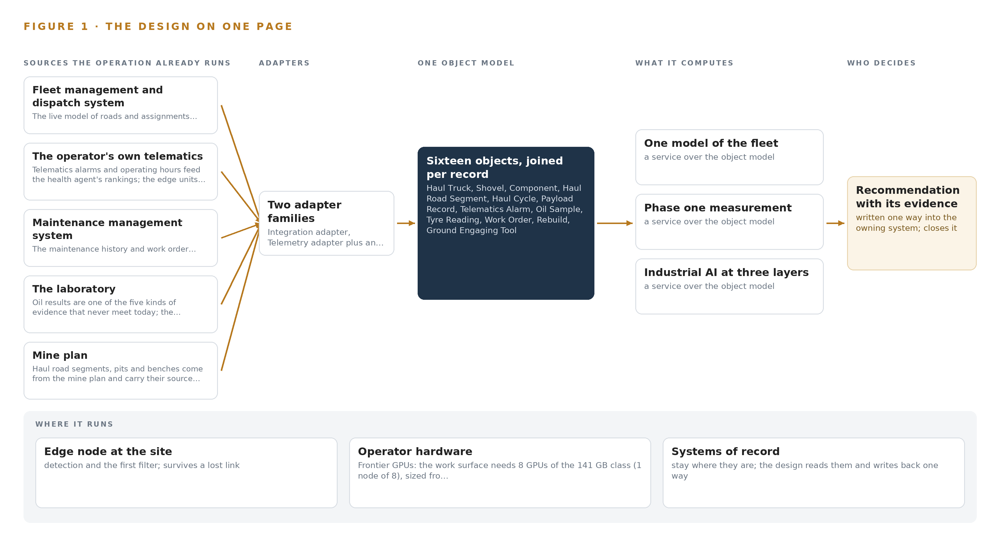
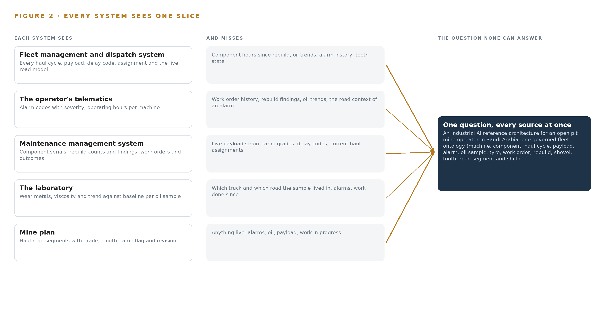
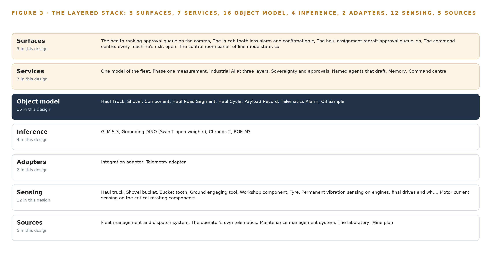
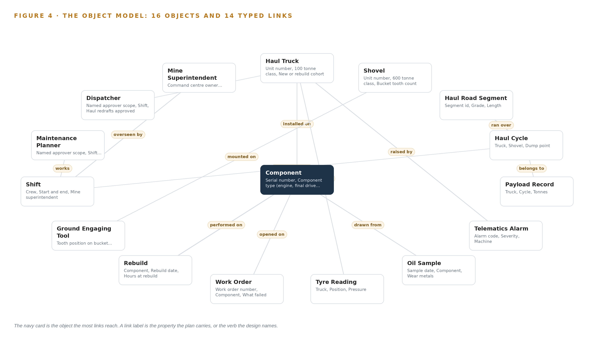
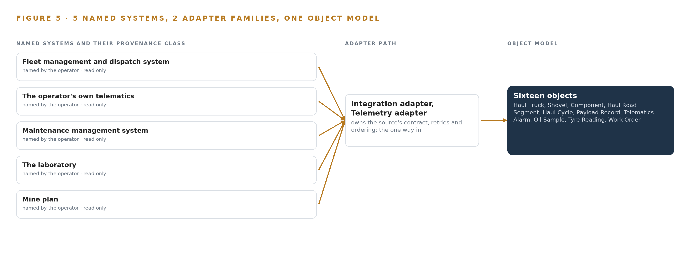
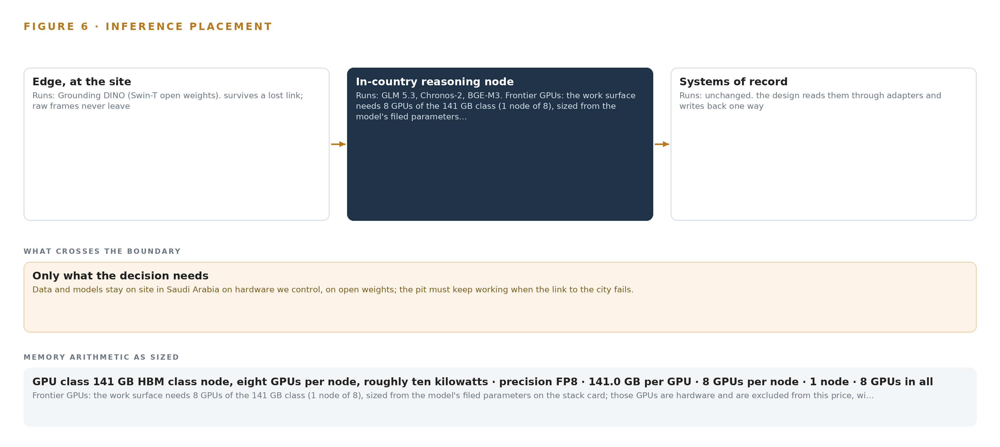
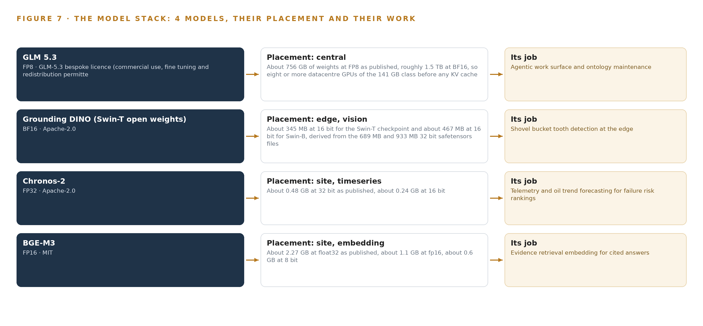
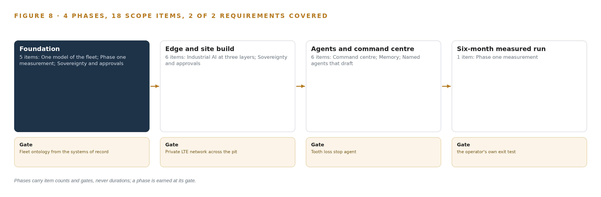
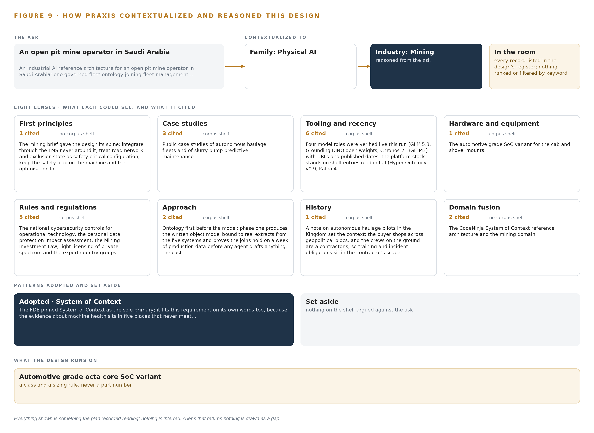

# Industrial AI for an Open Pit Mine Haul Fleet in Saudi Arabia

Canonical: https://codeatoms.ai/open-pit-mine-haul-fleet-saudi-arabia/
DOI: https://doi.org/10.5281/zenodo.23889774
PDF: https://codeatoms.ai/open-pit-mine-haul-fleet-saudi-arabia/paper/open-pit-mine-haul-fleet-saudi-arabia.pdf
License: CC BY 4.0
Publisher: CodeNinja Atoms (https://codeatoms.ai), a fully owned subsidiary of CodeNinja

VERTICAL-DRIVEN ARCHITECTURES · MINING · DESIGNED WITH PRAXIS · NOVEMBER 2026

# Industrial AI for an Open Pit Mine Haul Fleet in Saudi Arabia

Pit Fleet Watch: A Sovereign AI Reference Architecture for Mine Haul Fleets

Muhammad Umar, Cofounder, CodeNinja

For the mine superintendent, the maintenance planner and the dispatcher, and the reliability, data and platform engineers who would build and run it.

---

Vertical-Driven Architectures is a CodeNinja series of system designs. Every design in the series is driven by a real-world problem and scenario in a single industry, and every one is designed on Praxis, CodeNinja's platform for designing physical AI systems. Operations are described by class, never by name.

At a glance

## Industrial AI for an Open Pit Mine Haul Fleet in Saudi Arabia

**What this is.** An open reference architecture for system design in physical AI, built for an open pit mine operator in Saudi Arabia whose pit is worked by a contractor with a haul fleet of about 35 trucks of the 100 tonne class and one shovel of the 600 tonne class, where owning the reasoning node that runs it costs about 556,000 US dollars over three years. Every alarm, oil result, tyre reading, payload record and rebuild is joined on one governed fleet ontology, so the maintenance planner can ask which component on which truck fails next and catch a final drive in the workshop rather than on the ramp. The models run entirely on the operator's own hardware on site, under the Mining Investment Law and its safety regulations, the national cybersecurity controls for operational technology, the Personal Data Protection Law and export control on the GPU node. It is written for the mine superintendent, the maintenance planner and the dispatcher, and the reliability, data and platform engineers who would build and run it. The operator is described by class, never by name.

**The answer in numbers.**

| Part | The design |
| --- | --- |
| Sources | Five systems, entering through two adapter families (the integration adapter for vendor APIs, database reads and file exports, the telemetry adapter for high rate signals) that stamp every fact with its source system, provenance class and a synchronized timestamp: the fleet management and dispatch system, the original equipment makers' telematics, the maintenance management system, the oil laboratory and the mine plan, all read only; the two writes are approved haul redrafts back into the fleet system and approved work orders back into the maintenance system, each with an audit trail |
| Object model | 16 typed objects with 13 labelled typed links, from the haul truck, shovel, component and haul road segment through the haul cycle, payload record, telematics alarm, oil sample and tyre reading to the work order, rebuild, ground engaging tool and shift, with the maintenance planner, dispatcher and mine superintendent, published as JSON for reuse |
| Models | GLM 5.3 (bespoke licence, 753B at FP8) for reasoning, the conversational interface and the agents' drafts; Grounding DINO Swin-T (Apache-2.0, about 345 MB at 16 bit) for shovel bucket tooth detection at the edge; Chronos-2 (Apache-2.0) for zero shot telemetry and oil trend forecasting with covariates; BGE-M3 (MIT) for evidence retrieval so every answer cites its record; nothing trained into weights |
| Compute | One node of eight 141 GB cards (1,128 GB) in the site server room, holding 753 GB of FP8 weights with a 1.2 planning factor, 904 GB, at roughly ten kilowatts; rack servers beside it for forecasting and embedding; heat rated automotive grade SoC edge units, fanless, on the trucks and at the shovel bucket camera. The node is a 4A090.a class item for a D:3 and D:4 destination, so a BIS licence determination belongs in phase one (Appendix A.3). Nothing leaves; updates arrive one way through a hardware enforced data diode |
| Rollout | Four phases carrying 18 scope items (5, 6, 6, then 1) behind four gates: the fleet ontology standing on the systems of record, the private LTE network across the pit, the tooth loss stop agent, and a six month measured run of one pit's haul fleet of about 35 trucks and one 600 tonne class shovel against the operator's own baselines of unplanned downtime, mean time between failures, tooth loss reaching the crusher and cost per tonne |
| Three-year cost | About 556,000 US dollars to own the reasoning node for three years (a range of 528,000 to 580,000: server, support and power at the Saudi industrial electricity tariff), against about 751,000 to rent the same eight cards on the cheapest three year commitment in AWS Middle East (UAE), an EC2 Instance Savings Plan, all upfront, so ownership costs about three quarters of it. Renting is a price reference only, because AWS lists no Saudi region on the day read and every rented option would carry fleet records across the border (Appendix A) |
| Human control | Agents draft and named people decide: the maintenance planner approves each health ranking, the dispatcher approves each haul redraft, the shovel operator confirms each tooth loss, and the mine superintendent owns the command center and holds escalation authority; no agent stops a machine or changes a work order without a named approval, except the tooth loss stop, which follows the site safety procedure |

**Reuse it.** The object model, the model register and the figures are free to reuse under CC BY 4.0. Cite as <https://codeatoms.ai/open-pit-mine-haul-fleet-saudi-arabia/.>

**Made with.** Reasoned on [CodeNinja Praxis](<https://codeatoms.ai/praxis/>), the CodeNinja Atoms platform for designing physical AI systems. The object model imports into [Hyper Ontology](<https://codeatoms.ai/hyper-ontology/>), which turns it into a living system. Load it with the [hyper-ontology loader](../hyper-ontology-py/): `hyper-ontology show open-pit-mine-haul-fleet-saudi-arabia`. Both are in beta; access by request.

ABSTRACT

## A Failing Final Drive Leaves Evidence Long Before It Fails

When a haul truck's final drive fails on the ramp, the question an open pit mine operator in Saudi Arabia needs industrial AI to answer is which machine fails next and what the planner should do about it today, and that question cannot be answered with the data as it stands: the alarm lives in the operator's own telematics, the wear metals in the laboratory's oil findings, the payload history in the fleet management and dispatch system, the rebuild hours in the maintenance management system and the ramp itself in the mine plan, and no one of those systems can see the other four. Reference architectures for [industrial AI](https://codeatoms.ai/industrial-ai-reference-architecture/) exist for exactly this condition, because the join has to happen somewhere, the data may not leave the site, and the pit must keep working when the link to the city fails.

The design is a sovereign, offline-capable system for one pit: five sources of record joined through two adapter families into a governed fleet ontology of sixteen objects, with seven services and five surfaces serving a control room command center, and four models placed across three tiers: GLM 5.3, at 753 billion parameters served at FP8 on one node of eight 141 GB GPUs, runs reasoning and the conversational interface on the site's own servers; Chronos-2 forecasts telemetry and oil trends and BGE-M3 embeds evidence for cited answers on the same site tier; Grounding DINO open weights run on heat-rated automotive-grade edge units on the trucks and at the shovel bucket camera, where vibration, motor current and camera evidence is gathered even when coverage drops. Three named agents draft for named people: a health agent on a new alarm, oil result or tyre reading for the maintenance planner, a tooth loss agent on a shovel camera detection for the shovel operator, and a dispatch agent on a truck pulled from service for the dispatcher, with every work order outcome feeding memory, never weights. Phase one runs one pit's haul truck fleet, about 35 trucks and one 600 tonne class shovel, for six months against the operation's own baselines of unplanned downtime, mean time between failures, tooth loss events reaching the crusher and cost per tonne.

The paper covers the industry problem and the join failure across the five systems, the constraints and the stack, the sixteen-object fleet ontology and how every source enters it through an adapter, the placement of inference across edge and site tiers, the four models and the licenses that let the operator hold their weights, the four phases with their eighteen items, gates and measured run, what the operator owns at the end, and finally how Praxis contextualized and reasoned the design.

---



Figure 1. Pit Fleet Watch on one page: the sources the operation already runs, one object model, what it computes, and the person who decides.

## Contents

Each chapter is tagged for the reader it serves most directly: Executive, Team Lead, FDE, Reference.

|  |  |  |
| --- | --- | --- |
|  | Abstract · A Failing Final Drive Leaves Evidence Long Before It Fails | Executive |
| PART I · THE PROBLEM | | |
| 1 | [Industrial AI Reference Architectures Start at the Pit Floor](#ch1) | Executive |
| 2 | [Five Systems Hold Five Slices of One Truck](#ch2) | ExecutiveTeam Lead |
| PART II · THE DESIGN | | |
| 3 | [Sovereignty and Named Approvals Shape Every Layer](#ch3) | Team Lead |
| 4 | [One Stack Runs From Systems of Record to Surfaces](#ch4) | Team LeadFDE |
| 5 | [Sixteen Objects Turn Fleet Data Into One Argument](#ch5) | FDE |
| 6 | [Every Fact Enters Through an Adapter, Never Directly](#ch6) | FDE |
| 7 | [Forecasting Runs on the Truck, Reasoning on Site](#ch7) | FDE |
| 8 | [Licenses Decide What the Operator Can Own](#ch8) | FDEExecutive |
| PART III · THE ROLLOUT | | |
| 9 | [Shadow Mode Comes Before Any Draft Is Trusted](#ch9) | Team LeadExecutive |
| 10 | [The Intelligence Stays with the Operator That Produced It](#ch10) | Executive |
| PART IV · HOW IT WAS DESIGNED | | |
|  | Conclusion · The Join, the Boundary and the Named Decision Are the Design | Executive |
| 11 | [How Praxis Contextualized and Reasoned This Design](#ch11) | Team LeadFDE |
|  | [Sources](#sources) | Reference |

PART I · CHAPTER 1

## Industrial AI Reference Architectures Start at the Pit Floor

Industrial AI reference architectures start at the pit floor because a final drive announces itself through months of alarms, oil findings and payload strain spread across five systems that never meet, inside a regulatory ground where data stays on site and the desert heat and dust are working conditi

The abstract stated the counts; this chapter states the question they exist to answer. Sovereign industrial AI reference architectures are usually argued from the data center inward, but for a haul fleet the argument runs the other way: the evidence a failing final drive leaves behind is generated at the machine, in heat and dust, under rules that keep data on site, and an architecture that cannot live with those conditions never reaches the question at all.

### 1.1  The Question, the Data and the Regulatory Ground

The operation needs one question answered continuously: which component on which truck will fail next, and can it be caught before the failure arrives on the ramp with a loaded truck on it. The data that answers it lives in five systems of record: alarm codes and severity from the operator's telematics, wear metals and viscosity trends from the oil laboratory, payload and cycle records from the fleet management and dispatch system, work order outcomes and rebuild findings from the maintenance management system, and the grade and ramp flag of every haul road segment from the mine plan. The regulatory ground constrains the answer as much as the data does. Data and models stay on site on hardware the operator controls; camera coverage of named operators requires a personal data protection impact assessment before the first camera runs; and any mechanism that can stop a machine must stand on functional safety guidance for autonomous and mixed mining systems (Gmggroup 2020). The design satisfies all three regimes at once rather than trading among them.

### 1.2  The Documented Cost of Getting It Late

The cost of a late answer is documented publicly. A mines safety regulator published a significant incident report into a collision between an autonomous haul truck and a manned water cart, in which machine state and mixed traffic were not joined in time to prevent contact (WorkSafe 2025), and the same regulator maintains a code of practice for safe mobile autonomous mining whose continuing revisions record the problem as standing rather than exceptional (WorkSafe 2025b). At the industry level, member companies of the International Council on Mining and Metals still report fatalities year on year in the council's safety data, which is the floor under every ranking this design produces (ICMM n.d.). A final drive failing on the ramp is rarely an injury event, but it is the same evidence arriving late, and it costs unplanned downtime, a recovery on a grade and a rebuild bay filled without warning.

### 1.3  The Operation as a Scenario

The operator is an open pit mine operator in Saudi Arabia, with the pit worked by a contractor. The pit works a haul fleet of about 35 trucks of the 100 tonne class against one electric rope shovel of the 600 tonne class, feeding a crusher that is protected by catching shovel teeth before they travel with the ore. Four roles sit in the loop by name: the maintenance planner approves health drafts, the dispatcher approves haul redrafts, the shovel operator confirms a missing tooth, and the mine superintendent owns the command center and holds escalation authority. The physical environments are the pit floor, the ramp segments of the haul road, the workshop rebuild bay and a site server room. Five named systems of record hold the evidence and two adapter families bring it in, and one rule runs through all of it: no agent stops a machine or changes a work order without a named approval, with the single exception of the tooth loss stop, which follows the site safety procedure. Phase one covers one pit's haul fleet and the shovel, runs for six months, and is measured against the operator's own baselines of unplanned downtime, mean time between failures, tooth loss events reaching the crusher and cost per tonne.

PART I · CHAPTER 2

## Five Systems Hold Five Slices of One Truck

Each of the five systems of record sees one slice of the machine and misses the rest, so the one question that matters, which component fails next, is answerable by none of them alone and by no one of them together.

Chapter 1 stated the question and the ground it must be answered on. This chapter shows why none of the five systems of record can answer it, by walking through what each one sees and what each one misses; Figure 2 sets the five views side by side.

### 2.1  What Each System Sees

The fleet management and dispatch system sees the movement: every haul cycle with its truck, shovel and dump point, cycle time, delay code and payload tonnes, and it holds the live model of the roads and assignments. What it misses is everything inside the machine, because hours since a component's last rebuild, the wear metals in its oil and the alarm history are not its business. The operator's telematics sees the machine's own voice: alarm codes with severity and timestamps, and operating hours per unit, and it misses what any alarm means in maintenance terms, holding no work order history, no rebuild findings and no oil trend against which an alarm could be graded.

The maintenance management system sees the component's biography: serial numbers, rebuild counts and shop findings, work orders and their outcomes. It misses the live conditions that produced the failure, because payload strain, ramp grades and delay codes never reach it. The laboratory sees the component's blood: wear metals, viscosity and the trend against baseline for each oil sample, and it misses the machine's context, since a sample is flagged without knowing which truck carried it, what it hauled or up which grade. The mine plan sees the ground itself: haul road segments with grade, length, ramp flag and source revision, and it sees nothing live at all, because it is revised on planning time, not operating time.



Figure 2. Five systems, each seeing one part of the answer; the question needs all of them in one place at once.

### 2.2  What None of Them See Together

What no system sees is the chain. The simulated event that drives this design is one truck's final drive: months of rising wear metals sit in the laboratory's records, payload strain on ramp segments sits in the fleet system's cycles, an escalating alarm sits in telematics, and the maintenance system holds a rebuild history that says the component is past its mean time between failures. Each system holds one link and none holds the chain, so the planner reads an alarm without the oil trend and the laboratory flags a sample without knowing the truck works the ramp loaded, and the failure announces itself on the ramp instead of in the workshop. That is the join failure, and it is the cost in practice.

PART II · CHAPTER 3

## Sovereignty and Named Approvals Shape Every Layer

Sovereign data on the operator's own hardware, named people approving every action, heat and dust that punish commodity equipment, and a pit that must keep working when the link to the city fails together shape every choice downstream of this chapter.

Chapter 2 showed the join failure: five slices and no chain. This chapter turns that failure into the constraints every layer downstream must satisfy, then records what the scope buys, what it costs and what the design refused.

### 3.1  Data and Models Stay on Site

The first goal is sovereignty: every fact, every model and every ranking stays inside the boundary, on the operator's own hardware in the site server room, with no egress and a hardware-enforced data diode as the single outward path. This is hard in mining because the equipment makers' telematics often live in vendor clouds whose data rights conflict with residency, and because most inference offerings in the field assume a hosted service. The design answers with open weights under licenses that permit self-hosting, and with on-machine edge reads as the fallback that keeps evidence on site when the cloud path is closed.

### 3.2  Named People Approve Every Action

The second goal is accountability: agents draft and named people decide. This is hard because the pit is worked by a contractor, which splits accountability between the contractor running the machines and the operator owning the data and the deposit. Every approval surface therefore names its approver scope, the maintenance planner for health drafts, the dispatcher for haul redrafts and the shovel operator for tooth loss, and the write-back path into the fleet management system carries an audit trail the system's owner accepts before the dispatch agent is built on it.

### 3.3  Heat and Dust Are Working Conditions

The third goal is survival: the equipment must work where the fleet works. Commodity edge hardware is rated for offices, and the desert is not one; the automotive-grade system on chip variant is committed for the cab and shovel mounts, enclosure thermal budgets are run against solar gain, cleaning intervals are treated as a design parameter rather than a chore, and the handed over temperature grade is a commissioning check because published ratings for the board conflict with the chip's.

### 3.4  The Pit Works When the Link Fails

The fourth goal is availability offline. Private spectrum on a light-licensed shared-access basis gives no guaranteed channel, so the edge units buffer locally and send events and small crops rather than continuous pixels, and the site servers keep answering when the link to the city drops. The safety loop stays on the machine and the optimization loop in the control room, a separation the mining guidance on autonomous systems states directly (Gmggroup 2020), and the reason the pit must tolerate link loss at all is that production cannot wait on a city.

### 3.5  What the Scope Buys and What It Costs

Three scoping decisions follow from those goals, and each buys something specific at a stated cost, set out in Table 1. The phase-one boundary keeps the measurement honest; memory instead of training keeps the sovereignty promise auditable; and events rather than pixels keep the design inside the spectrum it actually has.

Table 1 · Scoping Decisions

| Decision | What it buys | What it costs |
| --- | --- | --- |
| Phase one covers one pit's haul fleet and one shovel | A bounded six-month baseline of unplanned downtime, mean time between failures, tooth loss reaching the crusher and cost per tonne | The rest of the operation waits on the phase-one measurement before anything generalizes |
| Memory instead of training | Rankings improve from recorded work order outcomes with no weights changing, keeping the sovereignty promise auditable | Improvement is bounded by what the maintenance record actually holds |
| Events and small crops from the edge, not continuous pixels | The design fits shared-access spectrum and survives link loss | No continuous video review, and the control room sees detections rather than footage streams |

### 3.6  Where the Design Refused the Easy Path

The same goals rule out alternatives that would be simpler to buy, and Table 2 records each refusal with its reason. Beyond the table, several bodies of work are out of scope entirely: autonomous haulage and machine control, because no agent drives, brakes or steers anything; plant and crusher control beyond the tooth loss stop, which protects the crusher by stopping the tooth before it travels with the ore; replacement of the systems of record, which the ontology projects over rather than migrates; training or fine tuning of any model, since rankings improve through memory of work order outcomes and planner decisions; bulk historic data migration beyond live feeds and agreed opening balances; and estate-wide end user training beyond train the trainer for named operators. Each is excluded because the requirement never named it or because it would break a constraint above.

Table 2 · What the Design Chose Against

| Where | What was picked | Instead of, and why |
| --- | --- | --- |
| Edge compute | Automotive-grade SoC edge units on the trucks and at the shovel bucket camera | Off the shelf edge boxes or GPU modules per station, which need a heat path a sealed cab mount cannot give |
| Control path | Write-back only through the owning systems, the fleet system for assignments and the maintenance system for work orders, after a named approval | Any direct path from an agent to a machine, which the operator's own rule forbids outside the tooth loss stop |
| Forecasting | Zero-shot forecasting with covariates on the site servers | Fine-tuned models, which would move the operator's data into weights and break the no-training rule |
| Time series storage | The choice among the compared candidates after the phase-one measurement of actual telemetry rates | Committing to a store before volume is measured, which sizes storage by assumption |
| Positioning | Truck positions and assignments from the fleet management and dispatch system | A committed tracking and trajectory forecasting layer the requirement does not need |
| Scope | One pit, one haul fleet, one shovel and the crusher's tooth protection | Autonomous haulage, plant control beyond the stop, ventilation and slope monitoring and historic migration: scope the requirement never named |

PART II · CHAPTER 4

## One Stack Runs From Systems of Record to Surfaces

The architecture places the five systems of record below, one governed fleet ontology in the middle, and the services, agents and surfaces above, so that nothing is integrated around the ontology and nothing bypasses the systems the operation already trusts.

Chapter 3 fixed the constraints: reasoning stays on site, no agent acts without a named approval, and the systems of record stay exactly where they are. This chapter lays out the stack those constraints produce, from the five systems the operation already trusts to the five surfaces where its people decide.

### 4.1  The Architectural Pattern and Why It Fits

The stack has three bands. Below sit the five systems of record: the fleet management and dispatch system, the operator's own telematics, the maintenance management system, the laboratory and the mine plan. In the middle sits one governed fleet ontology of sixteen objects, a projection over the five rather than a migration of any of them. Above sit the seven services, the three agents that draft and the five surfaces where the maintenance planner, the shovel operator, the dispatcher and the mine superintendent decide. The pattern fits this operation because it binds the silos in place while giving every agent one model to read, and because the safety loop stays on the machine, where the bucket camera and its edge unit watch for a missing tooth, while the optimization loop runs in the site server room, a separation the functional safety guidance for autonomous mining treats as foundational (Gmggroup 2020). Figure 3 shows the layers with their counts: five sources, two adapter families, sixteen objects, four models across three inference tiers, seven services and five surfaces. Nothing is integrated around the ontology, and nothing bypasses the systems of record: every read arrives through an adapter, and every write returns through the owning system.



Figure 3. The layered stack: 5 sources, 2 adapter families, 16 objects, 7 services and 5 surfaces.

### 4.2  Stack Stages From Sources to Surfaces

Table 3 walks the same stack stage by stage, naming the component responsible at each stage. Two stages deserve comment. Sensing is deliberately physical: cameras watch the shovel bucket, the ramp and the workshop rebuild bay, while vibration and current sensing on engines, final drives and wheel motors, tyre readings, payload records and telematics alarms carry the machine's condition between frames. Inference spans three tiers, from Grounding DINO on the heat-rated edge units under ONNX Runtime to Chronos-2, BGE-M3 and GLM 5.3 on the site servers, with GLM 5.3 served under vLLM on the operator's own hardware. Table 7, printed from the plan beside this chapter, records the same stack as a register of choices, layer by layer with the reason each was picked, including the decisions to take truck positions from the fleet management system rather than add a positioning layer, to commit no trajectory forecasting in phase one, and to size telemetry storage from measured rates of about 35 trucks and one shovel rather than an assumption.

Table 3 · The Stack, Stage by Stage

| Stage | What it is responsible for | How |
| --- | --- | --- |
| Sources | Holding the record of roads, assignments, machines, history and plan geometry | Five systems: the fleet management and dispatch system, the operator's own telematics, the maintenance management system, the laboratory, the mine plan |
| Sensing | Turning physical behavior into signals and frames | Bucket, ramp and workshop cameras; vibration and current sensing on engines, final drives and wheel motors; tyre readings; payload records; telematics alarms |
| Adapters | Governing every fact at the door | Two families: the integration adapter for vendor APIs, database reads and file exports; the telemetry adapter for high-rate signals |
| Object model | One governed model of the fleet | Sixteen objects with typed links, every fact carrying its source system and revision |
| Inference | Running models where the evidence is | Grounding DINO on the heat-rated edge units under ONNX Runtime; Chronos-2, BGE-M3 and GLM 5.3 on the site servers, GLM 5.3 under vLLM |
| Services | Joining evidence into drafts, rankings and cited answers | Seven services, from one model of the fleet and named agents that draft to memory and the command center |
| Surfaces | Where named people decide | Five surfaces: the health ranking approval queue, the in-cab tooth loss alarm and confirmation, the haul redraft approval queue, the command center, the control room panel |

Table 7 · Architecture, Layer by Layer

| Layer | Component | Choice | Why |
| --- | --- | --- | --- |
| Event streaming and messaging | by class, no product named | Product | Apache Kafka 4.3.x (KRaft) |
| The ontology or graph store | by class, no product named | Product | Hyper Ontology |
| Time series and telemetry storage | InfluxDB 3 Core, TimescaleDB, QuestDB | Class | The shelf holds three compared candidates; the choice lands after the phase-one measurement of actual telemetry rates from about 35 trucks and one shovel, because storage is sized by measured volume, not by assumption. |
| Video ingest, recording and management | by class, no product named | Product | MediaMTX |
| Edge model serving | by class, no product named | Product | ONNX Runtime |
| On site language model serving | by class, no product named | Product | vLLM |
| Object tracking and trajectory forecasting | by class, no product named | Not needed | Haul cycles and truck positions come from the fleet management and dispatch system, which holds the live model of roads and assignments; the cameras detect per frame and no trajectory forecast is committed in phase one. |
| Edge orchestration of containers | by class, no product named | Product | K3s |
| An air gapped artifact and model registry | by class, no product named | Product | Harbor |
| Labelling and retraining | by class, no product named | Product | CVAT |
| Time synchronisation across sensors and systems | by class, no product named | Product | Linuxptp with chrony |
| Observability of the running system | by class, no product named | Product | Prometheus 3.13 LTS with Grafana and Loki |

### 4.3  A Reusable Pattern

The reusable shape is the projection ontology with adapters as its one door, and it is the part of this design that reads as a sovereign industrial AI reference architecture made concrete. A team carrying a similar brief keeps four moves: bind the silos with a governed object model rather than a data lake; make the adapter tier, not the ontology's readers, responsible for provenance; place detection where the safety consequence is and ranking where the evidence joins; and write back only through the owning systems, with an audit trail on every write. They would swap the object list, the sensing mix and the model sizes for their own, and they would keep the rule that no fact enters ungoverned and no draft carries weight without a named approval.

PART II · CHAPTER 5

## Sixteen Objects Turn Fleet Data Into One Argument

Sixteen objects, from the haul truck and its final drive to the planner who approves the work order, carry typed links that let one query walk from a ramp alarm to an oil trend to a rebuild record, an argument no document store can hold.

Chapter 4 showed the stack as layers with counts. This chapter opens the middle layer and lists what it holds, object by object and link by link.

### 5.1  Sixteen Objects and Their Typed Links

The model holds sixteen objects: the Haul Truck, the shovel with its bucket tooth count, the Component, the Haul Road Segment, the Haul Cycle, the Payload Record, the Telematics Alarm, the Oil Sample, the Tyre Reading, the Work Order, the Rebuild, the Ground Engaging Tool, the Shift, and three actors, the Maintenance Planner, the Dispatcher and the Mine Superintendent. Each object is anchored in the system of record that owns it: the haul truck, the haul cycle and the payload record in the fleet management and dispatch system, the component, the work order and the rebuild in the maintenance management system, the oil sample in the laboratory, the haul road segment in the mine plan. Figure 4 shows every object and its typed links, with the work order as the focal object, and Table 8, printed from the plan beside this chapter, records the same model as a register of objects, their anchors and their links.

The links are what a document store cannot hold. A query that starts at a telematics alarm on a truck working the ramp walks to the haul cycles that truck ran over that haul road segment, to the final drive as a component with its hours since rebuild, to the oil sample trend on that component, and to the findings recorded at its last rebuild. Each of those records exists today; the walk between them does not, because the five systems share no keys and no links. The design's worked event, one truck's final drive failing on the ramp, is exactly this walk, and the argument it assembles is what no single system can produce alone.



Figure 4. The sixteen objects of the model and the typed links that let a query reach across them.

Table 8 · The Object Model

| Object | Anchored in | Typed links |
| --- | --- | --- |
| Haul Truck | Fleet management and dispatch system | no typed link recorded |
| Shovel | Fleet management and dispatch system | no typed link recorded |
| Component | The maintenance management system | installed on: Haul Truck; hours since: Rebuild |
| Haul Road Segment | The mine plan | no typed link recorded |
| Haul Cycle | Fleet management and dispatch system | occurred during: Shift; ran over: Haul Road Segment |
| Payload Record | Fleet management and dispatch system | belongs to: Haul Cycle |
| Telematics Alarm | The original equipment makers' telematics | raised by: Haul Truck |
| Oil Sample | The laboratory | drawn from: Component |
| Tyre Reading | Inspection records | taken on: Haul Truck |
| Work Order | The maintenance management system | opened on: Component |
| Rebuild | The maintenance management system | performed on: Component |
| Ground Engaging Tool | Inspection records | mounted on: Shovel |

### 5.2  The Human Loop and the Hosting Posture

The three actors are objects in the model, not labels outside it. The maintenance planner approves health rankings, the dispatcher approves haul redrafts, and the mine superintendent owns the command center and holds the escalation authority. The work order's status vocabulary marks the boundary of the machine's authority: a draft sits at "Drafted by agent" until a named person moves it to "Approved", and every later state, from "In progress" to "Overdue", records a human decision. The hosting posture follows from sovereignty. The ontology, the models and the memory run on the site servers in the mine's server room, on hardware the operator controls; identity is served on site; the running system holds no external links, and the one inbound path is the one-way data diode that carries artifact and model updates in. The one write path out of the ontology returns through the owning systems, the fleet management system for assignments and the maintenance system for work orders, each write carrying its audit trail.

### 5.3  One Object in Its Recorded Form

The work order, in its recorded form printed below, carries the whole governance argument in one record: the component it is opened on, what failed, the work done, the planner decision and the outcome, with a status vocabulary that begins exactly where the agent's authority ends.

```
{ "id": "haul-truck", "label": "Haul Truck", "kind": "asset", "anchored_in": "Fleet management and dispatch system", "properties": [ "Unit number", "100 tonne class", "New or rebuild cohort", "Running hours", "Current haul assignment", "Availability this month" ], "status_vocabulary": [ "In service", "Pulled from service", "In rebuild", "Standby" ], "links": [] }
```

PART II · CHAPTER 6

## Every Fact Enters Through an Adapter, Never Directly

Every fact from the five named sources enters the ontology through one of two adapter families, carrying its provenance class and its source system, so the join is governed at the door rather than repaired after it.

Chapter 5 described what the object model holds. This chapter describes how facts reach it, and the guarantees they arrive with.

### 6.1  Five Named Sources, One Provenance Class

Five systems feed the ontology, all of them the operator's own, and all read-only at the door. The fleet management and dispatch system holds the live model of roads and assignments, and the health and dispatch agents read cycles, payloads and delays from it. The operator's own telematics supplies alarms and operating hours, while the edge units also read the truck bus on the machine so evidence keeps flowing when coverage drops. The maintenance management system supplies the history and the work order outcomes the rankings learn from, and receives approved work orders and rebuild records back. The laboratory supplies the oil analysis, one of the five kinds of evidence that never meet today. The mine plan supplies haul road segments, pits and benches, each carrying its source and revision so a ramp event attributes to the right segment; the road network is safety-critical configuration, and its revision trail is treated accordingly (Gmggroup 2020). Figure 5 sets the five systems, their provenance classes and their adapter paths side by side. One survey item stays open in phase one: the telematics may live in vendor clouds or carry data rights that conflict with the sovereign constraint, so an interface and data-rights survey runs early, with on-machine edge reads as the fallback that keeps evidence on site.



Figure 5. The 5 named systems, the adapter path each one takes, and the object model they all map into.

### 6.2  What the Adapter Tier Guarantees

Two adapter families cover every entry. The integration adapter handles the vendor APIs, database reads and scheduled file exports that reach the five named systems; the telemetry adapter handles the high-rate signals from the truck bus and the edge units. Between them they guarantee four things: every fact carries its source system, its provenance class and a synchronized timestamp; no source writes into the ontology directly, so the join is governed at the door rather than repaired after it; replays are idempotent, so a redelivered record updates rather than duplicates; and the write-back path runs only through the owning systems, the fleet management system for assignments and the maintenance system for work orders, each write carrying its audit trail.

### 6.3  The Event Backbone

The backbone is Apache Kafka 4.3.x in KRaft mode, on the site servers. Ordering is per partition, keyed by machine, so one truck's events land in the order they happened, and delivery is at least once with idempotent consumers on the far side. Buffering happens twice: at the edge, where units hold events and small image crops locally while the private LTE link is down and forward them on recovery, and in the backbone, whose retention covers a replay after a consumer failure. Replication runs across brokers on site, and the time card grandmaster keeps sensors and systems synchronized so joins across the five sources line up in time. Models and artifacts enter through the air-gapped registry over a hardware-enforced data diode, one way, so the running system has no egress at all.

PART II · CHAPTER 7

## Forecasting Runs on the Truck, Reasoning on Site

Tooth detection runs on heat-rated edge units at the bucket and on the trucks, forecasting and evidence retrieval run on the site servers, and GLM 5.3 reasoning runs on one node of eight 141 GB GPUs in the site server room, with nothing that matters crossing the network boundary when the link fails.

Chapter 6 showed how the five systems of record enter through two adapter families and land in one governed object model. This chapter fixes where the four models run, because placement decides what survives a failed link, a summer afternoon and a broken update path: on the machine, on the site servers, or on the node that answers the superintendent.

### 7.1  Three Tiers and the Arithmetic That Sizes Them

The edge tier is the automotive-grade octa core SoC variant committed for the cab and shovel mounts, and it exists because heat and abrasive dust are normal on this site rather than exceptions. It serves Grounding DINO, the Swin-T open weights checkpoint at about 345 MB at 16 bit, through ONNX Runtime under K3s, a footprint that fits in the SoC's memory with the video pipeline beside it and lets the enclosure stay fanless, since a fan would pull dust through the board. The larger Swin-B checkpoint at about 467 MB at 16 bit is the fallback if evaluation on representative footage demands it, and the sizing still holds. Tooth detection runs here because the pixels are here: the bucket camera produces continuous frames, and the shared-access spectrum across the pit carries no guaranteed channel, so the design never commits to sending continuous pixels anywhere. The split follows the mining safety guideline's own discipline of keeping the safety loop on the machine and the optimization loop in the center (Gmggroup 2020).

The site tier is rack servers in the site server room, fed from the internal Harbor registry with no egress. They run Chronos-2, about 0.48 GB at 32 bit as published and about 0.24 GB at 16 bit, thresholding forecast residuals for anomaly across the telemetry of about 35 trucks and one shovel, and BGE-M3 at about 1.1 GB at fp16 for evidence retrieval. Both are small against server memory, so the binding constraint on this tier is not capacity but the rule that nothing leaves it.

The central tier is one node of eight 141 GB GPUs, roughly ten kilowatts, in the same server room, holding GLM 5.3 for reasoning and the work surface. The arithmetic is exact: GLM 5.3 is filed at 753B parameters, and at FP8, one byte per parameter, that is 753 GB of weights. A 1.2 planning factor reserves another 151 GB for KV cache and activations, so the GPUs must hold 904 GB in total. Eight GPUs of 141 GB give 1,128 GB, which leaves 375 GB beside the weights, more than twice the 151 GB the planning factor reserves, so the KV cache ceiling holds with headroom for concurrent command center sessions. Figure 6 sets the three tiers side by side with what runs on each and what crosses between them.



Figure 6. Where each tier runs, what runs there, and the narrow set of outputs that cross the boundary.

### 7.2  The Latency Budget

The budget is ordered by consequence rather than by a single number, because each loop ends at a different person. The shortest loop never leaves the machine: a frame is judged on the SoC beside the camera, the in-cab alarm sounds, and the shovel operator confirms the tooth loss before the ore travels toward the crusher; no step in that loop waits on the network, which is how a stop can be trusted when the channel is shared and unguaranteed. The middle loop refreshes as evidence arrives: when an oil result lands from the laboratory or a telematics alarm opens, the health agent's failure risk ranking is recomputed on the site servers and waits in the planner's approval queue, and its deadline is the shift, because the maintenance planner decides within it. The longest loop is conversational: the command center asks, BGE-M3 retrieves the evidence across the ontology, GLM 5.3 answers with citations, and the answer is only useful if it arrives while the mine superintendent is still looking at the machine in question.

### 7.3  The Boundary and Its Failures

What crosses the network boundary is events and small crops, never continuous pixels: the edge units buffer locally and send detections, confirmed events and crops small enough for the shared channel. The edge units also read the truck bus on the machine directly, so telematics evidence keeps flowing when coverage drops and the operator's own telematics cannot be reached. When the link to the city fails, the pit keeps working, which is the reason reasoning sits on site rather than in an in-country data center: every ranking, draft and approval continues inside the boundary, in line with the fail-safe discipline the autonomous mining codes require on link loss (WorkSafe 2025b). When power fails, the edge node and its PoE switch sit on one UPS and NUT orders the clean shutdown, so the units resynchronize cleanly when power returns rather than waking corrupted. When the update path is the failure in question, model and container updates arrive through a hardware-enforced data diode running Lidi into the Harbor registry: the registry cannot be written from outside, and the update path can never become an egress path.

PART II · CHAPTER 8

## Licenses Decide What the Operator Can Own

Four models, GLM 5.3, Grounding DINO, Chronos-2 and BGE-M3, each carry a license whose terms permit the operator to hold, serve and keep the weights inside its own boundary, which is why each was chosen over the alternatives that do not.

Chapter 7 placed each model on the tier its latency and its evidence demand. This chapter asks the quieter question that decides more than placement: what each license permits the operator to keep, because a model the operator cannot hold, serve and update inside its own boundary is not an asset but a dependency. Figure 7 stacks the four models on their tiers.



Figure 7. The four models, their placement, and the work each one does.

### 8.1  Four Models, Each Held Under Its Own Terms

GLM 5.3 is the reasoning tier, filed at 753B parameters: about 756 GB of weights at FP8 as published and roughly 1.5 TB at BF16, which is why eight GPUs of the 141 GB class are sized before any KV cache is counted. It runs in the site server room on the operator's own hardware as the agentic work surface and ontology maintenance model, drafting the health, tooth loss and dispatch agents' outputs and answering the command center with citations. Its license is the GLM-5.3 bespoke license, whose terms permit commercial use, fine tuning and redistribution, and those terms are what let the operator hold the weights, serve them with vLLM from the internal registry, and keep serving them whatever any external relationship becomes.

Grounding DINO, the Swin-T open weights checkpoint at about 345 MB at 16 bit, detects the shovel bucket, its teeth and the ground engaging tools per frame on the heat-rated edge units at the bucket camera. Its Apache-2.0 license permits the operator to hold and serve the checkpoint inside the perimeter and to relabel footage in CVAT toward a future retrain if evaluation on representative footage demands it, even though phase one commits no fine tuning of any model. Chronos-2 is the forecasting model on the site servers, about 0.48 GB at 32 bit as published and about 0.24 GB at 16 bit, doing zero-shot forecasting with covariates and thresholding the residual for anomaly, so no model is tuned for this operation. It was chosen over TimesFM 3.0 and Moirai 2.0, whose non-commercial terms cannot ship inside the operator's boundary, and over Chronos-Bolt, because covariates and several co-evolving channels matter here. BGE-M3 is the evidence retrieval embedding on the site servers, served at fp16 at about 1.1 GB: its dense, sparse and multi-vector retrieval in a single pass, with an 8,192 token window and an MIT license, keeps part numbers and alarm codes retrievable across records that mix Arabic and English.

### 8.2  The Model and Equipment Register

Table 4 reads the whole design in one place: each model, the hardware classes and sizing rules that carry it, the sensing that feeds it, the patterns the design stands on, and the ground it runs on. Each row is a choice the license or the environment forced, and each carries its reason beside it, so an engineer building from this paper can check any row against the arithmetic in Chapter 7 and the integration map in Chapter 6.

Table 4 · Model and Equipment Register

| The choice | What was picked | Why here |
| --- | --- | --- |
| Reasoning model | GLM 5.3, 753B parameters at FP8, on one node of eight 141 GB GPUs | Bespoke license permits commercial use, fine tuning and redistribution, so the operator holds the weights |
| Edge vision model | Grounding DINO, Swin-T open weights, about 345 MB at 16 bit, served on the automotive-grade SoC | Apache-2.0 lets the operator hold and serve the checkpoint fanless at the bucket |
| Forecasting model | Chronos-2, zero-shot with covariates, about 0.24 GB at 16 bit, on the site servers | Apache-2.0 against non-commercial family members that cannot ship inside the boundary |
| Embedding model | BGE-M3, 8,192 token window, about 1.1 GB at fp16, on the site servers | MIT license, with dense, sparse and multi-vector retrieval over Arabic and English records |
| Edge compute | Automotive-grade octa core SoC variant, heat-rated for cab and shovel mounts | Carries the bucket-watch model fanless where a GPU module would need a heat path a sealed enclosure cannot give it |
| Site inference servers | Rack servers in the site server room, sized for the desert environment, fed from the internal registry with no egress | Join the evidence and run the forecasting and embedding tiers beside the ontology |
| GPU node | One node of eight 141 GB GPUs, roughly ten kilowatts | 753 GB of weights leave 375 GB for KV cache against the 151 GB the 1.2 planning factor reserves |
| Sensing | Bucket, ramp and rebuild bay cameras; vibration and motor current sensing on critical rotating components; oil findings; tyre readings; payload records; telematics alarms | The kinds of evidence that never meet today, joined in one ontology with every fact tied to its source |
| Patterns the design stands on | Safety loop on the machine and optimization loop in the center (Gmggroup 2020); memory of work order outcomes, never weights; write-back only through the owning systems; local buffering with fail-safe on link loss (WorkSafe 2025b) | Each pattern is a mining safety or sovereignty rule, not a preference |
| Ground it runs on | The operator's own hardware on site, an air-gapped Harbor registry, updates through a hardware-enforced data diode | The pit keeps working when the link to the city fails, and nothing leaves |

PART III · CHAPTER 9

## Shadow Mode Comes Before Any Draft Is Trusted

Four phases carrying eighteen items put the ontology, the edge build and all three agents through gates, with every ranking run in shadow against reconstructed baselines before any draft carries weight with the planner, the shovel operator or the dispatcher.

Chapter 8 settled the four models, their footprints and the licenses that let the operator hold their weights on its own hardware. This chapter sets the order of the work, what each phase must prove before the next begins, and what the measured run reads before any agent draft carries weight with a named person.

### 9.1  Four Phases Carry Eighteen Items Through Their Gates

The rollout is four phases carrying eighteen items, with their gates and requirement coverage shown in Figure 8. Foundation carries five items across three workstreams, one model of the fleet, phase one measurement, and sovereignty and approvals; its exit gate is the fleet ontology standing on the systems of record, the sixteen objects anchored in the five named systems with evidence joins proven on live records. The edge and site build carries six items across industrial AI at three layers and sovereignty and approvals; its gate is the private LTE network working across the pit, on which every later capability depends. The agents and command center phase carries six items across command center, memory and named agents that draft; its gate is the tooth loss stop agent, the one capability that touches a machine and therefore the one that must work first. The measured run carries a single item, the phase-one pilot read against its gates, in the phase one measurement workstream.

Requirement coverage stands at two requirements covered in full, none partial and none open, as Figure 8 records. The order encodes dependency rather than convenience: no agent is built before the ontology and the write-back paths are settled, and no ranking carries weight before the baseline it will be measured against is reconstructed.



Figure 8. The four phases and their gates, and coverage of the 2 requirements across them.

Table 5 · Failure Modes

| What fails | What the design does |
| --- | --- |
| The operator's own telematics may live in vendor clouds or carry data rights that conflict with the sovereign constrain | Interface and data-rights survey in phase one, with on-machine edge reads as the fallback that keeps evidence on site |
| Uneven machine-readable history across the five systems weakens the baselines and the first risk rankings | Reconstruct the baseline from all five systems with gaps stated, and run rankings in a shadow period before any carries weight with the planner |
| Summer heat and abrasive dust degrade cameras and edge units silently, presenting as accuracy loss | Automotive-grade SoC variant with the conflicting datasheet resolved at commissioning, enclosure thermal budgets run against solar gain, cleaning intervals as a |
| Zero-shot tooth detection is unproven on representative bucket footage, and a false stop costs production while a missed | Evaluate the detector on representative footage before any stop authority, set the false-alert budget per shift with the shovel operators, and keep the manual t |
| Write-back to the fleet management system may be blocked by the vendor or by process, turning the dispatch agent into a | Settle the write-back path and its audit trail with the FMS owner and vendor in phase one, before the dispatch agent is built on it |

PART III · CHAPTER 10

## The Intelligence Stays with the Operator That Produced It

The object model, the memory of work order outcomes and the weights all sit on the operator's own hardware inside its own boundary, so the intelligence the pit produces compounds for the operator and for no one else.

Chapter 9 set the gates, the item counts and the measurements that decide whether the design earns trust in the pit. This chapter settles the question that outlasts every gate: who owns what the system becomes once the six-month run has done its work.

### 10.1  What the Operator Holds When Phase One Ends

The fleet object model is the operator's from the day it is built. Its 16 objects and their typed links are a projection over the operator's five systems of record, not a copy held somewhere else: every haul truck, component, oil sample and work order carries the system it came from, so the model can be rebuilt from those sources at any time and cannot be held hostage by anyone who did not build it. The same holds for the weights. GLM 5.3 runs under a license that permits commercial use, fine tuning and redistribution, while Grounding DINO and Chronos-2 run under Apache-2.0 and BGE-M3 under MIT; each license lets the operator hold and serve its copy inside the boundary without a vendor's continued permission, which is the entire point of self hosting on site. In phase one nothing is fine tuned, because rankings improve through memory of work order outcomes and planner decisions and never through weights; there is therefore no fine-tune to own yet, and any future one belongs to the operator on the same license terms.

The decision record is the third asset. Every approved ranking, haul redraft and tooth loss confirmation is kept with the named approver who decided it, and that record is the memory each later decision reads; it lives on the site servers and does not leave them. The boundary is the fourth asset: the servers in the site server room, the edge units on the trucks and at the shovel bucket, the private network across the pit, and identity served on site. Updates arrive one way through the hardware-enforced data diode, so even the update path cannot become an egress path, and the pit keeps working when the link to the city fails.

### 10.2  The Offer Behind the Design

CodeNinja builds exactly this shape, and this design maps onto its offer part by part. Adaptive Operations covers the sensing, detection and forecasting of physical behavior: the vibration and current sensing on engines, final drives and wheel motors, the bucket camera watching for missing teeth, and the zero-shot forecasting of telemetry and oil trends that ranks failure risk. Decision Systems covers the ranking, attribution and recommendations a named person decides: the health ranking the maintenance planner approves, the haul redraft the dispatcher approves, the stop the shovel operator confirms. Hyper Ontology holds the governed fleet model, the 16 objects and their typed links, as the operator's own projection over its systems of record. Hyper Pragma is the work surface in the command center where the operator's own people act on agent drafts and build their own agents inside the boundary. Hyper Engram is the kept record of decisions and outcomes that the next decision reads; it never updates model weights. Sovereign Infrastructure is the posture the whole design takes: the operator's own hardware, open-weight licenses and operation inside the boundary with no egress. Praxis is the platform that produced the design, and everything it produced sits with the operator that paid for it.

PART IV · CONCLUSION

## The Join, the Boundary and the Named Decision Are the Design

In one view, the design is a projection rather than a migration: a governed fleet ontology of sixteen objects that binds five systems of record in place and ties every fact to the system it came from, heat-rated edge units that read the truck bus and watch the bucket when the network drops, forecasting and retrieval on site servers, GLM 5.3 reasoning on the operator's own eight GPUs, and three agents that only draft, while the planner, the shovel operator and the dispatcher decide, with the outcome of every work order held in memory so each ranking gets better without a single weight changing.

Running the same shape elsewhere takes an operation with several systems of record it cannot replace, an environment that punishes commodity hardware, and a rule that named people decide: the objects, the sources and the models are swapped for the operation's own, while the join, the adapter discipline, the memory of outcomes, the offline fail-safe and the gates stay exactly as drawn, because those are the parts that make the intelligence compound inside the boundary of the organization that produced it.

PART IV · CHAPTER 11

## How Praxis Contextualized and Reasoned This Design

Every design in the series is produced on Praxis, and this chapter lets a reader trace any choice back to the recorded reading that justified it, from the ask and the assigned family to the eight lenses and the patterns adopted and set aside.

Chapter 10 closed the ownership argument: the model, the memory, the weights and the boundary all stay with the operator. This chapter turns the design on itself and shows how it was reasoned, so that any choice in the preceding chapters can be traced back to recorded reading rather than to assertion. Every design in this series is produced on Praxis, CodeNinja's platform for designing physical AI systems, and this chapter lets a reader trace any choice back to what justified it, as Figure 9 shows: the ask as it arrived, the family and industry assigned, the records in the room, the eight lenses, and the patterns adopted and set aside.

### 11.1  Contextualizing the Ask

The ask arrived in the operator's own words: a governed fleet ontology joining fleet management, telematics, maintenance and oil analysis; edge units on the trucks and at the shovel bucket camera; on-site servers; a command center with cited answers; three named agents drafting for named people; and reasoning on GLM 5.3 open weights self hosted on site, with one truck's final drive failing on the ramp as the event the design must catch early. Praxis assigned the design to the physical AI family in the mining industry, with the country fixed by the operator's own requirement. What was in the room was recorded: tooling and recency records, case study records, a first principles mining brief, and hardware shelf entries covering the edge compute, the site servers, the cameras and the GPU node. Every record is listed in the design's register and available on request.



Figure 9. From the ask to the design: the family and industry Praxis assigned, the eight lenses and what each cited, the patterns adopted and set aside, and the equipment the design lands on.

### 11.2  The Eight Lenses

Each lens read what it could see and returned what it returned. The first-principles lens supplied the spine of the design, and the rules lens grounded the approval rule in recorded regulatory practice: the codes of practice for safe mobile autonomous mining (WorkSafe 2025b), their functional safety treatment (Gmggroup 2020), and the significant incident report into a collision between an autonomous haul truck and a manned water cart (WorkSafe 2025), which stands behind the rule that no agent stops a machine or changes a work order without a named approval. Industry-wide safety reporting (ICMM n.d.) frames why the tooth loss stop follows the site safety procedure rather than an agent's judgment. Table 6 sets all eight lenses out, and the two that returned nothing are shown as gaps rather than filled with inference.

Table 6 · The Lenses and What They Contributed

| Lens | Could see | Cited | What it contributed |
| --- | --- | --- | --- |
| First principles | no corpus shelf | 1 | The mining brief gave the design its spine: integrate through the FMS never around it, treat road network and exclusion state as safety-critical configuration, |
| Case studies | Case study shelf | 3 | Public case studies of autonomous haulage fleets and of slurry pump predictive maintenance. |
| Tooling and recency | Tooling and recency shelf | 6 | Four model roles were verified live this run (GLM 5.3, Grounding DINO open weights, Chronos-2, BGE-M3) with URLs and published dates; the platform stack stands |
| Hardware and equipment | Hardware shelf | 1 | The automotive grade SoC variant for the cab and shovel mounts. |
| Rules and regulations | Regulatory shelf | 5 | The national cybersecurity controls for operational technology, the personal data protection impact assessment, the Mining Investment Law, light licensing of private spectrum and the export country groups. |
| Approach | Approach shelf | 2 | Ontology first before the model: phase one produces the written object model bound to real extracts from the five systems and proves the joins hold on a week of |
| History | History shelf | 1 | A note on autonomous haulage pilots in the Kingdom set the context: the buyer shops across geopolitical blocs, and the crews on the ground are a contractor's, so training and incident obligations sit in the contractor's scope. |
| Domain fusion | no corpus shelf | 2 | The CodeNinja System of Context reference architecture and the mining domain. |

### 11.3  Patterns Adopted and Set Aside

Four patterns were adopted. Integrate through the fleet management system, never around it, so the dispatch agent's approved redraft is written back to the owning system with an audit trail. Keep the safety loop on the machine, so the tooth loss alarm sounds in the cab where the shovel operator stands. Improve through memory rather than weights, so every work order outcome makes the next ranking better without any fine tuning. Buffer at the edge on link loss, sending events and small crops rather than continuous pixels, because a shared-access private network guarantees no channel. Four were set aside with reasons. Trajectory forecasting was set aside because the fleet management system holds the live model of roads and assignments. A new positioning layer for people and vehicles was set aside for the same reason. Off the shelf GPU modules per station were set aside because a sealed enclosure in this heat and dust needs the fanless automotive-grade SoC, not a heat path no enclosure can serve. Any direct control path from an agent to a machine was set aside because the approval rule forbids it.

### 11.4  Where the Reasoning Lands

The reasoning lands on equipment classes. The automotive-grade octa core SoC variant runs on the trucks and at the shovel, with the conflicting temperature datasheets resolved as a commissioning check. Rack servers in the site server room run the time series and embedding tiers beside the ontology, fed from the internal registry with no egress. One node of eight GPUs of the 141 GB class holds GLM 5.3 at FP8, where 753 GB of weights and the 1.2 planning factor for KV cache and activations make 904 GB against 1,128 GB of capacity. Every figure and every choice in this chapter came from recorded reading: the ask as stated, the records as listed, the lenses as returned, the patterns as weighed. Nothing shown is inferred, and any record behind any choice can be read on request.

Appendix A

## What the Operator's Own Reasoning Node Costs Over Three Years

The paper is written for an open pit mine operator in Saudi Arabia, with a site server room at the pit (chapter 1, section 1.3). This appendix therefore prices for Saudi Arabia, with the Saudi Electricity Company industrial tariff for power and the AWS Middle East (UAE) region, me-central-1, as the rental reference. The design runs every model on hardware the operator owns, and its central tier is "one node of eight 141 GB GPUs, roughly ten kilowatts" serving GLM 5.3 on vLLM (chapter 7, section 7.1; Table 4, "GPU node"). The three other models need no further hardware line here: Chronos-2 at about 0.24 GB and BGE-M3 at about 1.1 GB run on the site rack servers, and Grounding DINO at about 345 MB runs on the automotive grade SoC edge units (chapter 7, section 7.1; Table 4); the paper names those servers and edge units by class only, with no count, no part and no sizing, so they are listed under A.3 rather than a part guessed. The node is priced two ways: owned, from a reseller's published configured price with support and power added, and rented, from the AWS price files for the nearest region that offers the same card. Every input is dated and cited, and the arithmetic is shown.

### A.1 The Answer

Owning the node for three years costs **about 556,000 US dollars**, inside a range of 528,000 to 580,000. Renting the same eight H200 cards around the clock on the cheapest three year commitment, an AWS EC2 Instance Savings Plan, all upfront, for p5en.48xlarge in Middle East (UAE), costs **about 751,000 dollars**. Against it, ownership costs **about three quarters** (555,747 / 750,535 = 0.74, and 0.70 to 0.77 across the range). No rented option can sit inside the Kingdom today: AWS's Saudi region is reported for launch in December 2026 (W.Media 2026) and its price files list no Saudi region on the day read (AWS 2026a), and every rented option would carry fleet, telematics, oil and work order records across the border, which the operator's rule that data and models stay on site with no egress rules out (chapter 3, section 3.1; Table 4, "Ground it runs on"). Renting is therefore a price reference only. GLM 5.3 carries a bespoke license whose terms, in the paper's words, "permit commercial use, fine tuning and redistribution" (chapter 8, section 8.1); no price is asserted for it here. Grounding DINO and Chronos-2 (Apache-2.0) and BGE-M3 (MIT) carry no license line (Table 4).

### A.2 What the Hardware Would Cost

| Option | Basis | Three year cost (USD) |
| --- | --- | --- |
| Owned, in the site server room | One 8x H200 node with support and power, broken out below | 528,000 to 580,000, typical 556,000 |
| AWS, Middle East (UAE), three year EC2 Instance Savings Plan, all upfront | p5en.48xlarge, eight H200 cards, 1,128 GB of HBM3e (AWS 2026c), at 28.55916 dollars an hour, the cheapest three year plan for this instance in the region (AWS 2026a), 26,280 hours; outside the Kingdom | 750,535 |
| AWS, Middle East (UAE), three year Compute Savings Plan, all upfront | p5en.48xlarge at 50.66046 dollars an hour (AWS 2026a), 26,280 hours; outside the Kingdom; reference only | 1,331,357 |
| AWS, Middle East (UAE), on demand | p5en.48xlarge at 75.9552 dollars an hour (AWS 2026b), 26,280 hours; outside the Kingdom; reference only | 1,996,103 |

The same file lists the p5en EC2 Instance Savings Plan at 30.38208 dollars an hour partial upfront and 32.81265 no upfront, so all upfront is the cheapest purchase option (AWS 2026a). Me-central-1 is the Middle East region whose Savings Plan file lists p5en.48xlarge on the day read; the region index lists me-south-1 and il-central-1 beside it and no Saudi region (AWS 2026a). Egress, storage of the mirrored fleet record and the network link to the region are excluded, and the all upfront plan is paid in full on day one, so every rented figure is a floor.

The owned line, item by item:

| Line | Basis | Three year cost (USD) |
| --- | --- | --- |
| Node | Thinkmate GPX GXS5-2508-8HGX-H2, 5U, NVIDIA HGX H200 with eight H200 SXM5 cards of 141 GB, two Intel Xeon Platinum 8558 processors of 48 cores and 330 W each, 1 TB of DDR5 memory in 32 DIMMs, 3000 W 4+2 redundant power and a three year warranty, the configurator's default build at a configured price of 407,660 dollars (Thinkmate 2026) | 407,660 |
| Support | 8 to 12 percent of hardware value a year (Introl 2026), 10 percent typical, over three years | 97,838 to 146,758, typical 122,298 |
| Power | The paper's "roughly ten kilowatts" for the node (chapter 7, section 7.1; Table 4, "GPU node"), consistent with eight cards at up to 700 W each plus the host (NVIDIA 2026), 10 kW x 26,280 hours = 262,800 kWh, times a power usage effectiveness of 1.6 (above the 1.54 industry average, Uptime Institute 2025) = 420,480 kWh, billed on the mine's industrial connection: 20 halalas per kWh today (SEC 2026a) and 23 halalas from 1 January 2027 for an industrial customer connected to the transmission or distribution network (SEC 2026b), both excluding VAT, at 3.75 riyals to the dollar (SAMA 2026) | 22,426 to 25,789, typical 25,789 |
| **Total** | Low: 8 percent support, today's tariff. High: 12 percent, the 2027 tariff. Typical: 10 percent, the 2027 tariff, because the three years run almost entirely under the 2027 schedule | **527,924 to 580,207, typical 555,747** |

The power line is a ceiling: it takes the paper's ten kilowatts around the clock, against an H200 card's 700 W maximum (NVIDIA 2026), and the command center's reasoning load will rarely hold eight cards at full draw. It assumes the site server room shares the mine's existing industrial connection; a separate connection would add the 2027 fixed charge of 350 to 900 riyals a month by breaker size, at most 8,640 dollars over three years (SEC 2026b). The reseller price is a United States dollar price from a United States reseller, before Saudi customs duty and 15 percent VAT, and a written quote delivered to the Kingdom will differ.

Why this hardware: the paper's sizing is explicit, "GLM 5.3 is filed at 753B parameters, and at FP8, one byte per parameter, that is 753 GB of weights. A 1.2 planning factor reserves another 151 GB ... so the GPUs must hold 904 GB in total. Eight GPUs of 141 GB give 1,128 GB" (chapter 7, section 7.1), and Table 4 fixes the class as "One node of eight 141 GB GPUs, roughly ten kilowatts" (Table 4, "GPU node"). Eight H200 cards at 141 GB are 1,128 GB, and that is the node priced, as Thinkmate's HGX H200 configuration and as p5en.48xlarge, whose eight H200 cards carry the same 1,128 GB (AWS 2026c).

One inconsistency in the paper's own numbers, which changes neither the node count nor the price: the weights are 753 GB in chapter 7 and Table 4, but "about 756 GB of weights at FP8 as published" in chapter 8, section 8.1 and Figure 7; this appendix uses chapter 7 and Table 4, and 756 GB times 1.2 is 907 GB, which the same 1,128 GB node holds.

### A.3 What the Price Does Not Include

- **An export license determination, which the paper does not name.** A node of eight 141 GB HBM class GPUs is a 4A090.a class item; 15 CFR 742.6(a)(6)(iii)(A), as it reads on the day, carries a worldwide license requirement for 4A090.a items (eCFR 2026b), and Saudi Arabia sits in Country Groups D:3 and D:4 (eCFR 2026a). The order date for the node is therefore set by a BIS license determination, which should be a phase one checkpoint before the class is quoted; this appendix does not price it.
- **The edge units and the site servers**: the automotive grade octa core SoC units on the trucks and at the shovel, the bucket, ramp and rebuild bay cameras, the vibration and motor current sensing, and the rack servers for the forecasting, embedding, ontology, event backbone, Harbor registry and observability tiers, all named by class with no count or part in the paper (chapter 7, section 7.1; Table 4).
- **The private LTE network across the pit, the hardware enforced data diode, the UPS and the time grandmaster** (chapter 6, section 6.3; chapter 7, section 7.3), and any radio or private network licence from the communications regulator.
- **The facilities work behind the ten kilowatts**: cooling and the power path in a site server room in desert heat and dust, and on site generation if the pit is not on the grid, which this appendix does not assume.
- **Everything the paper's scope keeps out**: autonomous haulage and machine control, plant and crusher control beyond the tooth loss stop, replacement of the systems of record, training or fine tuning of any model, and bulk historic migration (chapter 3, section 3.6).
- **People**: the engineers who build and run the platform and the maintenance planner, shovel operators, dispatchers and mine superintendent who approve every draft, whom every option carries.
- **Customs duty, 15 percent VAT, freight and installation** on the hardware, which a written quote delivered to the Kingdom settles, and residual value at the end of three years.
- **Double counted cover.** The configured price already carries a three year warranty, so the support line may count some cover twice.
- **A closed model token comparison**, which is not printed because the paper states no token volume for the reasoning tier.

### A.4 Sources for This Appendix

- AWS. 2026a. EC2 Instance and Compute Savings Plans price files, region index and me-central-1, version 20261029175641, as read 2 November 2026. <https://pricing.us-east-1.amazonaws.com/savingsPlan/v1.0/aws/AWSComputeSavingsPlan/current/region_index.json> and <https://pricing.us-east-1.amazonaws.com/savingsPlan/v1.0/aws/AWSComputeSavingsPlan/20261029175641/me-central-1/index.json>
- AWS. 2026b. EC2 on demand price data for the AWS pricing page, Linux, shared tenancy, Middle East (UAE), published 29 October 2026, as read 2 November 2026. <https://b0.p.awsstatic.com/pricing/2.0/meteredUnitMaps/ec2/USD/current/ec2-ondemand-without-sec-sel/Middle%20East%20(UAE>)/Linux/index.json
- AWS. 2026c. Amazon EC2 P5 instances, p5en.48xlarge, eight NVIDIA H200 GPUs, 1,128 GB HBM3e, as read 2 November 2026. <https://aws.amazon.com/ec2/instance-types/p5/>
- eCFR. 2026a. 15 CFR Part 740, Supplement No. 1, Country Groups, Saudi Arabia in D:3 and D:4, as read 2 November 2026 (issue of 29 October 2026). <https://www.ecfr.gov/current/title-15/part-740/appendix-Supplement%20No.%201%20to%20Part%20740> (read through <https://www.ecfr.gov/api/versioner/v1/full/2026-10-29/title-15.xml?part=740>)
- eCFR. 2026b. 15 CFR 742.6(a)(6)(iii)(A), worldwide license requirement for 3A090.a and 4A090.a items, as read 2 November 2026 (issue of 29 October 2026). <https://www.ecfr.gov/current/title-15/section-742.6> (read through <https://www.ecfr.gov/api/versioner/v1/full/2026-10-29/title-15.xml?part=742&section=742.6>)
- Introl. 2026. GPU infrastructure TCO model, "Vendor support agreements typically cost 8-12% of hardware value annually", as read 2 November 2026. <https://introl.com/blog/gpu-infrastructure-tco-model-5-year-enterprise-ai-deployment>
- NVIDIA. 2026. H200 specifications, H200 SXM, maximum thermal design power up to 700 W, as read 2 November 2026. <https://www.nvidia.com/en-us/data-center/h200/>
- SAMA. 2026. Saudi Central Bank on maintaining the riyal at the official rate of 3.75 to the dollar, as read 2 November 2026. <https://sama.gov.sa/en-US/MediaCenter/News/Pages/news-557.aspx>
- SEC. 2026a. Saudi Electricity Company, Consumption Tariffs, industrial 20 halalas per kWh, as read 2 November 2026. <https://www.se.com.sa/en/Ourservices/ColumnC/Bills-and-Consumption/ConsumptionTariffs/CT1/>
- SEC. 2026b. Saudi Electricity Company, consumption tariffs after amendment, applied from 1 January 2027, industrial sector connected to the transmission or distribution network 23 halalas per kWh, fixed charge 350 to 900 riyals a month by breaker capacity, excluding VAT, as read 2 November 2026. <https://www.se.com.sa/ar-SA/ourservices/columnc/bills-and-consumption/consumptiontariffs/ct2/ct2>
- Thinkmate. 2026. GPX GXS5-2508-8HGX-H2 5U H200 Xeon server, online configurator, default configuration as stated, configured price 407,660 dollars, as read 2 November 2026. <https://www.thinkmate.com/system/gpx-gxs5-2508-8hgx-h2>
- Uptime Institute. 2025. Global Data Center Survey 2025, average annual PUE of 1.54, as read 2 November 2026. <https://intelligence.uptimeinstitute.com/resource/uptime-institute-global-data-center-survey-2025> and <https://mgrid.org/2025/10/01/uptime-institute-data-center-pue-stagnation-2025-liquid-cooling/>
- W.Media. 2026. AWS Saudi Arabia cloud region set for December 2026 launch, as read 2 November 2026. <https://w.media/aws-saudi-arabia-cloud-region-set-for-december-2026-launch/>

SOURCES

## Source Register

WorkSafe. 2025. Mines Safety Significant Incident Report No. 226 Collision between an autonomous haul truck and manned water cart , WorkSafe , LGIRS. <https://www.worksafe.wa.gov.au/publications/mines-safety-significant-incident-report-no-226-collision-between-autonomous-haul>

WorkSafe. 2025b. Safe mobile autonomous mining in Western Australia: Code of practice , WorkSafe , LGIRS. <https://www.worksafe.wa.gov.au/publications/safe-mobile-autonomous-mining-western-australia-code-practice>

Gmggroup. 2020. GUIDELINE FOR APPLYING. <https://gmggroup.org/wp-content/uploads/2024/07/20200709_Guideline_for_Applying_Functional_Safety_to_Autonomous_Mining_Systems-GMG-AM-FS-v01-r01-2.pdf>

ICMM. n.d.. Transparent Safety Data Reporting. <https://www.icmm.com/en-gb/our-work/health-and-safety/safety-data-and-indicators>

---

### About CodeNinja

CodeNinja is a Middle Eastern American artificial intelligence lab and system of context company. It builds sovereign self-improving systems that organizations own, run inside their own boundary and improve with every decision they make.

[codeatoms.ai](https://codeatoms.ai)
