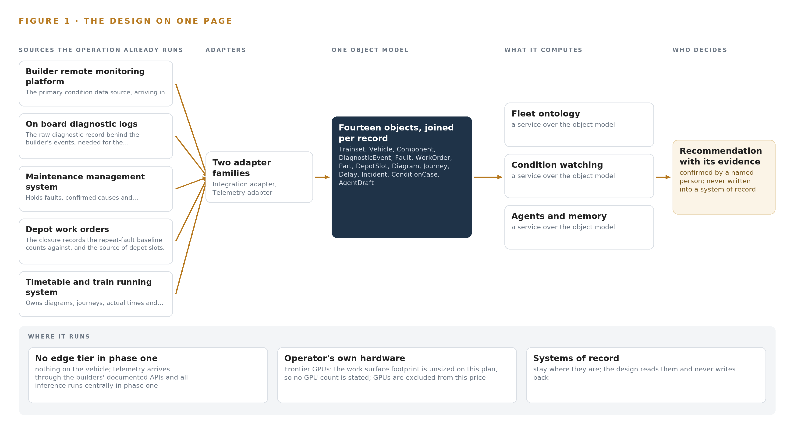
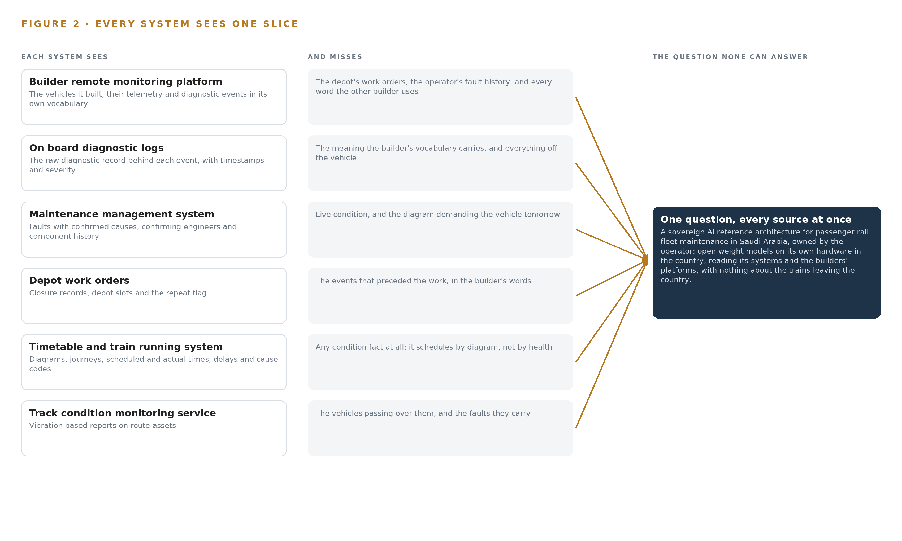
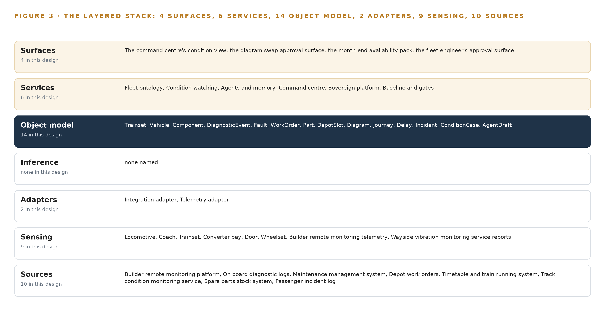
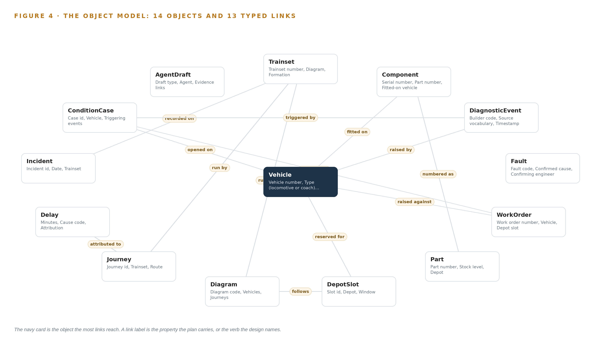
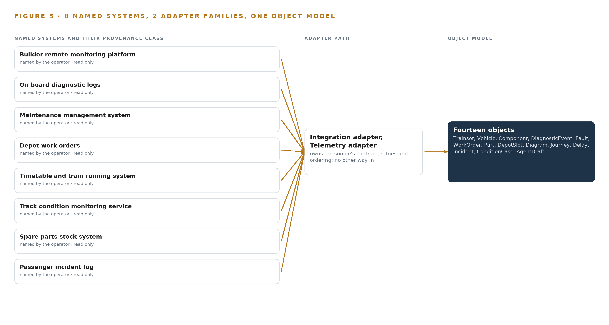
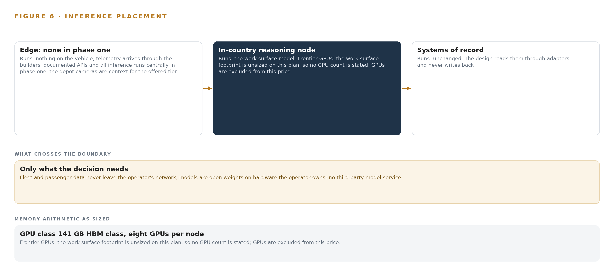
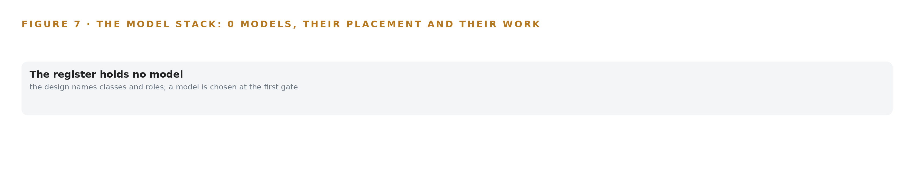
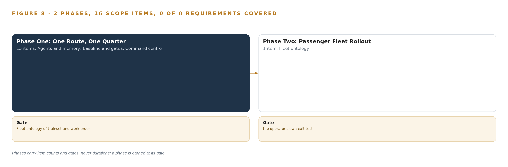
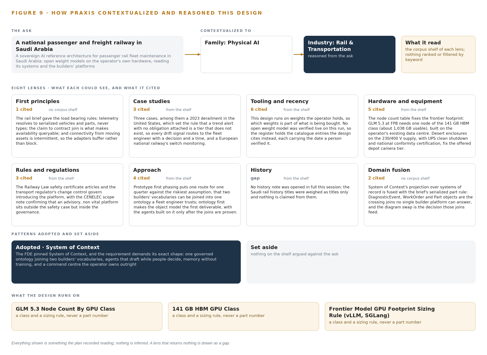

# Sovereign AI Reference Architectures for Passenger Rail Fleet Maintenance in Saudi Arabia

Canonical: https://codeatoms.ai/passenger-rail-fleet-saudi-arabia/
PDF: https://codeatoms.ai/passenger-rail-fleet-saudi-arabia/paper/passenger-rail-fleet-saudi-arabia.pdf
License: CC BY 4.0
Publisher: CodeNinja Atoms (https://codeatoms.ai), a fully owned subsidiary of CodeNinja

VERTICAL-DRIVEN ARCHITECTURES · RAIL & TRANSPORTATION · DESIGNED WITH PRAXIS · NOVEMBER 2026

# Sovereign AI Reference Architectures for Passenger Rail Fleet Maintenance in Saudi Arabia

Fleet Condition Command: Industrial AI in Rail Maintenance the Operator Owns

Muhammad Umar, Cofounder, CodeNinja

For the fleet technical director and head of maintenance, the depot, reliability and control room leads, and the platform, data and integration engineers who would build and run it.

---

Vertical-Driven Architectures is a CodeNinja series of system designs. Every design in the series is driven by a real-world problem and scenario in a single industry, and every one is designed on Praxis, CodeNinja's platform for designing physical AI systems. Operations are described by class, never by name.

At a glance

## Sovereign AI Reference Architectures for Passenger Rail Fleet Maintenance in Saudi Arabia

**What this is.** An open reference architecture for system design in physical AI, built for a national passenger and freight railway in Saudi Arabia that runs long distance push pull trainsets over desert routes with depots at the ends of the line, where owning the inference node that runs it costs about 570,000 US dollars over three years. When a traction converter on one locomotive drifts over a week, the design joins the builder's diagnostic events, the depot's work orders, the maintenance system's confirmed causes, the timetable's diagrams and the spare parts stock into one argument, so the fleet engineer sees the condition case, the matching closed work orders and the recommended depot slot, and the fleet controller approves the swap out of the diagram before the desert decides. The model runs entirely on the operator's own hardware in the country under the Railway Law safety certificate articles, the regulator's change control, the national data protection law and export control on the GPU node. It is written for the fleet technical director and head of maintenance, the depot, reliability and control room leads, and the platform, data and integration engineers who would build and run it. The operator is described by class, never by name.

**The answer in numbers.**

| Part | The design |
| --- | --- |
| Sources | Ten sources read in place, never written: eight systems of record of operator provenance (the builder's remote monitoring platform, the on board diagnostic logs, the maintenance management system, the depot work orders, the timetable and train running system, the track condition monitoring service, the spare parts stock system and the passenger incident log) and two depot camera feeds, entering through two adapter families (integration adapters over documented APIs, telemetry adapters for streams) that stamp provenance class, keep each builder's own vocabulary and carry per source clock offsets |
| Object model | 14 typed objects with their typed links, from the trainset, vehicle and serial numbered component through the diagnostic event, fault, work order, part, depot slot, diagram, journey, delay and incident to the two objects the design itself writes, the condition case and the agent draft; a projection over the builders' platforms and the operator's systems, never a copy, published as JSON for reuse |
| Models | A frontier class of open weights, self hosted for sovereignty, for the command centre's conversational reasoning, judging agent drafts and drafting diagram swaps; GLM 5.3 at FP8 is the named candidate (about 756 GB of weights on one node with roughly 280 GB of KV cache ceiling) and no row is committed until a person verifies it live; nothing is trained, fine tuned or distilled; no third party model service |
| Compute | One inference tier, the operator's existing in country data centre, on the 141 GB HBM class with eight GPUs per node (about 1,038 GB usable); one node holds the named candidate; no on vehicle compute and no edge tier in phase one; the node is ordered at engagement start because GPU lead time into the country is the one dependency that can idle every workstream, and Saudi Arabia is a D:3 and D:4 destination for which a 4A090 class node needs a US export licence (Appendix A) |
| Rollout | Two phases carrying 16 scope items (15 and 1), each earned at a gate, never a date: one route for one quarter, whose exit gate is the fleet ontology of trainset and work order bound to a week of real extracts from both builders with the joins proven before any agent is built, then passenger fleet rollout with the new builder's vocabulary as an onboarding item; baselines written at signature; the simulated traction converter drift cased, swapped out of its diagram and repaired before it fails in the desert |
| Three-year cost | About 570,000 US dollars to own the named node for three years (a range of 542,000 to 594,000: server, support and power at the national commercial electricity tariff), against about 751,000 to rent the same eight cards on the deepest three year commitment in AWS Middle East (UAE), so ownership costs about three quarters of it, and about 2.00 million on demand, against which ownership costs a little over a quarter. Renting is a price reference only, because AWS lists no Saudi region on the day read and every rented option would carry fleet data across the border (Appendix A) |
| Human control | Agents draft and people decide, by name: every condition case carries an approving fleet engineer and a recommended depot slot, every agent draft carries an approval state and a citation set, nothing reaches a depot slot or a diagram swap without a named person deciding, and the platform stays advisory and non vital, outside the safety case and inside the governance; every confirmed cause and accepted swap is kept as memory the next case reads |

**Reuse it.** The object model, the model register and the figures are free to reuse under CC BY 4.0. Cite as <https://codeatoms.ai/passenger-rail-fleet-saudi-arabia/.>

**Made with.** Reasoned on [CodeNinja Praxis](<https://codeatoms.ai/praxis/>), the CodeNinja Atoms platform for designing physical AI systems. The object model imports into [Hyper Ontology](<https://codeatoms.ai/hyper-ontology/>), which turns it into a living system. Load it with the [hyper-ontology loader](../hyper-ontology-py/): `hyper-ontology show passenger-rail-fleet-saudi-arabia`. Both are in beta; access by request.

ABSTRACT

## A Drifting Converter Should Be Swapped Before the Desert Decides

Sovereign AI reference architectures for passenger rail fleet maintenance in Saudi Arabia come down to one question this operation cannot answer today: which vehicle on the fleet is drifting toward failure, and what should be done about it before the timetable sends it back onto a long desert route. The operator's present estate cannot answer that question, because condition data arrives from the builder's platform in the builder's words, the depot closes work orders in its own, and the two meet only in a meeting, so a door fault seen on board three times this month is never joined to the work order that was closed last month for the same door. A locomotive whose traction converter is drifting is scheduled by the timetable rather than by its condition and fails in the desert; when a train is late, the control room and the depot each tell a different story; and the maintenance-included terms of the new trainset contract will be measured against availability figures the operation cannot compute cleanly today, a gap that matters wherever railroad performance measurement is itself a regulated reporting requirement (ECFR n.d.).

The design reads ten named source systems, among them the builder's remote monitoring platform, the on board diagnostic logs, the maintenance management system, the depot work orders, the timetable and train running system, the track condition monitoring service, the spare parts stock system and the passenger incident log, through two adapter families, an integration adapter and a telemetry adapter, into a governed ontology of fourteen objects joined by typed links; six services, the fleet ontology, condition watching, agents and memory, the command center, the sovereign platform and baseline and gates, carry the work to four surfaces, the command center's condition view, the diagram swap approval surface, the month-end availability pack and the fleet engineer's approval surface; the model register carries no verified model row from this run, so the frontier-class open weights behind the conversational work surface are open work to be verified live and then sized, and in phase one all compute runs centrally in the operator's existing in-country data center, with GPU capacity of the 141 GB HBM class procured against measured load and nothing about the trains leaving the operator's network.

The paper covers the industry problem and the join failure across the systems of record; the constraints, the layered stack, the fourteen-object model, ingestion through adapters, the placement of inference inside the sovereign boundary, and the model and license register; the two-phase rollout with its item counts, gates, measurements and failure modes, and who owns what the design builds; and it closes with the chapter showing how Praxis contextualized and reasoned the design, so any choice can be traced to the recorded reading that justified it.

---



Figure 1. Fleet Condition Command on one page: the sources the operation already runs, one object model, what it computes, and the person who decides.

## Contents

Each chapter is tagged for the reader it serves most directly: Executive, Team Lead, FDE, Reference.

|  |  |  |
| --- | --- | --- |
|  | Abstract · A Drifting Converter Should Be Swapped Before the Desert Decides | Executive |
| PART I · THE PROBLEM | | |
| 1 | [A Sovereign AI Reference Architecture Starts with One History](#ch1) | Executive |
| 2 | [Every System Sees One Slice of the Trainset](#ch2) | ExecutiveTeam Lead |
| PART II · THE DESIGN | | |
| 3 | [Sovereign Constraints Shape Everything Downstream](#ch3) | Team Lead |
| 4 | [One Stack Runs From Systems of Record to Surfaces](#ch4) | Team LeadFDE |
| 5 | [Fourteen Objects Turn Fleet Data Into One Argument](#ch5) | FDE |
| 6 | [Every Source Enters Through an Adapter, Never Directly](#ch6) | FDE |
| 7 | [Reasoning Stays In-Country on Hardware the Operator Owns](#ch7) | FDE |
| 8 | [No Weights Are Committed Until One Is Verified](#ch8) | FDEExecutive |
| PART III · THE ROLLOUT | | |
| 9 | [One Route for One Quarter Earns Every Later Gate](#ch9) | Team LeadExecutive |
| 10 | [The Intelligence Stays with the Railway That Produced It](#ch10) | Executive |
| PART IV · HOW IT WAS DESIGNED | | |
|  | Conclusion · Sovereignty Is a Data Structure Before It Is a Data Center | Executive |
| 11 | [Praxis Recorded Every Choice This Design Stands On](#ch11) | Team LeadFDE |
|  | [Sources](#sources) | Reference |

PART I · CHAPTER 1

## A Sovereign AI Reference Architecture Starts with One History

Condition data arrives in the builder's words, the depot works in its own, and a traction converter that is drifting keeps being scheduled by the timetable until it fails in the desert.

The design comes down to one question this operation cannot answer today: is this trainset fit for the diagram the timetable has just given it? The abstract promised a design that answers that question from data the operation already holds, and this chapter shows why sovereign AI reference architectures have to be earned here rather than bought: the question itself, the regimes it must satisfy, the documented cost of leaving it unanswered, and the scenario that must answer it.

### 1.1  The Question the Operation Needs Answered

The operator's own framing of the ask is a sovereign reference architecture, owned outright, reading its systems and the builders' platforms, with nothing about its trains leaving the country or reaching a foreign model service. The working question beneath that ask is narrower and harder: for every trainset on every diagram, is it fit to run tomorrow, and if not, which vehicle, which component by serial number, which evidence, which depot slot and which spare part. Three joins sit inside that question, and none of them can be made today. Has this fault been seen and closed before, on this same door, by this same depot. Is this traction converter drifting toward a failure that its next diagram will take into the desert. And what availability did the fleet actually attain last month, computed the way the new maintenance-included contract will compute it, with every figure defensible by citation back to its source.

The data the question requires spans condition telemetry from the builder's platform, the raw diagnostic logs behind it, faults with confirmed causes, work order closures, depot slots, diagrams, journeys and actual times, track condition reports, spare parts stock and the passenger incident log. The regimes it must satisfy are the Kingdom's Railway Law safety certificate articles and the regulator's change control, under which introducing the platform is filed as a significance decision inside the safety management system before any contract-facing output goes live; the national data protection law over the incident log's personal data; national cybersecurity and communications controls over the platform itself; and the CENELEC scope note that keeps an advisory, non-vital system outside the safety case while leaving it inside the governance. Performance measurement is a legal obligation in comparable regimes elsewhere: United States federal regulation makes service metrics reporting a requirement for railroads (ECFR n.d.), and Britain's regulator monitors train service performance against regulated outputs (ORR n.d.).

### 1.2  The Documented Cost of the Problem

The cost in practice is concrete. A locomotive whose traction converter is drifting is scheduled by the timetable rather than by its condition, and fails in the desert. A door fault seen on board three times in a month is not joined to the work order that was closed last month for the same door, so the same part is faulted, worked and faulted again. When a train is late, the control room and the depot each tell a different story, and neither story carries the other's records. The measurement layer is contested even where it is most mature: an industry subgroup reviewing the designated railroad operating metrics recommended removing some of them, because members' varied experience showed the measures did not carry uniform meaning (STB 2023), and rail safety researchers have proposed transparency and published data as the very basis for measuring national railway safety (Illinois 2023). This operator is in a weaker position than any of those regimes describe, because it is tendering for trainsets with maintenance included, measured against availability figures it cannot compute cleanly today.

### 1.3  The Operation as a Scenario

The operator is a national passenger and freight railway running long-distance passenger trains over a network of more than a thousand kilometers, with more trainsets on order to raise capacity. Its passenger fleet runs push-pull trainsets of locomotives and coaches across long desert routes, with maintenance depots at the ends of the line. Railways of this class monitor dozens of coaches and locomotives remotely through the builder's digital platform and track condition through a vibration based monitoring service, and the tender now under way is for ten more trainsets from a new builder, with maintenance included.

The people in the loop, by role, are the fleet engineer who judges condition cases and approves agent drafts; the few engineers who can read a diagnostic log and know which faults to trust; the depot supervisor who owns work orders and depot slots; the control room that owns the running story; and the accountable owner of the availability figures. The physical environments are desert heat that sets the enclosure thermal budget before any camera is chosen, long routes with intermittent connectivity from moving assets, and depots at the line's ends; the offered depot tier adds cameras on one depot's inspection road and siding overview, detecting locomotive, coach, trainset, converter bay, door and wheelset. The counts the design carries are ten sources read through two adapter families into fourteen objects, served by six services onto four surfaces, with the named systems of record walked through in Chapter 2 and the regulatory ground as stated in 1.1.

PART I · CHAPTER 2

## Every System Sees One Slice of the Trainset

Each of the operator's systems of record holds a true slice of the fleet, and none of them can hold the one history of a single door or a single serial-numbered converter.

Chapter 1 stated the question the operation needs answered and the scenario that must answer it. This chapter walks the systems that operation already owns, one by one, and shows what each sees, what each misses, and what none of them can see together.

### 2.1  What Each System Holds

The builder's remote monitoring platform sees the vehicles it built: their telemetry, their diagnostic events, and their condition in the builder's own vocabulary. It misses the depot's work orders, the operator's confirmed fault history, and every word the other builder will use when the new trainsets arrive. The on board diagnostic logs hold the raw record behind each event, with timestamps and severity, but they miss the meaning the builder's vocabulary carries and everything that happens off the vehicle. The maintenance management system holds faults with confirmed causes, the engineers who confirmed them, and component history by serial number, but it misses live condition and the diagram demanding the vehicle tomorrow.

The depot work orders see closures, slots and a repeat flag, but not the events that preceded the work, because those events live in the builder's words. The timetable and train running system owns diagrams, journeys, scheduled and actual times, and delays with cause codes; it sees no condition fact at all, which is exactly why a drifting converter keeps being scheduled by the timetable rather than by its health. The track condition monitoring service reports on route assets from wayside vibration data but not on the vehicles passing over them. The spare parts stock system knows part numbers, stock levels and reservations, but not what a condition case needs until someone asks it. The passenger incident log records incidents by trainset, date and category, carrying personal data under the national data protection law, but not the technical cause behind any of them. Figure 2 sets these systems side by side.



Figure 2. Eight systems, each seeing one part of the answer. The question needs all of them in one place at once.

### 2.2  What None of Them See Together

The one history of a single door requires the diagnostic events from the logs, the vocabulary mapping from the builder's platform, the fault record from the maintenance system and the closure from the work order, joined by vehicle and component and time; no single system holds even two of those pieces in the same words. The traction converter question requires drift evidence joined to the vehicle's diagram, so that a swap can be drafted before the desert run rather than after the failure. The availability question requires delays from the running system joined to depot records and part availability, with each figure citable to its source for the maintenance-included contract. The cost of the gap is the repeat fault that is worked three times, the desert failure that a swap would have prevented, and the two different stories told about one late train. The engineers who could join these records by hand are few, and the new builder's arrival multiplies the vocabularies faster than headcount can follow.

PART II · CHAPTER 3

## Sovereign Constraints Shape Everything Downstream

Sovereignty inside the operator's network, decisions left to named people, memory without training, and no replacement of systems of record together fix every choice the design makes after them.

Chapter 2 showed every system holding one true slice and none holding the one history. This chapter fixes the four constraints that shape every choice made after them, then records what those choices cost and what was set aside to keep them.

### 3.1  Nothing About the Trains Leaves the Country

The boundary is absolute: fleet and passenger data never leave the operator's network, models are open weights on hardware the operator owns, and no third party model service is called. This is hard in this industry because the primary condition source is a builder's platform whose license and data terms may restrict reading, retaining or internally reusing diagnostic events, so the data terms are read and signed before any event is retained, and the approvals register carries that as a gate. The passenger incident log brings personal data under the national data protection law, so the data protection impact assessment and minimization at ingestion complete before the first quarter. The work surface runs on frontier class open weights self hosted for sovereignty, and the specific weights and the GPU count behind them remain open work until a model stands verified in the register, which is why no footprint figure is stated here.

### 3.2  Every Decision Belongs to a Named Person

Agents draft and people decide: each ConditionCase carries an approving engineer, and each AgentDraft carries an approval state and a citation set an engineer can check. This is hard because rail safety governance treats a new platform as a change requiring a significance decision under the safety management system before any contract-facing output goes live, and a system that acted on trains rather than advising people would fall inside the CENELEC safety case scope. The design stays advisory and non-vital: it reads and drafts, and nothing it does touches train control.

### 3.3  The System Improves by Memory, Not by Training

Improvement is a kept record of decisions and outcomes, the memory of confirmed outcomes, which each run reads before it acts and which does not update model weights. This is hard because fault histories in a fleet of this size are small and precious, because the requirement itself states memory without training a model on the fly, and because weights the operator holds must remain artifacts the operator can inspect rather than opaque byproducts of a tuning process.

### 3.4  The Systems of Record Stand

The ontology is a projection over the builders' platforms and the operator's systems, never a migration: systems of record are read, never replaced, never modified, never loaded. This is hard because two builders' vocabularies must join with citations, and no packaged product reconciles them. The ontology examples a team finds in other sectors tend to be schema copies of one system, and a copied schema cannot carry the load bearing join here, which is the crossing between a builder's diagnostic code and the operator's work order on a serial-numbered part.

### 3.5  Scoping Decisions

Three scoping decisions follow directly from the constraints, and each buys something at a stated cost, which Table 1 records. Phase one runs one route for one quarter against the operator's own baselines, so the riskiest assumption is proven on real extracts before anything extends. Two adapter families carry every source, so there is exactly one controlled entry path with provenance classes and per-source clock offsets. All compute is central, in the operator's existing data center, so sovereignty holds by construction in phase one.

Table 1 · Scoping Decisions

| Decision | What it buys | What it costs |
| --- | --- | --- |
| One route for one quarter in phase one | The riskiest assumption, that two builders' vocabularies join into one ontology a fleet engineer trusts, is proven on real extracts before agents are built, and the first gate can stop the work cheaply | Every baseline is measured on that route's traffic only, and extension waits on the gates |
| Two adapter families carry all ten sources | One controlled entry path, with provenance classes and per-source clock offsets on every fact | Bespoke read paths to two builders' documented APIs, since no packaged product reconciles two vocabularies |
| Central compute in the operator's data center | Sovereignty by construction: nothing crosses the network boundary and no on-vehicle serving is needed in phase one | Continuous sensing on the critical tier is offered, not committed, and GPU capacity is procured and warranted against measured load |

### 3.6  What the Design Chose Against

Each major choice had a live alternative, and Table 2 records what was picked, what it beat and why. The final row records what is deliberately out of scope, because extension is earned on the phase one gates the requirement asks the design to define, not assumed at the start.

Table 2 · What the Design Chose Against

| Where | What was picked | Instead of, and why |
| --- | --- | --- |
| The model of the fleet | A governed ontology as a projection over the systems of record | A data lake aggregating the builders' feeds, because the requirement asks for one history per door with each fact tied to its source, which copied schemas cannot answer with citations |
| The sovereign model footprint | GLM 5.3 at FP8 on one node of the 141 GB HBM class | BF16 on two nodes, or a 256 to 288 GB class node, because FP8 weights of about 756 GB fit one node with roughly 280 GB of KV ceiling, the smallest of the three footprints considered for the operator's named model |
| How the system improves | A kept record of decisions and outcomes, the memory of confirmed outcomes, that the next decision reads | Fine tuning on fault histories, because the requirement states memory without training a model on the fly, which is the architecture's own rule |
| Scope of change | An advisory, non-vital platform that reads and drafts | Touching signalling or vital systems, which would pull the design into the CENELEC safety case scope it does not need to enter |
| The sensing tier in phase one | Route based condition watching, as tendered | On-vehicle compute and continuous sensing on the critical tier, which is offered for a later phase rather than committed now |
| What is out of scope | No freight fleet, no new trainsets, no historic data migration before the gates; systems of record stand unchanged | Immediate estate-wide coverage, because the new builder's vocabulary is onboarded only after phase one proves the joins an engineer will trust |

PART II · CHAPTER 4

## One Stack Runs From Systems of Record to Surfaces

Systems of record sit below untouched, one governed object model sits in the middle, and the services and surfaces above it all run inside the operator's own in-country data center.

Chapter 3 fixed the constraints and recorded what each scoping decision buys and costs. This chapter turns those constraints into the stack that carries them: what sits below, what sits in the middle, and what runs above, all inside the operator's own in-country data center.

### 4.1  Three Layers in a Fixed Order

The architectural pattern, the layered shape that [sovereign AI reference architectures](https://codeatoms.ai/sovereign-ai-reference-architectures/) in critical infrastructure converge on, has three layers whose order never changes. Below sit the ten sources: the builder remote monitoring platform, the on board diagnostic logs, the maintenance management system, the depot work orders, the timetable and train running system, the track condition monitoring service, the spare parts stock system and the passenger incident log, plus two depot camera feeds. They are read in place, never replaced, never modified and never bulk loaded. In the middle sits one governed object model of fourteen objects, a projection over those systems rather than a copy of their schemas. Above it sit six services and four surfaces, where agents draft and named engineers decide. Figure 3 shows the layers with these counts. The order fits this railway because the fleet's facts live in systems the operator cannot rewrite: one builder's platform speaks its own vocabulary, a second builder arrives with the new trainsets, and the question the operator asks, what is the one history of this door, cannot be answered by copied schemas. It needs one model in which every fact carries the source that produced it.



Figure 3. The layered stack: 10 sources, 2 adapter families, 14 objects, 6 services and 4 surfaces.

### 4.2  The Stack Stage by Stage

Table 3 walks the same stack stage by stage, from the sources to the surfaces, and names the component at each stage. Two adapter families carry the sources in, integration adapters over the builders' documented APIs and the operator's systems, and telemetry adapters for streams, each stamping provenance, preserving source vocabulary and carrying per-source clock offsets. The object model runs on Hyper Ontology v0.9, with Apache Kafka 4.4 in KRaft mode as the event backbone, a time series store chosen as a class and sized only after phase one counts events per day, Frigate NVR for the depot cameras, Harbor as the artifact and model registry, Prometheus 3.13 LTS with Grafana and Loki for observability, and Keycloak for identity. Inference runs centrally in the operator's existing data center on a GPU node of the 141 GB HBM class; the model register holds no verified entry on this run, so the on-site language model layer is open work, chosen and sized when a verified model stands in the register. Table 7, printed by the platform from the plan, sets out the same stack as rows of Layer, Component, Choice and Why, and should be read alongside Table 3.

Table 3 · The Stack, Stage by Stage

| Stage | What it is responsible for | How |
| --- | --- | --- |
| Sources | Holding the operator's record of fleet, maintenance, running, stock, incidents and route assets | Ten named sources read in place: eight systems of record plus two depot camera feeds |
| Sensing | Completing the condition picture with physical evidence | Builder remote monitoring telemetry, wayside vibration reports, on board diagnostic logs, depot cameras bought by class off an approved list |
| Adapters | Carrying each source in with provenance, vocabulary and clock offset preserved | Two adapter families: integration adapters over documented APIs, telemetry adapters for streams, onto Kafka 4.4 (KRaft) |
| Object model | Turning ten vocabularies into one governed fleet model | Hyper Ontology v0.9 holding fourteen objects and their typed links; time series store by class, unsized until events per day are counted |
| Inference | Serving every model the operator holds, inside the country | One node of the 141 GB HBM class in the operator's existing data center; the model register is open work until a verified model stands |
| Services | Watching, drafting, computing and governing | Fleet ontology, Condition watching, Agents and memory, Command center, Sovereign platform, Baseline and gates |
| Surfaces | Putting each decision in front of a named person | The command center's condition view, the diagram swap approval surface, the month-end availability pack, the fleet engineer's approval surface |

Table 7 · Architecture, Layer by Layer

| Layer | Component | Choice | Why |
| --- | --- | --- | --- |
| Event streaming and messaging | by class, no product named | Product | Apache Kafka 4.4 (KRaft) |
| The ontology or graph store | by class, no product named | Product | Hyper Ontology v0.9 (Semantics and Kinetics) |
| Time series and telemetry storage | InfluxDB 3 Core, TimescaleDB, QuestDB | Class | Telemetry volume is unmeasured until events per day are counted in phase one, so the class is sized after measurement. |
| Video ingest, recording and management | by class, no product named | Product | Frigate NVR |
| Edge model serving | by class, no product named | Not needed | Telemetry arrives through the builders' documented APIs and all inference runs centrally in phase one; there is no on-vehicle serving. |
| On site language model serving | by class, no product named | Not needed | No model in the register survived this run's live checks, so nothing is served on this layer yet. The layer is model open work: it is chosen and sized when a verified model is. |
| Object tracking and trajectory forecasting | by class, no product named | Not needed | No trajectory forecasting or cross-camera tracking is committed; depot cameras are context for the offered tier. |
| Edge orchestration of containers | by class, no product named | Not needed | All compute is central in the operator's data center in phase one. |
| An air gapped artifact and model registry | by class, no product named | Product | Harbor |
| Labelling and retraining | by class, no product named | Not needed | Under system of context nothing is trained or distilled into weights; improvement is the memory of confirmed outcomes. |
| Time synchronisation across sensors and systems | by class, no product named | Class | Every causal claim, that this fault followed that closure, depends on the builders' and depot clocks agreeing, so a named source is designed in with per-source offsets kept. |
| Observability of the running system | by class, no product named | Product | Prometheus 3.13 LTS (with Grafana and Loki) |

### 4.3  A Reusable Pattern

The shape a team with a similar brief should carry away is the projection, not the objects. Three things are kept regardless of industry: the fixed layer order, with systems of record untouched below and every write confined to the model's own objects; adapters that stamp provenance and preserve each source's own vocabulary and clock, so no source is silently translated on the way in; and the rule that every agent draft carries citations into objects that a named person approves before anything changes. What a team swaps is the middle and the edges: the fourteen objects become their own nouns, the two adapter families become their own sources, and the 141 GB HBM class node becomes their own data center capacity. The grammar survives the swap, because nouns become objects, facts become properties and relationships become typed links in any domain, and that grammar is what makes the model queryable across systems rather than a copy of them.

PART II · CHAPTER 5

## Fourteen Objects Turn Fleet Data Into One Argument

Fourteen objects and their typed links let a query walk from a diagnostic event to a serial-numbered component to the work order that closed last month, a walk no document store can make with citations.

Chapter 4 fixed the layers and named the component at each stage. This chapter opens the middle layer, where ten vocabularies become one model of the fleet and every query can cite its ground.

### 5.1  Fourteen Objects and Their Typed Links

The model holds fourteen objects. Three are assets: Trainset, anchored in the timetable and train running system; Vehicle, anchored in the builder's remote monitoring platform; and Component, anchored in the maintenance management system. Three are events: DiagnosticEvent from the on board diagnostic logs, and Journey and Delay from the timetable and train running system. Six are records: Fault and its confirmed cause, WorkOrder with its repeat flag, DepotSlot, Diagram, Incident from the passenger incident log, and ConditionCase, the focal object the design itself creates. Part is a material anchored in the spare parts stock system, and AgentDraft is a document the agents produce. Figure 4 shows every object and its typed links. The links are what make the model an argument rather than an archive: a DiagnosticEvent is raised by a Vehicle, the Component is fitted on that vehicle and numbered as a Part, the WorkOrder that closed last month is raised against the same vehicle, and the Journey and Delay on the Trainset tell whether the fault met passengers. A document store can hold the same papers and return them on a keyword search, but it cannot walk this chain with citations, because the walk needs the serial-numbered component rather than the type, and the closure record rather than a meeting note. Table 8, printed by the platform from the plan, sets out every object with the system it is anchored in and its typed links.



Figure 4. The fourteen objects of the model and the typed links that let a query reach across them.

Table 8 · The Object Model

| Object | Anchored in | Typed links |
| --- | --- | --- |
| Trainset | Timetable and train running system | runs under: Diagram |
| Vehicle | Builder's remote monitoring platform | no typed link recorded |
| Component | Maintenance management system | fitted on: Vehicle; numbered as: Part |
| DiagnosticEvent | On board diagnostic logs | raised by: Vehicle |
| Fault | Maintenance management system | no typed link recorded |
| WorkOrder | Depot work orders | raised against: Vehicle |
| Part | Spare parts stock system | no typed link recorded |
| DepotSlot | Depot work orders | reserved for: Vehicle; follows: Diagram |
| Diagram | Timetable and train running system | no typed link recorded |
| Journey | Timetable and train running system | run by: Trainset |
| Delay | Timetable and train running system | attributed to: Journey |
| Incident | Passenger incident log | recorded on: Trainset |

### 5.2  The Human Loop and the Hosting Posture

The human loop lives in two objects. Every ConditionCase carries an approving engineer and a recommended depot slot, and every AgentDraft carries an approval state and a citation set, so nothing reaches a depot slot or a diagram swap without a named person deciding. The hosting posture follows the sovereignty constraint: all data stays resident in the country, in the operator's own data center; identity is held by Keycloak on site; there are no external links and no third party model service is called. The single write path in the whole design is into the model's own objects, the ConditionCase and the AgentDraft; the systems of record below are never written. Incident objects are minimized at ingestion to category and identifiers, because the passenger incident log carries personal data under the national data protection law. The availability figures the maintenance-included contract will be measured against are computed from Journey and Delay objects, in the same shape regulators use when they hold railways to regulated performance outputs (ORR n.d.).

### 5.3  One Object in Its Recorded Form

The Trainset record below shows the identifier, label, kind, anchor, properties, status vocabulary and typed link the platform prints for every object; the ConditionCase, the object where watching becomes a decision, is recorded the same way, with its identifier, its vehicle, its triggering events, its matched work orders, its recommended depot slot, its approving engineer and its five state vocabulary from Drafted to Rejected.

```
{ "id": "trainset", "label": "Trainset", "kind": "asset", "anchored_in": "Timetable and train running system", "properties": [ "Trainset number", "Diagram", "Formation", "Vehicles", "Morning count status" ], "status_vocabulary": [ "In service", "In maintenance", "Stabled", "Unavailable" ], "links": [ { "to": "diagram", "label": "runs under" } ] }
```

PART II · CHAPTER 6

## Every Source Enters Through an Adapter, Never Directly

Ten named sources enter through two adapter families with provenance class, source vocabulary and per-source clock offsets preserved, and the design writes to nothing it reads.

Chapter 5 showed what the model holds and where the human loop lives. This chapter describes how data reaches it: ten sources, two adapter families and an event backbone, with the design writing to nothing it reads.

### 6.1  Ten Sources, Every One a Read

Ten sources enter the design, and Figure 5 sets out each with its provenance class and its adapter path. Eight are the operator's systems of record, all of provenance class operator and all read only: the builder remote monitoring platform, the primary condition source arriving in the builder's words; the on board diagnostic logs, the raw record behind the builder's events; the maintenance management system, holding faults, confirmed causes and component history; the depot work orders, whose closures the repeat-fault baseline counts against; the timetable and train running system, owning diagrams, journeys, actual times and delays; the track condition monitoring service, whose vibration based reports complete the route asset picture; the spare parts stock system, feeding part availability into each recommended depot slot; and the passenger incident log, completing the Incident object under the national data protection law. The remaining two sources are the depot camera feeds, the inspection road and the siding overview, of depot provenance and serving as context for the offered tier. Every event that enters carries its provenance class, so a claim made from builder data is distinguishable, permanently, from a claim made from depot data.



Figure 5. The 10 named systems, the adapter path each one takes, and the object model they all map into.

### 6.2  What the Adapter Tier Guarantees

The adapter tier makes five guarantees. First, it is read only: the design writes to nothing it reads, and the writes anywhere are confined to the model's own ConditionCase and AgentDraft objects. Second, source vocabulary is preserved: a builder's diagnostic code enters as the builder wrote it, recorded in the source vocabulary property of the DiagnosticEvent, and translation happens in the ontology where it can be cited and audited rather than at the pipe where it cannot. Third, each source's clock offset is kept, because every causal claim the model makes, that this fault followed that closure, depends on the builders' and the depot's clocks agreeing, and a named time source is designed in with per-source offsets rather than assumed. Fourth, connectivity from moving assets is intermittent, so the adapters buffer rather than block: when a trainset's link drops on a desert route, events queue and flow on reconnection. Fifth, no packaged integration product reconciles two builders' vocabularies, which is the ontology's whole point, so the connectors are bespoke read paths over documented APIs and the operator's own systems.

### 6.3  The Event Backbone

The backbone is Apache Kafka 4.4 in KRaft mode, running inside the operator's in-country network. Ordering is per source key, so events from one vehicle keep their sequence even when other vehicles interleave. Delivery is at least once, with deduplication on event identity at ingest, so nothing is lost in a reconnection and nothing is double counted in a repeat-fault baseline. Buffering is built into the same path: queued events from a disconnected trainset resume in order, and the telemetry volume behind them lands in a time series store chosen as a class and sized only after phase one counts events per day. Replication stays inside the country, so the backbone itself respects the sovereign boundary, and Harbor holds every artifact the system runs, so updates to the platform never require an external fetch. The result is that ingestion can fail quietly, on a dropped link or a slow depot clock, and recover without any system of record ever knowing the design exists.

PART II · CHAPTER 7

## Reasoning Stays In-Country on Hardware the Operator Owns

Phase one runs all inference centrally in the operator's existing data center on procured GPU capacity, with no on-vehicle compute, and nothing about the trains crosses the network boundary.

A sovereign AI reference architecture is decided less by which model answers than by where the answer is computed, and Chapter 6 ended with the builders' events and the operator's records landing on one backbone inside one network. This chapter fixes what happens next: every inference tier in phase one sits in the operator's existing data center, on GPU capacity procured against measured load, with no on-vehicle compute and nothing about the trains leaving the country.

### 7.1  One Inference Tier, in One Room

Phase one has a single inference tier: the operator's data center. Telemetry arrives through the builders' documented APIs, so there is no on-vehicle serving and no edge serving to specify; the offered continuous tier would be specified to the EN 50155 class for on-vehicle electronics if taken up later, but phase one is route based as tendered and commits nothing on the vehicle. What the tier will hold is fixed even though its size is not. The work surface runs frontier class open weights, self hosted for sovereignty, on the 141 GB HBM class with eight GPUs per node, which gives about 1,038 GB of usable memory per node. The arithmetic the register applies when a model row stands: the house's named candidate, GLM 5.3 at FP8, carries about 756 GB of weights, which fits one such node and leaves roughly 280 GB as the KV cache ceiling, the memory that holds conversation state during generation. That is the smallest of the three footprints considered for the named model, and it is why the design chose FP8 on one node over BF16 across two nodes or a larger 256 to 288 GB class node. No GPU count is committed today, because no model row survived this run's live checks; Figure 6 shows the tier, what runs there and the boundary drawn around it.



Figure 6. Where each tier runs, what runs there, and the narrow set of outputs that cross the boundary.

### 7.2  The Latency Budget

The latency budget is set by decision cadence, not by milliseconds, and no sub-microsecond requirement exists anywhere in the design; that is why hardware time synchronization was set aside for a software time class over existing GNSS-disciplined sources, with per-source offsets kept. Three cadences govern. Condition watching keeps pace with the event stream, so a drifting traction converter is caught while the trainset can still be re-diagrammed. Agent drafting and the command center conversation stay inside a fleet engineer's working session, which makes the KV cache ceiling the real constraint on concurrency. The month-end availability pack is computed on schedule, and the stakes there are external as well as internal: federal regulation makes railroad service metrics a legal reporting requirement in the United States (ECFR n.d.), and the regulator's own industry sub-group has shown that metrics members cannot usefully collect get pruned (STB 2023). The availability figures the new maintenance-included contract will be measured against must be computable cleanly on the operator's own numbers before anyone outside asks for them. Because the work surface is a single node class, queueing under load is the pressure point, and the serving layer is sized against measured load once events per day are counted in phase one.

### 7.3  The Boundary and Its Failure Modes

Nothing about the trains crosses the network boundary: fleet and passenger data never leave the operator's network, the design calls no third party model service, and it writes to nothing outside its own stores. The inbound paths are confined to the read adapters to the builders' documented APIs and the systems of record. Updates arrive as artifacts pulled through the Harbor registry inside the boundary, so a failed update path leaves the platform serving the versions it already holds while the registry remains the single write path for new ones. When the link to a moving asset drops, ingestion queues rather than blocks: the event backbone buffers and replays in order, the design's rule for moving assets, whose connectivity is intermittent by nature. When power fails at the depot tier, a UPS-backed clean shutdown path protects recordings and indexes so they resynchronize on return; desert heat set the enclosure thermal budget before any camera was chosen, on the 230/400 V supply the depots run. The two failures that touch the reasoning tier itself are procurement and approval: the 141 GB class node is ordered at engagement start so delivery is confirmed before the quarter begins, and the significance decision is filed under the safety management system before any contract-facing output goes live.

PART II · CHAPTER 8

## No Weights Are Committed Until One Is Verified

The register holds no model row that survived this run's live checks, so no weights, licenses or GPU counts are committed, and the serving layer is sized only when a verified model stands in the register.

Chapter 7 placed the reasoning in the operator's data center and left the serving layer unsized on purpose. This chapter shows what the model stack holds instead of a committed model: a register with no row that survived this run's live checks, a named candidate whose arithmetic is filed but not committed, and the rule that no weights, licenses or GPU counts are stated until a verified model stands.



Figure 7. The model stack: no model row is committed yet; the design names classes and roles and chooses a model at the first gate.

### 8.1  A Register That Refuses to Guess

Figure 7 shows the model stack, and its serving tier is deliberately empty. The design names one model: GLM 5.3, the house's sovereign frontier model for the work surface that system of context commits. Its role would be the command center's conversational reasoning, judging agent drafts, answering with citations and drafting diagram swaps; its placement is the operator's data center on the 141 GB HBM class; its size at FP8 is about 756 GB of weights on one node with roughly 280 GB of KV cache ceiling. Its license terms are not asserted, because the row does not stand in this build's register: it was set aside at a gate, so no filed parameter count stands under the work surface and no GPU count is derived from it. What is committed is a class, not a product: frontier class open weights, self hosted for sovereignty, in the Kimi class. The register's own rule is that every catalog entry it holds was verified by a person on the date it carries and was not rechecked live for this run, which is the outstanding work before any weights are committed. The license test a candidate must pass follows from the operator's requirement: open weights the operator holds on its own hardware, servable in country, with no third party model service in the call path, on terms that survive the end of any vendor relationship. The class was chosen because the requirement demands a command center where engineers judge agent drafts and converse with citations, and none of that can run on weights the operator does not own. Improvement, when the system runs, is a kept record of decisions and outcomes that the next decision reads, the memory of confirmed outcomes, never fine tuning, so the register carries no training or labelling row at all.

### 8.2  The Model and Equipment Register

Table 4 gathers what the design does commit: the model class and the named candidate, the hardware classes and sizing rules that fix any future footprint, the sensing the condition picture is built from, the pattern the whole design stands on, and the ground it runs on. Where ontology examples usually present a finished model with its objects, this register shows the commitments that must stand first, with the weights held back until verification. Its discipline mirrors the transparency that rail safety researchers argue national measurement needs, published data a reader can check (Illinois 2023): every entry carries who verified it and when.

Table 4 · Model and Equipment Register

| The choice | What was picked | Why here |
| --- | --- | --- |
| Frontier work surface model | Frontier class open weights, self hosted for sovereignty (Kimi class) | The command center converses and judges drafts on weights the operator holds outright |
| Named sovereign candidate | GLM 5.3 at FP8 on one node of the 141 GB class | About 756 GB of weights with roughly 280 GB of KV ceiling, the smallest of the three footprints considered; the row awaits live verification |
| GPU class | 141 GB HBM class, eight GPUs per node | About 1,038 GB usable holds the FP8 weights with KV headroom; no count is derived until a model row stands |
| Sizing rules | Frontier Model GPU Footprint Sizing Rule (vLLM, SGLang); GLM 5.3 Node Count By GPU Class | Weights against usable memory fix the KV cache ceiling before any serving decision |
| Sensing | Builder remote monitoring telemetry; wayside vibration monitoring service reports; on board diagnostic logs | The condition picture arrives as streams the ontology binds to vehicles and components |
| Depot vision, by class | Wired cameras with Frigate NVR, rugged enclosures on the 230/400 V supply with UPS clean shutdown | Desert heat sets the enclosure budget before any camera is chosen; depot cameras are context for the offered tier |
| Primary pattern | System of context | A governed ontology as a projection over systems of record, agents that draft while people decide, memory without training |
| Ground | The operator's existing data center, GPU capacity procured and warranted against measured load | The sovereign boundary is the operator's in-country network; no third party model service is called |

PART III · CHAPTER 9

## One Route for One Quarter Earns Every Later Gate

Phase one runs one route for one quarter against the operator's own baselines and ends with the simulated traction converter drift cased, swapped and repaired before it fails in the desert.

Chapter 8 closed the model register and the licenses: open weights the operator can hold, register entries each carrying the date a person verified it, and a frontier footprint named but unsized until a verified model stands in it. This chapter turns from what the system is made of to how it earns the right to run: one route, one quarter, and gates that can stop the work cheaply.

### 9.1  Phases, Items and Gates

Phase One, One Route, One Quarter, carries 15 items across six workstreams: Fleet ontology, Condition watching, Agents and memory, Command center, Sovereign platform, and Baseline and gates. Its items include the fleet ontology of trainset and work order, the two builders' diagnostic event ingestion, the systems of record read integration, and the rehearsed export of ontology and memory that Chapter 10 returns to. Its exit gate is the fleet ontology of trainset and work order: the object model bound to a week of real extracts from both builders, with the joins proven before any agent is built on them, because the riskiest assumption in the whole design is that two builders' vocabularies can be joined into one history a fleet engineer trusts. Phase Two, Passenger Fleet Rollout, carries a single item, new builder vocabulary onboarding in the Fleet ontology workstream: the new trainsets arrive with a new builder and new words, and the point of the ontology is that a new vocabulary is an onboarding item rather than a rebuild. The two phases carry 16 items in total, each traced against the 23 requirements in the requirement register and assessed at a gate rather than asserted up front, and extension to the freight fleet and the new trainsets is earned on the phase one gates rather than scheduled. Figure 8 sets the phases, their item counts, their gates and the coverage trace side by side.



Figure 8. The two phases and their gates, and coverage of the 23 requirements across them.

### 9.2  What the Rollout Measures

The headline measure is the traction converter drift score, expressed in sigma against a nominal of 1.0, with a breach when the score rises above it; phase one ends with the simulated traction converter drift cased, swapped and repaired before it fails in the desert, which is the proof that watching changes an outcome rather than decorating one. Around it sit the operator's own baselines: the repeat-fault baseline, which counts a door fault seen on board three times this month only when it joins to the work order closed last month for the same door, and the availability figures computed cleanly from the timetable and train running system, the same figures the maintenance-included contract for the new trainsets will be measured against. The baselines and the fleet population they describe are written at signature, not reconstructed after the fact, because a baseline written later cannot adjudicate anything. Performance measurement is a legal reporting duty elsewhere, with United States rules requiring railroads to report service metrics (ECFR n.d.) and an industry sub-group recommending which of the regulator's designated metrics to keep (STB 2023), and the operator's contract-facing figures deserve the same definitional care.

### 9.3  Failure Modes

Table 5 states what can fail and what the design does about each, and every row is a gate or a loop rather than a hope.

Table 5 · Failure Modes

| What fails | What the design does |
| --- | --- |
| The builders' platform license and data terms restrict reading, retaining or internally reusing diagnostic events | The data terms are read and signed before any event is retained, and the approvals register carries that signature as a gate |
| Two builders' vocabularies do not join cleanly on the first pass, breaking the one-history promise | The ontology is bound to a week of real extracts and the joins are proven before agents are built |
| Depot-entered work order data is dirty and corrupts the repeat-fault joins | The programmatic data quality feedback loop runs from week one |
| GPU procurement lead time into the country delays the serving node | The 141 GB class node is ordered at engagement start and its delivery is confirmed before the quarter begins |
| The regulator treats the platform's introduction as a material change requiring approval | The significance decision is filed under the safety management system before any contract-facing output goes live |
| The passenger incident log carries personal data under the national data protection law | The data protection impact assessment and minimization at ingestion complete before the first quarter |

### 9.4  Lessons

**Prove the join before building the agents.** The whole design stands on the claim that a door has one history across two builders' vocabularies, so the first gate spends itself on exactly that: real extracts, real joins, a fleet engineer reading one history of one door. Everything downstream, the agents, the drafts, the command center, is built only on that proof. Write the baselines at signature. A repeat-fault count and an availability figure only mean something against a population and a baseline fixed before watching begins, which is why the baseline item sits in phase one rather than in a later retelling. Order the hardware when the engagement starts. The serving node's lead time into the country is the one dependency that can idle every workstream at once, so the 141 GB class node is ordered at start and its delivery confirmed before the quarter begins. Treat the data terms as a gate, not paperwork. The builders' license terms decide whether a diagnostic event may be retained and reused at all, so the signature sits in the approvals register beside the technical gates it outranks.

### 9.5  What Is Still Open

Four questions remain open, and settling each changes something concrete. The model register is the first: no open weight model was verified live on this run, and when one is verified and committed the serving node is sized and ordered against it, converting the named frontier footprint into a stated GPU count. Telemetry volume is the second: events per day are counted in phase one, and the count decides the time series storage class, so settling it fixes the choice within the class the stack row holds. The continuous on-vehicle tier is the third: it is offered, not committed, and taking it up would bring EN 50155-class edge compute onto vehicles and change the sensing design with it. The regulator's significance decision is the fourth: filing it early changes nothing in the design, and filing it late can stop any contract-facing output from going live.

PART III · CHAPTER 10

## The Intelligence Stays with the Railway That Produced It

The ontology, the memory of confirmed outcomes, the decision record and the boundary belong to the railway, and a rehearsed export of ontology and memory proves it in phase one.

Chapter 9 showed how the gates earn trust one route at a time. This chapter settles the quieter question the gates protect: who owns what they admit.

### 10.1  Who Owns What the Design Builds

Four things are built, and the operator owns all four. The first is the object model: 14 objects with their typed links, a projection over the builders' platforms and the operator's systems of record rather than a migration, so what is owned is the argument and not a pile of copies, and every fact in it carries its source and its citation set. The second is the weights: models run as open weights on hardware the operator owns, in its own data center, with nothing about the trains leaving the country or reaching a foreign model service; and because nothing is trained or fine tuned anywhere in the design, there are no fine tunes whose loss would strand the build, since improvement is memory of confirmed outcomes, a kept decision record each run reads before it acts. The third is that decision record itself: every condition case carries an approving engineer, and every agent draft carries its evidence links, its citation set and its approval state, which makes the record of what was drafted, what was approved and what was rejected the asset that compounds. The fourth is the boundary: fleet and passenger data never leave the operator's network, and the personal data in the passenger incident log is minimized at ingestion under the national data protection law. Ownership is demonstrated rather than asserted, because a rehearsed export of ontology and memory is a phase one deliverable: the operator can walk away carrying everything. Rail safety researchers have argued that transparency and published data are themselves measures of a national railway's safety (Illinois 2023), and only an operator that holds its own record can ever publish from it.

### 10.2  The Offer Behind the Design

The design was produced on Praxis, CodeNinja's platform for designing physical AI systems, and it maps directly onto what CodeNinja builds: Adaptive Operations covers the sensing, detection and forecasting of physical behavior, from the depot cameras and the wayside vibration reports to the traction converter drift score; Decision Systems covers the ranking, attribution and recommendations a named person decides, from delay attribution to the recommended depot slot and diagram swap an engineer approves; Hyper Ontology is the object model, the 14 objects that join two builders' vocabularies into one history; Hyper Pragma is the command center, the work surface where the operator's own fleet engineers judge agent drafts and converse with citations; and Sovereign Infrastructure is the posture the requirement itself demands, open weights on the operator's own hardware inside the country, with no third party model service anywhere in the path.

PART IV · CONCLUSION

## Sovereignty Is a Data Structure Before It Is a Data Center

In one view the design is a projection, not a copy: ten systems of record stay exactly where they are, fourteen objects with typed links hold one history per vehicle, door and serial-numbered component, agents draft condition cases and diagram swaps that a named engineer approves or rejects, memory of confirmed outcomes accumulates without any model being trained, and every part of it runs on hardware the railway owns inside its own network, with the first gate testing the riskiest assumption, that two builders' vocabularies can be joined into one ontology a fleet engineer trusts.

Running the same shape elsewhere takes less machinery than discipline: systems of record that resolve to serialized vehicles and parts rather than types, an owner for the boundary and the export rehearsal, baselines and population written before the first quarter rather than after, regulators engaged through the safety management system before any contract-facing output goes live, and the restraint to let one route for one quarter decide whether the rest of the fleet follows.

PART IV · CHAPTER 11

## Praxis Recorded Every Choice This Design Stands On

Every choice in this design traces to recorded reading on Praxis, from the eight lenses that shaped it to the equipment classes and precedents it runs on, with nothing inferred beyond what was read.

Chapter 10 settled who owns what the design builds. This chapter opens the record of how the design was reasoned, so that any choice in it can be traced to what justified it. Every design in this series is produced on Praxis, and this chapter lets a reader trace any choice in this one back to the recorded reading behind it; Figure 9 shows the ask, the family and industry Praxis assigned, what it read, the eight lenses, the patterns and the equipment the reasoning runs on.

### 11.1  Contextualizing the Ask

The ask was a sovereign AI reference architecture for passenger rail fleet condition monitoring, written in the operator's voice and stating its own constraints: open weight models on the operator's own hardware in the country, reading the builders' platforms and the operator's systems of record, with nothing about the trains leaving the country or reaching a foreign model service. Praxis assigned the family Physical AI and the industry Rail and Transportation; the pin was the FDE's own decision on this project, not a reasoned match, and the brief was still read as reasoning input. What Praxis read was the corpus shelf of each lens, nothing ranked or filtered by keyword, and every precedent, rule and equipment class cited in this paper comes from that reading.



Figure 9. From the ask to the design: the family and industry Praxis assigned, the eight lenses and what each cited, the patterns adopted and set aside, and the equipment the design lands on.

### 11.2  The Lenses

Table 6 states what each of the eight lenses could see, how many records each cited, and what each contributed to the design; one lens returned nothing, and it is shown as the gap it was.

Table 6 · The Lenses and What They Contributed

| Lens | Could see | Cited | What it contributed |
| --- | --- | --- | --- |
| First principles | no corpus shelf | 1 | The rail brief gave the load bearing rules: telemetry resolves to serialized vehicles and parts, never types; the claim to contract join is what makes availability queryable; and connectivity from moving assets is intermittent, so the adapters buffer rather than block. |
| Case studies | the case study shelf | 3 | Three cases, among them a 2023 derailment in the United States, which set the rule that a trend alert with no obligation attached is a tier that does not exist, so every drift signal routes to the fleet engineer with a decision and a time, and a European national railway's switch monitoring. |
| Tooling and recency | the tooling and recency shelf | 6 | This design runs on weights the operator holds, so which weights is part of what is being bought. No open weight model was verified live on this run, so the register holds the catalogue entries the design cites instead, each carrying the date a person verified it. |
| Hardware and equipment | the hardware and equipment shelf | 5 | The node count table fixes the frontier footprint: GLM 5.3 at FP8 needs one node of the 141 GB HBM class (about 1,038 GB usable), built on the operator's existing data centre. Desert enclosures on the 230/400 V supply, with UPS clean shutdown and national conformity certification, fix the offered depot camera tier. |
| Rules and regulations | the rules and regulations shelf | 3 | The Railway Law safety certificate articles and the transport regulator's change control govern introducing the platform, with the CENELEC scope note confirming that an advisory, non vital platform sits outside the safety case but inside the governance. |
| Approach | the approach shelf | 4 | Prototype first phasing puts one route for one quarter against the riskiest assumption, that two builders' vocabularies can be joined into one ontology a fleet engineer trusts; ontology first makes the object model the first deliverable, with the agents built on it only after the joins are proven. |
| History | the history shelf | 0 | No history note was opened in full this session; the Saudi rail history titles were weighed as titles only and nothing is claimed from them. |
| Domain fusion | no corpus shelf | 2 | System of context's projection over systems of record is fused with the brief's serialized part rule: DiagnosticEvent, WorkOrder and Part objects are the crossing joins no single builder platform can answer, and the diagram swap is the decision those joins feed. |

### 11.3  Patterns Adopted and Set Aside

One pattern was adopted, system of context, as the primary architecture: the FDE pinned it, and the requirement demands its exact shape, one governed ontology joining two builders' vocabularies, agents that draft while people decide, memory without training, and a command center the operator owns outright. The pattern commits three layers in a fixed order, with the systems of record below, never replaced, never modified, never loaded; the ontology as a projection over those systems, never a shadow copy; one small grammar in which nouns become objects, facts become properties, relationships become typed links and actions change them; and a kinetic loop that closes on the model, so the fleet's twin stays living rather than cached. No pattern was set aside: the reasoning adopted one and found none it needed to reject.

### 11.4  Where the Reasoning Lands

The reasoning lands on four equipment classes: GLM 5.3 Node Count By GPU Class and 141 GB HBM GPU Class, which together fix the serving footprint; Frontier Model GPU Footprint Sizing Rule (vLLM, SGLang), which governs how that footprint is derived when a verified model stands in the register; and Rugged Enclosure Mounting Power UPS NUT SABER, which fixes the enclosure, power and conformity ground for the offered depot camera tier. Every one of those landings traces to recorded reading, and nothing in this paper is inferred beyond what was read.

Appendix A

## What the Operator's Own Inference Node Costs Over Three Years

The paper is written for a national passenger and freight railway in Saudi Arabia, with every model running in the operator's existing data center in the country (chapter 3, section 3.1; chapter 7, section 7.1). This appendix therefore prices for Saudi Arabia, with the national commercial electricity tariff for power and the AWS Middle East (UAE) region, me-central-1, as the rental reference. The paper commits a class and a footprint rather than a GPU count: the work surface runs "on the 141 GB HBM class with eight GPUs per node, which gives about 1,038 GB of usable memory per node", and the named candidate, GLM 5.3 at FP8, "carries about 756 GB of weights, which fits one such node and leaves roughly 280 GB as the KV cache ceiling" (chapter 7, section 7.1; Table 4, "GPU class" and "Named sovereign candidate"). The paper states that "no GPU count is committed today, because no model row survived this run's live checks" (chapter 7, section 7.1), so this appendix prices the footprint the paper's own arithmetic lands on when that row stands, one node of eight 141 GB cards, and nothing more. The offered depot camera tier is not committed and carries no line (Table 1; Table 4, "Depot vision, by class"). The node is priced two ways: owned, from a reseller's published configured price with support and power added, and rented, from the AWS price files for the nearest region that offers the same card, on demand and on the two three year all upfront plans. The reseller, AWS and tariff figures are the ones read on 2 November 2026 for the ep34 appendices on the same node class in the same region and are cited with that date; every input is dated and cited, and the arithmetic is shown.

### A.1 The Answer

Owning the node for three years costs **about 570,000 US dollars**, inside a range of 542,000 to 594,000. Renting the same eight H200 cards around the clock costs **about 751,000 dollars** on the deepest three year commitment (an AWS EC2 Instance Savings Plan, all upfront, for p5en.48xlarge in Middle East (UAE)), **about 1.33 million dollars** on the three year Compute Savings Plan, all upfront, and **about 2.00 million dollars** on demand. Against the deepest commitment, ownership costs **about three quarters** (569,988 / 750,535 = 0.76, and 0.72 to 0.79 across the range); against on demand, a little over a quarter (569,988 / 1,996,103 = 0.29). No rented option can sit inside the country today: AWS's Saudi region is scheduled to open by December 2026 (W.Media 2026) and its price files list no Saudi region on the day read (AWS 2026a), and every rented option would carry diagnostic events, work orders, the passenger incident log's minimized records and the decision record across the border, which the design's own rule that fleet and passenger data never leave the operator's network rules out (chapter 3, section 3.1; chapter 7, section 7.3). Renting is therefore a price reference only. The paper asserts no licence terms for GLM 5.3, "because the row does not stand in this build's register" (chapter 8, section 8.1), so no model price or licence line is carried here.

### A.2 What the Hardware Would Cost

| Option | Basis | Three year cost (USD) |
| --- | --- | --- |
| Owned, in the operator's existing data center | One 8x H200 node with support and power, broken out below | 542,000 to 594,000, typical 570,000 |
| AWS, Middle East (UAE), on demand | p5en.48xlarge, eight H200 cards, 1,128 GB of HBM3e (AWS 2026c), at 75.9552 dollars an hour (AWS 2026b), 26,280 hours; outside the country | 1,996,103 |
| AWS, Middle East (UAE), three year Compute Savings Plan, all upfront | p5en.48xlarge at 50.66046 dollars an hour (AWS 2026a), 26,280 hours; outside the country | 1,331,357 |
| AWS, Middle East (UAE), three year EC2 Instance Savings Plan, all upfront | p5en.48xlarge at 28.55916 dollars an hour, the deepest three year plan for this instance in the region (AWS 2026a), 26,280 hours; outside the country | 750,535 |

The purchase option priced as the rental reference is the three year EC2 Instance Savings Plan, all upfront, the lowest three year rate the me-central-1 file lists for p5en.48xlarge (the partial upfront and no upfront three year Instance plans list 30.38208 and 32.81265 dollars an hour). Egress, storage of the replicated telemetry and the network link to the region are excluded, and the all upfront plans are paid in full on day one, so every rented figure is a floor.

The owned line, item by item:

| Line | Basis | Three year cost (USD) |
| --- | --- | --- |
| Node | Thinkmate GPX GXS5-2508-8HGX-H2, 5U, NVIDIA HGX H200 with eight H200 SXM5 cards (1.1 TB of HBM3), two Intel Xeon Platinum 8558 processors of 48 cores and 330 W each, 32 x 32 GB of DDR5 memory, 3000 W 4+2 redundant power and a three year depot warranty, the configurator's default build: barebone 309,855, processors 2 x 5,584, memory 32 x 2,688, assembly and testing 330, warranty 45, a configured price of 407,660 dollars (Thinkmate 2026) | 407,660 |
| Support | 8 to 12 percent of hardware value a year (Introl 2026), 10 percent typical, over three years | 97,838 to 146,758, typical 122,298 |
| Power | The paper states no power figure for the node, so this line takes the 10.2 kW maximum NVIDIA gives for its own eight H200 system (NVIDIA 2026b): 10.2 kW x 26,280 hours = 268,056 kWh, times a power usage effectiveness of 1.6 (above the 1.54 industry average, Uptime Institute 2025) = 428,890 kWh, about 11,914 kWh a month, which sits in the commercial tier above 6,000 kWh a month: 32 halalas per kWh today and 35 halalas from 1 January 2027, both excluding VAT (Tariff 2026a; Tariff 2026b), at 3.75 riyals to the dollar (SAMA 2026) | 36,599 to 40,030, typical 40,030 |
| **Total** | Low: 8 percent support, today's tariff. High: 12 percent, the 2027 tariff. Typical: 10 percent, the 2027 tariff, because the node is ordered at engagement start after the model row is verified and its three years run under the 2027 schedule | **542,097 to 594,447, typical 569,988** |

The power line is a ceiling: it takes the system maximum around the clock, against an H200 card's "up to 700W" (NVIDIA 2026a), and a fleet engineering work surface whose cadence is set by decisions rather than milliseconds (chapter 7, section 7.2) will rarely hold eight cards at full draw. It also prices every kilowatt hour at the upper commercial tier, which is right if the data center shares a meter with other loads; a dedicated meter would bill the first 6,000 kWh a month at 22 halalas today and 25 from 2027, and would add the 2027 fixed charge of 350 to 900 riyals a month by breaker size, at most 8,640 dollars over three years (Tariff 2026b). The reseller price is a United States dollar price from a United States reseller, before Saudi customs duty and 15 percent VAT, and a written quote delivered to the country will differ.

Why this hardware: the paper's sizing line is explicit, "the 141 GB HBM class with eight GPUs per node, which gives about 1,038 GB of usable memory per node", with the named candidate's "about 756 GB of weights, which fits one such node and leaves roughly 280 GB as the KV cache ceiling" (chapter 7, section 7.1), and Table 4 fixes the class as "141 GB HBM class, eight GPUs per node" (Table 4, "GPU class"). Eight H200 cards at 141 GB are 1,128 GB in total, of which the paper counts about 1,038 GB as usable, and that is the node priced, as Thinkmate's HGX H200 configuration and as p5en.48xlarge, whose eight H200 cards carry the same 1,128 GB (AWS 2026c; NVIDIA 2026b). The paper's own rule is that the node is "ordered at engagement start so delivery is confirmed before the quarter begins" (chapter 7, section 7.3; chapter 9, section 9.4), and this appendix prices that order.

### A.3 What the Price Does Not Include

- **An export licence, which the paper does not price and does not claim away.** The paper names "GPU procurement lead time into the country" as a failure mode and answers it with an early order (Table 5; chapter 9, section 9.4), and makes no claim that the node needs no licence. Saudi Arabia sits in Country Groups D:3 and D:4 (eCFR 2026a), and 15 CFR 742.6(a)(6)(iii), as it reads on the day, carries a worldwide licence requirement for 4A090.a items (eCFR 2026b). The order date for the node is therefore set by that licence as well as by the verified model row.
- **Everything the paper's scope boundary keeps out**: the freight fleet, the new trainsets, historic data migration, and any change to a system of record (Table 2, "What is out of scope"). The builders' platforms and the operator's eight systems are the operator's own and carry no line here.
- **The offered depot camera tier**: cameras, rugged enclosures, UPS and Frigate NVR are chosen by class for an offered, uncommitted tier (Table 1; Table 4), and the paper gives no part or count.
- **The servers for the rest of the stack**: the Kafka backbone, Hyper Ontology, the time series store (a class, unsized until events per day are counted), the Harbor registry, Keycloak and the observability stack are chosen by class and not sized in the paper (chapter 4, Table 7; chapter 6, section 6.3).
- **Facilities work** for the node's load and cooling in the operator's data center, which the paper does not discuss.
- **People**: the engineers who build and run the platform, and the fleet engineers and controllers who approve every draft, whom every option carries.
- **Customs duty, 15 percent VAT, freight and installation** on the hardware, which a written quote delivered to the country settles, and residual value at the end of three years.
- **Double counted cover.** The configured price already carries a three year depot warranty, so the support line may count some cover twice.
- **A closed model token comparison**, which is not printed because the paper states no token volume for the work surface.

### A.4 Sources for This Appendix

- AWS. 2026a. EC2 Instance and Compute Savings Plans price files, region index and me-central-1, version 20261029175641, as read 2 November 2026. <https://pricing.us-east-1.amazonaws.com/savingsPlan/v1.0/aws/AWSComputeSavingsPlan/current/region_index.json> and <https://pricing.us-east-1.amazonaws.com/savingsPlan/v1.0/aws/AWSComputeSavingsPlan/20261029175641/me-central-1/index.json>
- AWS. 2026b. EC2 on demand price data for the AWS pricing page, Linux, shared tenancy, Middle East (UAE), published 29 October 2026, as read 2 November 2026. <https://b0.p.awsstatic.com/pricing/2.0/meteredUnitMaps/ec2/USD/current/ec2-ondemand-without-sec-sel/Middle%20East%20(UAE>)/Linux/index.json
- AWS. 2026c. Amazon EC2 P5 instances, p5en.48xlarge, eight NVIDIA H200 GPUs, 1,128 GB HBM3e, as read 27 October 2026 for the ep28 appendix and not re-read. <https://aws.amazon.com/ec2/instance-types/p5/>
- eCFR. 2026a. 15 CFR Part 740, Supplement No. 1, Country Groups, Saudi Arabia in D:3 and D:4, version of 29 October 2026, as read 2 November 2026. <https://www.ecfr.gov/current/title-15/part-740/appendix-Supplement%20No.%201%20to%20Part%20740> (read through <https://www.ecfr.gov/api/versioner/v1/full/2026-10-29/title-15.xml?part=740>)
- eCFR. 2026b. 15 CFR 742.6(a)(6)(iii)(A), worldwide license requirement for 3A090.a and 4A090.a items, version of 29 October 2026, as read 2 November 2026. <https://www.ecfr.gov/current/title-15/section-742.6> (read through <https://www.ecfr.gov/api/versioner/v1/full/2026-10-29/title-15.xml?part=742&section=742.6>)
- Introl. 2026. GPU infrastructure TCO model, "Vendor support agreements typically cost 8-12% of hardware value annually", as read 2 November 2026. <https://introl.com/blog/gpu-infrastructure-tco-model-5-year-enterprise-ai-deployment>
- NVIDIA. 2026a. H200 specifications, H200 SXM, up to 700W (configurable), 141GB, as read 2 November 2026. <https://www.nvidia.com/en-us/data-center/h200/>
- NVIDIA. 2026b. DGX H100/H200 User Guide, Introduction, Table 3 Power Specifications, "10.2 kW max", and 8 x H200 GPUs with 1,128 GB total GPU memory, as read 2 November 2026. <https://docs.nvidia.com/dgx/dgxh100-user-guide/introduction-to-dgxh100.html>
- SAMA. 2026. Saudi Central Bank affirms its commitment to the riyal's peg to the US dollar at the official rate of 3.75, listed in search on 2 November 2026; the page did not load for direct reading that day. <https://sama.gov.sa/en-US/MediaCenter/News/Pages/news-557.aspx>
- Tariff. 2026a. National electricity consumption tariffs, published by the Kingdom's electricity service provider, commercial 22 halalas per kWh for 1 to 6,000 kWh a month and 32 above, as read 2 November 2026. <https://www.se.com.sa/en/Ourservices/ColumnC/Bills-and-Consumption/ConsumptionTariffs/CT1/>
- Tariff. 2026b. National electricity consumption tariffs after amendment, published by the same provider, applied from 1 January 2027, commercial 25 halalas per kWh for 1 to 6,000 kWh a month and 35 above, fixed charge 350 to 900 riyals a month by breaker capacity, excluding VAT, as read 2 November 2026. <https://www.se.com.sa/ar-SA/ourservices/columnc/bills-and-consumption/consumptiontariffs/ct2/ct2>
- Thinkmate. 2026. GPX GXS5-2508-8HGX-H2 5U H200 Xeon server, online configurator, default configuration as stated, configured price 407,660 dollars (sum of the page's default selections), as read 2 November 2026. <https://www.thinkmate.com/system/gpx-gxs5-2508-8hgx-h2>
- Uptime Institute. 2025. Global Data Center Survey 2025, average annual PUE of 1.54, as read 2 November 2026 through <https://mgrid.org/2025/10/01/uptime-institute-data-center-pue-stagnation-2025-liquid-cooling/> (survey page <https://intelligence.uptimeinstitute.com/resource/uptime-institute-global-data-center-survey-2025>)
- W.Media. 2026. AWS Saudi Arabia cloud region set for December 2026 launch, 1 September 2026, as read 2 November 2026. <https://w.media/aws-saudi-arabia-cloud-region-set-for-december-2026-launch/>

SOURCES

## Source Register

ECFR. n.d.. eCFR :: 49 CFR 1251.2 -- Service metrics reporting.. <https://www.ecfr.gov/current/title-49/subtitle-B/chapter-X/subchapter-C/part-1251/section-1251.2>

STB. 2023. RSTAC Measures & Metrics Sub-Group Recommendations June 21, 2023. <https://www.stb.gov/wp-content/uploads/RSTAC-Measures-Metrics-Sub-Group-Recommendations.pdf>

Illinois. 2023. Towards measuring national railways’ safety through a benchmarking framework of transparency and published data. <https://railtec.illinois.edu/wp/wp-content/uploads/Blumenfeld-et-al-2023-Towards-measuring-national-railways-safety-through-a-benchmarking-framework-of-transparency-and-published-data.pdf>

ORR. n.d.. . <https://www.orr.gov.uk/media/17044/download>

---

### About CodeNinja

CodeNinja is a Middle Eastern American artificial intelligence lab and system of context company. It builds sovereign self-improving systems that organizations own, run inside their own boundary and improve with every decision they make.

[codeatoms.ai](https://codeatoms.ai)
