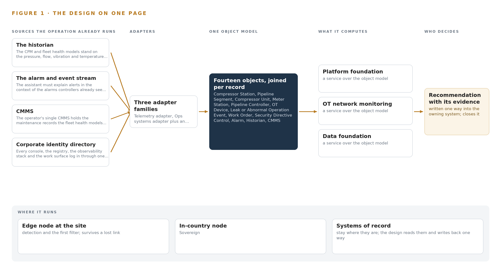
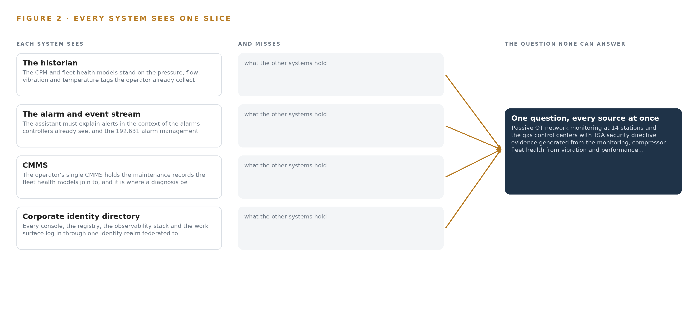
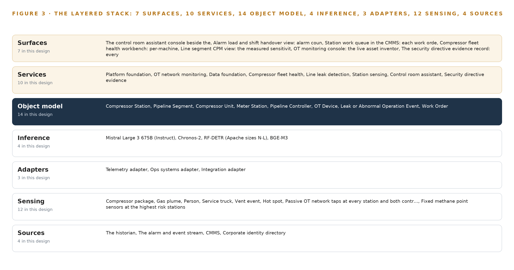
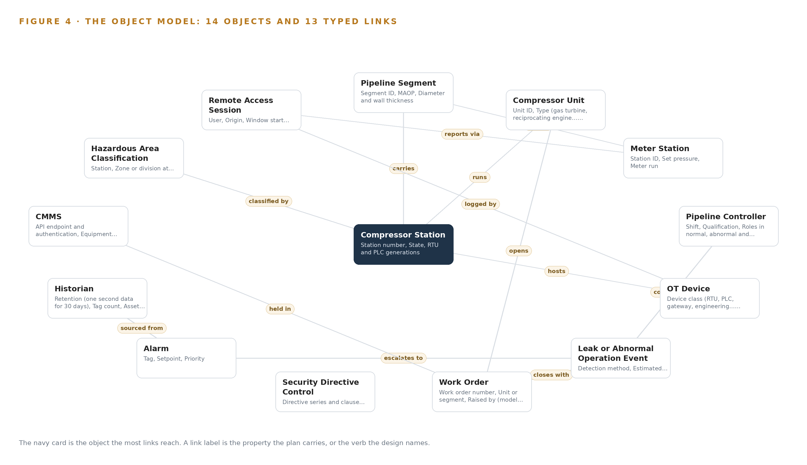
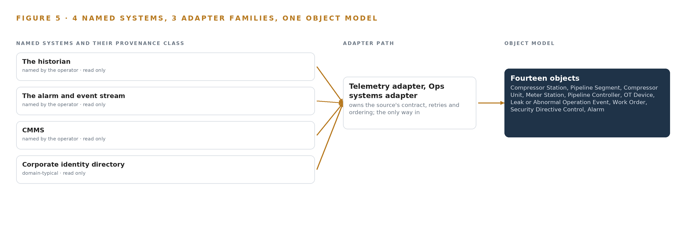
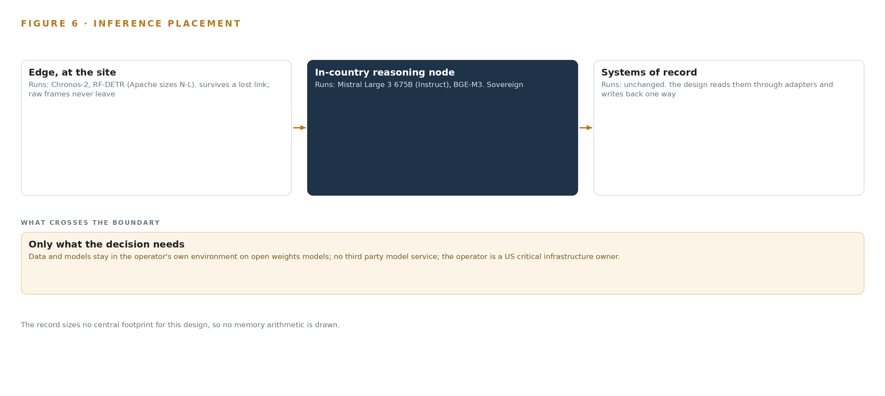
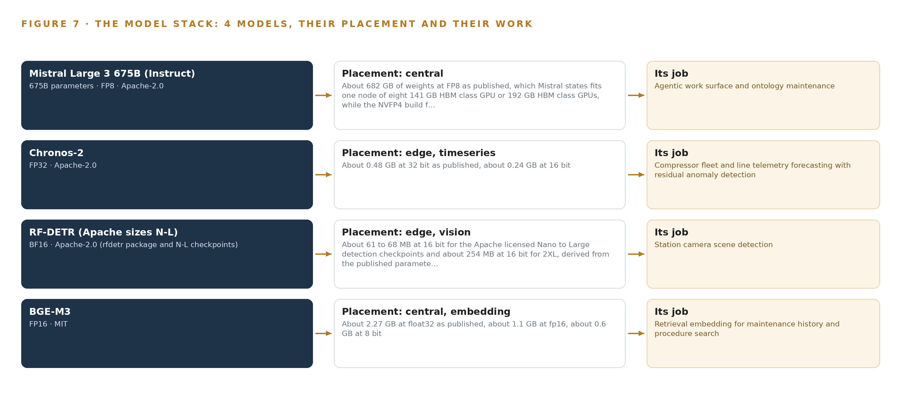
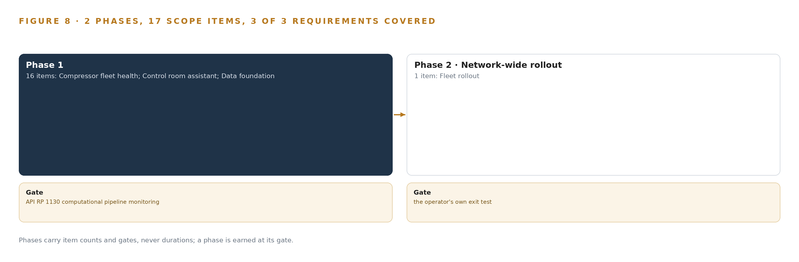
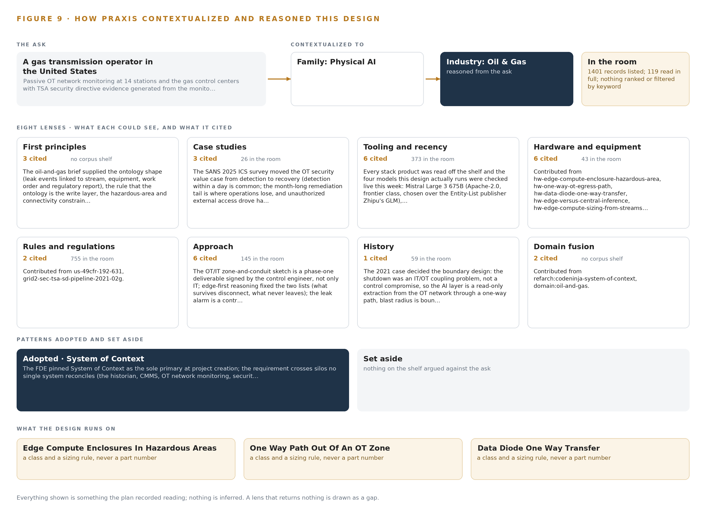

# Pipeline Integrity Watch: Leak Detection, Fleet Health and Security Directive Evidence for Natural Gas Transmission in the United States

Canonical: https://codeatoms.ai/pipeline-integrity-gas-transmission-us/
DOI: https://doi.org/10.5281/zenodo.23556374
PDF: https://codeatoms.ai/pipeline-integrity-gas-transmission-us/paper/pipeline-integrity-watch-pipeline-integrity-gas-transmission-us.pdf
License: CC BY 4.0
Publisher: CodeNinja Atoms (https://codeatoms.ai), a fully owned subsidiary of CodeNinja

VERTICAL-DRIVEN ARCHITECTURES · OIL & GAS · DESIGNED WITH PRAXIS · OCTOBER 2026

# Pipeline Integrity Watch: Leak Detection, Fleet Health and Security Directive Evidence for Every Station

A single on-premises model of a United States natural gas transmission estate that passively monitors the OT network, watches compressor health and leak indicators at every station, and explains each alert to a controller who decides every action.

CodeNinja Engineering Team

For the vice president of operations and pipeline integrity, gas control and compliance managers, and the OT security, reliability, data and platform engineers who would build and run it.

---

Vertical-Driven Architectures is a CodeNinja series of system designs. Every design in the series is driven by a real-world problem and scenario in a single industry, and every one is designed on CodeNinja Praxis, the CodeNinja Atoms platform for designing physical AI systems. Operations are described by class, never by name.

At a glance

## Leak Detection, Fleet Health and Security Directive Evidence for Every Station

**What this is.** An open reference architecture for system design in physical AI. A single on-premises model of a natural gas transmission estate in the United States: passive taps watch the OT network at every station and in the gas control centers, open-weight models watch compressor health and leak indicators at the station, and a control room assistant explains each alert and drafts a response for a pipeline controller who decides every action. The security directive evidence generates itself from the monitoring. It is written for the vice president of operations and pipeline integrity, gas control and compliance managers, and the OT security, reliability, data and platform engineers who would build and run it. The operator is described by class, never by name.

**The answer in numbers.**

| Part | The design |
| --- | --- |
| Sources | Four named systems, all read only: the historian on AVEVA PI System open APIs, the alarm and event stream, the CMMS and the corporate identity directory, entering through three adapter families (Telemetry, Ops systems, Integration); nothing ever addresses a field device |
| Object model | 14 typed objects and 13 typed links, from the compressor station, the meter station, the pipeline segment and the compressor unit through the alarm, the leak or abnormal operation event and the work order to the pipeline controller and the security directive control, published as JSON for reuse |
| Models | Mistral Large 3 675B (Apache-2.0) for the control room assistant, the compliance agent and the work surface; Chronos-2 (Apache-2.0) for telemetry forecasting with residual anomaly detection; RF-DETR Apache sizes for station camera scene detection; BGE-M3 (MIT) for retrieval |
| Compute | At each station, volume production edge modules in 7W to 60W envelopes inside hazardous area enclosures, detecting through backhaul loss; centrally, one node of eight 141 GB HBM-class GPUs in the gas control center |
| Rollout | Two phases carrying 17 scope items: 16 items across six workstreams at the pilot stations, gated by an API RP 1130 computational pipeline monitoring test per segment, then the fourteen station fleet rollout; 3 of 3 requirements covered |
| Three-year cost | About 465,000 US dollars to own the control center node for three years (432,000 to 485,000), about three quarters of the 625,000 the deepest AWS commitment in US East costs and well under the 1.66 million on demand; the station modules, enclosures, cameras, diodes and sensors are priced by quotation (Appendix A) |
| Human control | The system never writes to a field device and shutdown stays with the certified control paths; a hardware one-way diode is the only way out of each station OT zone; every decision-influencing model runs in shadow mode before any controller-facing alert, and a named controller confirms or clears every leak event |

**Reuse it.** The object model, the model register and the figures are free to reuse under CC BY 4.0. Cite the canonical page, <https://codeatoms.ai/pipeline-integrity-gas-transmission-us/,> until the DOI is minted on release.

**Made with.** Reasoned on [CodeNinja Praxis](<https://codeatoms.ai/praxis/>), the CodeNinja Atoms platform for designing physical AI systems. The object model imports into [Hyper Ontology](<https://codeatoms.ai/hyper-ontology/>), which turns it into a living system. Both are in beta; access by request.

ABSTRACT

## The Evidence Should Generate Itself From the Monitoring

A United States gas transmission operator needs four questions answered at once: is the line tight tonight, is each compressor unit drifting from its healthy signature, is the OT network at every station behaving as inventoried, and can the security directive evidence be shown on demand. Today those questions live in separate systems that never meet, because the historian holds the process tags, the alarm and event stream holds what controllers saw, the CMMS holds what maintenance did, and the security posture lives in documents assembled by hand; a leak signature spread across pressure, flow, methane and camera evidence arrives as unrelated alarms, and the evidence record is typed after the fact rather than generated by the monitoring itself.

The design builds one living model of the pipeline estate on the operator's own hardware: four source systems enter through three adapter families into an object model of fourteen objects; ten services run across station edge nodes and the gas control centers; seven surfaces present the findings to controllers, engineers and compliance owners; and four open-weight models carry the intelligence, with Chronos-2 forecasting and RF-DETR scene detection running on station edge hardware that keeps working through backhaul loss, and Mistral Large 3 675B with BGE-M3 running beside them in the control center under licenses the operator can hold outright. Passive taps watch the OT network, data diodes enforce one-way passage out of station zones, the control room assistant explains each alert in plain words with the data behind it and drafts a response, and a controller decides every action; the system never writes to a field device.

Part I states the problem and the join failure across the estate's systems of record; Part II sets the constraints, the stack, the object model, the adapter discipline, the placement of inference and the model licenses; Part III carries the two-phase rollout with its gates, the failure modes, and ownership of what the design builds; and Part IV closes with how Praxis contextualized and reasoned the design, so any choice can be traced to what justified it.

---



Figure 1. Pipeline Integrity Watch on one page: the sources the operation already runs, one object model, what it computes, and the person who decides.

## Contents

Each chapter is tagged for the reader it serves most directly: Executive, Team Lead, FDE, Reference.

|  |  |  |
| --- | --- | --- |
|  | Abstract · The Evidence Should Generate Itself From the Monitoring | Executive |
| PART I · THE PROBLEM | | |
| 1 | [Every Station Speaks, Nobody Joins the Sentences](#ch1) | Executive |
| 2 | [Four Systems Each See One Slice of the Line](#ch2) | ExecutiveTeam Lead |
| PART II · THE DESIGN | | |
| 3 | [The Hard Rules of the Line Shape Every Layer](#ch3) | Team Lead |
| 4 | [One Stack Runs From the Taps to the Consoles](#ch4) | Team LeadFDE |
| 5 | [Fourteen Objects Turn Station Data Into One Argument](#ch5) | FDE |
| 6 | [Four Sources, Three Adapters, No Direct Access](#ch6) | FDE |
| 7 | [Detection Lives at the Station, Reasoning in the Center](#ch7) | FDE |
| 8 | [Open Licenses Put the Weights in Operator Hands](#ch8) | FDEExecutive |
| PART III · THE ROLLOUT | | |
| 9 | [Shadow Mode Comes Before Any Flag Is Trusted](#ch9) | Team LeadExecutive |
| 10 | [The Operator Owns the Models, Record and Boundary](#ch10) | Executive |
| PART IV · HOW IT WAS DESIGNED | | |
|  | Conclusion · One Read-Only Model of the Line, Owned Outright | Executive |
| 11 | [How Praxis Contextualized and Reasoned This Design](#ch11) | Team LeadFDE |
|  | [Sources](#sources) | Reference |

PART I · CHAPTER 1

## Every Station Speaks, Nobody Joins the Sentences

A transmission estate continuously produces the evidence of leaks, failing compressors and network intrusions, but it is scattered across systems that cannot be read together, so each risk is discovered late and evidenced by hand.

The abstract promised a living model of the pipeline estate that watches, explains and drafts while a person decides. Before that promise can be argued, the problem itself has to be stated precisely: what the operation needs to know each day, why the systems it already owns cannot say it, and what the regulatory regimes require it to prove.

### 1.1  The Question the Operation Needs Answered

A transmission estate asks the same four questions every hour, and each one is a join across data the operation already holds. Is this pressure and flow deviation a leak, or line pack responding to a ramp? Is this compressor unit drifting toward failure, or operating normally for its running hours? Is anyone unexpected inside the operational technology network at a station? And can the operation prove, on demand, that its security measures are in place and its alarm management plan is being followed? Answering the first question needs one-second pressure and flow telemetry along the line plus meter accuracy; the second needs vibration and discharge temperature joined to maintenance history; the third needs passive network traffic from the stations; the fourth needs all of the above held as evidence. The regimes that govern the answers are the United States pipeline safety rules under 49 CFR Part 192, including the alarm management requirements of 192.631 and incident reporting under Part 191, the computational pipeline monitoring practices of API RP 1130, and the transportation security directives that apply to hazardous liquid and natural gas pipelines. The design encodes rule versions as objects rather than hard-coding them, because the United States methane and pipeline leak rules changed status repeatedly between 2024 and 2026.

### 1.2  The Documented Cost of the Problem

The cost of discovering a fault late, rather than reading its early signature, is documented in public investigation records. A major United Kingdom energy company was fined after failing to properly maintain pipework for seven years, a lapse that led to a major hydrocarbon release (HSE 2025). A loss of primary containment at a United States liquefied natural gas facility traced back to instrument and procedural failures that the investigation report set out in full (DOT 2022). In a prosecuted case, the wall thickness of hydrocarbon-containing pipework deteriorated through a local corrosion mechanism until the pipework failed (HSE n.d.). These are the tail of the distribution, but the mechanism is ordinary: the evidence of deterioration exists in the data for a long time before anyone can read it, because it is scattered. For this operator the recurring cost is not the rare catastrophe but the daily one, evidence assembled by hand for every review, every audit and every security directive response, using hours of engineering time that produce no finding.

### 1.3  The Operation as a Scenario

The operator is a gas transmission operator in the United States, as its own requirement states, running a gas transmission estate of more than 3,000 miles of pipe, more than a dozen compressor stations, several gas control centers, and a compressor fleet of more than 100 units. The stations carry three generations of remote terminal units and programmable logic controllers on mixed backhaul: leased lines, licensed radio and intermittent cellular. Each station sits inside a hazardous area classification that constrains what may be installed and where. The people in the loop, by role, are the pipeline controllers who work shifts and own the detect, validate and initiate sequence for any leak alarm; the control engineer who signs the zone and conduit design; maintenance planners who turn diagnoses into work orders; the compliance owner who answers to the regulators; and the plan owner responsible for the security implementation plan the whole build must fit inside. The named systems the design reads are four systems of record: the historian, the alarm and event stream, the computerized maintenance management system, and the corporate identity directory. The places are the stations, the line between them, and the control centers where every decision finally lands.

PART I · CHAPTER 2

## Four Systems Each See One Slice of the Line

The historian, the alarm and event stream, the CMMS and the security tooling each hold a true but partial picture, and the question that matters most, whether this alarm is a leak, needs all of them at once.

Chapter 1 set out the question. This chapter explains why no system the operation already runs can answer it.

### 2.1  What Each System Sees

The historian: the CPM and fleet health models stand on the pressure, flow, vibration and temperature tags the operator already collects; the historian is the system of record for the line.

The alarm and event stream: the assistant must explain alerts in the context of the alarms controllers already see, and the 192.631 alarm management reviews need off-scan and inhibited-point records.

CMMS: the operator's single CMMS holds the maintenance records the fleet health models join to, and it is where a diagnosis becomes a work order with an owner and a due date.

Corporate identity directory: every console, the registry, the observability stack and the work surface log in through one identity realm federated to the operator's existing directory, so leavers lose access when the directory removes them.



Figure 2. Four systems, each seeing one part of the answer. The question needs all of them in one place at once.

### 2.2  What None of Them See Together

Each holds one slice, and the question needs all of them in one place at once, which today is done by hand at the cadence of whoever has the time.

PART II · CHAPTER 3

## The Hard Rules of the Line Shape Every Layer

No writes to field devices, passive listening only, open weights on premises and a controller who decides every action are not features to add later but constraints that fix the architecture before any component is chosen.

Chapter 2 showed four true but partial pictures that no manual effort can join at the speed of a control room. This chapter states the hard rules that shape every layer of the answer before any component is chosen, because in this industry the constraints are not features to add later.

### 3.1  The System Never Writes to a Field Device

The first rule comes from the operator's requirement in its own words: the system never writes to a field device. On a gas transmission estate, shutdown and control authority lives in certified control paths that have been qualified under the pipeline safety rules, and no analytics layer may sit inside that authority. This is hard in this industry because the commercially tempting design, an agent that closes a valve or trims a setpoint when its model is confident, is exactly the design the requirement forbids. The consequence is fixed early: the control room assistant drafts responses and a controller decides every action, and shutdown stays with the existing certified paths. Every interface to the operational technology side is therefore read-only by design, not by policy.

### 3.2  The Network Is Listened To, Never Probed

The second rule is passive monitoring. The stations run three generations of remote terminal units and programmable logic controllers on mixed serial and Internet Protocol links, and active scanning of such equipment carries real risk of perturbing legacy devices that were never built to be queried by strangers. So the operational technology network sensors listen on network taps and switched port analyzer ports only, decoding protocol traffic as it passes, never probing. The hardness here is coverage: passive protocol decoding can be blind on pure-serial segments with no Internet Protocol visibility, which is why a per-station visibility survey with a documented serial-gateway decision is a phase one workstream rather than an assumption.

### 3.3  The Weights Live on the Operator's Premises

The third rule is open weights on premises. The operator must own the models it depends on, on its own hardware, with no data leaving its boundary and no vendor able to withdraw capability. This is hard because the model market pushes the other way: most frontier capability is served from someone else's cloud under someone else's license, and some capable open-weight models are published by entities on the United States Entity List, an untenable provenance for a critical infrastructure owner. The design therefore commits to plain permissive grants, Apache-2.0 and MIT, with no field-of-use restriction, and treats license terms as a first-class selection criterion alongside accuracy.

### 3.4  A Controller Decides Every Action

The fourth rule is the human loop. Every alert the system raises competes for controller attention against a written alarm management plan with monthly reviews under 192.631, and alarm fatigue is a documented regulatory concern in its own right. The design answers by setting the alert budget before the thresholds: the assistant console is advisory and adds zero alarms to the existing stream, every assistant alert is counted in the annual plan review, and every model that could influence a decision runs in shadow mode beside the incumbent alarms before any controller-facing alert exists. The controller's detect, validate and initiate sequence for a leak alarm is preserved, not automated around.

### 3.5  Scoping Decisions and Their Costs

The constraints above force scoping decisions, and each buys something at a cost the operator accepts knowingly. Table 1 records the three that shape the most downstream structure.

Table 1 · Scoping Decisions

| Decision | What it buys | What it costs |
| --- | --- | --- |
| Read-only posture with a hardware one-way path out of the station OT zone | Bounded blast radius: telemetry and evidence leave with no return path to misconfigure | Model and rule updates need a separately approved change path under management of change, never the data path |
| Detection models running on station edge hardware | Monitoring and detection keep working through intermittent cellular backhaul | Edge compute in hazardous areas, sized by thermal envelope, plus store-and-forward buffers to size and watch |
| Open-weight models on the operator's own hardware | The operator owns the models, the data and the update cadence outright, in country | The operator carries the serving, fine-tuning and update burden itself, with no vendor to delegate it to |

### 3.6  What the Design Chose Against

Each major choice was made against a live alternative, and the reasons are recorded in Table 2 so they can be audited. The pattern that runs through them is the same: the operator keeps what it must own, and the design refuses anything that rents the layer back.

Table 2 · What the Design Chose Against

| Where | What was picked | Instead of, and why |
| --- | --- | --- |
| OT boundary | Hardware-enforced one-way data diode out of the station OT zone | A bidirectional firewall conduit, because the 2021 shutdown of a major United States pipeline was an IT/OT coupling failure, not a control compromise |
| OT visibility | Passive taps and SPAN ports with protocol decoding | Active scanning of field devices, which could perturb three generations of legacy RTUs and PLCs |
| Leak and health analytics | Open time series models over the operator's own telemetry, joined to the CMMS | A packaged asset performance product of the Aspen Mtell or Honeywell Forge class, which rents the very layer this design exists to hand over |
| Language model | Mistral Large 3 675B under Apache-2.0, frontier class with no field-of-use restriction | GLM open weights, whose publisher sits on the United States Entity List, an untenable provenance for a US critical infrastructure owner |
| Inference placement | Detection on station edge hardware with store-and-forward sync | Central-only analytics at the control center, which goes blind during backhaul outages |
| Scope boundary | An advisory layer on a separate console beside the HMI, drafting responses for a controller to decide | Robot or drone inspection rounds and optical gas imaging flights, which the fixed sensing plan does not carry |

PART II · CHAPTER 4

## One Stack Runs From the Taps to the Consoles

A single layered stack carries every signal from passive network taps and field sensors through adapters into one object model, and back out to the services and surfaces the controllers and engineers actually use.

Chapter 3 fixed the constraints that shape everything downstream: open weights on the operator's own hardware, no writes to any field device, security directive evidence that generates itself from monitoring, and detection that keeps working when a station's backhaul drops. This chapter lays out the one stack that satisfies all four together, by settling once, at the bottom, how every signal enters and, at the top, who acts on it.

### 4.1  Bottom to Top, One Direction of Flow

The architecture is three layers with a single direction of flow. Below sit the systems of record the operator already runs: the historian holding the pressure, flow, vibration and temperature tags, the alarm and event stream the controllers already watch, the CMMS that owns the equipment master and the work orders, and the corporate identity directory. In the middle sits one object model, at version 0.9, which is the only layer that writes. Above it sit the applications and agents: ten services that do the monitoring, forecasting, detection and explanation, and seven surfaces where named people decide. Nothing replaces a system of record, and nothing above the model talks to anything below it except through the model.

The pattern fits a pipeline estate because such estates accrete systems over decades and cannot be swapped for a clean slate; the design reads each record where it stands. The layer split also carries the constraints directly. Read-only adapters honor the no-write rule at the boundary, and the single write path through the model is what makes the security directive evidence auditable: every record in it can be traced to the source event that produced it.

Figure 3 shows the layered stack with its counts: four sources, three adapter families, fourteen objects, ten services, seven surfaces and four models. Underneath runs the supporting spine: Apache Kafka 4.3.x in KRaft mode as the event backbone, InfluxDB 3 Core for time series, MediaMTX for video ingest, K3s for edge orchestration, Harbor as the air-gapped artifact and model registry, CVAT for labeling and retraining, linuxptp with chrony for time synchronization, Keycloak for identity, and Prometheus with Grafana and Loki for observability of the running system itself.



Figure 3. The layered stack: 4 sources, 3 adapter families, 14 objects, 10 services and 7 surfaces.

### 4.2  The Stack Stage by Stage

Table 3 walks the same stack stage by stage, and each stage names the components that carry it, so an engineer can read the figure and the table as one picture.

Table 3 · The Stack, Stage by Stage

| Stage | What it is responsible for | How |
| --- | --- | --- |
| Sources | Holding the operator's record of the line, its alarms, its maintenance and its people, exactly as it stands | The historian on AVEVA PI System open APIs, the alarm and event stream, the CMMS and the corporate identity directory, all read only |
| Sensing | Producing the physical signals no existing system records | Passive OT network taps at every station and both control centers, fixed methane point sensors at the highest risk stations, vibration sensors on compressor frames and bearing housings, discharge temperature probes, the existing pressure and flow transmitters, PTP grandmaster clocks, and fixed and thermal cameras |
| Adapters | Turning every feed into typed, provenance-stamped events without ever addressing a field device | The Telemetry adapter for historian tags and sensor streams, the Ops systems adapter for the alarm stream and the CMMS, and the Integration adapter for the identity directory and evidence sources |
| Object model | Holding the fourteen objects and their typed links as the only write layer | The object model v0.9 (Semantics and Kinetics), over Kafka 4.3.x (KRaft) for events and InfluxDB 3 Core for time series |
| Inference | Running the four models where each belongs | Triton Inference Server on K3s station edge nodes for Chronos-2 forecasting and RF-DETR scene detection; vLLM in the gas control centers for Mistral Large 3 675B and BGE-M3 retrieval |
| Services | Doing the work of monitoring, health, detection, explanation and evidence | Platform foundation, OT network monitoring, data foundation, compressor fleet health, line leak detection, station sensing, control room assistant, security directive evidence, phase one pilot, fleet rollout |
| Surfaces | Presenting the argument to the named person who decides | The control room assistant console beside the HMI, the alarm load and shift handover view, the station work queue in the CMMS, the compressor fleet health workbench, the line segment CPM view, the OT monitoring console, and the security directive evidence record |

PART II · CHAPTER 5

## Fourteen Objects Turn Station Data Into One Argument

The object model gives stations, segments, compressor units, OT devices, alarms, leak events, work orders and security directive controls typed links, so a query can walk from a methane reading to the controller who confirmed it and the work order that closed it.

Chapter 4 carried every signal from the taps and sensors through the adapters into one object model. This chapter opens that model, names every object in it, and shows what the typed links let a query do that a document store cannot.

### 5.1  Fourteen Objects and Their Typed Links

The model holds fourteen objects. The sites are the compressor station, carrying station number, state, RTU and PLC generations, backhaul type and hazardous area classification reference, and the meter station as the measurement record, carrying set pressure, meter run and remote telemetry type; the two are kept separate because they anchor in different systems and are reconciled by link rather than by merge. The assets are the pipeline segment, with maximum allowable operating pressure, diameter and wall thickness, class location, inline inspection assessment date and high-consequence-area flag; the compressor unit, with type, running hours, last overhaul date, vibration and temperature points and mean time between failures; and the OT device, with device class, vendor and firmware version, address, approved logic fingerprint and last-seen time. The actor is the pipeline controller, with shift, qualification and roles in normal, abnormal and emergency conditions. The events are the alarm, the leak or abnormal operation event and the remote access session. The records are the work order and the security directive control. The systems are the historian and the CMMS. The document is the hazardous area classification.

The typed links join them into one argument. A station links to its hazardous area classification and hosts its OT devices; compressor units link to the stations they run at; an alarm escalates to the leak event it raised; a leak event links to the controller who confirmed it and to the work order that closed it; work orders link to the CMMS record that holds them; remote access sessions link to the OT device they reached. Figure 4 draws every object and every link, with the leak event in focus as the object the argument turns on.

That focus is what a query can reach. Starting from a methane reading at a station, a query walks to the station's hazardous area classification, to the CPM alarm record, to the controller who confirmed the event, to the work order with its owner and due date, and to the regulatory report reference, in one traversal. A document store returns whatever matches the words of a search; it cannot walk a typed link, so the same argument has to be reassembled by hand each time. The link from a diagnosis to an owned work order exists because pipework left unmaintained has failed through local corrosion in prosecuted cases (HSE n.d.), and a major hydrocarbon release from exactly that neglect drew a fine in a recent prosecution (HSE 2025).



Figure 4. The fourteen objects of the model and the typed links that let a query reach across them.

### 5.2  The Human Loop and the Hosting Posture

The human loop lives at the objects with owners. The pipeline controller confirms or clears each leak event and decides every action the assistant drafts; each work order carries an owner and a due date; each security directive control carries an owner and its gap statement. The hosting posture keeps the loop inside the operator's boundary: everything runs on premises in the gas control centers and at the stations, no data leaves that boundary, identity flows through Keycloak federated to the corporate directory so leavers lose access the day the directory removes them, and there are no external links. The only write path in the whole design is the object model fed by the adapter tier, and no path to a field device exists anywhere in it.

### 5.3  One Object in Its Recorded Form

The leak or abnormal operation event is recorded with its detection method, estimated rate and location, CPM alarm record, confirming controller, work order and regulatory report reference, and its status moves through detected, under investigation, confirmed, cleared as non-leak and repaired.

```
{ "id": "compressor-station", "label": "Compressor Station", "kind": "site", "anchored_in": "CMMS", "properties": [ "Station number", "State", "RTU and PLC generations", "Backhaul type (leased line, licensed radio\u2026", "Hazardous area classification reference" ], "status_vocabulary": [], "links": [ { "to": "pipeline-segment", "label": "carries" }, { "to": "ot-device", "label": "hosts" }, { "to": "hazardous-area-classification", "label": "classified by" }, { "to": "compressor-unit", "label": "runs" } ] }
```

PART II · CHAPTER 6

## Four Sources, Three Adapters, No Direct Access

Every source system enters through one of three adapter families that guarantee provenance, ordering and read-only behavior, and nothing ever reads a field device directly.

Chapter 5 opened the object model and its typed links. This chapter describes how data gets into it: four sources, three adapter families, and no direct access to anything.

### 6.1  The Sources and Their Provenance

Four named source systems feed the model, all read only. The historian is the system of record for the line, holding the pressure, flow, vibration and temperature tags the CPM and fleet health models stand on; its provenance class is the operator's own. The alarm and event stream is the set of alarms controllers already see, plus the off-scan and inhibited-point records the alarm management reviews need; also the operator's own. The CMMS holds the equipment master and the work order history the fleet health models join to, and it is where a diagnosis becomes a work order with an owner and a due date; the operator's own. The corporate identity directory is domain-typical, the identity realm an operator of this size already runs, federated so that access ends when the directory ends it. Figure 5 maps each source, its provenance class and its adapter path into the model.



Figure 5. The 4 named systems, the adapter path each one takes, and the object model they all map into.

### 6.2  What the Adapter Tier Guarantees

Three adapter families carry the four sources. The Telemetry adapter takes historian tags and sensor streams; the Ops systems adapter takes the alarm stream and the CMMS; the Integration adapter takes the identity directory and the evidence sources behind the security directive record. The tier guarantees five things. Every event carries a provenance stamp naming its source system, its adapter family and its extraction time. Connections are read only, with credentials scoped to read at the adapter. Ordering is preserved from source to backbone. No adapter ever addresses a field device: signals arrive from the historian's open APIs, with OPC UA and MQTT where IP links exist, and from the passive taps, never by probing the RTUs and PLCs. Each feed is translated into the object vocabulary, so services never see a raw tag name, and backpressure is absorbed at the adapter so a slow consumer never stalls a source.

### 6.3  The Event Backbone

The backbone is Apache Kafka 4.3.x in KRaft mode, which needs no separate coordination service. Ordering holds because producers key events by station and tag, so each station's events keep their sequence within a partition even when a station resynchronizes after hours of lost backhaul. Delivery is at least once, made safe by idempotent writes keyed to the source's own sequence number, so a replay after a reconnect cannot double-count a reading. Buffering lives on the station edge nodes as store-and-forward queues sized for the agreed survival window at the measured message rate, doubled, and every display and every assistant answer marks data that arrived through the buffer as stale. Replication runs in the control center cluster, so the loss of a node costs no evidence. Model and container artifacts enter through the Harbor registry by a separately approved change path under management of change, never back through the one-way path out of the OT zone.

PART II · CHAPTER 7

## Detection Lives at the Station, Reasoning in the Center

Forecasting and camera detection run on station edge hardware sized to survive backhaul loss, while the frontier assistant and retrieval models run in the control center, and only telemetry and evidence cross the one-way boundary.

Chapter 6 described how every source enters through an adapter and lands on the event backbone. This chapter decides where the four models actually run, and one physical fact settles most of it: the stations sit on intermittent cellular backhaul, so anything that must keep working when the link drops has to run where the data is born.

### 7.1  Two Tiers, Each with Its Own Arithmetic

The edge tier lives in the station cabinet. Chronos-2 forecasts the pressure, flow, vibration and temperature tags and thresholds its residual for anomaly; at about 0.48 GB of weights at 32 bit, or about 0.24 GB at 16 bit, it leaves most of the station edge module's memory free. RF-DETR watches the cameras for the compressor package, gas plume, person, service truck, vent event and hot spot classes; the Apache-licensed Nano to Large checkpoints occupy about 61 to 68 MB at 16 bit, and the 2XL size about 254 MB. Both are served by Triton Inference Server on K3s, on volume-production modules in 7W to 60W envelopes chosen by thermal envelope rather than part number, and both keep detecting through backhaul loss. That offline survival is why they sit at the station: deterioration of containment pipework progresses locally and silently between maintenance rounds until the pipework fails (HSE n.d.), and continuous local signatures are what catch it.

The central tier lives in the control centers. Mistral Large 3 675B (Instruct), the frontier model behind the control room assistant, the compliance agent and the work surface, publishes at FP8 as about 682 GB of weights, which fits a single node of eight 141 GB HBM-class GPUs with headroom for serving overhead; the NVFP4 build of the same model fits a node of 80 GB HBM-class GPUs. BGE-M3 runs beside it for retrieval at about 1.1 GB at fp16, negligible against the same node. Figure 6 sets the two tiers side by side, with what runs on each and what crosses between them.



Figure 6. Where each tier runs, what runs there, and the narrow set of outputs that cross the boundary.

### 7.2  The Latency Budget Is Ordered by Who Waits

Three loops carry three budgets. The station loop closes entirely on station hardware, so camera detections and forecast residuals arrive at the speed of the local models, never at the speed of the link. The control room loop is conversational: a controller asks the assistant to explain an alert, retrieval and generation run on the central node, and the answer lands in the time a person reads a screen; the console is advisory and adds zero alarms to the HMI, so every new alert is counted inside the alarm management plan reviews required by 49 CFR 192.631(e) rather than competing outside them. The evidence loop is batch: security directive evidence, ontology maintenance and compliance records generate on schedule, not on demand. Stale data is marked on every display and every answer, so a controller never mistakes a store-and-forward replay for a live reading.

### 7.3  One Way Out, One Approved Path In

Only telemetry, detections, forecast residuals and evidence records cross the boundary, through a hardware-enforced one-way diode out of the OT zone with no return path to misconfigure. Model updates never travel that conduit: they enter through a separately approved change path under management of change, pulled from the air-gapped Harbor registry. When the link fails, station buffers sized for the agreed survival window at the measured message rate, doubled, hold everything until the connection returns, and every display marks what is stale. When power fails at a station, detection stops with the station, and the gap in the record is itself visible in the observability stack. When the update path fails, the station keeps running its last approved weights and flags the version skew, and Prometheus with Grafana shows the divergence until the change is resynchronized. Leak-relevant detection never depends on any of these paths, because a loss of primary containment at a single facility can escalate in minutes (DOT 2022).

PART II · CHAPTER 8

## Open Licenses Put the Weights in Operator Hands

Four open-weight models carry the design, each chosen for what its license permits a United States critical infrastructure owner to hold outright, from the frontier work surface to the edge forecaster and the camera detector.

Chapter 7 placed each model at its tier and did the memory arithmetic. This chapter examines the four models as licenses first and engines second, because for a gas transmission operator in the United States, the deciding question is not which model is strongest but which weights the operator can hold outright on its own premises.



Figure 7. The four models, their placement, and the work each one does.

### 8.1  Four Models, Four Jobs

Figure 7 stacks the four models over the ground they run on, from the station cabinets to the control-center node. Mistral Large 3 675B (Instruct) is a 675B-parameter mixture-of-experts model published at FP8, about 682 GB of weights, fitting a single node of eight 141 GB HBM-class GPUs. Its role is the agentic work surface and ontology maintenance: it runs the control room assistant, the compliance agent and the work surface entirely inside the control centers. Its license is Apache-2.0, a plain grant with no field-of-use restriction and no Entity-List exposure, and that is precisely why it was chosen over GLM 5.3 open weights, whose publisher sits on the US Entity List, an untenable provenance for a United States critical infrastructure owner.

Chronos-2 does zero-shot multivariate and covariate-informed forecasting on the pressure, flow, vibration and temperature tags, with the residual thresholded for anomaly. It weighs about 0.48 GB at 32 bit and about 0.24 GB at 16 bit, is Apache-2.0 licensed, and runs on the station edge boxes so detection keeps working through backhaul loss.

RF-DETR carries station camera scene detection. Only the Apache-2.0 sizes are used: the Nano to Large checkpoints at about 61 to 68 MB at 16 bit and the 2XL size at about 254 MB, published at BF16. It is fine-tuned on the operator's own site footage with CVAT for the six detection classes, exports to the edge NPU, and the exact version is pinned so the Plus sizes under PML 1.0 never enter the air-gapped registry.

BGE-M3 provides retrieval embeddings for maintenance history and procedure search. It is MIT licensed, carries an 8K context window, and produces hybrid dense and sparse retrieval from one pass, which keeps tag names, error codes and part numbers findable where pure dense embeddings lose them. It weighs about 2.27 GB at FP32, about 1.1 GB at fp16 and about 0.6 GB at 8 bit, and runs beside the work surface in the control center.

### 8.2  The Register Behind the Choices

Table 4 gathers the decisions this chapter and Chapter 7 stand on: one row for each model, then the hardware classes and sizing rules, the sensing, the patterns the design stands on, and the ground the whole stack runs on.

Table 4 · Model and Equipment Register

| The choice | What was picked | Why here |
| --- | --- | --- |
| Frontier work surface | Mistral Large 3 675B (Instruct), FP8, about 682 GB of weights | Apache-2.0 with no field-of-use restriction or Entity-List exposure; carries the assistant, the compliance agent and the work surface on one control-center node |
| Telemetry forecaster | Chronos-2, about 0.48 GB at 32 bit | Zero-shot covariate forecasting with residual anomaly detection; small enough to run offline on the station edge boxes |
| Camera detector | RF-DETR Apache sizes at BF16, about 61 to 68 MB for Nano to Large, about 254 MB for 2XL | Apache-2.0 checkpoints only with the version pinned; fine-tunable on site footage and exportable to the edge NPU |
| Retrieval embedding | BGE-M3, MIT, about 1.1 GB at fp16 | Hybrid dense and sparse retrieval in one pass keeps tag names, error codes and part numbers findable |
| Edge compute class | Volume-production modules in 7W to 60W envelopes | Chosen by thermal envelope for station cabinets; runs the station models offline and needs no export license for a domestic install |
| Hazardous-area ground | Edge Compute Enclosures In Hazardous Areas | Station electronics sit inside classified areas, so the enclosure class is a design input, not an afterthought |
| One-way egress | One Way Path Out Of An OT Zone and Data Diode One Way Transfer | Telemetry and evidence leave the OT zone with no return path to misconfigure |
| Placement rule | When Inference Belongs At The Edge | Detection survives backhaul loss at the station; reasoning stays where the context and the people live |
| Sensing | Passive OT network taps at every station and both control centers, fixed methane point sensors at the highest risk stations, vibration sensors on compressor frames and bearing housings, discharge temperature probes, existing line pressure and flow transmitters, PTP grandmaster clocks | The physical coverage every model in this table reads |
| Standing patterns | System of Context as the primary architecture, zone-and-conduit boundary, edge-first detection, shadow mode before any controller-facing alert | Every row above was tested against these patterns before it was committed |
| Ground it runs on | Operator-owned control-center GPU node and station cabinets, K3s, Triton Inference Server, vLLM, Harbor registry | Open weights held outright on premises, inside the operator's boundary, with updates through an approved change path |

PART III · CHAPTER 9

## Shadow Mode Comes Before Any Flag Is Trusted

A two-phase rollout puts the pilot stations through an API RP 1130 computational pipeline monitoring gate and requires every decision-influencing model to run beside the incumbent alarms before any controller-facing alert exists.

Chapter 8 settled the four models and the licenses that let the operator hold its own weights on its own hardware. This chapter sets the order in which the build reaches the estate, the gate that can stop it cheaply, and what has to be measured before any controller-facing alert exists.

### 9.1  Two Phases, One Gate and Full Coverage

Figure 8 shows the whole path. Phase 1 carries 16 items across six workstreams: the data foundation, OT network monitoring, compressor fleet health, line leak detection, the control room assistant, and the phase one pilot that binds them at the pilot stations. Its single exit gate is API RP 1130, the recommended practice that governs computational pipeline monitoring: the line leak detection workstream does not leave the phase until the sensitivity-versus-false-alarm test has been run for each segment and the per-segment detectable limit has been written down as an acceptance test. Phase 2 carries one item, the fourteen station fleet rollout, and inherits every phase one artifact unchanged: the fourteen object model, the adapters, the agentic memory and the monitoring console. Requirement coverage closes at three requirements covered, none partial and none open: passive OT monitoring with self-generating TSA security directive evidence, compressor fleet health from vibration and performance data, and leak and abnormal operation detection with the assistant that explains each alert and drafts the response.



Figure 8. The two phases and their gates, and coverage of the 3 requirements across them.

### 9.2  What the Rollout Measures

The pilot measures four things. First, the per-segment detectable limit, from the sensitivity-versus-false-alarm tests, so every controller knows what mass balance can and cannot see. Second, shadow agreement: every model that could influence a decision runs beside the incumbent alarms, and what is counted is agreement and disagreement against the record controllers already trust, not a claimed accuracy. Third, alarm load: the assistant console is advisory and adds zero alarms to the HMI, and every assistant alert is counted in the monthly review the alarm management plan already requires. Fourth, work order conversion: how many model-raised diagnoses the CMMS work orders confirm, because deferred maintenance is how contained pipework becomes a release, as the corrosion failure behind a prosecuted hydrocarbon case shows (HSE n.d.) and as the fine that followed seven years of unmaintained pipework confirms (HSE 2025).

### 9.3  Failure Modes

Table 5 states what fails and what the design does about each; the two most consequential are the physics of mass balance and the fragility of old serial links.

Table 5 · Failure Modes

| What fails | What the design does |
| --- | --- |
| Mass balance misses small or transient leaks | The per-segment detectable limit is written as an acceptance test; methane sensing at the highest risk stations and a separate shut-in method cover the blind spots |
| Passive decoding is blind on pure-serial segments | A per-station visibility survey in phase one; the serial-gateway decision is documented per station and the blind spots are printed on the coverage map |
| No approved PLC logic baseline exists to compare changes against | Fingerprints are built during phase one and the logic-change gate stays inactive at a station until its baseline is signed |
| Alarm fatigue under 49 CFR 192.631(e) | The alert budget is set before the thresholds; the assistant adds zero alarms and every assistant alert is counted in the annual plan review |
| Intermittent cellular backhaul | Store-and-forward buffers sized for the agreed survival window at the measured message rate, doubled; stale data is marked on every display and answer |
| The build must fit the TSA-approved Cybersecurity Implementation Plan | The plan owner is engaged before anything is installed; the evidence record is scoped to the plan's stated measures and amendments route through the operator |

### 9.4  Lessons

**Shadow the flags before anyone trusts them.** A controller-facing alert exists only after the shadow record against the incumbent alarms justifies it, and the same rule applies to the health models and the camera detections: nothing crosses from the machine to the console on the machine's own testimony.

**Set the alarm budget before the thresholds.** Every new alert competes for controller attention under a written plan with monthly reviews, so the budget is fixed first and the thresholds are tuned into it, not the other way round.

**Sign the boundary with the control engineer, not only IT.** The OT and IT zone-and-conduit sketch is a phase one deliverable signed by the control engineer, because the person who owns the stations, not the person who owns the firewall, knows what a mistake there costs.

### 9.5  What Is Still Open

The station inference server class, the camera class, the enclosures, site networking, positioning and the frontier cluster class all stand as open class decisions, chosen by thermal envelope and duty rather than part number; settling the camera class would fix detection latency at the fence line, and settling the inference server class decides whether the work surface shares a node with the retrieval stack. The backhaul survival window is an agreed number still to be fixed, and it sizes the store-and-forward buffers. The US methane and pipeline leak rule versions changed status repeatedly between 2024 and 2026, so rule versions are encoded as objects and repair timelines follow the operator's compliance team; settling a rule version would let the evidence record carry firm dates instead of objects. A loss of primary containment at a gas handling facility shows why detection quality is worth this patience (DOT 2022).

PART III · CHAPTER 10

## The Operator Owns the Models, Record and Boundary

Everything the design builds, from the object model and the fine-tuned weights to the decision record and the station boundary, remains the operator's property and stays inside its own security plan.

Chapter 9 set the phases, the gate and the measurements. This chapter settles the question the operator asked at the start: when the rollout is finished, whose is it.

### 10.1  What the Operator Holds

The object model is the operator's: fourteen objects, from the station and the pipeline segment to the security directive control, with their typed links, their status vocabularies and the hazardous area classification document they anchor to, held in the operator's own store on its own hardware. The weights are the operator's: Mistral Large 3 675B, Chronos-2 and the RF-DETR Apache sizes sit under Apache-2.0, and BGE-M3 under MIT, licenses with no field-of-use restriction, so the fine-tune on the operator's own station footage and the residual thresholds tuned on its own telemetry are property it can keep, move or retire without a vendor's consent. The decision record is the operator's: every confirmed leak event, every controller response, every cleared non-leak and every deferred work order is a kept object the next decision reads, and it is never used to update model weights. The boundary is the operator's: the hardware-enforced one-way path out of each station OT zone, the identity realm federated to the corporate directory, and the evidence record scoped to the measures the operator's own security plan states, with the operator retaining sole responsibility for compliance even where operation is delegated. The system never writes to a field device, and shutdown stays with the certified control paths, so what the operator owns is intelligence, not control.

### 10.2  The Offer Behind the Design

CodeNinja designed this system on CodeNinja Praxis, its platform for designing physical AI systems, and the design maps directly onto what CodeNinja builds: the passive OT monitoring, the compressor fleet health models, the tested computational pipeline monitoring and the methane and camera sensing at the highest risk stations are Adaptive Operations; the control room assistant that ranks, explains and drafts a response for a named controller to decide is Decision Systems; the fourteen object model is Hyper Ontology; the surface on which the operator's controllers and engineers build their own agents over that model is Hyper Pragma; the kept record of decisions and outcomes that the next decision reads is Hyper Engram; the own hardware, the open-weight licenses and the in-country, premises-bound operation are Sovereign Infrastructure; and the design itself, with its recorded reading and its eight lenses, was produced on Praxis.

PART IV · CONCLUSION

## One Read-Only Model of the Line, Owned Outright

The design is a single argument assembled from an estate's own signals: passive OT taps, compressor vibration and temperature, line pressure and flow, methane sensing and cameras at the highest risk stations, all landing in one object model from which detection, fleet health, control room explanation and security directive evidence are all read. Every layer of it runs on hardware the operator owns, under licenses that let the operator hold its own weights, with a one-way boundary out of every station zone and no write path to any field device; the assistant drafts and explains, and a controller decides.

Running the same shape elsewhere takes three things the estate already has: systems of record worth reading, stations where passive taps and diodes can be fitted without touching control logic, and people accountable for the alarm plan and the security directive evidence who will own the thresholds and the record. The stack, the object model, the adapter discipline and the placement rules travel; the ontology is re-anchored in the new operator's own stations, units, segments and rules, and the first gate stays cheap because shadow mode comes before any controller ever sees a flag.

PART IV · CHAPTER 11

## How Praxis Contextualized and Reasoned This Design

Every design in the series is produced on Praxis, and this chapter records the ask, the reading and the eight lenses so any choice in the paper can be traced back to what justified it.

Chapter 10 established that everything the design builds stays with the operator. This final chapter records how the design itself was reasoned, so any choice in the paper can be traced back to what justified it (Figure 9). Every design in the Vertical-Driven Architectures series is produced on Praxis, the design team platform for designing physical AI systems. This chapter lists what was asked, what was read, and what each of the eight lenses contributed, and it closes on where the reasoning lands.

### 11.1  Contextualizing the Ask

The ask, in the operator's own words, was passive OT network monitoring at the stations and the gas control centers with TSA security directive evidence generated from the monitoring, compressor fleet health from vibration and performance data, leak and abnormal operation detection from pressure and flow plus methane sensing and cameras at high risk stations, and a control room assistant that explains alerts and drafts responses for a controller to decide, never writing to field devices, under PHMSA and TSA rules, with open weights on premises. Praxis assigned the design to the Physical AI family and the Oil and Gas industry, with the country placed by the operator's own requirement. The room held 1401 records; 119 were read in full during the design and the remaining 1282 are available on request.



Figure 9. From the ask to the design: the family and industry Praxis assigned, the eight lenses and what each cited, the patterns adopted and set aside, and the equipment the design lands on.

### 11.2  The Lenses

Table 6 records all eight lenses, what each could see, how many records each cited, and what each contributed to the finished design.

Table 6 · The Lenses and What They Contributed

| Lens | Could see | Cited | What it contributed |
| --- | --- | --- | --- |
| First principles | 3 | 3 | The ontology shape, the rule that the ontology is the write layer, the hazardous area and connectivity constraints, and the caution that US methane rules moved repeatedly so rule versions are objects |
| Case studies | 26 | 3 | The SANS 2025 ICS survey moved the OT value case from detection to recovery, and a fleet-scale predictive maintenance build showed that one model per asset means alert fatigue is the design problem |
| Tooling and recency | 373 | 6 | Every stack product was read off the shelf, and the four models were checked live: Mistral Large 3 675B over the Entity-List publisher's GLM, Chronos-2, RF-DETR Apache sizes and BGE-M3 |
| Hardware and equipment | 43 | 6 | Edge compute enclosures in hazardous areas, the one-way OT egress path, the data diode class, and edge-versus-central inference sizing |
| Rules and regulations | 755 | 2 | 49 CFR 192.631 and the TSA security directive series, which fix the alarm management reviews and the shape of the evidence record |
| Approach | 145 | 6 | The zone-and-conduit sketch signed by the control engineer, the edge-first two lists, the controller-owned detect-validate-initiate sequence and the shadow mode rule |
| History | 59 | 1 | The 2021 pipeline shutdown was an IT/OT coupling problem, so the AI layer is a read-only extraction through a one-way path and the design rehearses its own unavailability |
| Domain fusion | 2 | 2 | The system of context reference architecture and the oil and gas domain brief |

### 11.3  Patterns Adopted and Set Aside

Three patterns were adopted. System of Context stands as the primary architecture, because the people who act on the system work over the ontology and the memory rather than through a reporting layer. The one-way path out of the OT zone, hardware-enforced, bounds the blast radius by architecture rather than by policy. Edge-first reasoning fixed the two lists: what must survive a disconnected station, and what never leaves the site. Set aside, with reasons recorded: active scanning of field devices, which the requirement forbids and which would perturb three generations of RTUs and PLCs; a bidirectional firewall conduit, which leaves a return path to misconfigure; GLM open weights, whose publisher sits on the US Entity List; packaged asset performance products, which rent the layer this engagement exists to hand over; and central-only analytics, which dies with the backhaul.

### 11.4  Where the Reasoning Lands

The reasoning lands on equipment classes rather than part numbers: edge compute enclosures rated for hazardous areas, the one-way path out of an OT zone, the data diode transfer class, and the rule for when inference belongs at the edge, each chosen by thermal envelope and duty. The station inference server, the cameras, the enclosures, site networking, positioning, time synchronization hardware and the frontier cluster remain open class decisions, recorded as such rather than filled by inference. Everything shown in this paper, from the stack to the phases to the failure modes, was recorded reading; nothing is inferred.

Appendix A

## What the Control Center Node Costs Over Three Years

The design runs on the operator's own hardware, in the gas control centers and the station cabinets, with nothing in a third party cloud (chapter 3 and Table 4). Its reasoning model, Mistral Large 3 675B (Instruct), runs at FP8 on a single node of eight 141 GB HBM-class GPUs with vLLM, and BGE-M3 runs beside it on the same node (chapter 7, section 7.1; Table 4, "one control-center node"). This appendix prices that node two ways: owned, from a published server list price with support and power added, and rented, from the AWS price files for the US East region, as the cloud equivalent. Every input is dated and cited, and the arithmetic is shown. The station edge modules are specified as a class (volume production modules in 7W to 60W envelopes, Table 4) rather than a part number and are sold by quotation, so they are named and left out of the total rather than guessed.

### A.1 The Answer

Owning the node for three years costs **about 465,000 US dollars**, inside a range of 432,000 to 485,000. Renting the same eight cards around the clock costs **about 625,000 dollars** on the deepest three-year commitment (an AWS EC2 Instance Savings Plan, all upfront, US East) and **about 1.66 million dollars** on demand. Ownership costs **about three quarters** of the deepest commitment (465,000 / 625,000 = 0.74, and 0.69 to 0.78 across the range), and the commitment costs **about three eighths** of on demand (625,000 / 1,663,000 = 0.38). All four models are open weights, Mistral Large 3 675B, Chronos-2 and the RF-DETR sizes the design uses under Apache-2.0 and BGE-M3 under MIT (chapter 8), and carry no licence line.

### A.2 What the Node Would Cost

| Option | Basis | Three-year cost (USD) |
| --- | --- | --- |
| Owned, in the control center | One server of eight H200 cards of 141 GB, with support and power, broken out below | 432,000 to 485,000, typical 465,000 |
| AWS, US East, on demand | p5en.48xlarge, eight H200 cards of 141 GB, at 63.296 dollars an hour (Vantage 2026), 26,280 hours | 1,663,000 |
| AWS, US East, three-year Compute Savings Plan, all upfront | p5en.48xlarge at 42.21683 dollars an hour (AWS 2026), 26,280 hours | 1,109,000 |
| AWS, US East, three-year EC2 Instance Savings Plan, all upfront | p5en.48xlarge at 23.7993 dollars an hour, the deepest three-year plan in the region (AWS 2026), 26,280 hours | 625,000 |

The owned line, item by item:

| Line | Basis | Three-year cost (USD) |
| --- | --- | --- |
| Server | Exxact TensorEX 5U HGX H200 server, eight H200 SXM5 cards of 141 GB, published starting price of 325,039 dollars (Exxact 2026) | 325,000 |
| Support | 8 to 12 percent of hardware value a year (Introl 2026), 10 percent typical, over three years | 78,000 to 117,000, typical 98,000 |
| Power | 7 kW assumed average draw against the 10.2 kW maximum of an eight card H200 system (NVIDIA 2026), 7 x 26,280 = 183,960 kWh, times a power usage effectiveness of 1.6 (above the 1.54 industry average, Uptime Institute 2025) = 294,336 kWh, at the US average of 9.77 cents per kWh industrial or 14.53 cents commercial, July 2026 (EIA 2026) | 29,000 to 43,000 |
| **Total** | Low: 8 percent support, industrial tariff. High: 12 percent, commercial. Typical: 10 percent, commercial | **432,000 to 485,000, typical 465,000** |

Why eight cards of 141 GB: the paper sizes the model at about 682 GB of weights at FP8 (chapter 7, section 7.1; chapter 8, section 8.1), which fits on eight 141 GB cards (1,128 GB) with about 446 GB left for the KV cache and serving overhead, and does not fit on fewer. AWS p5en.48xlarge is the US East instance with exactly that card class; p5.48xlarge carries eight 80 GB cards and fits only the NVFP4 build the paper mentions as an alternative, not the FP8 build it chooses, so it is not priced.

Not in the table: the station edge modules (more than a dozen compressor stations, chapter 1, one module class per cabinet, Table 4), the hazardous area enclosures, the station cameras, the data diodes, the passive OT network taps at every station and both control centers, the methane point sensors, vibration sensors, discharge temperature probes and PTP grandmaster clocks (Table 4, Sensing), and site networking; the paper names all of these as classes, not part numbers, and records the station inference server, camera, enclosure and frontier cluster classes as open decisions (chapter 9, section 9.5), so each is sold by quotation. Also out: the control center cluster for Kafka, Harbor and observability, which the paper does not size; sales tax, freight, installation and any configuration above the server's starting price, which a written quote settles; and people and facilities, which every option carries. Every rented figure is a floor, because egress, storage and support plans are excluded, and the all upfront plan is paid in full on day one.

### A.3 Sources for This Appendix

- AWS. 2026. EC2 Instance and Compute Savings Plans price file, us-east-1, version 20261021225300, as read 22 October 2026. <https://pricing.us-east-1.amazonaws.com/savingsPlan/v1.0/aws/AWSComputeSavingsPlan/current/region_index.json>
- EIA. 2026. Electric Power Monthly, Table 5.6.A, Average Price of Electricity to Ultimate Customers by End-Use Sector, July 2026, as read 22 October 2026. <https://www.eia.gov/electricity/monthly/epm_table_grapher.php?t=epmt_5_6_a>
- Exxact. 2026. TensorEX 5U HGX H200 Server, TS4-181733724, as read 22 October 2026. <https://www.exxactcorp.com/Exxact-TS4-181733724-E181733724>
- Introl. 2026. GPU infrastructure TCO model, as read 22 October 2026. <https://introl.com/blog/gpu-infrastructure-tco-model-5-year-enterprise-ai-deployment>
- NVIDIA. 2026. NVIDIA DGX H100/H200 User Guide, Power Specifications, as read 22 October 2026. <https://docs.nvidia.com/dgx/dgxh100-user-guide/introduction-to-dgxh100.html>
- Uptime Institute. 2025. Global Data Center Survey 2025, as read 22 October 2026. <https://intelligence.uptimeinstitute.com/resource/uptime-institute-global-data-center-survey-2025>
- Vantage. 2026. p5en.48xlarge pricing, US East (N. Virginia), Linux on demand, as read 22 October 2026. <https://instances.vantage.sh/aws/ec2/p5en.48xlarge>

SOURCES

## Source Register

DOT. 2022. Freeport LNG Quintana Island, Texas, June 8, 2022, Loss of Containment root cause report. <https://www.phmsa.dot.gov/sites/phmsa.dot.gov/files/2022-11/IFO-Group-RCFA-Report-final-redacted.pdf>

HSE. 2025. Shell UK fined £560,000 following major hydrocarbon release, HSE Media Centre. <https://press.hse.gov.uk/2025/11/28/shell-uk-fined-560000-following-major-hydrocarbon-release/>

HSE. n.d. Details for Case No.4652333. <https://resources.hse.gov.uk/convictions/case/case_details.asp?SF=CN&SV=4652333>

---

### About CodeNinja

CodeNinja is a Middle Eastern-American artificial intelligence lab focused on building self-improving systems. We are reinventing knowledge work to close the loop between vertical AI use cases and the generalized intelligence that fuels it, accelerating the path toward organizational superintelligence.
