# Consist Watch: Executing the Operator's Own Fault Logic Across a 225-Car Commuter Fleet

Canonical: https://codeatoms.ai/rail-fleet-condition-monitoring-us/
DOI: https://doi.org/10.5281/zenodo.23365118
PDF: https://codeatoms.ai/rail-fleet-condition-monitoring-us/paper/consist-watch-rail-fleet-condition-monitoring-us.pdf
License: CC BY 4.0
Publisher: CodeNinja Atoms (https://codeatoms.ai), a fully owned subsidiary of CodeNinja

Rail & Transportation · system design

# Consist Watch: Executing the Operator's Own Fault Logic Across a 225-Car Commuter Fleet

Consist Watch is the rail fleet condition monitoring system we designed for a rail and transportation operator in the United States: 64 named signals per car, the operator's own fault-logic table, severity-routed locomotive fault detection alerts, and an agentic work surface over a fleet ontology. This post explains the hardware envelope, the telemetry path, the data layer and the model choices mechanism by mechanism.

**CodeNinja Engineering Team**, Forward Deployed Engineering2026-10-1420 min read4,555 words14 figures

At a glance

## Executing the Operator's Own Fault Logic Across a 225-Car Commuter Fleet

**What this is.** An open reference architecture for system design in physical AI. A real time condition monitoring system for a 225-car commuter fleet in the United States: onboard modules read 64 named signals per car and execute the operator's own fault-logic table at the car, telemetry rides the car system's existing cellular routers to a contractor-hosted US cloud, and severity-ranked faults reach the mechanical desk and the yard through one fleet ontology. It is written for the railroad's mechanical desk and fleet engineering leads, and the embedded, telemetry and data engineers who would build and run it. The operator is described by class, never by name.

**The answer in numbers.**

| Part | The design |
| --- | --- |
| Sources | One named system, the car system on every car (64 named signals: 32 digital at 0 to 48 VDC, 32 analog, plus a 3-axis accelerometer and GPS), entering through one integration adapter family |
| Object model | 14 typed objects, from the car, its monitoring module and its channels through the active fault, fault history and alert notification to the mechanical desk controller, the yard and the recipient groups, published as JSON for reuse |
| Models | Mistral Large 3 675B (Apache-2.0, self-hosted with vLLM) for the agentic work surface over the fleet ontology; Chronos-2 (Apache-2.0) for analog anomaly detection and seasonal trending; no training run |
| Compute | At the car, an EN 50155 and IEC 60571 module (8 by 8 by 8 inches, IP62, 24 to 48 VDC, CFR 238 materials); centrally, one 141 GB HBM GPU class node in a contractor-hosted US cloud |
| Rollout | Three phases carrying 17 scope items: a 3-car prototype, the 222-car fleet rollout, then service operations, with 13 months of history over 64 signals per car |
| Three-year cost | About 625,000 US dollars to run the eight-card node for three years on the deepest AWS commitment in US East, about three eighths of the 1.66 million on demand; the 225 modules are priced by quotation (Appendix A) |
| Human control | The module executes the operator's own fault logic verbatim; a named mechanical desk controller owns every active fault in that car's territory, and alerts go by severity to named recipient groups |

**Reuse it.** The object model, the model register and the figures are free to reuse under CC BY 4.0. Cite as DOI <https://doi.org/10.5281/zenodo.23365118.>

**Made with.** Reasoned on [CodeNinja Praxis](<https://codeatoms.ai/praxis/>), the CodeNinja Atoms platform for designing physical AI systems. The object model imports into [Hyper Ontology](<https://codeatoms.ai/hyper-ontology/>), which turns it into a living system. Both are in beta; access by request.

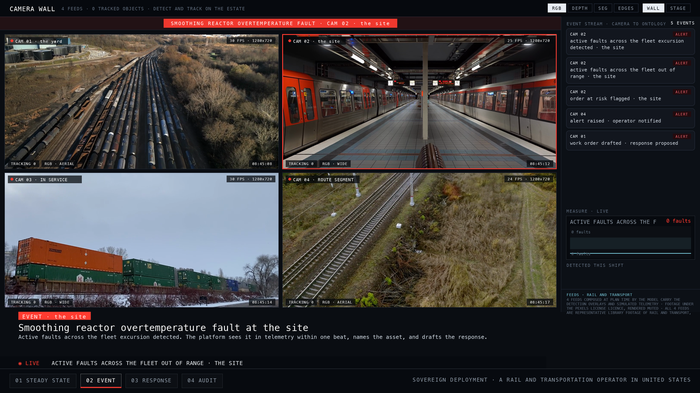

## Introduction

A fault on a commuter train becomes visible to the organisation in one of three ways: a crew calls it in over the radio, a yard employee notices it during a walk-round, or the car fails in service and the mechanical desk learns about it from the disruption. Across a 225-car fleet, none of those paths involves reading the car. Across rail transport, defects that go undetected can quietly grow until they cause catastrophic failure, as a University of Birmingham doctoral study of integrated railway remote condition monitoring puts it, which is why engineers keep searching for ways to catch developing faults early.

We designed a rail fleet condition monitoring system for a rail and transportation operator in the United States that closes that gap. The constraints were fixed before we started. The modules ride the car system routers already installed on each car for cellular service, so the telemetry design inherits their network address translation and port behaviour rather than adding new connectivity. Compute is contractor-hosted in the United States, with no server room on the property and no perimeter to defend, which makes role-based accounts with multi-factor authentication the primary control surface. The hardware half is bounded by the operator's own envelope: 8 by 8 by 8 inches, IP62, 30-year corrosion protection, 24 to 48 VDC from the vehicle battery, electronics built to the EN 50155 railway electronics standard, and materials certified to CFR 238 because this is FRA-regulated commuter stock. The design holds 13 months of history over 64 signals per car and proceeds through a 3-car prototype before the 222-car rollout.

This blog describes the design in the order it was built. It covers how the operation runs today, why the systems already in place cannot answer the question the mechanical desk actually asks, the layered architecture from surfaces to storage, the fleet ontology and its 14 objects, how telemetry moves from a moving car to the cloud, the inference path from a raw reading to a fault closed in the ledger, the two models and the electronics class behind them, how the design was reasoned, and how delivery and coverage are evaluated.

## Background: how this operation runs

The operation is a commuter rail fleet of 225 cars running in the United States under Federal Railroad Administration regulation, which means the stock is commuter equipment governed by CFR 238 for fire certification of materials. Each car already carries its own car system, a set of electronics with cellular routers installed for existing services, and that car system exposes 64 named signals: 32 digital at 0 to 48 VDC and 32 analog channels. Today nothing reads those signals continuously. A 3-axis accelerometer supplied by the contractor and GPS data over the car system's ethernet connection complete what the design has to work with on the vehicle side.

The people are a mechanical desk controller at the control center, yard employees at the outlying yards, and staff at a center and an office. The plan stages ten places in total, of which the control center, the yard, three in-service sites, a route segment, the center and the office sit under the system boundary shown in Figure 1. Figure 1 shows the customer's world and the platform's edge: one named external system, the car system, feeds the design, and the mechanical desk controller and yard employee roles work what it produces.

The physical conditions are a winter-to-summer spread of -10 to 170 degrees F, body-mounted shock and vibration on rail stock, and cellular coverage that comes and goes as the cars move. Nothing is wired to train control or positive train control; the design builds no interface there. Figure 2 shows the operation at steady state on its own terrain, every staged asset watched continuously, with active faults across the fleet running at its nominal of zero faults. That steady state is what the system is designed to hold, and to leave quickly when a reading crosses its threshold.

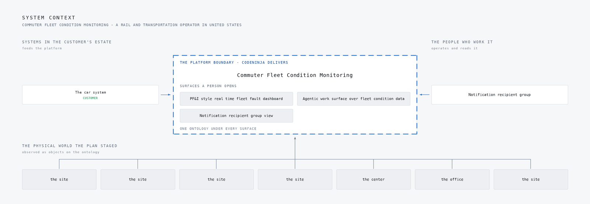

**Figure 1:** The customer's world and the platform's boundary: 1 named systems feed it, 1 roles work it, 7 of the 10 places the plan staged sit under it.

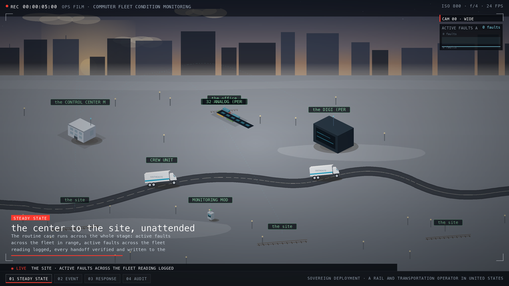

**Figure 2:** The simulation at steady state, drawn on the site's own terrain: every asset the plan staged, watched continuously, with active faults across the fleet running at its nominal.

## The problem

The 64 signals on each car exist and are named, but they are read only when a car happens to be in the shop with a diagnostic connected. The car system itself carries cellular connectivity, yet it was built for its own services, not for streaming telemetry, so it has never carried channel data off the vehicle. The mechanical desk therefore sees service disruptions and crew reports. Yard employees see what a walk-round reveals. The accelerometer and GPS signals that would show locked axles, wheel slip or hard couplings are simply not recorded anywhere.

No existing system answers the question the desk actually asks: which cars have active faults right now, across the whole 225-car fleet, ranked so the desk knows who acts on what. There is no real time fleet health dashboard, no severity-routed alerting by email and text, no history that would show a thermocouple drifting across a season, and no record of where slippery rail concentrates on the route. Thirteen months of history over 64 channels on 225 cars does not exist in any system the operator runs today.

The cost is faults that arrive late, arrive without context, or do not arrive at all. Alerts that do reach the desk are undifferentiated by severity, and the industry has seen where that ends: a federal investigation into the East Palestine derailment documented alerts reaching a desk with no capacity to act on them. The technical problem, stated plainly, is instrumenting 225 cars continuously through routers never designed for it, buffering through coverage gaps on moving stock, and turning 64 raw signals per car into a small number of alerts a desk and its yards will actually treat seriously.

## Design goals

The requirement set four goals for this rail fleet condition monitoring system, and each one is hard for a reason specific to this fleet.

The first goal is completeness against the operator's own fault definitions. Each car already names 64 signals, 32 digital and 32 analog, and the requirement carries its own fault-logic table, so the design executes that table rather than inventing a detection model around it. The hard part is that the analogs arrive raw and need conditioning. A mis-scaled thermocouple or accelerometer would silently poison every trend built on it, so the plan calibrates every conditioned channel against known references during prototype commissioning and records per-channel provenance.

The second goal is visibility where people act. Active faults must be legible at the control centre mechanical desk and at the outlying yards, as subsecond fleet-wide views across 225 cars, with email and text alerts routed by severity and tracked to acknowledgement. The hazard here is alert fatigue, and the plan took the alert-obligation rule from the East Palestine case study: every tier names who acts, when, and with what authority, and the alert budget is agreed with the desk during the 6-month tuning phase.

The third goal is history long enough to show seasons. The design holds 13 months of 64 channels across 225 cars, tabular and graphical, which forces tiered retention to keep the storage curve inside the contract's 5 percent annual escalation cap.

The fourth goal is hardware that survives the car. The electronics class is EN 50155 and IEC 60571 railway electronics with IEC 61373 body-mounted shock and vibration, inside an 8x8x8-inch, IP62, 30-year-corrosion, -10 to 170 degree F, 24 to 48 VDC battery envelope, with materials tightened to CFR 238 and the USDOT recommended fire-safety practices. Three prototype cars carry the class before the 222-car rollout begins.

## Scoping decisions that de-risked the design

Three decisions taken early removed the risks that most often break a build of this shape, and each one cost something we accepted deliberately.

The first was to ride the car system's cellular routers that already exist on every car, rather than design new connectivity. This is the only path between the module and the cloud, so the telemetry design is built around its NAT and port-forwarding behaviour from the start. The cost is that coverage on a moving fleet is intermittent, so the design must carry store-and-forward buffering sized to the longest expected coverage gap, with message queue depth monitored as a first-class metric. New connectivity would have bought cleaner networking at the price of a fleet-wide installation we do not control.

The second was to execute the operator's own fault-logic table verbatim instead of building a learned fault model. The table is named, the signals are named, and the mechanical desk already works in those terms. The cost is that detection is bounded by the 64 named signals, and anomalies outside that vocabulary surface only through the analog trending layer rather than through named logic.

The third was to specify the electronics as a class, EN 50155 and IEC 60571 with IEC 61373 vibration and CFR 238 fire materials, proven through type-test reports, rather than name part numbers. The cost is that component selection sits with the contractor, and we audit the class rather than the box. The gain is schedule: the 222-car rollout depends on shop access and car-house windows, and a class specification lets installation proceed per window without waiting on a single part.

## What we chose against

Every layer of this design had a competing option on the table, and the reasons for setting each aside are specific to this operation rather than general preferences. Some were set aside on licence terms, some on fit against what the requirement actually states, and some on the shape of the deployment itself. The table below carries the decisions and their replacements, so we will not repeat its rows here.

Two exclusions deserve prose because they look like gaps and are not. First, no interface is built to train control or PTC. The stock is FRA-regulated commuter equipment, and the monitoring system reads condition data only, so keeping the two worlds separate keeps the certification boundary clean. Second, no on-site server, data diode or air-gap layer is designed. Compute is contractor-hosted in the United States, the telemetry rides the operator's existing cellular routers, and role-based accounts with MFA are the primary control surface, so the one-way transfer stack answers to a requirement this design does not have. Likewise no CMMS integration and no site server appear, because the requirement names neither. A design that answers layers the requirement does not ask for pays for them in certification, cost and surface area, and none of that cost buys this operator a visible fault any sooner.

| Where | What we picked | Instead of | Why here |
| --- | --- | --- | --- |
| Agentic Work Surface | Mistral Large 3 (675B, Apache-2.0) self-hosted on the contractor's US cloud | GLM 5.3 or Kimi K3 class weights | Both set-aside models are stronger agents but carry bespoke licences with MaaS revenue triggers and security-review conditions; Apache-2.0 means the owns the weights outright with no revenue trigger, which is the difference between owning and renting on a 13-year rolling-stock service contract. |
| Telemetry & Cloud Platform | Self-managed Apache Kafka plus InfluxDB 3 Core | ClickHouse Cloud managed service | The software leaning: the customer owns the telemetry store outright and hardens it themselves; the ClickHouse architecture's subsecond-aggregation serving patterns are adopted for the fleet dashboards while the managed service is replaced with open source per the leaning, with the substitution said plainly. |
| Monitoring Hardware | Deterministic rule-based fault logic in the module plus central zero-shot anomaly trending | A trained classifier | 's own §3.4 table defines every fault as deterministic arithmetic over named, and System of Context trains nothing for this customer; anomaly detection rides Chronos-2 zero-shot at the cloud tier, so no model is trained and no training set exists to maintain. |
| Mechanical Desk & Notifications | Standalone monitoring, logging and notification system | Work-order integration into a maintenance or asset management system | Intake A6 settles it: the system stands alone; logged faults stop at notification and acknowledgement, so no CMMS row, interface or write-back is designed. |
| Scope | Not built | Work order and CMMS integration | Intake A6 settles the system as standalone monitoring, logging and notification only; logged faults stop at notification and acknowledgement and no work orders are created in any maintenance or asset management system. |
| Scope | Not built | cameras and video analytics | The specification monitors 32 digital and 32 analog electrical (C6) and names no camera anywhere; the sensing half of this design is signals, not video. |
| Scope | Not built | Any interface to train control, PTC or signalling | The system reads vehicle signals and advises people only; no output reaches a vital function, so no safety-function allocation, SIL claim or FRA filing path is designed or implied. |
| Scope | Not built | Modifications to the vehicle beyond -wired connections | §3.2 states the digital signals already exist on the train, no sensors or wiring are needed, and the will connect them; the design conditions raw signals within its own modules and touches nothing else on the car. |
| Scope | Not built | Agency transit asset management plan rewrite | Condition outputs inform 's people and remain in this system; folding them into a TAM plan update or NTD reporting change is 's own process, not this contract's deliverable. |

## Car to cloud through one fleet ontology

The system reads as one stack, and Figure 3 shows every component of it top to bottom: the surfaces the operator's people open, the agents and the loop, the models and inference, the system of context, and the ingestion tier underneath. Figure 4 shows the same stack as layers: one named source, the monitoring module reading the 64 named train signals, feeds one adapter family that maps each reading into an ontology core of 14 objects, from car and input channel through active fault, fault history record, alert notification and slippery rail hotspot, and that core grounds five services and three surfaces.

The flow runs upward. The module conditions the raw analogs, executes the operator's own fault-logic table, and streams through the existing cellular routers on each car into contractor-hosted cloud ingestion, built to the ClickHouse Cloud Architecture for Real Time Analytics pattern and substituted with self-managed open source the operator owns. On the core sit the real-time dashboards, the 13-month history, and severity-routed email and text alerting. Amazon Chronos-2, an Apache-2.0 licensed zero-shot forecasting model at 120M parameters, trends the analog channels with no fine tuning, and its residuals threshold into the alert queue. Above that, the agentic work surface runs on Mistral Large 3 675B Instruct, self-hosted under Apache-2.0, improving through memory rather than training. Hosting is contractor cloud in the United States with Keycloak providing role-based accounts and MFA.

The stage table underneath traces one fault through this stack end to end: a smoothing reactor overtemperature fault at a site, from the reading that carries it to the mechanical desk controller dispatched and the outcome written back to the ledger.

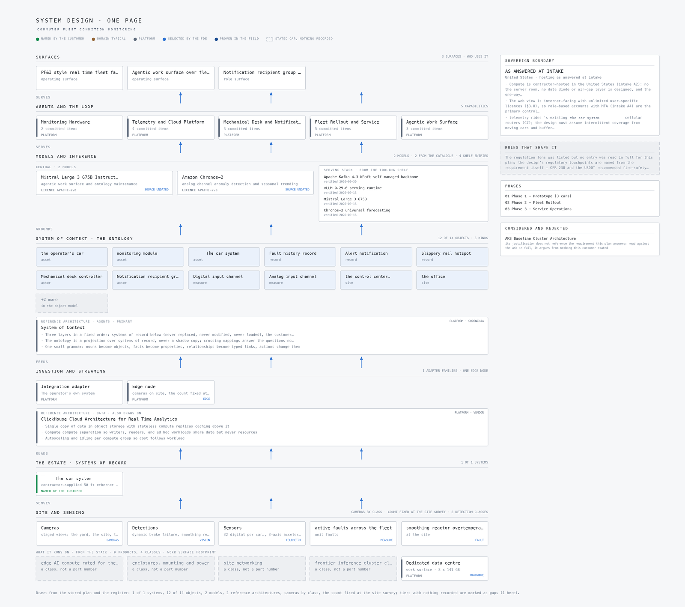

**Figure 3:** Every component of the system in one picture, top to bottom: the surfaces the customer's people open, the agents and the loop, the models and inference, the system of context, ingestion and streaming, the systems of record, and the site and its sensing. Drawn from the stored plan and the register: 1 of 1 systems, 12 of 14 objects, 2 models, 2 reference architectures, cameras by class, the count fixed at the site survey; tiers with nothing recorded are marked as gaps (1 here).

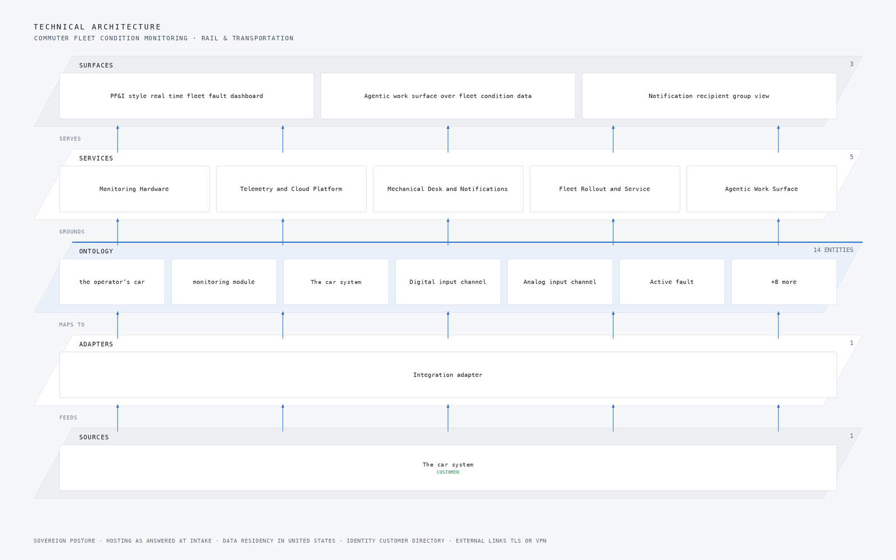

**Figure 4:** The layered stack for this project: 1 named source feeds 1 adapter, which map into an ontology core of 14 objects taken from the object model this engagement builds for the customer, grounding 5 delivered capabilities and the 3 surfaces the customer's own people open.

| Stage | What it is responsible for | How |
| --- | --- | --- |
| Sources | 1 source system already running on site | The car system |
| Sensing | 4 camera views plus the readings the plant already emits | Dynamic brake failure, smoothing reactor overte, locked axle and motor current imbalance |
| Adapters | One adapter per system family, never per system | 1 family mapping every source into the object model |
| Object model | 14 objects and the typed links between them | The operator's car, monitoring module, the car system and Digital input channel |
| Inference | Detection where the reading is made, reasoning where the context lives | Mistral Large 3 675B Instruct (FP8) and Amazon Chronos-2 |
| Capabilities | 5 capabilities built on the one model | One per workstream of the agreed baseline |
| Surfaces | 3 surfaces the operator's own people open | Overview, Chat and Scope Room |

## The fleet ontology

The centre of the design is not a document store but an ontology: fourteen object types that together are the fleet. The plan puts the operator's car, the monitoring module, the car system, the digital input channel, the analog input channel, the active fault, the fault history record, the alert notification, the mechanical desk controller, the yard employee, the control centre, the office, the slippery rail hotspot and the notification recipient group into one owned model, and every reading, fault and notification becomes a typed object linked to the car it came from and the people who must act on it. This follows System of Context, published by CodeNinja, which is the primary pattern the design stands on.

The typed links are what make the queries possible. A single query can reach from a smoothing reactor overtemperature fault to the analog channel that produced it, to the car and its module, to the mechanical desk controller responsible for that car's territory, and to the recipient group that gets the text. A document store can hold the same records but cannot walk those edges, so every fleet-wide question becomes an application-side join. The requirement demands subsecond fleet-wide active-fault views and tabular and graphical history over 64 channels on 225 cars for 13 months, so the data layer adopts the ClickHouse Cloud Architecture for Real Time Analytics, published by CLICKHOUSE, as its supporting pattern, with the managed cloud service substituted by self-managed open source the operator owns.

Figure 5 shows the objects and the links between them, and Figure 6 draws the same system component by component with the typed flows between layers and the hosting posture underneath, data residency in the United States and identity as a Keycloak role-based account layer with multi-factor authentication, because the web view is internet-facing and the account surface, not the network perimeter, is the primary control.

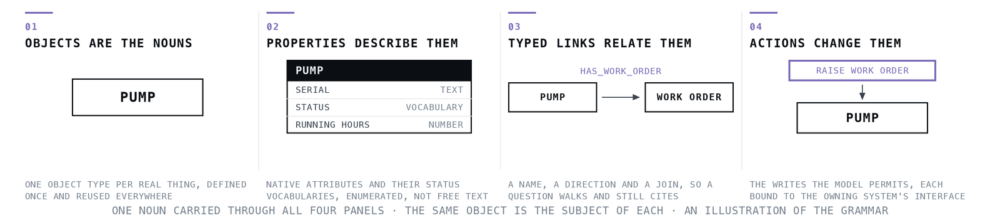

**Figure 5:** Object model of a rail fleet condition monitoring system showing the operator's cars, monitoring modules, digital and analog input channels, faults, alerts and notification groups with their typed links.

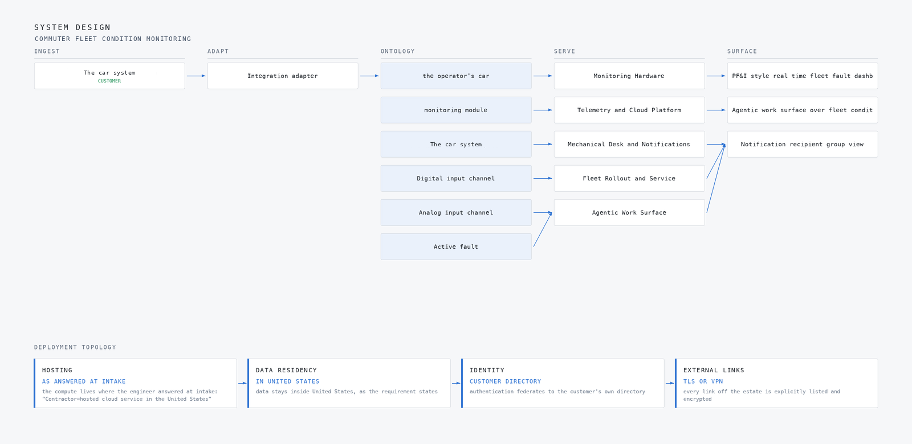

**Figure 6:** The same system drawn component by component, with the typed flows between layers and the hosting posture underneath: hosting as answered at intake, data residency in united states, identity customer directory, external links tls or vpn.

```
{
  "id": "car",
  "label": "the operator's car",
  "kind": "asset",
  "properties": [
    "car number in the RRD",
    "active cab (F Cab Active / R Cab Active)",
    "GPS location from the car system",
    "vehicle battery voltage (24 to 48 VDC nominal 37.5 V system)",
    "in-service status"
  ],
  "status_vocabulary": [
    "in service",
    "removed from service",
    "in yard",
    "under prototype test"
  ],
  "linked_to": [
    {
      "to": "onboard_monitoring_module",
      "label": "monitoring module"
    },
    {
      "to": "digi_router",
      "label": "The car system"
    },
    {
      "to": "digital_input_channel",
      "label": "Digital input channel"
    },
    {
      "to": "analog_input_channel",
      "label": "Analog input channel"
    }
  ]
}
```

One object of this design's model, as the platform records it.

## Ingestion and the event backbone

There is exactly one named source system in this build, the operator's own cellular that already rides on each car for connectivity, and the telemetry design is built around its behaviour rather than around new connectivity. The module speaks to the car system over the car's existing ethernet, GPS rides the same path, and the requirement is explicit that this is the only path between the module and the cloud. The design therefore assumes intermittent coverage from moving cars and treats it as normal operating condition, not as an exception.

The adapter tier maps the operator's stream into the object model, and it is responsible for three things: conditioning the raw analog signals before they become object events, carrying the per-channel calibration recorded at prototype commissioning so every trend carries its provenance, and stamping each reading onto the car, channel and fault objects it belongs to. Downstream, the streaming layer is responsible for delivery through coverage gaps. Each module runs store-and-forward buffering sized to the longest expected coverage gap at the agreed sample rate, and the message queue depth is monitored as a first-class metric with a staleness alert route covering the rest. Figure 7 shows how data moves, each named source into the adapter family that maps it, the adapters into the one ontology core, and the core out to the surfaces a person opens.

Figure 8 shows the integration map, the one named system this build integrates with mapped through one adapter family, each row carrying its provenance class. Because the source is the operator's own and its behaviour is documented in the requirement, the adapter is specified against its NAT and port-forwarding behaviour rather than discovered during commissioning, which is the guarantee the design can make at that hop.

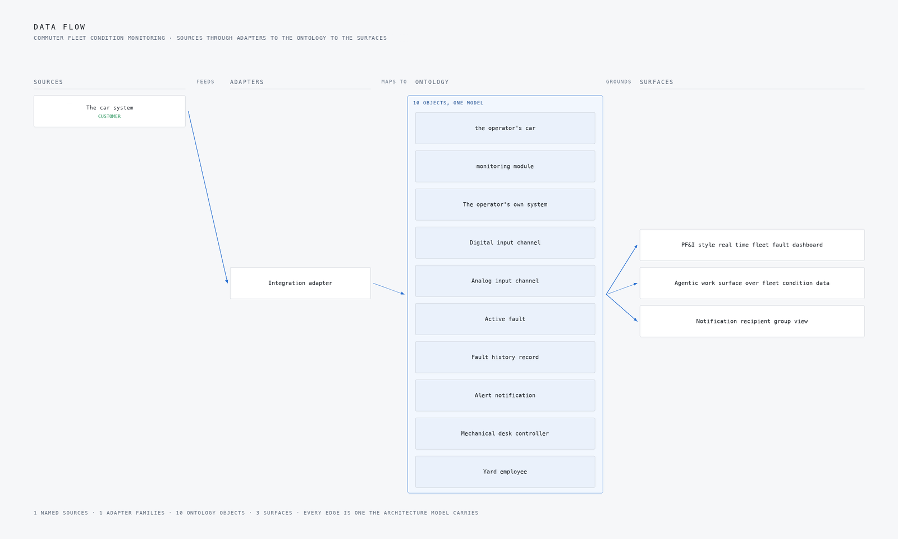

**Figure 7:** How data moves: each named source into the adapter family that maps it, the adapters into the one ontology core, the core out to the surfaces a person opens.

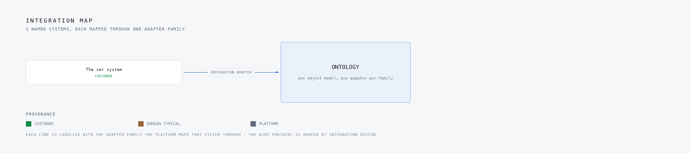

**Figure 8:** The 1 named systems this build integrates with, mapped through 1 adapter family, each row carrying its provenance class.

## Inference and the edge

The first inference point is the module itself. The requirement supplies its own fault-logic table over 64 named train signals, 32 digital and 32 analog, and the design executes that table rather than inventing a model around it. The module is specified as a class, not a part number: EN 50155 and IEC 60571 railway electronics with IEC 61373 body-mounted shock and vibration, EN 45545 to 2-class fire materials tightened by the requirement to CFR 238 plus the USDOT recommended practices, inside an 8 by 8 by 8 inch, IP62, 30-year-corrosion, -10 to 170 degree F, 24 to 48 VDC vehicle-battery envelope. Fault logic runs at the car so a fault exists as an object even when the cellular link is not there, and only conditioned readings and active faults cross the network boundary.

Four cameras complete the sensing half, aerial over the yard, wide at two sites, and aerial on a route segment, watching for dynamic brake failure, smoothing reactor overtemperature, locked axle, motor current imbalance, wheel slip and slide, slippery rail hotspots, MA frequency drift and hard coupling. Detections resolve onto fleet objects in the event stream, and the latency budget for the desk-facing view is subsecond, taken from the requirement's fleet-wide active-fault demand.

Figure 9 shows the hero workflow end to end: a smoothing reactor overtemperature fault at a site, from the reading that carries it to the mechanical desk controller dispatched and the recovery written back to the ledger, nothing waiting for a phone call. Figure 10 shows the camera wall at the moment of that event, four feeds with the detections drawn on them. When the link drops, the module buffers and forwards, and the staleness alert route tells the desk the feed is old rather than letting it look live.

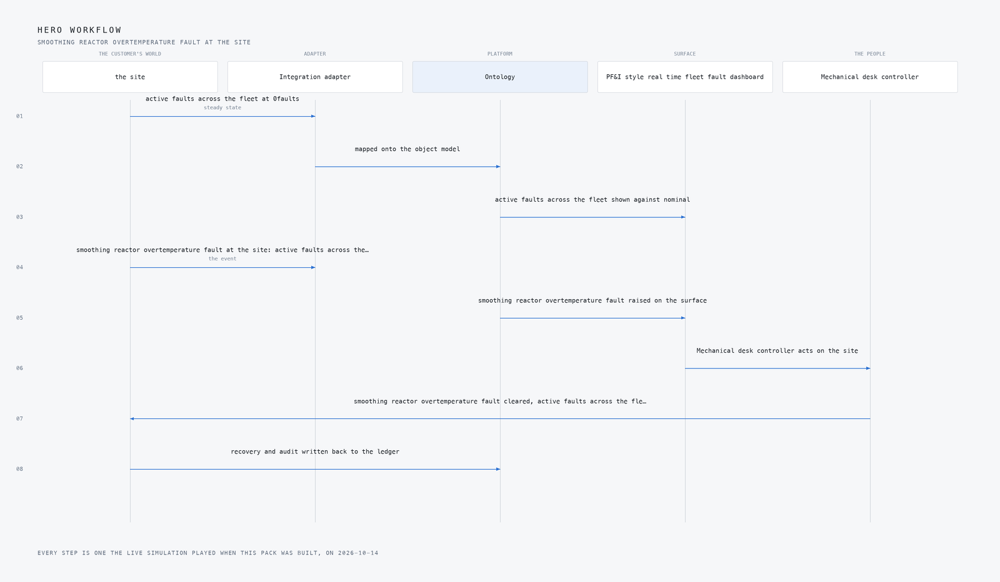

**Figure 9:** The hero workflow end to end: smoothing reactor overtemperature fault at the site, from the reading that carries it to the recovery written back to the ledger.


**Figure 10:** The camera wall at the moment of the event, smoothing reactor overtemperature fault at the site: four feeds with the detections drawn on them, the event stream resolving each one onto the object model, and active faults across the fleet on the excursion in faults.

## Two models, both Apache-licensed

Two models are named in this design and both carry the Apache-2.0 licence, which is a design constraint here and not a footnote. The System of Context rule is that nothing is trained for this customer, so the licence and the no-training rule together decide what qualifies. The plan put GLM 5.3 and Kimi K3 aside specifically on bespoke licence terms.

For the agentic work surface and ontology maintenance, the design runs Mistral Large 3 675B Instruct in FP8, self-hosted on a single 141 GB HBM GPU class node and served with vLLM. The agents work over the fleet ontology, read fault and condition data, and improve through memory rather than through training, which is what the requirement's intake asks for explicitly. For the analog half, the design runs Amazon Chronos-2 for anomaly detection and seasonal trending over the motor currents, thermocouples, accelerometers and speed sensors. It is a 120M parameter model doing zero-shot forecasting across univariate, multivariate and covariate channels with no fine tuning, which is what fits the no-training rule, and its residuals are thresholded into the alert queue and feed the 13-month seasonal view the requirement asks for. At that size it trends 64 channels across 225 cars on modest hardware.

Figure 11 shows the three-layer stack the models sit in, with inference above the ontology and the surfaces above that. The table below carries the full set of model choices with their roles and licences, so the rows are not repeated here.

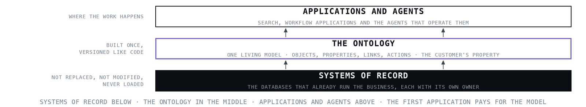

**Figure 11:** Three layer model stack of a predictive maintenance rolling stock platform, pairing a self hosted Apache licensed large language model for the agent work surface with zero shot forecasting over analog channels.

| The choice | What was picked | Why here |
| --- | --- | --- |
| Agentic work surface and ontology maintenance | Mistral Large 3 675B Instruct (FP8), licence Apache-2.0 | The plan names it for this role and records its licence as Apache-2.0 |
| Analog channel anomaly detection and seasonal trending | Amazon Chronos-2, licence Apache-2.0 | Zero-shot forecasting over univariate, multivariate and covariate channels motor currents, thermocouple, accelerometer, speed sensors with no fine tuning, which is what System of Context's no-training rule requires; at 120M parameters it trends 64 channels across 225 cars on modest hardware, and residuals thresholded into the alert queue feed the 13-month seasonal view A3 asks for. |
| The equipment it runs on | Rolling Stock Electronics, 141 GB HBM GPU Class | The electronics class governs the whole hardware half: EN 50155 / IEC 60571 railway electronics with IEC 61373 body-mounted shock and vibration, EN 45545 to 2-class fire materials (the spec tightens this to CFR 238 plus the USDOT recommended practices), inside the customer's own 8x8x8-inch, IP62, 30-year-corrosion, -10 to 170 F, 24 to 48 VDC battery envelope. No part numbers are named; the class and its type-test |
| What watches the site | 4 cameras, aerial, wide | What they are watching for: dynamic brake failure, smoothing reactor overte, locked axle, motor current imbalance, wheel slip/slide |
| The pattern it stands on, agents layer | System of Context, published by CodeNinja | The requirement is a living model of a 225-car fleet cars, input channels, faults, alerts and slippery-rail hotspots that the mechanical desk and yard staff read, act on and correct, and intake A1 explicitly asks for an agent work surface building agentic workflows on top of the fault and condition data; System of Context gives that one owned ontology with agents that improve through memory (Engram) rather than |
| The pattern it stands on, data layer | ClickHouse Cloud Architecture for Real Time Analytics, published by CLICKHOUSE | Covers the distinct data layer: C3 and C8 demand subsecond fleet-wide active-fault views and tabular/graphical history over 64 channels on 225 cars for 13 months exactly the subsecond aggregation over high-volume event streams for user-facing dashboards this architecture is filed for; its patterns are adopted while the managed cloud service is substituted with self-managed open source the customer owns. |

## What degrades, and what must not

Each failure mode in this design has a stated answer, and the distinction the design draws is between what degrades and what must not. The network fails first: coverage gaps on a moving 225-car fleet drop or delay telemetry, so faults in a gap arrive late, and the design degrades to store-and-forward buffering sized to the longest expected gap, with queue depth monitored and a staleness alert route. What must not degrade is the module's own fault logic, which runs at the car on vehicle battery power, 24 to 48 VDC, so an active fault exists before any link is needed.

The sensing can silently fail: the 64 signals are raw and a mis-scaled thermocouple or accelerometer poisons every trend built on it, so the plan would bench-measure and calibrate every conditioned channel against known references during prototype commissioning and record per-channel calibration in the system as provenance. What must not degrade is the provenance itself, because a trend without it is unverifiable. The source system can change under the design, and the adapter tier carries that risk, which is why its behaviour is specified from the requirement rather than assumed. A model that stops being confident is answered by the no-training rule: Chronos-2 residuals either cross the threshold into the alert queue or they do not, and the alert budget with the desk during the 6-month tuning phase retires classes that produce no action, the contractual hook being the requirement's own nuisance-fault elimination clause. The East Palestine precedent, where a desk stopped treating a stream it could not act on, is the reason acknowledgement tracking is per alert.

The contractor-hosted cloud is its own failure mode: if the service ends, the fault history, ontology and agent context leave with it, so the plan would rehearse a full export during phase one and make data return and deletion an explicit contract term. The table below carries the full set of failure modes and mitigations.

| What fails | What the design does |
| --- | --- |
| Cellular coverage gaps on a moving 225-car fleet drop or delay telemetry, and faults occurring in a gap arrive late or not at all | store-and-forward buffering sized to the longest expected coverage gap at the agreed sample rate, with the message queue depth monitored as a first-class metric and the staleness alert route covering the rest |
| Prototype-to-fleet schedule risk: installing on 222 live cars depends on shop access and car-house windows the contractor does not control, the same constraint that broke the Flushing Line CBTC programme | Build the rollout schedule from 's available installation windows per car house, not from the software plan, and rehearse the full module installation off-car before the first car |
| Alert fatigue: C4's email and text stream exceeds what the desk and yard staff can treat seriously, and the alerts get ignored exactly as the East Palestine desk ignored the 953 alert | Set the alert budget with the desk during the 6-month tuning phase, route by severity with acknowledgement tracking per A5, and retire alert classes that produce no action §5.0's nuisance-fault elimination clause is the contractual hook |
| Raw analog signal quality is unproven: the analog channels are raw signals needing conditioning, and a mis-scaled thermocouple or accelerometer silently poisons every trend built on it | Bench-measure and calibrate every conditioned channel against known references during prototype commissioning, and record per-channel calibration in the system so trends carry their provenance |
| Thirteen-month retention of 64 channels across 225 cars inflates the contractor cloud bill against C15's 5 percent annual escalation cap | Tier the retention full-resolution recent data, downsampled seasonal history and price the storage curve into the service contract before signature |
| Contractor-hosted cloud dependency: if the contractor or the service ends, 's fault history, ontology and agent context leave with it | Rehearse a full export of the ontology, fault history and agent memory during phase one, and make data return and deletion an explicit contract term |

## How the design was reasoned

The method started with the requirement read verbatim. The two sections were read in full, and the decision that shaped most of the rest came from one of them: the requirement names its own 64 signals and its own fault-logic table, so the design executes that table instead of inventing a model around it. The model choices were then checked live against licence terms, which set aside two candidates and confirmed Mistral Large 3 675B and Chronos-2 on Apache-2.0.

For prior work, the design leans on the East Palestine case study for the alert-obligation rule, that every tier names who acts, when and with what authority, and on the Deutsche Bahn switch case for environmental-qualification-first sequencing, which is why the hardware half is written as a class specification before any component choice. Samsara's DHL consolidation guided the one-stream-many-views shape without its closed SaaS form. Two published patterns were adopted: System of Context as the primary, ClickHouse Cloud Architecture for Real Time Analytics as the supporting data layer. One reference architecture, the AKS Baseline Cluster Architecture, was proposed and set aside because its justification, read against the ask in full, argued from nothing this operator stated. The proven shelf came back honestly empty: nothing in it genuinely bears on rail fleet condition monitoring, and the treasury and defence-logistics precedents would have been stretched repairs.

Figure 12 shows the reasoning end to end, the ask, the industry it resolved to, every research lens with what it could see and what it cited. Three lenses came back with nothing usable, and the table below lists them: the regulation lens was listed but no entry was read in full, the history lens held 63 rail entries none of which were read this run, and the requirement states no sovereignty posture, so nothing in the design assumes one.

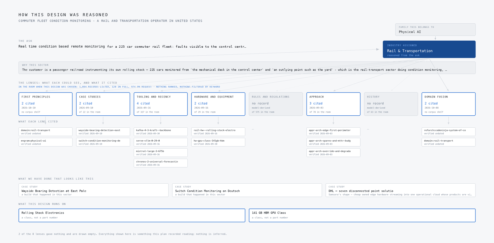

**Figure 12:** How this design was reasoned, end to end: the ask, the family and the industry it resolved to, every adaptive domain intelligence lens with what each one could see and what it cited, the precedent it stood on, and the equipment the design lands on. A lens that gave nothing is drawn empty rather than left out.

| Lens | Could see | Cited | Status |
| --- | --- | --- | --- |
| First Principles | No shelf of this kind | 2 | Contribution, 2026 to 10 to 10 |
| Case Studies | 22 in the room | 2 | Contribution, 2026 to 09 to 10 |
| Tooling and Recency | 327 in the room | 4 | Contribution, 2026 to 09 to 16 |
| Hardware and Equipment | 29 in the room | 2 | Contribution, 2026 to 09 to 16 |
| Rules and Regulations | 575 in the room | 0 | Gap, model-derived |
| Approach | 78 in the room | 3 | Contribution, 2026 to 09 to 03 |
| History | 63 in the room | 0 | Gap, model-derived |
| Domain Fusion | No shelf of this kind | 2 | Contribution, 2026 to 10 to 08 |

## Evaluation and rollout

Nothing has been measured, so what follows is what the plan would measure. The headline measure is active faults across the fleet, counted in faults, with the smoothing reactor overtemperature fault as the named excursion and a breach declared when the count rises above its nominal level of zero. The staged workflow the figures carry runs from the control centre to a site unattended, through a smoothing reactor overtemperature fault at that site, to a mechanical desk controller dispatched, to the site settled and sealed in the ledger with every asset audited. Figure 13 shows the coverage matrix, how the requirement's demands map onto the components that answer them, which is the gate the design would be read against before any phase closes.

The rollout runs in three phases with a gate at the end of each. Phase 1 is the prototype on 3 cars, carrying 12 items, and its gate is concrete: bench-measured calibration on every conditioned channel, a rehearsed full export of the ontology, fault history and agent memory, and a full module installation rehearsed off-car before the first car. Phase 2 is the fleet rollout across the remaining 222 cars, carrying 4 items, and its schedule is built from the operator's available installation windows per car house rather than from the software plan, because shop access is the constraint that broke comparable programmes and the contractor does not control it. Phase 3 is service operations, carrying 1 item, and its gate is the alert budget agreed with the desk after the 6-month tuning phase, with alert classes that produced no action retired under the nuisance-fault elimination clause.

Figure 14 shows the delivery timeline across the three phases. The design also prices the 13-month retention curve, full-resolution recent data over downsampled seasonal history, into the service contract before signature, against the requirement's 5 percent annual escalation cap.

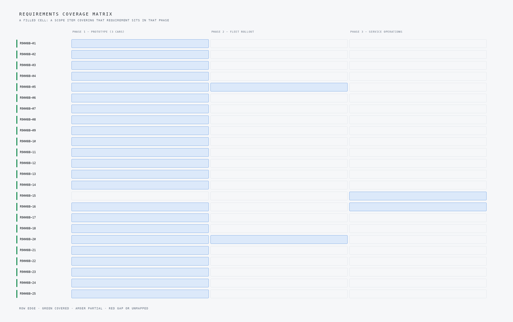

**Figure 13:** Coverage matrix for a predictive maintenance rolling stock design, matching each requirement in the operator's ask to the component of the system that answers it.

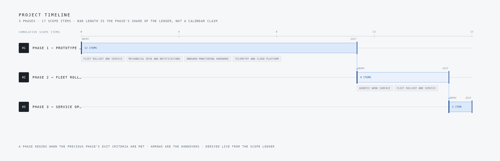

**Figure 14:** Delivery timeline for a rail fleet condition monitoring system rollout, running from the three car prototype phase through fleet rollout on 222 cars to service operations.

## Lessons learned

The lessons from this design fall into two groups, one about building the fleet ontology before the agents that read it, and one about treating the railway's own constraints, coverage gaps, shop windows and alert fatigue, as design rather than operational afterthoughts. Each is set out below with the decision that produced it.

### Execute the customer's fault table, do not invent a model

The requirement named 32 digital and 32 analog signals per car and carried its own fault-logic table in its own section. We designed the modules and the alert pipeline to execute that table verbatim rather than wrapping it in a learned model, because the operator's mechanical desk already knows what each fault means and has to act on it.

### Licence terms eliminate models before benchmarks do

We set aside two otherwise strong candidates on bespoke licence terms before any performance comparison, and committed to Mistral Large 3 675B Instruct and Amazon Chronos-2, both Apache-2.0. Check the licence first, because a model you cannot self-host under acceptable terms is not a candidate no matter how it benchmarks.

### Qualify the hardware class before designing the electronics

The electronics class governs the whole hardware half: EN 50155 and IEC 60571 railway electronics, IEC 61373 shock and vibration, CFR 238 fire materials, all inside the operator's 8x8x8-inch IP62 battery-powered envelope. We sequenced the environmental qualification first so no board decision could be made that the class would later reverse.

### Route alerts by severity or the stream gets ignored

The East Palestine case study carried the lesson that an alert nobody treats seriously is worse than no alert. We budgeted the email and text stream with the desk during a 6-month tuning phase, routed by severity with acknowledgement tracking, and wrote a nuisance-fault elimination clause into the scope as the contractual hook for retiring alert classes that produce no action.

### Size the buffer for the coverage gap you will actually get

Telemetry rides the operator's existing cellular routers on moving cars, so intermittent coverage is the design condition, not an edge case. We specified store-and-forward buffering sized to the longest expected coverage gap at the agreed sample rate, with queue depth monitored as a first-class metric and a staleness alert route behind it.

## What is still open

Three questions could not be closed from the requirement, and each would change the design if settled. The sovereignty posture is not stated anywhere in the requirement, so nothing in this design assumes one; settling it would decide whether contractor-hosted compute in the United States stands or whether a data boundary layer has to be added. The regulation lens was listed but no entry was read in full during this run, so the regulatory touchpoints, CFR 238 and the USDOT recommended fire-safety practices, are named from the requirement itself; reading the lens properly could tighten the materials specification or add touchpoints the requirement does not name. The history lens held 63 rail entries, none of which were read this run, so the East Palestine case study carries the historical argument alone; reading the wider rail record could surface precedents for the rollout scheduling risk that the current mitigation handles from a single case.

A fourth question is contractual rather than technical: the 13-month retention of 64 channels across 225 cars against the 5 percent annual escalation cap depends on a storage curve that has to be priced into the service contract before signature. The table below carries the full set of open questions and what each one would change.

| What the design needed | What the project holds |
| --- | --- |
| Rules and Regulations | The regulation lens was listed but no entry was read in full for this plan; the design's regulatory touchpoints are named from the requirement itself CFR 238 and the USDOT recommended fire-safety practices for materials (§3.10, with independent laboratory certification) and the operator's wiring specification (§3.9) and FTA/FRA transit-regulation entries in the corpus are to be confirmed at design before any |
| History | The history lens holds 63 rail entries but none was read in full this run; the East Palestine lesson this design leans on is carried instead through its full case study under case studies, which is the same evidence at case-study depth. |
| The sovereignty posture it runs under | The requirement does not state it, so nothing in this design assumes one |

## Conclusion

The design is a rail fleet condition monitoring system for a rail and transportation operator in the United States, built as three layers that each do one job. Monitoring modules on a 225-car commuter fleet read 64 named signals and execute the operator's own fault-logic table at the car, on EN 50155-class electronics inside an IP62, vehicle-battery-powered envelope, tested on 3 prototype cars before the 222-car rollout. Telemetry rides the cellular routers already on each car into a contractor-hosted US cloud, where a 14-object fleet ontology grounds real-time dashboards, severity-routed email and text alerting, and 13 months of history. On top sits the agent work surface: Mistral Large 3 675B and Chronos-2, both Apache-licensed, self-hosted, improving through memory rather than training.

Running it somewhere else means three substitutions. The hardware half is already a class specification rather than a bill of materials, so the electronics envelope transfers as written. The models are self-hosted on open licences, so the inference layer moves with the operator, and the data layer is self-managed open source for the same reason. What does not transfer is the operator's own fault-logic table and the cellular behaviour the adapter is specified against; a new fleet brings its own signal names, its own fault table and its own connectivity, and the adapter tier is where that work happens.

Appendix A

## What the Fleet Compute Costs Over Three Years

The requirement puts compute in a contractor-hosted cloud in the United States, with no server room on the property (chapter 1). The design serves its reasoning model, Mistral Large 3 675B, self-hosted on one node of the 141 GB HBM GPU class with vLLM, beside a small time series model (chapter 7). This appendix prices that node from the AWS price files for the US East region, dated and cited. The 225 monitoring modules are specified as a class (EN 50155 and IEC 60571 electronics, IP62, CFR 238 materials) rather than a part number and are sold by quotation, so they are named and left out of the total rather than guessed.

### A.1 The Answer

Running the node around the clock for three years costs **about 625,000 US dollars** on the deepest three-year commitment (an AWS EC2 Instance Savings Plan, all upfront, US East) and **about 1.66 million dollars** on demand, so the commitment costs **about three eighths** of the on-demand price. Both models are open weights under Apache-2.0 and carry no licence line.

### A.2 What the Node Would Cost

| Option | Basis | Three-year cost (USD) |
| --- | --- | --- |
| AWS, US East, on demand | p5en.48xlarge, eight H200 cards of 141 GB, at 63.296 dollars an hour (Vantage 2026), 26,280 hours | 1,663,000 |
| AWS, US East, three-year Compute Savings Plan, all upfront | p5en.48xlarge at 42.21683 dollars an hour (AWS 2026) | 1,109,000 |
| AWS, US East, three-year EC2 Instance Savings Plan, all upfront | p5en.48xlarge at 23.7993 dollars an hour, the deepest three-year plan in the region (AWS 2026) | 625,000 |

Why eight cards: the 675 billion parameter model needs about 675 GB for its weights at eight bits, which fits on eight 141 GB cards with room for the KV cache and does not fit on fewer.

Not in the table: the 225 onboard monitoring modules and their installation across the fleet, sold by quotation; the 13 months of telemetry history over 64 signals per car, which the design prices into the service contract against the 5 percent annual escalation cap; and egress, which depends on the cellular plan already on each car.

### A.3 Sources for This Appendix

- AWS. 2026. EC2 Instance and Compute Savings Plans price file, us-east-1, version 20261013035015, as read 14 October 2026. <https://pricing.us-east-1.amazonaws.com/savingsPlan/v1.0/aws/AWSComputeSavingsPlan/current/region_index.json>
- Vantage. 2026. p5en.48xlarge pricing, US East (N. Virginia), Linux on demand, as read 14 October 2026. <https://instances.vantage.sh/aws/ec2/p5en.48xlarge>

## References

1. [A Survey on Data-Driven Predictive Maintenance for , PMC](https://pmc.ncbi.nlm.nih.gov/articles/PMC8434101) why this is hard to prevent
2. [Exploring the paradigm of railway predictive maintenance](https://www.tandfonline.com/doi/full/10.1080/15732479.2025.2596714) why this is hard to prevent
3. [Modeling of a Predictive Maintenance Process to Screen](https://www.itskrs.its.dot.gov/2022-b01708) what the regulator requires
4. [A Survey of AI-Enabled Predictive Maintenance for Railway](https://pmc.ncbi.nlm.nih.gov/articles/PMC12899784) what it costs when it goes wrong
5. [Predictive Maintenance in Railways: Enhancing Safety and](https://ifactoryapp.com/predictive-maintenance/predictive-maintenance-railways-safety-efficiency) what it costs when it goes wrong
6. [Integrated railway remote condition monitoring](https://etheses.bham.ac.uk/7904/1/Huang17PhD.pdf) the source for the opening fact

## Acknowledgements

This design was assembled on CodeNinja Praxis, the CodeNinja Atoms platform, which read the requirement, reasoned the plan and drew every figure in this post from it. It stands on published work by Codeninja and Clickhouse: System of Context and ClickHouse Cloud Architecture for Real Time Analytics. The operation it was designed for is described by class rather than named.

## About the author

**The CodeNinja Engineering Team**, forward deployed engineers at CodeNinja, designed this system on CodeNinja Praxis, the CodeNinja Atoms platform. Every figure in this post is generated from the project’s own plan, and the operation it was designed for is described by class rather than named.

Published 2026-10-14.
