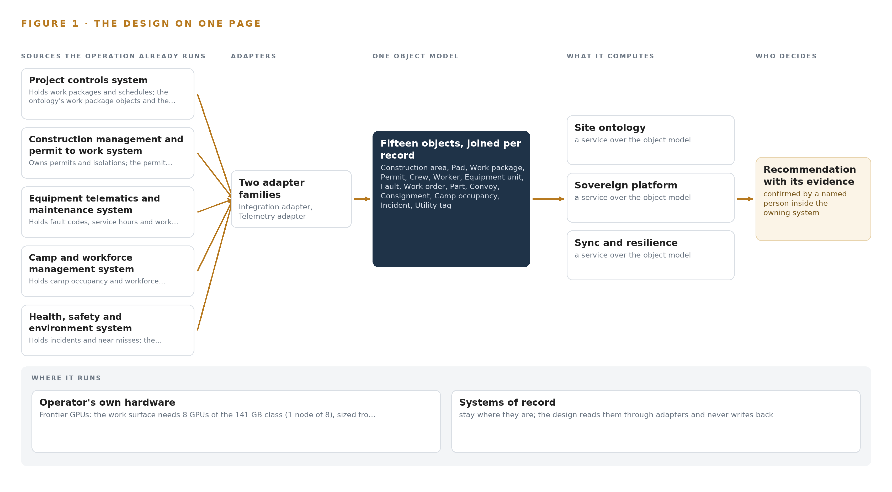
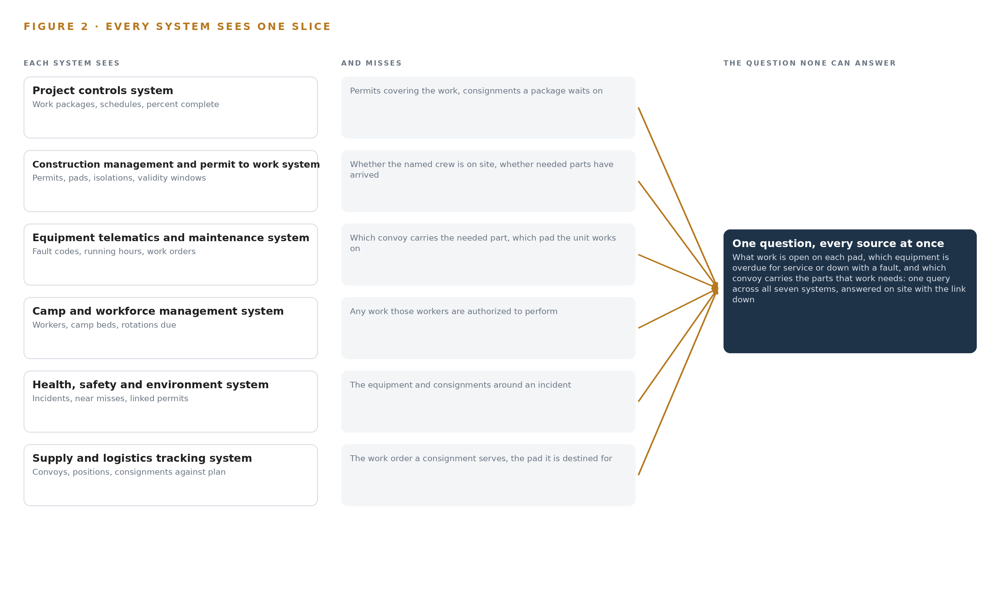
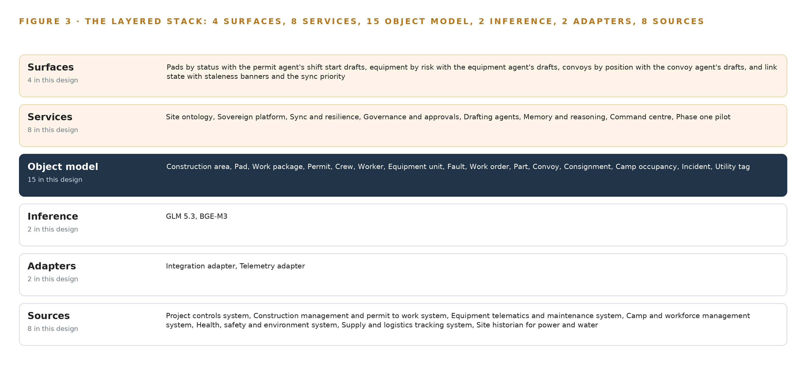
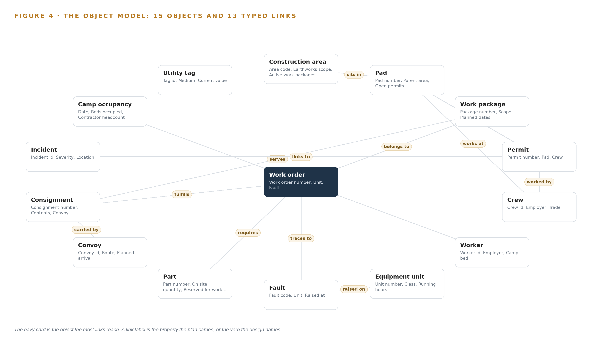
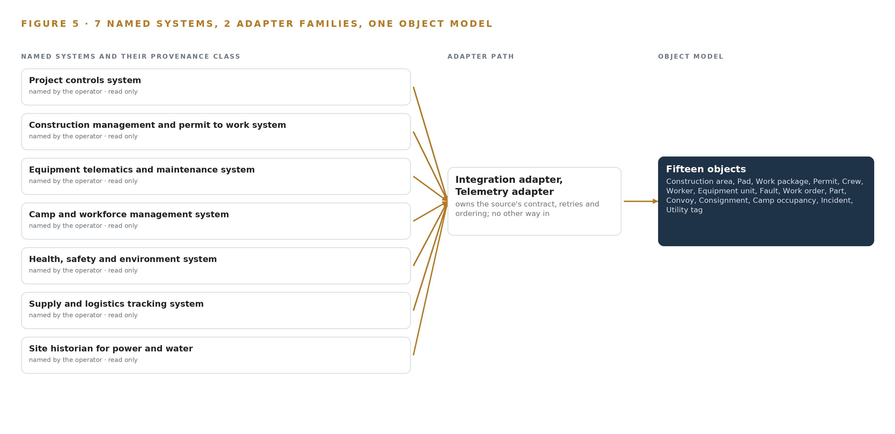
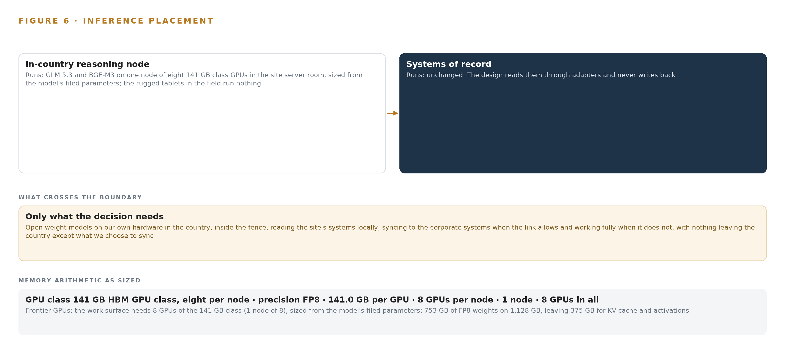
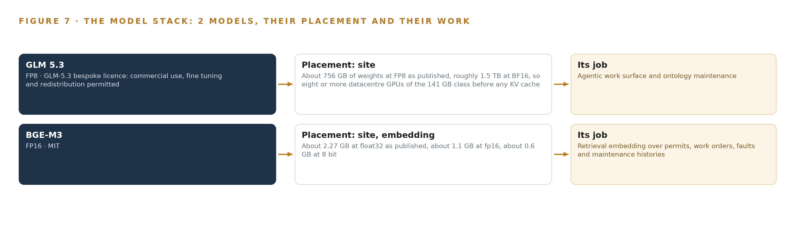
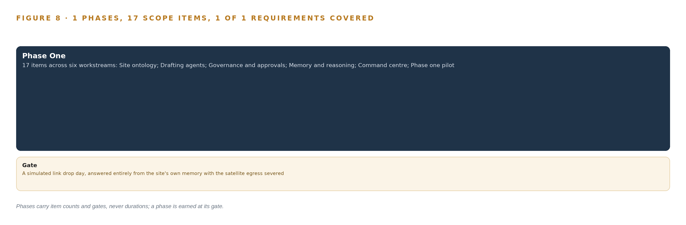
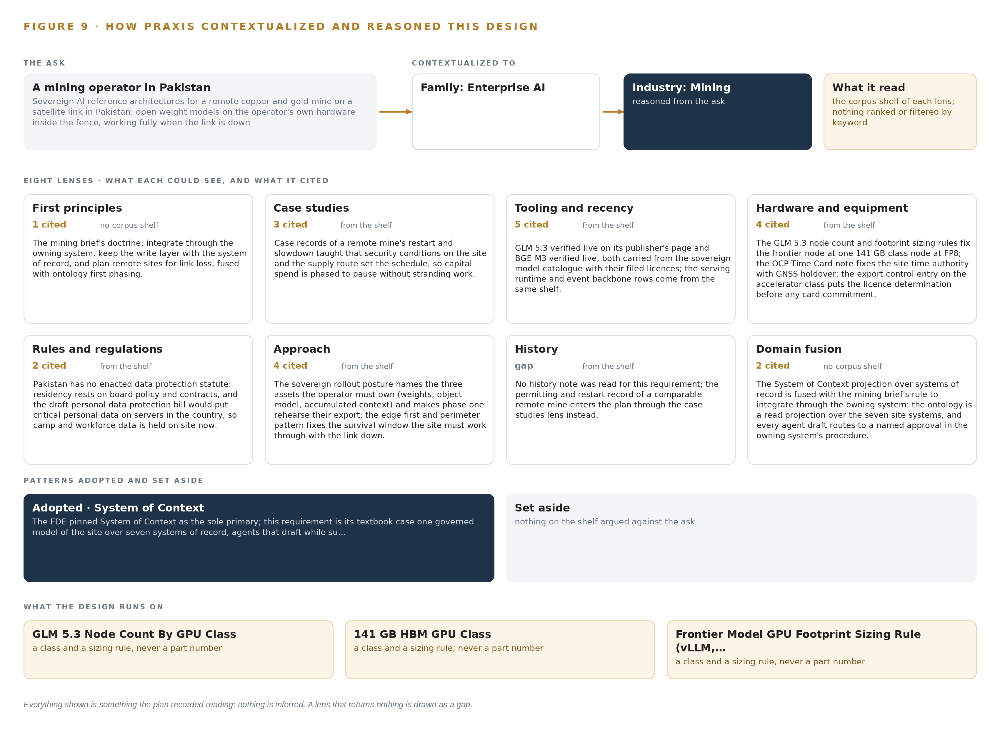

# Sovereign AI Reference Architectures for a Remote Mine on a Satellite Link in Pakistan

Canonical: https://codeatoms.ai/remote-mine-satellite-pakistan/
PDF: https://codeatoms.ai/remote-mine-satellite-pakistan/paper/remote-mine-satellite-pakistan.pdf
License: CC BY 4.0
Publisher: CodeNinja Atoms (https://codeatoms.ai), a fully owned subsidiary of CodeNinja

VERTICAL-DRIVEN ARCHITECTURES · MINING · DESIGNED WITH PRAXIS · NOVEMBER 2026

# Sovereign AI Reference Architectures for a Remote Mine on a Satellite Link in Pakistan

Mining Watch: One Living Picture of the Operation

Muhammad Umar, Cofounder, CodeNinja

For the leaders accountable for mining operations, their supervisors, and the data and platform engineers who would build and run it.

---

Vertical-Driven Architectures is a CodeNinja series of system designs. Every design in the series is driven by a real-world problem and scenario in a single industry, and every one is designed on Praxis, CodeNinja's platform for designing physical AI systems. Operations are described by class, never by name.

At a glance

## Sovereign AI Reference Architectures for a Remote Mine on a Satellite Link in Pakistan

**What this is.** An open reference architecture for system design in physical AI, built for a mining operator developing a large open pit copper and gold mine in a remote part of Pakistan, reached by road and air, on its own power, with one satellite link that drops in bad weather, where owning the inference node that runs it costs about 572,000 US dollars over three years. When the link drops for a day while a dozer fault, a permit clash and a late convoy all arrive, the design answers all three from the site's own memory: which work is open on each pad, which equipment is overdue or down, and which convoy carries the parts for it, with every fact stamped with when the site last saw it, and syncs when the link returns. The models run entirely on the operator's own hardware inside the fence under the mining lease, the permit to work and isolation procedures, the draft data protection rules and export control on the GPU node. It is written for the leaders accountable for mining operations, their supervisors, and the data and platform engineers who would build and run it. The operator is described by class, never by name.

**The answer in numbers.**

| Part | The design |
| --- | --- |
| Sources | Seven read only systems of record on site, entering through two adapter families (integration for record extracts, telemetry for tag and telematics streams) over an event backbone that stamps every fact with its source system and the time the site last saw it: project controls, construction management and permit to work, equipment telematics and maintenance, camp and workforce management, health, safety and environment, supply and logistics tracking, and the site historian for power and water; the corporate estate abroad is the eighth source, a sync target and never a dependency; nothing writes into a system of record |
| Object model | 15 typed objects with 13 typed links, from the construction area and pad through the work package, permit, crew and worker to the equipment unit, fault, work order, part, convoy and consignment, with camp occupancy, incident and utility tag, each anchored in exactly one system of record and published as JSON for reuse |
| Models | GLM 5.3 (GLM-5.3 bespoke licence, 753B at FP8) for the three drafting agents (permits, equipment, convoys), the command centre's cited conversational interface and ontology maintenance; BGE-M3 (MIT) for retrieval over permits, work orders, faults and maintenance histories; no third party model service, nothing trained into weights |
| Compute | One node of eight 141 GB HBM cards (1,128 GB) in the site server room on the mine's own power, holding 753 GB of FP8 weights with 375 GB beside them; BGE-M3 on the same node; no edge tier, the rugged tablets in the field run nothing. The node is a 4A090 class item for a D:2, D:3 and D:4 destination, so an export licence determination naming the end user is the first phase one checkpoint, with an in country colocation fallback if the path closes |
| Rollout | One phase of 17 scope items across six workstreams, closed by a gate, never a date: a simulated link drop day with the satellite egress severed, on which the pilot area resolves a dozer fault, a permit clash and a late convoy entirely from site memory; one construction area and its heavy fleet for one quarter; four baselines measured from the site's own records before any claim (permit conflicts found at the pad, equipment hours lost to parts not on site, convoy days late, and the time a new supervisor needs to answer what is open on a pad) |
| Three-year cost | About 572,000 US dollars to own the node for three years (a range of 548,000 to 597,000: server, support and power at the national industrial tariff as a reference, since the mine generates its own power), against about 751,000 to rent the same eight cards on the deepest three year commitment in AWS Asia Pacific (Mumbai), so ownership costs about three quarters of it, and about 2.00 million on demand, against which ownership costs a little over a quarter. Renting is a price reference only: AWS lists no region in Pakistan, and no rented node answers with the link down (Appendix A) |
| Human control | Agents draft and supervisors decide, by name: the area supervisor confirms the permit agent's shift start draft of open permits, conflicts and expired isolations per pad, the maintenance planner approves the equipment agent's work order and parts check, and the logistics lead approves the convoy agent's re sequencing; no agent issues a permit, closes an isolation or dispatches a convoy; every confirmation is recorded against the owning system's record and kept as memory the next shift reads |

**Reuse it.** The object model, the model register and the figures are free to reuse under CC BY 4.0. Cite as <https://codeatoms.ai/remote-mine-satellite-pakistan/.>

**Made with.** Reasoned on [CodeNinja Praxis](<https://codeatoms.ai/praxis/>), the CodeNinja Atoms platform for designing physical AI systems. The object model imports into [Hyper Ontology](<https://codeatoms.ai/hyper-ontology/>), which turns it into a living system. Load it with the [hyper-ontology loader](../hyper-ontology-py/): `hyper-ontology show remote-mine-satellite-pakistan`. Both are in beta; access by request.

ABSTRACT

## The Answer Already Exists in the Systems the Operation Runs

Sovereign AI reference architectures for a remote copper and gold mine on a satellite link in Pakistan: the operator's corporate systems live in data centers abroad and reach the site over that link, so when the link degrades the site works blind, with permits issued on paper, equipment faults logged after the shift and a convoy's position known when it arrives.

The design reads 8 source systems through 2 adapter families into one object model of 15 objects, runs 8 services over it and opens 4 surfaces to the people who decide, with 2 models placed where the data is. A sovereign system of context for a remote copper and gold mine in Pakistan: one governed ontology over read mirrors of the site's seven systems of record, three drafting agents (permits, equipment, convoys) whose drafts named people approve, memory that survives crew rotation, and a command center that runs fully on site through satellite outages with GLM 5.3 self hosted on one 141 GB class node. Phase one is one construction area and its heavy fleet for one quarter, gated on the site answering a simulated link-drop day, on which a dozer fault, a permit clash and a late convoy arrive together, entirely from its own memory.

The paper covers the operation and the problem its systems cannot answer, the constraints, the stack, the object model, ingestion, inference placement, the models and their licenses, the rollout and its proof, ownership, and finally how Praxis contextualized and reasoned the design.

---



Figure 1. Mining Watch on one page: the sources the operation already runs, one object model, what it computes, and the person who decides.

## Contents

Each chapter is tagged for the reader it serves most directly: Executive, Team Lead, FDE, Reference.

|  |  |  |
| --- | --- | --- |
|  | Abstract · The Answer Already Exists in the Systems the Operation Runs | Executive |
| PART I · THE PROBLEM | | |
| 1 | [A Daily Question Goes Unanswered in the Systems That Hold the Data](#ch1) | Executive |
| 2 | [Every System Sees One Slice of the Operation](#ch2) | ExecutiveTeam Lead |
| PART II · THE DESIGN | | |
| 3 | [Four Constraints Shape Everything Downstream](#ch3) | Team Lead |
| 4 | [One Stack Runs From the Systems of Record to the Surfaces](#ch4) | Team LeadFDE |
| 5 | [Fifteen Objects Turn Operational Data Into One Argument](#ch5) | FDE |
| 6 | [Every Source Enters Through an Adapter, Never Directly](#ch6) | FDE |
| 7 | [Inference Belongs Where the Data Is](#ch7) | FDE |
| 8 | [The License Decides What the Operator Can Own](#ch8) | FDEExecutive |
| PART III · THE ROLLOUT | | |
| 9 | [Shadow Mode Comes Before Any Flag Is Trusted](#ch9) | Team LeadExecutive |
| 10 | [The Intelligence Should Stay with the Operation That Produced It](#ch10) | Executive |
| PART IV · HOW IT WAS DESIGNED | | |
|  | Conclusion · The Pattern Repeats Wherever Systems of Record Do Not Meet | Executive |
| 11 | [How Praxis Contextualized and Reasoned This Design](#ch11) | Team LeadFDE |
|  | [Sources](#sources) | Reference |

PART I · CHAPTER 1

## A Daily Question Goes Unanswered in the Systems That Hold the Data

The operation holds every fact the question needs and no system answers it.

The abstract promised sovereign AI reference architectures for remote mine sites: read mirrors of the site's seven systems of record, one governed ontology over them, three drafting agents whose outputs named people approve, and one frontier class model node inside the fence. This chapter returns to the problem that design answers, because the problem, not the technology, fixes the shape of everything downstream.

### 1.1  The Question, the Data and the Regimes

Every shift, the site's supervisors need one question answered: what work is open on each pad, which equipment is overdue for service or down with a fault, and which convoy carries the parts that work needs. The data the answer requires is already held: permits and isolations from the construction management and permit to work system, fault codes and work orders from the equipment telematics and maintenance system, convoy positions and consignments from the supply and logistics tracking system, crew locations and authorizations from the camp and workforce management system, incident records from the health, safety and environment system, and live power and water readings from the site's own historian. Three regimes frame how the answer may be produced. Mining law places site authority in a named mine manager, so no software may confirm a permit or an isolation; Pakistan's personal data protection regime is a draft bill rather than a statute, so residency obligations for worker records rest on board policy and contracts; and export controls on high bandwidth memory accelerator classes govern what hardware can enter the country at all. The answer must therefore be computed on site, inside the fence, with every approval left to a named person.

### 1.2  The Documented Cost of a Blind Site

When communication fails at a mine, the failure reaches people, not only screens. Communication failures were blamed for injuries to a worker trapped in a drilling jumbo during a roof collapse at an underground mine, in a matter investigated by a state resources regulator (Miningmonthly 2026). A loss of communications on an autonomous haulage circuit caused an autonomous truck to reverse into a manually operated excavator (Miningmonthly 2024). Mine accidents in the United States prompted federal law on mine communications and tracking, after which the national regulator studied survival and interoperability requirements for underground communications (MSHA 2006), and an industry guidelines body has collected recommendations from operating companies on keeping open pit telecommunications functioning (Gmggroup n.d.). On this site the failure mode is routine rather than exceptional: when the satellite link degrades, permits are issued on paper, equipment faults are logged after the shift, and a convoy's position is known when it arrives. The people who run the site well are the ones who carry its state in their heads, and they rotate out every few weeks.

### 1.3  The Operation as a Scenario

A mining operator in Pakistan is developing a large open pit copper and gold mine in a remote part of the country, with construction under way, hundreds of permanent staff and thousands of contractors on site, and first production planned around the end of the decade. The site is many hours from the nearest city and reached by road and air; power is its own, water is pumped from distance, and its link to the outside world is satellite, with limited and costly bandwidth that drops in bad weather. The people in the loop are the mine manager who holds statutory authority, area supervisors who own pads, maintenance planners who schedule work orders, logistics coordinators who track convoys over a long road route, camp managers who hold a camp built for thousands, environment and safety leads, and the crews whose rotations end within weeks. The physical environments are active earthworks areas and pads, a concentrator build, a heavy equipment fleet and workshop, a camp, a supply route measured in days, and a site server room on the mine's own power. The systems of record number seven by name, plus corporate systems in data centers abroad that reach the site only over the link, and one satellite egress that all of them share.

PART I · CHAPTER 2

## Every System Sees One Slice of the Operation

Each system of record sees its own part of the answer and none sees the whole.

Chapter 1 stated the question the operation needs answered and the regimes that frame it. This chapter shows why no existing system answers it: each system of record holds one true slice of the operation, and none holds the join between them.

### 2.1  What Each System Sees

Figure 2 sets the seven systems side by side, and the prose here walks them in the order a supervisor would query them. The project controls system sees work packages, schedules and percent complete; it does not see which permits cover that work, or which consignment a delayed package is waiting on. The construction management and permit to work system sees every permit, pad and isolation with its validity window; it does not see whether the crew named on the permit is on site today, or whether the parts that work needs have arrived. The equipment telematics and maintenance system sees fault codes, running hours and work orders; it does not see which convoy carries the part each work order requires, or which pad the unit is working on. The camp and workforce management system sees every worker, camp bed and rotation due; it sees nothing about the work those workers are authorized to perform. The health, safety and environment system sees incidents and near misses and the permits they link back to; it does not see the equipment or the consignments around them. The supply and logistics tracking system sees convoys, positions and consignments against plan; it does not see the work order a consignment was bought for or the work package it serves. The site historian for power and water sees utility tags live and continuously; it sees nothing about the work those utilities exist to serve.



Figure 2. Seven systems, each seeing one part of the answer. The question needs all of them in one place at once.

### 2.2  What None of Them See Together

The supervisor's question crosses all seven slices at once: open work on the pad, equipment overdue or down, and the convoy carrying the parts for its repair. Answering it today means three queries to three systems, over a satellite link that may be down, joined in the head of one person whose rotation ends within weeks; when the link drops, the join disappears entirely and the answer comes from paper, memory and arrival. That is the cost in practice: permits issued on paper during outages, faults logged after the shift that raised them, convoys known only when they appear at the gate, and a site whose state leaves the country every few weeks with the rotating crew. The design's single contribution is to make the join itself a governed object, so the question can be answered by one query against one model of the site, on site.

PART II · CHAPTER 3

## Four Constraints Shape Everything Downstream

The goals, the scoping decisions and the exclusions were fixed before any component was chosen.

Chapter 2 showed the join failure: seven true slices and no system holding the join. This chapter fixes the goals and the scoping decisions before any component is named, because in this industry the constraints, not the tooling, decide the architecture.

### 3.1  The Site Must Answer with the Link Down

The first goal is that the site answers the supervisor's question with the satellite link down, at full fidelity, for as long as the outage lasts. This is hard in mining because the link is not a reliability problem to be engineered away but a physical condition: bandwidth is limited and costly, weather degrades it, and the corporate systems the site depends on sit in data centers abroad. Production raises the stakes, since a concentrator cannot wait for a satellite window, and a loss of communications at a mine is a documented path to injury and equipment damage (Miningmonthly 2024). In this industry, [sovereign AI reference architectures](https://codeatoms.ai/sovereign-ai-reference-architectures/) earn the name only when the link-down mode is enumerated and drilled rather than assumed, so the design treats degradation as a designed state with its own surfaces, its own staleness stamps and its own rehearsed day.

### 3.2  Every Decision Stays with a Named Person

The second goal is that agents draft and people approve: no software confirms a permit, an isolation or a work order. This is hard because mining law places site authority in a named mine manager, and the permit to work procedure exists precisely to put a human signature between a crew and a hazard. The cost of the goal is permanent: every agent output routes to a named approval in the owning system's procedure, and every confirmation made in the command center is recorded against the owning system's record and reconciled, so no second version of permit state grows beside the system of record.

### 3.3  Personal Data Never Leaves the Site

The third goal is that camp and workforce personal data stays on site, inside the fence, forever. This is hard because Pakistan's data protection regime is a draft bill rather than a statute, so residency obligations rest on board policy and contracts today and could change on enactment; the design answers by holding the camp and workforce mirror on site with purpose tags and retention limits, and making it the one mirror the outbound sync never touches, so enactment forces no migration.

### 3.4  The Operator Owns the Intelligence

The fourth goal is that the operator owns the three assets the build produces: the model weights it serves, the governed object model over its systems, and the accumulated memory that survives crew rotation. This is hard in this country because export controls on accelerator classes, keyed to total processing performance, gate the hardware the frontier tier needs, and a license determination naming the end user must precede any card commitment. The design holds an in-country colocation fallback for the frontier tier if the license path closes, and it phases the build so a slowdown pauses spend without stranding work.

### 3.5  Scoping Decisions

Three scoping decisions carry the goals into the build, and Table 1 states what each buys and what it costs. The mirrors are read-only, the ontology is a projection over systems of record rather than a replacement for them, and all serving sits on one site node. Each decision buys the supervisor's single query at the price of an engineering obligation the design must then meet.

Table 1 · Scoping Decisions

| Decision | What it buys | What it costs |
| --- | --- | --- |
| Read mirrors of all seven site systems under one governed ontology | One query reaches across permits, faults, convoys and crews that three systems hold separately | Every mirror must refresh over a link that drops, in stored order, with staleness stamped and shown on every answer |
| Agents that draft and named people who approve | Statutory authority and permit procedures stay intact, and every confirmation is attributable | Slower than automation, and every confirmation in the command center must reconcile daily against the owning system's record |
| All model serving on one site node, nothing hosted abroad | The site answers through outages and personal data never leaves the country | One frontier class node must be licensed into the country, powered by the mine, and sized with headroom for KV cache |

### 3.6  What the Design Chose Against

Table 2 records the alternatives the design rejected and why, ending with the scope boundary. The rejections follow the goals: one node instead of two keeps a remote site off a multi node fabric, store and forward instead of live replication respects a link that drops mid-stream, and self hosted open weights instead of a hosted API keeps the site answering when the link is down, which is the mode that matters here.

Table 2 · What the Design Chose Against

| Where | What was picked | Instead of, and why |
| --- | --- | --- |
| Frontier serving | One node of the frontier inference cluster class (GPU nodes for 300B to 1T parameter open weight models) at FP8 | Two nodes of the 80 GB class, whose 589 GB usable memory cannot hold the roughly 756 GB of FP8 weights, and whose two node fabric adds a failure class a remote site on its own power does not need; one node leaves about 280 GB of KV ceiling beside the weights |
| Satellite sync | Store and forward with ordered, idempotent replay | Live bidirectional replication, because the link drops in bad weather and a replication stream that fails mid-flight would leave mirrors in unknown order |
| Data posture | Camp and workforce records held on site with purpose tags and retention limits | A compliance-only reading of the draft bill, because residency currently rests on board policy and holding the data on site now means enactment forces no migration |
| Model placement | Self hosted open weights inside the fence | A hosted API, which leaves the site blind exactly when the link drops and places the operator's accumulated context outside the country |
| Scope boundary | Live feeds and agreed opening balances only | Bulk migration of historic records, continuous fleet condition sensing, cameras, autonomous haulage integration, corporate-side system changes, hardware and third party license fees, estate wide training and round the clock support, all excluded: the operator asked for none of them and each adds cost the outage test does not need |

PART II · CHAPTER 4

## One Stack Runs From the Systems of Record to the Surfaces

Systems of record below, one object model in the middle, services and surfaces above.

Chapter 3 fixed the four constraints: sovereignty inside the fence, full function through link loss, every decision with a named person, and a first gate that stops spend cheaply. This chapter lays the stack that satisfies them, stage by stage from the systems of record to the surfaces supervisors work in.

### 4.1  A Projection Over the Systems of Record

The pattern is three layers. Below sit the systems of record, unchanged and still authoritative: each keeps its data, its procedure and its owner, and nothing in the design replaces any of them. In the middle sits one governed object model, a read projection that joins them, never a second master. Above sit the services and surfaces: drafting agents that propose, governance that routes each proposal to a named approval, and the command center on the site network. Figure 3 shows the layered stack with its counts per layer: eight sources, two adapter families, fifteen objects, eight services and four surfaces.

This pattern fits because the failure the operator described is a join failure that becomes an outage failure. The corporate estate abroad is a sync target, not a dependency, so when the satellite link degrades the middle and top layers keep running on site, and the site works from its own memory instead of paper. Link loss in mining is a safety event, not an IT inconvenience: a loss of communications on an autonomous circuit put a haul truck into an excavator (Miningmonthly 2024), and mine regulators began mandating survivable communications after multiple fatality investigations (MSHA 2006). The stack treats the outage as the normal case. Table 7, printed by the platform at the end of this chapter, carries the same stack layer by layer with the component chosen at each layer and the reason for the choice.



Figure 3. The layered stack: 8 sources, 2 adapter families, 15 objects, 8 services and 4 surfaces.

Table 7 · Architecture, Layer by Layer

| Layer | Component | Choice | Why |
| --- | --- | --- | --- |
| Event streaming and messaging | by class, no product named | Product | Apache Kafka 4.3 (KRaft, three dedicated controllers) |
| The ontology or graph store | by class, no product named | Product | Hyper Ontology v0.9 (Semantics and Kinetics) |
| Time series and telemetry storage | InfluxDB 3 Core, TimescaleDB | Class | The shelf holds the compared set for this layer; the historian mirror's pick is confirmed at design against the site's tag cardinality and retention. |
| Video ingest, recording and management | by class, no product named | Not needed | No cameras or video are anywhere in this requirement. |
| Edge model serving | by class, no product named | Not needed | No model runs below the site server room; the rugged tablets are thin operators to the command center. |
| On site language model serving | by class, no product named | Product | vLLM |
| Object tracking and trajectory forecasting | by class, no product named | Not needed | No camera or radar streams exist to track; convoy trajectories come from the logistics system's positions. |
| Edge orchestration of containers | by class, no product named | Product | Kubernetes |
| An air gapped artifact and model registry | by class, no product named | Product | Harbor |
| Labelling and retraining | by class, no product named | Not needed | Under system of context nothing is trained: 'every confirmed cause and every accepted plan is kept on site so the next shift plan is better, without training a model on the fly.' |
| Time synchronisation across sensors and systems | by class, no product named | Product | Linuxptp + chrony |
| Observability of the running system | by class, no product named | Product | Prometheus + Grafana + Loki |

### 4.2  The Stack Stage by Stage

Table 3 walks the stack in the order data flows through it, from the sources the site already runs to the four surfaces, naming the component responsible at every stage. Two stages deserve note: the sensing stage adds no cameras and no new positioning hardware, because the requirement asks for none and the telematics and logistics systems already carry positions; and the inference stage runs entirely in the site server room, so the rugged tablets in the field are thin operators rather than edge computers.

Table 3 · The Stack, Stage by Stage

| Stage | What it is responsible for | How |
| --- | --- | --- |
| Sources | Holding the site's operational truth, each with its owner and procedure | Seven systems of record on site: project controls, construction management and permit to work, equipment telematics and maintenance, camp and workforce management, health, safety and environment, supply and logistics tracking, and the site historian for power and water, plus the corporate estate abroad reached only through the sync |
| Sensing | Carrying the feeds the site already produces, and one clock for all of them | Telematics fault codes and service hours as tendered, historian utility tags and convoy positions from the logistics system, all timed against an OCP Time Card class GNSS grandmaster with OCXO holdover, disciplined by linuxptp and chrony |
| Adapters | Owning every contract between a source and the object model | Two families: the integration adapter for record extracts, the telemetry adapter for tag and telematics streams, both feeding an Apache Kafka 4.3 backbone in KRaft mode with three dedicated controllers |
| Object model | Making the join the systems never made | Hyper Ontology v0.9, Semantics and Kinetics, holding fifteen objects and their typed links, with a time series store from the compared shelf for the historian mirror |
| Inference | Serving models on the site's own hardware inside the fence | vLLM serving GLM 5.3 and BGE-M3 on one node of eight 141 GB class GPUs, orchestrated by Kubernetes, with artifacts held in a Harbor registry |
| Services | Doing the work of the stack | Eight services: site ontology, sovereign platform, sync and resilience, governance and approvals, drafting agents, memory and reasoning, command center and the phase one pilot, observed through Prometheus, Grafana and Loki, with Keycloak for on-site identity |
| Surfaces | Where people meet the system | Four command center views: pads by status with the permit agent's shift-start drafts, equipment by risk with the equipment agent's drafts, convoys by position with the convoy agent's drafts, and link state with staleness banners and the sync priority |

### 4.3  A Reusable Pattern

The shape a team carrying a similar brief can reuse is this: read mirrors over the systems of record, one governed ontology as the single join, agents that draft and never decide, a store and forward sync with ordered idempotent replay, and a first phase gated on a simulated link-drop day answered entirely from site memory. Swap the source systems, the fifteen objects and the model, sized to whatever node the license path allows; keep the adapter-only write boundary, the single write path through named approvals in the owning procedures, and the outage drill as the exit gate. Any remote operation on a constrained link, in any industry, can carry this shape with those substitutions.

PART II · CHAPTER 5

## Fifteen Objects Turn Operational Data Into One Argument

The object model is the join the systems never made.

Chapter 4 laid the stack from the systems of record to the surfaces. This chapter opens the middle layer, where the design's whole value sits: fifteen objects and the typed links that turn seven separate records into one argument.

### 5.1  Fifteen Objects and the Links Between Them

Every object is anchored in exactly one system of record, which remains its owner. Two site objects, the construction area and the pad, anchor in project controls and the permit to work system. Two people objects, the crew and the worker, anchor in camp and workforce management. Three record objects, the work package, the permit and the work order, anchor in project controls, permit to work and equipment telematics respectively. Two asset objects, the equipment unit and the convoy, anchor in telematics and logistics. Two event objects, the fault and the incident, anchor in telematics and health, safety and environment. Two material objects, the part and the consignment, and two measures, camp occupancy and the utility tag, complete the fifteen. Figure 4 shows every object and its typed links, with the pad in navy as the focal object of the phase one gate.

The links are what a document store cannot hold. A permit names its pad and its crew; a work order traces to a work package and to the fault that raised it; a consignment rides a convoy and serves a work package or a work order; an incident links to the permit it happened under. When a supervisor asks which equipment is overdue for service, which convoy carries the parts for the work order it needs and whether the pad's permit is still valid, that is one traversal across the links, each step carrying its own last-seen stamp. In a document store each record is a self-contained page, and answering the same question means application code re-implementing every join, badly, in every surface. Table 8, printed by the platform at the end of this chapter, lists each object with the system it is anchored in and its typed links.



Figure 4. The fifteen objects of the model and the typed links that let a query reach across them.

Table 8 · The Object Model

| Object | Anchored in | Typed links |
| --- | --- | --- |
| Construction area | The project controls system | no typed link recorded |
| Pad | The construction management and permit to work system | sits in: Construction area |
| Work package | The project controls system | no typed link recorded |
| Permit | The construction management and permit to work system | issued on: Pad; worked by: Crew |
| Crew | The camp and workforce management system | works at: Pad |
| Worker | The camp and workforce management system | occupies: Camp occupancy |
| Equipment unit | The equipment telematics and maintenance system | no typed link recorded |
| Fault | The equipment telematics and maintenance system | raised on: Equipment unit |
| Work order | The equipment telematics and maintenance system | belongs to: Work package; traces to: Fault; requires: Part |
| Part | The supply and logistics tracking system | no typed link recorded |
| Convoy | The supply and logistics tracking system | no typed link recorded |
| Consignment | The supply and logistics tracking system | carried by: Convoy; fulfills: Work order; serves: Work package |
| Camp occupancy | The camp and workforce management system | no typed link recorded |
| Incident | The health, safety and environment system | links to: Permit |
| Utility tag | The site historian for power and water | no typed link recorded |

### 5.2  The Human Loop and the Hosting Posture

The human loop lives in the governance and approvals service: every agent draft routes to a named person who confirms it inside the owning system's own procedure, and the site manager's authority under the Mines Act 1923 is untouched, because the agents only draft. The hosting posture keeps everything inside the fence on the operator's own hardware. Pakistan has no enacted data protection statute, so residency obligations rest on board policy and contracts, and the draft personal data protection bill would place critical personal data on servers in country; the design therefore keeps camp and workforce personal data on site now, with purpose tags and retention limits, and the outbound sync never touches that mirror. Identity runs on Keycloak on site, so logins survive an outage. The single external link is the monitored satellite egress. The single write path onto the mirrors is the adapter tier, and the single write path out of a draft is a named confirmation recorded against the owning system's record and reconciled daily during the pilot, so no second version of permit state can grow beside the permit to work system.

### 5.3  One Object in Its Recorded Form

The construction area record below shows the id, label, kind, properties and status vocabulary the platform prints for every object; the permit, the object the phase one gate turns on, is recorded the same way.

```
{ "id": "construction-area", "label": "Construction area", "kind": "site", "anchored_in": "The project controls system", "properties": [ "Area code", "Earthworks scope", "Active work packages", "Area supervisor" ], "status_vocabulary": [], "links": [] }
```

PART II · CHAPTER 6

## Every Source Enters Through an Adapter, Never Directly

Nothing reaches the object model except through an adapter that owns its contract.

Chapter 5 described what the object model holds. This chapter describes how data gets into it: through adapters that own their contracts, never directly.

### 6.1  Seven Sources and Two Adapter Families

Each of the seven on-site systems of record enters the design with operator provenance: it is the operator's own system, read through a mirror, and it keeps its ownership of every record. The project controls system holds work packages and schedules. The construction management and permit to work system owns permits and isolations, which is why it stays read-only to the platform. The equipment telematics and maintenance system holds fault codes, service hours and work orders. The camp and workforce management system holds occupancy and workforce records, and its mirror is the one the outbound sync never touches. The health, safety and environment system holds incidents and near misses. The supply and logistics tracking system holds convoy positions and consignments. The site historian for power and water is the one system already on site, and its utility tags join the ontology across the plant boundary. The eighth source is the corporate estate abroad, classed as a sync target rather than a dependency. Figure 5 shows each system, its provenance class and its adapter path. The integration adapter carries record extracts from the transactional systems, and the telemetry adapter carries the historian's utility tag streams and the telematics fault code and service hour feeds.



Figure 5. The 8 named systems, the adapter path each one takes, and the object model they all map into.

### 6.2  What the Adapter Tier Guarantees

The tier guarantees four things. First, read-only access: no adapter writes to a system of record, and the one flow back out is chosen operational aggregates through the sync. Second, contract ownership: each adapter defines the extract or stream schema, the cadence, the mapping onto objects and the provenance stamp, so a change in a source system is absorbed in one place rather than in every surface. Third, idempotency: replaying an event twice changes nothing in the mirror, which is what makes outage recovery safe. Fourth, stamping: every mirrored record carries a last-seen time, so the command center's staleness banners can tell a supervisor that a convoy position is fresh and a work package figure is hours old. Nothing bypasses the tier: no script, no agent and no person reads a production system directly.

### 6.3  The Event Backbone

The backbone is Apache Kafka 4.3 in KRaft mode with three dedicated controllers, running in the site server room. Ordering is per source: each system's events land in a partition that preserves the order in which they occurred, so a permit confirmed after it was revoked never replays the other way round. Delivery is at least once, made safe by the adapters' idempotent application. Buffering is store and forward: queues hold mirror refreshes and outbound aggregates through a satellite outage and replay them in stored order when the link returns, which is why the design chose store and forward over live bidirectional replication, since a replication session that fails midstream on a degrading link leaves both sides uncertain. Mining already treats site communications as regulated infrastructure rather than a convenience: United States regulators mandated wireless communication and tracking in every underground coal mine after fatality investigations (MSHA 2006), and every such mine must now operate such a system (VT n.d.). Industry guidance for open pit telecommunications reaches the same conclusion for surface operations (Gmggroup n.d.), and communication failures have been blamed for injuries in an investigated roof collapse (Miningmonthly 2026). The backbone is sized so the site never depends on the window: refresh priority is set by data class, measured against the link's real sustained rate before anything else is committed.

PART II · CHAPTER 7

## Inference Belongs Where the Data Is

Each tier runs what its data and its link can carry.

Chapter 6 showed every source entering through an adapter family and flowing over the event backbone into the object model, with nothing writing directly to a system of record. This chapter decides where the computing happens, and one fact settles most of it: the site's only link to the outside world is satellite, it is limited and costly, and it drops in bad weather.

### 7.1  The Site Server Room Is the Single Inference Tier

Two inference tiers exist and both sit in the site server room, on the mine's own power, inside the fence; below that room the design commits no inference hardware at all. The frontier tier serves GLM 5.3, the model the operator names for reasoning, and the memory arithmetic fixes its shape. The register files GLM 5.3 at 753 billion parameters; at FP8 precision, one byte per parameter, the weights occupy 753 GB. One node of the frontier inference cluster class (GPU nodes for 300B to 1T parameter open weight models), eight cards, holds 1,128 GB, which leaves 375 GB beside the weights; the 1.2 planning factor reserves about 151 GB of that for KV cache and activations, so the node carries the model with about 280 GB of KV ceiling to spare. The rejected alternative, two nodes of the 80 GB class, offers 589 GB usable and cannot hold the weights at all, and it would drag a multi-node RDMA fabric into a remote site on its own power. The embedding tier serves BGE-M3 at FP16, about 1.1 GB as published, small enough to sit beside the frontier node on the same hardware and keep part numbers, fault codes and permit clauses retrievable. The rugged tablets are thin operators to the command center and run nothing themselves, which is why the stack carries no edge model serving row. Figure 6 sets the two tiers against the boundary: everything that reasons is inside the fence, and only mirror feeds and chosen aggregates cross it.



Figure 6. Where each tier runs, what runs there, and the narrow set of outputs that cross the boundary.

### 7.2  The Latency Budget Is a Shift Conversation, Not a Satellite Window

The budget the design sets is simple to state: no interactive answer traverses the link. A supervisor asking what work is open on a pad, which equipment is overdue and which convoy carries the parts for it is answered entirely from local read mirrors, by models served on site, so the answer returns in the time a shift conversation takes rather than the time a satellite round trip allows. The operator's own words carry the constraint forward into production: a mill cannot wait for a satellite window. Because answers come from mirrors, each one is stamped: the command center states when its facts were last synced, and staleness banners carry that age into every view, so a reader always knows whether an answer is fresh or held from the last good sync.

### 7.3  What Crosses the Fence, and What Happens When It Fails

Exactly two flows cross the boundary, both data-class filtered: mirror feeds come in from the corporate systems abroad, and chosen operational aggregates go out. The camp and workforce mirror is the one the outbound sync never touches, because personal data stays on site. When the link drops, the sync tier does not fail mid-replication; it runs store and forward with ordered, idempotent replay, buffering outbound aggregates and refreshing mirrors in stored order once the window returns, prioritised by data class. The stakes of a blind site are documented in this industry: communication failures were blamed for injuries at an underground mine, where a worker was trapped in a drilling jumbo during a roof collapse in a matter investigated by a state resources regulator (Miningmonthly 2026), and a loss of communications on an autonomous circuit sent an autonomous haul truck reversing into a manually operated excavator (Miningmonthly 2024). Open pit telecommunications guidance collected from mining companies and suppliers points the same way: the network must be planned for the degraded day, not the clear one (Gmggroup n.d.). When power fails, the enclosure and power class orders a clean shutdown of the sovereign node and the mirrors, so that on restoration the mirrors resynchronize rather than corrupt. When the update path fails, nothing in the daily loop notices: artifacts and models move through Harbor, the air gapped registry, and the site keeps serving its current verified versions until a new one arrives.

PART II · CHAPTER 8

## The License Decides What the Operator Can Own

Every model was chosen against its license before its accuracy.

Chapter 7 placed both inference tiers in the site server room and sized the frontier node from its filed parameters. This chapter turns from where the models run to what the operator may own, because in sovereign AI reference architectures of this shape the load bearing decision is not which model scores highest but which one the operator can hold, tune and keep inside the fence. Figure 7 shows the model stack: two models, one frontier and one embedding, both served on site, both carried in the air gapped registry, and nothing rented from outside. Each was chosen against its license before its accuracy, and the register behind the choices is collected in Table 4.



Figure 7. The two models, their placement, and the work each one does.

### 8.1  Two Models, Two Licenses, One Fence

GLM 5.3 is the frontier model, and the operator names it: reasoning runs on its open weights, self hosted on the operator's own hardware at the site. The register files 753 billion parameters, which at FP8 occupy about 756 GB of weights and roughly 1.5 TB at BF16, so the model is served at FP8 on one node of the 141 GB class under vLLM, per the sizing in Chapter 7. Its role is the agentic work surface and ontology maintenance: the conversational interface that answers with citations and says when its facts were last synced, and the reasoning behind the three drafting agents whose outputs people approve. Its license is the GLM-5.3 bespoke license, whose terms permit commercial use, fine tuning and redistribution, which is what lets the operator hold the weights inside the fence, tune them for site vocabulary, and carry them across the fence without renegotiating terms. It was chosen over GLM 5.2, which carries the MIT license but was not the model the operator named, and over any hosted API, which would place the reasoning outside the fence and fail exactly on the bad day the design exists for. BGE-M3 is the embedding model, serving retrieval over permits, work orders, faults and maintenance histories. It performs dense, sparse and multi-vector retrieval in one pass, which is what keeps part numbers, fault codes and permit clauses retrievable behind the command center's cited answers. It is about 2.27 GB at float32 as published, about 1.1 GB at FP16 and about 0.6 GB at 8 bit; the design serves it at FP16 beside the frontier node, where it is a rounding error against the KV ceiling. Its MIT license lets the operator copy it into the air gapped registry and run it anywhere on site without terms to track, which is why it was chosen before any comparison of embedding accuracy.

### 8.2  The Register Behind the Choices

Table 4 collects the model and equipment register: each model, the hardware classes and sizing rules, the sensing, the patterns the design stands on, and the ground it runs on. Every row is a decision the design made, and each is argued in the chapters behind it.

Table 4 · Model and Equipment Register

| The choice | What was picked | Why here |
| --- | --- | --- |
| Frontier model | GLM 5.3, 753 billion parameters at FP8, served under vLLM | Named by the operator; its bespoke license permits commercial use, fine tuning and redistribution, so the weights stay inside the fence |
| Embedding model | BGE-M3 at FP16, served beside the frontier node | Dense, sparse and multi-vector retrieval in one pass, under the MIT license |
| Hardware class | One node of the frontier inference cluster class (GPU nodes for 300B to 1T parameter open weight models), eight cards | Holds the 753 GB of weights with about 280 GB of KV ceiling, avoiding a multi-node fabric at a remote site |
| Sizing rules | GLM 5.3 Node Count By GPU Class and the Frontier Model GPU Footprint Sizing Rule (vLLM, SGLang) | Fix the node count from filed parameters and precision before any card is committed |
| Time authority | OCP Time Card class GNSS grandmaster with OCXO holdover, run with linuxptp + chrony | Fixes one clock for mirrors, telemetry and staleness stamps while the link is down |
| Sensing | None committed: no cameras, no new positioning hardware | The requirement asks for none; equipment and convoy positions arrive from the site's own systems |
| Pattern | System of context as a read projection over seven systems of record | Keeps the write layer with each system of record; agents only draft and named people approve |
| Pattern | Store and forward with ordered, idempotent replay | Tolerates satellite outages without failing mid-replication |
| Ground | The operator's own hardware, inside the fence, on the mine's power | Sovereignty is the requirement; an export license determination under ECCN 3A090 precedes any card commitment |

PART III · CHAPTER 9

## Shadow Mode Comes Before Any Flag Is Trusted

The rollout earns each phase at a gate the operator can read.

Chapter 8 fixed which models the site runs and on what license the operator holds their weights. This chapter sets out how the build earns its place on the site: what Phase One contains, what it must prove at its gate, and what the pilot measures before any number is quoted.

### 9.1  Phases, Items and the Gate

The rollout is a single phase with a single gate, shaped so a pause strands no work. Phase One carries 17 items across six workstreams: Site ontology, Drafting agents, Governance and approvals, Memory and reasoning, Command center, and the Phase one pilot itself. The items include the governed site ontology of pads and permits, local read mirrors of the site's seven systems of record, and the outage-tolerant satellite sync with staleness stamping that keeps those mirrors honest about their age. Requirement coverage stands at one requirement stated, one covered in full, none partial and none open: the operator's ask for a sovereign build that runs on site, reads the site's systems locally, syncs to the corporate systems when the link allows and works fully when it does not. Figure 8 lays the phase, its items, its workstreams and its gate on one page.

The gate is a simulated link-drop day, answered entirely from the site's own memory with the satellite egress severed. The pilot area must resolve a dozer fault, carried from a raised fault code to a drafted work order whose parts the on-site inventory can name; a permit clash between two crews on adjacent pads, held as a conflict rather than issued; and a late convoy, read from its last known position against plan, with the consignments it carries tied to the work packages waiting on them. The pilot covers one construction area and its heavy fleet, and until that day is answered from local memory, nothing the build drafts is load bearing.



Figure 8. The one phase and its gate, and coverage of the one requirement across it.

### 9.2  What the Rollout Measures

The pilot measures before it claims. Four baselines are taken from the site's own records before any figure is quoted, because the requirement itself states that its scale figures come from public reporting on projects of this class and must not stand in for this site. The sustained rate and the outage statistics of the satellite link are measured first, since they set the order in which the seven mirrors refresh by data class and the size of the replay buffer the sync must hold. Every agent confirmation is recorded against the owning system's record and reconciled daily during the pilot, so the permit to work system remains the single version of permit state. Staleness stamps carry the measurement to every surface: each answer the command center gives states when its facts were last synced.

### 9.3  Failure Modes

Communication failure is a documented cause of harm in mining rather than a hypothetical: a loss of communications on an autonomous circuit sent an autonomous haul truck into a manually operated excavator (Miningmonthly 2024), and communication failures were blamed for injuries when a worker was trapped in a drilling jumbo during a roof collapse (Miningmonthly 2026). Regulators have treated site communications as safety critical since the United States required wireless communication and tracking underground after fatal accidents (MSHA 2006), and an industry guidelines body publishes recommendations for open pit telecommunications for the same reason (Gmggroup n.d.). Table 5 states what can fail and what the design does about each.

Table 5 · Failure Modes

| What fails | What the design does |
| --- | --- |
| Export controls under ECCN 3A090 block or delay the 141 GB class node into Pakistan | The license determination, with the end user named, is the first Phase One checkpoint before any card commitment, and an in-country colocation fallback is held for the frontier tier if the path closes |
| Public reporting on projects of this class stands in for the site's own baseline | All four baselines are measured from the site's own records during the pilot, before any claim is quoted |
| Agent drafts confirmed only in the command center create a second version of permit state | Every confirmation is recorded against the permit to work system's record and reconciled daily during the pilot |
| Pakistan's data protection regime is a draft bill, not a statute | Camp and workforce personal data stays on site now, with purpose tags and retention limits, so enactment forces no migration |
| The satellite link's real sustained rate is too low to refresh seven mirrors and replay buffered sync | The sustained rate and outage statistics are measured first, then mirror refresh is prioritized by data class |
| Security conditions on the site and supply route constrain rotation and data sharing | The build is phased so a slowdown pauses spend without stranding work, and each phase keeps a remote commissioning option |

### 9.4  Lessons

**Rehearse the link-down day before anyone relies on site memory.** The gate does not ask whether the mirrors work; it asks whether a supervisor on a bad day gets one answer from site memory instead of three answers from three systems, if the link is up. Treating the outage as a drill rather than an assumption is what makes the degradation graceful in practice.

**Run the license determination before the card commitment.** ECCN 3A090 turns on total processing performance, and the 141 GB class node is the class most exposed by it. Naming the end user and settling the determination as the first checkpoint means a closed path costs a fallback decision, not a stranded purchase.

**Keep the write layer with the system of record.** The permit agent drafts and the permit to work system approves, through its own procedures and a named person. Daily reconciliation during the pilot is the check that this boundary held.

### 9.5  What Is Still Open

Four questions remain open, each with a settled consequence attached. The export license outcome either confirms the one-node frontier tier inside the fence or moves it to the in-country colocation fallback, which changes the hosting posture and nothing in the object model. The measured sustained rate of the satellite link fixes the refresh priority by data class and the buffer sizing for ordered replay. The enactment of Pakistan's draft data protection bill, if it comes, lands on records already tagged by purpose and limited by retention, so it forces no migration. And the site's own baselines, once measured, replace the public reporting on projects of this class that the requirement itself flags as assumption.

PART III · CHAPTER 10

## The Intelligence Should Stay with the Operation That Produced It

What the design builds belongs to the operator.

Chapter 9 showed the build earning trust at a gate the operator can read. This chapter settles what that trust protects: who owns each asset the build creates, and where the intelligence lives.

### 10.1  What the Operator Owns

Four assets, each named and each held inside the fence. The first is the object model: fifteen objects and their typed links, a governed read projection over the site's seven systems of record, owned and extendable by the operator as the site moves from construction into production. The second is the weights: GLM 5.3 self hosted at FP8 on the operator's own node of the 141 GB GPU class, under a license that permits commercial use, fine tuning and redistribution, with BGE-M3 under MIT serving retrieval beside it; no inference is rented by the token, and no provider can withdraw the model from the site. The third is the decision record: every confirmed cause and every accepted plan is kept on site so the next shift plan is better, without training a model on the fly; this is the memory that survives crew rotation, held as governed records the operator reads rather than as weight updates. The fourth is the boundary: camp and workforce personal data never leaves the site, the outbound sync carries only chosen aggregates, and the single write path to any system of record runs through that system's own procedure with a named approver.

### 10.2  The Offer Behind the Design

CodeNinja designed this build on Praxis, its platform for designing physical AI systems, and the design maps directly onto what CodeNinja builds: Hyper Ontology holds the governed object model that the fifteen objects live in; Hyper Pragma is the work surface on which the operator's own people extend the drafting agents into new areas and new systems as the site moves into production; Sovereign Infrastructure is the posture of the whole build, open weight models on the operator's own hardware, in country, inside the fence; and Praxis is the platform that produced the design, so the next brief can be reasoned the same way, with every choice traceable to recorded reading.

PART IV · CONCLUSION

## The Pattern Repeats Wherever Systems of Record Do Not Meet

Seen whole, the design is one object model over the systems a mining operator in Pakistan already runs, with inference placed where the data is and every decision left to a named person.

Running the same shape elsewhere takes the same four things: the named systems, an object model anchored in them, a first gate that can stop the work cheaply, and the license posture that lets the operator own what it learns.

PART IV · CHAPTER 11

## How Praxis Contextualized and Reasoned This Design

Every choice above traces back to something Praxis recorded reading.

Chapter 10 settled ownership of the assets the build creates. This chapter opens the record of how the design itself was reasoned, so any choice in the preceding chapters can be traced to what justified it. Every design in this series is produced on Praxis, and this chapter lets a reader trace any choice above back to what justified it. Sovereign AI reference architectures cannot be lifted from a generic pattern; each is argued from one operation's constraints, and Figure 9 shows the whole argument on one page: the ask, the family and industry assigned, the records read, the eight lenses, the patterns and the equipment the reasoning landed on.

### 11.1  Contextualizing the Ask

The ask, written in the operator's own words, is a sovereign build for a remote copper and gold mine on a satellite link in Pakistan: open weight models on the operator's own hardware in the country, inside the fence, reading the site's systems locally, syncing to the corporate systems when the link allows and working fully when it does not. Praxis assigned the design to the system of context family in the Mining industry, which fixed the architectural pattern before any tool was chosen: a governed ontology as a read projection over systems of record, drafting agents above it, memory beside them. What Praxis read: the case study, tooling and recency, hardware and equipment, rules and regulations, approach and history shelves. The first principles and domain fusion reasoning drew on the brief's own doctrine.



Figure 9. From the ask to the design: the family and industry Praxis assigned, the eight lenses and what each cited, the patterns adopted and set aside, and the equipment the design lands on.

### 11.2  The Lenses

Praxis reasons through eight lenses, and Table 6 states what each could see, how many sources it cited, and what it contributed to this design. A lens that returned nothing is shown as the gap it was: the history lens read no note for this requirement, and the permitting record it would have carried entered through case studies instead.

Table 6 · The Lenses and What They Contributed

| Lens | Could see | Cited | What it contributed |
| --- | --- | --- | --- |
| First principles | no corpus shelf | 1 | The mining brief's doctrine: integrate through the owning system, keep the write layer with the system of record, and plan remote sites for link loss, fused with ontology first phasing. |
| Case studies | the case study shelf | 3 | Case records of a remote mine's restart and slowdown taught that security conditions on the site and the supply route set the schedule, so capital spend is phased to pause without stranding work. |
| Tooling and recency | the tooling and recency shelf | 5 | GLM 5.3 verified live on its publisher's page and BGE-M3 verified live, both carried from the sovereign model catalogue with their filed licences; the serving runtime and event backbone rows come from the same shelf. |
| Hardware and equipment | the hardware and equipment shelf | 4 | The GLM 5.3 node count and footprint sizing rules fix the frontier node at one 141 GB class node at FP8; the OCP Time Card note fixes the site time authority with GNSS holdover; the export control entry on the accelerator class puts the licence determination before any card commitment. |
| Rules and regulations | the rules and regulations shelf | 2 | Pakistan has no enacted data protection statute: residency rests on board policy and contracts, and the draft personal data protection bill would put critical personal data on servers in the country, so camp and workforce data is held on site now. |
| Approach | the approach shelf | 4 | The sovereign rollout posture names the three assets the operator must own (weights, object model, accumulated context) and makes phase one rehearse their export; the edge first and perimeter pattern fixes the survival window the site must work through with the link down. |
| History | the history shelf | 0 | No history note was read for this requirement; the permitting and restart record of a comparable remote mine enters the plan through the case studies lens instead. |
| Domain fusion | no corpus shelf | 2 | The System of Context projection over systems of record is fused with the mining brief's rule to integrate through the owning system: the ontology is a read projection over the seven site systems, and every agent draft routes to a named approval in the owning system's procedure. |

### 11.3  Patterns Adopted and Set Aside

Four patterns were adopted. The ontology is a read projection over the seven systems of record, never a replacement for them; every agent draft routes to a named approval in the owning system's procedure; the sync is store and forward with ordered, idempotent replay, because a link that drops in bad weather must be buffered through rather than replicated across; and the frontier tier is one node of the 141 GB GPU class at FP8, sized by the model's filed parameter count against usable memory. Three were set aside with reasons. Live bidirectional replication was rejected because replication that fails mid-stream on a weather outage is worse than replay that resumes in order. Two nodes of the 80 GB class were rejected because 753 GB of FP8 weights exceed one 80 GB class node's 589 GB of usable memory, and a multi-node RDMA fabric at a remote site on its own power is the wrong shape. On-site training was set aside entirely: under system of context nothing is trained, and the loop closes through memory rather than weight updates.

### 11.4  Where the Reasoning Lands

The equipment classes the reasoning landed on are few and each is justified. The frontier tier is the frontier inference cluster class (GPU nodes for 300B to 1T parameter open weight models), eight accelerators in one node, holding 753 GB of FP8 weights on 1,128 GB and leaving 375 GB beside the weights for KV cache and activations against the 151 GB the 1.2 planning factor reserves. Site serving runs under vLLM on Kubernetes, with Harbor as the air-gapped artifact and model registry and Keycloak for identity. Time authority is an OCP Time Card class GNSS grandmaster with OCXO holdover, driven by linuxptp and chrony. The ruggedized site server class in the site server room is confirmed at design against the export license outcome. Every one of these choices traces to a record Praxis read, and nothing in this paper is inferred beyond what that reading recorded.

Appendix A

## What the Operator's Own Inference Node Costs Over Three Years

The paper is written for a mining operator developing a remote open pit copper and gold mine in Pakistan, with every model running in the site server room on the mine's own power, inside the fence (chapter 1, section 1.3; chapter 7, section 7.1). This appendix therefore prices for Pakistan, with the national industrial electricity tariff as the reference for power and the AWS Asia Pacific (Mumbai) region, ap-south-1, as the rental reference, because AWS lists no region in Pakistan. The design's frontier tier is "one node of the frontier inference cluster class (GPU nodes for 300B to 1T parameter open weight models), eight cards" of the 141 GB class serving GLM 5.3 at FP8 under vLLM (chapter 7, section 7.1; Table 4, "Hardware class"). The second model needs no further hardware line: BGE-M3 is "about 1.1 GB as published, small enough to sit beside the frontier node on the same hardware" (chapter 7, section 7.1; Table 4, "Embedding model"). The node is priced two ways: owned, from a reseller's published configured price with support and power added, and rented, from the AWS price files for the nearest region that offers the same card, on demand and on the two three year all upfront plans. Every input is dated and cited, and the arithmetic is shown.

### A.1 The Answer

Owning the node for three years costs **about 572,000 US dollars**, inside a range of 548,000 to 597,000. Renting the same eight H200 cards around the clock costs **about 751,000 dollars** on the deepest three year commitment (an AWS EC2 Instance Savings Plan, all upfront, for p5en.48xlarge in Asia Pacific (Mumbai)), **about 1.33 million dollars** on the three year Compute Savings Plan, all upfront, and **about 2.00 million dollars** on demand. Against the deepest commitment, ownership costs **about three quarters** (572,410 / 750,535 = 0.76, and 0.73 to 0.80 across the range); against on demand, a little over a quarter (572,410 / 1,996,103 = 0.29). No rented option can satisfy the design at all: AWS's region index lists no region in Pakistan on the day read (AWS 2026a), the nearest region sits across a border, and the whole point of the design is that the site answers with the satellite link down, which no rented node can do (chapter 3, section 3.1; chapter 7, section 7.2). Renting is therefore a price reference only. GLM 5.3 carries the GLM-5.3 bespoke licence, whose terms "permit commercial use, fine tuning and redistribution" (chapter 8, section 8.1); no price is asserted for it here. BGE-M3 (MIT) carries no licence line (chapter 8, section 8.1).

### A.2 What the Hardware Would Cost

| Option | Basis | Three year cost (USD) |
| --- | --- | --- |
| Owned, in the site server room | One 8x H200 node with support and power, broken out below | 548,000 to 597,000, typical 572,000 |
| AWS, Asia Pacific (Mumbai), on demand | p5en.48xlarge, eight H200 cards, 1,128 GB of HBM3e (AWS 2026c), at 75.9552 dollars an hour (AWS 2026b), 26,280 hours; outside the country | 1,996,103 |
| AWS, Asia Pacific (Mumbai), three year Compute Savings Plan, all upfront | p5en.48xlarge at 50.6602 dollars an hour (AWS 2026a), 26,280 hours; outside the country | 1,331,350 |
| AWS, Asia Pacific (Mumbai), three year EC2 Instance Savings Plan, all upfront | p5en.48xlarge at 28.55916 dollars an hour, the deepest three year plan for this instance in the region (AWS 2026a), 26,280 hours; outside the country | 750,535 |

The purchase option priced as the rental reference is the three year EC2 Instance Savings Plan, all upfront, the lowest three year rate the ap-south-1 file lists for p5en.48xlarge (the partial upfront and no upfront three year Instance plans list 30.38208 and 32.81265 dollars an hour). Egress, storage of the mirrored record and the satellite link itself are excluded, and the all upfront plans are paid in full on day one, so every rented figure is a floor.

The owned line, item by item:

| Line | Basis | Three year cost (USD) |
| --- | --- | --- |
| Node | Thinkmate GPX GXS5-2508-8HGX-H2, 5U, NVIDIA HGX H200 with eight H200 SXM5 cards (1.1 TB of HBM3), two Intel Xeon Platinum 8558 processors of 48 cores and 330 W each, 32 x 32 GB of DDR5 memory, 3000 W 4+2 redundant power and a three year depot warranty, the configurator's default build at a configured price of 407,660 dollars (Thinkmate 2026) | 407,660 |
| Support | 8 to 12 percent of hardware value a year (Introl 2026), 10 percent typical, over three years | 97,838 to 146,758, typical 122,298 |
| Power | The paper states no power figure for the node, so this line takes the 10.2 kW maximum NVIDIA gives for its own eight H200 system (NVIDIA 2026b): 10.2 kW x 26,280 hours = 268,056 kWh, times a power usage effectiveness of 1.6 (above the 1.54 industry average, Uptime Institute 2025) = 428,890 kWh, about 11,914 kWh a month. Priced at the B-3 industrial time of use tariff of the national schedule: 4 of every 24 hours at the peak rate of 35.68 rupees per kWh (71,482 kWh) and 20 at the off peak rate of 23.67 rupees (357,408 kWh), 11,010,311 rupees (IESCO 2026; LESCO 2026), plus the fixed charge of 1,250 rupees per kW of billing demand a month on 16.32 kW (10.2 kW at the 1.6 effectiveness), 734,400 rupees over 36 months, both before taxes, at 276.6609 rupees to the dollar (SBP 2026) | 42,452 |
| **Total** | Low: 8 percent support. High: 12 percent. Typical: 10 percent | **547,950 to 596,869, typical 572,410** |

The power line is a reference, not the site's bill. The mine generates its own power (chapter 1, section 1.3: "power is its own"), so the true cost of the node's electricity is the site's generation cost per kilowatt hour, which the paper does not state and which depends on the fuel and plant the operator runs; the national industrial tariff is used here because it is the one published, dated price for industrial electricity in the country. The line is also a ceiling on consumption: it takes the system maximum around the clock, against an H200 card's "up to 700W" (NVIDIA 2026a), and a supervisor's work surface will rarely hold eight cards at full draw outside the drill day. The reseller price is a United States dollar price from a United States reseller, before Pakistani customs duty, sales tax, freight to a site reached by road and air, and installation, and a written quote delivered to the site will differ.

Why this hardware: the paper's sizing line is explicit, "The register files GLM 5.3 at 753 billion parameters; at FP8 precision, one byte per parameter, the weights occupy 753 GB. One node of the frontier inference cluster class (GPU nodes for 300B to 1T parameter open weight models), eight cards, holds 1,128 GB, which leaves 375 GB beside the weights" (chapter 7, section 7.1), and Table 4 fixes the class as eight cards of the 141 GB class on one node, "avoiding a multi-node fabric at a remote site" (Table 4, "Hardware class"). Eight H200 cards at 141 GB are 1,128 GB, and that is the node priced, as Thinkmate's HGX H200 configuration and as p5en.48xlarge, whose eight H200 cards carry the same 1,128 GB (AWS 2026c; NVIDIA 2026b).

Two inconsistencies in the paper's own numbers, neither of which changes the node count or the price: the weights are 753 GB in chapter 7, Table 4 and chapter 11, but "about 756 GB of weights" in Table 2, chapter 8, section 8.1 and Figure 7 (756 GB times 1.2 is 907 GB, which the same 1,128 GB node holds); and chapter 7 states that 375 GB remain beside the weights of which the planning factor reserves about 151 GB, then calls the remainder "about 280 GB of KV ceiling", where 375 less 151 is 224. This appendix uses 753 GB and prices the node, not the ceiling.

### A.3 What the Price Does Not Include

- **An export licence determination, which is a checkpoint, not a price.** The paper makes "a license determination naming the end user" the first phase one checkpoint before any card commitment, with an in country colocation fallback if the path closes (Table 4, "Ground"; Table 5; chapter 9, section 9.4). Pakistan sits in Country Groups D:2, D:3 and D:4 (eCFR 2026a), and 15 CFR 742.6(a)(6)(iii)(A), as it reads on the day, carries a worldwide licence requirement for 3A090.a and 4A090.a items (eCFR 2026b). The order date for the node is therefore set by that determination, and the paper claims no exemption from it.
- **The site's own generation cost for the node's power**, which replaces the tariff line above once the operator states it, and the facilities work for about ten kilowatts of load and its cooling in a server room on a remote site.
- **Everything the paper's scope boundary keeps out**: bulk migration of historic records, continuous fleet condition sensing, cameras, autonomous haulage integration, corporate side system changes, hardware and third party licence fees, estate wide training and round the clock support (Table 2, "Scope boundary").
- **The servers for the rest of the stack**: the ruggedized site server class for the ontology, the Kafka backbone, the time series store, Keycloak, the Harbor registry and the observability stack, named by class and not sized in the paper (chapter 4, Table 7; chapter 11, section 11.4), and the OCP Time Card class grandmaster (Table 4, "Time authority").
- **The satellite link and its bandwidth**, which the operator already pays for, and the enclosure and power class that orders a clean shutdown when site power fails (chapter 7, section 7.3).
- **People**: the engineers who build and run the platform, and the area supervisors, maintenance planners and logistics leads who confirm every draft, whom every option carries.
- **Customs duty, sales tax, freight and installation** on the hardware, which a written quote delivered to the site settles, and residual value at the end of three years.
- **Double counted cover.** The configured price already carries a three year depot warranty, so the support line may count some cover twice.
- **A closed model token comparison**, which is not printed because the paper states no token volume for the work surface.

### A.4 Sources for This Appendix

- AWS. 2026a. EC2 Instance and Compute Savings Plans price files, region index and ap-south-1, version 20261107012235, published 7 November 2026, as read 8 November 2026; the index lists no region in Pakistan. <https://pricing.us-east-1.amazonaws.com/savingsPlan/v1.0/aws/AWSComputeSavingsPlan/current/region_index.json> and <https://pricing.us-east-1.amazonaws.com/savingsPlan/v1.0/aws/AWSComputeSavingsPlan/20261107012235/ap-south-1/index.json>
- AWS. 2026b. EC2 on demand price data for the AWS pricing page, Linux, shared tenancy, Asia Pacific (Mumbai), as read 8 November 2026. <https://b0.p.awsstatic.com/pricing/2.0/meteredUnitMaps/ec2/USD/current/ec2-ondemand-without-sec-sel/Asia%20Pacific%20(Mumbai>)/Linux/index.json
- AWS. 2026c. Amazon EC2 P5 instances, p5en.48xlarge, eight NVIDIA H200 GPUs, 1,128 GB HBM3e, as read 27 October 2026 for the ep28 appendix and not re-read. <https://aws.amazon.com/ec2/instance-types/p5/>
- eCFR. 2026a. 15 CFR Part 740, Supplement No. 1, Country Groups, Pakistan in D:2, D:3 and D:4, issue of 29 October 2026, as read 8 November 2026. <https://www.ecfr.gov/current/title-15/part-740/appendix-Supplement%20No.%201%20to%20Part%20740> (read through <https://www.ecfr.gov/api/versioner/v1/full/2026-10-29/title-15.xml?part=740>)
- eCFR. 2026b. 15 CFR 742.6(a)(6)(iii)(A), worldwide license requirement for 3A090.a and 4A090.a items, issue of 29 October 2026, as read 8 November 2026. <https://www.ecfr.gov/current/title-15/section-742.6> (read through <https://www.ecfr.gov/api/versioner/v1/full/2026-10-29/title-15.xml?part=742&section=742.6>)
- IESCO. 2026. Islamabad Electric Supply Company, Tariff Guide, S.R.O. No. 279(I)/2026, February 2026: B-3 industrial time of use, all loads up to 5,000 kW at 11 or 33 kV, peak 35.68 and off peak 23.67 rupees per kWh, fixed charge 1,250 rupees per kW per month on 25 percent of sanctioned load or actual maximum demand, whichever is higher, as read 8 November 2026. <https://iesco.com.pk/tariff-guide>
- Introl. 2026. GPU infrastructure TCO model, "Vendor support agreements typically cost 8-12% of hardware value annually", as read 8 November 2026. <https://introl.com/blog/gpu-infrastructure-tco-model-5-year-enterprise-ai-deployment>
- LESCO. 2026. Lahore Electric Supply Company, Electricity Tariffs, peak and off peak timings: four peak hours a day in every season (5 to 9 PM December to February, 6 to 10 PM March to May and September to November, 7 to 11 PM June to August), the remaining 20 hours off peak, as read 8 November 2026. <https://www.lesco.gov.pk/ElectricityTariffs>
- NVIDIA. 2026a. H200 specifications, H200 SXM, up to 700W (configurable), 141GB, as read 8 November 2026. <https://www.nvidia.com/en-us/data-center/h200/>
- NVIDIA. 2026b. DGX H100/H200 User Guide, Introduction, Table 3 Power Specifications, "10.2 kW max", and 8 x H200 GPUs with 1,128 GB total GPU memory, as read 8 November 2026. <https://docs.nvidia.com/dgx/dgxh100-user-guide/introduction-to-dgxh100.html>
- SBP. 2026. State Bank of Pakistan, USD/PKR weighted average rate 276.6609 as on 6 November 2026, as read 8 November 2026. <https://www.sbp.org.pk/>
- Thinkmate. 2026. GPX GXS5-2508-8HGX-H2 5U H200 Xeon server, online configurator, default configuration as stated, configured price 407,660 dollars (sum of the page's default selections), as read 2 November 2026 for the ep34 appendices; on 8 November 2026 the page served its configuration to a text reader without rendering its prices, so the 2 November figure is carried. <https://www.thinkmate.com/system/gpx-gxs5-2508-8hgx-h2>
- Uptime Institute. 2025. Global Data Center Survey 2025, average annual PUE of 1.54, as read 8 November 2026 through <https://mgrid.org/2025/10/01/uptime-institute-data-center-pue-stagnation-2025-liquid-cooling/> (survey page <https://intelligence.uptimeinstitute.com/resource/uptime-institute-global-data-center-survey-2025>)

SOURCES

## Source Register

Miningmonthly. 2024. Implications of an autonomous truck incident. <https://www.miningmonthly.com/technology/news-articles/1464235/implications-autonomous-truck-incident>

Miningmonthly. 2026. Communication failures blamed for Cowal roof collapse injuries. <https://www.miningmonthly.com/underground/news-analysis/4539086/communication-failures-blamed-cowal-roof-collapse-injuries>

MSHA. 2006. Communications and Tracking for Underground Mines. <https://www.msha.gov/compliance-and-enforcement/equipment-approval-certification/communications-and-tracking-underground-mines>

VT. n.d. Report 14-026 on underground mine communications. <https://energy.vt.edu/content/dam/energy_vt_edu/vccer-publications/14-026.pdf>

Gmggroup. n.d. Interoperability: Wireless Communications Guideline for Open Pit Mining. <https://gmggroup.org/wp-content/uploads/2024/01/Interop-Wireless-Communications-Guideline-for-Open-PIt-Mining.pdf>

---

### About CodeNinja

CodeNinja is a Middle Eastern American artificial intelligence lab and system of context company. It builds sovereign self-improving systems that organizations own, run inside their own boundary and improve with every decision they make.

[codeatoms.ai](https://codeatoms.ai)
