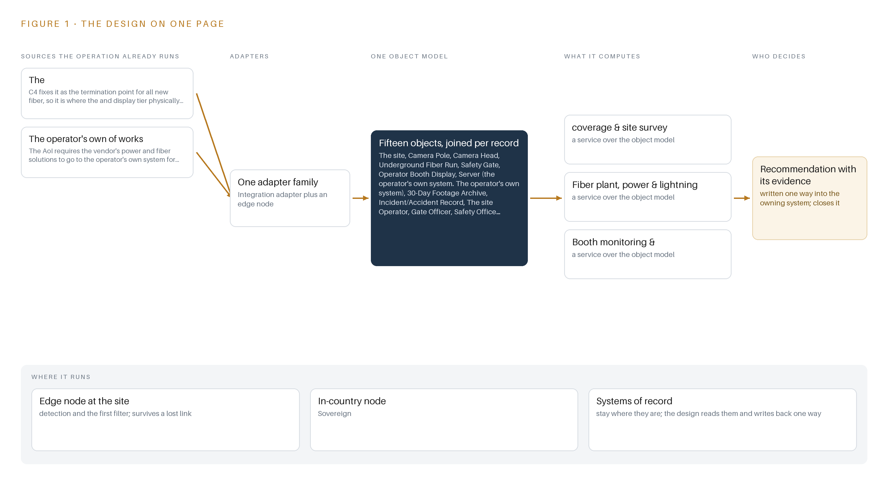
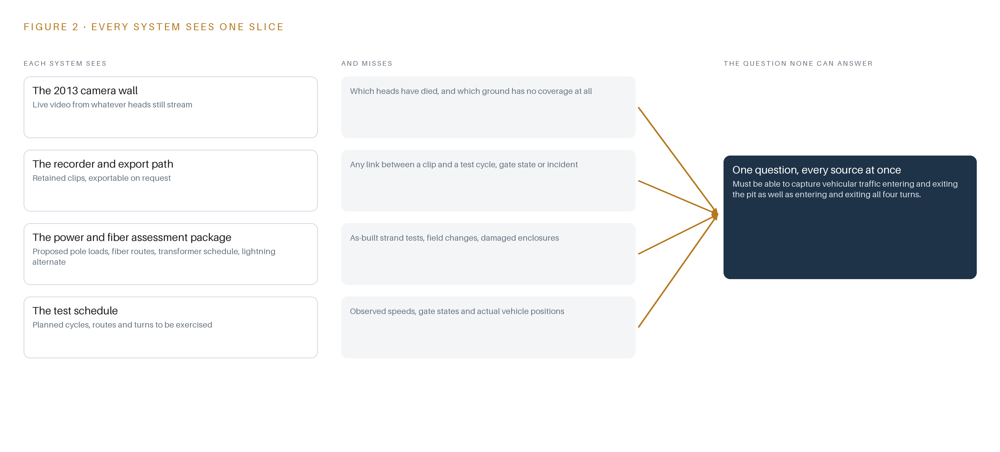
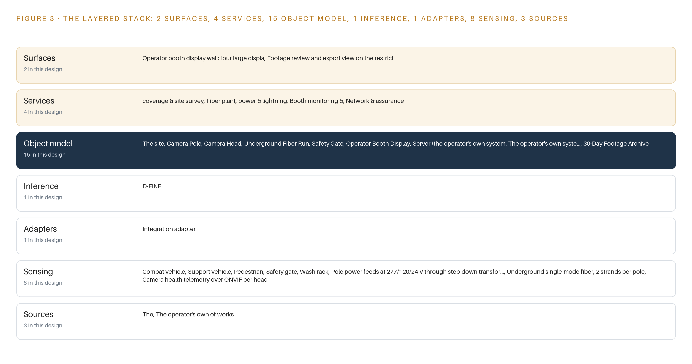
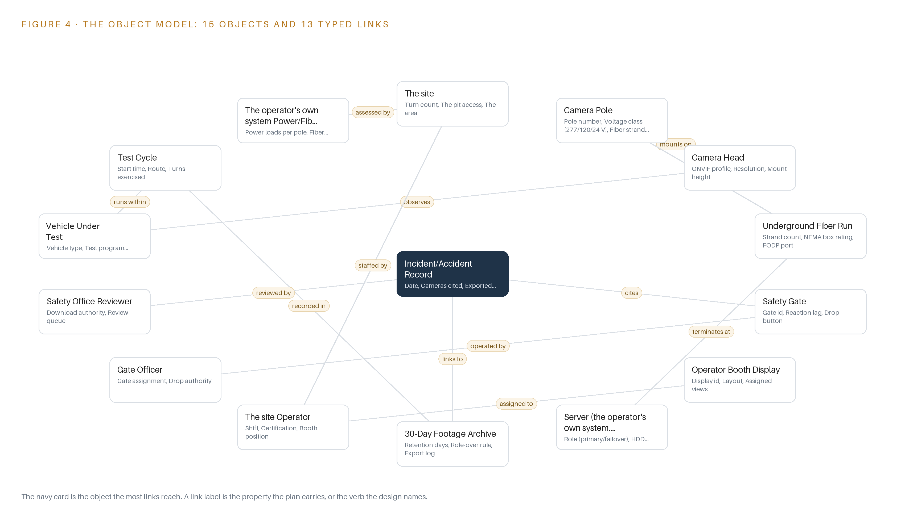
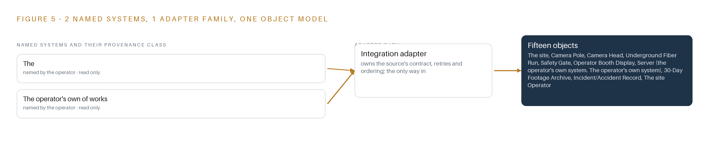
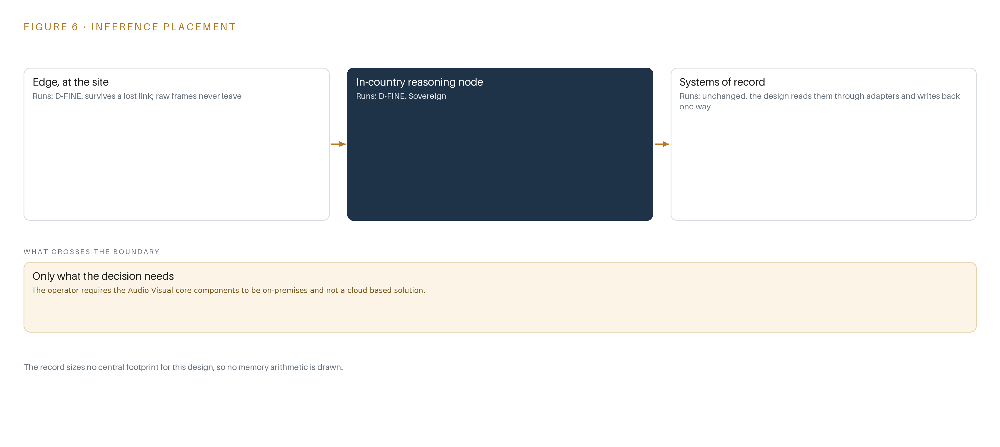
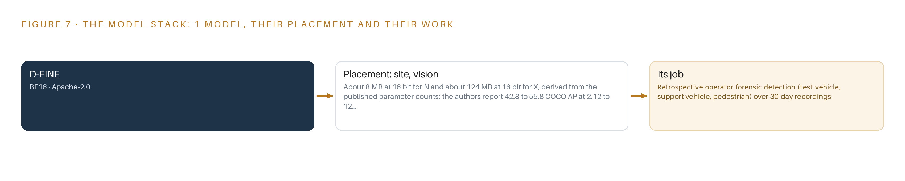
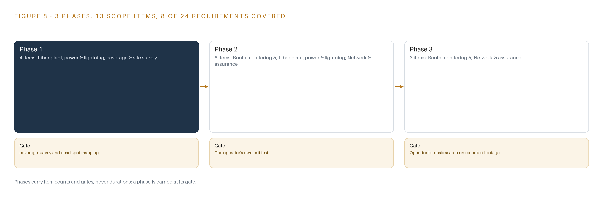

# Pit Camera Watch: An On-Premises Camera Monitoring System for Every Turn, Crossing and Pit Entry on the Test Site

Canonical: https://codeatoms.ai/test-site-camera-monitoring-us/
PDF: https://codeatoms.ai/test-site-camera-monitoring-us/paper/pit-camera-watch-on-premises-camera-monitoring-test-site-us.pdf
License: CC BY 4.0
Publisher: CodeNinja Atoms (https://codeatoms.ai), a fully owned subsidiary of CodeNinja

VERTICAL-DRIVEN ARCHITECTURES · DISCRETE MANUFACTURING & AUTOMOTIVE · DESIGNED WITH PRAXIS · OCTOBER 2026

# Pit Camera Watch: An On-Premises Camera Monitoring System for Every Turn, Crossing and Pit Entry on the Test Site

A fully on-premises camera monitoring system design for a United States vehicle proving ground, putting every turn, crossing, pit entry and access point behind owned fiber, owned recorders and per-use-case acceptance evidence.

CodeNinja Engineering Team

For the proving ground operations and safety lead, the site and network supervisors, and the surveillance, fiber plant and platform engineers who would build and run it.

---

Vertical-Driven Architectures is a CodeNinja Atoms series of system designs. Every design in the series is driven by a real-world problem and scenario in a single industry, and every one is designed on CodeNinja Praxis, the CodeNinja Atoms platform for designing physical AI systems. Operations are described by class, never by name.

At a glance

## Camera monitoring for a vehicle proving ground in the United States

**What this is.** An open reference architecture for system design in physical AI: a fully on-premises camera monitoring system that puts every turn, crossing, pit entry and access point of a vehicle proving ground on footage the operator owns, with exportable clips and camera uptime it can prove. It is written for the proving ground operations and safety lead and for the surveillance, fiber plant and platform engineers who would build it. The operator is described by class, never by name.

**The answer in numbers.**

| Part | The design |
| --- | --- |
| Field estate | 40 to 60 poles of fixed thermal and visible camera heads on new underground single-mode fiber, two strands per pole, 80 to 120 streams |
| Recording | An N+1 recorder pair, open-source Frigate NVR, each holding 30 days of footage on local disk inside an isolated network |
| Object model | 15 typed objects, from camera pole and fiber run to incident record and vehicle under test, published as JSON for reuse |
| Models | D-FINE, Apache-2.0, for retrospective search over the archive (test vehicle, support vehicle, pedestrian); about 8 to 124 MB of weights |
| Compute | One 48 GB L40S-class card per recorder host, in the conditioned server room; nothing at the poles |
| Three-year cost | About 474,000 to 871,000 US dollars to own over three years, mostly camera heads; the two recorder hosts alone cost about four fifths of the deepest three-year AWS commitment, and there is no per camera license at any pole count (Appendix A) |
| Human control | Booth operators watch and decide; nothing raises an automated alarm; only the safety office can export a clip |

**Reuse it.** The object model, the model register and the figures are free to reuse under CC BY 4.0. Cite as <https://codeatoms.ai/test-site-camera-monitoring-us/.>

**Made with.** Reasoned on [CodeNinja Praxis](<https://codeatoms.ai/praxis/>), the CodeNinja Atoms platform for designing physical AI systems. The object model imports into [Hyper Ontology](<https://codeatoms.ai/hyper-ontology/>), which turns it into a living system. Both are in beta; access by request.

ABSTRACT

## A Camera System Should Be Judged by Uptime, Not by Camera Count

Can the operator see every turn, crossing, pit entry and access point of its vehicle proving ground at all times, on footage it owns, with recorded clips it can export as evidence and camera uptime it can prove? Today it cannot: the existing camera monitoring system was purchased in 2013 and is at end-of-life status, with the decay that age brings, outages, dead heads and no redundancy, and no diagram of the cabling routes it depends on. A camera count on a purchase order does not answer the question; only a surveyed, tested, owned estate does.

The design replaces the 2013 estate with a fully on-premises system on site hardware: 40 to 60 poles of fixed Power over Ethernet (PoE) camera heads on new underground single-mode fiber, two strands per pole, terminated at the operator's own termination point. The design holds three source systems, one integration adapter family, fifteen objects, four services, two surfaces and one detection model. An N+1 recorder pair with 30-day local retention serves a four-display operator booth with freely manipulable layouts, and a 48 GB class GPU in the conditioned server room runs retrospective D-FINE forensic search over the 30-day archive. Everything runs behind an isolated network gated by Section 889 supply-chain screens, with camera uptime as a first-class acceptance metric.

The paper covers the problem and its cost in Part I, the constraints, stack, object model, ingestion and inference placement in Part II, the phased rollout with gates, failure modes and ownership in Part III, and closes with the chapter on how Praxis contextualized and reasoned the design.

---



Figure 1. Pit Camera Watch on one page: the sources the operation already runs, one object model, what it computes, and the person who decides.

## Contents

Each chapter is tagged for the reader it serves most directly: Executive, Team Lead, FDE, Reference.

|  |  |  |
| --- | --- | --- |
|  | Abstract · A Camera System Should Be Judged by Uptime, Not by Camera Count | Executive |
| PART I · THE PROBLEM | | |
| 1 | [A Camera Estate Ages Before Anyone Sees It](#ch1) | Executive |
| 2 | [Every Monitor Sees One Slice of the Test](#ch2) | ExecutiveTeam Lead |
| PART II · THE DESIGN | | |
| 3 | [Four Constraints Shape the Whole Estate](#ch3) | Team Lead |
| 4 | [One Stack Runs From the Poles to the Booth](#ch4) | Team LeadFDE |
| 5 | [Fifteen Objects Turn Pole and Fiber Into Evidence](#ch5) | FDE |
| 6 | [Every Stream Enters Through an Adapter, Never Directly](#ch6) | FDE |
| 7 | [Detection Belongs on the Recorder, Not at the Poles](#ch7) | FDE |
| 8 | [The License Decides What the Operator Can Own](#ch8) | FDEExecutive |
| PART III · THE ROLLOUT | | |
| 9 | [Acceptance Is Per Use Case, Not Per Camera](#ch9) | Team LeadExecutive |
| 10 | [The Estate Should Stay with the Operator That Owns It](#ch10) | Executive |
| PART IV · HOW IT WAS DESIGNED | | |
|  | Conclusion · The Operator Owns the Pixels, the Fiber and the Proof | Executive |
| 11 | [How Praxis Contextualized and Reasoned This Design](#ch11) | Team LeadFDE |
|  | [Sources](#sources) | Reference |

PART I · CHAPTER 1

## A Camera Estate Ages Before Anyone Sees It

A 2013-era monitoring system reaches end of life quietly, and the operator that depends on it inherits outages, dead heads and no route diagrams.

The abstract set out the shape of the answer: an on-premises estate of camera heads on new fiber, recorded by the operator's own redundant cores, watched by people in a booth. This chapter establishes why the question exists at all: what the operator needs to know, what the failure of the standing system has already cost the industry, and what the site actually is.

### 1.1  The Question the Operation Needs Answered

The operation needs one question answered continuously: when a vehicle under test moves through the test site, can the operator show where every vehicle, support vehicle and person was, and can it show it again thirty days later? Answering it requires data the operation must hold itself: live video from every turn approach, the pit entry, the pedestrian crossing and the access points; camera health telemetry per head; and recorded footage retained locally long enough for a safety office reviewer to pull clips after an incident. The design brief behind this paper fixes the shape of that data estate: forty to sixty camera poles, on the order of a hundred streams, thirty days of local retention, and a four-display booth where operators manipulate layouts freely. The regulatory ground is as decisive as the physics. The operator requires the audio visual core components to be on-premises and not a cloud-based solution, which places the recording, the retention and the search inside the boundary. Federal supply-chain rules, described in chapter 3, screen every network-capable component before purchase. Identity on the isolated network follows the operator's own identity and access management policy, and no wireless radios serve the estate. The question, in short, must be answered with the operator's own hardware, on the operator's own network, decided by the operator's own people.

### 1.2  The Documented Cost of Not Seeing

The cost of a vehicle and a worker sharing ground without adequate visibility is documented across the industry. The United Kingdom's reporting statistics record 1,313 people injured after being struck by a moving vehicle in industrial settings (Axelent n.d.), and the national workplace transport regulator states plainly that these accidents kill people every year, with workers knocked down, run over, or crushed against fixed parts by heavy vehicles (HSE n.d.). In North America, a regulator found that a subsidiary of one of the world's largest automotive suppliers could have prevented the death of a twenty-six-year-old employee from caught-between and struck-by hazards (ISHN 2024), and a subsidiary in Ontario was fined after a worker suffered a struck-by injury the province tied to visibility conditions (Ontario 2021). A test site where heavy test vehicles exercise turns at speed, with pedestrians crossing between pits and stands, sits at the sharp end of exactly this class of hazard (Ontario 2024). An operator of this size carries the exposure of the whole class: an aging camera estate is not a maintenance line item, it is the difference between a reviewable record and an unanswerable question.

### 1.3  The Operation as a Scenario

The scenario is a vehicle proving ground where vehicles under test run planned test cycles through marked turns, a pit entry, a wash rack and controlled crossings, observed by people rather than automated alerts. The estate in scope is banded: forty to sixty camera poles, each fed at 277/120/24 volts through step-down transformers and served by two strands of underground single-mode fiber; on the order of eighty to one hundred twenty streams landing on a redundant recorder pair with thirty-day retention; and four large booth displays. The people in the loop are three roles: site operators in the booth, gate officers with drop authority at safety gates, and safety office reviewers with download authority over the archive. The physical environments span outdoor poles exposed to storms, lightning and sun angle, buried fiber vulnerable to dig-ins, and a conditioned server room held to the ASHRAE A2 class. Two internal systems are named in the requirement, the facility system where all new fiber terminates and the power and fiber works assessment process, and one place is in scope: the site itself. The standing system the design replaces was purchased in 2013 and is at end-of-life status, and the requirement records that no fiber route diagrams exist for it at all.

PART I · CHAPTER 2

## Every Monitor Sees One Slice of the Test

The camera wall, the paper assessment package and the test schedule each hold one fragment of site safety, and none of them can show who was where when a vehicle moved.

Chapter 1 described the question the operator must answer and the ground it must answer it on. This chapter shows why nothing standing today can answer it: each existing system holds one slice of the test, and the slices do not join.

### 2.1  What Each System Sees, and What It Misses

The 2013 camera wall is the system everyone trusts and no one can vouch for. It sees whatever its surviving heads still stream, which after more than a decade is a partial and unverified set of views across the turns, the pit and the crossings. It misses the heads that have gone dark, because the system carries no model of camera health as an asset that can fail stale or flatlined, and it misses its own coverage: with no fiber diagrams and no camera view record beyond a site walk, nobody can say which ground is simply unobserved. The recorder and its export path see time. It holds retained clips and can hand a clip to a reviewer who asks. It misses context: a clip has no standing link to a test cycle, a gate state or an incident record, so finding the relevant ninety seconds means a person scanning timelines by memory. The power and fiber assessment package, held on paper, sees intent. It carries proposed power loads per pole, fiber routes, the transformer schedule and the lightning protection alternate that the requirement asks the vendor to propose for assessment before build. It misses reality: nothing on paper reports an as-built strand test, a damaged NEMA box or a route that was moved in the field. The test schedule sees the plan. It lists cycles, routes and the turns each article is meant to exercise. It misses observation: observed speed, gate state at the moment of a pass, and whether a pedestrian stood in the crossing.

### 2.2  What None of Them See Together

Figure 2 sets these slices side by side, and the join they cannot make is the one the operator needs: who was where when a vehicle moved, provable after the fact. A near miss at a crossing that leaves no injury produces no incident record, so the only evidence would live in footage nobody knows to pull, at a camera nobody knows still works, at a location no diagram confirms covers the crossing. The industry record shows what that gap costs: investigations after struck-by fatalities find the preventive information existed in fragments that no one joined in time (ISHN 2024; MSU 2014). The cost in practice is a safety office that reconstructs events from memory and paper, and a coverage gap that stays invisible until an event proves it.



Figure 2. Four systems, each seeing one part of the answer. the question needs all of them in one place at once.

PART II · CHAPTER 3

## Four Constraints Shape the Whole Estate

On-premises cores, screened components, reused pole locations and passive monitoring decide what the design buys, what it rejects and what it costs.

Chapter 2 showed that the standing systems each hold one slice and none holds the join. This chapter fixes the four constraints that shape the replacement, then records what the design scoped in, what it bought with each decision, and what it chose against.

### 3.1  The Core Stays on Site

The operator requires the audio visual core components to be on-premises and not a cloud-based solution, so recording, retention and search run on hardware the operator owns, behind an isolated network. This is hard in an industry where video management has drifted to cloud tenancy as the default, because the conventional cloud path buys elasticity and vendor-managed uptime by surrendering custody of footage. Here the design takes the opposite trade: an N+1 recorder pair with thirty days of local retention keeps every pixel and every export log inside the boundary, at the cost of capital hardware, spares and a maintenance line the operator must fund for the estate's life.

### 3.2  Every Component Passes the Supply-Chain Screens

Federal acquisition rules under Section 889 bar covered telecommunications and video equipment from the supply chain of any operator selling into the federal market, and the contract clauses that flow the rule down extend the screen and shorten the reporting clock to three days. This is hard in this industry specifically because the camera market is where label and maker diverge most often: a badge on a housing says little about the producer of record. The design therefore buys from an approved list with producer and country statements collected per component before any purchase order, maintains a component-level bill of materials, and keeps both reporting clocks known so the operator can respond inside the rule.

### 3.3  Reuse Before Install

The design surveys coverage before it installs anything: existing camera locations are repurposed where they still serve, and dead spots are mapped as the phase-one verdict rather than discovered after build. This is hard because replacing an end-of-life estate invites a clean-sheet instinct, and because the site holds no fiber diagrams, so every reused route must be proven by the survey evidence pack rather than assumed from a drawing that does not exist. The trade is honest: reuse saves trench and pole cost but binds the new layout to old geometry wherever the pixels-on-target arithmetic still holds.

### 3.4  Passive Monitoring, Decided by People

The design is passive: fixed heads, recorded streams, and detection used to search recorded footage, with no automated alerts and no automated actuation. Safety gates drop under a gate officer's hand, and a safety office reviewer decides what the archive exports. This is hard because the surveillance industry sells automation as the product, and because passive monitoring must still make search fast enough to matter, which is why the forensic detection model and its graphics card are sized in the model chapter rather than skipped.

### 3.5  Scoping Decisions

Three decisions set the boundary of the estate. Table 1 records what each buys and what each costs.

Table 1 · Scoping Decisions

| Decision | What it buys | What it costs |
| --- | --- | --- |
| On-premises N+1 recorder pair with 30-day local retention | Custody of every stream and export inside the boundary, failover if a core fails | Operator-funded hardware, spares and a maintenance line with uptime tracked as a first-class metric |
| Forty to sixty fixed poles on new underground single-mode fiber, two strands per pole | An always-present calibrated view per zone and a plant the operator owns outright with as-builts | Trenching, lightning protection and surge engineering, and fiber repair stock held on site |
| Passive monitoring with retrospective forensic search | A small GPU sized for search on demand, no per-stream always-on decode | No automated alerts, so coverage quality rests on the booth operators and the survey |

### 3.6  What the Design Chose Against

Each rejection follows from a constraint rather than from preference. Table 2 records where the design picked one path over another, and why, ending with what falls outside scope entirely.

Table 2 · What the Design Chose Against

| Where | What was picked | Instead of, and why |
| --- | --- | --- |
| Recording core | Open-source Frigate NVR hardened on site hardware | A packaged commercial video management system: the on-premises requirement stands, and an open-source recorder the operator owns outright keeps 30-day retention and local detection without per-camera license rents |
| Detection duty | Retrospective D-FINE search over recorded clips | Always-on detection across all eighty to one hundred twenty streams: passive monitoring needs no live alerts, and searching on demand sizes the GPU small instead of paying decode on every stream every second |
| Camera heads | Fixed multi-sensor heads per pole | PTZ cameras covering wide arcs cheaply: zone-drawn coverage of crossings, the pit and the turns needs an always-present calibrated view, and a steerable head leaves every point unobserved most of the cycle |
| Events and telemetry | Recorder-local events with no message broker | A streaming backbone: no downstream subscribers exist, so a broker would be infrastructure without a consumer |
| Site links | Managed PoE switches over underground fiber | Wireless or radio links: the requirement excludes wireless radios, and copper cannot reach the pole distances single-mode fiber covers |
| Out of scope | This baseline covers the camera estate alone | Cross-site analytics, cloud tenancy of any kind, and the wider commercial solutions opening items outside this area of interest, each of which is published separately and none of which this design commits to |

PART II · CHAPTER 4

## One Stack Runs From the Poles to the Booth

Systems of record below, one object model in the middle, and the booth wall and review surface above, all on site hardware.

Chapter 3 fixed the constraints and their costs: an on-premises audio visual core with no cloud dependency, Section 889 supply-chain screens before any purchase, and coverage evidence before any pole is ordered. This chapter stacks the components that satisfy those constraints, from the fiber strands at the poles to the four displays in the operator booth.

### 4.1  One Object Model Between the Plant and the Booth Wall

The architectural pattern is the series standard: systems of record below, one object model in the middle, applications and agents above. In this estate the systems of record are largely physical rather than informational: the underground fiber plant, the camera poles and heads, and the recorder pair with its archive. The object model lives in the recorder's configuration under site change control, which is why the design deliberately runs no separate graph store: no agents and no cross-system semantic layer are committed, and the work surface is offered, not confirmed. Above the model sit exactly two surfaces, the booth display wall and the restricted review view.

The pattern fits because the estate is one N+1 recorder pair in one conditioned room. A message broker would have no downstream subscriber, since events stay inside the recorder and its own network; a time-series store would carry no duty beyond camera health, which the observability stack already handles; and a container fleet has nothing to orchestrate. Figure 3 shows the layered stack with its counts per layer: three sources, one adapter family, fifteen objects, one model, four services and two surfaces, every layer on site hardware behind the isolated network.



Figure 3. The layered stack: 3 sources, 1 adapter family, 15 objects, 4 services and 2 surfaces.

### 4.2  The Stack Stage by Stage

Table 3 walks the same stack stage by stage and names the components in each.

Table 3 · The Stack, Stage by Stage

| Stage | What it is responsible for | How |
| --- | --- | --- |
| Sources | The inputs the estate reads: the operator's designated fiber termination building, the works power and fiber assessment inputs, and the camera heads' own streams | Read-only against both named systems; provenance recorded per source |
| Sensing | Fixed visible and thermal heads on 40 to 60 poles, pole power feeds at 277/120/24 V through step-down transformers, two single-mode strands per pole, and per-head ONVIF health telemetry | Passive heads with no compute at the pole; pixels and telemetry land on the recorder |
| Adapters | One integration adapter family normalizing RTSP video and ONVIF telemetry into the recorder | No stream enters directly; every feed crosses the adapter tier with provenance attached |
| Object model | Fifteen typed objects from camera-pole to incident-accident-record, held in the recorder configuration under change control | The asset registry is the model; queries traverse typed links, not flat files |
| Inference | Frigate NVR v0.18.0 with its built-in ONNX detector runtime running D-FINE retrospectively over recorded clips | On-demand search on the 48 GB GPU class server in the ASHRAE A2 conditioned room; no always-on detection across the 80 to 120 streams |
| Services | Coverage and site survey; fiber plant, power and lightning; booth monitoring; network and assurance | The four services the rollout workstreams run against, with camera uptime as a first-class metric |
| Surfaces | Operator booth display wall with four freely manipulable displays, and the footage review and export view on the restricted workstation | The booth wall serves the site operator; the safety office holds the only export path |

PART II · CHAPTER 5

## Fifteen Objects Turn Pole and Fiber Into Evidence

Every pole, head, fiber run, gate and incident record becomes a typed object a query can reach, with the safety office holding the only export path.

Chapter 4 placed one object model in the middle of the stack and argued against a separate graph store. This chapter enumerates that model: fifteen objects, the typed links between them, and the single write path allowed to touch them.

### 5.1  Fifteen Objects and the Links Between Them

Figure 4 shows the model. The estate objects are the-site, camera-pole, camera-head, underground-fiber-run, safety-gate, operator-booth-display, the server pair running the recorder, the 30-day-footage-archive and the incident-accident-record. The people and process objects are the-site-operator, gate-officer, safety-office-reviewer, vehicle-under-test, test-cycle and the power and fiber assessment package. Each carries typed properties and a status vocabulary: a camera head is Streaming, Degraded or Offline; a fiber run is Installed, Tested, Damaged or Repaired; a test cycle is Planned, Running, Aborted or Complete.

The typed links are what make the model more than an asset list. An incident-accident-record cites the safety-gate involved, names its safety-office-reviewer, and links to the exported clips in the 30-day-footage-archive; those clips trace back through camera-head and camera-pole to underground-fiber-run and its termination point. A query can therefore reach from one export to the exact fiber strand that carried it, across seven typed hops, in one traversal. A document store cannot do this: it would hold the incident as a flat file with a text list of camera names, and every question that crosses objects, such as which poles fed by a damaged run served a recorded test cycle, would become a manual search.



Figure 4. The fifteen objects of the model and the typed links that let a query reach across them.

### 5.2  Where the Human Loop Lives and How the Estate Is Hosted

The human loop sits at three points. The site operator works the booth wall and manipulates layouts freely; the gate officer holds drop authority at each safety-gate; the safety office reviewer holds download authority over the archive. Hosting follows the operator's requirement that the audio visual core be on-premises and not cloud based: every object lives on site hardware behind an isolated network, no object holds an external link, and data residency is total because nothing crosses the boundary. Identity follows the operator's own policy: Keycloak on-premise single sign-on, with hardware token sign on for the Linux hosts, and only site operators, gate officers and the safety office reach the network at all. The only write path into the evidence chain is the safety office export, which is logged in the archive's export log; the recorder's detector model version changes only under site change control.

### 5.3  One Object in Its Recorded Form

The recorded form of a camera pole shows how much of the estate's maintainability rests on a single object.

```
{
  "id": "the-site",
  "label": "The site",
  "kind": "site",
  "anchored_in": "",
  "properties": [
    "Turn count",
    "The pit access",
    "The area",
    "Posted speed"
  ],
  "status_vocabulary": [],
  "links": [
    {
      "to": "the-site-operator",
      "label": "staffed by"
    },
    {
      "to": "the-operator-s-own-system-power-fiber-assessment-package",
      "label": "assessed by"
    }
  ]
}
```

PART II · CHAPTER 6

## Every Stream Enters Through an Adapter, Never Directly

Camera heads, health telemetry and pole power cross into the recorder through one integration adapter family that guarantees ordering, retention and clean shutdown.

Chapter 5 defined what the objects hold and who may write to them. This chapter defines how the bytes get in: three source systems, one adapter family, and an event path that never leaves the recorder.

### 6.1  Three Sources, One Adapter Family

Figure 5 maps the integration. The estate reads three source systems. The first is the operator's designated termination building, the point where all new underground fiber lands; it is an operator-of-record system, read-only, and the display and recording tier physically sits at its end of the plant. The second is the works power and fiber assessment input set, also operator-of-record and read-only: the requirement directs the vendor's power and fiber solutions to the operator's own system for assessment before build, so the assessment package is a procedural deliverable, not an integration. The third is the camera estate itself, a field-provenance source: the heads stream RTSP video and publish ONVIF health telemetry, and every head enters service only after Section 889 screening of its component-level bill of materials.



Figure 5. The 3 named systems, the adapter path each one takes, and the object model they all map into.

### 6.2  What the Adapter Tier Guarantees

One integration adapter family carries all of it, and no stream reaches the recorder except through it. The tier guarantees four things. It normalizes heterogeneous ONVIF profiles into one internal shape, so the recorder sees one estate rather than a mix of makers. It attaches provenance to every stream, so each clip inherits the screened identity of the head that produced it. It rejects unprovisioned devices outright, which matters on a site where a label may not match a maker. And it admits a fiber run to service only after its per-strand test records are in, so the object model never claims a capacity the plant has not demonstrated.

### 6.3  The Event Backbone: Ordering, Delivery, Buffering, Replication

The design deliberately runs no message broker: events stay inside the recorder and its own network, and no downstream subscriber exists to justify one. Ordering comes from time instead. Chrony 4.9 disciplines every host against the site grandmaster, an OCP Time Card GNSS card with a holdover oscillator, with linuxptp where PTP-aware switches exist, so frames from adjacent heads interleave in true sequence and an exported clip is evidentiary on its timestamps alone. Delivery is synchronous and internal: the D-FINE detector reads recorded clips, not a live bus, so there is no consumer lag to manage. Buffering is electrical and stream-level: Network UPS Tools holds the recorder pair through pole-power disturbances and shuts both nodes down cleanly, and the recorder buffers head disconnects and re-ingests each stream on recovery. Replication is recorder-native N+1: primary and standby each hold the 30-day local retention on HDD, so failover keeps the booth wall and the archive continuous without a mirrored fabric.

PART II · CHAPTER 7

## Detection Belongs on the Recorder, Not at the Poles

Passive monitoring with no automated alerts means all compute stays in the conditioned server room, sized for retrospective search over 80 to 120 recorded streams.

Chapter 6 traced every feed through the single adapter family onto the recorder and showed why no event broker exists downstream. This chapter settles where computation happens, which for a passive monitoring estate is a short answer with long consequences.

### 7.1  One Inference Tier, in One Room

The operator's requirement fixes passive monitoring: cameras observe, people decide, and nothing raises an automated alarm. That single scoping decision collapses inference placement to one tier. No compute sits at the poles; heads stream pixels and the underground fiber carries them to the recorder room. Figure 6 shows the placement: one inference tier on a 48 GB PCIe inference GPU class server in the ASHRAE A2 conditioned server room, paired N+1 with a standby host. The tier carries two duties: continuous decode of 80 to 120 streams for the booth wall, and retrospective detection over the 30-day archive when an operator or a safety office reviewer asks for search. No cross-camera tracking and no trajectory forecasting exist, because passive monitoring has no prediction duty; the detector serves timeline search only. The memory arithmetic is short because the model is small. The detector weights run about 8 MB at 16-bit BF16 for the N tier and about 124 MB for the X tier, derived from published parameter counts, so even the largest tier is a rounding error against 48 GB of usable card memory. The card's real budget is decode buffers and batched frames across up to 120 streams, which is why the acceptance plan calls for bench checks of decode and inference at the installed resolution rather than paper sizing. No KV cache ceiling applies: a KV cache exists only for generative language models that attend over growing context, and no language model role exists in a passive monitoring estate; the agentic work surface remains an offer, not a commitment. The headroom a cache would have consumed instead covers a second detection model if the operator ever adds classes. Published timings for the family, 42.8 to 55.8 COCO AP at 2.12 to 12.89 ms on a single T4 at batch size 1, size the search duty with margin.



Figure 6. Where each tier runs, what runs there, and the narrow set of outputs that cross the boundary.

### 7.2  The Latency Budget

Two clocks govern the estate, and the design keeps them apart. The live wall runs with no model in its path: decode, layout, display. Booth operators judging a vehicle at a pit entry or a pedestrian crossing need video that behaves as live, so the budget spends nothing on inference there; detection never delays the wall. The search clock is the second one: a request names a class, a zone and a time window, the detector runs over the matching recorded clips, and its per-frame cost is bounded by the published 2.12 to 12.89 ms at batch size 1 on a T4-class device. Total wait on a search is therefore gated by how fast recorded clips decode, not by the model, and the sizing rule is to bench-check decode first and leave headroom for a second model. Safety gate reaction lag is a physical property carried on the safety gate object, not a compute number the design claims.

### 7.3  The Boundary and Its Failures

Nothing crosses the network boundary. There is no cloud, no egress path and no downstream subscriber; events stay inside the recorder and its own network, which is why Chapter 6 needed no broker. When parts fail, the design answers in kind. On power loss, Network UPS Tools drives a clean shutdown of the server pair, and N+1 failover keeps recording on the standby host; pole feeds at 277/120/24 V through step-down transformers carry integrated lightning protection, with surge protection on the grandmaster antenna run. On a fiber cut, two strands per pole give the first margin, and camera health telemetry over ONVIF marks the affected head Offline and the run Degraded or Damaged; the spares plan holds patch stock and a repair procedure. On loss of the update path, the estate keeps running the last approved model file, which was staged under site change control with no internet dependency. When satellite time is lost, the grandmaster's holdover oscillator keeps evidentiary ordering intact.

PART II · CHAPTER 8

## The License Decides What the Operator Can Own

One Apache-2.0 detection model, checked against matched-compute comparisons, keeps the weights and the search capability entirely in the operator's hands.

Chapter 7 placed all compute in one server room and showed that the card's headroom goes to a second model rather than a cache. This chapter names the one model that headroom serves, and the license that decides who owns it.



Figure 7. The one model, their placement, and the work each one does.

### 8.1  One Model, Read in Full

Figure 7 shows the model stack, and the stack is one card deep: D-FINE, served by the recorder's built-in detector runtime on its ONNX backend, with nothing above it and nothing beside it. D-FINE is a real-time object detection family spanning N to X tiers; the estate runs it at BF16 precision for retrospective forensic detection of three classes, test vehicle, support vehicle and pedestrian, over the 30-day archive. The pedestrian class is not decoration: struck-by and caught-between events remain a documented cause of workplace death at an automotive manufacturer (ISHN 2024), and visibility around vehicles and mobile equipment is a regulated hazard in industrial workplaces (Ontario 2024). A search that pulls every clip of a person near a turning vehicle is the point of the system, which is why the detector exists at all. The license is Apache-2.0, unconditional on both code and weights. Those terms permit the operator to hold, copy, modify and run the weights on its own hardware with no per-camera rent, no usage reporting and no platform license trigger; the weights and the search capability stay entirely inside the boundary. The choice was checked against matched-compute comparisons: the July 2026 comparison puts D-FINE ahead of DEIM at equal compute, and RF-DETR was set aside because its XL tiers fall under a platform license, which would place a condition between the operator and its own detector. Sizes N through L fit the 48 GB card alongside the decode load. The footprint, from published parameter counts, is about 8 MB at 16 bits for N and about 124 MB for X, with published quality of 42.8 to 55.8 COCO AP at 2.12 to 12.89 ms on a single T4 at batch size 1. The detector is used off the shelf; no labeling or retraining duty is committed.

### 8.2  The Register of Choices

Table 4 gathers the model, the hardware classes and sizing rules, the sensing, the patterns and the ground it runs on into one register; each row states the choice and the reason it holds at this site.

Table 4 · Model and Equipment Register

| The choice | What was picked | Why here |
| --- | --- | --- |
| Detection model | D-FINE, Apache-2.0, BF16, N to X tiers | Unconditional license keeps the weights in the operator's hands; N through L fit the 48 GB card; ahead of DEIM on matched compute in the July 2026 comparison. |
| Site inference server | 48 GB PCIe inference GPU class server in the ASHRAE A2 conditioned server room, N+1 | The entry class for plant server rooms running vision, and retrospective search plus 80 to 120 streams of decode fit it with headroom for a second model. |
| Recorder and serving runtime | Frigate NVR v0.18.0 with its built-in ONNX detector runtime | Open source the operator owns outright; keeps 30-day retention, ONVIF and RTSP exits and local detection without per-camera license rents. |
| Camera heads | Fixed multi-sensor thermal and visible heads, no wireless radios, Section 889 screened with producer-of-record statements | Zone coverage needs always-present calibrated views, and camera provenance is the first procurement gate on a test site. |
| Site networking | Managed PoE switches over underground single-mode fiber, two strands per pole | The requirement fixes the fiber architecture, and PoE Type 1 and 2 per-port budgets cover the heads without pole-side power electronics. |
| Enclosures and power | NEMA-rated outdoor enclosures, 277/120/24 V step-down transformer feeds, Network UPS Tools for clean shutdown | Heat, storms and sun angle degrade heads and light budgets, and clean shutdown protects the archive. |
| Time synchronization | OCP Time Card GNSS grandmaster with holdover oscillator, Chrony 4.9, linuxptp where PTP-aware switches exist | Evidentiary ordering across 80 to 120 recorded streams requires one clock. |
| Identity | Keycloak on-premise single sign-on with hardware token sign on for Linux hosts | Only booth operators and the safety office reach the isolated network, under the operator's identity policy. |
| Observability | Prometheus, Grafana and Loki on the isolated network | Camera uptime must be a first-class metric, not a vendor health page. |
| Sizing rules | The survey evidence pack, pixels on target first, low light as a budget, mounting geometry decides what you see | Coverage is proven in phase one evidence, never assumed from a camera count. |
| Patterns | A site-scale camera onboarding reference architecture and an on-premises video search blueprint | Onboarding, clip retrieval and search patterns adopted with no managed cloud, keeping the audio visual core on-premises. |

PART III · CHAPTER 9

## Acceptance Is Per Use Case, Not Per Camera

Three phases gated by survey evidence, coverage verdicts and per-use-case tests make camera uptime a measured commitment instead of a purchase-order claim.

Chapter 8 fixed the model stack, the memory arithmetic and the license terms that keep the detector weights in the operator's hands. This chapter sets out how the estate gets built, what each phase must prove before the next one begins, and what the running system is measured on once the booth wall lights up.

### 9.1  Three Phases, Thirteen Items and Gates That Stop the Work Cheaply

The rollout runs as three phases carrying thirteen items in total, and each phase ends at a gate that can stop the work while the money at risk is still small (Figure 8). Phase 1 carries four items across the coverage and site survey workstream and the fiber, power and lightning workstream. Its items are the coverage survey with dead spot mapping, camera head selection under the Section 889 screens, and the reuse assessment that repurposes existing camera locations wherever they still serve. Its exit gate is the coverage survey and dead spot mapping itself: no pole is committed until the survey shows every crossing, pit entry, turn and access point held at the required pixels on target, and any dead spot is either closed by geometry or accepted in writing. Phase 2 carries six items across booth monitoring, fiber plant and power, and network and assurance: the underground single-mode fiber plant to all poles, the operator booth display wall with view control, and the on-premises N+1 recorder pair with 30-day retention. Its exit is installation acceptance of the physical plant, per-strand fiber test findings, and the booth layouts demonstrated against the survey evidence pack. Phase 3 carries three items across booth monitoring and network and assurance: operator forensic search on recorded footage, commissioning acceptance tests per use case, and the maintenance, spares and uptime sustainment plan. Its exit gate is operator forensic search on recorded footage: the search must return the right clip from the right camera at the right time before the estate is declared complete. Requirement coverage is tracked against 24 requirements drawn from the site camera system statement. Eight are covered in full by the recorded phases, none land as partial, and 16 remain open, most of them hanging on the power and fiber assessment package that the operator must assess before the fiber plant is built. The open list is reviewed at every gate, so coverage closes phase by phase instead of being asserted at the end.



Figure 8. The three phases and their gates, and coverage of the 24 requirements across them.

### 9.2  What the Rollout Measures

Two measurements carry the acceptance case. The first is camera uptime as a first-class metric: the fault condition the rollout watches for is a camera feed loss, the recorded example being a feed loss at Pole 30, and acceptance is re-runnable quarterly rather than a one-time signature. The second is retention on local HDD, held at a nominal 30 days, with a breach recorded when actual retention runs above the window, because holding footage longer than policy says is its own evidentiary problem. Per-use-case acceptance is grounded in the safety case rather than in vendor claims: workplace transport continues to kill workers who are knocked down, run over or crushed against fixed parts (HSE n.d.), more than a thousand people a year are injured after being struck by moving vehicles in reported statistics (Axelent n.d.), and regulators treat visibility hazards for vehicles and mobile equipment as a legal duty rather than a preference (Ontario 2024). The test that matters is therefore not how many heads are installed but whether a named use case, such as a pedestrian crossing watched through a shift or a test cycle reconstructed from 30 days of footage, passes on its own evidence.

### 9.3  What Fails and What the Design Does

The failure modes below are the ones the design carries explicitly, and each has a standing countermeasure rather than a hope (Table 5).

Table 5 · Failure Modes

| What fails | What the design does |
| --- | --- |
| The new estate decays into the same state as the 2013 system: outages, dead heads, no redundancy | Uptime as a first-class metric, N+1 failover, a funded maintenance line with spares and MTTR budgets, and acceptance tests the operator can re-run quarterly |
| Section 889 covered equipment enters the supply chain under another label | Producer and country statements per component before the purchase order, a component-level bill of materials, both report clocks tracked, physical inspection ready |
| Lightning strikes damage pole heads, enclosures or fiber | Integrated lightning protection per camera, the vendor's proposed alternate held for operator assessment, surge protection on the grandmaster antenna run, spare heads held |
| Underground fiber is damaged by dig-ins or unmarked routes after handover | As-builts and per-strand test findings handed over, locate marks recorded, a repair procedure and fiber patch stock in the spares plan |
| Recorder compute is undersized for 80 to 120 streams of decode plus detection | Bench-measured decode and inference on the candidate GPU at the deployed resolution, model-needing substreams requested, headroom left for a second model |
| Heat, storms and sun angle degrade cameras and the low-light budget at night | NEMA-rated enclosures with thermal margin, worst-hour lux readings per position in the survey, IR-corrected optics or added lighting where the budget fails |

### 9.4  Lessons

**A camera count is not a capability.** The acceptance rule adopted here comes safety-city records in which installed camera counts were presented as coverage while whole zones went unwatched. The estate therefore accepts per use case, with camera uptime as a first-class metric, and a head that streams but cannot resolve a pedestrian at the far edge of its zone counts as a failure of the use case, not a success of the install. Pixels on target come first. Mount height, resolution and worst-hour lux decide what the booth actually sees, and the survey evidence pack turns those numbers into a contract before any pole is ordered. The economics support the discipline: struck-by injuries carry fines and, far too often, deaths that controls could have prevented (Ontario 2021; ISHN 2024). Provenance is a pre-purchase-order screen, not a post-award discovery. Oversight records show agencies still finding covered equipment because labels differ from makers, so the component-level bill of materials and both report clocks precede any order rather than follow it. Reuse before new steel. Existing camera locations are repurposed wherever they still serve, which saves poles, avoids new digging near live test routes and keeps the fiber plant shorter than a greenfield layout would make it.

### 9.5  What Is Still Open

Three questions remain open, and settling each changes a concrete part of the design. First, whether the safety office reaches recorded footage from outside the isolated network: settling it one way adds a one-way transfer device and its permanent operational burden, and settling it the other formalizes escorted export under existing site procedures. Second, the lightning protection alternate: the site statement expects the vendor to propose one, and its assessment fixes the surge architecture at the poles and on the grandmaster antenna run. Third, the fiber route record: no diagrams exist today, so as-builts are created during build, and the quality of the locate-mark record settles how much dig-in exposure the operator carries after handover. A fourth, softer question is whether a second detection model is ever added: the GPU is sized with headroom, and exercising that headroom would change the compute budget without changing the architecture.

PART III · CHAPTER 10

## The Estate Should Stay with the Operator That Owns It

The object model, the detector weights, the footage archive and the network boundary all remain inside the operator's own hands, under its own change control.

Chapter 9 gated the build on survey evidence and per-use-case acceptance. This chapter states who owns what that build produces, because an estate that stays in the operator's hands is the whole point of the design.

### 10.1  Who Owns What the Design Builds

The object model, fifteen objects from camera pole to incident record, lives in the recorder's configuration under the operator's own change control, not inside a vendor tenant, so every schema change is an operator decision with an operator signature. The weights follow the same logic: the detector ships under Apache-2.0 with unconditional code and weight rights, so the operator holds the model file outright, may fine-tune it later, and pays no per-camera license rent for the life of the estate. The decision record, the incident and accident records with their exported clips, export logs and named safety office reviewers, stays in operator custody under the local retention rules, and the 30-day footage archive it points into never leaves the network that produced it. The boundary itself is operator property: the audio visual core is required to run on-premises, identity is enforced through hardware token sign on and on-site single sign-on, and no path exists for footage or telemetry to leave the isolated network.

### 10.2  The Offer Behind the Design

This design was produced by CodeNinja on Praxis, its platform for designing physical AI systems, and it maps directly onto the company's offer: Adaptive Operations covers the sensing and detection of physical behavior at the poles and in the recorder, from test vehicle and pedestrian detection to camera health telemetry; Hyper Ontology is the fifteen-object model that turns poles, fiber runs, gates, test cycles and incidents into one queryable picture; and Sovereign Infrastructure is the posture the whole design stands on, operator-owned hardware, an open-weight detector the operator can hold and fine-tune, and a fully on-premises, air-gapped operation behind the operator's own boundary requirement.

PART IV · CONCLUSION

## The Operator Owns the Pixels, the Fiber and the Proof

The design is one owned estate: fixed camera heads on owned poles, owned underground fiber to an owned termination point, an N+1 recorder pair holding 30 days of footage inside the boundary, a four-display booth where named people watch named views, and retrospective detection over the archive for forensic search, all accepted use case by use case with uptime measured rather than assumed.

Running the same shape elsewhere takes four commitments: survey coverage before buying anything, so pixels on target decide head placement; screen every network-capable component against the supply-chain rules with a component-level bill of materials; put the intelligence where the recordings live, so search sizes the GPU rather than the stream count; and fund spares, mean time to repair and re-runnable acceptance tests so the new estate never decays into the state of the one it replaced.

PART IV · CHAPTER 11

## How Praxis Contextualized and Reasoned This Design

Every choice in this paper, from the pixels-on-target rule to the Section 889 screens, follows one chain of thought through eight lenses.

Chapter 10 placed the estate, the weights and the boundary in the operator's hands. This closing chapter shows the chain of thought that produced the design: how the ask was read, the eight lenses it passed through in order, and where the reasoning lands. Every design in this series is produced on Praxis.

### 11.1  Contextualizing the Ask

The ask was to replace an end-of-life camera monitoring system, purchased in 2013 and decayed into outage and dead-head territory, with a fully on-premises estate for a vehicle proving ground: fixed camera heads on new underground single-mode fiber, an N+1 recorder pair with 30-day retention, a four-display operator booth, and supply-chain screens on every network-capable component. Praxis assigned the design to the Physical AI family and to the discrete manufacturing and automotive industry. The site statement was read in full, including the later revision confirming that no fiber route diagrams exist and that camera view diagrams may come later.

### 11.2  The Eight Lenses

Praxis reads every ask through eight lenses, in order, and each one settled something. First principles settled the rules that shape the workflow: sensor health is treated as an asset, existing camera locations are reused wherever they still serve, and alarms are routed apart from alerts. Case studies found no comparable camera estate replacement, and the design says so rather than leaning on a weak precedent. Tooling and recency settled the open software, from the recorder and the time card grandmaster to power monitoring, each read with its license, and checked the detector live. Rules and regulations settled the supply-chain screens, their two reporting clocks and the component-level bill of materials. Approach settled prototype-first phasing, the spares and repair-time budget, and the time sync rules that make failover and evidence ordering real commitments. History settled uptime as a first-class acceptance metric for each use case, and showed that covered equipment can arrive under another label. Domain fusion joined the camera wall, the health telemetry and the coverage table into one design. Hardware and equipment settled the survey evidence pack, pixel density on target, the low-light budget, mounting geometry, stream sizing, the power classes and the server room class.

### 11.3  Where the Reasoning Lands

The reasoning lands in a short list of equipment classes: an ASHRAE A2 conditioned server room holding a 48 GB PCIe inference GPU class server, managed PoE switches over the underground single-mode fiber plant, NEMA-rated enclosures fed through step-down transformers, a GNSS grandmaster card with holdover for time sync, a fixed thermal and visible camera class bought through the Section 889 gate, and a hardened open-source recorder running a retrospective detector over the archive. Everything shown in this paper was recorded reading: every rule cites a record read in the room, every component carries its license terms, and nothing is inferred.

Appendix A

## What the Camera Estate Costs Over Three Years

The design buys a field estate and a small amount of compute: fixed thermal and visible camera heads on 40 to 60 poles, the switches, enclosures and power at each pole, two fiber aggregation switches, a four-display booth, and an N+1 recorder pair in the conditioned server room, each host carrying one 48 GB L40S-class card and 30 days of footage on local disk. This appendix prices that estate from public list prices, dated and cited, at both ends of the pole count. The field estate has no rental equivalent, so the only rent comparison is the compute, and it is printed for reference only, because the operator requires the audio visual core to run on-premises. Every number can be rerun with a written quote.

### A.1 The Answer

Equipping the estate costs about **375,000 to 632,000 US dollars** in list prices, and with support and power over three years **474,000 to 871,000 dollars**. The camera heads are most of it: 287,000 to 501,000 dollars, because a thermal and visible head costs about seven to eight thousand dollars and a proving ground needs one on every pole. The compute is small by comparison: owning the two recorder hosts costs about **32,600 dollars** over three years, against **36,800 to 118,000 dollars** to rent two L40S cards around the clock, so ownership is **about four fifths** the deepest three-year AWS commitment (EC2 Instance Savings Plan, all upfront, US East) before the 30 days of footage are stored anywhere. There is **no per camera license** at any pole count: the recorder is open source and the detector is Apache-2.0.

### A.2 What Owning Costs

| Line | Basis | Three-year cost (USD) |
| --- | --- | --- |
| Camera heads | One bi-spectrum thermal and visible head per pole, 40 to 60 poles: Hanwha Vision TNM-C4950TD at 7,165.99 dollars (IP Security Depot 2026) at the low end, TNM-C4940TD at 8,351.00 (OWL360IT 2026) at the high end; two streams per head gives the paper's 80 to 120 | 287,000 to 501,000 |
| Pole kit | Per pole: Planet IGS-5225-4P2S managed PoE switch with two SFP uplinks at 393.25 (Nassau National Cable 2026), nVent Hoffman NEMA 4X enclosure at 344.99 (Zoro 2026), Hammond 1 kVA 277 V to 120 V transformer at 345.79 (Standard Electric Supply 2026), Mean Well 24 V DIN supply at 26.78 (TRC Electronics 2026); 1,110.81 a pole | 44,400 to 66,600 |
| Fiber aggregation | Two FS S5850-48S6Q switches with 48 SFP+ ports each at 3,798.48 (SabrePC 2026), enough for 60 poles with a spare path | 7,600 |
| Operator booth | Four Samsung QM55C 55 inch displays rated for continuous use at 1,260.00 (AVendor 2026) | 5,000 |
| Recorder hosts | Two hosts, primary and standby, each one L40S-class card with its share of host, memory and power supply, priced as one eighth of an eight-card L40S server at 85,271 dollars (Newegg 2026); the card alone lists at 10,710.15 (SabrePC 2026) | 21,300 |
| Footage disks | 30 days of 80 to 120 streams on each host at 1.21 to 5 Mbps a stream (Bosch 2020; Hanwha Vision 2026), 31 to 194 TB a host plus a quarter for parity, on 2 to 11 WD Purple Pro 24 TB drives a host at 1,133.99 (CDW 2026) | 4,500 to 24,900 |
| Clean shutdown | Two APC Smart-UPS 3 kVA at 2,039.99 (CDW 2026), one per host, driven by Network UPS Tools | 4,100 |
| Time | One OCP Time Card grandmaster with holdover oscillator at 1,500.00 (Makerfabs 2026) | 1,500 |
| **Equipment** |  | **375,000 to 632,000** |
| Support | 8 to 12 percent of equipment value a year (Introl 2026) | 90,000 to 228,000 |
| Power, server room | 0.6 kW a host for the card and its host share (an assumption: the L40S is rated at 350 W) plus about 7 W a drive, at a power usage effectiveness of 1.6 (Uptime Institute 2025), at the US average industrial price of 9.77 cents per kWh for July 2026 (EIA 2026) | 5,000 to 5,600 |
| Power, poles | 35 W a pole for the head inside its PoE+ budget and the switch (an assumption), around the clock, at the same price | 3,600 to 5,400 |
| **Total** |  | **474,000 to 871,000** |

The low end is 40 poles, the lower priced head and the low bitrate; the high end is 60 poles, the higher priced head and 5 Mbps on every stream. The one model, D-FINE, holds about 8 to 124 MB of weights and adds no hardware line.

### A.3 What Renting the Compute Would Cost

For reference only: the operator requires the audio visual core on-premises, and the field estate cannot be rented at all. The same two cards, rented without a break for three years, because recording never stops:

| Option | Basis | Three-year cost (USD) |
| --- | --- | --- |
| AWS, US East, on demand | two g6e.xlarge, one L40S each, at 1.861 dollars an hour in us-east-1 (AWS 2026a) | 97,800 |
| AWS, US East, three-year EC2 Instance Savings Plan, all upfront | two g6e.xlarge at 0.69974 dollars an hour, the deepest three-year plan in the region (AWS 2026b) | 36,800 |
| Specialist GPU cloud, on demand | 18.00 dollars an hour for eight L40S cards, 2.25 per card, two cards (CoreWeave 2026) | 118,000 |

Each g6e.xlarge carries 250 GB of local disk, so storing 30 days of footage, egress and the network link back to the site are all excluded, and every rented figure is a floor.

### A.4 What the Price Does Not Include

- **Poles, trenching, conduit and the fiber itself.** No fiber route diagrams exist, so the run lengths are unknown until the phase one survey; civil works are priced on the survey, not here.
- **Installation, the coverage survey, commissioning and acceptance testing**, which the phased rollout sizes.
- **A drive chassis.** The recorder host share carries the card; the 2 to 11 drives each host needs sit in its own bays or in a small external enclosure, priced on the written quote.
- **Section 889 sourcing.** The time card listed here ships from outside the United States, and the booth display has built-in wireless radios that the design does not allow; both are placeholders for screened, radio-free equivalents, which the component-level bill of materials settles.
- **Lightning and surge protection** at each pole and on the grandmaster antenna run, which the vendor's alternate and the operator's assessment fix.
- **Sales tax and freight**, which a written quote settles.

### A.5 Sources for This Appendix

- AWS. 2026a. Amazon EC2 on-demand prices, US East (N. Virginia), Linux, g6e.xlarge, price file of 9 October 2026. <https://aws.amazon.com/ec2/pricing/on-demand/>
- AWS. 2026b. EC2 Instance Savings Plans price file, us-east-1, version 20261010020024. <https://pricing.us-east-1.amazonaws.com/savingsPlan/v1.0/aws/AWSComputeSavingsPlan/current/region_index.json>
- AVendor. 2026. Samsung QM55C 55 inch commercial display. <https://avendor.com/products/samsung-qm55c-55-commercial-4k-uhd-display>
- Bosch. 2020. DINION IP 5000i data sheet, H.265 typical bitrate. <https://cdn.commerce.boschsecurity.com/public/documents/DINION_IP_5000i_Data_sheet_enUS_33412453003.pdf>
- CDW. 2026. APC Smart-UPS SMT3000RM2UC 3 kVA. <https://www.cdw.com/product/apc-smart-ups-line-interactive-3kva-rackmount-2u-120v-6x-nema-5-15r-2x/4894882>
- CDW. 2026. WD Purple Pro WD240PURP 24 TB. <https://www.cdw.com/product/wd-purple-pro-wd240purp-hard-drive-24-tb-surveillance-smart-video/8237466>
- CoreWeave. 2026. Pricing, L40S on demand. <https://www.coreweave.com/pricing>
- EIA. 2026. Electric Power Monthly, Table 5.6.A, July 2026. <https://www.eia.gov/electricity/monthly/epm_table_grapher.php?t=epmt_5_6_a>
- Hanwha Vision. 2026. DesignPro, understanding bitrates. <https://support.hanwhavision.com/hc/en-001/articles/54540420837779-DesignPro-Understanding-Bitrates>
- IP Security Depot. 2026. Hanwha Vision TNM-C4950TD bi-spectrum thermal and visible camera. <https://www.ipsecuritydepot.com/hanwha-tnm-c4950td-vga-4k-dual-sensor-ai-bi-spectrum-thermal-outdoor-varifocal-dome-ip-camera/tnm-c4950td/>
- Introl. 2026. GPU infrastructure TCO model (support rate). <https://introl.com/blog/gpu-infrastructure-tco-model-5-year-enterprise-ai-deployment>
- Makerfabs. 2026. OCP-TAP Time Card. <https://www.makerfabs.com/ocp-tap-time-card.html>
- Nassau National Cable. 2026. Planet IGS-5225-4P2S industrial managed PoE switch. <https://nassaunationalcable.com/products/planet-igs-5225-4p2s-industrial-full-managed-port-poe-switch>
- Newegg. 2026. Supermicro SYS-421GE-TNRT-02-G1, eight L40S cards. <https://www.newegg.com/p/N82E16859152404>
- OWL360IT. 2026. Hanwha Vision TNM-C4940TD bi-spectrum thermal and visible camera. <https://storeusa.owl360it.com/products/hanwha-bi-spectrum-ai-thermal-camera-1431429>
- SabrePC. 2026. FS S5850-48S6Q, 48 SFP+ ports. <https://www.sabrepc.com/29123-FS-S112555877>
- SabrePC. 2026. L40S 48 GB PCIe card, part 900-2G133-0080-000. <https://www.sabrepc.com/900-2G133-0080-000-NVIDIA-S7323682>
- Standard Electric Supply. 2026. Hammond C1F1C0CES 1 kVA, 277 V to 120/240 V. <https://www.standardelectricsupply.com/Hammond-Power-Solutions-C1F1C0CES-HPS-Fortress-Distribution-Transformer>
- TRC Electronics. 2026. Mean Well HDR-60-24. <https://trcelectronics.com/products/mean-well-hdr-60-24>
- Uptime Institute. 2025. Global Data Center Survey 2025. <https://uptimeinstitute.com>
- Zoro. 2026. nVent Hoffman A16148CHQRFG NEMA 4X enclosure. <https://www.zoro.com/nvent-hoffman-quick-release-latch-electrical-enclosures-16-in-h-8-in-d-14-in-w-12-13-4-4x-fiberglass-a16148chqrfg/i/G8750594/>

All prices were read on 11 October 2026.

SOURCES

## Source Register

Axelent. n.d.. Proactive Strategies to Prevent Vehicle Accidents , Axelent. <https://www.axelent.com/en/safety-hub/logistics-manufacturing/proactive-strategies-to-prevent-vehicle-accidents>

HSE. n.d.. Introduction to workplace transport safety , HSE. <https://www.hse.gov.uk/workplacetransport/about.htm>

Ontario. 2024. Visibility hazards for vehicles and mobile equipment in industrial workplaces ontario.ca. <https://www.ontario.ca/page/visibility-hazards-vehicles-and-mobile-equipment-industrial-workplaces>

ISHN. 2024. OSHA: Manufacturer failed to prevent worker death from caught-between, struck-by hazards ISHN. <https://www.ishn.com/articles/114180-osha-manufacturer-failed-to-prevent-worker-death-from-caught-between-struck-by-hazards>

Ontario. 2021. Worker's 'Struck-by' Injury Results in $70,000 Fine for Magna Subsidiary in St. Thomas Ontario Newsroom. <https://news.ontario.ca/en/court/60630/workers-struck-by-injury-results-in-70000-fine-for-magna-subsidiary-in-st-thomas>

---

### About CodeNinja

CodeNinja is a Middle Eastern-American artificial intelligence lab focused on building self-improving systems. We are reinventing knowledge work to close the loop between vertical AI use cases and the generalized intelligence that fuels it, accelerating the path toward organizational superintelligence.
