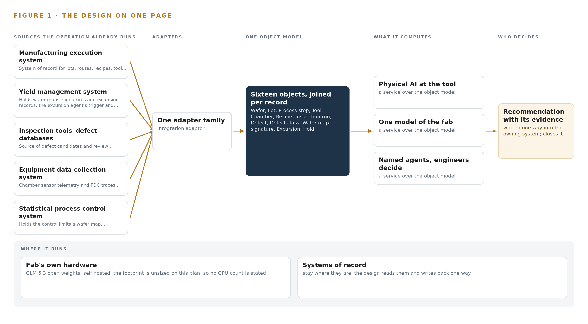
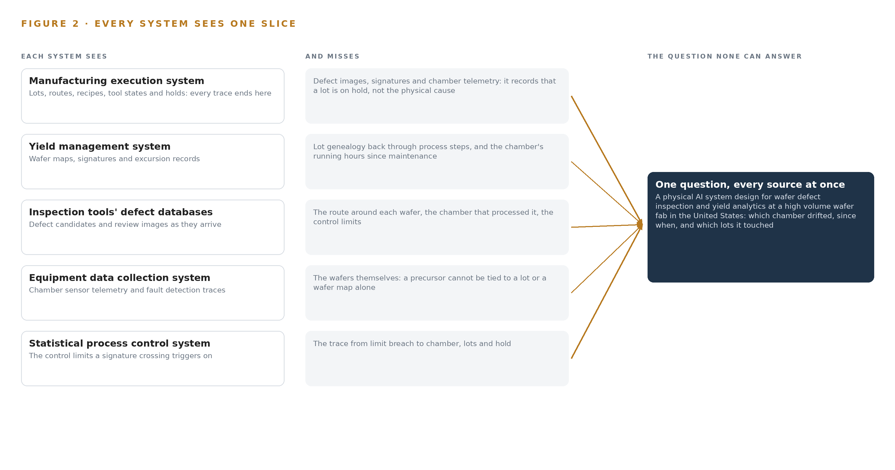
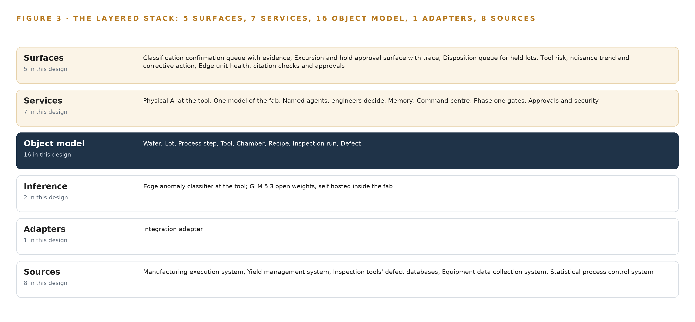
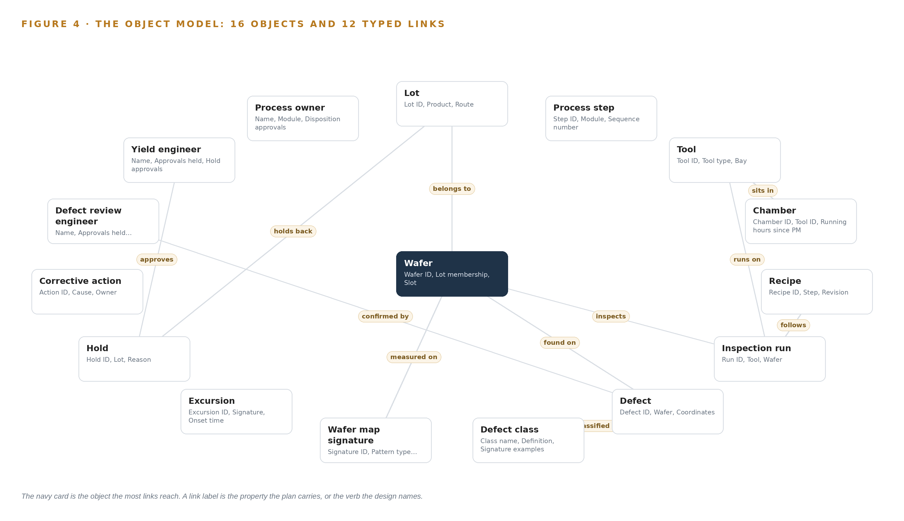
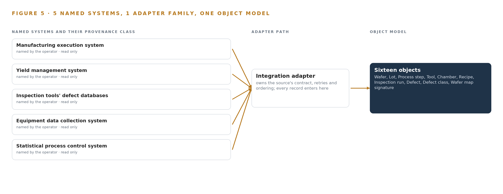
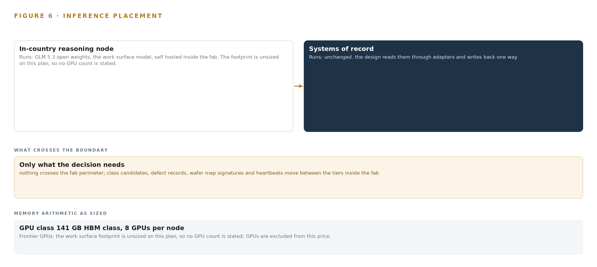
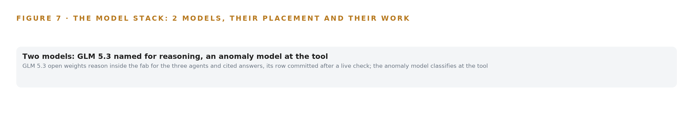
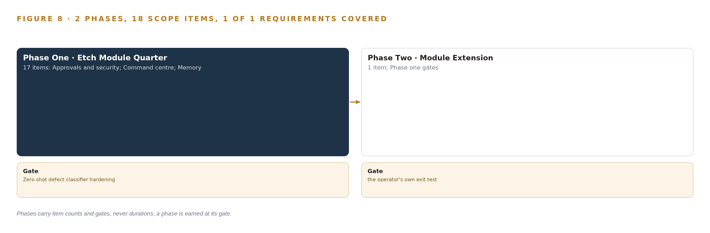
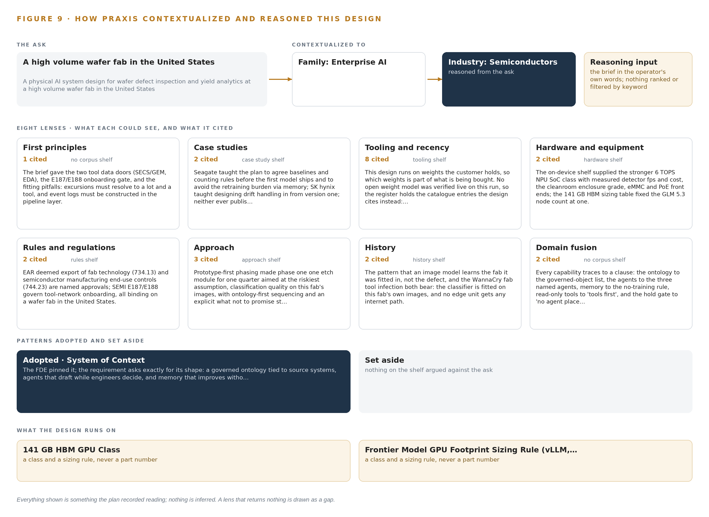

# Physical AI System Design for Wafer Defect Inspection in the United States

Canonical: https://codeatoms.ai/wafer-defect-inspection-us/
DOI: https://doi.org/10.5281/zenodo.23889770
PDF: https://codeatoms.ai/wafer-defect-inspection-us/paper/wafer-defect-inspection-us.pdf
License: CC BY 4.0
Publisher: CodeNinja Atoms (https://codeatoms.ai), a fully owned subsidiary of CodeNinja

VERTICAL-DRIVEN ARCHITECTURES · SEMICONDUCTORS · DESIGNED WITH PRAXIS · NOVEMBER 2026

# Physical AI System Design for Wafer Defect Inspection in the United States

Fab Defect Watch: Ontologies for Semiconductor Defect Classification at the Edge

Inside a high volume United States wafer fab, this system classifies defect images on sealed edge units at the inspection tools, joins them to lots, tools and chambers in one governed fab ontology, and drafts classifications, holds and dispositions that named engineers confirm and approve.

Muhammad Umar, Cofounder, CodeNinja

For fab yield directors, defect review engineers and yield engineers, and the data, platform and equipment engineers who would build and run it.

---

Vertical-Driven Architectures is a CodeNinja series of system designs. Every design in the series is driven by a real-world problem and scenario in a single industry, and every one is designed on Praxis, CodeNinja's platform for designing physical AI systems. Operations are described by class, never by name.

At a glance

## Physical AI System Design for Wafer Defect Inspection in the United States

**What this is.** An open reference architecture for physical AI system design, built for a high volume wafer fab in the United States that images wafers at many process steps with optical inspection and electron microscope review tools, where owning the reasoning node that runs it costs about 576,000 US dollars over three years. Defect images are classified at the tool, joined to the wafer, lot, tool, chamber and recipe in one governed fab ontology, and traced to an excursion and a hold, so the yield engineer can ask which chamber drifted, since when, and which lots it touched. The model runs entirely on the fab's own hardware under United States export control, including the deemed export rule for supporting engineers, and the sector's tool network cybersecurity and equipment communications standards. It is written for fab yield directors, defect review engineers and yield engineers, and the data, platform and equipment engineers who would build and run it. The operator is described by class, never by name.

**The answer in numbers.**

| Part | The design |
| --- | --- |
| Sources | Five systems of record and the tool interfaces at the edge, eight sources in all, entering through one integration adapter family over SECS/GEM, GEM300 and EDA interfaces onto an Apache Kafka (KRaft) backbone: the manufacturing execution system, the yield management system, the inspection tools' own defect databases, the equipment data collection system and the statistical process control system, all read only; the one write back is an approved hold or disposition through the manufacturing execution system interface |
| Object model | 16 typed objects with 12 typed links, from the wafer and lot through the process step, tool, chamber, recipe and inspection run to the defect, defect class, wafer map signature, excursion, hold and corrective action, with the defect review engineer, yield engineer and process owner, published as JSON for reuse |
| Models | GLM 5.3 open weights for the work surface, self hosted inside the fab: reasoning for the three named agents and cited answers, unsized until a verified register row stands; an unsupervised anomaly model fitted on the fab's own normal images on the CodeNinja on-device AI stack at the tool; no third party model service, nothing trained into weights |
| Compute | At the tool, one octa core 6 TOPS NPU edge SoC unit per inspection tool group in a fanless sealed cleanroom enclosure, held to a 60 percent headroom gate. In the fab's server room, the 141 GB HBM GPU class, eight GPUs per node, one node for GLM 5.3 at FP8. Nothing crosses the fab perimeter |
| Rollout | Two phases carrying 18 scope items (17, then 1): one etch module for one quarter, gated on classification quality on the fab's own images, joins proven on one real week of production data and a named approval on every hold, measured as time from excursion onset to hold against a nominal of 4.0 hours; 1 of 1 requirement covered |
| Three-year cost | About 576,000 US dollars to own the reasoning node for three years (a range of 551,000 to 623,000: server, support and power at the United States average industrial or commercial price), against about 625,000 to rent the same eight cards on the deepest three year commitment in AWS US East (N. Virginia), so ownership costs about nine tenths of it, and about 1.66 million on demand, against which ownership costs about a third. Renting is a price reference only, because every rented option would carry fab data out of the fab (Appendix A) |
| Human control | Agents draft and engineers decide: the defect review engineer confirms each proposed defect class, the yield engineer approves every drafted hold, and the process owner approves every release, rework or scrap; a hold placed or released without a recorded named approval is refused in code and audited per hold, and every supporting engineer is screened for deemed export before access |

**Reuse it.** The object model, the model register and the figures are free to reuse under CC BY 4.0. Cite as <https://codeatoms.ai/wafer-defect-inspection-us/.>

**Made with.** Reasoned on [CodeNinja Praxis](<https://codeatoms.ai/praxis/>), the CodeNinja Atoms platform for designing physical AI systems. The object model imports into [Hyper Ontology](<https://codeatoms.ai/hyper-ontology/>), which turns it into a living system. Load it with the [hyper-ontology loader](../hyper-ontology-py/): `hyper-ontology show wafer-defect-inspection-us`. Both are in beta; access by request.

ABSTRACT

## Ontologies for Semiconductor Defect Classification Decide Yield

When a wafer map shows a ring signature, physical AI system design has to give a wafer fab in the United States one answer: which chamber drifted, when it started, and which lots it touched before anyone noticed. Ontologies for semiconductor defect classification are how the industry names the missing piece, because no single system of record can walk from a defect image to a lot, a tool, a chamber, a recipe and a control limit in one trace. The manufacturing execution system knows the lot and the hold, the yield management system knows the signature, the inspection tools' own databases hold the images, the equipment data collection system holds the chamber telemetry, and the statistical process control system holds the limits, but the join that the question demands is done by engineers reading screens, and the cost shows up as hours between excursion onset and hold.

The design runs wholly inside the fab boundary on the operator's own hardware. Sealed fanless edge units next to the optical inspection and electron microscope review tools classify defect images as they arrive on the CodeNinja on-device AI stack; one adapter family joins eight sources into one governed fab ontology of sixteen objects, from wafer, lot and process step through tool, chamber, recipe, inspection run, defect, defect class and wafer map signature to excursion, hold, corrective action and the three approving roles; seven services and five surfaces carry three named agents, a classification agent drafting on a review image, an excursion agent drafting a hold when a wafer map signature crosses a control limit, and a disposition agent drafting release, rework or scrap for a held lot, each confirmed by a defect review engineer, a yield engineer or a process owner; and the model register holds zero verified weights, with reasoning intended for GLM 5.3 open weights self hosted inside the fab once a verified row stands in the register.

The paper covers the industry problem and the join failure across five systems of record, the constraints that sovereignty and the tools-first rule impose, the layered stack, the sixteen object model and its typed links, ingestion through one adapter family, where inference runs and what happens when the link or the update path fails, the honestly open model register, the two phase rollout with its item counts, gates and the excursion to hold time it measures, who owns what the system produces, and it closes with how Praxis contextualized and reasoned the design.

---



Figure 1. Fab Defect Watch on one page: the sources the operation already runs, one object model, what it computes, and the person who decides.

## Contents

Each chapter is tagged for the reader it serves most directly: Executive, Team Lead, FDE, Reference.

|  |  |  |
| --- | --- | --- |
|  | Abstract · Ontologies for Semiconductor Defect Classification Decide Yield | Executive |
| PART I · THE PROBLEM | | |
| 1 | [Ontologies for Semiconductor Defect Classification Decide Yield](#ch1) | Executive |
| 2 | [Every Fab System Sees One Slice of the Wafer](#ch2) | ExecutiveTeam Lead |
| PART II · THE DESIGN | | |
| 3 | [Sovereignty and the Tools-First Rule Shape Everything](#ch3) | Team Lead |
| 4 | [One Stack Runs From Records to Surfaces](#ch4) | Team LeadFDE |
| 5 | [Sixteen Objects Turn Fab Data Into One Argument](#ch5) | FDE |
| 6 | [Every Source Enters Through an Adapter, Never Directly](#ch6) | FDE |
| 7 | [Classification Runs at the Tool, Reasoning Inside](#ch7) | FDE |
| 8 | [No Weights Are Committed Before Verification](#ch8) | FDEExecutive |
| PART III · THE ROLLOUT | | |
| 9 | [One Etch Module Quarter Proves It First](#ch9) | Team LeadExecutive |
| 10 | [The Intelligence Stays with the Fab Producing It](#ch10) | Executive |
| PART IV · HOW IT WAS DESIGNED | | |
|  | Conclusion · The Fab Should Reason Over Its Own Records | Executive |
| 11 | [How Praxis Contextualized and Reasoned This Design](#ch11) | Team LeadFDE |
|  | [Sources](#sources) | Reference |

PART I · CHAPTER 1

## Ontologies for Semiconductor Defect Classification Decide Yield

A drifting etch chamber prints its ring signature on wafer maps long before any single system can name the chamber, the lots it touched or the hold that should follow.

The abstract promised a physical AI system design with defect images classified at the tool, one governed model of the fab, and three named agents that draft while engineers decide. This chapter states the question behind that promise, the documented cost of leaving it unanswered, and the operation the design is written for.

### 1.1  The Question, the Data and the Regimes

Ontologies for semiconductor defect classification exist to answer one operational question: when a wafer map signature crosses a control limit, which chamber is drifting, which lots has it touched since onset, and what hold and disposition should follow. Ontologies for semiconductor defect classification answer it by joining evidence the fab already holds, because the question spans five systems at once: review images from the optical inspection and electron microscope tools, wafer maps and signatures from the yield management system, chamber sensor traces from the equipment data collection system, control limits from the statistical process control system, and lot genealogy from the manufacturing execution system. The proving fault is precise: one etch chamber drifting and printing a ring signature on wafer maps, a pattern the fab sees only after wafers have already carried it into later steps.

The answer must satisfy more than engineering. As a United States operator, the fab works under export control law, where deemed export of fab technology and semiconductor manufacturing end-use controls make even the nationality of a supporting engineer a compliance fact, and under the sector's own tool-network cybersecurity and equipment communications standards, which govern how any unit is onboarded to the tool network. Because the system advises decisions that touch product and safety, the functional-safety treatment of AI systems (ISO 2024) and the consensus finding that machine learning already runs across safety-critical applications (Nationalacademies 2025) set the frame for how much autonomy is granted; where visual inspection AI serves regulated markets, its risk classification is settled by rules of the kind the EU AI Act service desk and a 2025 compliance-pathways study describe (Europa n.d.; KB 2025).

### 1.2  The Documented Cost of the Problem

The sector's record shows what failure costs. The U.S. Chemical Safety and Hazard Investigation Board investigated an equipment fracture and fatal hydrogen chloride release at a polysilicon producer in the semiconductor supply chain (CSB 2020), and state regulators cited a major fab for a safety violation after a man died on the job (ABC15 2024); both document that equipment and process failures in this industry carry human consequences, not only yield consequences. The yield cost is quieter and compounds hourly: between excursion onset and hold, a drifting chamber keeps printing on every wafer that passes through it. That is why the design's headline measure is the time from excursion onset to hold, with a nominal of four hours, breached above it, measured against etch chamber drift printing a ring signature.

### 1.3  The Operation as a Scenario

The operator is a high volume wafer fab in the United States, and phase one is confined to a single etch module. Three roles hold the decisions, each by name: the defect review engineer confirms defect classes on review images; the yield engineer approves holds when a wafer map signature crosses a control limit; the process owner disposes of held lots as release, rework or scrap. The physical environments are cleanroom bays housing the etch, inspection and review tools, review stations where engineers read images, and an on-site server room on the fab's segmented tool network where the reasoning model runs on the operator's own hardware, with no third party model service anywhere. The counts are five named source systems, three named roles, one process module and one fab site, joined through one integration adapter family into one governed object model.

PART I · CHAPTER 2

## Every Fab System Sees One Slice of the Wafer

The manufacturing execution, yield management, defect, equipment data collection and statistical process control systems each hold one true slice of the argument, and none of them can join the slices without an engineer in the middle.

Chapter 1 stated the question and the scenario. This chapter shows why no single existing system can answer it, by walking through what each of the five holds and what it cannot see.

### 2.1  What Each System Sees

The manufacturing execution system is the system of record for lots, routes, recipes, tool states and holds, and every trace the design builds ends in a lot and a hold here; it knows a lot is stopped, but it holds no defect image, no wafer map signature and no chamber telemetry, so it cannot say why anything stopped. The yield management system holds the wafer maps, the signatures and the excursion records, which makes it both the trigger the excursion agent listens to and the evidence store a trace reads from; it cannot reach back through process steps to a chamber's running hours since its last maintenance. The inspection tools' own defect databases produce the defect candidates and review images the edge units classify, fresh evidence from the fab floor, yet around each image they hold neither the route the wafer traveled nor the limits a signature must cross to become an excursion. The equipment data collection system carries the chamber sensor telemetry and fault detection traces in which drift announces itself first, but on its own a precursor cannot be tied to a lot, a wafer map or an image. The statistical process control system holds the control limits a wafer map signature crossing triggers on and raises the flag faithfully; it cannot trace the flag to a chamber, name the lots at risk or draft the hold that follows.

### 2.2  What None of Them See Together

What none of them see together is the argument itself: one chamber drifting, the lots it processed since onset, the ring signature those lots now carry, the review images that show it, and the hold that should follow, in one joined view. Figure 2 sets the five slices side by side and converges on that question. The cost in practice is the engineer in the middle, because a yield engineer assembles the join by hand across five systems while material keeps moving through the drifting chamber; the design measures that assembly as time from excursion onset to hold, against a nominal of four hours, with the fault being etch chamber drift printing a ring signature.



Figure 2. Five systems, each seeing one part of the answer; the question needs all of them in one place at once.

PART II · CHAPTER 3

## Sovereignty and the Tools-First Rule Shape Everything

Open weights on operator owned hardware inside the fab, tools read but never commanded, memory instead of training, and export control screening of every supporting engineer together fix the shape of every layer downstream.

The join failure is structural, so the constraints on any fix are structural too. This chapter states the four goals that shape every layer downstream, then the scoping they force.

### 3.1  Open Weights on Hardware the Operator Owns

The first goal is sovereignty: reasoning runs on GLM 5.3 open weights, self hosted inside the fab on hardware the operator owns, with no third party model service and no data leaving the boundary. This is hard in semiconductors because the fab's own data is controlled technology, which makes any external model path a compliance event rather than a procurement choice. The named model's 753 billion parameters served at FP8 need a full node of the 141 GB HBM GPU class, eight GPUs per node, to themselves; no language model is served at the tool, where the edge units' anomaly classifier runs on the on-device stack's own runtime.

### 3.2  Tools First: Read, Never Command

The second goal is the tools-first rule: the design reads from the tool databases and never commands a tool. This is hard because fab integration is contractual and tool by tool, negotiated over SECS/GEM, GEM300 and EDA according to which revisions each etch-module tool implements, and because a certified tool's state is safety-relevant. The rule runs through everything downstream: the gate for any hold is the manufacturing execution system interface, never an agent, and a hold placed or released without a recorded named approval is refused in code and audited per hold.

### 3.3  Memory Instead of Training

The third goal is memory instead of training: every confirmed class and every root cause becomes memory the next decision reads, and nothing is trained into weights. This is hard because the sector default is a classifier trained on labelled images, which locks the estate to one defect mix and becomes a standing retraining burden as that mix shifts. Improvement compounds in the record rather than in the weights, and any future trained classifier would be a different architecture, stated plainly.

### 3.4  Every Supporting Engineer Screened

The fourth goal is export control over people: access to fab technology by a supporting engineer who is a non-US person can be a deemed export under section 734.13, so every supporting engineer is screened before access is granted and the check is carried as a named approval. This is hard in an industry where the relevant expertise is global and the technology is controlled precisely because of what it makes; it is also the constraint most easily missed, because it binds the support team rather than the software.

### 3.5  Scoping Decisions

These goals force scope, and Table 1 records the three decisions that buy the phase one gate. Published examples of [physical AI system design](https://codeatoms.ai/physical-ai-system-design/) that travel across sectors trade fab specific keys for reusability, so this design scopes its model to the fab's own sixteen objects and proves the joins on one real week of production data before phase one is judged, recording where the truth actually lives in each source.

Table 1 · Scoping Decisions

| Decision | What it buys | What it costs |
| --- | --- | --- |
| One etch module in phase one | The riskiest assumption, classification quality on this fab's own images, is measured before any estate-wide build | Findings from one module's defect mix do not transfer automatically to other modules |
| Unsupervised anomaly model fitted on the fab's normal images | No labelled-image estate and no standing retraining burden | No accuracy figure can be quoted before the phase one measurement on real images |
| One integration adapter family for all five source systems | A single provenance path and uniform guarantees for every object in the model | Every tool interface remains contractual and revision-specific under SECS/GEM, GEM300 and EDA |

### 3.6  What the Design Chose Against

Table 2 records what was picked, what each pick displaced and why, ending with the boundary that stays out of scope.

Table 2 · What the Design Chose Against

| Where | What was picked | Instead of, and why |
| --- | --- | --- |
| Edge compute at the inspection tools | A CodeNinja on-device AI stack SoC unit per inspection tool group | An off the shelf GPU edge module, whose 7 to 25 W sits against a sealed fanless cleanroom enclosure and which is not the stack the requirement names |
| Defect classification | An unsupervised anomaly model fitted on the fab's normal images | A defect classifier trained on labelled images, which locks the estate to one defect mix and becomes a standing retraining burden as that mix shifts |
| Improvement mechanism | Memory of every confirmed class and root cause | Training or fine tuning, which this architecture forbids: improvement compounds in the record, not in weights |
| Model serving | GLM 5.3 open weights, self hosted inside the fab on the 141 GB HBM GPU class | A third party model service, ruled out by the operator's own requirement: open weights on hardware the operator owns |
| Out of scope | No new cameras, no writes to tool control systems, no ERP or supply chain integration, no AMHS or robotics control, no historic data migration | Each of these joins when a module that needs it enters, because the intake chose the minimum subset for the one etch module |

PART II · CHAPTER 4

## One Stack Runs From Records to Surfaces

Systems of record sit below untouched, one governed object model sits in the middle as a projection over them, and the edge tier, the agents and the work surfaces sit above, each with a named responsibility.

Chapter 3 set the four constraints and recorded what the design chose against. This chapter turns those constraints into a stack: one fixed order of layers, from the fab's systems of record up to the surfaces where engineers decide.

### 4.1  The Pattern and Why It Fits This Fab

The architecture is a projection, not a replacement. The fab's systems of record sit below, untouched: never replaced, never modified, never loaded, because fab integration is contractual and tool by tool over SECS/GEM, GEM300 and EDA interfaces, and because onboarding anything onto the tool network is governed by SEMI E187 and E188 network security standards. One governed object model sits in the middle, a projection over those systems that joins their records without copying their truth. Above it sit the edge units at the inspection and review tools, the three named agents, and the five work surfaces where the defect review engineer, the yield engineer and the process owner decide.

This order fits because the fab's hardest integration fact is that its records cannot be touched, and its hardest quality fact is that every decision must resolve to a lot, a tool and a named person. A projection answers both: the systems of record keep every fact, the object model keeps the joins, and the layers above only read and draft. Machine learning is already running across nearly every industrial sector, including safety critical ones (Nationalacademies 2025), but it only helps here if it sits over records that stay authoritative. Figure 3 shows the layered stack with its counts: eight sources, one adapter family, sixteen objects, seven services and five surfaces.



Figure 3. The layered stack: 8 sources, 1 adapter family, 16 objects, 7 services and 5 surfaces.

### 4.2  The Stack Stage by Stage

Table 3 walks the stack from the sources to the surfaces, naming the component responsible at each stage. The stage boundaries are also trust boundaries: everything below the adapter tier belongs to the fab's own systems, and everything above reads only through the backbone.

Table 7, printed with this chapter, carries the same stack layer by layer with the component, the choice and the reason for each row.

Table 3 · The Stack, Stage by Stage

| Stage | What it is responsible for | How |
| --- | --- | --- |
| Sources | Holding every record the argument needs: lots, routes, recipes, tool states, holds, wafer maps, defect candidates, chamber telemetry, control limits | The five named systems of record and the tool interfaces, all read only |
| Sensing | Turning physical behavior into signals the tiers above can reason over | Chamber FDC traces, wafer map signature residuals, SPC control limit status and edge unit heartbeats; no cameras, because the inspection tools' own images are consumed |
| Adapters | Carrying every record into the backbone with provenance, ordering and a constructed event log | One integration adapter family over SECS/GEM, GEM300 and EDA interfaces on an Apache Kafka (KRaft) backbone |
| Object model | One governed projection of the fab, sixteen objects with typed links | Hyper Ontology, with InfluxDB 3 Core for time series and telemetry |
| Inference | Classifying defect images at the tool and reasoning on site | Edge units on the CodeNinja on-device AI stack runtime running an unsupervised anomaly model fitted on the fab's own normal images, and a 141 GB HBM GPU class site tier for GLM 5.3 open weights, self hosted |
| Services | The seven named services: Physical AI at the tool, One model of the fab, Named agents engineers decide, Memory, Command center, Phase one gates, Approvals and security | Containers on K3s, observable through Prometheus, Grafana and Loki, artifacts in Harbor, identity in Keycloak, time synchronized by Linuxptp against an Open Time Card grandmaster class clock |
| Surfaces | The five places engineers decide | The classification confirmation queue with evidence, the excursion and hold approval surface with trace, the disposition queue for held lots, tool risk, nuisance trend and corrective action, and edge unit health, citation checks and approvals |

Table 7 · Architecture, Layer by Layer

| Layer | Component | Choice | Why |
| --- | --- | --- | --- |
| Event streaming and messaging | by class, no product named | Product | Apache Kafka (KRaft) |
| The ontology or graph store | by class, no product named | Product | Hyper Ontology |
| Time series and telemetry storage | by class, no product named | Product | InfluxDB 3 Core |
| Video ingest, recording and management | by class, no product named | Not needed | Defect images arrive from the inspection tools' own defect databases over tool interfaces, not camera streams, and the stations have no footage of the fab's own. |
| Edge model serving | by class, no product named | Not needed | The rollout model is named plainly: GLM 5.3 runs self hosted on the fab's own servers, not at the edge, because 753B at FP8 is a node-class rollout and no language model is served at the tool. The edge units' anomaly classifier runs on the CodeNinja on-device AI stack's own runtime, carried in… |
| On site language model serving | by class, no product named | Product | GLM 5.3 open weights, self hosted on the fab's own servers on the 141 GB HBM GPU class, served under the frontier model footprint sizing rule for vLLM and SGLang; sized when a verified register row stands |
| Object tracking and trajectory forecasting | by class, no product named | Not needed | Wafer and lot movement is tracked by the MES and substrate tracking standards, not by a vision tracker. |
| Edge orchestration of containers | by class, no product named | Product | K3s |
| An air gapped artifact and model registry | by class, no product named | Product | Harbor |
| Labelling and retraining | by class, no product named | Not needed | Under system of context nothing is trained into weights: confirmed classes and root causes become memory, not training data. |
| Time synchronisation across sensors and systems | by class, no product named | Product | Linuxptp |
| Observability of the running system | by class, no product named | Product | Prometheus / Grafana / Loki |

### 4.3  A Reusable Pattern

The shape a team can carry to any similar brief is the projection stack: sources of record untouched below, one governed object model projected over them in the middle, sensing and drafting agents above, and a named human as every gate. What a team swaps is the vocabulary and the doors: the sixteen objects become their own nouns, the SECS/GEM, GEM300 and EDA interfaces become whatever their sector's systems speak, and the FDC traces become their own telemetry. What they keep is the grammar: nouns become objects, facts become properties, relationships become typed links, and no agent writes to a system of record without a recorded approval.

PART II · CHAPTER 5

## Sixteen Objects Turn Fab Data Into One Argument

Sixteen objects and their typed links let one query walk from a defect image to a wafer, a lot, a tool, a chamber and a hold, a walk no document store and no single system of record can make.

Chapter 4 fixed the layers and named the stack's components. This chapter opens the middle layer: the sixteen objects, their typed links, and the single walk that turns a defect image into an argument about a chamber, a lot and a hold.

### 5.1  Sixteen Objects and the Links Between Them

The object model holds sixteen objects in six kinds: the materials wafer and lot; the events process step, inspection run, defect and excursion; the assets tool and chamber; the records recipe, hold and corrective action; the measure wafer map signature; and the record defect class, alongside the three actors defect review engineer, yield engineer and process owner. Each is anchored in the system of record that owns its truth: the wafer, lot, process step, tool, recipe and hold in the manufacturing execution system; the chamber in the equipment data collection system; the inspection run and defect in the inspection tools' own defect databases; the defect class, wafer map signature, excursion and corrective action in the yield management system. Figure 4 draws every object and its typed links, with the wafer in navy as the object the most links reach.

The links are what a document store cannot hold. One query can start at a defect image classified as a pattern defect, walk to the wafer it was found on, to the wafer map signature carrying a ring pattern, to the lot that wafer belongs to, back through the inspection run to the tool and the recipe it ran, to the chamber inside that tool whose running hours since PM and FDC trace explain the drift, to the excursion the signature triggered, to the hold the yield engineer approved, and to the corrective action that closes it. Table 8, printed with this chapter, lists every object with its anchor and its typed links. This is the shared core of industrial ontology examples in manufacturing: a defect argument that reaches every system of record without any of them being asked to join anything.



Figure 4. The sixteen objects of the model and the typed links that let a query reach across them.

Table 8 · The Object Model

| Object | Anchored in | Typed links |
| --- | --- | --- |
| Wafer | The manufacturing execution system | belongs to: Lot; carries: Wafer map signature |
| Lot | The manufacturing execution system | no typed link recorded |
| Process step | The manufacturing execution system | no typed link recorded |
| Tool | The manufacturing execution system | no typed link recorded |
| Chamber | The equipment data collection system | sits in: Tool |
| Recipe | The manufacturing execution system | no typed link recorded |
| Inspection run | The inspection tools' own defect databases | runs on: Tool; inspects: Wafer; follows: Recipe |
| Defect | The inspection tools' own defect databases | found on: Wafer; classified as: Defect class; confirmed by: Defect review engineer |
| Defect class | The yield management system | no typed link recorded |
| Wafer map signature | The yield management system | measured on: Wafer |
| Excursion | The yield management system | no typed link recorded |
| Hold | The manufacturing execution system | holds back: Lot |

### 5.2  Where the Human Loop Lives and the Hosting Posture

The human loop lives in the actors and in the approval properties every record carries: a hold records who raised it and who approved it, a defect records which review engineer confirmed its class, and an attempt to place or release a hold without a recorded named approval is refused in code and audited per hold, because the gate is the manufacturing execution system interface, never the agent. Functional safety and AI is an active standards question (ISO 2024), and AI based visual quality inspection carries its own classification and compliance pathways (KB 2025), which is why every drafting agent ends at a named person rather than at an action.

The hosting posture is sovereign end to end. All data stays inside the fab on the operator's own hardware, with no third party model service and nothing crossing the fab perimeter; identity is held in Keycloak on site; the edge units carry no internet path; and no write path leads back toward a system of record except an approved hold or disposition through the manufacturing execution system interface.

### 5.3  One Object in Its Recorded Form

The code block shows one object in its recorded form: the wafer, the object the most links reach, with its properties and its two typed links.

```
{ "id": "wafer", "label": "Wafer", "kind": "material", "anchored_in": "The manufacturing execution system", "properties": [ "Wafer ID", "Lot membership", "Slot", "Current process step" ], "status_vocabulary": [], "links": [ { "to": "lot", "label": "belongs to" }, { "to": "wafer map signature", "label": "carries" } ] }
```

PART II · CHAPTER 6

## Every Source Enters Through an Adapter, Never Directly

One adapter family over SECS/GEM, GEM300 and EDA interfaces carries every record into the event backbone, so no source system is ever loaded, modified or replaced, and no join is trusted until it is proven on a real week of production data.

Chapter 5 showed what the object model holds and how one walk crosses its links. This chapter covers how records reach it: through one adapter family, never directly, and never with a join trusted before it is proven.

### 6.1  Eight Sources, One Door Each

Eight sources feed the design. Five are named systems of record, all of the operator's own and all read only: the manufacturing execution system, the system of record for lots, routes, recipes, tool states and holds, where every trace ends in a lot and a hold; the yield management system, which holds wafer maps, signatures and excursion records; the inspection tools' own defect databases, the source of defect candidates and review images the edge units classify; the equipment data collection system, which carries chamber sensor telemetry and FDC traces for drift precursors and excursion tracing; and the statistical process control system, which holds the control limits a wafer map signature crossing triggers on. The remaining sources are the tool interfaces and telemetry streams at the edge. Figure 5 maps each named system, its provenance class and its adapter path into the backbone.



Figure 5. The 8 named systems, the adapter path each one takes, and the object model they all map into.

### 6.2  What the Adapter Tier Guarantees

One adapter family, the integration adapter, carries every record in, over SECS/GEM, GEM300 and EDA interfaces decided by which revisions each etch module tool implements. The tier guarantees four things. First, no source is ever loaded, modified or replaced: the adapters read, and nothing is written back toward a system of record except an approved hold or disposition through the manufacturing execution system interface. Second, every record carries its provenance and its timestamp, so any figure on any surface can be traced to the system that holds its truth. Third, event logs are constructed in the pipeline layer rather than trusted as they arrive, because source systems differ in what they call an event and when they record it. Fourth, no join is trusted until it is proven: the adapters reconcile the source keys across the systems on one real week of production data before phase one is judged, recording where the truth actually lives, because an ontology that joins silently wrong keys is worse than four systems that do not join at all.

### 6.3  The Event Backbone

The backbone is Apache Kafka with KRaft, and it answers four questions. Ordering: events are keyed per wafer and per tool, so inspection runs, defect candidates and telemetry replay in the sequence they happened. Delivery: adapters are at least once and idempotent, so a replayed event cannot double count a defect or a confirmed class. Buffering: the backbone absorbs bursts when a review tool emits images faster than the edge tier classifies them, and the edge units buffer locally when their uplink is briefly lost. Replication: topics are replicated across brokers so the loss of a broker does not lose records, and the artifact registry in Harbor keeps the edge tier's software resynchronizable without any internet path. Time alignment across sensors and systems is held by Linuxptp against an Open Time Card grandmaster class clock, so an FDC trace, an inspection run and a wafer map signature from the same excursion share one clock. Nothing on the backbone crosses the fab perimeter.

PART II · CHAPTER 7

## Classification Runs at the Tool, Reasoning Inside

The anomaly classifier runs on sealed fanless units at the inspection tools with no internet path, while reasoning waits on verified open weights self hosted inside the fab, and the latency budget is set by images arriving, not by users waiting.

Chapter 6 followed every record from the fab's systems of record through the adapter tier into the object model. This chapter follows the same data one step further, to where it is computed: which model runs on a sealed unit at the inspection tool, which runs on the operator's own servers deeper inside the fab, and what that split costs in latency and failure exposure.

### 7.1  Two Tiers, Each Placed for a Reason

The design has two inference tiers, and Figure 6 sets them side by side with what runs on each and what crosses between them. The first tier is the tool itself. Sealed fanless units beside the optical inspection and electron microscope review tools classify defect images as they arrive, on the CodeNinja on-device AI stack runtime, using an unsupervised anomaly model fitted on this fab's own normal images, so a class candidate exists before any image leaves the tool bay. The unit is an octa core edge SoC class with a 6 TOPS neural processing unit, commercial grade rated 0 to 80 C, in a fanless sealed smooth-wall cleanroom enclosure with a power over Ethernet front end, because a fan sheds and moves particles. The arithmetic that matters at this tier is load, not weights: the NPU load figures on the on-device shelf were measured for detectors rather than an anomaly model, so a 60 percent headroom gate governs until the real load is measured, and a saturated unit dropping images silently is the named failure mode behind that gate.

The second tier is inside the fab, on the operator's own servers. The stack row that names GLM 5.3 calls it a 753-billion-parameter model at FP8 precision and node class, which is exactly why no language model is served at the tool. What the plan holds for this tier is the class and the rule: a 141 GB high bandwidth memory GPU class with 8 GPUs per node, and the frontier model footprint sizing rule for vLLM and SGLang serving. What it does not hold is the split between weights, usable memory and the KV cache ceiling, because no verified model row stands in the register; those figures are derived only when one does, and Chapter 8 explains why none does yet.



Figure 6. Where each tier runs, what runs there, and the narrow set of outputs that cross the boundary.

### 7.2  Latency Runs From Image Arrival to Hold Approval

The budget has two ends, and neither is a person waiting on a chat reply. At the near end, classification sits in the arrival path: the unit must keep pace with the inspection tool's own output, and the headroom gate exists so that bursts of arrivals never queue behind a saturated unit. At the far end sits the rollout's own measure, time from excursion onset to hold, with a nominal of 4.0 hours and a breach above it, exercised by the simulated event of one etch chamber drifting and printing a ring signature on wafer maps. Everything between, from the wafer map signature crossing a control limit, through the excursion agent tracing it to a chamber, to the yield engineer approving the hold, must fit inside that figure. The people in the loop pace the budget and guard it at once, and that is deliberate: how inspection AI is classified is an active regulatory question, with published analyzes of risk classification and compliance pathways for AI-based visual quality inspection (KB 2025), so every class candidate and every hold draft ends with a named approver rather than acting alone.

### 7.3  What Crosses the Boundary, and What Fails When It Does

Nothing crosses the fab perimeter. Tool-to-server flows ride internal segmented conduits under the fab's own cybersecurity program, no edge unit gets any internet path, and the event backbone, Apache Kafka in KRaft mode, carries class candidates, defect records, wafer map signatures and heartbeats between the tiers, with linuxptp and an Open Time Card grandmaster class keeping event order honest across systems. Each failure mode is bounded. If the link fails, classification continues at the tool because the classifier is local, and queued events move when the conduit returns, while the surfaces show the gap honestly. If power fails, the unit drops with it, since power arrives on the same Ethernet front end, and the edge unit heartbeat puts the drop on the health surface where someone sees it. If the update path fails, nothing is pushed from outside, because there is no outside path: artifacts and model updates move through Harbor, the air-gapped artifact and model registry, on the internal network, and a unit that misses an update keeps running its last verified artifact until the path returns.

PART II · CHAPTER 8

## No Weights Are Committed Before Verification

The register is honestly empty: no open weight model survived this run's live checks, so GLM 5.3 stands as a named intention with an unsized footprint rather than a committed row, and the gate to commit it is verification, not preference.

Chapter 7 placed classification at the tool and reasoning inside the fab, and it left one number deliberately unfixed: the size of the reasoning footprint. This chapter shows why the register is empty, what stands in it instead, and what it will take to commit a model row.



Figure 7. The two models, their placement, and the work each one does.

### 8.1  An Honest Register Holds One Intention and One Fitted Model

Figure 7 lays the model stack out, and its most important feature is an absence: the register holds no model row, because no open weight model survived this run's live checks. The catalog entries the tooling lens brought in were each verified by a person on the date the entry carries and were not rechecked live for this build, and that outstanding verification is the gate to commit, not a matter of preference. GLM 5.3 therefore stands as a named intention. The operator's own ask names it, reasoning on GLM 5.3 open weights, self hosted inside the fab, acquired by a commercial buyer, and the work surface commits frontier-class open weights self hosted for sovereignty, of GLM 5.3 or Kimi class. Behind the name stand a role and a placement: reasoning for the three named agents and for the command center's conversational interface that answers with citations, running on the operator's own servers inside the fab, never at the tool, never as a third party model service. Behind it do not stand a filed parameter count, precision, license terms or context window, so the footprint is unsized and no GPU count is derived; the stack row that calls GLM 5.3 a 753-billion-parameter FP8 node-class model is the argument for where it sits, not a committed figure. Committing the row means a live check on this build, filed together with the parameter count, precision and license terms, and only then does the sizing rule fix the node count, the weights against usable memory and the KV cache ceiling.

The second model in the stack is not a language model at all. The edge tier runs an unsupervised anomaly model fitted on this fab's own normal images, served on the CodeNinja on-device AI stack runtime at the tool. It was chosen against a defect classifier trained on labelled images, for two reasons the design states plainly: System of context forbids a model trained for this operator, and a trained-classifier estate becomes a standing retraining burden. Confirmed classes and root causes become memory instead, and no weight is ever updated by them. Assurance cannot lean on mature certification here, because the functional safety and AI standard is a technical report (ISO 2024), so the design's own gates carry it: the phase one bench run measures the anomaly model on the fab's own images, and no accuracy is quotable before that run.

An empty register is not a gap in the design; it is the design holding its own rule. The operator is buying weights it will hold, so which weights is part of what is being bought, and a row that could not survive a live check would be a costly line in the build.

### 8.2  The Choice Register on One Page

Table 4 gathers what the register does hold: each model with its status, the hardware classes and the sizing rule, the sensing the design stands on, the pattern, and the ground it runs on. Read as a whole, it says that everything is committed except the weights themselves, and that the weights wait on verification rather than preference.

Table 4 · Model and Equipment Register

| The choice | What was picked | Why here |
| --- | --- | --- |
| Reasoning model | GLM 5.3, open weights, self hosted inside the fab, acquired by a commercial buyer | Named in the operator's own ask; sovereignty requires weights the operator holds; unsized until the row survives a live check |
| Edge classifier | Unsupervised anomaly model fitted on the fab's own normal images, served on the CodeNinja on-device AI stack runtime at the tool | System of context forbids a model trained for this operator; a trained classifier would be a standing retraining burden; confirmed classes become memory |
| Edge hardware class | Octa core 6 TOPS NPU edge SoC class, commercial grade 0 to 80 C, fanless sealed smooth-wall cleanroom enclosure, PoE front end | No fan sheds or moves particles; shelf figures are measured for detectors, so the 60 percent headroom gate governs until the anomaly load is measured |
| Site hardware class | 141 GB HBM GPU class, 8 GPUs per node, on the operator's own hardware inside the fab | Frontier-class open weights at FP8 are node class; no GPU count is derived while no verified model row stands |
| Sizing rule | Frontier model footprint sizing rule for vLLM and SGLang serving | Fixes the node count, weights against usable memory and the KV cache ceiling |

PART III · CHAPTER 9

## One Etch Module Quarter Proves It First

Phase one is one etch module for one quarter, gated on classification quality on this fab's own images, joins proven on production data and named approvals on every hold, before any extension gate opens.

Chapter 8 ended with the register's honest gap: the weights the operator named sit in the catalog, but no model survived this run's live checks, so the fab's inference server stays unsized until a verified model stands in the register. This chapter turns that honesty into sequence: the riskiest assumption, classification quality on this fab's own images, is proven first on one etch module, and every extension gate opens only on recorded evidence.

### 9.1  Phases, Gates and Coverage

Phase One is the etch module phase: 17 items across six workstreams, namely approvals and security, the command center, memory, the named agents with engineers deciding, one model of the fab, and the phase one gates. The items include the units placed at the inspection tools, the hardening of the zero shot defect classifier, and the fab ontology of yield objects, the 16 objects from wafer to process owner. Its exit gate is zero shot defect classifier hardening: the anomaly model is measured offline on a development board against this fab's own images before any accuracy figure is quoted, and only ranges with stated conditions are quotable before that bench run. Phase Two carries a single item, the extension gates and module rollout, and it opens only when Phase One's gates have been judged against recorded baselines. Figure 8 sets both phases, their item counts and their gates side by side, with requirement coverage beside them: the plan's coverage record holds the requirement covered, with nothing partial and nothing open.



Figure 8. The two phases and their gates, and coverage of the one requirement across them.

### 9.2  What the Rollout Measures

The loop is judged on one measure: time from excursion onset to hold, in hours, with a nominal of 4.0 and a breach when the measured time rises above it. The fault that exercises the measure is the design's simulated event, one etch chamber drifting and printing a ring signature on wafer maps. The excursion agent must trace that signature to a chamber through the equipment data collection traces, draft a hold, and a yield engineer must approve it before the clock stops. Baselines and counting rules are agreed before the first model is fitted, a discipline the sector's own precedents taught, and since neither precedent published a false-call rate, the nuisance trend surface carries ranges with conditions rather than a single figure. Machine learning already runs across nearly every safety-critical industry, which is why these gates are agreed in advance and judged against recorded baselines rather than after the fact (Nationalacademies 2025), and the hold refusal rule is anchored in code in the spirit of functional safety guidance for AI systems (ISO 2024).

### 9.3  Failure Modes

Table 5 states what can fail and what the design does about each failure, and every mitigation named in it is an item or a gate already carried by a phase.

Table 5 · Failure Modes

| What fails | What the design does |
| --- | --- |
| Anomaly model quality on this fab's images is unmeasured until the bench run | Dev board and offline measurement on the fab's own images is the phase gate; only ranges with conditions are quoted before it |
| NPU load figures are measured for detectors, not the anomaly model, and a saturated unit drops images silently | Commit the stronger SoC class, measure the actual load, and keep the 60 percent headroom gate |
| Deemed export of fab technology if a supporting engineer is a non-US person | Screen the support team under the EAR deemed export rule before access is granted, and name the check as an approval |
| A hold placed or released without a recorded named approval | The approval-missing attempt is refused in code and audited per hold; the gate is the MES interface, never the agent |
| Ontology joins fail silently when source keys do not reconcile across the systems | Prove the joins on one real week of production data before Phase One is judged, and record where the truth actually lives |
| A managed cloud or third-party model service appearing anywhere in the build | Confirm the sovereign obligation with the operator's compliance owner and bind it to a named scope item before design freeze |

### 9.4  Lessons

**Agree the baselines and counting rules before the first model ships.** The sector's precedent builds that skipped this step spent their first measured period arguing about what counted as a defect rather than improving the model; this plan fixes the counting rules as a gate item, so the bench run measures against a settled definition and the false-call question is asked with the same denominators throughout. Design drift handling in from version one. The simulated event is a chamber drifting gradually and printing a ring signature, not a step change, so the excursion path, the chamber telemetry precursors and the hold drafting are exercised from the first version rather than retrofitted after a first excursion is missed. Fit the classifier on this fab's own images. The pattern the history lens surfaced is that an image model learns the fab, not the defect: a model fitted elsewhere inherits another fab's illumination, another tool's artifacts and another process's nuisance population. The anomaly model is therefore fitted unsupervised on this fab's own normal images, and no edge unit holds any internet path.

### 9.5  What Is Still Open

Three questions remain open, and each settles into a design change. The false-call rate: neither sector precedent published one, and settling it would let the nuisance trend surface carry a single quotable figure instead of ranges with conditions. The model register: no open-weight model survived this run's live checks, so the reasoning weights the operator named are not yet sized under the register; settling it fixes the fab's inference server, its GPU count under the 141 GB HBM rule and its license terms. The sovereign obligation: the rule of no cloud and no third party model service is confirmed with the operator's own compliance owner and bound to a named scope item before design freeze, and settling it removes the last condition on the boundary the ownership chapter describes.

PART III · CHAPTER 10

## The Intelligence Stays with the Fab Producing It

The ontology, the memory of confirmed classes and root causes, the decision record and the boundary all belong to the operator, held on its own hardware, and the agents never place or release a hold without a named approval.

Chapter 9 set the gates that protect the build's integrity; this chapter states who holds what those gates protect, which is the operator, on every axis that matters.

### 10.1  Who Owns What the Build Produces

The operator owns the object model. The 16 objects and their typed links are a projection over the operator's own systems of record, never a shadow copy of them, and the crossing mappings that answer questions no single system can are held with the ontology. Unlike most industrial ontology examples, which live in a vendor's documentation, this one lives on the operator's own hardware and changes only through its named owners. The operator owns the memory: every confirmed class and every confirmed root cause is kept as decision memory that the next run reads before it acts, and because nothing is trained or distilled into weights under system of context, there are no fine-tunes whose ownership could ever be contested; the anomaly model is fitted unsupervised on the fab's own normal images and runs where the fab runs. The operator owns the decision record: every hold carries who raised it and who approved it, the approval-missing attempt is refused in code, and the audit trail per hold is the operator's own evidence, produced by its own people acting under its own authority. The operator owns the boundary: the whole build runs on the operator's own hardware inside the fab, nothing crosses the fab perimeter, no managed cloud service and no third-party model service appears anywhere, and the support team is screened under the EAR deemed export rule before any access is granted.

### 10.2  The Offer Behind the Design

CodeNinja designed this system on Praxis, its platform for designing physical AI systems, and the design maps directly onto what CodeNinja builds: the governed object model of wafers, lots, tools, chambers, excursions and holds is Hyper Ontology; the command center where the yield team works excursions, holds, tool risk and agent drafts, and where the operator's own people can build further agents on models they can change without losing what was built, is Hyper Pragma; the three named agents that draft classifications, excursion traces and dispositions for a named engineer to confirm and approve are Decision Systems; and the whole posture, open weights on hardware the operator owns inside its own fab with no third-party model service, is Sovereign Infrastructure.

PART IV · CONCLUSION

## The Fab Should Reason Over Its Own Records

One design holds the whole argument: classification at the tool on sealed fanless units, one governed ontology joining eight sources into sixteen objects, three named agents that draft while named engineers decide, memory of confirmed classes and root causes instead of retraining, and every byte staying inside the fab boundary on hardware the operator owns, with the model register stating plainly that no weights are committed until a verified row stands.

Running the same shape elsewhere takes an operation willing to name its systems of record and its approvers before the first model is discussed, edge units rated for the floor environment rather than adapted office hardware, an export control screen on every supporting engineer before access is granted, and a first phase aimed at the riskiest assumption, classification quality on that fab's own images, rather than the widest scope.

PART IV · CHAPTER 11

## How Praxis Contextualized and Reasoned This Design

Every choice in this design traces to recorded reading: eight reasoning lenses and the brief in the operator's own words.

Chapter 10 closed the argument on ownership; this chapter opens the record, so a reader can trace any choice in the paper back to the reading that justified it. Every design in this series is produced on Praxis, CodeNinja's platform for designing physical AI systems, and Figure 9 shows the path from the ask to the reasoning to the design.

### 11.1  Contextualizing the Ask

The ask, in the operator's own words, was a physical AI system for wafer defect inspection and yield analytics: edge units next to optical inspection and electron microscope review tools classifying defect images as they arrive, one governed fab ontology joining the manufacturing execution, yield management, tool defect, equipment data collection and statistical process control systems, three named agents drafting for engineers who confirm and approve, memory keeping every confirmed class and root cause, reasoning self hosted inside the fab, and one simulated event, an etch chamber drifting and printing a ring signature on wafer maps. Praxis assigned the design to the Enterprise AI family; the semiconductors pin is the FDE's own decision on this project, stated as a decision rather than a reasoned match, and the brief was read as reasoning input.



Figure 9. From the ask to the design: the family and industry Praxis assigned, the eight lenses and what each cited, the patterns adopted and set aside, and the equipment the design lands on.

### 11.2  The Lenses

Table 6 states what each of the eight lenses could see, how many sources it cited and what it contributed to the design. Every lens returned a contribution; the gap in this design is not a lens that saw nothing but a register that could not yet stand behind weights, which the tooling lens records plainly.

Table 6 · The Lenses and What They Contributed

| Lens | Could see | Cited | What it contributed |
| --- | --- | --- | --- |
| First principles | no corpus shelf | 1 | The brief gave the two tool data doors (SECS/GEM, EDA), the E187/E188 onboarding gate, and the fitting pitfalls: excursions must resolve to a lot and a tool, an |
| Case studies | case study shelf | 2 | Seagate taught the plan to agree baselines and counting rules before the first model ships and to avoid the retraining burden via memory; SK hynix taught design |
| Tooling and recency | tooling shelf | 8 | This design runs on weights the operator holds, so which weights is part of what is being bought. No open weight model was verified live on this run, so the reg |
| Hardware and equipment | hardware shelf | 2 | The on-device shelf supplied the stronger 6 TOPS NPU SoC class with measured detector fps and cost, the cleanroom enclosure grade, eMMC and PoE front ends; the |
| Rules and regulations | rules shelf | 2 | EAR deemed export of fab technology (734.13) and semiconductor manufacturing end-use controls (744.23) are named approvals; SEMI E187/E188 govern tool-network o |
| Approach | approach shelf | 3 | Prototype-first phasing made phase one one etch module for one quarter aimed at the riskiest assumption, classification quality on this fab's images, with ontol |
| History | history shelf | 2 | The pattern that an image model learns the fab it was fitted in, not the defect, and the WannaCry fab tool infection both bear: the classifier is fitted on this fab's own images, and no |
| Domain fusion | no corpus shelf | 2 | Every capability traces to a clause: the ontology to the governed-object list, the agents to the three named agents, memory to the no-training rule, read-only t |

### 11.3  Patterns Adopted and Set Aside

System of context was adopted as the primary pattern, pinned by the FDE, because the requirement asks exactly for its shape: a governed ontology tied to source systems that are never replaced, never modified and never loaded, agents that draft while engineers decide, and memory that improves without training. Its fixed grammar governs the whole build: nouns become objects, facts become properties, relationships become typed links, and actions change them. No pattern was set aside; the reasoning trace records none, and the design carries no orphaned architecture.

### 11.4  Where the Reasoning Lands

The reasoning lands on equipment classes rather than named products wherever the shelf holds no verified entry: the octa-core 6 TOPS NPU edge SoC class in fanless sealed cleanroom enclosures, the Open Time Card grandmaster class for time synchronization, the 141 GB HBM GPU class for the fab's inference server, and fab integration decided tool by tool over SECS/GEM, GEM300 and EDA according to which revisions each etch-module tool implements. Two precedents were read in the sector, the Seagate fab image defect build and the SK hynix virtual metrology build, and both shaped the phase gates rather than decorating the prose. Everything shown in this chapter was recorded reading: the citation counts and the gap in the model register are as recorded, and nothing is inferred.

Appendix A

## What the Fab's Own Reasoning Node Costs Over Three Years

The paper is written for a high volume wafer fab in the United States, with an on-site server room on the fab's segmented tool network where the reasoning model runs on the operator's own hardware (chapter 1, section 1.3). This appendix therefore prices for the United States, with the national average industrial and commercial electricity prices for power and the AWS US East (N. Virginia) region, us-east-1, as the rental reference. The design runs every model on hardware the operator owns, and its site tier is GLM 5.3 at FP8, which "need[s] a full node of the 141 GB HBM GPU class, eight GPUs per node, to themselves" (chapter 3, section 3.1; Table 4, "Site hardware class"; Figure 9, "the 141 GB HBM sizing table fixed the GLM 5.3 node count at one"). Chapter 8 keeps that footprint formally unsized until a verified register row stands, so this appendix prices the one node chapter 3 and Figure 9 name, and nothing beyond it. The edge tier needs no line here: the paper names the class of the edge unit (an octa core 6 TOPS NPU SoC in a fanless sealed cleanroom enclosure, Table 4) and places one per inspection tool group (Table 2), but gives neither a unit price nor a count of tool groups, so nothing is added for it rather than a count guessed. The node is priced two ways: owned, from a reseller's published configured price with support and power added, and rented, from the AWS price files for us-east-1, on demand and on the two three year all upfront plans. Every input is dated and cited, and the arithmetic is shown.

### A.1 The Answer

Owning the node for three years costs **about 576,000 US dollars**, inside a range of 551,000 to 623,000. Renting the same eight H200 cards around the clock costs **about 625,000 dollars** on the deepest three year commitment (an AWS EC2 Instance Savings Plan, all upfront, for p5en.48xlarge in US East (N. Virginia)), **about 1.11 million dollars** on the three year Compute Savings Plan, all upfront, and **about 1.66 million dollars** on demand. Against the deepest commitment, ownership costs **about nine tenths** (575,786 / 625,446 = 0.92, and 0.88 to 1.00 across the range); against on demand, about a third (575,786 / 1,663,419 = 0.35). Renting is a price reference only: every rented option would carry process data and wafer images out of the fab to a third party, which the operator's own constraint of open weights on hardware it owns, with no third party model service and nothing crossing the fab perimeter, rules out (chapter 3, section 3.1; Table 2, "Model serving"; chapter 10). The paper files no license terms for GLM 5.3 (chapter 8, section 8.1), so no license line is asserted here.

### A.2 What the Hardware Would Cost

| Option | Basis | Three year cost (USD) |
| --- | --- | --- |
| Owned, in the fab's own server room | One 8x H200 node with support and power, broken out below | 551,000 to 623,000, typical 576,000 |
| AWS, US East (N. Virginia), on demand | p5en.48xlarge, eight H200 cards, 1,128 GB of HBM3e (AWS 2026c), at 63.296 dollars an hour (AWS 2026b), 26,280 hours; outside the fab | 1,663,419 |
| AWS, US East (N. Virginia), three year Compute Savings Plan, all upfront | p5en.48xlarge at 42.21683 dollars an hour (AWS 2026a), 26,280 hours; outside the fab | 1,109,458 |
| AWS, US East (N. Virginia), three year EC2 Instance Savings Plan, all upfront | p5en.48xlarge at 23.7993 dollars an hour, the deepest three year plan for this instance in the region (AWS 2026a), 26,280 hours; outside the fab | 625,446 |

The three year partial upfront and no upfront EC2 Instance Savings Plans list 25.3184 and 27.34387 dollars an hour for the same instance (AWS 2026a), so the all upfront plan is the cheapest purchase option. Egress, storage of the mirrored fab record, the network link to the region and the Linux operating system's own support are excluded, and the all upfront plans are paid in full on day one, so every rented figure is a floor.

The owned line, item by item:

| Line | Basis | Three year cost (USD) |
| --- | --- | --- |
| Node | Thinkmate GPX GXS5-2508-8HGX-H2, 5U, NVIDIA HGX H200 with eight H200 SXM5 cards (1.1 TB of HBM3), two Intel Xeon Platinum 8558 processors of 48 cores and 330 W each, 32 x 32 GB of DDR5 memory, six power cables, 3000 W 4+2 redundant power and a three year depot warranty, the configurator's default build at a configured price of 407,660 dollars (Thinkmate 2026) | 407,660 |
| Support | 8 to 12 percent of hardware value a year (Introl 2026), 10 percent typical, over three years | 97,838 to 146,758, typical 122,298 |
| Power | The paper states no power figure, so the configurator's own estimate for the default build is used: 11,306 W (Thinkmate 2026), consistent with eight cards of up to 700 W each (NVIDIA 2026). 11.306 kW x 26,280 hours = 297,122 kWh, times a power usage effectiveness of 1.6 (above the 1.54 industry average, Uptime Institute 2025) = 475,395 kWh, about 13,205 kWh a month, at the United States average industrial price of 9.64 cents per kWh or the average commercial price of 14.47 cents per kWh, August 2026, preliminary (EIA 2026) | 45,828 to 68,790, typical 45,828 |
| **Total** | Low: 8 percent support, industrial price. High: 12 percent, commercial price. Typical: 10 percent, industrial price, because a high volume fab buys its power as an industrial customer and the server room sits on the fab's own supply | **551,326 to 623,207, typical 575,786** |

The power line is a ceiling: it takes the configurator's maximum estimate around the clock, and a reasoning node serving three drafting agents and a cited conversational interface will rarely hold eight cards at full draw. It uses the national average price because the paper names no state; a fab's own negotiated tariff will differ. The reseller price is before sales tax, freight and installation, and a written quote will differ.

Why this hardware: the paper's sizing line is explicit, "753 billion parameters served at FP8 need a full node of the 141 GB HBM GPU class, eight GPUs per node" (chapter 3, section 3.1), Table 4 fixes the class as "141 GB HBM GPU class, 8 GPUs per node, on the operator's own hardware inside the fab", and Figure 9 records that the sizing table "fixed the GLM 5.3 node count at one". Eight H200 cards at 141 GB are 1,128 GB, and that is the node priced, as Thinkmate's HGX H200 configuration and as p5en.48xlarge, whose eight H200 cards carry the same 1,128 GB (AWS 2026c).

One inconsistency in the paper's own sizing, which does not change the node count or the price: chapter 3 and Figure 9 fix one node, while chapter 7, section 7.1, chapter 8, section 8.1 and Table 4 say the footprint is unsized and no GPU count is derived until a verified model row stands. This appendix prices the one node; if the verified row changes the footprint, the node count and every line above scale with it.

### A.3 What the Price Does Not Include

- **The edge estate.** One octa core 6 TOPS NPU SoC unit per inspection tool group, in a fanless sealed cleanroom enclosure (Table 2; Table 4). The paper gives no unit price and no count of tool groups for the etch module.
- **Export control, which is a checkpoint, not a price.** The node is bought and run inside the United States, so no export license is priced for it. The control the paper does name binds people: access to fab technology by a supporting engineer who is a non-US person can be a deemed export under 15 CFR 734.13, so every supporting engineer is screened before access is granted (chapter 3, section 3.4; Table 5). That screening is a named approval and carries no line here.
- **Everything the paper's scope boundary keeps out**: new cameras, writes to tool control systems, ERP or supply chain integration, AMHS or robotics control and historic data migration (Table 2, "Out of scope").
- **The servers for the rest of the stack**: the Apache Kafka backbone, the object model store, InfluxDB 3 Core, K3s, the observability stack, Keycloak and the air gapped Harbor registry are chosen by product but not sized in the paper (chapter 4; Table 7).
- **People**: the engineers who build and run the platform, and the defect review engineers, yield engineers and process owners who confirm and approve every draft, whom every option carries.
- **Sales tax, freight and installation** on the hardware, which a written quote settles, and residual value at the end of three years.
- **Double counted cover.** The configured price already carries a three year depot warranty, so the support line may count some cover twice.
- **A closed model token comparison**, which is not printed because the paper states no token volume for the work surface.

### A.4 Sources for This Appendix

- AWS. 2026a. EC2 Instance and Compute Savings Plans price file, region index and us-east-1, version 20261029175641 (published 29 October 2026), as read 2 November 2026; p5en.48xlarge, Linux, RunInstances: 3 year All Upfront p5en EC2 Instance Savings Plan 23.7993, Partial Upfront 25.3184, No Upfront 27.34387; 3 year All Upfront Compute Savings Plan 42.21683 dollars an hour. <https://pricing.us-east-1.amazonaws.com/savingsPlan/v1.0/aws/AWSComputeSavingsPlan/current/region_index.json> and <https://pricing.us-east-1.amazonaws.com/savingsPlan/v1.0/aws/AWSComputeSavingsPlan/20261029175641/us-east-1/index.json>
- AWS. 2026b. EC2 on demand price data for the AWS pricing page, Linux, shared tenancy, US East (N. Virginia), published 29 October 2026, as read 2 November 2026; p5en.48xlarge 63.296 dollars an hour. <https://b0.p.awsstatic.com/pricing/2.0/meteredUnitMaps/ec2/USD/current/ec2-ondemand-without-sec-sel/US%20East%20(N.%20Virginia>)/Linux/index.json
- AWS. 2026c. Amazon EC2 P5 instances, p5en.48xlarge, eight NVIDIA H200 GPUs, 1,128 GB HBM3e, as read 2 November 2026. <https://aws.amazon.com/ec2/instance-types/p5/>
- EIA. 2026. Electric Power Monthly, Table 5.6.A, Average Price of Electricity to Ultimate Customers by End-Use Sector, August 2026, U.S. Total: commercial 14.47 and industrial 9.64 cents per kWh, preliminary, as read 2 November 2026. <https://www.eia.gov/electricity/monthly/epm_table_grapher.php?t=epmt_5_6_a>
- Introl. 2026. GPU infrastructure TCO model, "Vendor support agreements typically cost 8-12% of hardware value annually", as read 2 November 2026. <https://introl.com/blog/gpu-infrastructure-tco-model-5-year-enterprise-ai-deployment>
- NVIDIA. 2026. H200 specifications, H200 SXM, maximum thermal design power up to 700 W, as read 2 November 2026. <https://www.nvidia.com/en-us/data-center/h200/>
- Thinkmate. 2026. GPX GXS5-2508-8HGX-H2 5U H200 Xeon server, online configurator, default configuration as stated, configured price 407,660 dollars, estimated power 11,306 W from the configurator's per component watts, as read 2 November 2026. <https://www.thinkmate.com/system/gpx-gxs5-2508-8hgx-h2>
- Uptime Institute. 2025. Global Data Center Survey 2025, average annual PUE of 1.54, as read 2 November 2026. <https://intelligence.uptimeinstitute.com/resource/uptime-institute-global-data-center-survey-2025> and <https://mgrid.org/2025/10/01/uptime-institute-data-center-pue-stagnation-2025-liquid-cooling/>

SOURCES

## Source Register

CSB. 2020. Investigation Report. <https://www.csb.gov/assets/1/6/wacker_polysilicon_investigation_report_final.pdf>

ISO. 2024. ISO/IEC TR 5469:2024 , Artificial intelligence , Functional safety and AI systems. <https://www.iso.org/standard/81283.html>

KB. 2025. A Short Note on Risk Classification and Compliance Pathways for AI-Based Visual Quality Inspection under the EU AI Act. <http://urn.kb.se/resolve?urn=urn%3Anbn%3Ase%3Ari%3Adiva-80083>

Nationalacademies. 2025. Machine Learning for Safety-Critical Applications , Publications. <https://nap.nationalacademies.org/resource/27970/interactive/index.html>

---

### About CodeNinja

CodeNinja is a Middle Eastern American artificial intelligence lab and system of context company. It builds sovereign self-improving systems that organizations own, run inside their own boundary and improve with every decision they make.

[codeatoms.ai](https://codeatoms.ai)
