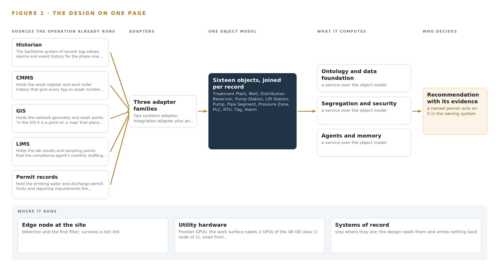
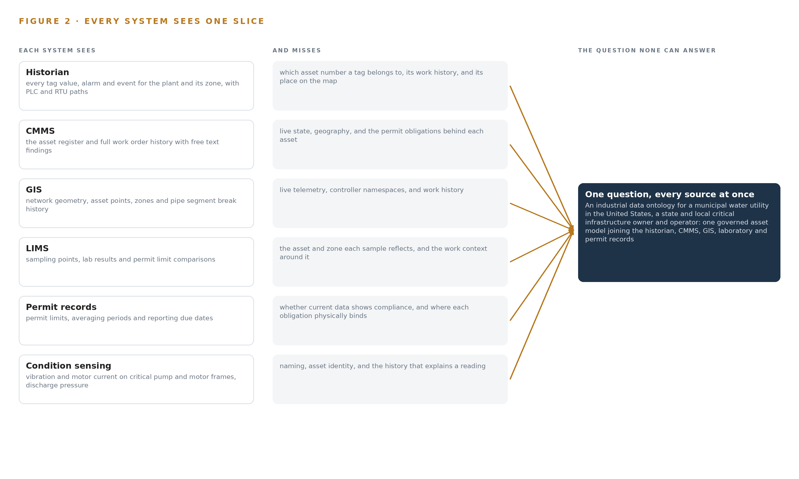
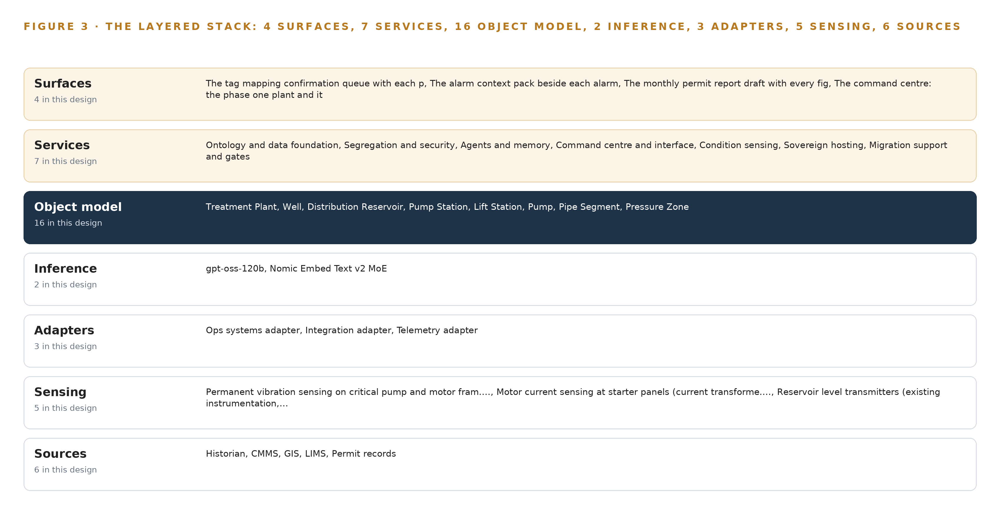
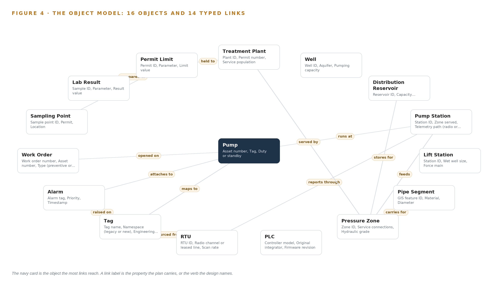
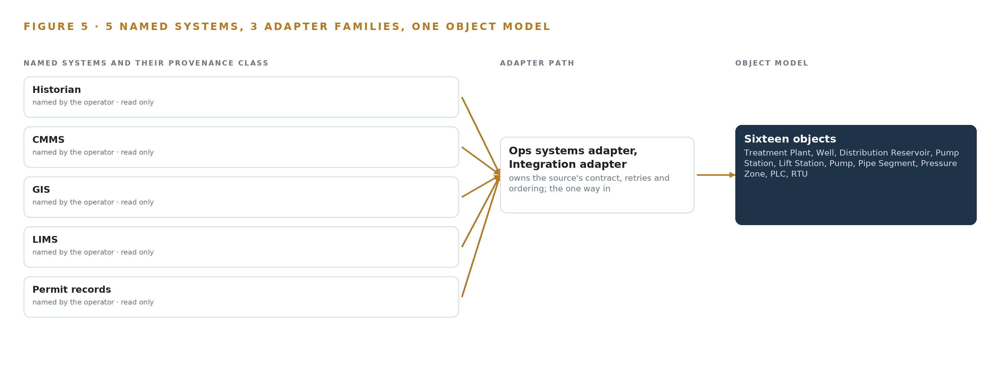
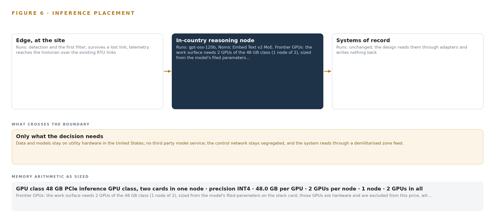
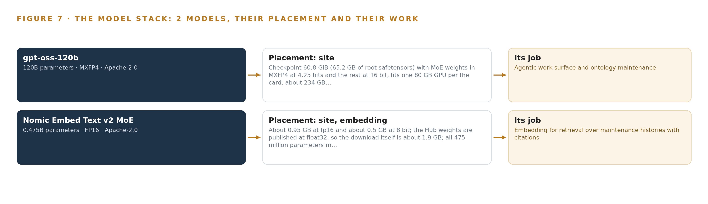
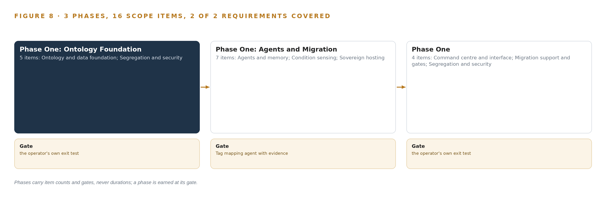
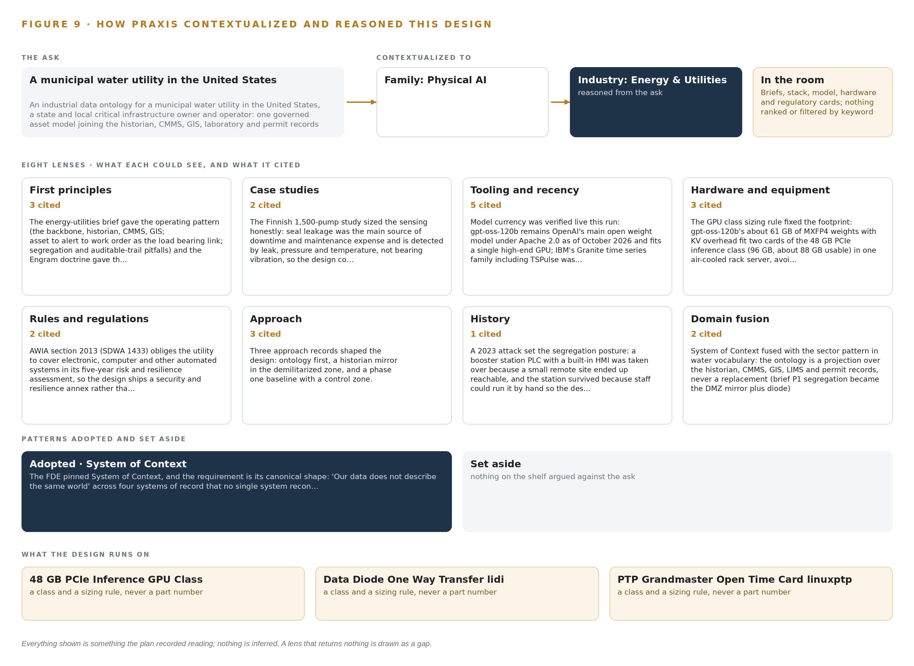

# Industrial Data Ontology for a Water Utility in the United States

Canonical: https://codeatoms.ai/water-utility-ontology-us/
DOI: https://doi.org/10.5281/zenodo.23889772
PDF: https://codeatoms.ai/water-utility-ontology-us/paper/water-utility-ontology-us.pdf
License: CC BY 4.0
Publisher: CodeNinja Atoms (https://codeatoms.ai), a fully owned subsidiary of CodeNinja

VERTICAL-DRIVEN ARCHITECTURES · ENERGY & UTILITIES · DESIGNED WITH PRAXIS · NOVEMBER 2026

# Industrial Data Ontology for a Water Utility in the United States

**Plant Context Grid: Industrial Ontologies for the Night a Duty Pump Trips**

A governed industrial data ontology that joins the historian, CMMS, GIS, laboratory and permit records of a municipal water utility in the United States, drafts tag mappings, alarm context and permit reports for named staff to decide, and reasons on open weights in the utility's own server room.

Muhammad Umar, Cofounder, CodeNinja

For the operations superintendent and plant engineer accountable for the migration, the compliance manager who signs the permit reports, and the data, security and platform engineers who would build and run it.

---

Vertical-Driven Architectures is a CodeNinja series of system designs. Every design in the series is driven by a real-world problem and scenario in a single industry, and every one is designed on Praxis, CodeNinja's platform for designing physical AI systems. Operations are described by class, never by name.

At a glance

## Industrial Data Ontology for a Water Utility in the United States

**What this is.** An open reference architecture for system design in physical AI, built for a municipal water utility in the United States that runs a treatment plant, wells, a distribution reservoir, pump and lift stations and a pipe network under PLCs and RTUs, in the middle of a control system migration, where owning the inference server that runs it costs about 59,000 US dollars over three years. Every alarm tag is tied to the pump it measures, the station and pressure zone the pump serves, the work orders on it and the sampling points and permit limits on its zone, so the operator on shift can ask, the night a duty pump trips, which asset tripped, what work is open on it and what the permit requires of the zone it feeds. The model runs entirely on the utility's own hardware, reads the segregated control network only through a hardware data diode, and answers to the drinking water and discharge permit regime and the obligations of a state and local critical infrastructure owner. It is written for the operations superintendent and plant engineer accountable for the migration, the compliance manager who signs the permit reports, and the data, security and platform engineers who would build and run it. The operator is described by class, never by name.

**The answer in numbers.**

| Part | The design |
| --- | --- |
| Sources | Six sources entering through three adapter families that stamp every fact with its source system, extraction method and timestamp: the historian, read only through a mirror in the demilitarized zone behind a hardware data diode, the CMMS, the GIS, the LIMS, the permit records and the condition sensing on pump and motor frames and at the starter panels; the platform holds no credentials in the control network, and its single write path ends at a confirmation record in memory |
| Object model | 16 typed objects with 14 typed links, from the treatment plant, well, distribution reservoir, pump station, lift station and pressure zone through the pump, pipe segment, PLC, RTU, tag and alarm to the work order, sampling point, lab result and permit limit, published as JSON for reuse |
| Models | gpt-oss-120b (Apache-2.0, 117B, MXFP4) for the agentic work surface: the tag mapping agent, the alarm context agent, the monthly compliance drafting agent and cited answers; Nomic Embed Text v2 MoE (Apache-2.0) for retrieval so every answer cites its record; United States origin weights for a state and local critical infrastructure buyer; no third party model service, nothing trained into weights |
| Compute | One air-cooled node of two 48 GB PCIe cards (96 GB, about 88 GB usable) in the utility's own server room, holding 58.4 GB of INT4 weights with a 1.2 planning factor, 70.1 GB; no inference at the stations or wells, and no data leaves the boundary. The room's power, cooling and rack space are confirmed at design and serving acceptance is gated on a measured load run |
| Rollout | Three gated phases carrying 16 scope items (5, 7, then 4) on one treatment plant and its distribution zone during the control system migration, held to the utility's own four baselines before the estate follows; both stated requirements covered |
| Three-year cost | About 59,000 US dollars to own the server for three years (a range of 57,000 to 61,000: server, two 48 GB cards, support and power at the United States average commercial tariff), against about 104,000 to rent the same card class on the deepest three-year commitment in AWS US East, so ownership costs a little under three fifths of it, and about 276,000 on demand. The lowest priced rented instance that holds the model, one 96 GB card of a different class, is about 33,000, against which ownership costs about 1.8 times as much. Renting is a price reference only, because every rented option would carry the utility's records outside its boundary (Appendix A) |
| Human control | Agents draft and named staff decide: the engineer confirms each tag mapping, the operator on shift confirms each alarm context pack, and the compliance manager approves the monthly permit report draft before any figure leaves the room; a monthly sampled audit of confirmed mappings logs the error rate, and a 15 minute staleness alarm on the historian mirror puts the command center into an explicit degraded mode |

**Reuse it.** The object model, the model register and the figures are free to reuse under CC BY 4.0. Cite as <https://codeatoms.ai/water-utility-ontology-us/> (DOI to be assigned on release).

**Made with.** Reasoned on [CodeNinja Praxis](<https://codeatoms.ai/praxis/>), the CodeNinja Atoms platform for designing physical AI systems. The object model imports into [Hyper Ontology](<https://codeatoms.ai/hyper-ontology/>), which turns it into a living system. Load it with the [hyper-ontology loader](../hyper-ontology-py/): `hyper-ontology show water-utility-ontology-us`. Both are in beta; access by request.

ABSTRACT

## Industrial Ontologies Answer a Question Six Records Keep Apart

An industrial data ontology exists to answer the question a municipal water utility in the United States cannot answer today: when the duty pump at a station trips at two in the morning, which asset tripped, what work is open on it, and what the permit requires of the zone it feeds. The answer lives in records that never meet, because the historian holds the tag and the alarm, the maintenance system holds the asset number and the work order, the mapping system holds the pipe and the zone, the laboratory system holds the sample, and the permit files hold the limit, so answering means one person holding all of them in mind while the operators who can are retiring in the middle of a control system migration. The operator is a state and local critical infrastructure owner, which means the join must happen without data leaving its boundary and without any write path toward the control network.

The design is one governed object model of 16 objects, from the plant, well and distribution zone down to the tag, the alarm, the work order, the lab result and the permit limit, fed read-only from six sources through three adapter families, with the segregated control network reached only through a historian mirror behind a hardware data diode in a demilitarized zone. Seven services and four surfaces carry the work: a tag mapping confirmation queue, an alarm context pack, a monthly permit report draft, and a command center with a conversational interface that answers with citations. Three named agents propose and named staff decide, and memory keeps every confirmed mapping and resolved alarm. Two models run on the utility's own air-cooled server with two cards of the 48 GB PCIe class: gpt-oss-120b, 117 billion parameters at MXFP4, about 61 GB of weights, which with the 1.2 planning factor for cache and activations reaches 70.1 GB against the 96 GB the two cards hold, and an embedding model for retrieval with citations. Phase one covers one plant and its distribution zone, gated on the utility's own four baselines before the estate follows.

The paper covers the industry problem and the cost of the join failure, the constraints that shape everything downstream, the layered stack and its 16 objects, the adapter tier and the event backbone, where inference runs and why, the model register and the licenses that let the utility own its weights, the three gated phases with their item counts and measurements, who owns the intelligence the design builds, and finally how Praxis contextualized and reasoned the design, so that every choice can be traced to recorded reading.

---



Figure 1. Plant Context Grid on one page: the sources the operation already runs, one object model, what it computes, and the person who decides.

## Contents

Each chapter is tagged for the reader it serves most directly: Executive, Team Lead, FDE, Reference.

|  |  |  |
| --- | --- | --- |
|  | Abstract · Industrial Ontologies Answer a Question Six Records Keep Apart | Executive |
| PART I · THE PROBLEM | | |
| 1 | [Industrial Ontologies Answer Questions Six Records Keep Apart](#ch1) | Executive |
| 2 | [Every System of Record Sees One Slice of the Station](#ch2) | ExecutiveTeam Lead |
| PART II · THE DESIGN | | |
| 3 | [Read-Only Across the Boundary Shapes Everything Downstream](#ch3) | Team Lead |
| 4 | [One Stack Runs From the Diode to the Surfaces](#ch4) | Team LeadFDE |
| 5 | [Sixteen Objects Turn Plant Data Into One Argument](#ch5) | FDE |
| 6 | [Every Source Enters Through an Adapter, Never Directly](#ch6) | FDE |
| 7 | [Reasoning Stays on Premises on Two Air-Cooled Cards](#ch7) | FDE |
| 8 | [The License Decides What the Utility Can Own](#ch8) | FDEExecutive |
| PART III · THE ROLLOUT | | |
| 9 | [Phase One Proves Itself Against Four Baselines](#ch9) | Team LeadExecutive |
| 10 | [The Intelligence Stays with the Utility That Produced It](#ch10) | Executive |
| PART IV · HOW IT WAS DESIGNED | | |
|  | Conclusion · An Owned Ontology Compounds Through the Migration | Executive |
| 11 | [Praxis Recorded Every Choice This Design Stands On](#ch11) | Team LeadFDE |
|  | [Sources](#sources) | Reference |

PART I · CHAPTER 1

## Industrial Ontologies Answer Questions Six Records Keep Apart

A night pump trip is answered today by memory and phone calls, because the records that hold the answer sit in six systems that only a retiring workforce bridges.

The abstract promised an industrial data ontology that turns six records into one governed model of a water system. This chapter grounds that promise in the question the operation actually asks at two in the morning, in the cost the industry already documents for leaving it unanswered, and in the scenario the rest of the paper designs against.

### 1.1  What the Night Trip Asks

Industrial ontologies earn their place in this sector because the operational question is never held by one system. When a duty pump at a station trips at night, the operation needs to know in a single view: which tag tripped, which physical pump that tag belongs to, which zone the pump feeds, how long the distribution reservoir covers zone demand, what the last work orders on that pump found, what the vibration and motor current sensing recorded before the trip, and which sampling points and permit limits sit on the affected zone. Published examples of an [industrial data ontology](https://codeatoms.ai/industrial-ontology-examples/) in this sector tend to begin from a data model; this design begins from that question, because the question is what forces the join. Answering it requires live telemetry, the asset register, work order history, network geometry, laboratory records, permit terms and condition data at the same moment, and each of those lives in a different system. The regulatory regimes raise the stakes on every part of the answer: the operator holds drinking water and discharge permits that require monthly reporting against named limits and averaging periods, it carries state and local critical infrastructure obligations, and it must keep its control network segregated from its enterprise systems, a direction state utility regulators have formalized in published cybersecurity baselines for utilities (NARUC n.d.). A partial answer is therefore not only slow, it is not a compliant answer.

### 1.2  What the Industry Already Documents

The cost of the split record shows up in two ways, one documented publicly and one that shows up inside every operation of this class. The documented part is the scale of what goes unseen when records cannot be joined: a control system cybersecurity expert counts more than 17 million control system cyber incidents hidden in plain sight, and argues that such incidents are more plentiful and more impactful than the sector generally recognizes (Energycentral 2022). Incidents of that volume are discovered, investigated and reported through exactly the records this design joins, and when the historian, the maintenance system, the map and the laboratory cannot be read together, the evidence that would connect an anomaly to its cause stays scattered. The undocumented part is quieter: the operator's own engineers describe resolving alarms by phoning the person who remembers which tag is which, and that memory is walking out of the workforce through retirement. Both costs land on the same night shift.

### 1.3  The Operation as a Scenario

The operator is a municipal water utility in the United States, a state and local critical infrastructure owner and operator. Phase one covers one plant and its distribution zone during the migration; the estate beyond phase one holds further plants and zones that the design extends to only after its gates are met. Within phase one the operation runs wells drawing from an aquifer, a distribution reservoir, stations of two kinds (pump stations with duty and standby pumps, and lift stations with wet wells and force mains), a pipe network of segments with break history, and a control layer of PLCs and RTUs connected by radio and leased lines. Six sources feed the design, five of them named systems of record: the historian, the CMMS, the GIS, the LIMS and the permit records, with condition telemetry as the sixth. Four named roles are in the loop: the engineer who confirms tag mappings, the operator on shift who confirms alarm context, the compliance manager who approves the monthly permit report draft, and the operations superintendent who runs the command center. The physical environments are a treatment plant, remote stations and wells exposed to weather and washdown, and a server room that must air-cool an inference server on the operator's own premises. The regulatory ground is the drinking water and discharge permit regime, national cybersecurity and communications controls, and state oversight of a critical infrastructure owner. That scenario, those six sources and those four roles are the fixed facts the design answers to.

PART I · CHAPTER 2

## Every System of Record Sees One Slice of the Station

Each source system holds a true but partial view of the same pump, and none of them can say which work order, which zone and which permit limit stand behind a single alarm.

Chapter 1 named the question and the regimes that make a partial answer noncompliant. This chapter shows, system by system, why each existing record cannot answer it alone, and what that costs in practice.

### 2.1  One Slice at a Time

The historian is the backbone: it holds every tag value, every alarm and the event history for the phase one plant and its distribution zone, and it knows which PLC or RTU each point arrives over. It does not know which asset number a tag belongs to, what work that asset has had, or where it sits on the map. The CMMS holds the asset register and the full work order history, with findings written in free text: in the CMMS the pump is an asset number with a repair trail. It sees nothing live and nothing geographic. The GIS holds the network geometry and the asset points: in the GIS the same pump is a point on a map, placed in its zone and pipe network, with material, diameter and break history on the segment beside it. It holds no telemetry and no controller namespaces. The LIMS holds the sampling points and lab findings with their permit limit comparisons: in the laboratory records the same station is a sampling location. It cannot say which asset or which zone a sample reflects, or what work was under way when it was taken. The permit records hold the limits, averaging periods and reporting due dates, but not whether current data shows compliance or where each obligation physically binds. The condition sensing added by this design reads vibration on pump and motor frames and motor current at the starter panels, but a vibration signature explains nothing until it is joined to the asset, its work history and its tags. Figure 2 sets these views side by side, and the pattern is uniform: each system is complete on its own axis and silent on everyone else's.



Figure 2. Six systems, each seeing one part of the answer; the question needs all of them in one place at once.

### 2.2  What None of Them Sees Together

No system in the operation can walk the chain the night trip demands: from the alarm tag to the pump, from the pump to the station and zone, from the zone to the reservoir and its time to drain at zone demand, from the pump to its work orders and their findings, and from the zone to its sampling points, lab findings and permit limits. That chain exists only in the heads of the engineer and the operator on shift, which is why the current answer is a set of phone calls at two in the morning. The cost in practice compounds quietly: alarms get acknowledged without context, mapping errors survive because nobody can see a tag and its asset in one place, and every retirement narrows the human bridge. The migration makes it urgent, because a tag namespace nobody can map is a tag nobody can cut over.

PART II · CHAPTER 3

## Read-Only Across the Boundary Shapes Everything Downstream

Segregation from the control network, on-premises compute, draft-only agents and a migration already under way define what every layer below is allowed to do.

Chapter 2 showed that each system holds a true but partial view and that no system holds the chain. This chapter states the four goals that shape every layer below, why each is hard in this industry, and what the design chose to buy and to refuse in meeting them.

### 3.1  The Control Network Stays Behind a Diode

The first goal is segregation: the ontology and its agents must read the control network through a demilitarized zone feed and never send a control command. This is hard in this industry because the utility sector is a named target of state-sponsored actors whose documented tactics include reaching control systems through enterprise networks (CISA 2022), and because the sector's precedent for the consequence is the Ukrainian outage, where attackers used stolen credentials to switch substations off (CISA 2015). A DMZ feed held by firewall rules alone can be misconfigured into a write path; a hardware data diode makes read-only a physical property of the link rather than a policy that survives an error. The constraint this imposes is total: the platform holds no credentials in the control network and no write path toward any system of record, so every action in the control domain stays with the people who own it.

### 3.2  The Weights Stay on the Operator's Own Servers

The second goal is on-premises compute: the reasoning model runs as self hosted open weights on the utility's own servers, and no data leaves the operator's boundary. This is hard because a municipal server room limits the hardware classes available: the design sizes gpt-oss-120b, with 117 billion parameters at MXFP4 giving about 61 GB of weights, onto two cards of the 48 GB PCIe class in one air-cooled node, 96 GB total, where the 1.2 planning factor for KV cache and activations still fits. A larger GPU class would force new power and cooling into a room that does not have them, and a hosted model would break the residency requirement outright. The constraint is that serving capacity is fixed at what the room holds, which the sizing respects.

### 3.3  Agents Propose and Named Staff Decide

The third goal is draft-only agents: the tag mapping agent proposes on a tag found during migration and the engineer confirms; the alarm context agent assembles context on an alarm and the operator on shift confirms; the compliance agent drafts monthly permit report data and the compliance manager approves. This is hard because the sector's own pattern recommends writing work orders back into the CMMS, and refusing that means every confirmed action passes through a person's hands, bounding throughput by staff time. The design refuses the write-back deliberately: no agent sends a control command or changes a work order or a permit report without a named approval, and the system improves through memory of confirmed mappings and resolved alarms rather than through any change to weights.

### 3.4  The Migration Sets the Clock

The fourth goal is to serve a migration already under way, whose target historian is not yet selected. This is hard because connectors designed against an interface that changes at cutover fail silently, and because the operators who can resolve unmapped tags retire on their own schedule, not the program's. The design answers with a dual tag namespace that holds legacy and new namespaces at once, typed extractors re-confirmed against the chosen historian before cutover, a design-freeze checkpoint on the historian selection, and mapping coverage as a live weekly signal against the glide path.

### 3.5  Scoping Decisions

The scoping decisions follow from those goals, and Table 1 states what each buys and what it costs. The pattern across all three is the same: the design pays in operational effort and throughput to keep segregation, residency and human authority absolute.

Table 1 · Scoping Decisions

| Decision | What it buys | What it costs |
| --- | --- | --- |
| Read the control network through a hardware diode behind a DMZ historian mirror | A read path that cannot be misconfigured into a write, ever | An extra mirror tier to operate, with a staleness bound to alarm on and a degraded mode to run |
| Self host open weights on the utility's own air-cooled server | Data residency and weights the operator owns outright | The operator's own power, cooling and rack space carry the serving load, fixed at two 48 GB class cards |
| Draft-only agents with no write back to any system of record | No parallel queue, and every confirmed action carries a named person's approval | Throughput is bounded by staff time, and every surface must be a confirmation queue rather than an inbox |

### 3.6  What the Design Chose Against

Table 2 records the refusals with their reasons, and the last row names what sits outside the scope entirely. Each refusal protects one of the four goals above, and none is a preference that could be traded away later without breaking a constraint the operator set in its own words.

Table 2 · What the Design Chose Against

| Where | What was picked | Instead of, and why |
| --- | --- | --- |
| Reasoning model | Gpt-oss-120b, United States origin open weights, self hosted | GLM 5.3 class open weights: the buyer is US state and local critical infrastructure and the maker of GLM sits on the US Entity List, so origin follows the regime |
| Boundary control | Hardware data diode behind the DMZ historian mirror | A DMZ feed held by firewall rules alone: the operator's own words require the control network stays segregated, and a diode makes that a physical property |
| Agent outputs | Draft-only outputs, no write back to the CMMS or permit records in phase one | Writing work orders back as the sector pattern recommends: the design builds no parallel queue, and the named approver acts in the system of record |
| How the system improves | Memory of every confirmed mapping and resolved alarm | Training or fine tuning: nothing is distilled into weights, so no training run is priced or promised |
| How the world is watched | Telemetry and permanent condition sensing | Cameras and video analytics: the requirement asks for no video, so no camera legality or vision model arises |
| Scope boundary | Phase one on one plant and its distribution zone with baselines and gates | The migration itself, historic data migration, estate-wide end user training, hardware, GPUs and third-party license fees: all held by the operator or its separate modernisation program |

PART II · CHAPTER 4

## One Stack Runs From the Diode to the Surfaces

From the one-way feed through the object model and the event backbone to the confirmation queues and the command center, one stack carries every byte and every draft.

Chapter 3 pinned the constraints: the control network stays segregated, the systems of record stay in place, every decision stays with a named person, and every model and every byte stays on the utility's own premises. This chapter turns those constraints into a stack in which each layer owns one responsibility and the control boundary is crossed once, by the one-way feed through the demilitarized zone.

### 4.1  The Pattern and Why It Fits

The architecture is a projection, not a consolidation. The systems of record sit below, bound in place and never replaced; one governed object model sits in the middle, holding the 16 objects that Chapter 5 opens up; and the applications and agents sit above it, reading from it and proposing into it but never writing beneath it. Figure 3 shows the layers with their counts: six read-only sources, three adapter families, 16 objects, seven services, four surfaces and two models, every one running on the utility's own hardware inside its own server room.

The shape fits this operation for three reasons. The migration is in flight, so tag namespaces and the target historian will change underneath the design, and a middle model carrying a dual namespace bridge absorbs that change without touching any source. Segregation leaves exactly one boundary to defend, the diode-hardened read into the demilitarized zone mirror, with every other layer on the office side of it. And sovereignty makes the inference layer a pair of models on the utility's own two-card server rather than a rented endpoint, so no layer in the stack makes an external call in the inference path.



Figure 3. The layered stack: 6 sources, 3 adapter families, 16 objects, 7 services and 4 surfaces.

### 4.2  The Stack Stage by Stage

Table 3 walks the stack stage by stage, naming what each stage is responsible for and how it discharges it. The stages carry the whole journey of a byte: born in a system of record or on a sensor, admitted through an adapter with provenance, resolved into the object model, reasoned over by the models, acted on by the services, and met by a person on one of the four surfaces.

Table 3 · The Stack, Stage by Stage

| Stage | What it is responsible for | How |
| --- | --- | --- |
| Sources | Six read-only feeds: the historian, the CMMS, the GIS, the LIMS and the permit records, plus existing station instrumentation | Bound in place and never replaced; the historian is read only through the diode-hardened mirror in the demilitarized zone |
| Sensing | Condition evidence for critical assets during the migration | Permanent vibration sensing on pump and motor frames, motor current sensing at starter panels, reservoir level and discharge pressure read from existing instrumentation |
| Adapters | Typed, provenance-stamped entry for every source | Three families, the ops systems, integration and telemetry adapters, built on the Open62541 OPC UA stack, holding read-only credentials and the dual tag namespace bridge |
| Object model | One governed argument across every source | The 16-object graph in a governed graph store, with Apache Kafka 4.4 as the event backbone and InfluxDB 3 Core for time series |
| Inference | Self-hosted models on the utility's own server | gpt-oss-120b served by vLLM across two 48 GB PCIe-class cards, Nomic Embed Text v2 MoE for retrieval, RKE2 orchestration and an offline Harbor registry |
| Services | The seven workstreams that run the system | Ontology and data foundation, segregation and security, agents and memory, command center and interface, condition sensing, sovereign hosting, and migration support and gates, on Keycloak identity, Prometheus with Grafana and Loki observability, and linuxptp with chrony fed by the OCP Time Card |
| Surfaces | Four places a person meets the system | The tag mapping confirmation queue, the alarm context pack, the monthly permit report draft, and the operations superintendent's command center |

### 4.3  A Reusable Pattern

The shape a team can carry elsewhere is the read-only projection with a confirmation loop. Bind the systems of record in place, cross the control boundary once through a hardware diode into a mirror, project everything into one governed object model in which every fact carries its provenance, let agents draft with evidence, let named people confirm, and keep the confirmations as memory the next run reads. A team with a similar brief swaps the object set, the sources and the sensing channels for its own, and re-sizes the server if its work surface model exceeds the 117 billion parameters filed here. What it keeps is the part that carries the guarantees: the adapter tier with its provenance stamps, the single write path that ends at a confirmation record, and the diode that makes the read a physical property rather than a rule that could be misconfigured.

Table 7 · Architecture, Layer by Layer

| Layer | Component | Choice | Why |
| --- | --- | --- | --- |
| Event streaming and messaging | by class, no product named | Product | Apache Kafka 4.4 (KRaft, self managed) |
| The ontology or graph store | by class, no product named | Product | Hyper Ontology v0.9 (Semantics and Kinetics) |
| Time series and telemetry storage | by class, no product named | Product | InfluxDB 3 Core |
| Video ingest, recording and management | by class, no product named | Not needed | The requirement asks for no cameras or video anywhere; the world is watched by the telemetry and condition sensing, so this layer carries nothing. |
| Edge model serving | by class, no product named | Not needed | No inference runs at the edge: the anomaly model is CPU-class and the reasoning model serves from the site server, and the station sensing rides the existing RTU radio and leased line paths to the historian. |
| On site language model serving | by class, no product named | Product | vLLM |
| Object tracking and trajectory forecasting | by class, no product named | Not needed | There is no video or moving-object tracking in this design; nothing in the requirement watches objects move. |
| Edge orchestration of containers | by class, no product named | Product | RKE2 |
| An air gapped artifact and model registry | by class, no product named | Product | Harbor (offline install) |
| Labelling and retraining | by class, no product named | Not needed | Under system of context nothing is trained, fine tuned or distilled into weights: the system improves through its memory of confirmed mappings and resolved alarms, so there is no retraining loop to tool. |
| Time synchronisation across sensors and systems | by class, no product named | Product | Linuxptp with chrony |
| Observability of the running system | by class, no product named | Product | Prometheus with Grafana and Loki |

PART II · CHAPTER 5

## Sixteen Objects Turn Plant Data Into One Argument

Sixteen objects and their typed links let a single query walk from a tripped tag to its pump, its station, its open work order and the permit limit on the zone it feeds.

Chapter 4 named the object model as the middle layer of the stack and left it closed. This chapter opens it: sixteen objects, the typed links between them, the human loop that lives inside them, and the recorded form one of them takes.

### 5.1  Sixteen Objects and Their Typed Links

The model holds five sites and places: the plant, the well, the distribution reservoir, the station in both of its forms, the pumping station that feeds a zone and the lift station with its wet well and force main, and the zone itself. It holds four physical assets: the pump, the pipe segment, the PLC and the RTU. It holds one measure and one event: the tag, whose status vocabulary carries the migration, and the alarm. And it holds four records that carry the regulatory argument: the work order, the sampling point, the lab result and the permit limit. Figure 4 shows all sixteen and the typed links between them, and Table 8 prints each object with the system it is anchored in and the links it carries.

The links are what make the model an argument rather than a filing system. When a station's duty pump trips at night, one query walks the chain: the alarm is raised on a tag, the tag maps to a pump, the pump runs at a station, the station feeds a zone, the zone draws on a reservoir whose recorded time to drain at zone demand says how long the operator has, and the pump carries an open work order in the CMMS. A document store could answer that only if every join had been anticipated and precomputed, and a migration guarantees joins nobody anticipated; a graph answers it by walking links that exist because every object was placed with its anchor. This is the test that separates a governed industrial ontology from the industrial ontology examples that stop at a data model: the links are typed, every one is traversable in either direction, and every fact along the walk carries the source system it came from.



Figure 4. The sixteen objects of the model and the typed links that let a query reach across them.

Table 8 · The Object Model

| Object | Anchored in | Typed links |
| --- | --- | --- |
| Treatment Plant | GIS | held to: Permit Limit |
| Well | GIS | no typed link recorded |
| Distribution Reservoir | GIS | stores for: Pressure Zone |
| Pump Station | GIS | feeds: Pressure Zone; reports through: RTU |
| Lift Station | GIS | no typed link recorded |
| Pump | CMMS | runs at: Pump Station; maps to: Tag |
| Pipe Segment | GIS | carries for: Pressure Zone |
| Pressure Zone | GIS | served by: Treatment Plant |
| PLC | Historian | no typed link recorded |
| RTU | Historian | no typed link recorded |
| Tag | Historian | sourced from: RTU |
| Alarm | Historian | raised on: Tag; attaches to: Pump |

### 5.2  The Human Loop and the Hosting Posture

Every object that can carry a decision carries a status vocabulary whose states are acted by people: a tag moves from Unmapped through Proposed to Confirmed by the engineer, an alarm moves from Active through Acknowledged to Resolved by the operator on shift, and the monthly permit report draft is approved by the compliance manager before any figure leaves the room. The hosting posture keeps those decisions inside the boundary. Everything runs on the utility's own servers in its own server room on premises in the United States; identity is issued by the on-site Keycloak service rather than any external provider; the inference path makes no external calls and no data leaves the perimeter; and the single write path in the platform ends at a confirmation record in memory, never at a system of record and never toward the control network.

### 5.3  One Object in Its Recorded Form

The tag is the object the migration turns on, and its recorded form, printed below, shows how every object in the model is held.

```
{ "id": "treatment-plant", "label": "Treatment Plant", "kind": "site", "anchored_in": "GIS", "properties": [ "Plant ID", "Permit number", "Service population", "Process units", "Distribution zone served" ], "status_vocabulary": [], "links": [ { "to": "permit-limit", "label": "held to" } ] }
```

PART II · CHAPTER 6

## Every Source Enters Through an Adapter, Never Directly

Three adapter families bring six read-only sources into the ontology with provenance, ordering and buffering, and no path anywhere in the tier points back toward a system of record.

Chapter 5 described what the model holds. This chapter describes how data gets into it: six read-only sources, three adapter families, and an event backbone that keeps order, delivery and buffering honest while the migration continues around them.

### 6.1  Six Sources and Their Provenance Classes

Figure 5 sets the six sources and their adapter paths side by side. The first is the historian, the backbone system of record for tag values, alarms and event history across the phase one plant and its distribution zone; its provenance class is a control-network mirror, because it is read not from the control network but from the historian mirror in the demilitarized zone, carried across a hardware-enforced data diode by Lidi, which makes the read a physical one-way property. The diode is not caution. The attackers who took down distribution in Ukraine reached their targets through compromised paths into the control environment (CISA 2015), and state-sponsored actors continue to target the energy sector specifically (CISA 2022), so a feed held by firewall rules alone sits one misconfiguration away from becoming a write. The other operator records are the CMMS, holding the asset register and work order history that give every tag an asset number; the GIS, holding the network geometry that places every asset in its zone; the LIMS, holding the sampling points and lab findings; and the permit records, holding the drinking water and discharge limits the compliance agent drafts against. The sixth source is the condition sensing: permanent vibration sensing on pump and motor frames and motor current sensing at starter panels, classed as design-installed, with reservoir level and station discharge pressure read from existing instrumentation.



Figure 5. The 6 named systems, the adapter path each one takes, and the object model they all map into.

### 6.2  What the Adapter Tier Guarantees

Three families carry everything: the ops systems adapter for the historian mirror, the integration adapter for the CMMS, GIS, LIMS and permit records, and the telemetry adapter for the sensing channels, all built on the Open62541 OPC UA stack. The tier guarantees four things. Every fact enters stamped with its source system, its extraction method and its timestamp, so no fact in the ontology is ever unattributed. Every connector is a typed extractor holding read-only credentials, and no path anywhere in the tier points back toward a system of record, let alone the control network. The dual namespace bridge holds the legacy and new tag namespaces at once, so the migration's renaming is absorbed as data rather than felt as an outage. And because the target historian is not yet selected, connectors are typed extractors re-confirmed against the chosen historian before cutover, with a design-freeze checkpoint carried in the phase plan.

### 6.3  The Event Backbone

Ordering, delivery and buffering are carried by Apache Kafka 4.4, self managed in KRaft mode. Events are keyed by tag and asset identifier, so every partition preserves per-asset order even when the whole phase one estate streams at once. Delivery is at least once with idempotent upserts into the object model, so a replayed event corrects rather than duplicates. Buffering sits at the mirror, which is documented to push no back pressure toward the source during an outage; the platform raises a staleness alarm at 15 minutes, and the command center shows an explicit degraded mode while the alarms themselves stand alone. Time is its own guarantee: linuxptp with chrony, fed by the OCP Time Card grandmaster, puts the historian's alarm timestamps, the lab result dates and the work order dates on one clock, which is what makes the event ordering mean anything at all.

PART II · CHAPTER 7

## Reasoning Stays on Premises on Two Air-Cooled Cards

All reasoning runs in the utility's own server room on two 48 GB cards, sized so the weights, the key-value cache and the failure modes of the room itself all fit.

Chapter 6 ended with every source entering through an adapter and the control network staying behind a one-way mirror. This chapter follows the data to where it is reasoned over, which is also the question industrial ontologies eventually force: where does the reasoning run, and who owns the room it runs in.

### 7.1  All Reasoning Sits in One Tier

The design has one inference tier, the site tier: a single node in the utility's own server room. Nothing computes at a station or a well, because nothing there needs it; the vibration and motor current sensing is low-rate telemetry the existing radio and leased-line RTU network already carries to the historian, and the anomaly work on those signals is CPU-class work that runs on the site server beside the reasoning model. The placement honors the intake, which requires the open weights self hosted on the utility's own servers on premises, and so rules out colocation and any hosted option.

The sizing is arithmetic rather than judgment. The reasoning model files 117B total parameters; at INT4, 0.5 bytes per parameter, that is 58.4 GB of weights the cards must hold, and the planning factor of 1.2 for the key-value cache and activations, the scratch memory a serving engine needs to attend over its context while generating, brings the requirement to 70.1 GB. Two cards of the 48 GB PCIe class in one node give 96 GB of memory, about 88 GB of it usable, leaving roughly 38 GB beside the weights against the about 12 GB the factor reserves. The model's own card confirms the fit from the other direction: a 60.8 GiB checkpoint, 65.2 GB of root safetensors, with the mixture of experts weights in MXFP4 at 4.25 bits and the remainder at 16 bit, about 61 GB of weights and about 4.8 GB of key-value cache, figures that fit an 80 GB GPU and reach about 234 GB only if expanded to 16 bit. At 117B parameters the model sits below the 300B frontier threshold, so one node of two cards is the whole cluster. Figure 6 places the tiers: sensing at the stations, one crossing of the diode, and every model in the utility's own server room.



Figure 6. Where each tier runs, what runs there, and the narrow set of outputs that cross the boundary.

### 7.2  The Latency Budget

Only one of the four surfaces carries a number, because only one needs one. The alarm context pack must be ready within the attention of the operator on shift who acknowledges the alarm, and the freshness bound the design commits to is the 15-minute staleness alarm on the DMZ historian mirror: if the mirror falls more than 15 minutes behind the source, the command center says so instead of letting a stale pack pass as current. The tag mapping queue is migration-paced, with the engineer's confirmation treated as the deliberate slow loop rather than a bottleneck to fight. The monthly permit report draft is calendar-paced batch work where minutes are irrelevant. The conversational interface is the interactive surface, and its latency is dominated by retrieval over the hybrid dense plus lexical index rather than by generation, which is why that index is kept small enough to serve on the same node.

### 7.3  The Boundary and Its Failure Paths

Only telemetry crosses the boundary: tag values, alarms and event history, read through the diode-hardened DMZ mirror and never written back. The platform holds no credentials in the control network and no write path toward any system of record, so segregation is a property of the architecture rather than of a firewall rule. The posture is earned by the sector's threat record: the tactics published against energy-sector operators (CISA 2022), the outage that began with credentials taken from a control environment (CISA 2015), and the cybersecurity baselines drawn for utility distribution systems (NARUC n.d.) all assume this separation.

Each failure path is designed rather than hoped away. If the link fails, the mirror buffers per its documented behavior and pushes no back pressure toward the source, the 15-minute staleness alarm fires, the command center drops into an explicit degraded mode, and the raw alarm list stands alone throughout, so an operator is never deprived of alarms because a context pack is unavailable. If the power or the cooling of the room fails, the two-card 48 GB PCIe class was chosen precisely because it air-cools in a standard rack, the UPS carries a clean shutdown, and serving acceptance is gated on a measured load run in the actual room, whose power, cooling and rack space are confirmed at design rather than assumed. If the update path is the concern, the artifact and model registry is an offline Harbor install: updates arrive as artifacts brought inside the boundary, never as live pulls from outside it, and a design-freeze checkpoint on the historian selection keeps the connectors from being reworked twice.

PART II · CHAPTER 8

## The License Decides What the Utility Can Own

Apache-2.0 terms on United States origin weights let the utility hold its reasoning stack outright, and the register states each model's size, role and placement model by model.

Chapter 7 fixed where the reasoning runs; this chapter fixes what the utility owns when it runs there. Two models carry the whole design, and both stand on Apache-2.0 terms from United States publishers, which is what lets the register below read as an asset list rather than a subscription schedule.



Figure 7. The two models, their placement, and the work each one does.

### 8.1  Two Models Carry the Whole Stack

Figure 7 shows the model stack, and it is deliberately short. The reasoning model is gpt-oss-120b, a mixture of experts model filing 117B total parameters, with the expert weights in MXFP4 at 4.25 bits and the remainder at 16 bit: a checkpoint of 60.8 GiB, 65.2 GB of root safetensors, about 61 GB of weights and about 4.8 GB of key-value cache at the serving sizes Chapter 7 sized the cards for, and about 234 GB only if expanded to 16 bit, which the design never does. Its role is the agentic work surface and ontology maintenance: it serves the tag mapping agent, the alarm context agent, the monthly compliance drafting agent and the conversational interface that answers with citations, all from the site tier in the utility's own server room. Its license is Apache-2.0, whose terms carry no field of use restriction and no reach-through claim on outputs, so the utility may hold the weights, serve them and keep every draft they produce. It was chosen over the GLM 5.3 class for a reason the register states plainly: the buyer is United States state and local critical infrastructure, and the maker of GLM sits on the US Entity List.

The second model is Nomic Embed Text v2 MoE, a 475-million-parameter mixture of experts embedding model with 768 dimensions and an 8K token window, about 0.95 GB at fp16 and about 0.5 GB at 8 bit, with the published float32 weights making the download about 1.9 GB and every expert resident at serving. Its role is retrieval: it embeds the maintenance histories, work order findings and permit text that the conversational interface's citations depend on, feeding a hybrid dense plus lexical index on the same node. It is Apache-2.0 from a United States publisher with published data provenance, chosen over BGE-M3 for origin, and its Matryoshka truncation, which permits shorter vectors at a controlled quality cost, keeps the on-site index small enough for the utility's own hardware.

### 8.2  The Register Behind the Claim

A model register earns its keep by being auditable line by line, and most industrial ontology examples stop at the objects and never reach it; this one carries the models, the hardware classes and sizing rules, the sensing, the patterns the design stands on, and the ground everything runs on, because the engineer who extends the estate will need all five to decide what to keep. The ground row is not decorative: critical infrastructure protection standards govern security management controls across cyber systems (Federalregister 2025), and physical access to them is managed under a physical security plan (NERC n.d.), so where the weights live is a compliance fact, not only a hosting preference. Table 4 states each choice and why it stands where it does. Read together with Figure 7, it answers the chapter's claim: everything in it is held outright by the utility, inside its own boundary, on licenses that survive their publishers' interest.

Table 4 · Model and Equipment Register

| The choice | What was picked | Why here |
| --- | --- | --- |
| Reasoning model | gpt-oss-120b, 117B parameters, mixture of experts in MXFP4, Apache-2.0 | United States origin open weights for a critical infrastructure buyer; the GLM 5.3 class is set aside because its maker sits on the US Entity List |
| Embedding model | Nomic Embed Text v2 MoE, 475 million parameters, 768 dimensions, 8K window, Apache-2.0 | United States publisher with published data provenance; Matryoshka truncation keeps the on-site index small enough for the utility's own hardware |
| Inference hardware | Two 48 GB PCIe cards in one air-cooled node, 96 GB total, about 88 GB usable | The 70.1 GB sized requirement fits with room for the key-value cache, and the class air-cools in a standard server room |
| One way transfer | Lidi over a hardware-enforced data diode class, behind the DMZ historian mirror | Makes the read a physical property that cannot be misconfigured into a write |
| Time synchronization | OCP Time Card grandmaster with linuxptp and chrony | One clock for sensors, alarms and work orders, so the night-trip argument orders correctly |
| Condition sensing | Permanent vibration on critical pump and motor frames, motor current at starter panels, reservoir level and discharge pressure from existing instrumentation | Answers the night trip with condition data; discharge pressure carries the seal failure mode vibration cannot see |
| Commitment pattern | The model proposes, a deterministic layer commits, named staff decide | Keeps wrong mappings from becoming ground truth exactly when the cutover depends on them |
| Namespace pattern | Dual tag namespace bridge holding legacy and new namespaces at once | The target historian is not yet selected, so connectors re-confirm against whatever is chosen |
| Ground | The utility's own server room, on premises, with Harbor offline registry, vLLM serving and RKE2 orchestration | The intake requires self hosting on the utility's own servers; no data leaves the boundary |

PART III · CHAPTER 9

## Phase One Proves Itself Against Four Baselines

Three gated phases covering sixteen items across one plant and its distribution zone hold the design to the utility's own baselines before the estate is allowed to follow.

Chapter 8 settled the model register and the licenses that let the utility hold both weights on its own two-card server. This chapter sequences the work so that nothing extends beyond one plant and its distribution zone until the utility's own four baselines have been met.

### 9.1  Three Gated Phases Hold Sixteen Items to One Plant

The rollout keeps phase one inside one plant and its distribution zone, and the wider estate of wells, stations, reservoirs and pipe segments follows only by extension decision. Phase one runs as three gated phases carrying sixteen items across seven workstreams: ontology and data foundation, segregation and security, agents and memory, condition sensing, sovereign hosting, command center and interface, and migration support and gates. Figure 8 sets the three phases side by side with their item counts and gates, together with the coverage of the requirement set, which stands at two requirements covered, none partial and none open.

Ontology Foundation, the first phase, carries five items in two workstreams, and its items include the governed industrial data ontology build, the source connectors for the record systems and the demilitarized zone read-only path. Agents and Migration, the second, carries seven items in three workstreams, and its exit gate is the tag mapping agent producing proposals with evidence the confirming engineer can check against the source systems. The third phase carries four items in three workstreams, among them the operations superintendent command center, the conversational interface that answers with citations, and the security approvals with a resilience annex. Each gate is a stop rather than a milestone: the following phase does not start until the gate is passed, and the first gate is cheap to fail because it sits on five items rather than sixteen.



Figure 8. The three phases and their gates, and coverage of the 2 requirements across them.

### 9.2  What the Rollout Measures

The rollout measures five things, and the four baselines the utility set before any extension are fed by all of them. Tag mapping coverage runs as a live weekly signal expressed as the percent of tags confirmed, tracked against the cutover glide path, so the retirement of operators who know which tag is which shows up as a slope change rather than a surprise. Confirmed mappings are sampled in a monthly audit whose error rate is logged, which is what keeps the confirmation queue from becoming a rubber stamp. The demilitarized zone historian mirror carries a staleness alarm at fifteen minutes and an explicit degraded mode on the command center, so a mirror outage degrades the context packs without pushing back pressure toward the control network. The monthly review names alarms that fired without a finding and findings that arrived without an alarm, which is the honest measure of the condition sensing, since vibration and motor current cannot see seal leakage and the design makes no seal claim for that channel. Serving acceptance is gated on a measured load run on the inference server, and the night trip scenario, one station's duty pump tripping after dark, is the rehearsal case: the question is whether the alarm context pack arrives with the pump's condition data and its work order history attached, in the minutes the operator on shift has to act.

### 9.3  Failure Modes the Design Carries Openly

The design names its failure modes rather than burying them, and Table 5 pairs each with the mechanism that answers it. The first matters most at cutover, because it is the one the migration itself creates: an engineer approving the agent's proposals faster than they are verified, so wrong mappings become ground truth exactly when the cutover depends on them.

Table 5 · Failure Modes

| What fails | What the design does |
| --- | --- |
| Mapping confirmations become rubber-stamps | Reviewer copy stating the proposal is preliminary and requires independent evidence, a per-proposal confirmation gate, and a monthly sampled audit of confirmed mappings with a logged error rate |
| Vibration and motor current sensing cannot see seal leakage | Discharge pressure and existing instrumentation carry the seal failure mode, no seal claim is made for the vibration channel, and the monthly review names alarms without findings and findings without alarms |
| The demilitarized zone historian mirror is a single point | Vendor-documented buffering so an outage pushes no back pressure toward the source, a fifteen-minute staleness alarm, an explicit degraded mode on the command center, and the alarms standing alone throughout |
| Operators who know which tag is which retire before their knowledge is captured | Mapping coverage as a live weekly signal against the cutover glide path, the tag mapping agent working the retirement window deliberately, and every confirmed mapping held in memory so it survives the people who confirmed it |
| The target historian is not yet selected | A dual tag namespace bridge holds both namespaces at once, connectors are typed extractors re-confirmed against the chosen historian before cutover, and the phase plan carries a design-freeze checkpoint on the selection |
| Server room power, cooling and rack space are unconfirmed for the inference server | The two-card 48 GB PCIe class air-cools in a standard rack, the room's power, cooling and rack space are confirmed at design, and serving acceptance is gated on a measured load run |

### 9.4  Lessons the Design Holds To

**Segregation should be a physical property, not a policy.** Firewall rules are configuration, and configuration drifts: the attack that cut power to a large number of Ukrainian operators reached control networks through paths that were supposed to be closed (CISA 2015), the documented tactics of state-sponsored actors against the energy sector work the same seams (CISA 2022), and control system incidents across the sector are held to be far more plentiful than reported (Energycentral 2022). The diode behind the demilitarized zone mirror makes the read one way as a matter of physics, because there is no write path to misconfigure.

**Memory has to outlive the people who confirm it.** The scarcest data in a water utility is knowing which tag is which, and it walks out of the building at retirement. Every confirmed mapping and resolved alarm is kept and read again before the next proposal, so the system's knowledge compounds while the staff who built it can still be asked why.

**A draft with no write path is the safer design.** The sector's own pattern of writing work orders back into the CMMS creates a parallel queue that the pattern itself warns about. This design builds no queue at all: the named approver acts in the system of record, and the agent's draft carries evidence rather than authority.

### 9.5  What Is Still Open

Historian selection is open, and settling it would freeze the connector design and the dual namespace bridge, which is why the phase plan carries a design-freeze checkpoint on that selection. The server room's power, cooling and rack space are unconfirmed for the inference server, and settling them either confirms the two-card 48 GB class or forces a different class before serving acceptance. Whether phase one extends beyond the four named staff is an open extension decision, and settling it changes only the identity layer's scope, not the ontology or the agents. Whether the estate of wells, stations, reservoirs and pipe segments follows at all is settled by the four baselines themselves, which is the point of holding the gates.

PART III · CHAPTER 10

## The Intelligence Stays with the Utility That Produced It

Every confirmed mapping, resolved alarm and approved report stays inside the boundary, in an object model, a memory and a decision record the utility controls.

Chapter 9 held the rollout to gates the utility set itself. This chapter states who owns what those gates protect, which is everything the design builds.

### 10.1  The Utility Holds the Model, the Weights and the Record

The object model is the utility's. Sixteen objects, from the plant and its wells down to tags, alarms, work orders, sampling points, lab findings and permit limits, each anchored in one of the utility's own systems of record and each carrying the typed links that let a query walk from an alarm to its asset to its work history to its permit limit. The ontology is a projection over the historian, the CMMS, the GIS, the LIMS and the permit records, bound in place and never replaced, migrated or loaded, so the utility's investment in those systems is preserved rather than paralleled. Among industrial ontology examples, this one is unusual in what it declines to do: it writes nothing back to any system of record, which is exactly why its value survives the cutover it supports.

The weights are the utility's. Gpt-oss-120b and the embedding model are held under Apache-2.0, a license whose terms let the utility run, copy and modify the weights on its own servers with no usage trigger and no vendor relationship, and no fine-tune exists because nothing in the design trains: the system improves through memory, every confirmed mapping and resolved alarm kept and read again before the next run. The decision record is the utility's, and it is the asset that compounds: every confirmation, approval and resolution is kept with its named person and its timestamp, so the reasoning behind each mapping and each alarm resolution survives the staff who made it. The boundary is the utility's. The inference server, the diode, the historian mirror and the object model all run inside the utility's own server room, on its own hardware, and no data leaves the perimeter.

### 10.2  The Offer Behind the Design

CodeNinja designed this system on Praxis, and its elements map directly to what CodeNinja builds. Adaptive Operations covers the sensing, detection and forecasting of physical behavior: the permanent vibration and motor current sensing on critical pump and motor frames, and the condition picture those channels feed. Decision Systems covers the ranking, attribution, reconciliation and drafting that a named person decides: the tag mapping proposals an engineer confirms, the alarm context packs an operator on shift reads, and the monthly compliance drafts a compliance manager approves. Hyper Ontology is the object model itself, the governed sixteen-object join across the utility's systems of record. Hyper Pragma is the command center and conversational surface on which the utility's own people build and run their agents, on weights the utility can change without losing what was built. Sovereign Infrastructure covers the own hardware, the open-weight licenses and the on-premises operation behind a hardware diode. Praxis is the platform that produced this design.

PART IV · CONCLUSION

## An Owned Ontology Compounds Through the Migration

The design in one view is a read-only join: a diode-hardened feed out of the control network, sixteen objects whose typed links carry a question from a tripped tag to its pump, its open work order, its pipe segment and its permit limit, three agents that draft with evidence while named staff decide, and two Apache-2.0 licensed models on two cards in the utility's own rack, with memory that keeps every confirmation so the system knows more after each shift than before it. Nothing in it replaces a system of record, sends a control command, or moves a fact outside the operator's boundary.

Running the same shape elsewhere is a matter of substitution rather than invention: keep the diode and the read-only rule, keep the draft then approve loop, size the cards from the filed parameter count and the planning factor, and swap the objects and permits for the sector's own. Most published industrial ontology examples stop at the class hierarchy; the reusable part of this design is the join itself, typed links from a measure to its asset, its work order and its limit, with the model proposing and a deterministic layer committing.

PART IV · CHAPTER 11

## Praxis Recorded Every Choice This Design Stands On

Every choice in this paper traces to recorded reading on Praxis, and this chapter shows the ask, the records in the room, the eight lenses and the patterns behind it.

Chapter 10 closed the argument on ownership. This chapter turns the argument inside out and shows how it was reasoned, choice by choice, on the platform that produced it. Every design in this series is produced on Praxis, the platform for designing physical AI systems, and this chapter lets a reader trace any choice in this paper back to the recorded reading that justified it. Figure 9 shows the whole path: the ask, the family and industry assigned, what was in the room, the eight lenses, the patterns and the equipment classes the reasoning landed on.

### 11.1  Contextualizing the Ask

The ask was an industrial data ontology for a municipal water utility in the United States, a state and local critical infrastructure owner and operator: one governed asset model joining the historian, CMMS, GIS, laboratory and permit records during a migration, read through a demilitarized zone feed, never sending control commands, with three named agents drafting for named staff on self hosted open weights, and phase one on one plant and its distribution zone with baselines and gates. Praxis assigned it the industrial data ontology family in the Energy and Utilities industry, under the system of context architecture as the pinned primary approach. What was in the room: the energy and utilities vertical brief; the Engram doctrine; the stack cards for every layer; the model cards for gpt-oss-120b and Nomic Embed Text v2 MoE; the hardware cards for the 48 GB PCIe class, the data diode and the time card; and the regulatory records on segregation and critical infrastructure protection.



Figure 9. From the ask to the design: the family and industry Praxis assigned, the eight lenses and what each cited, the patterns adopted and set aside, and the equipment the design lands on.

### 11.2  The Eight Lenses

Table 6 records what each lens cited and what it contributed to the design. Six lenses contributed; two returned nothing and are shown as gaps rather than papered over.

Table 6 · The Lenses and What They Contributed

| Lens | Cited | What it contributed |
| --- | --- | --- |
| First principles | 3 | The energy-utilities brief gave the operating pattern (the backbone, historian, CMMS, GIS; asset to alert to work order as the load bearing link; segregation an |
| Case studies | 2 | The Finnish 1,500-pump study sized the sensing honestly: seal leakage was the main source of downtime and maintenance expense and is detected by leak, pressu |
| Tooling and recency | 5 | Model currency was verified live this run: gpt-oss-120b remains OpenAI's main open weight model under Apache 2.0 as of October 2026 and fits a single high-end G |
| Hardware and equipment | 3 | The GPU class sizing rule fixed the footprint: gpt-oss-120b's about 61 GB of MXFP4 weights with KV overhead fit two cards of the 48 GB PCIe inference class (96 |
| Rules and regulations | 2 | AWIA section 2013 (SDWA 1433) obliges the utility to cover electronic, computer and other automated systems in its five-year risk and resilience assessment, so |
| Approach | 3 | Three approach records shaped the design: ontology first, a historian mirror in the demilitarized zone, and a phase one baseline with a control zone. |
| History | 1 | A 2023 attack set the segregation posture: a booster station PLC with a built-in HMI was taken over because a small remote site ended up reachable, and the sta |
| Domain fusion | 2 | System of context fused with the sector pattern in water vocabulary: the ontology is a projection over the historian, CMMS, GIS, LIMS and permit records, never a rep |

### 11.3  Patterns Adopted and Set Aside

Four patterns were adopted. The diode behind the demilitarized zone mirror makes the read a physical property, which a firewall rule alone cannot. The dual tag namespace bridge holds the legacy and new namespaces at once, so the ontology answers queries across the cutover rather than on either side of it. Draft-only surfaces with named approvers put every decision with a person whose name is on the record. Memory instead of retraining improves the system through confirmed mappings and resolved alarms without ever touching weights, which removes the training run from the plan entirely.

Four were set aside with reasons recorded. GLM 5.3 class was set aside because its maker sits on the US Entity List and the buyer is United States critical infrastructure, so origin follows the regime. Firewall-only segregation was set aside because rules drift and diodes do not. Write-back into the CMMS was set aside because the parallel queue it creates is the failure the sector pattern itself warns about. Frontier-class GPU nodes were set aside because 117B parameters sit below the 300B threshold, and two 48 GB cards hold the weights with room to spare.

### 11.4  Where the Reasoning Lands

The reasoning lands on three equipment classes. The 48 GB PCIe inference GPU class, two cards in one air-cooled node, holds 58.4 GB of INT4 weights with the 1.2 planning factor's KV cache and activation reserve inside 96 GB, precisely because it air-cools in a municipal server room. The data diode class one-way transfer sits behind the demilitarized zone historian mirror and makes the read one way. The PTP grandmaster time card, an open grandmaster with GNSS and a holdover oscillator, keeps every sensor and system on one clock, which is what lets an alarm, a vibration sample and a motor current reading be joined at all. Everything shown in this chapter was recorded reading on Praxis, and nothing is inferred.

Appendix A

## What the Utility's Own Inference Server Costs Over Three Years

The paper is written for a municipal water utility in the United States, with the inference server in the utility's own server room on its own premises (chapter 1, section 1.3; chapter 7, section 7.1). This appendix therefore prices for the United States, with the national average commercial electricity price for power and the AWS US East region, us-east-1, as the rental reference. The design runs every model on hardware the utility owns, and its one inference tier is "two cards of the 48 GB PCIe class in one node", 96 GB in all, serving gpt-oss-120b on vLLM (chapter 7, section 7.1; Table 4, "Inference hardware"). The embedding model needs no further hardware line: Nomic Embed Text v2 MoE is about 0.95 GB at fp16 and runs "on the same node" (chapter 8, section 8.1), and the anomaly work on the condition signals is "CPU-class work that runs on the site server beside the reasoning model" (chapter 7, section 7.1), so nothing is added for either rather than a card guessed. The server is priced two ways: owned, from a system builder's published starting price with two 48 GB PCIe cards, support and power added, and rented, from the AWS price files for us-east-1, on demand and on the two three year all upfront plans. Every input is dated and cited, and the arithmetic is shown.

### A.1 The Answer

Owning the server for three years costs **about 59,000 US dollars**, inside a range of 57,000 to 61,000. Renting the same card class around the clock costs **about 104,000 dollars** on the deepest three year commitment (an AWS EC2 Instance Savings Plan, all upfront, for g6e.12xlarge in US East (us-east-1)), **about 130,000 dollars** on the three year Compute Savings Plan, all upfront, and **about 276,000 dollars** on demand. Against the deepest commitment for the same card class, ownership costs **a little under three fifths** (59,280 / 103,681 = 0.57, and 0.55 to 0.59 across the range); against on demand, about a fifth (59,280 / 275,747 = 0.21). The comparison is not like for like in one respect: the smallest AWS instance with two or more 48 GB L40S cards in one host, g6e.12xlarge, carries four of them (AWS 2026c), twice what the design sizes, so the rented figure buys more memory than the design needs.

The lowest priced rented instance that holds the 70.1 GB requirement on any card class is a different card: g7e.2xlarge, one 96 GB RTX PRO 6000 Blackwell Server Edition card (AWS 2026d), at about **33,000 dollars** over three years on the same EC2 Instance Savings Plan, all upfront. Against that instance, ownership of the two card server costs **about 1.8 times as much** (59,280 / 33,232 = 1.78). The paper's choice of class rests on the room, not on rent: the two card 48 GB class "air-cools in a standard rack" in a municipal server room (chapter 7, section 7.3; Table 4), and a rented instance in any form would carry tag values, alarms, work orders and permit records outside the utility's boundary, which the utility's own constraint of no third party model service and no data leaving the boundary rules out (chapter 3, section 3.2; Table 1; Table 4, "Ground"). Renting is therefore a price reference only. gpt-oss-120b and Nomic Embed Text v2 MoE both carry Apache-2.0 (Table 4), so there is no license line.

### A.2 What the Hardware Would Cost

| Option | Basis | Three year cost (USD) |
| --- | --- | --- |
| Owned, in the utility's own server room | One two card 48 GB PCIe server with support and power, broken out below | 57,000 to 61,000, typical 59,000 |
| AWS, US East (us-east-1), on demand | g6e.12xlarge, four L40S cards, 192 GB of GPU memory (AWS 2026c), at 10.49264 dollars an hour (AWS 2026b), 26,280 hours; outside the utility's boundary | 275,747 |
| AWS, US East (us-east-1), three year Compute Savings Plan, all upfront | g6e.12xlarge at 4.93574 dollars an hour (AWS 2026a), 26,280 hours; outside the utility's boundary | 129,711 |
| AWS, US East (us-east-1), three year EC2 Instance Savings Plan, all upfront | g6e.12xlarge at 3.94523 dollars an hour, the deepest three year plan for this instance in the region (AWS 2026a), 26,280 hours; outside the utility's boundary | 103,681 |
| AWS, US East (us-east-1), three year EC2 Instance Savings Plan, all upfront, a different card | g7e.2xlarge, one 96 GB RTX PRO 6000 Blackwell Server Edition card (AWS 2026d), at 1.26453 dollars an hour (AWS 2026a), 26,280 hours; on demand 3.36312 dollars an hour (AWS 2026b); outside the utility's boundary | 33,232 |

g6e.12xlarge is the smallest instance in the region with two or more L40S cards in one host; the g6e sizes from xlarge to 16xlarge carry one card each, and the next sizes carry four and eight (AWS 2026c). Egress, storage of the mirrored historian, CMMS and permit records and the network link to the region are excluded, and the all upfront plans are paid in full on day one, so every rented figure is a floor.

The owned line, item by item:

| Line | Basis | Three year cost (USD) |
| --- | --- | --- |
| Server | Puget Systems E222-2U, a 2U server with two AMD EPYC 9005 processors that "supports two GPUs", 1+1 redundant 2000 W power and a three year parts warranty with next business day parts, at its published starting price of 16,475.38 dollars (Puget 2026a; Puget 2026b) | 16,475 |
| Cards | Two NVIDIA L40S 48 GB cards at the builder's published option price of 9,882.00 dollars each (Puget 2026b), in line with a reseller's 10,737.37 dollars for the same card (SabrePC 2026) | 19,764 |
| Support | 8 to 12 percent of hardware value a year (Introl 2026), 10 percent typical, on 36,239 dollars over three years | 8,697 to 13,046, typical 10,872 |
| Power | The paper states no power figure for the server, so this takes the 2000 W rating of one power supply module, which the builder states the whole system must stay under for redundancy to work (Puget 2026b), as a ceiling: 2 kW x 26,280 hours = 52,560 kWh, times a power usage effectiveness of 1.6 (above the 1.54 industry average, Uptime Institute 2025) = 84,096 kWh, at the United States average commercial price of 14.47 cents per kWh for August 2026 (EIA 2026) | 12,169 |
| **Total** | Low: 8 percent support. High: 12 percent. Typical: 10 percent. Power at the ceiling in all three | **57,106 to 61,454, typical 59,280** |

The power line is a ceiling: it takes the full rating of one power supply module around the clock, and a work surface serving four named staff and three agents will rarely hold two cards and two processors at full draw. It also prices every kilowatt hour at the national average; the paper names no state, and the utility's own tariff, or its own generation, will differ. The builder's starting configuration carries its minimum processors, memory and storage, so a configuration sized for the historian mirror and the object model on the same node would cost more, and a written quote will differ.

Why this hardware: the paper's sizing line is explicit, "117B total parameters; at INT4, 0.5 bytes per parameter, that is 58.4 GB of weights", and "the planning factor of 1.2 ... brings the requirement to 70.1 GB", against "two cards of the 48 GB PCIe class in one node" that "give 96 GB of memory, about 88 GB of it usable" (chapter 7, section 7.1; Table 4, "Inference hardware"). Two L40S cards at 48 GB are 96 GB, and that is the server priced.

Two inconsistencies in the paper's own numbers, neither of which changes the card count or the price. First, the weights are 58.4 GB at INT4 in chapter 7, section 7.1 and chapter 11, section 11.4, but "about 61 GB of weights" at MXFP4 in the abstract, chapter 7, chapter 8 and Table 6; 61 GB times 1.2 is 73.2 GB, which the same 96 GB holds. Second, chapter 7 gives "roughly 38 GB beside the weights" against about 88 GB usable, while 88 less 58.4 is 29.6 GB (96 less 58.4 is 37.6 GB, so the 38 GB figure appears to use the raw 96 GB); the figure should name which total it uses before publication.

### A.3 What the Price Does Not Include

- **Everything the paper's scope boundary keeps out**: the migration itself, historic data migration, estate wide end user training, hardware, GPUs and third party license fees, "all held by the operator or its separate modernisation program" (Table 2, "Scope boundary"). This appendix prices the server only as a reference for that operator held line.
- **The room behind the server.** The paper leaves the server room's power, cooling and rack space unconfirmed and gates serving acceptance on a measured load run in the actual room (chapter 7, section 7.3; chapter 9, sections 9.3 and 9.5); any electrical or cooling work is sold by quotation once that is settled.
- **The rest of the stack**: the hardware data diode and the historian mirror in the demilitarized zone, the OCP Time Card grandmaster, the condition sensing on pump and motor frames and at the starter panels, and any separate servers for the event backbone, the object model store, observability and the offline Harbor registry, which the paper names by class and does not size (chapter 4; Table 4).
- **People**: the engineers who build and run the platform, the engineer who confirms each tag mapping, the operator on shift who confirms each alarm context pack and the compliance manager who approves each permit report draft, whom every option carries.
- **Sales tax, freight and installation** on the hardware, which a written quote settles, and residual value at the end of three years.
- **Double counted cover.** The starting configuration already carries a three year parts warranty, so the support line may count some cover twice.
- **A closed model token comparison**, which is not printed because the paper states no token volume for the work surface.

### A.4 Sources for This Appendix

- AWS. 2026a. EC2 Instance and Compute Savings Plans price files, region index and us-east-1, version 20261029175641, as read 2 November 2026. <https://pricing.us-east-1.amazonaws.com/savingsPlan/v1.0/aws/AWSComputeSavingsPlan/current/region_index.json> and <https://pricing.us-east-1.amazonaws.com/savingsPlan/v1.0/aws/AWSComputeSavingsPlan/20261029175641/us-east-1/index.json>
- AWS. 2026b. EC2 on demand price data for the AWS pricing page, Linux, shared tenancy, US East (us-east-1), published 29 October 2026, as read 2 November 2026. <https://b0.p.awsstatic.com/pricing/2.0/meteredUnitMaps/ec2/USD/current/ec2-ondemand-without-sec-sel/US%20East%20(N.%20Virginia>)/Linux/index.json
- AWS. 2026c. Amazon EC2 G6e instances, NVIDIA L40S, 48 GB per GPU; g6e.12xlarge with four GPUs and 192 GB of GPU memory, as read 2 November 2026. <https://aws.amazon.com/ec2/instance-types/g6e/>
- AWS. 2026d. Amazon EC2 G7e instances, NVIDIA RTX PRO 6000 Blackwell Server Edition, 96 GB; g7e.2xlarge with one GPU, as read 2 November 2026. <https://aws.amazon.com/ec2/instance-types/g7e/>
- EIA. 2026. Electric Power Monthly, Table 5.6.A, Average Price of Electricity to Ultimate Customers by End-Use Sector, by State, August 2026, U.S. Total commercial 14.47 cents per kWh, released 23 October 2026, as read 2 November 2026. <https://www.eia.gov/electricity/monthly/epm_table_grapher.php?t=epmt_5_6_a>
- Introl. 2026. GPU infrastructure TCO model, "Vendor support agreements typically cost 8-12% of hardware value annually", as read 27 October 2026. <https://introl.com/blog/gpu-infrastructure-tco-model-5-year-enterprise-ai-deployment>
- Puget. 2026a. Puget Systems 2U rackmount servers, E222-2U, "Up to 2x NVIDIA RTX or L40S", starting at 16,475.38 dollars, as read 2 November 2026. <https://www.pugetsystems.com/products/rackmount-servers/2u/>
- Puget. 2026b. Puget Systems E222-2U configurator: two AMD EPYC 9005 processors, accelerators None, 1x or 2x, NVIDIA L40S 48GB at add 9,882.00 dollars, 1+1 redundant 2000W CRPS 80 PLUS Platinum power supply, three year parts warranty, as read 2 November 2026. <https://www.pugetsystems.com/products/rackmount-servers/2u/e222-2u/>
- SabrePC. 2026. NVIDIA L40S Graphic Card, 48 GB GDDR6 with ECC, 900-2G133-0080-000, 10,737.37 dollars, as read 2 November 2026. <https://www.sabrepc.com/900-2G133-0080-000-NVIDIA-S7323682>
- Uptime Institute. 2025. Global Data Center Survey 2025, average annual PUE of 1.54, as read 27 October 2026. <https://intelligence.uptimeinstitute.com/resource/uptime-institute-global-data-center-survey-2025>

SOURCES

## Source Register

CISA. 2015. Cyber-Attack Against Ukrainian Critical Infrastructure CISA. <https://www.cisa.gov/news-events/ics-alerts/ir-alert-h-16-056-01>

CISA. 2022. Tactics, Techniques, and Procedures of Indicted State-Sponsored Russian Cyber Actors Targeting the Energy Sector CISA. <https://www.cisa.gov/news-events/alerts/2022/03/24/tactics-techniques-and-procedures-indicted-state-sponsored-russian-cyber-actors-targeting-energy>

NERC. n.d. CIP-006-6, Cyber Security, Physical Security of BES Cyber Systems. <https://www.nerc.com/globalassets/standards/reliability-standards/cip/cip-006-6.pdf>

Federalregister. 2025. Federal Register :: Critical Infrastructure Protection Reliability Standard CIP-003-11, Cyber Security, Security Management Controls. <https://www.federalregister.gov/documents/2025/09/23/2025-18396/critical-infrastructure-protection-reliability-standard-cip-003-11-cyber-security-security>

NARUC. n.d. Cybersecurity Baselines for Electric Distribution Systems. <https://www.naruc.org/core-sectors/critical-infrastructure-and-cybersecurity/cybersecurity-for-utility-regulators/cybersecurity-baselines/>

Energycentral. 2022. More than 17 million control system cyber incidents are hidden in plain sight. <https://www.energycentral.com/intelligent-utility/post/more-17-million-control-system-cyber-incidents-are-hidden-plain-sight-qfm92UPDB7eG9Xe>

---

### About CodeNinja

CodeNinja is a Middle Eastern American artificial intelligence lab and system of context company. It builds sovereign self-improving systems that organizations own, run inside their own boundary and improve with every decision they make.

[codeatoms.ai](https://codeatoms.ai)
