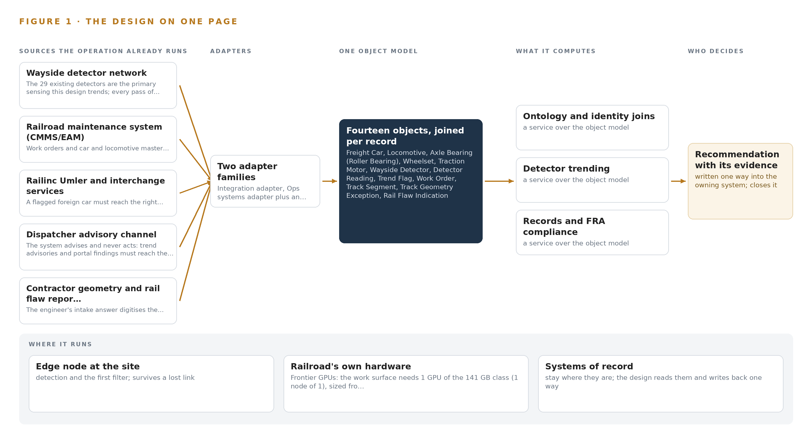
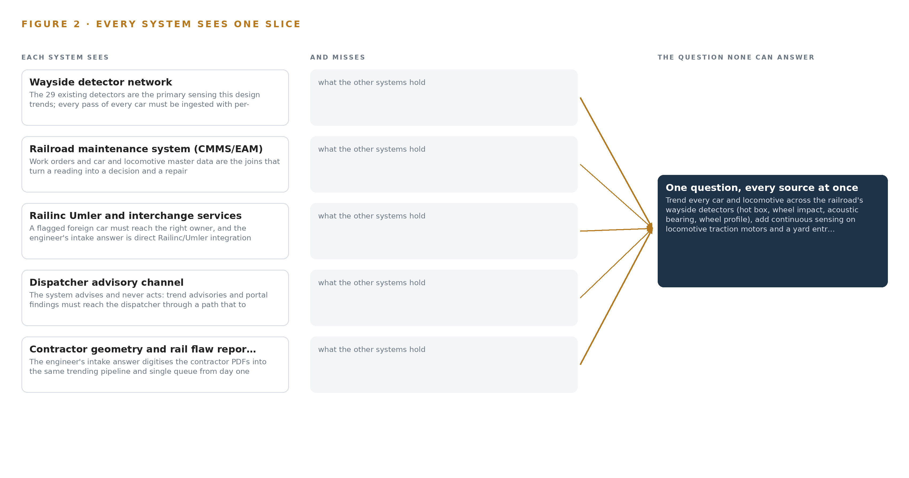
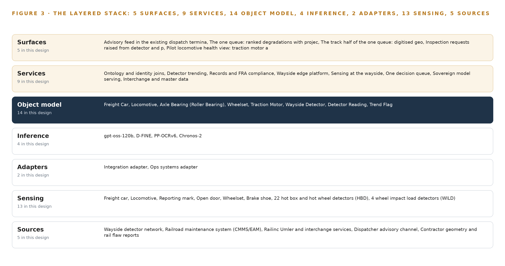
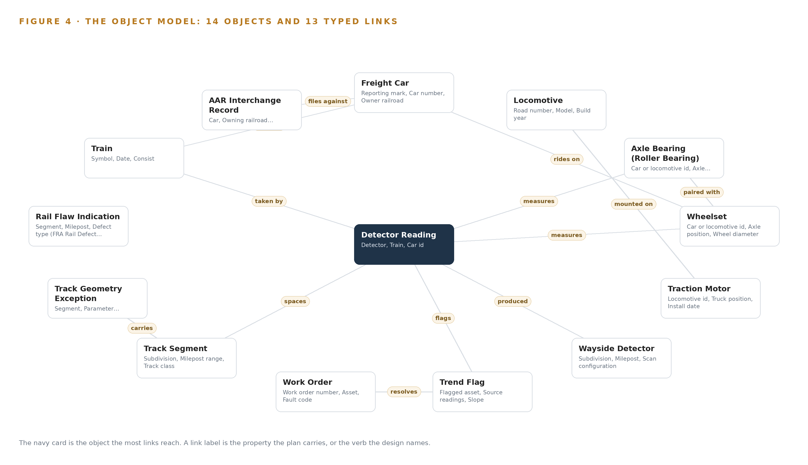
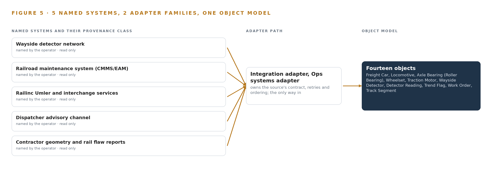
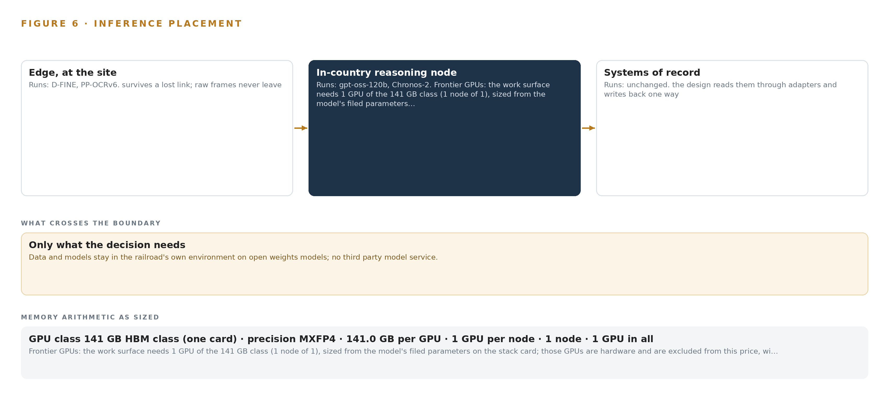
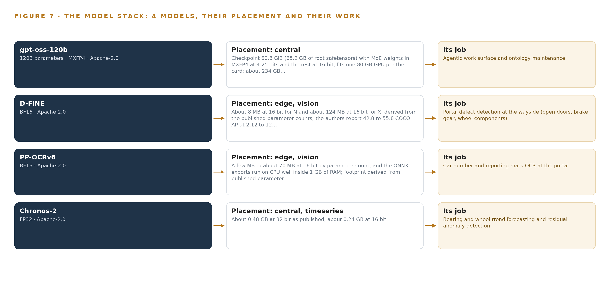
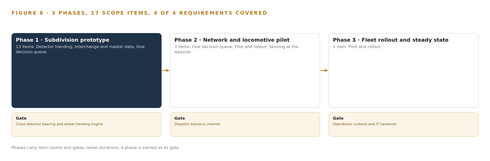
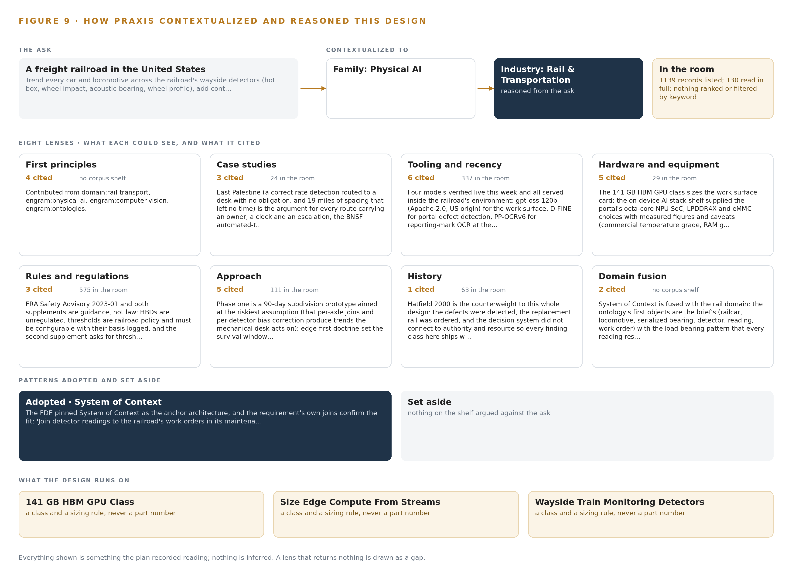

# Wayside Trend Watch: Predictive Maintenance From Wayside Detectors for a Freight Railroad in the United States

Canonical: https://codeatoms.ai/wayside-detector-trending-rail-us/
DOI: https://doi.org/10.5281/zenodo.23556421
PDF: https://codeatoms.ai/wayside-detector-trending-rail-us/paper/wayside-trend-watch-wayside-detector-trending-rail-us.pdf
License: CC BY 4.0
Publisher: CodeNinja Atoms (https://codeatoms.ai), a fully owned subsidiary of CodeNinja

VERTICAL-DRIVEN ARCHITECTURES · RAIL & TRANSPORTATION · DESIGNED WITH PRAXIS · OCTOBER 2026

# Wayside Trend Watch: Days of Warning Before Any Stop Alarm

For a freight railroad in the United States, the system trends every car and locomotive across its wayside detectors into one ranked queue that mechanical and track teams act on days or weeks before a stop alarm, with people deciding every set out and no train ever stopped or signal changed by software.

CodeNinja Engineering Team

For the chief mechanical officer and the track and maintenance-of-way leads, and the mechanical, reliability, data and platform engineers who would build and run it.

---

Vertical-Driven Architectures is a CodeNinja series of system designs. Every design in the series is driven by a real-world problem and scenario in a single industry, and every one is designed on Praxis, CodeNinja's platform for designing physical AI systems. Operations are described by class, never by name.

At a glance

## Wayside Trend Watch: Days of Warning Before Any Stop Alarm

**What this is.** An open reference architecture for system design in physical AI. A predictive maintenance system for a freight railroad in the United States: the 29 wayside detectors the railroad already runs are trended per axle, keyed to serialized bearings, wheelsets and traction motors, and joined to work orders, interchange records and digitized contractor track reports in one object model, so the mechanical and track teams act on one ranked queue days or weeks before a single-reading stop alarm. It is written for the chief mechanical officer and the track and maintenance-of-way leads, and the mechanical, reliability, data and platform engineers who would build and run it. The operator is described by class, never by name.

**The answer in numbers.**

| Part | The design |
| --- | --- |
| Sources | Five named systems, all read only: the wayside detector network (22 hot box and hot wheel detectors, 4 wheel impact load detectors, 2 acoustic bearing detectors, 1 automated wheel profile system), the maintenance system (CMMS/EAM), Railinc Umler and interchange services, the dispatcher advisory channel and the contractor geometry and rail flaw reports, entering through two adapter families |
| Object model | 14 typed objects with 13 typed links, from the freight car, locomotive, serialized axle bearing, wheelset and traction motor through the detector reading and the trend flag to the work order, track geometry exception, rail flaw indication and AAR interchange record, published as JSON for reuse |
| Models | gpt-oss-120b (Apache-2.0, self-hosted with vLLM) for the ranked queue and the ontology-maintaining agents; Chronos-2 (Apache-2.0) for zero-shot per-axle trend forecasting; D-FINE and PP-OCRv6 (Apache-2.0) for defect detection and reporting-mark OCR at the portal; no training run |
| Compute | At the new four-camera yard-entry portal, an octa-core NPU edge box sized from its streams, so only detections, OCR strings and short evidence frames cross a cellular link that drops for hours; centrally, one 141 GB HBM GPU class card in one node in the railroad's own data center, holding the 65.2 GB checkpoint with a 1.2 planning factor and about 63 GB to spare |
| Rollout | Three phases carrying 17 scope items (13, then 3, then 1) behind three gates: the cross-detector trending engine proven in shadow beside the existing alarm, the read-only dispatch advisory channel, then the runbook and IT handover |
| Three-year cost | About 54,000 US dollars to own the central card for three years (a range of 52,000 to 57,000, card, support and power, host server by quotation), against about 625,000 dollars to rent the smallest AWS instance that holds one such card on the deepest three-year commitment in US East and about 1.66 million on demand; the edge box, portal cameras and pilot locomotive sensing are priced by quotation (Appendix A) |
| Human control | The system advises and never acts: it touches no signal, train control or PTC system, the single-reading stop alarm to the dispatcher is unchanged, and a named person decides every set out and every slow order |

**Reuse it.** The object model, the model register and the figures are free to reuse under CC BY 4.0. Cite as <https://codeatoms.ai/wayside-detector-trending-rail-us/> (DOI to be added at deposit).

**Made with.** Reasoned on [CodeNinja Praxis](<https://codeatoms.ai/praxis/>), the CodeNinja Atoms platform for designing physical AI systems. The object model imports into [Hyper Ontology](<https://codeatoms.ai/hyper-ontology/>), which turns it into a living system. Both are in beta; access by request.

ABSTRACT

## A Failure Is a Trend Before It Is an Alarm

The question a freight railroad in the United States needs answered is which serialized bearing, wheelset, traction motor or track segment is degrading, how fast, and what a named person should do about it before a single-reading stop alarm fires on the dispatcher's desk. It cannot be answered today because the 29 wayside detectors judge every axle in isolation, the locomotive condition data that exists sits in shop systems, the contractor geometry and rail flaw reports arrive as PDFs, and no query can walk from one detector pass through the car's identity, its work order history and its interchange record to the decision that reading should trigger. The single-reading alarm path stays as it is; what is missing is the weeks of evidence that precede it.

The design joins 5 named source systems through 2 adapter families into one object model of 14 objects that the railroad owns, served by 9 services and surfaced on 5 surfaces, with 4 open-weights models: D-FINE and PP-OCRv6 run on the wayside NPU beside the four cameras of a new yard-entry portal so raw video never leaves the site and only detections, reporting-mark OCR strings and short evidence frames cross the link, Chronos-2 trends the per-axle detector series centrally, and gpt-oss-120b serves the one ranked queue and the ontology-maintaining agents from a single 141 GB card in the railroad's own data center. A pilot set of locomotives carries continuous traction motor and axle bearing sensing, the existing detector alarm path to the dispatcher is untouched, and every set out and every slow order is decided by a person whose name is on the record.

The paper covers the problem and the join failure, the four constraints, the layered stack, the fourteen objects and their typed links, ingestion through adapters, where each model runs and why, the models and their licenses, the three phases with their seventeen items and gates, what the rollout measures, who owns what the design builds, and closes with the chapter showing how Praxis contextualized and reasoned the design.

---



Figure 1. Wayside Trend Watch on one page: the sources the operation already runs, one object model, what it computes, and the person who decides.

## Contents

Each chapter is tagged for the reader it serves most directly: Executive, Team Lead, FDE, Reference.

|  |  |  |
| --- | --- | --- |
|  | Abstract · A Failure Is a Trend Before It Is an Alarm | Executive |
| PART I · THE PROBLEM | | |
| 1 | [A Bearing Degrades for Weeks Before the Alarm Sounds](#ch1) | Executive |
| 2 | [Every System Sees One Slice of the Car](#ch2) | ExecutiveTeam Lead |
| PART II · THE DESIGN | | |
| 3 | [Four Constraints Shape Everything Downstream](#ch3) | Team Lead |
| 4 | [One Stack Runs From the Detectors to the Queue](#ch4) | Team LeadFDE |
| 5 | [Fourteen Objects Turn Detector Noise Into One Argument](#ch5) | FDE |
| 6 | [Every Source Enters Through an Adapter, Never Directly](#ch6) | FDE |
| 7 | [Vision Belongs at the Portal, Forecasting in the Data Center](#ch7) | FDE |
| 8 | [The License Decides What the Railroad Can Own](#ch8) | FDEExecutive |
| PART III · THE ROLLOUT | | |
| 9 | [Shadow Mode Comes Before Any Queue Is Trusted](#ch9) | Team LeadExecutive |
| 10 | [The Intelligence Stays with the Railroad](#ch10) | Executive |
| PART IV · HOW IT WAS DESIGNED | | |
|  | Conclusion · The Evidence for the Next Failure Is Already Being Recorded | Executive |
| 11 | [How Praxis Contextualized and Reasoned This Design](#ch11) | Team LeadFDE |
|  | [Sources](#sources) | Reference |

PART I · CHAPTER 1

## A Bearing Degrades for Weeks Before the Alarm Sounds

A hot bearing, a wearing wheel and a settling track all announce themselves in readings the railroad already collects, but each reading is judged alone and the trend that precedes the alarm is never assembled.

The abstract promised a single ranked queue built from detectors the railroad already runs. Before any design can earn that promise, the problem has to be stated exactly: the question the operation needs answered, what it costs the industry when that question goes unanswered, and the shape of the operation that must live with the answer.

### 1.1  The Question the Operation Needs Answered

The mechanical and track teams need one question answered continuously: which serialized bearing, wheelset, traction motor or track segment is degrading, how fast, and what should be done about it by when, days or weeks before any single reading trips a stop alarm. Answering it requires data the operation already holds in fragments: per-axle readings from every pass of every car across the wayside detector network, with ambient temperature and train speed as covariates; work orders and car and locomotive master data, so a trend can be read against what was repaired and when; and interchange records, so a flagged foreign car can reach the right owner. The answer must satisfy federal railroad safety rules covering track, freight car, locomotive and brake inspection under 49 CFR Parts 213, 215, 229 and 232, the Federal Railroad Administration's guidance that railroads evaluate their policies for hot bearing wayside detectors (Federalregister 2023), industry guidance on axle bearing condition monitoring by trackside and onboard means (RSSB n.d.), and the interchange rules of the industry's equipment registry.

### 1.2  The Documented Cost of the Problem

The cost of a bearing or wheel run to failure is documented in the public record. In March 2023 the Federal Railroad Administration issued Safety Advisory 2023-01, directing railroads to evaluate their policies and procedures for the use and maintenance of hot bearing wayside detectors after a derailment in which a bearing degraded across detector passes without a stop-level reading (Federalregister 2023). A peer reviewed study in the Transportation Research Record found that in-service failures of railroad rolling stock cause train delay and economic impact, and that railcar condition feeds directly into that cost (DOI 2011). A structural wagon failure at speed, investigated and publicly reported, shows the same shape in a different component: degradation visible in hindsight, invisible in operation (NSW 2012). Each failure mode shares one property, that the evidence existed in readings before the event and was never assembled into a trend anyone acted on.

### 1.3  The Operation as a Scenario

The operator is a freight railroad in the United States, operating across multiple subdivisions with a mixed fleet of cars and locomotives. Its wayside estate counts 29 existing detectors: 22 hot box and hot wheel detectors, 4 wheel impact load detectors, 2 acoustic bearing detectors and 1 automated wheel profile system at the busiest yard entry. The design adds a four-camera portal at that yard entry, covering the left side, right side, wheel line and a throat overview, plus pilot vibration and temperature sensing on locomotive traction motors and axle bearings. The people in the loop, by role, are the mechanical supervisors who own the queue, the car inspectors and shop craft who confirm and repair, the track supervisors who own geometry and rail flaws, the dispatchers who keep the single stop decision, and a small information technology team of five who run whatever is built. The physical environments are wayside detector bungalows, an exposed yard throat, locomotive and car shops, running subdivisions and one central data center. The regulatory ground is federal railroad safety rules and industry interchange rules. The design counts five named source systems, two adapter families, fourteen objects, nine services, five surfaces and four models, handed over in three gated phases against four requirements.

PART I · CHAPTER 2

## Every System Sees One Slice of the Car

The detector network, the maintenance system, the interchange records, the dispatch channel and the contractor reports each hold a slice of the truth, and no query can walk from any one of them to the answer.

Chapter 1 set out the question. This chapter explains why no system the operation already runs can answer it.

### 2.1  What Each System Sees

Wayside detector network the 29 existing detectors are the primary sensing this design trends; every pass of every car must be ingested with per-axle resolution

Railroad maintenance system (CMMS/EAM) work orders and car and locomotive master data are the joins that turn a reading into a decision and a repair

Railinc Umler and interchange services a flagged foreign car must reach the right owner, and the engineer's intake answer is direct Railinc/Umler integration

Dispatcher advisory channel the system advises and never acts: trend advisories and portal findings must reach the dispatcher through a path that touches no signal, train control or PTC system

Contractor geometry and rail flaw reports the engineer's intake answer digitises the contractor PDFs into the same trending pipeline and single queue from day one, so track degradation joins the rolling stock picture



Figure 2. Five systems, each seeing one part of the answer; the question needs all of them in one place at once.

### 2.2  What None of Them See Together

Each holds one slice, and the question needs all of them in one place at once, which today is done by hand at the cadence of whoever has the time.

PART II · CHAPTER 3

## Four Constraints Shape Everything Downstream

Advisory-only operation, open weights in the railroad's own environment, no reduction of any regulated inspection, and a small mechanical desk set the boundaries every later choice in this design must respect.

Chapter 2 showed that the answer lives across five systems no query can span. This chapter sets the four constraints that bound every later choice in the design, then records what those bounds bought and what they cost.

### 3.1  The System Advises and Never Acts

The first constraint is advisory-only operation: the design must never stop a train or change a signal. This is hard in rail because the industry already has an automated stop path, the single-reading alarm to the dispatcher, and hardening a second one would demand a safety case nobody wants to write for a trend system. So the design connects to no vital circuit, no train control path and no positive train control system; advisories ride a channel beside the alarm, never in front of it, and dispatch keeps the stop decision entirely.

### 3.2  Open Weights in the Railroad's Own Environment

The second constraint is sovereign: every model must run as open weights on the railroad's own hardware, in its own data center, with no data leaving its boundary. This is hard in the United States at the needed scale, because the US-origin open-weights shelf is thin and one major frontier vendor sits on the US Entity List, which removes it from consideration for a critical-infrastructure buyer. The arithmetic settles the sizing: the work surface model at 117 billion parameters ships as a checkpoint of about 65.2 GB, its MoE weights in MXFP4 and the rest at 16 bit; with a 1.2 planning factor for KV cache and activations the card must hold about 78.2 GB, and one 141 GB high-bandwidth-memory card holds it with about 63 GB to spare.

### 3.3  No Regulated Inspection Is Reduced

The third constraint is that the design claims no waiver and reduces no visual or periodic inspection under 49 CFR Parts 213, 215, 229 or 232. This is hard because sensing anywhere near inspection practice reads as automation of union work, and the automated inspection waiver fights began exactly there. The design's answer is behavioral: the first phases change no inspection frequency and no job duty, crafts see the same dashboards as management, and the consultation record is written as a project deliverable as it happens.

### 3.4  A Small Mechanical Desk Sets the Alert Budget

The fourth constraint is human: the mechanical desk is small, and alert volume above what it can act on turns the queue into noise. The design therefore fixes an alert budget with the supervisors before any threshold is set, keeps the ranked queue below that budget line, and reports acknowledge, ignore and action rates weekly. Every set out is decided by a person.

### 3.5  Scoping Decisions

Three scoping decisions follow from these constraints, and each buys something at a stated cost, as Table 1 records.

Table 1 · Scoping Decisions

| Decision | What it buys | What it costs |
| --- | --- | --- |
| Key every reading to serialized bearings and axles | Trend continuity across cars, shops and owners, so a bearing keeps its history wherever it runs | Master data cleanup, and per-axle baselines that start at go-live wherever detector history is not exportable |
| Digitize contractor PDFs into the same pipeline | Track degradation joins the rolling stock picture in one queue from the first day | An extraction and verification step on every geometry run and flaw report |
| Advise through a channel that touches no vital system | Zero risk to any signal, train control or PTC path | Dispatch keeps the stop decision, and advisories ride beside the alarm rather than in front of it |

### 3.6  What the Design Chose Against

The constraints also forced explicit rejections, recorded in Table 2 with their reasons, closing with what the design leaves out of scope entirely.

Table 2 · What the Design Chose Against

| Where | What was picked | Instead of, and why |
| --- | --- | --- |
| Detector coverage | Cross-detector trending over the existing 29 detectors | Buying and installing more detectors to close the spacing, because spacing is a commercial compromise and trending shortens the observed gap without pouring concrete |
| Portal video | Edge inference at the portal with store-and-forward buffers | Streaming raw video to the central site, because cellular backhaul that drops for hours cannot carry pixels; detections, OCR strings and short evidence frames cross instead |
| Work surface model | The 120B-class US-origin model under Apache-2.0 open weights | A frontier-scale model from a vendor on the US Entity List, because a critical-infrastructure buyer needs US-origin weights and the 117B mixture-of-experts fits one 141 GB card the railroad can power |
| Alert handling | One ranked queue under an agreed alert budget | An unbudgeted alarm stream, because a small mechanical desk that cannot act on alerts will learn to ignore them |
| Inspection practice | Advisories that change no inspection frequency and no job duty | Any move toward automated inspection, because the waiver fights began exactly there and this design does not enter them |
| Scope boundary | Existing detectors, a pilot locomotive subset, and the existing alarm path left untouched | New detector sites, fleet-wide retrofit in the first phases, any signal or train control interface, and any model training or fine tuning for this operator, all outside this design |

PART II · CHAPTER 4

## One Stack Runs From the Detectors to the Queue

Two adapter families feed one object model, nine services and five surfaces, with nothing replacing the systems of record and no data leaving the railroad's environment.

Chapter 3 fixed the four constraints that shape everything downstream: the systems of record stay in place, the data stays inside the railroad's environment, the single-reading stop alarm to the dispatcher stays exactly as it is, and every set out stays with a person. This chapter lays out the stack that satisfies those constraints, layer by layer, from the detector bungalows to the ranked queue.

### 4.1  The Pattern and Why It Fits

The pattern is a deliberate sandwich: systems of record below, one object model in the middle, applications and agents above. Below sit the five sources the design reads and never replaces: the wayside detector network, the maintenance system, the Railinc Umler and interchange services, the dispatcher advisory channel, and the contractor geometry and rail flaw reports. In the middle, the object model v0.9 holds the fourteen objects that turn per-axle readings into one argument, with the telemetry store chosen by class beside it for the raw series. Above, nine services and five surfaces do the work, and an agentic work surface maintains the ontology itself.

This shape fits a railroad for three reasons. First, no railroad can swap its maintenance system or its detector network for a platform, and the advisory posture the Federal Railroad Administration expects around hot bearing detector policies presupposes that the detector network and its alarm path remain untouched (Federalregister 2023). Second, the middle layer is where the value sits: in-service failures of rolling stock cause train delay and economic impact that condition-based action can shrink (DOI 2011), and shrinking them requires joining records that today live in separate systems. Third, everything above the object model can change without touching anything below it, which is what lets a five-person IT team run the whole design. Figure 3 shows the layered stack with its counts per layer: five sources, two adapter families, one object model of fourteen objects, four models split across the wayside and the data center, nine services and five surfaces, all inside the railroad's own environment.



Figure 3. The layered stack: 5 sources, 2 adapter families, 14 objects, 9 services and 5 surfaces.

### 4.2  The Stack Stage by Stage

Table 3 walks the seven stages in order, and each stage names its components so an engineer can trace any surface back to the source that fed it. The stages are: Sources, Sensing, Adapters, Object model, Inference, Services, Surfaces.

Table 3 · The Stack, Stage by Stage

| Stage | What it is responsible for | How |
| --- | --- | --- |
| Sources | Hold the records of the operation, read only and never replaced | Five named systems: the wayside detector network, the maintenance system (CMMS/EAM), Railinc Umler and interchange services, the dispatcher advisory channel, and the contractor geometry and rail flaw reports |
| Sensing | Turns each physical pass into measurements at per-axle resolution | 22 hot box and hot wheel detectors, 4 wheel impact load detectors, 2 acoustic bearing detectors, 1 automated wheel profile system at the busiest yard entry, the four-camera yard entry portal, and pilot vibration and temperature sensing on traction motors and axle bearings |
| Adapters | Guarantee every record enters once, typed, provenance-stamped and schema-checked | Two families: the integration adapter for the detector network, Railinc services and the digitized contractor reports; the ops systems adapter for the maintenance system and the dispatch advisory channel |
| Object model | Holds the one argument over serialized assets that every surface reads | the object model v0.9 with 14 objects and their typed links, with a time series store chosen by class against measured pass volume holding the raw reading series |
| Inference | Serves open weights where the data is, with nothing trained for the operator | Edge: D-FINE and PP-OCRv6 on the wayside NPU box under K3s on an ONNX Runtime-class runtime; center: Chronos-2 for trend forecasting and gpt-oss-120b on vLLM on one 141 GB card in the railroad's data center |
| Services | Do the work between the records and the queue | Nine named services: ontology and identity joins, detector trending, records and FRA compliance, wayside edge platform, sensing at the wayside, one decision queue, sovereign model serving, interchange and master data, pilot and rollout |
| Surfaces | Where named people see the argument and decide | Five surfaces: the advisory feed in the existing dispatch terminal, the ranked degradation queue, the track half of the queue, inspection requests raised from detector and portal findings, and the pilot locomotive health view |

PART II · CHAPTER 5

## Fourteen Objects Turn Detector Noise Into One Argument

Fourteen objects and their typed links let a query walk from a flagged reading to the serialized bearing, its wheelset, its car, the work order that fixed it last time and the track segment it crossed, which no document store can do.

Chapter 4 laid the stack from the detectors to the queue, and its middle layer was named but not opened. This chapter opens it: the fourteen objects, the typed links between them, and the one recorded object where a trend becomes a person's decision.

### 5.1  Every Object and Its Typed Links

The model holds fourteen objects in four kinds. Seven are assets: Freight Car, Locomotive, Axle Bearing (Roller Bearing), Wheelset, Traction Motor, Wayside Detector and Track Segment. One is a measure: Detector Reading. Five are records: Trend Flag, Work Order, Track Geometry Exception, Rail Flaw Indication and AAR Interchange Record. One is an event: Train. Figure 4 shows every object and every typed link between them, with the trend flag as the focal object.

The links are what make the argument. A wheelset is paired with the axle bearing that shares its axle position; a traction motor is mounted on a locomotive; a wayside detector produced each detector reading; a reading was taken by a train and measures a specific serialized bearing and wheelset; a track segment carries geometry exceptions and sets the detector spacing against which a warning interval is judged. Because axle bearings and wheelsets are keyed to serialized components rather than to cars, a bearing keeps its baseline and its wear history across wheel changes, car renumbers and interchanges, which is exactly the continuity that condition monitoring standards for axle bearings assume (RSSB n.d.).

A query can therefore walk a path no document store can: from a flagged reading, to the bearing it measured, to the wheelset beside it, to the car that carries both, to the work order that fixed that bearing last time, to the track segment where the reading was taken, to the open geometry exception on that same segment. A document store can hold each of those facts; it cannot traverse them, because the joins are not documents but typed links the query engine follows.



Figure 4. The fourteen objects of the model and the typed links that let a query reach across them.

### 5.2  The Human Loop and the Hosting Posture

The human loop lives in the trend flag, which carries a disposition and a disposer: every flag stays Open until a named person confirms it, dismisses it or lets it raise a work order, and no flag ever becomes a set out without that person. The same rule governs the track half of the queue, where a slow order remains a person's decision.

The hosting posture keeps everything inside the railroad's boundary. The ontology runs on the operator's own hardware in its own data center; identity and access run on Keycloak against the railroad's own people; the only external link is the read-only Railinc Umler and interchange feed, which crosses out and back under the railroad's own agreements. The only write path into the object model is the adapter tier described in Chapter 6, plus the human disposition recorded through the queue surface; no source system, no service and no agent writes any other way, and no data leaves the environment.

### 5.3  One Object in Its Recorded Form

The trend flag is the object where the argument becomes a decision, and its recorded form carries the flagged asset, the source readings behind it, the slope, the projected threshold crossing, the warning interval measured against detector spacing, and the disposition with the person who made it.

```
{ "id": "freight-car", "label": "Freight Car", "kind": "asset", "anchored_in": "Railinc Umler registry and the railroad's CMMS master data", "properties": [ "Reporting mark", "Car number", "Owner railroad", "Home or foreign car", "Car type", "Capacity", "Last interchange date" ], "status_vocabulary": [ "In service", "Bad ordered", "Set out", "Shopped", "Retired" ], "links": [ { "to": "wheelset", "label": "rides on" } ] }
```

PART II · CHAPTER 6

## Every Source Enters Through an Adapter, Never Directly

All 29 detectors, the maintenance system, the interchange services, the dispatch advisory channel and the digitized contractor reports enter through two adapter families, so no source system ever writes directly into the object model.

Chapter 5 described what the object model holds and the single write path into it. This chapter describes how data actually gets there: five sources, two adapter families, and an event backbone that keeps every per-axle reading ordered, handed over and recoverable when the cellular link drops.

### 6.1  Five Named Sources, All Read Only

Figure 5 maps the integration. The wayside detector network is the primary sensing: all 29 detectors, being 22 hot box and hot wheel detectors, 4 wheel impact load detectors, 2 acoustic bearing detectors and 1 automated wheel profile system, enter with per-axle resolution so a reading resolves to one serialized bearing. The maintenance system (CMMS/EAM) supplies work orders and car and locomotive master data, the joins that turn a reading into a repair. Railinc Umler and interchange services give car ownership and interchange records, so a flagged foreign car reaches the right owner. The dispatcher advisory channel carries trend advisories and portal findings to dispatch through a path that touches no signal, train control or PTC system. Contractor geometry and rail flaw reports arrive as PDFs that the platform digitizes into the same trending pipeline and the same queue from day one.

All five are operator-held systems of record in the read direction, and every one carries a provenance stamp into the object model, so any figure on any surface can be traced to the system that produced it.



Figure 5. The 5 named systems, the adapter path each one takes, and the object model they all map into.

### 6.2  What the Adapter Tier Guarantees

The adapter tier guarantees six things. It is read only: no source system is ever written to, and no source ever writes directly into the object model. It resolves identity: a car is identified per pass by its AEI tag and, at the portal, by PP-OCRv6 reading the reporting mark, so the join key is settled at the edge rather than after a video upload. It normalizes: every reading carries ambient temperature, train speed and the detector's calibrated bias, because detector maintenance and calibration policies are precisely what the Federal Railroad Administration asked railroads to evaluate after bearing failures (Federalregister 2023), and a per-detector bias term is how one detector's reading is made comparable to another's. It is idempotent: a replayed export produces one reading, keyed on detector, train, car, axle position and timestamp. It applies back-pressure: a slow downstream service slows the adapter, never the source. And it buffers: at the portal, inference runs on the wayside box and only detections, OCR strings and short evidence frames cross the link, never raw video, because a cellular backhaul that drops for hours cannot carry pixels.

### 6.3  The Event Backbone

The backbone is Apache Kafka 4.3.x in KRaft mode with three dedicated controllers, running in the railroad's data center with replication across brokers. Ordering is preserved by key: every reading is keyed on detector and axle position, so the pass sequence for one bearing arrives in the order it was measured, which is the sequence the trending engine differentiates. Delivery is at-least-once, made safe by the adapter's idempotent upserts, so a re-handed over message cannot double-count a reading. Buffering happens at both ends: the wayside edge units under K3s hold store-and-forward queues that survive backhaul outages and resynchronize when the link returns, and the portal keeps its evidence frames local until the link can carry them. Model and artifact updates travel the other way through Harbor as an air-gapped registry, so nothing updates from the public internet. Prometheus, Grafana and Loki watch the whole path, and lag on any partition is the first signal that a detector, a link or an adapter needs attention.

PART II · CHAPTER 7

## Vision Belongs at the Portal, Forecasting in the Data Center

D-FINE and PP-OCRv6 run on the wayside NPU beside the cameras so detections and car numbers become join keys at the edge, Chronos-2 trends the per-axle series centrally, and gpt-oss-120b serves the queue from one card, with only findings and evidence frames crossing a cellular link that drops for hours.

Chapter 6 described how every source enters through one of the two adapter families, so no detector feed bypasses the event backbone's guarantees and no system of record is written to directly. This chapter places the four models on the hardware where they run and works the arithmetic that decides what each tier can hold.

### 7.1  Two Places, No Middle Tier

Inference runs in exactly two places: the portal's wayside edge box and the railroad's central data center. A yard-site server tier between them was weighed and set aside, because an intermediate tier adds a failure domain a five-person IT team would have to own and nothing in the requirement needs it.

At the portal, D-FINE detects open doors, brake gear, wheel components and dragging equipment, and PP-OCRv6 reads reporting marks, both on the octa-core NPU edge box beside the cameras. D-FINE is about 8 MB at 16 bit in its small size and about 124 MB in its large one; PP-OCRv6's small tier is 7.7 million parameters, a few MB to about 70 MB at 16 bit, with ONNX exports that run on CPU well inside 1 GB of RAM. Together they occupy a fraction of the box, leaving the rest for the video pipeline and the store-and-forward buffer, and car identity is resolved per pass by AEI tag and portal OCR rather than visual tracking across frames, which is why the OCR string must become a join key at the edge rather than after a video upload.

In the data center, Chronos-2 trends the per-axle series at about 0.48 GB as published at 32 bit, about 0.24 GB at 16 bit, small enough to sit on the trending service beside the time series store. The work surface model sizes the tier: gpt-oss-120b, filed at 117 billion parameters, ships as a checkpoint of about 65.2 GB with its MoE weights in MXFP4 and the rest at 16 bit; the 1.2 planning factor reserves about 13 GB for KV cache and activations, so the card must hold about 78.2 GB, and one card of the 141 GB class holds it with about 63 GB to spare. That single card, one node of one GPU, is the whole central model tier, inside the existing data center's power and cooling. Figure 6 sets the tiers side by side with what crosses between them.



Figure 6. Where each tier runs, what runs there, and the narrow set of outputs that cross the boundary.

### 7.2  The Latency Budget

The budget has three horizons, each set by the physical process it serves. The portal's horizon is one pass: detection and OCR must finish before the car clears the camera line at yard speed, and D-FINE's card reports 2.12 to 12.89 ms at batch size 1 on a T4 for its two sizes, a figure the NPU box need not match to stay well inside a window measured in the time a car takes to traverse the portal. The trending horizon is one pass spacing: the forecast and residual for an axle must be ready before that axle reaches the next detector, because the trend flag's warning interval is measured against detector spacing, and a forecast that arrives after the next pass is not a forecast. The work surface's horizon is one supervisor interaction: the model is a mixture of experts with roughly 5 billion active parameters, so a ranked-queue answer completes within a working session. No requirement exceeds what its tier can meet.

### 7.3  What Crosses the Boundary, and What Fails

Only findings cross the cellular link: detections, OCR strings and short evidence frames, never pixels or continuous video, because a link that drops for hours cannot carry a stream and was never asked to. The edge box keeps detecting through an outage and buffers its outputs store-and-forward; when the link returns, the buffered findings resynchronize into the event backbone in order and the ontology fills the gap. The stop alarm path is untouched throughout, since it runs from detector to dispatcher on the railroad's own wiring and this design sits beside it, never in front of it, the posture the Federal Railroad Administration's advisory on hot bearing detectors asks railroads to evaluate for themselves (Federalregister 2023).

Power failure at the bungalow is handled by the enclosure class: surge-protected power, a sealed case with thermal budget for direct sun, and Network UPS Tools monitoring clean shutdown, so the box rides through an outage and reboots into K3s orchestration with its buffer intact. Update failure is handled by the air-gapped Harbor registry: models ship as versioned open-weight artifacts pulled inside the boundary, and if the pull path fails the edge keeps serving the last pulled weights. Every failure leaves the system advising more slowly, never acting differently, because there is no actuation to fail toward.

PART II · CHAPTER 8

## The License Decides What the Railroad Can Own

Every model in the design is Apache-2.0 open weights, which is precisely what lets the railroad hold its weights, its data and its decision record inside its own environment with no vendor's permission to renew.

Chapter 7 placed each model on its tier and worked the memory arithmetic the hardware must hold. This chapter states what each model is and on what license it runs, because the license decides what the railroad can own: weights it holds itself, in its own environment, with no permission to renew.



Figure 7. The four models, their placement, and the work each one does.

### 8.1  Four Models, One License Family

Figure 7 stacks the four models over the hardware they run on. Every one is Apache-2.0 open weights, and every one runs as shipped: under the system of context nothing is trained, fine tuned or distilled for the operator, agents improve through agentic memory rather than training runs, and detector accuracy is governed by an evaluation harness.

gpt-oss-120b is a 120 billion parameter mixture of experts with roughly 5 billion active parameters, served centrally on one card of the 141 GB class. Its checkpoint is 60.8 GiB, 65.2 GB of root safetensors, with the MoE weights in MXFP4 at 4.25 bits and the rest at 16 bit, about 234 GB if expanded to full 16 bit, and a KV cache the card files at about 4.8 GB. It serves the one queue and the ontology-maintaining agents, and it was chosen over GLM 5.3, a 753 billion parameter model, because Zhipu AI sits on the US Entity List and this is a United States critical-infrastructure buyer; the US-origin open-weights shelf at frontier scale is thin, and this is the largest permissive model on it.

D-FINE is the portal's defect detector, from the real-time detection family. Apache-2.0 covers its code and released weights with no field-of-use restriction, and the design uses the COCO checkpoints rather than the Objects365 ones, whose terms are not commercially cleared. The card reports 42.8 to 55.8 COCO AP across its sizes, and the small size runs on the portal's octa-core NPU box at yard speed.

PP-OCRv6 is the portal's reader, from the OCR and document parsing family: Apache-2.0 with no revenue condition, its small tier at 7.7 million parameters with the CTC head pinned, so a car number becomes a join key at the edge rather than after a video upload.

Chronos-2 is the trend forecaster, from the time series forecasting family, Apache-2.0. It performs zero-shot multivariate forecasting over per-axle detector reading series with covariates, ambient temperature and train speed, and the residual against the forecast is thresholded to raise the trend alarm. Zero-shot matters because nothing is fine tuned for this operator. The trend alarm is the precursor reading the single-reading stop alarm cannot see, the gap the Federal Railroad Administration's advisory on hot bearing detectors asks railroads to evaluate (Federalregister 2023), and axle bearing monitoring by trackside and onboard systems is an established practice with published requirements and guidance (RSSB n.d.).

### 8.2  The Model and Equipment Register

Table 4 gathers the choices behind the models: a row for each of the four models, then the hardware classes and sizing rules, the sensing, each pattern the design stands on, and the ground it runs on, so an engineer can trace any row back to the prose above and the arithmetic in Chapter 7.

Table 4 · Model and Equipment Register

| The choice | What was picked | Why here |
| --- | --- | --- |
| Work surface model | gpt-oss-120b, 120B MoE, MXFP4, Apache-2.0, central tier | Largest permissive US-origin open weights; GLM 5.3 set aside on the Entity List; one 141 GB card in the railroad's own data center |
| Portal detection | D-FINE, Apache-2.0, COCO checkpoints, wayside NPU box | No field-of-use restriction; Objects365 terms not cleared; runs at yard speed on the edge |
| Portal OCR | PP-OCRv6 small, 7.7M parameters, CTC head pinned | Car number becomes a join key at the edge; runs on CPU well inside 1 GB of RAM |
| Trend forecasting | Chronos-2, Apache-2.0, zero-shot, central tier | Multivariate forecasts with covariates; residual thresholding; nothing fine tuned under the system of context |
| Central hardware class | 141 GB HBM GPU class, one card, one node | About 65.2 GB of MXFP4 and 16 bit weights plus a 13 GB planning reserve fits with about 63 GB spare |
| Edge compute sizing | Octa-core NPU edge box sized from its streams | D-FINE and PP-OCRv6 occupy a fraction of the box; buffer and video pipeline take the rest |
| Wayside sensing | 29 detectors: 22 hot box and hot wheel, 4 wheel impact load, 2 acoustic bearing, 1 wheel profile; pilot locomotive vibration and temperature sensing | The existing network is the trend corpus; new onboard sensing is pilot only, rolled out through scheduled shop visits |
| Portal sensing | Four cameras at yard entry: left side, right side, wheel line, yard throat overview | Bought by class against pixel-density and blur-budget arithmetic; detections span car, door, wheel, brake shoe, journal box and dragging equipment |
| Pattern: trend, do not build | Cross-detector trending over the existing 29 detectors, keyed to serialized bearings and axles | Shortens the observed gap without new detector sites, which are the railroad's capital decision |
| Pattern: findings cross, pixels stay | Edge inference at the portal with store-and-forward buffers | A cellular link that drops for hours cannot carry video; detections, OCR strings and evidence frames cross |
| Pattern: advise, never act | No train control, signal or PTC interface | The single-reading stop alarm to the dispatcher stays exactly as it is; people decide every set out |
| Ground | The railroad's own data center and wayside boxes, Harbor air-gapped registry | Open weights let the operator hold its weights, its data and its decision record with no permission to renew |

PART III · CHAPTER 9

## Shadow Mode Comes Before Any Queue Is Trusted

Three phases carry seventeen items and three gates, with cross-detector trending proven in shadow beside the existing alarm and an alert budget agreed with the supervisors before anyone is asked to act on the queue.

Chapter 8 settled the register of four models and the Apache-2.0 licenses that let the railroad hold every weight it runs. This chapter sets out how the build reaches the railroad: three phases carrying seventeen items, each closed by a gate, with the cross-detector trending engine proven in shadow beside the existing stop alarm before anyone is asked to act on the queue.

### 9.1  Three Phases Carry Seventeen Items and Three Gates

Phase 1 carries 13 items across six workstreams: ontology and identity joins, detector trending, interchange and master data, the one decision queue, records and FRA compliance, and pilot and rollout. Its items include the detector reading model with serialized asset identity, the agentic memory that keeps the decision record, and ingestion of every feed from the 29 existing detectors: 22 hot box and hot wheel detectors, 4 wheel impact load detectors, 2 acoustic bearing detectors and 1 automated wheel profile system. Its exit gate is the cross-detector bearing and wheel trending engine: per-axle readings from every detector flowing through the adapters into the object model, trend flags raised and ranked, all running in shadow beside the single-reading stop alarm to the dispatcher, which stays exactly as it is.

Phase 2 carries 3 items across three workstreams: the dispatch advisory channel, the locomotive traction motor and axle bearing sensing pilot, and the network rollout to every detector and yard. Its exit gate is the dispatch advisory channel itself, a read-only path that touches no signal, train control or PTC system and carries trend advisories and portal findings to the dispatcher as advice only. Phase 3 carries 1 item, the operations runbook and IT handover, and its gate is that handover accepted by the railroad's own information technology team. Figure 8 sets the phases, item counts, gates and workstreams side by side with requirement coverage: four requirements covered in full, none partial, none open.



Figure 8. The three phases and their gates, and coverage of the 4 requirements across them.

### 9.2  What the Rollout Measures

Shadow mode exists to measure one number before trust: lead time. For every reading that later trips the existing stop alarm, the record shows whether a trend flag was already open on that axle or wheelset, and how many detector passes of warning it gave, which is the warning interval the design exists to lengthen. The queue is measured by its behavior: acknowledge, ignore and action rates reported weekly from the start, held against the alert budget the supervisors agree before thresholds are set. The portal is measured per detection class, all eight of them from freight car to dragging equipment, with an accuracy record kept from day one and evidence frames captured at the worst hour of light. Each detector site is measured for bias, mean and spread learned from live passes, so a reading is corrected against its own detector before it joins a trend.

### 9.3  Failure Modes

The design names what can fail and what it does about each; Table 5 lists the ones that shape the rollout, from detector history to craft consultation.

Table 5 · Failure Modes

| What fails | What the design does |
| --- | --- |
| Detector reading history may not exist in exportable form | Baselines bootstrap from whatever logs exist, and per-detector bias is learned from live passes, so trending starts at go-live rather than never |
| Detector interfaces are vendor-specific and may need supplier cooperation | An interface survey at each site opens phase one, and an industry detector data export is confirmed per site before trending goes live on it |
| Portal accuracy at night, in snow and against low sun is unproven at this yard | A survey evidence pack captured at the worst hour, a per-detection accuracy record from day one, and a person confirming every consequential finding |
| Alert volume above what a small mechanical desk can act on | An alert budget agreed with the supervisors before thresholds are set, a ranked queue held below the budget line, and weekly acknowledge, ignore and action rates |
| Sensing near inspection practice reads as automation of craft work | The first phases change no inspection frequency and no job duty, crafts see the same dashboards as management, and the consultation record is written as a deliverable as it happens |
| The railroad's interchange data agreement may not cover direct filing by a new system | Agreement scope confirmed in phase one, and foreign-car alerts ride the existing interchange process until direct filing is live |

### 9.4  Lessons

**Shadow the queue before anyone is asked to act on it.** The existing single-reading alarm already protects the railroad, and the federal safety advisory asked railroads to evaluate exactly how they use and maintain hot bearing detectors (Federalregister 2023). What the new layer adds is lead time, and lead time can only be demonstrated beside the alarm it complements; in shadow, the trend engine earns or fails its case without a single set out depending on it.

**Agree the alert budget before setting the thresholds.** Thresholds set by sensitivity alone produce more flags than a small mechanical desk can work through, and in-service failures already cost the industry delay and money (DOI 2011), so a queue that becomes noise protects nothing. The budget comes first, the thresholds second, and the weekly rates keep the bargain visible.

**Change no inspection practice in the first phases.** The disputes over automated inspection waivers began exactly where sensing touched craft practice, and this design claims no waiver and reduces no inspection. The crafts see the same picture management sees, and the consultation record is written while the work happens, not after.

### 9.5  What Is Still Open

Three questions remain open. Whether per-axle detector history exists in exportable form: settling it would let baselines draw on years of record instead of live passes, which would open trend flags with more confidence and earlier. Whether the railroad's interchange data agreement covers direct registry reads and alert filing by a new system: settling it would turn foreign-car alerts from a manual interchange process into direct filing, and until then the existing process carries them. Whether portal accuracy holds at night, in snow and against low sun at this yard: settling it would set the human confirmation load and decide how high portal findings can rank in the one queue.

PART III · CHAPTER 10

## The Intelligence Stays with the Railroad

The object model, the weights, the trend record and the boundary all belong to the railroad, because the design runs on its own hardware under its own identity with no data leaving its environment.

Chapter 9 carried the build through three gates to a handover the railroad's own team accepts. This chapter states who owns what the build leaves behind, and the answer is the railroad, all of it, by construction rather than by negotiation.

### 10.1  The Railroad Owns the Model, the Weights, the Record and the Boundary

The object model is the railroad's: 14 objects with their typed links, anchored in its own registries and records, its car and locomotive master data, the industry equipment registry it already subscribes to, its track charts and its contractor reports. Because the model is built on the railroad's own ground truth, it remains meaningful if every other part of the stack is replaced.

The weights are the railroad's. All four models in the register are Apache-2.0 open weights, a license that permits holding, running and modifying without revenue conditions, and nothing is trained or fine tuned, so the weights the railroad runs are the weights it holds. They run on hardware it owns: the 141 GB HBM class card in its own data center serving the work surface model, and the NPU edge boxes at the portal serving detection and OCR.

The decision record is the railroad's. Every trend flag disposition, every set out a named person decided, every alert filed and every inspection request raised is kept in the agentic memory the next decision reads, which serves both as evidence for the regulator and as the substrate on which the agents improve without a training run.

The boundary is the railroad's. Access is governed by its own identity provider, no data leaves its environment, the only external reads are the interchange services it already pays for, and the advisory path touches no signal, train control or PTC system. The single-reading stop alarm path is unchanged, because the system advises and never acts.

### 10.2  The Offer Behind the Design

CodeNinja designed this system on Praxis, its platform for designing physical AI systems. The wayside, portal and pilot sensing of physical behavior, and the trend forecasting over it, are Adaptive Operations; the ranked queue of what is degrading, how fast, what to do and by when, on which a named person decides every set out and every slow order, is Decision Systems; the object model that joins detectors to serialized bearings, axles, work orders and interchange records is Hyper Ontology; the work surface where the railroad's mechanical and track teams build their own agents is Hyper Pragma; the kept record of decisions and outcomes that the next decision reads is Hyper Engram; and the shape that holds it all together, open weights on the railroad's own hardware inside its own boundary, is Sovereign Infrastructure.

PART IV · CONCLUSION

## The Evidence for the Next Failure Is Already Being Recorded

In one view, the design is a join: 29 existing detectors, a camera portal and a locomotive pilot, resolved to serialized bearings, axles and wheelsets in an object model the railroad owns, trended centrally by an open-weights forecaster, and handed over to one ranked queue where a person decides every set out, all of it running on the railroad's own hardware inside its own boundary while the existing stop alarm to the dispatcher continues exactly as before.

Running the same shape elsewhere takes four things: an identity key that ties each reading to a serialized component rather than to a vehicle, per-pass resolution fine enough to trend, an advisory-only boundary drawn so the system never sits in front of a safety decision it does not own, and open weights on hardware the operator controls. Wherever an operation already measures its assets on a repeated basis, the trend that precedes the failure is in that record, and this is the shape that assembles it.

PART IV · CHAPTER 11

## How Praxis Contextualized and Reasoned This Design

Every choice in this design traces to recorded reading through eight lenses, and this chapter shows the ask, what was in the room, the patterns adopted and set aside, and where the reasoning lands.

Chapter 10 closed the ownership question: the object model, the weights, the decision record and the boundary all stay with the railroad. Every design in this series is produced on Praxis, and this chapter is the trace that lets a reader take any choice in the earlier chapters back to what justified it; Figure 9 shows the whole path on one page, from the ask through the lenses to the equipment classes.

### 11.1  Contextualizing the Ask

The ask arrived as one paragraph from a freight railroad in the United States, with the country fixed by the operator's own requirement: trend every car and locomotive across the wayside detectors for hot box, wheel impact, acoustic bearing and wheel profile readings, add continuous sensing on locomotive traction motors and a yard entry camera portal, join the result to work orders and interchange records, and give the mechanical and track teams one queue to act days or weeks before a stop alarm, with people deciding every set out, under FRA rules and open weights in the railroad's own environment. Praxis assigned the design to the physical AI family in the rail and transportation vertical. What was in the room, read in full and available on request: the European Commission's railway safety statistics (Europa 2024); a published official investigation into the structural failure of a freight wagon (NSW 2012); the Federal Railroad Administration safety advisory on the use and maintenance of hot bearing wayside detectors (Federalregister 2023); the UK standards body's requirements and guidance for axle bearing condition monitoring (RSSB n.d.); and a peer reviewed study of the delay and economic impact of in-service rolling stock failures (DOI 2011).



Figure 9. From the ask to the design: the family and industry Praxis assigned, the eight lenses and what each cited, the patterns adopted and set aside, and the equipment the design lands on.

### 11.2  The Eight Lenses

Praxis read the ask through eight lenses, and Table 6 records what each could see, what it cited and what it contributed to the design.

Table 6 · The Lenses and What They Contributed

| Lens | Could see | Cited | What it contributed |
| --- | --- | --- | --- |
| First principles | How heat, impact and acoustic energy travel from a failing bearing or wheel to a wayside sensor, and how serialized components join into one model | 4 records | Per-axle resolution as the unit of trending, and the shape of the 14-object model |
| Case studies | Published accident investigations and failure cost studies | (NSW 2012); (DOI 2011); (Europa 2024) | The cost of catching degradation late, and why a single-reading alarm is a last line rather than a strategy |
| Tooling and recency | The current open source stack and its versions | The stack shelf; no outside records | The event backbone, the ontology store, the video manager, edge orchestration, model serving and the artifact registry in the stack register |
| Hardware and equipment | Edge compute, cameras, enclosures, time sync and GPU classes | The hardware shelf; no outside records | The 141 GB class card, the octa-core NPU edge box, the time card grandmaster and the enclosure and power rules |
| Rules and regulations | Federal safety advisories, UK condition monitoring guidance, the federal inspection parts | (Federalregister 2023); (RSSB n.d.) | The advisory-only posture, the untouched stop alarm path, and the refusal to reduce any regulated inspection |
| Approach | The family's prior designs and their gates | The design family; no outside records | Shadow mode, the alert budget, and the system of context that fixes what runs where and what is never trained |
| History | The industry's record of detector-driven responses and inspection waiver disputes | (Federalregister 2023) | Why the first phases change no inspection frequency and no job duty, and why the consultation record is a deliverable |
| Domain fusion | Rail engineering read against computer vision, time series forecasting and ontology design | Internal engram records | The OCR join at the edge that turns a car number into a join key, and the zero-shot forecaster over per-axle series |

### 11.3  Patterns Adopted and Set Aside

Four patterns were adopted. Edge inference at the portal with store-and-forward buffers, because a cellular backhaul that drops for hours cannot carry pixels: detections, OCR strings and short evidence frames cross the link, raw video does not. Zero-shot forecasting over per-axle series with ambient temperature and train speed as covariates, because under the system of context nothing is fine tuned and accuracy is governed by an evaluation harness. Serialized component identity resolved per pass by AEI tag and portal OCR. And an advisory channel that runs beside the alarm rather than in front of it. Set aside with reasons: visual tracking and trajectory forecasting, since identity is resolved per pass rather than across frames; streaming raw video to the central site, which the link cannot carry; a yard-site inference server tier, not warranted for a five-person information technology team; labelling and retraining, replaced by the evaluation harness over shipped weights; and a hardware diode, unnecessary because no vital circuit is ever crossed.

### 11.4  Where the Reasoning Lands

The reasoning lands on four equipment classes: the 141 GB HBM GPU class that holds the work surface model in the railroad's own data center; edge compute sized from streams for the portal; wayside train monitoring detectors as the sensing ground the design trends; and rugged enclosure, mounting, power and protection for the wayside bungalow. Everything in this paper, the stack, the models, the gates and the patterns, traces to the recorded reading listed in 11.1 and to the shelf records behind each lens, and nothing beyond that record is inferred.

Appendix A

## What the Central Card Costs Over Three Years

The design runs its work surface model, gpt-oss-120b, on vLLM on one card of the 141 GB HBM GPU class, one card in one node, in the railroad's own data center (chapter 7, section 7.1; Table 4, "Central hardware class"). Chronos-2 sits on the trending service beside the time series store at about 0.24 GB and needs no card of its own (chapter 7, section 7.1). D-FINE and PP-OCRv6 run on the octa-core NPU edge box at the four-camera yard-entry portal (chapter 7, section 7.1; Table 4, "Edge compute sizing"). This appendix prices the central card two ways, owned in the railroad's data center and rented from the AWS US East region, from public prices, dated and cited. The edge box, the portal cameras and the pilot locomotive sensing are specified as classes rather than part numbers and are sold by quotation, so they are named and left out of the total rather than guessed.

### A.1 The Answer

Owning the central card costs **about 54,000 US dollars over three years**, inside a range of 52,000 to 57,000, for the card, its support and its power; the host server is sold by quotation and is not in that figure. Renting the smallest AWS instance that holds one 141 GB card costs **about 625,000 dollars** on the deepest three-year commitment (an AWS EC2 Instance Savings Plan, all upfront, US East) and **about 1.66 million dollars** on demand, so the commitment costs **about three eighths** of the on demand price. All four models are open weights under Apache-2.0 and carry no licence line.

### A.2 What Owning Costs

| Line | Basis | Three-year cost (USD) |
| --- | --- | --- |
| Card | One NVIDIA H200 NVL PCIe card of 141 GB at 39,774 dollars (CloudNinjas 2026) | 39,774 |
| Support | 8 to 12 percent of hardware value a year (Introl 2026), 24 to 36 percent over three years | 9,546 to 14,319 |
| Power | The card's 600 W maximum (NVIDIA 2026) for 26,280 hours at an assumed power usage effectiveness of 1.6, 25,229 kWh at the US industrial average of 9.77 cents per kWh in July 2026 (EIA 2026) | 2,465 |
| **Total** |  | **51,785 to 56,558, typical 54,171** |

Why one card: the gpt-oss-120b checkpoint as shipped is 65.2 GB, its MoE weights in MXFP4 and the rest at 16 bit, and the paper's 1.2 planning factor brings the card to 78.2 GB, which one 141 GB card holds with about 63 GB spare (chapter 3, section 3.2; chapter 7, section 7.1; chapter 8, section 8.1).

The host server that carries the card is sold by quotation, because no public price was found for a server configured with one H200 NVL card, so it is left out of the total along with its share of support and power. The card's power is taken at its maximum draw, so that line is a ceiling for the card alone.

### A.3 What Renting Costs

AWS does not sell an H200 instance smaller than eight cards in US East: the region's price file lists p5en.48xlarge as the only p5en size. The smallest instance that holds one 141 GB card is therefore p5en.48xlarge, eight H200 cards of 141 GB, of which the design would use one. It is rented without a break for three years, 26,280 hours, because detector passes arrive at every hour and the trend must be ready before an axle reaches the next detector (chapter 7, section 7.2).

| Option | Basis | Three-year cost (USD) |
| --- | --- | --- |
| AWS, US East, on demand | p5en.48xlarge at 63.296 dollars an hour (Vantage 2026), 26,280 hours | 1,663,000 |
| AWS, US East, three-year Compute Savings Plan, all upfront | p5en.48xlarge at 42.21683 dollars an hour (AWS 2026) | 1,109,000 |
| AWS, US East, three-year EC2 Instance Savings Plan, all upfront | p5en.48xlarge at 23.7993 dollars an hour, the deepest three-year plan in the region (AWS 2026) | 625,000 |

The arithmetic: 63.296 × 26,280 = 1,663,419; 23.7993 × 26,280 = 625,446; and 625,446 ÷ 1,663,419 = 0.376, about three eighths.

Against the owned option no ratio is printed, because the owned total leaves out the host server. What the arithmetic does support is a margin: 625,446 − 54,171 = 571,275, so the host server with its support and power would have to cost more than about 571,000 dollars over three years before owning cost as much as the deepest cloud commitment. Egress, storage and support plans are excluded from every rented figure, so each is a floor.

### A.4 What the Price Does Not Include

- **The host server for the central card**, sold by quotation, as above.
- **The octa-core NPU edge box at the portal**, specified by class and sized from its streams (Table 4, "Edge compute sizing"), sold by quotation.
- **The four portal cameras**, left side, right side, wheel line and yard throat overview, bought by class against pixel density and blur budget arithmetic (Table 4, "Portal sensing"), sold by quotation, with their enclosure, mounting, power and protection (chapter 11, section 11.4).
- **The pilot locomotive sensing**, vibration and temperature on traction motors and axle bearings (Table 4, "Wayside sensing"), sold by quotation; the paper does not state how many locomotives the pilot covers.
- **The 29 existing wayside detectors**, which the railroad already owns and runs, so they carry no new cost.
- **The data center servers for the event backbone, ontology store and time series store**, which the paper chooses by class against measured pass volume and does not size (chapter 4, Table 3).
- **Sales tax, freight, installation, people and implementation**, which a written quote and the build settle.

### A.5 Sources for This Appendix

- AWS. 2026. EC2 Instance and Compute Savings Plans price file, us-east-1, version 20261021225300, as read 22 October 2026. <https://pricing.us-east-1.amazonaws.com/savingsPlan/v1.0/aws/AWSComputeSavingsPlan/current/region_index.json>
- CloudNinjas. 2026. NVIDIA H200 NVL PCIe 141GB Data Center GPU, as read 22 October 2026. <https://cloudninjas.com/collections/asrock-rack-4uxgm-turin2-gpu-upgrades/products/nvidia-h200-nvl-pcie-141gb-data-center-gpu>
- EIA. 2026. Electric Power Monthly, Table 5.6.A, July 2026, as read 22 October 2026. <https://www.eia.gov/electricity/monthly/epm_table_grapher.php?t=epmt_5_6_a>
- Introl. 2026. GPU infrastructure TCO model, as read 22 October 2026. <https://introl.com/blog/gpu-infrastructure-tco-model-5-year-enterprise-ai-deployment>
- NVIDIA. 2026. H200 specifications, H200 NVL, as read 22 October 2026. <https://www.nvidia.com/en-us/data-center/h200/>
- Vantage. 2026. p5en.48xlarge pricing, US East (N. Virginia), Linux on demand, as read 22 October 2026. <https://instances.vantage.sh/aws/ec2/p5en.48xlarge>

SOURCES

## Source Register

Europa. 2024. Railway safety statistics in the EU, European Commission. <https://ec.europa.eu/eurostat/statistics-explained/index.php?title=Railway_safety_statistics_in_the_EU>

NSW. 2012. RAIL SAFETY INVESTIGATION REPORT. <https://www.parliament.nsw.gov.au/tp/files/41678/Gulgong_wagon_failure_Final.pdf>

Federalregister. 2023. Federal Register :: Safety Advisory 2023-01; Evaluation of Policies and Procedures Related to the Use and Maintenance of Hot Bearing Wayside Detectors. <https://www.federalregister.gov/documents/2023/03/03/2023-04415/safety-advisory-2023-01-evaluation-of-policies-and-procedures-related-to-the-use-and-maintenance-of>

RSSB. n.d. Axle Bearing Condition Monitoring. <https://consultations.rssb.co.uk/_entity/sharepointdocumentlocation/612594d2-6592-ed11-aad1-000d3aba38ae/2ab10dab-d681-4911-b881-cc99413f07b6?file=04.+RIS-2714-RST_issue_one_draft.pdf>

DOI. 2011. Train Delay and Economic Impact of In-Service Failures of Railroad Rolling Stock. <https://doi.org/10.3141/2261-14>

---

### About CodeNinja

CodeNinja is a Middle Eastern-American artificial intelligence lab focused on building self-improving systems. We are reinventing knowledge work to close the loop between vertical AI use cases and the generalized intelligence that fuels it, accelerating the path toward organizational superintelligence.
